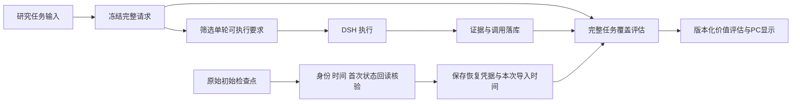

# 完整研究任务与单轮执行请求分层

日期：2026-10-01。状态：本步实施及PC真实验收通过；详见唯一执行台账W7.4e。

## 证据

agentic_research_graph.requirements_for_round会根据本轮目标、可用工具和已尝试路径筛选requirements。首次DSH控制请求也经过该筛选。正式40679e的单轮请求5项，完整报告还有market_narrative过期缺口。原W7.4b/c从该请求重算失败任务整体覆盖，范围不足。原报告的冻结覆盖是报告事实，保留；旧失败任务不能借子集声称整体充分。

## 决定

1. 使用现有RunRoleOutputRecord保存research_task_request.v1，role为research_task_request；不新增数据库schema。执行图入口在任意工具/轮次执行前冻结完整ResearchSessionRequest，包含完整要求、原预算、允许能力、研究模式、PIT、deadline、输入身份与上下文。
2. 使用完整规范化JSON的SHA256及外层payload hash，保存Run身份和原记录时间。查询校验Run/Event/Snapshot、schema、hash及先于第一次提交的时序。已有执行轨迹/Host会话/结果的任务禁止事后freeze。
3. 同Run完整请求只保存一次；不同输入拒绝，不能延长旧deadline后冒充同一任务。Factory重建优先返回保存原输入，并保留现有研究范围/权限撤销检查。Executor恢复时核对checkpoint请求；旧checkpoint按其原输入恢复但不补造执行前凭据；未经独立恢复核验时，失败覆盖保持未知。
4. 完整覆盖与预算展示分开：coverage_basis=saved_task_request表示执行前冻结完整任务，saved_checkpoint表示从原始检查点核验恢复；saved_result表示原报告。只有单轮凭据为round_request_only，覆盖null，原材料/调用/失败保留。预算当前仍展示首次提交请求的上限并注明来源，不称全任务原始上限。
5. value版本升级v4，旧评估不可删除或改写。先副本计划/追加/幂等核对，再按已审核Run范围在正式库追加纠正快照。旧saved_request值在PC不再作为完整覆盖展示。
6. 旧Pack声明和task_policy摘要不足以重建全部历史要求、变换及时间边界；不凭当前代码反推或回填历史完整请求。

7. 历史恢复是单独可审计操作：只接受最早、无parent的input/-1检查点及其首个子状态回读，校验Run/Event/Snapshot和原记录时间早于提交。保存原始检查点ID、原blob SHA、原request SHA、原记录时间；导入行created_at使用本次真实时间。缺失或不匹配拒绝写入，不冒充执行前新凭据。工具默认只读计划，apply才追加；重复执行不重复写入。

## 数据路径

## 验证门

实际筛选掉不可执行要求后仍计入完整任务缺口；缺全量记录时不推断100%。篡改、晚到、不同请求、重建截止时刻、真实SQLite checkpoint一致/不一致/旧式恢复均验证。正式存量行不变、追加评估幂等；新真实DSH任务完整凭据早于单轮提交，完整覆盖与报告相符，PC显示完整要求；有原始检查点的旧任务核验恢复，无完整凭据的旧任务保持未知。

## 后续边界

本凭据不等于完整Harness部署或所有依赖版本冻结。工具版本、来源注册表、发布评估规则及正式方法部署/回滚仍按总方案继续实现。手机验收暂停。
