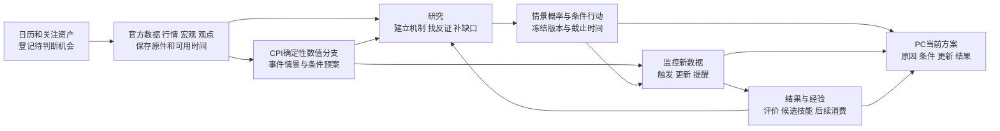

# Decision Hub：事前决策产品总控

> **2026-10-27 暂停更新：产品仍未交付。** 用户要求停止执行，只核对总控和交接。唯一normal27841已因用户中止终态1；UI/Host编译0，未恢复服务。以[暂停交接](E:/project/study/codex/dsh/decision-hub/docs/v3/reports/HANDOFF_PAUSED_2026-10-27.md)及具名停止证据为本时点摘要；以下10月23日旧服务/PID/25命令口径均为历史，不代表当前。T01—T08及全部最终要求仍未整体完成。


## 当前交接状态（2026-10-23，北京时间；执行暂停，产品未交付）

**先读[项目交接文档](E:/project/study/codex/dsh/decision-hub/docs/design/decision-product-control-2026-10-17/HANDOFF_2026-10-23.md)。** 文档逐项列出目标、实际完成/未完成、已证失败原因、代码与包位置、下一步和原件；它是本时点交接摘要，不建立新目标。当前权威字段为execution-contract.json的latest_runtime_checkpoint。

**客观交付状态：**review-5从10月18日12:50创建至今接近5天；T01—T08仍in_progress。正式产品25笔perpetual_research命令=17failed/6degraded/2cancelled/0active；BTC18、ETH02两份真实独审4h报告/PC证明保留，正式PAPER成交0。24h/72h可用终稿、完整多事件/自动研究/真实条件提醒/PAPER及反馈闭环均未完成。局部测试或服务启动不能算产品交付。

**运行状态：**Main49c完整UI/Host构建于09:19:40成功，09:31:59 API200/三个Worker fresh且错误为空。交接巡检仍见supervisor24492和四个wrapper进程、8047端口可连；这不是重新通过全部业务健康验收。生产受控源仍409路径/1920冻结输入。最新ETH72 Run13b596于10:06:50正常收为degraded/research_only，未prepare/独审/finalize；不是永久running，技能加载本身成功。

**失败与修复：**本Run真实591/592输入已复现异步子Agent回传导致旧快照/实时事件全量比较误拒绝。ISO bridge净+18行，private pre-step RED→GREEN，历史改写/取消/原deadline仍拒绝；现场缺exactstack，不能说所有历史失败仅此一因。全期限PAPER14path、PCE官方来源11path、native修复均已封包，未合Main/未上线。此前base25预检尚未包含最新bridge和共享计划文档后续变化，不能当最新组合已绿。下一构建22行selection scope已准备，实际prepare/登记未执行。

**用户要求与执行状态：**用户要求客观交接，当前不再推进合并、构建或新研究；保留已启动49c供查看。目标工具11:00实查paused，未标完成、未新建目标。旧active及下方历史PID/候选/下一步文字不得当作当前执行指令。接续位置见交接第9节，继续围绕事前事件/概率/原因/多空方案/监控/PAPER/经验，不新增性能目标或竞争门禁。

## 2026-10-21暂停复核记录（历史，以下旧进程/active状态不作当前依据）

**review-5需求未完成，尚未交付；目标工具本次实查为paused。** 已通知协作Agent不再启动后续实现、测试或发版；既有唯一完整用例保持原样，仅收取原终态，不擅自恢复目标。本节与execution-contract.json的latest_runtime_checkpoint为当前状态；下方历史检查点不代表当前进展，不能据此重复已通过研究。

**用户再次明确：产品效果优先（2026-10-21）。** “只剩约2K”指旧隔离情景catalog一次实测382078字节相对代码自定384000字节上限余1922字节，并非模型剩余token。超过会拒绝而不是静默截断，仍会阻碍研究交付。ISO已扩至640000字节，review沿用800000字节、internal与既有Host1048576字符对齐；未正式发布，不代表已解决所有上下文问题。不得以通过内部容量检查或节省token为由删情景、关键证据、反证、根因分析或必要研究轮次。后续容量设计应依据实际入口能力和材料组织，采用原件去重及可回读的分步分析；当前尚未实现自动分块/动态预算，不冒称已有。此处只记录产品优先级，不恢复暂停执行或新增门禁。

| 用户结果 | 实际完成 | 仍缺什么 |
|---|---|---|
| PC与后台启动 | 48一次构建UI1/Host1均exit0；07:14:56Z API200、三个新worker fresh/error=null，Chrome正式入口恢复owner/原账户2500及500/25设置 | 持续运行和具体用户链分别验证；辅助通道历史90s超时债不据启动瞬间关闭 |
| BTC/ETH事前研究 | BTC18、ETH02两份真实独立审核报告/建议已同Run在PC打开；48新增ETH72h真实取数、审核退回并修订后超时失败，原件保留 | 都是研究试行，不代表预测效果资格；24h/72h均无可用终稿 |
| 周期自动研究 | AUTO-48真实取数、prepare及独审已执行；09:03:51Z provider_timeout，无报告，Chrome终态已回读；未来槽保持暂停v6 | 首次可用自动报告仍未完成；独审发现单位1/成本100不一致，以及自拟600s新鲜度已触发而无快确认/重比较接线 |
| 提醒与持续条件 | 原ETH到期提醒入队/暂停已有PC证据；条件监控/授权/后继Run/PC包已合Main merge38–39并随48上线，直接临时SQL验证通过；PC最近槽失败状态正确显示 | 真实条件触发、通知送达、后继独审尚未验 |
| PAPER与经验 | BTC18成熟预测结果已有PC入口；AUTO48已有7次按原始输入hash/dispatch精确连接的真实完成模型调用包含该经验 | 真实成交0；合法入场→保护退出→资金费结算未完成；经验进入模型已证，因果使用及改善判断未证 |
| 多事件与情景操作 | 普通三方向概率/多空比较已存在；日历/议程接入，CPI nowcast/prior桥接已在47。ISO情景数学核心已实现，Task2接真实审核/发布/监控/PC中 | 数学与合成验证不等于上线；逐场景p_j、P(path\|scenario)及提前独审多空分支仍未贯通；共识/实际值与其他事件族输入仍不完整 |

当前真实受理验收累计**24次全部终态（17失败、5有限结果、2取消），运行中0；独审可读报告2，PAPER成交0**。ETH72h于08:18:43Z以provider_timeout失败，artifact=null；已实际取数、独审退回和新prepare，但未完成重审/发布。工程通过不等于金融有效，也不等于产品交付。

**本轮增量（18:40，不能计上线）：**完整9分支及全部原件保留，共享表示catalog从432256降至382078字节。case6实际Graph重放通过，但旧V2报告消费者KeyError导致commit失败；Root已修V3报告并加入逐情景p/q、含成本预案、原因原件和期限，V2原字节保持。case7实际native→Graph→SQL报告保存/发布及幂等发布通过，9情景原件均保留；该case随后在UTC元数据格式接缝失败，窄修后复用原已发布库，sidecar→CPI格式原件→监控选择B/做空→普通过期/事件有效→重启后通知/选择各1已通过。均为受控child/source，model_invoked=false，不算真实市场成功。

**尚未通过：**同case的签名报告GET返回409，已定位为元数据修正使旧临时GraphRecipe V2源码版本不一致，未绕认证或改写原选择；普通概率定义V3投影已修1P，PC报告消费者正在修。PAPER首次直接SQL暴露profile_ref对象/字符串匹配错误，最小修复后继续原2个SQL用例。待这些消费者冻结后只做一次最终完整流程验证（含正常报告GET/source及实际PC wire），随后必要组合发布。Main正式源/构建/24次真实验收统计未变；来源原件修复3文件仅暂存。

**18:58后续实际结果：**上述消费者现均冻结。ISO复制真实已发布受控库后，已通过正常签名准备→做空指南→展示→V2意图→原队列SELL20张@99.8/名义19.96USDT/费0.00998→原保护退出剩余0；资金费未知、结果不可评分，未伪造净盈利。旧账户意图/到期均409；真实新close120/anchor100使选择变为uncovered后，旧意图no_fill且无fill_id，最后原反例1P61.19s。实际manual/watch PC组件wire分别1P14.21s/1P15.01s，不算正式Chrome验收。

内部容量错配已统一到既有Host能力：catalog两端640000字节、review沿用普通800000字节、internal与Host1048576字符；完整额外材料实际catalog556670B/review655026B/654312字符通过，Python8P/TS1P、正常生成/检查通过，时限/权限/金融五未改。此前1920B余量风险不再原样带到真实研究。当前唯一最终完整case handle42558/PID21652已确认live，覆盖同9分支+正常签名报告GET/source；所有生产源保持冻结，无重启/并发副本。它未终态前不宣称完整一致流程或整产品完成。

**四问本次复核（19:07）：**卷级实测C剩5.59GiB、E剩5.05GiB、D剩1064.90GiB；未进行清理，不能将整卷变化全部归因本项目。15秒有界只读清点仅D1部分非链接文件已累计7.392GiB逻辑大小/355563文件（不完整，非NTFS实际占盘，链接与错误跳过），不再扩大扫描。构建逐版复制retention/original-view的代码及47/48实目录均已核实；无引用旧失败中间物/可重建输出可回收，引用原件、数据库、当前/回滚仍须保留，生命周期未实现。总控T01–T08仍in_progress；真实报告2、正式PAPER0不变，ISO通过不能计作交付。容量错配、重复解码/验证、慢研究与快行情时钟、源码升级使旧临时报告409都是已证接缝问题；最终同版本用例通过也不能代替历史跨版本读取修复。方向文字未改，执行优先级已偏离：局部证明/发布维护占据时间，完整事前决策仍缺。后续应围绕事件→情景概率p→条件方向概率q/原因原件→含成本多空排序及触发/失效→变化提醒→PAPER结果/下一轮消费推进，而非增加竞争门禁；本次暂停复核不启动这些工作。

### 用户四问：结论与责任（2026-10-21）

1. **磁盘存在历史副本累加。** retention保存prior.sources历史original-view，各候选继续继承；迁D只改变存放位置，没有完成保留生命周期。可重建且无引用的失败中间物/旧输出应该清理；被当前运行、回执、回滚或历史报告引用的原件不能凭目录旧直接删。本次浅层清点53候选目录/36回执，不等于53次构建。06:52Z卷级快照E仅剩792,051,712字节（0.74GiB），D约1.04TiB可用；不能把整盘变化全归因项目。当前48仍运行，不能把缺少终态文件误判为失败后重建。保留治理已影响交付，不能继续只作迁盘补救。
2. **总控需求没全部完成。** 报告主链有两次真实成功，其余关键缺口见上表。耗时主要消耗于运行/契约错误修补、逐版保全与构建、局部验证和错误状态追查，没有形成相应预测产品价值。将ISO测试通过计为上线、将状态滞后继续当待运行均不准确。
3. **重复约束确实发生冲突。** 外层45秒取消后台准备、触发截止与研究/行动期限耦合、冻结版本再按今日常量比较等已暴露。AUTO-47原全文275167字符超过内部262144而Host允许1048576，且错误被归成cancellation_projection_invalid；该本地缺陷已merge36并发布48，AUTO-48实际越过模型输入。当前ISO完整事件方案又发现重复嵌套材料与catalog/prompt长度不匹配，正在改共享原件引用表示，尚未验证全链。ETH72h实际运行约一小时后provider_timeout、无报告；具体触发层仍须按终态原件定位。约束应按责任统一，真实性与资金边界保留；重复认证、表示膨胀及阶段时钟冲突不能靠新增门禁解决。
4. **产品价值缺口是事前情景→概率→因果理由→多空条件预案→跟踪更新。** 单份三方向分布和事后报告未达到原目标；新条件监控也不能替代逐场景预审操作。按原T03/T04补齐这些连接，不能只增加篇幅或把概率未校准当作全面拒绝试行建议的理由；也不能编造70%胜率。

**方向判断：目标文字没有改变，执行优先级已偏离。** 发布/证明/局部排错占据主线，集成契约问题接连到真实运行才暴露；此前把47已正常结束构建误当失联继续追查也属于执行失误。已有直接通过证据复用；不新起性能目标、不加竞争台账。当前顺序：封当前完整情景/native/发布/监控接线与server-owned单位字段修复→一次必要组合发布（含来源原件修复）→实际事前方案/快确认与修订→合法PAPER/经验和其余期限。慢研究asof、快行情确认和可重比较允许域需明确连接；旧输入不改新，不盲删新鲜度。完整T03/T04始终在当前范围，不能降级为未来增强。

### 本轮四问复核补充（2026-10-21 16:24）

- **容量实测：**C剩4.18GiB、E剩5.43GiB、D剩1064.91GiB。本轮D1浅层candidate-*相关目录104个、直接构建回执37份；目录包含捕获/辅助目录，不等于104次构建。上文53为较窄候选口径。整盘变化未全部归因项目，C盘尚无分项归因。retention复制prior.sources的事实见infra/dsh/prepare-product-retention.py:895–919，构建继承见build-product.ps1:75–110；生命周期未完成。本轮不新增构建/清理/迁盘，不以目录数量证明重复构建次数。
- **完成度：**T01–T08仍in_progress。已证BTC/ETH各一份真实独审报告与PC回读、持久设置及部分周期准入；未证完整事件情景/条件行动、24h/72h可用报告、自动报告/实际条件提醒、真实PAPER全生命周期、下一Run实际消费经验及完整PC交接。不能把ISO源码、局部测试或两份报告算整个目标完成。
- **文档与执行：**总控顶部和execution-contract最新检查点作为当前状态，历史记录保留但不再作为当前准入要求。旧任务文字滞后本身是管理缺口；本轮更新实际终态和进度，不新建竞争计划或审查体系。
- **产品价值：**事件结果概率p与给定情景的资产方向概率q分别呈现；各情景给出证据/根因、含成本的多空行动排序、触发/失效条件、反证和更新时间。缺统计校准可明确为研究估计并给条件试行方案；不能伪造70%胜率，也不能自动全部等待。结果到期用于下一轮更新。上述不是未来美化，仍为本目标主线。

当前操作/证据：[AUTO-48执行记录](../../../artifacts/decision-product-core-20261018/D2/AUTO-48/operations.md)。ISO包及实际失败原件见execution-contract.json；金融方法02文档未改。

## 历史执行检查点（截至BTC11；已被上述当前状态替代）


**最新BTC11终态：owner正常取消，未交付。** 原progress stop一次经Chrome正常确认；Run `run_9d50eae4a9f54a28b5bf22249ab2bb17`为cancelled/`cancelled_by_owner`，finished2026-10-19T22:41:55.341677Z、artifact=null。`D2/BTC-11/observation-current.json` SHA=`e43b22e5db5b0b1eed9f0a59b04ae2d24123739bd8a5a201e9524e5f526a4b6d`于22:42:18.257445Z确认native cancelled/gen1/seq17898、20gateway completed、38input/37finish；sole66885已exit0，`pc-stopped-proof-size-block.png`留证。11accepted=8failed+2degraded+1cancelled+0running，报告0/成交0，cancelled不混failed。

第二prepare成功后，首次review16613@22:34:48.500Z→16614@22:36:59.330Z因`too_big child_events_json`失败，未获有效鉴真wrapper/金融批准。原件`native-second-prepare-review-check.json` SHA=`f3312f1c14a618be09b993f34ba0289bb16b78456dc23885064107055b0c2d43`、`native-first-review-result.json` SHA=`77426b0f33c1c6716ec032bb3f40eef05bea941460a063ed4e2656fa6600848c`。rootpre静态确认当前源同prepare已reviewed不能恢复、改draft须有效负审授权、gen2不允许review，属于必阻。完整proof 1MB门TS+Python修复正在ISO，Main32/306controlled/350frozen未动；将与已就绪提交恢复必要整合一次发版，完整实际child跨层离线门通过前不新研究。不截原件、不改金融门/研究时限，目标active未完成。

**BTC11原回执恢复（终态前历史）：** 一次POST的UI结果未确认后，Root只点一次“核对原研究回执”GET确认accepted，无重投/closure。Run `run_9d50eae4a9f54a28b5bf22249ab2bb17`，created/accepted2026-10-19T21:58:54.866960Z，key=`48baa29c-dc30-4568-a093-3bbe5eb3c002`；`D2/BTC-11/run-identity.json` SHA=`31e6aae1b0d45c56f4a571db649afd92125cc6213510804b664a9c7e0a914c38`按原回执RunID精确SQL join length1、非latest。唯一Run observer66885于22:18:17Z见running/native generation1 seq256/model_input19/finish17、13gateway completed；当时11accepted=8failed+2degraded+1running，报告0/成交0。UI未确认具体原因未知，不猜未受理；`pc-submission-unconfirmed.png`与`pc-recovered-original-receipt.png`留证，Chrome已进同原Run progress。

32启动ready原件`D1/candidate-32-startup-current.json` SHA=`d2fba02d71cc44999175f00700b272ae0130cf647e6fd202c0be4459aef3889d`确认21:57:43.938238Z API200/三新worker fresh/error=null，startup23979已exit0。Root正常入口+1reload恢复owner至本地13:54:13，同paper98a flat2500/BTCv1/500/25/4h/3在线回读；merge18/306controlled/350frozen/02c98及32receipt914db…15454保持，未计真实报告通过。

**BTC10终态原证据（历史）：** `run_4cabed994c4d487692f32c7740034132`于2026-10-19T21:08:16.987865Z failed/`dsh_host_unavailable`、artifact=null；`D2/BTC-10/observation-current.json` SHA=`d16656d6c60afc1f1bcbd174a9f00a5d697af85cc73d682ff05a0f960cf35d11`于21:08:38.455832Z确认，observer88528已exit0。native failed/generation2/seq16468同码，28input/28finish、Gateway13=12completed+1failed（cross_asset随后已恢复）。该终态时10accepted=8failed+2degraded，完整报告0/成交0；截图`D2/BTC-10/pc-terminal-failed-31.png`保留。原受理identity SHA=`4d4b59617755be251812962807ef5a88826696ebc54194a17b7b72f12f7907c5`不改写。

**最新身份更正（以本注记为准，旧原件保留）：** `D2/BTC-09/identity-correction.json` SHA=`1e8cf1968be38576b4da3435bd04dcdbd599a7757ddc91c1d03cbedb8bd522c1`只读DB核实，BTC09 `run_524667d79f784d888932a95d38c7af46`真实accepted_command_key为`8f48cd1d-222b-4e69-9a0d-e067b20cf2c5`；旧run-identity误录的`7c459b63-e8e7-4bbc-beb3-ab8e182edb63`实际属于BTC08 `run_9eece502010349f6b04974a7195df19b`，抄录来源未知。9accepted的Run、回执request_id、内部PK均各9唯一，回执request_id与内部PK不同；无重投/重复业务写证据，不需再GET/POST对齐。旧identity和17attempts不覆盖。

**31既有启动证据（历史）：** `D1/candidate-31-startup-current.json` SHA=`09417703de0dbfaab55ce3df6df14c04d8eb21327ee70f149aceb0df159910d1`确认2026-10-19T20:31:30.750993Z API200、3个新worker全fresh/error=null；launch20:22:03.9196322Z，observer84851已exit0，migration `0103_perp_funding_reconcile`。正式构建回执SHA=`50b316380ee34ecaec8b3e4fc62ee489b3b601cb9bad1ceb8691a8730520c78e`保持；31已正常停，旧ready不作32状态。

**候选30失败原记录保留：** 2026-10-19T19:14:23.9157579Z passed=false，UI1attempt/exit1、Host0、retention passed=true；`D1/candidate-30/build-execution.json` SHA=`b670abda935b90f46fbe75a45f70043bb2008e7ca2485a05aa1fd5ee92cea5ed`。Root的node_modules→D junction迁移引入`ERR_PNPM_UNSAFE_MODULES_DIR`，基础检查未覆盖自动install安全检查；恢复与安装通过不改写30失败，不绕guard、不改pnpm安全设置。

日期：2026-10-20（北京时间）。状态：**review-5实施中，尚未交付，既有目标active。BTC11因当前源完整proof大小门必阻后由Root正常stop一次，现cancelled/cancelled_by_owner、artifact=null。11accepted=8failed+2degraded+1cancelled+0running，可用V2报告/纸面成交均0。Main32/306controlled/350frozen、02方法与旧失败/identity保持；ISO修复及完整实际child跨层离线门未通过前不新研究。**

本文件是唯一总控入口。本次按“11完整业务链→01现有模块/债务→02概率与双向行动→08 Agent/学习→03运行数据→04 PC→05执行计划”组织设计。10是技术债台账，06/07/09保留审查依据与设计演变。必须同时审查用户结果和跨层连接，不能用局部接口通过替代整体可交付性。

本包承接既有需求与代码。用户于2026-10-18明确“按这个方案来，OKX永续的建议和纸面验证也按推荐方案。定个目标开始实施”，结束文档补审暂停。当前按05逐切片实施；状态权威为本目录execution-contract.json，简短过程与证据索引见EXECUTION_LOG.md。历史暂停及审查记录仍在06保留。

### 历史交付检查点（2026-10-20 北京时间，merge18，候选32未改、BTC11 owner取消）

BTC11终态前sole66885于22:18:17Z见native gen1/seq256、model_input19/finish17，13gateway completed（history1/crossasset2/crowding2/derivatives4/macro3/web1）。Chrome progress→同Run report `focus=sources`回读16accepted/fresh、6sources、12gateway view、3call failure保留、0review；管理页7个实际进程在线，Back报告再Back原progress成功，未提交。badge曾2/3后3/3，仅记状态抖动待诊断，不断言离线或已修；截图`D2/BTC-11/pc-evidence-in-progress.png`、`pc-management-processes.png`保留。

提交恢复ISO候选17P（manifest SHA缩写`60a6cdcc…573ff`，3paths/product仅API，timeout/network一次recovery GET/no retry POST）仍未合Main。现已触发BTC11必要源码阻断分支：与完整proof 1MB门TS+Python修复一起必要整合一次发版；完整实际child跨层离线门通过前不新研究，不截原件/不改金融门或研究时限。本轮仅记录，不复制/运行/扫描或扩提示优化。

**BTC11提交确认窗口债（未修）：** `D2/BTC-11/submission-receipt-recovery-diagnosis.json` SHA=`05f17de8ff1256777c5b17fe8abf86d73784a94e04c6e5459622381edf46ef80`记录服务器HTTP200/firstbyte31.8904s，客户端默认30s且本command无override；强支持admission确认窗口超时，浏览器精确错误分支未知。此窗口与后台研究deadline独立，不缩短研究；BTC11同一Run现已owner取消、一次POST+一次原回执GET，无重复。

BTC10 prepare停止真实继续执行、review协议阻塞及金融授权0/finalize0的证据保持。merge18修复SDK system-prompt plugin snapshot第二user投影；实际审核输出precheck SHA=`25459e0ec16a0dcc726a328948bbad2c31e85ff4aa1af335ba4931336e5c84c0`确认snapshot/auth/refs/time真但2issue缺id、prompt漏列，现只补canonical requiredfields，不自动补ID/不改negative/schema/方法。均为source_fixed_pending_live。最终Host诊断SHA=`f155d13826fb78f49bad1b40966b4bf6aa7db262c29d1a064392dd83bf154fed`界定gen1 completed、gen2修复accepted后HTTP502且无native事件，具体stage未知，单列且不混同已修问题。

`D2/merge-18/manifest.json` SHA=`7ffa2e34b313643d86c16d665d33d9a62d568b30039dbaa2fa421830c87480d6`，merged-source SHA=`b2ebb95960abb1664a39fdc762825cbae2ba5d940cd7294d16db6546f055df33`，apply-result SHA=`d22b9f6446bb7aa6cf955c69a09c018a599f0cbb2fad13f2d2686f782b38b077`实际applied8。TS28P/Python19P+negative revision1P/prompt3P；独审SHA=`a88cf4a4e5f6df83357aaec9f33e60ca2b01cece5a7c877079ced181523d1117`、增量review SHA=`ca246af4e33ff1509125051290dc736d38709b25fff4c66fa1ecdb9223ed5d61`无P0/P1。旧prompt Main同baseline1F/2E501及此前旧suite17F债保留，非整套绿；P2 wrapped-null-source既有行为差异记债不扩修。

31原源capture `D1/candidate-32-current31-selection/capture-handoff.json` SHA=`2684e04a3cb4d654522c83981497858142d4aa3e5c855eb12da319a71452d810`保348unchanged/10immutable selections/1771files/70396217payload B、raw DB writes0。32 build-start SHA=`03d18bd128c52685adf2db31b467c3734efe0c133e4e955f53fc8435681b53e7`沿prior31receipt/current31capture，固定6GiB门实测11213262848B，未做新空间处理；构建/startup已通过，23979完成，BTC11由Root唯一66885观察，不另开观察/POST/测试/改源。

失败06、先前三scope与qualified dedup原件保留。26scope handoff SHA=`fc57a3241eaccca2f18fc4fe1664c1c3fffac52d4920742eac76a2ceee9c1910`，34089files/6185067714逻辑B、D完整副本永久保留、E junction；先前E差额原因仍未知，空间增量不全归因迁移。`D1/storage-preflight-after-dependency-restore.json`只签31启动前容量与映射；startup observer84851已完成，不另开observer/POST/构建或改source。真实review、sameRun报告+建议、paper及ETH仍未完成。

26scope的fresh双份hash/OwnerGroup/AllowSubset/SourceProtected门均过：目标权限相同或更严格，不宣称raw ACL完全相同。DATSO/DATS Robocopy ERROR5原件保留；修正为普通DAT+精确.NET Access-only DACL，D3357次权限收敛，无SourceACL/owner/SACL/privilege改，非guard放宽，仅删核验过的E重复backup。24/25 stage2未执行；未动live core-live数据库/source/02/锁。

**共享依赖执行约束：** Root实核ISO `node_modules` junction→Main；迁移前共享pnpm state写ISO4项目而Main实际5，Main自动install已恢复正确状态。Main冻结/构建/真实研究期间禁止从该ISO执行会改共享安装状态的`pnpm install/exec`；测试用既有固定CLI或隔离依赖。依赖隔离列后续债，不改ISO链接或伪写pnpm state。

### BTC09终态与merge-17合入前验收记录（历史，部署状态以上文为准）

BTC09安全证据`D2/BTC-09/actual-prepare-premature-stop-proof.json`（SHAc7ebbcbc11369ef18280e412bb3afd98e9673b0f6b1e2e17942834a10fbb7523）确认：17897 prepare于17:16:42.192Z发起，17898于17:16:44.681Z返回完整typed preparation成功；25ms后17900记录aborted.user。Root核源确认`hasAcceptedSynthesis`未区分prepare/final，触发`bridge.stopAfterAcceptedSynthesis.cancel`。这是Host内部主动终止，不能解读为用户UI取消；reviewer0/finalize0，尚无评审报告。前3次conditioning、quantity、candidate引用问题已被模型继续修复，第3次错误不是最终阻塞；accepted-only资格保持。

Root ISO正修prepare/final停止条件；另一个真实fallback DTO错误已有GREEN6P候选，尚未合并。candidate29原件capture已完成（`D1/candidate-29-current28-selection/capture-handoff.json`），不计新构建或研究成功；真实review、sameRun报告+建议、paper及ETH仍未完成。

BTC/ETH历史补采与PC覆盖已取得独立证据：`D2/BTC-09/history-backfill-result.json`首任务partial（ETH110/BTC0 connecttimeout），`history-btc-recovery-result.json`恢复BTC110/completed；`history-backfill-read-verification.json`核两者实际source/hash及各110连续已收盘UTC日（2026-07-01至10-18，gateio-public现货日线）。PC截图`pc-history-eth-original-coverage-28.png`、`pc-history-btc-coverage-28.png`保留。资料实际获取时点不回填，不替换BTC09失败工具结果，也不冒充accepted研究证据。ISO队列消费+daily370已GREEN但未合并、未上线；不能据此关闭真实报告/建议/纸面/ETH主链。

**尚未达到可交付状态。** BTC08 `run_9eece502010349f6b04974a7195df19b`于2026-10-19T15:46:46.571493Z产品失败；精准诊断`D2/BTC-08/terminal-failure-diagnosis.json`确认两次prepare均缺少own-event conditioningRef，independent review0、finalize0，尚未进入独立审核，不能称为审核失败。native completed（seq10246）、35model_input/35model_finish、Gateway6（4completed/2failed）、callbacks0不计作产品交付，终态截图`D2/BTC-08/pc-terminal-27.png`保留。

merge-16原件见`D2/merge-16/manifest.json`（SHA704ec464d7c557be832057224f93775820aae2e6c7672357e098f125437eb415）及`apply-result.json`；两修复均为source_fixed_pending_live。构建前仅对本目标既有证据目录做NTFS压缩，以满足既有5GiB启动门；未删除或移动文件，不计性能任务或产品验收。剩余真实独立review、sameRun报告+建议、paper及同账户ETH均未完成。

28构建回执`D1/candidate-28/product-validated-builds.json` SHA=`948d328fb75e7f41b0d20245c930d6b92424229610b0c75a74e6523373b19eda`。BTC08两份完整actual draft离线重放`D2/BTC-08/full-prepare-replay.json`（SHA3fb84501922c9aefb6e435d4bd6851ca2e245aa0f6ba3f4a721e9dddc981ecf8）仍为既有离线修复证据，不能替代BTC09真实失败或独立review/发布；当前保留终态并等待最终诊断，不另发研究。

同Run完整失败页截图`D2/BTC-08/pc-failure-reason-27.png`显示通用中文兜底；`structured_output_invalid`中文错误映射缺失记为P2未修UX，不计核心验收成功。

| 核心用户结果 | 已取得的证据 | 尚未通过 |
|---|---|---|
| PC首用、账户与设置 | candidate32 ready/API200/3新worker fresh；Chrome同owner/flat2500/BTCv1/500/25/4h已回读；BTC11一次原回执GET恢复accepted、已回同原Run progress | ETH完整设置与研究；UI首次未确认具体原因未知 |
| BTC/ETH事前概率与多空行动 | 11accepted=8failed+2degraded+1cancelled+0running；BTC11 owner正常取消、artifact=null，旧失败保留 | 真实金融独立审核→同Run完整报告/建议→Chrome；可用V2完整报告0，材料失败报告2 |
| BTC/ETH历史资料与PC覆盖 | 两真实补采job后各110连续已收盘UTC日，source/hash/read adapter及两资产PC覆盖验收留证；队列消费+daily370定向11P通过，merge-17已合入candidate31 | 新Run实际消费验证待；现货资料不替代永续研究、完整报告或成交验收 |
| 失败恢复与再次研究 | BTC11原回执恢复及原progress一次stop正常确认；第二prepare成功后review完整child proof too_big，未有效鉴真wrapper | 当前源必阻，完整proof大小门TS+Python修复及实际child跨层离线门待；与提交恢复必要整合一次，门过前不新研究；报告/纸面成交0 |
| 模拟交易与持续提醒 | BTC/ETH4h工程链已合；closed资金费续核、账户复用修复已合19，实际交易待验 | 实际入场/退出/资金费覆盖与同账户复用、提醒 |
| 结果与经验 | 正常tick→4h经验工程门已验；原生financial skill调用不证明V2可复用技能消费 | 首真实4h成熟、V2可复用技能选择/消费及下一模型因果引用 |
| 历史原报告跨升级 | 16正式同旧库：签名200、匿名403、跨owner拒绝，source/artifact完全一致，0业务写 | 后续版本持续保持；不重复同证据测评 |


BTC11 owner取消终态与原件已保留；Main32/350未动，完整proof大小门ISO修复将与提交恢复必要整合一次。完整实际child跨层离线门通过前不新研究，完整报告/建议与纸面成交0，目标active未完成。下一步及未覆盖范围见 [执行记录](EXECUTION_LOG.md) 与 [当前执行合同](execution-contract.json)。

## 0. 本次设计基线与阅读承诺

```yaml
design_baseline: decision-product-control-2026-10-17.review-5
accepted_scope_baseline: decision-product-control-2026-10-17.review-5
status: implementation_in_progress
implementation_authorized: true
owner_approval_reference: 2026-10-18用户明确批准按方案实施及OKX永续建议和纸面验证
latest_instruction: 先跑通BTC/ETH核心流程并自测，每一步记录，交付可用PC产品
```

以上字段已按用户最新批准更新。2026-10-18目标创建返回active；工具卡片不替代本目录任务记录。旧控制工具向本包迁移前，边界由当前章程和人工核对执行，不宣称自动拦截已生效。review-5新增[12工程文档地图与交付条件](12_ENGINEERING_READINESS_AND_DELIVERY.md)的设计仍需逐项实现验证；更新批准不等于产品已通过。

### 0.1 用户需求、现状、推荐设计必须分开

| 用户已经反复要求的结果 | 现状 | 本次设计对应位置 |
|---|---|---|
| 事前发现事件/市场变化并主动给方案 | 有日历、触发、事件预案和研究入口，当前完整链阻断 | 01实际双入口调用链；03持久执行；04首页与提醒 |
| 根因链、多轮检索、反证和明确倾向 | 有causal schema/DSH工具；一次复核、固定问题集合等约束不匹配 | 08角色DAG、机制图、追问修订和复核协议；07问题原件 |
| 不仅报告，要各情景概率与操作机会 | CPI事件模型已有，条件资产反应/动作连接未完成 | 02逐模型公式、代码/数据落点、合成算例；04输出合同 |
| 加密货币既可做多也可做空，给明确首选操作 | 旧产品主要为现货、多仓；研究方向含short不等于可发布/可模拟空单 | 02双向合约/概率/动作，03全链版本迁移，04仓位与风险设置；本次不再把做空建议排除 |
| 长期运行保持记忆，可控自进化 | 有案例/技能/结果服务，实际正常学习链未证明 | 08跨事件上下文与经验生命周期、候选编译和下一Run消费 |
| 不因60秒/省token删掉必要研究 | 已有异步任务，但部分执行/内容资格混合 | 03生命周期，08按问题组织上下文；05修改预算分支 |
| BTC/ETH，后续黄金/纳指/恒科，包含宏观 | 资产价格接入不等于完整分析；跨资产链未交付 | 01能力现状；02共享模型与资产特有模型；05 T09 |
| Kronos等开源研究成果有明确位置 | K1有限路径实验已有失败/未准入结论，K2未启动 | 02开源组件接线、输入输出及融合规则；05 T10 |
| 优先未来4小时到3天、PC先完成 | 10月15日方案记录该要求；旧core合同仍30m/24h/72h | 02新增4h目标与旧目标隔离；04期限展示；05 schema迁移 |
| 先把完整产品和技术方案确认清楚 | 上轮仅完成局部设计核查，不能代表整包批准 | 本节与第10节评审清单；review-5已批准，按05逐切片执行 |

### 0.2 每个模块必须交代的内容

模块设计必须同时给出：①用户结果；②现有文件/函数和调用者；③目标输入/输出schema及版本；④具体处理步骤/公式/任务DAG；⑤表与原件引用；⑥唯一写者、重试/幂等/失败语义；⑦上游下游与允许依赖；⑧变更范围/迁移/回滚；⑨直接验证方法。只有概念或文件名的模块不能进入开发。

01列现状和模块边界，02/03/08给算法与状态实现，04给用户可见结果，05将变更绑定到同一组模块。新增一份反思文档不能自动代替这些设计。

## 1. 产品承诺与交付范围

用户关注资产和关键事件后，系统在事前不断搜集和核验信息，建立可检查的主反因果链，给出情景概率与有条件的操作建议。新信息改变判断时自动修订、提示并保留旧判断。到期后评估预测与行动，再把可验证经验交给下一次研究实际使用。

最可能的情景与最值得采取的动作分别计算：一个高概率但潜在损失巨大的动作可能不值得采取；不能只按概率最大排序，也不能因没有统计胜率资格就停止给出有依据的条件方案。

完整产品方向包含BTC/ETH、黄金、纳指、恒科的宏观研究与决策支持。**当前交付优先级是BTC/ETH普通市场与多事件驱动的双向决策闭环**：PC工作台、跟踪、纸面结果和经验消费同步交付。CPI只是代表案例；FOMC、PCE、就业等会影响加密市场的核心事件属于T03–T08当前主线，撤回review-3将它们整体推至T09的分期。普通市场建议不等待某次CPI发布，也不等待全部专用统计模型训练完成。OKX USDT线性永续建议与纸面验证已获用户确认；已有现货与历史保留。黄金/指数新资产和后续方法增强在T09，Kronos在T10；移动端暂缓。来源、资料、研究、历史和管理入口不隐藏。

### 1.1 多事件覆盖怎样形成明确范围

事件覆盖、可执行情景方案和统计资格分开记录。02/03/11定义EventFamilyPackV1及冻结绑定，复用同一来源→事件→研究→行动→监控→结果链，禁止为每个事件复制一套服务。

| 当前加密主线输入 | 首版必须形成的能力 | 不可虚称的部分 |
|---|---|---|
| CPI/PCE通胀、Employment就业、FOMC政策 | 官方日历与实际值/原文、事件族自己的指标与场景、事前概率/多空分支、实现后更新及结果；缺专用统计模型采用具证且明确未校准的结构化判断 | FOMC不能套CPI九格，前值/nowcast不能冒充市场共识；有日历不等于有方案 |
| PPI/GDP/零售/JOLTS/初请等扩展宏观日程 | 纳入关注窗口与来源覆盖，按02的事件族规则生成可支持的情景研究和缺口；事件影响当前4h/24h/72h方案时触发复查 | 无可核源/解析器不宣称已实现actual自动更新；不得静默漏掉已登记重要事件 |
| 加密市场自身 | 合约资金费/到期与交易规则、交易所运营公告、可核流动性/仓位变化；结合BTC/ETH标的和当前建议求值 | OI不是净资金流；无法获知的暗盘不能伪造；新闻响应与事前发生概率分别评价 |
| 多事件同时或连续发生 | 冻结同一时点的事件议程和依赖；FOMC声明、预期、发布会逐阶段更新；同一72h窗口避免独立概率相乘与重复归因 | 不做无依据的全组合概率乘法；事件相关簇不得计为独立样本 |

官方[BLS日历](https://www.bls.gov/schedule/2026/home.htm)、[BEA日历](https://www.bea.gov/news/schedule)和[FOMC安排](https://www.federalreserve.gov/monetarypolicy/fomccalendars.htm)已用于核对范围；时间来自实际源版本及其时区，不硬编码“每月某日”或全部事件同一时刻。详细能力与源准入以02/03矩阵为准，尚未完成采集验证的项目继续显示未验证。

新产品主期限为4h/24h/72h；旧30m研究、事件窗口和7d基线继续按原目标读取和评分。4h需要新增合同、数据窗口、模型/概率绑定、行动和UI支持，不能把30m换一个显示名。来源依据：[10月15日Kronos融合方案](../market-risk-v1/KRONOS_INTEGRATION_RESEARCH_PLAN_2026-10-15.md)。

本次明确撤回review-2将做空建议排除的限制。目标支持空仓、已有多仓、已有空仓、仓位未知下的开多/开空、增减仓、平仓、持有或条件等待；必须把方向预测、当前仓位与动作分开。震荡概率不是“持仓中性”，反手要分为先平旧仓再评新仓。合约乘数、报价、资金费、保证金和强平影响纳入建议/纸面合同，不能把现货收益简单取反当合约空单。自动下单不在本轮授权和交付范围，页面不能伪造实际成交。未知账户使用单位名义与仓位分支，不编造余额或默认给用户加杠杆。

**明确推荐规则：**先给各事件场景和上涨/震荡/下跌分布及口径，再在同一用户约束、成本和路径假设下比较合法动作，给首选与次选、选择原因和改变条件。没有已校准胜率不自动取消有依据的建议；无法估计的概率应显示具体未知及影响，不能补成50%或为了动作而伪造70%。用户所述急跌/急涨用于检验漏报及漏机会，但不只挑这些事后案例授分。

## 2. 怎么读本包

| 文件 | 回答什么 | 权威边界 |
|---|---|---|
| 本文件 | 产品目标、分期、当前状态、决策与推进规则 | 当前评审与后续实施的总控入口 |
| [01 能力与代码对应](01_CAPABILITY_TRACEABILITY.md) | 旧需求、真实实现、证据、缺口、任务归属 | 当前盘点快照；不替代原始运行证据 |
| [02 决策方法与效果评价](02_DECISION_METHOD_AND_EVALUATION.md) | 因果搜证、概率、行动、技能学习、资产差异、效果 | 业务/算法语义；新增接口均须注明拟建 |
| [03 运行与数据合同](03_RUNTIME_AND_DATA_CONTRACTS.md) | 每个进程和模块的责任、时序、状态、时间、恢复 | 跨层技术设计；生产schema和真实代码仍是现状证据 |
| [04 PC用户流程与输出](04_PC_PRODUCT_CONTRACT.md) | 用户看到什么、每个操作如何落地、如何验收 | 用户结果与前后端对应 |
| [05 分阶段实施计划](05_IMPLEMENTATION_PLAN.md) | 文件、接口、依赖、测试、完成门和操作记录 | 待恢复实施的工作包；不自动授权开工 |
| [06 评审与决策记录](06_REVIEW_AND_DECISIONS.md) | 哪些问题被指出、怎样处理、还剩什么不确定性 | 本轮评审原件摘要，不冒充代码验证 |
| [07 代码层架构诊断与修订](07_ARCHITECTURE_REPAIR_BLUEPRINT.md) | 具体代码问题、责任拆分、接口骨架、SDK取舍、旧项目教训 | 补正T02/T04/T06实现方法；新接口仍为拟建 |
| [08 Agent、根因链、上下文与学习](08_AGENT_RESEARCH_AND_LEARNING_SPEC.md) | 子agent如何分工/汇聚，因果追问怎样执行，长期上下文如何隔离，技能怎样生成与消费 | 研究/学习执行设计；不是现状已运行证明 |
| [09 价值审查依据与处置](09_PRODUCT_VALUE_AND_OPTIMIZATION_REVIEW.md) | 旧方案的稀疏样本、时效、编排和用户设置风险如何被处理 | 第0节保留review-3处置并链接review-4修订；旧建议仅保留为历史依据 |
| [10 技术债台账](10_TECHNICAL_DEBT_REGISTER.md) | 具名技术债的代码证据、用户影响、责任任务、修复/迁移/直接验证 | 区分已设计、候选代码与真正关闭；不能只记一句已解决 |
| [11 完整业务与跨层连接](11_END_TO_END_DESIGN_CONTRACT.md) | 用户全旅程、共用/隔离边界、三个事件流程、模块/对象/页面如何关联 | 端到端业务设计；02/03/04/08必须与此一致 |
| [12 软件工程文档地图与交付条件](12_ENGINEERING_READINESS_AND_DELIVERY.md) | 全生命周期缺口、开发Agent入口、分层验收、外部借鉴及交付包 | 导航与就绪条件；不复制业务字段或另设状态账本 |

用户评审顺序按本文件开头；开发接续在得到整包确认后，只加载00、当前任务对应的01条目、02/03/08相关合同及05任务，历史原件按引用读取。禁止每轮把全部台账注入模型；摘要也不能无依据覆盖历史需求。后续变更先改对应合同和映射，不另建竞争的总目标。

## 3. 用一条业务实例解释各层



这是业务责任图；真实进程、代码入口、数据库和调用顺序见01/03。CPI确定性预案可以独立运行，需要解释或修订时才通过既有准入进入研究；普通市场变化也可独立触发研究。每个箭头传递可定位对象引用，自由文本不自动成为已验证事实。

以CPI为例，真实系统必须能回答：

1. 什么时间已经知道会议/数据发布安排？是否在公布前登记研究机会？
2. 截止当时能取得哪些官方数据、共识或其他估计、美元/利率/仓位证据？未知项是什么？
3. 各情景如何定义、概率为何改变？“高于前值”和“超出市场共识”有无被混淆？
4. 各情景通过何种机制影响BTC和ETH？有什么反例、已定价或相反传导？
5. 当前仓位下建议什么操作？触发、失效、期限和风险是什么？
6. 实际值发布后，哪个旧假设被支持/推翻？哪条新方案何时送达、何时在页面可见？
7. 到期后原概率、方向判断、提醒提前量和纸面行动各自表现如何？下一次用了什么经验？

若现有数据只支持部分回答，仍给出可支持的条件方案和明确缺口；不得补造共识、历史价格或高胜率。

## 4. 当前事实与完成定义

2026-10-17暂停时：release32真实BTC主链失败；release33候选修复及定向验证已有记录，但正式构建、启动和新BTC/ETH验证未执行。M1/M2/M4等有局部代码/受控验证。完整学习消费及其他资产整链仍未证明。细项见01与[复盘稿](../../retrospectives/SOFTWARE_ENGINEERING_REVIEW_2026-10-17.md)。

状态不能用一个“完成百分比”代替，统一分开记录：

| 状态轴 | 允许的状态 | 升级证据 |
|---|---|---|
| 设计 | 待决 / 已定义 / 评审发现待修 / 技术核查完成 / 用户确认基线 | 技术核查与用户整包确认分别记录，不可相互替代 |
| 实现 | 未实现 / 已有部分 / 候选实现 / 已集成 | 代码位置、版本、依赖接线 |
| 功能验证 | 未验证 / 局部 / 真实组件集成 / 真实外部链路 / PC完整任务 | 同一版本、输入身份、结果引用与验收回执 |
| 运行 | 未启动 / 受限 / 正常 / 故障 / 暂停 | 实际进程、健康、任务和恢复证据 |
| 价值 | 未评价 / 样本不足 / 描述性结果 / 通过预登记资格 / 不通过 | 事前协议、完整分母、时间隔离、基线及费用 |

文档评审通过不升级其余四轴。旧版真实成功保留；不能外推为新版通过。

## 5. 版本与依赖：保留产品闭环，拆小工程交付

| 阶段 | 可交付结果 | 不得替代的后续要求 |
|---|---|---|
| D0 本轮 | 总控、模块实现/分层、Agent/因果/学习设计、数学模型与开源接线、PC/开发合同，交用户评审 | 用户确认前不能进入D1；静态检查不算运行修复或产品交付 |
| D1 运行恢复切片 | 真实输入→研究原件→复核/发布及PC回读，首因明确、可恢复；复用旧合格合同 | 只算工程切片；尚未证明新增多空/三期限/学习能力 |
| D2 双向决策可用切片 | 普通市场主链及核心多事件包：合约/风险→情景/涨震跌→多空首选→监控/修订/提醒→纸面结果；BTC/ETH及4h/24h/72h | UI随合同交付，不等下一次CPI、全部统计模型或自动晋升；日历覆盖不能替代可执行方案 |
| D3 经验与完整交付 | 实际结果→候选→后续真实消费；各市场/目标/期限资格分开；PC手册、恢复、操作记录及原协议结果 | 先证明可执行学习切片，再完成扩展；不足样本如实结项，不能空等数周或冒充金融优势 |
| D4 独立增强 | 黄金/纳指/恒科各自的完整链、Kronos受控候选、更多事件模型 | 数据接入或模型能运行均不算资产/策略准入 |

D1→D2→D3在同一总控中推进，D1失败不能使后续需求消失；D4逐scope交付，未完成不能消除旧要求。开发只保留一个在制纵向任务，旁路工作限于解除该任务的独立阻断。保留历史28日/A180等协议的原始窗口和分母；新协议单独登记，不倒签、不重置旧失败。

## 6. 关键设计决定及替代方案

以下组合已随review-4获用户接受；review-5补审的是遗漏的模型、工程与交付细节。用户无需再次确认文件名等普通实现选择；新增规则及其影响见06第13节和12，当前暂停保持。

| 议题 | 选择及原因 | 其他方案和不选原因 |
|---|---|---|
| 架构改造 | 保留Python/FastAPI/SQLAlchemy、React/TS和Graph；第一阶段收缩DSH Web适配器，先解开Kernel逆向依赖和具体类接线，详见07 | 不把“保留DSH”视为已经证明最优；替换SDK须沿可验证port，不能牵动业务重写 |
| 编排 | DSH负责模型和工具循环；Graph负责研究业务流程；Hub负责持久事实、行动、通知、结算 | 不再叠加新的全局Agent循环/任务平台 |
| 主动判断 | 已登记事件时钟、定义清楚的潜在事件与市场条件触发；事件发生概率和条件结果分别建模 | 不把写prompt作为正常使用必经步骤；不对无法定义的“某事发生”凭空造概率 |
| 深研究与监控 | 提前预案、已发布条件的确定性监控、按影响选择角色的深研究分别执行；共享具名对象与版本 | 不让每分钟监控重跑全角色；不把60秒当研究上限；不让推理中的候选绕过发布门 |
| 认证成本 | 不变证据的完整验证结果按版本复用，实时核身份/权限/取消/新鲜度 | 不删身份与证据约束；也不在每个GET遍历整段历史 |
| 学习 | 结果驱动候选技能、独立评价、按版本试用/晋升/回滚，保留消费回执 | 不允许自我总结直接改写生产策略或全局技能目录 |
| 开源复用 | 优先现有ports与组件；新增库只置于适配器或离线验证层 | 不因GitHub项目热门直接复制新Agent平台进入核心；许可证、依赖、PIT和行为需逐项验证 |
| 模型与上下文 | 保留已要求的gpt-6.1-sol；不以省token删反证、出处或关键输入 | 上下文按任务检索和证据引用组织，不能用无意义重复历史占满窗口 |
| 可用性与效果 | 同时交付具体建议及其证据资格，分别验证运行、概率和行动效用 | 不把70%写成未经验证的承诺；也不以不能承诺为由取消具体操作方案 |

## 7. 工程推进控制

每次实施只激活一个可交付子任务。T01–T10是归属工作包，不是无限扩围许可。开工冻结：用户结果、对应需求、允许修改路径、真实入口、接口语义、依赖证据、修复假设、直接验证、未覆盖边界与停止条件。新问题只有直接阻断当前结果才更新章程纳入；其他记回既有债项和T任务，不即时开工。T02的所有分层整理不能全部变为第一个可见结果的前置。

任务记录模板（追加在06或该任务原件索引，不复制所有日志）：

```text
任务/版本；开始与结束时间；对应需求；修改文件
要验证的假设；执行命令与边界；结果及证据链接
用户现在多完成了什么；仍未完成什么；下一步及阻断
```

停止与升级规则：

- 同一阻断连续两次有明确修复假设的验证仍失败，停止同方向补丁/换release，做一次限定范围的责任与时序复核，重新确定假设、方法和结束条件；无需等到昂贵正式发布才触发。计数不因改任务名或换agent清零。命令笔误另记操作错误，不能伪装为有效实验；连续无新证据也不得继续重复。工程问题由负责人处理，只有产品取舍/费用/权限或不可获得的外部条件才交用户决定。
- 构建成功、健康检查成功、局部测试成功只能升级对应状态，不能签发产品完成。
- 验证只覆盖本任务直接风险和必要回归；不因命令写法错误无意启动全仓套件。新增测试必须解释防止哪种用户失败。
- 相同代码/配置/依赖/有效输入下复用已有检查与构建证据；复跑必须写出变化或原证据为什么不可信。外部瞬态问题使用具名有限重试，不能用重复正式研究诊断已知本地错误。通过完成门即记录并关闭子任务，再激活下一项。
- 子agent仅负责当前任务可并行的限定子范围，不再分叉产品路线；交付结论、差异与原件引用。接续加载当前任务和必要合同，历史按引用读，排除产物/归档全树扫描。追加审查必须针对具名遗漏，不能循环询问“还有没有问题”。
- 工程成本与产品研究预算分账。工程侧减少重复上下文、重复构建/测试、无关重构和无结论审查；不因此截掉研究必要证据或反证。真实token统计可得则记值及来源，不可得标unknown，用命令次数/耗时/读取范围描述过程，不能虚构节约比例或擅定金融研究硬预算。
- 真实外部模型失败保留原因和已有成果；研究有进展则继续按已登记任务政策，终态失败后不再用固定长宽限空等必然不会出现的成果。
- 重新发布前必须知道新版本消除了什么首因，以及下一处本地接线已在真实组件集成中覆盖。
- 本轮首先需要用户确认完整设计基线。确认后，文件名、模块拆分、测试方法和一般技术取舍由工程负责人处理；改变产品目标/首版范围、删除能力、付费来源、自动交易/杠杆、破坏性迁移或改变概率目标/金融语义则提交具名变更说明，不能边写边悄悄更改。

## 8. 文档权威与历史保存

本包取代旧文档的“当前推进顺序与当前状态”入口；旧业务要求、原始失败、已登记金融协议、代码schema和ADR仍有效，除非本包明确记录变更。01保存需求继承映射。旧文档中的completed、唯一下一步等仅按其版本和范围解读。

`docs/design/market-risk-v1/CURRENT_FOCUS.md`只保留短状态和本包链接。旧tasks/current-core-execution作为历史任务事实保留暂停，不与新设计相互推断完成。本轮不新增第二套运行状态数据库或执行平台。

## 9. 外部依据及适用边界

本方案核查了官方技术资料：LangGraph区分单次图执行的checkpoint和跨执行长期记忆；项目继续复用现有持久化，新增第二个记忆库须有必要性。[LangGraph官方说明](https://docs.langchain.com/oss/python/langgraph/persistence)

行动变更和待发送消息应原子写入同一数据库事务；投递重放仍需要幂等消费。项目已有outbox应扩展复用。[Transactional Outbox模式作者说明](https://microservices.io/patterns/data/transactional-outbox.html)

这是设计依据，不是已实现证明。金融方法、数据时点和学习方法的外部来源与限制见02。此次没有复制第三方代码或安装依赖。

## 10. 提交用户整包评审的内容

以下保留已确认的组合和本轮补审范围，不逐文件要求再次批准：

| 设计选择 | 推荐方案及产品影响 | 状态 |
|---|---|---|
| 产品范围与分期 | BTC/ETH双向建议/纸面+普通市场及核心多事件；OKX USDT线性永续；4h/24h/72h；旧能力保留，黄金/指数后续 | 已确认；最新要求暂停补审 |
| 研究机制 | 真实独立子session执行专业任务和反证，多轮修订复核 | review-4已确认；review-5补角色冲突、缓存、权限和停止语义 |
| 概率与行动 | 三类概率、条件首选与备选，不将未校准等同禁止建议 | review-4已确认；review-5补成交条件、组合风险、评分和paper规则 |
| 自进化与长期记忆 | 自动生成/试用候选，版本管理与实际消费；新增程序走工程变更 | review-4已确认；review-5补撤权、父版资格及在途处理 |
| 技术与开源 | 保留业务数据/Graph，收缩DSH适配；Kronos为独立候选 | review-4已确认；review-5补可测运行门、身份/恢复及文档适用性 |

review-4已获整包确认，review-5按后续暂停指令补审；待用户结束本次文档暂停再沿05实施，不重新审批已定的市场与核心目的。无法由静态文档证明的实测性能、数据实际覆盖、未来概率校准和相对增益，均作为实施中的具名验证事项；不把它们伪装成现在已经确定的事实。

## 11. 对抗审查的裁决与证据边界

本轮按业务/数学、PC与跨层、架构/技术债三个方向独立审查，再互查共同类型、时钟、资产/账户与方法身份。发现的问题已回写相关合同，详见[06裁决记录](06_REVIEW_AND_DECISIONS.md)与[09处置表](09_PRODUCT_VALUE_AND_OPTIMIZATION_REVIEW.md)。不能再将某一次局部审查的“未发现更多”当作整体没有问题。

review-3已确定三类概率、双向操作/算账、发布时钟、风险设置、动态角色与学习；review-4进一步明确多事件族与阶段/重叠处理、开发工具旧合同迁移、任务边界和提前止损。对应代码缺口进入[10技术债](10_TECHNICAL_DEBT_REGISTER.md)，设计处理不标成修复关闭。

结论分三种证据：源码与旧原件可证明当前缺口；公式、合成算例和交叉合同可检验设计自洽；真实运行、时效、数据覆盖及金融增益必须由05相应任务证实。本次不能证明所有问题均被预见，更不能证明胜率达到70%。操作建议的明确程度与证据资格分别表达，资格不足不自动变成“观望”。review-4已确认，review-5文档补审暂停中，未恢复实施。

## 12. 实施就绪、未证明事项和谁来决策

| 项目 | 当前结论 | 处理责任与结束证据 |
|---|---|---|
| 用户目的和优先级 | 已清楚：加密BTC/ETH、PC、事前多空、持续更新、结果学习；CPI是例子 | 不再反复要求用户重述，也不缩为CPI报告 |
| 架构/核心接口与下一步 | 足以定义有边界的D1修复任务；D2多事件与双向合同已有具体设计 | 工程负责人按05实施，不能从“可开工”推断已可交付 |
| 真实native/Provider恢复 | R33候选仍未实跑签收 | T01/T02必须同候选真实成功→审核→报告/Action→PC；只有失败原因清楚不算D1通过 |
| 数据实际覆盖 | 官方来源明确；本机采集、首次发布历史、共识权利/费用、事件阶段解析尚需验证 | T03逐核心族冻结能力回执；缺项具名处理。需要付费才提交具体源/费用/替代给用户 |
| 算法和操作实际可用 | 公式/目标/候选与成本边界已定义；数值实现、输入有效性、真实监控待证 | T03–T08直接验证；结构化判断可先交付，不能伪称已校准 |
| 未来增益 | 无法现在确定 | T06预登记长期观察按期结项；不让工程会话无限等待，也不因此抹去未证明能力 |
| 实施控制 | 规则已写；旧脚本硬编码spot/旧目录，尚不具备本包自动检查 | 05在首子任务内最小改造现有脚本；它只检查边界与证据结构，用户结果由主线验收证明 |
| 当前需要用户决定 | 补审结束后解除此次暂停；OKX USDT线性永续已接受，不再待选择 | 本轮新增规则明确列在06/12，普通模拟参数/文件/验证由工程负责人提出并记录；真实自动交易不在本包 |
| 无需现在卡住用户的事项 | 文件/模块拆分、参数候选版本、队列/事务边界、有限验证、普通source能力处理 | 工程负责人按合同决定并记录；真实账户可不填，先单位名义与明确模拟账户，不假设余额 |

后续新增事件、资产、模型或runtime按07变更影响矩阵局部扩展。只能承诺变更边界和兼容/回滚策略；无法保证未来零修改。新增事件会有新的source/parser/情景/标签工作，新增资产会有市场/成本/机制工作，共同Hub/Graph/PC主链不应因此复制重建。


### 当前必要窄修：有效期分离

实际PC证实BTC18发布后仅3m5s有效、ETH02约12m12s。Entry研究准备时已开始消耗候选有效期，自动槽还被下一整点截断。期限分离最终包manifest-v2已通过直接验证与独立复核，merge34合入Main，candidate47正常构建成功；此前replay夹具失败及修复记录保留，不再表示当前未合入。旧报告/expiry与金融方法原义保持；修复后的真实自动Run和发布后可操作窗口仍待验收。两项既有PC通过证据见AUTO-46/pc-two-feature-acceptance-46b.json。
