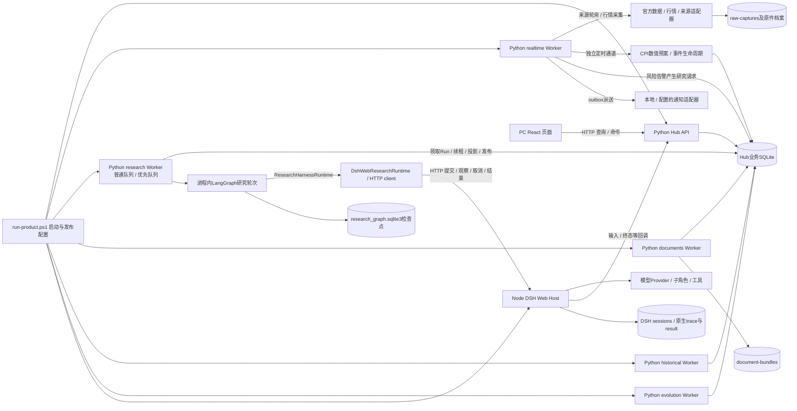
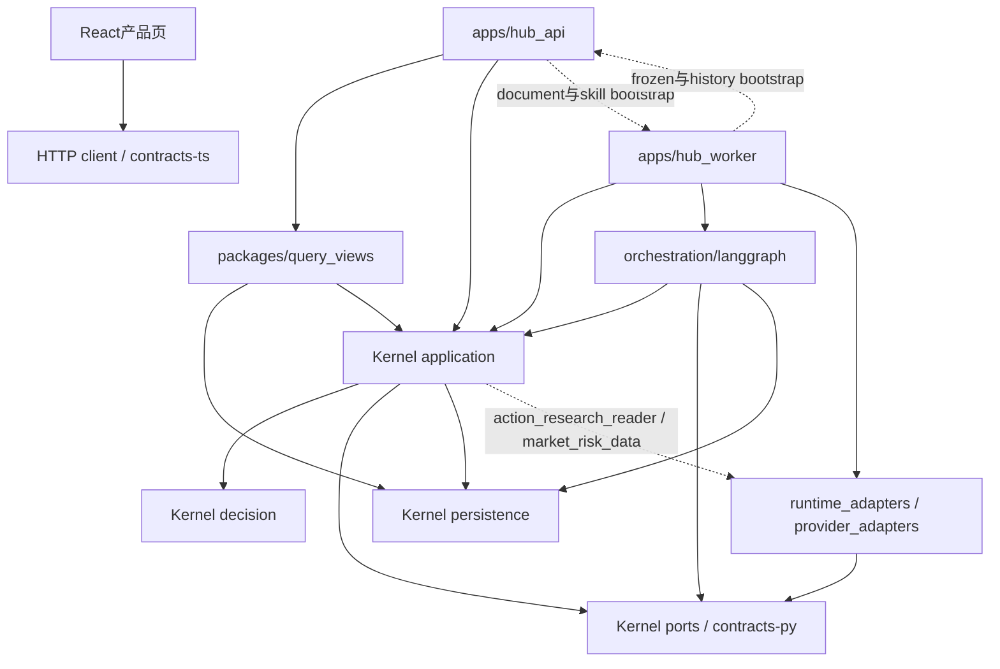
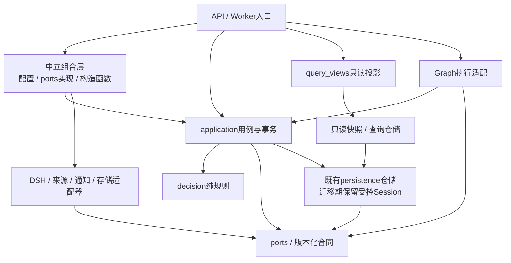

# 能力、真实实现与需求保留映射

日期：2026-10-17。状态：只读盘点与文档整合；实施暂停。本轮没有运行产品测试、构建、服务、研究或清理。总控见[00](00_MASTER_CONTROL.md)。F01–F32是原稳定能力ID；本轮为明确新增的多空双向建议追加F33，后续不能改号重用。它们不取代原MR、G/E/V、I、W、CE/M/K命名空间，也不给历史验收重新授分。跨层缺口与关闭证据统一登记在[10技术债台账](10_TECHNICAL_DEBT_REGISTER.md)，台账不是新的实施顺序。

## 1. 状态与证据读法

本表以当前工作树中的文件/符号和保存原件为依据；不是全仓审计。没有用旧方案的目标文件名冒充实现，没有查询正式库来补新运行结论。代码、测试文件及回执日期不同，未证明的跨版本组合保持未验证。

| 标记 | 本文含义 | 不可推断 |
|---|---|---|
| 已有部分 | 至少有真实模块/表/路由，完整合同仍有缺口 | 有模块就能完成用户任务 |
| 候选实现 | 修复已写入工作树，尚无当前正式链证据 | 已正式安装或已修好实际问题 |
| 已集成 | 静态查到正常composition/API等接线 | 正常运行、持续可靠或用户已收到 |
| 验证：局部 | 具名保存回执或历史局部验收；适用范围写在对应行 | 当前完整BTC/ETH链已通过 |
| 验证：未验证 | 本轮仅确认代码或设计，未找到足以升级的当前证据 | 测试文件存在就代表测试通过 |
| 未实现／planned | 需求保留，实际能力缺失，或仅有占位/目标设计 | 已支持该资产、来源、端点或模型 |

所有行的运行状态统一为“暂停”：10月17日复盘保存的检查为8047/3097/8037/8038无监听。当前正式版本release32的BTC研究失败；release33只到候选修复和定向工程门。除明确列出的有限描述性评价外，本文没有授予任何预测增益、收益或70%资格。

主要证据入口：

| 证据代号 | 原件 | 可证明的范围 |
|---|---|---|
| R | [软件工程复盘](../../retrospectives/SOFTWARE_ENGINEERING_REVIEW_2026-10-17.md) | 当前失败、暂停状态、已有模块与工程问题的只读归纳 |
| H | [完整PRD](../../product/DECISION_HUB_FULL_PRODUCT_PRD_2026-09-26.md) §3–9 | 历史产品功能、L01–L16、页面与时间语义；其旧“当前/正常”不能当今天状态 |
| C32 | [release32/STATUS](../../../artifacts/decision-product-v1/core-main-flow-20261015/release32/STATUS.md) | 正式BTC只通过owner身份和真实工具/证据两门；8条Evidence、4次成功工具调用；无综合、独审、报告、同Run行动 |
| C33 | [release33/STATUS](../../../artifacts/decision-product-v1/core-main-flow-20261015/release33/STATUS.md) | 失败首因保真、模型计时边界等候选修复及定向门；build/start/BTC/ETH均0 |
| M1 | [M1/STATUS](../../../artifacts/decision-product-v1/core-main-flow-20261015/M1/STATUS.md) | CPI实际值激活受控主路径；实际值为工程fixture，非真实公布预测成绩 |
| M2 | [M2/STATUS](../../../artifacts/decision-product-v1/core-main-flow-20261015/M2/STATUS.md) | 监控、追加通知、重启/独立仓位/回执/事务负例；4 passed，为工程控制 |
| M4 | [M4/STATUS](../../../artifacts/decision-product-v1/core-main-flow-20261015/M4/STATUS.md) | 事件概率/路径/纸面结果分账的受控验证；新版20分钟前窗另有定向回执，不能移植旧method hash |
| L7 | [W7学习状态](../../../artifacts/decision-product-v1/w7-learning-01/STATUS.md)、[generation交接](../../../artifacts/decision-product-v1/w7-generation-01/HANDOFF.md) | 当时隔离队列、真实来源读取、受控候选/代际消费工程控制；不证明今日正常产品完成真实学习链 |
| K1 | [K1/STATUS](../../../artifacts/decision-product-v1/core-main-flow-20261015/K1/STATUS.md) | 两资产、两个原点、64条真实输入回溯采样路径；金融不准入；并非事前发出的预测 |

路径缩写只为减轻表格长度，均指向真实仓库目录：K＝packages/kernel/decision_hub_kernel；A＝K/application；P＝K/persistence；D＝K/decision；Q＝packages/query_views；API＝apps/hub_api；UI＝apps/decision-desk/src/product；T＝tests。例如A/action_plan.py即packages/kernel/decision_hub_kernel/application/action_plan.py。所有下列端点是静态源码确认，未在暂停期间发HTTP请求。

## 1A. 现有系统实际怎么运行（AS-IS）

本节回答“现有代码由谁调用、在哪里保存、哪一段尚未闭合”，不表示现在启动了任何进程。依据是当前工作树的定向静态阅读，排除了`*_versions`快照、依赖目录和产物目录；历史运行结论仍按上文证据表。阅读顺序建议为本节的两条路径→§1B模块边界→§2功能缺口；研究与学习详细设计接[08](08_AGENT_RESEARCH_AND_LEARNING_SPEC.md)，源码诊断和拟定接口细节接[07](07_ARCHITECTURE_REPAIR_BLUEPRINT.md)。

### 1A.1 实际进程及持久化关系

实际接线入口是`infra/dsh/run-product.ps1`、`apps/hub_worker/main.py::_run_loop`、`apps/hub_worker/composition.py`和`apps/hub_api/main.py`。同一个`hub_worker.main`按role产生独立进程；Graph是research进程内编排，CPI是realtime里的定时任务，都不是另一个Web服务。普通与优先research进程共享持久Run队列并按配置选择任务，不能把两个Worker说成两套研究方法。图中SQLite、检查点库、文件原件及Host session不是一个原子事务；恢复要核对各自身份，不能看到其中一份成功就宣布业务完成。

`RealtimeScheduler.run_forever`以独立异步通道推进sources、risk acquisition、risk monitor、研究准入、行动监控、outbox、结果等；慢研究由research Worker消费。CPI安装点仍复用了`risk_enhancement_tick`，见§1B.14的耦合修订。上述role是否启用、来源/现货/行动/学习是否安装，取决于启动配置及准入回执；这里展示代码能力，不把全部可选分支当成当前已开启。

### 1A.2 实际代码依赖（箭头表示import／构造依赖）

实线是当前可见的主要依赖，不代表全部都应永久保留。虚线是已定位的反向或跨进程组合依赖；`query_views → application`目前也有真实存在的读取委托，不等同查询层有权启动业务命令。当前application经常直接持有SQLAlchemy Session/ORM，尚非纯粹的“端口与适配器”分层；不能只画一个整洁的目标图而省略这些现状。

### 1A.3 静态走通：CPI公布前预案到公布后结果

这里跟踪**事件自有数值链**。它能够不创建研究Run而生成事件预案；研究Run另可读取这些预案作为上下文。两者不能合并成虚构的单一调用链。

| 顺序 | 源码处理与分支 | 写入／读取的交接物及下一步 |
|---|---|---|
| C1 来源进入 | `SourceIngestionService.poll_due/poll_once/_poll_owned`通过注册源轮询；`cpi_pre_event_context.py::collect_cpi_pre_event_context_in_session`按截止读schedule、BLS prior、nowcast原件 | `observations`、`source_poll_attempts`、`raw_captures`及原件引用；源成功、内容真实性、已知时点分别检查 |
| C2 定时安装 | `main.py::_run_loop(role="realtime")`调用`event_scenario_tick.py::install_event_scenario_on_realtime`；包装后的tick以60秒最小启动间隔推进有限同步工作，并在取消时等待所属线程结束；实际间隔还受批次耗时/共享lane影响 | `EventScenarioAutoproducer.tick`随后运行`EventLifecycleProcessor.tick`；不是页面打开才计算 |
| C3 数值预报 | `EventScenarioAutoproducer.tick`收集事前上下文和残差历史，拒绝已知actual，调用`compute_cpi_scenario_body`；写前再次核对来源guard、lease/generation及公布窗口 | 追加`event_scenario_jobs`、`event_scenario_forecasts`；输入不足为waiting_inputs，错过公布为missed。`market_survey_consensus_unavailable`被明确保留，不能将前值目标称为市场共识 |
| C4 资产预案 | 数值forecast提交后，对BTC/ETH分别调用`_opportunity`→`prepare_event_owned_opportunity_in_session`→`commit_prepared_event_owned_opportunity_in_session` | `event_scenario_outputs`追加资产预案及父版本；行情/模型原件不足可只失败此资产输出，不撤销已经有效的CPI数值forecast，不补造Run |
| C5 事前可见／研究读取 | `API/event_prevision_routes.py`读取事件原件；UI `EventPrevisionPanel`查询列表和详情；另一路`ResearchRequestFactory._build_prepared`调用`event_owned_scenario_context_inputs_in_session`及`event_opportunity_context_inputs_in_session` | 事件页可读取；正常研究冻结时可纳入同Run输入。纳入上下文不等于研究完成、复核通过或同Run Action已经发布 |
| C6 实际值激活 | `EventLifecycleProcessor._realize_due`匹配forecast的reference period与公布后成功BLS poll，随后prepare/commit realization；按原始输入signature避免重复认证 | `event_realizations`保存actual及最早可用时点；没有匹配成功原件就不激活，修订追加而非覆盖预测 |
| C7 持续监控与通知 | 同一lifecycle tick调用`EventOpportunityMonitorService.process_due/process_event`，以预测、realization、行情和仓位分支求值；`enqueue_event_notice_in_session`同时排队通知 | `event_opportunity_monitor_heads/evaluations/notices/commands`及`outbox`；`NotificationDispatcher.dispatch_once`派送；`EventLifecyclePanel`读取与回执，不以入队代替用户看到 |
| C8 到期结果 | lifecycle调用`EventOutcomeService.process_due/process_forecast`，读取原forecast、realization、事前asset output和到期路径 | 追加`event_outcomes`，事件概率评分、资产响应、纸面策略结果分别解释；缺路径或未成熟保持其实际状态，不能算账户成交 |

**本条的静态结论：**C1–C8有上述接线；历史M1/M2/M4只证明各自受控范围。release32没有完成的研究综合/独审/行动，不能由这条数值子链替代。待补的技术环节包括共识/已定价输入、可检验的条件传导、事件与同Run行动引用、真实公布的连续路径及统一页面入口；具体合同见02–04及07。

### 1A.4 静态走通：普通BTC市场变化到研究、行动和复查

例子采用现有风险规则触发，不依赖CPI、手写问题或用户保持页面开启。阈值只是当前代码事实，不是本设计对金融有效性的推荐。

| 顺序 | 源码处理与分支 | 写入／读取的交接物及下一步 |
|---|---|---|
| M1 采集与指标 | `composition.py::build_realtime_worker`在risk启用时装配`MarketRiskDataService`；`refresh_due/_refresh`采集、归档并通过`MarketPathStore.ingest`保存bar，`build_market_features`生成特征 | `market_path_acquisitions`、`market_candles`、raw-captures和features档案；后续`snapshot(as_of)`检查新鲜度/路径原件 |
| M2 事实变化提醒 | composition为BTC设30m变化阈值0.015、ETH设0.02；`RiskMonitorService.process_due`领取plan并读snapshot；`complete/evaluate_condition`处理真假/未知、连续bar和episode | `risk_monitor_plans`、`risk_condition_evaluations`、`risk_alerts`与outbox；alert明确`alarm_kind=fact_change`、`prediction_hit=false`，所以这是已观察变化，不算事前预测命中 |
| M3 研究请求登记 | `SpotResearchTick.tick`→`RiskResearchAdmissionService.process_due`→`discover`读取尚未消费的alert，`_stage_in_session`按trigger去重/合并请求；fixture或未准入scope记录排除 | `risk_research_requests/triggers`；还有独立daily计划入口。请求存在不表示Host已可用或模型已开始 |
| M4 事务准入 | `prepare_scope`准备真实来源和Host准入；`_fresh_preflight`检查前置；`_admit`在写事务中复查guard，以`AdmissionService.admit`创建观察/事件，`ensure_study`绑定资产，`RunService.create(strategy_version="research.v1")`入队 | `observations/events/studies/runs`及请求→Run引用；保持`risk-research:{key}`幂等。条件待满足、lease丢失、失败有各自状态，迟到研究不回填原触发时点 |
| M5 冻结与执行 | `DurableResearchWorker.tick/_execute_claim`领取Run并续租；`ResearchRequestFactory.build/_build_prepared`冻结scope、Task、策略、上下文和action机会；`LangGraphResearchExecutor.execute/resume`运行`build_agentic_research_graph` | `run_role_outputs`等冻结回执与`research_graph.sqlite3`；Graph经`ResearchHarnessRuntime.execute`进入DshWeb/Host，工具结果经Evidence服务保存 |
| M6 研究终态与行动 | Worker处理Graph final、`ResearchReviewService.review`、`commit_research_result`、`_record_completed`，再调用`_publish_actions_safely`→`ActionResearchIntegration.publish_committed`→`ActionPublicationService.publish` | artifact与同Run引用；`decision_opportunities/snapshots`、`action_plan_revisions/heads`。没有native final ref不能发布这条行动；hook失败另存并由`reconcile_missed_hooks`按原身份恢复 |
| M7 快监控与深复查 | `ActionMonitorTick`调用`ActionMonitorService`读取新鲜行情求值；独立`ActionReviewService.stage/discover`经风险研究准入产生关联父Run的复查 | `action_condition_evaluations`、新修订或复查请求；深研究不阻塞既有条件求值，监控命中也不直接等于新研究结论 |
| M8 用户与结果 | API `action_routes`→`DecisionProductQuery`→UI `ActionPlanPanel`读取当前版本与仓位分支；启用纸面执行时quote/execution tick记录意向、可执行报价和episode；学习由evolution role消费合格终态 | Action UI、命令回执、`action_execution_records.py`所列账本，随后学习来源/注册/候选；后续技能实际消费仍是另一个可检验步骤 |

**本条的静态结论：**自动变化→持久研究请求的代码路径存在，当前正式整链在M5–M6失败，不能称“只关注资产便持续给出可靠操作”已经验收。现有30m/24h/72h horizon、daily触发和阈值属于原配方；新增4h须新增目标/方法版本，不能改名继承旧证据。

## 1B. 模块设计基线（AS-IS与TARGET逐项对照）

以下按技术职责分组，F-ID仍是功能需求索引。每组说明处理链和读写责任；**TARGET均为待用户确认的设计提案**。继续使用既有Python/TypeScript、SQLite、Worker与Graph，不为整理分层新增微服务、消息平台或第二套研究队列。模块边界优先落实在现有入口与端口，文件迁移服务于职责收敛，不能把搬文件当完成功能。

### 1B.1 来源与原件（F02/F03/F07/F08）

**AS-IS处理链：**注册源/工具查询/用户资料→source adapter、`SourceIngestionService.poll_once`、`SourceAcquisitionService.ingest`或`ResearchLibraryService`→`source_states/source_poll_attempts/source_acquisition_receipts/raw_captures`、原始字节档案、`research_document_versions/blocks/corrections`→事实解析、发现、证据读取。来源轮询与研究时按需工具取数是两个入口；都应保留原件及失败回执，不能只统计成功Evidence。

**TARGET职责与缺口：**采集模块负责连接、权限、限速、原件、cursor和尝试状态；解析模块只消费已保存原件。以来源能力/授权/时效清单装配adapter，不在业务规则里构造HTTP客户端。新增观点源必须保留作者、版本、转载关系与引用；当前真实授权、持续覆盖、解析失败恢复仍需逐源验证。资料修正保留版本和人工审核，不直接变成更高权威事实。

### 1B.2 事实、时间与行情（F04/F05/F12）

**AS-IS处理链：**原件+采集回执→`macro_event.py`、`research_evidence.py::_validate_candidate_pit`、`MarketPathStore`和`build_market_features`→`parsed_versions/fact_versions/research_facts/research_evidence/run_input_refs`、`market_candles`及features原件→按cutoff查询的事实、证据和特征。来源发布、收到、落盘与采用时点是独立字段，行情特征还绑定窗口与缺bar状态。

**TARGET职责与缺口：**事实服务拥有解析版本、单位、时点、修订血缘及PIT查询；行情服务拥有bar/quote原件和确定性特征计算；它们输出带版本引用的快照，不输出“应买/应卖”。Run只能冻结当时可用版本，未来修订不能回写旧Run。当前读取服务多与ORM和原件验证混合，先提取快照reader与原件存储port；禁止为缺失事实补0、补0.5或用mtime替代known时间。

### 1B.3 事件身份、发现与机会（F01/F06/F09/F18）

**AS-IS处理链：**来源envelope/日历/风险alert→`DiscoveryAdmissionService.decide`、`EventWatchService`或`RiskResearchAdmissionService.discover/_admit`→`occurrences/studies/admission_decisions/event_watches/risk_research_requests/runs`；CPI另经`EventScenarioAutoproducer`写`event_scenario_forecasts/outputs`→研究候选或事件预案。`register_action_opportunities_in_session`在研究Task冻结时登记行动机会，不能把它与事件forecast ID混为同一个对象。

**TARGET职责与缺口：**身份服务解决“是不是同一事件/主题”，机会服务解决“何时、为哪个资产/仓位/期限决策”，准入服务解决“当前能否开始这项工作”。共同引用事件/来源ID，保留各自不可变主键和owner；通过显式关联把事件预案交给研究/行动，禁止合成Run来满足UI。缺口是泛事件发现、全机会分母、合并/延后可见性及真实持续路径；日历取消或改期必须产生明确状态变更。

**扩展市场接缝（F29/F30）：**已有`MarketExtensionRegistry.register`和`market_scope.py`目录；目标是在registry登记产品身份、日历、单位、来源权利、domain pack及outcome能力后独立准入。黄金、纳指、恒科各有scope/adapter/特征与标签配方，不能仅扩展字符串枚举后复用BTC阈值或结果资格；其真实产品能力仍为planned。

### 1B.4 研究任务与编排（F10/F11）

**AS-IS处理链：**已准入Run→`DurableResearchWorker`领取/续租、`ResearchRequestFactory`冻结、`LangGraphResearchExecutor` execute/resume→Graph回合→`ResearchHarnessRuntime`→DSH Host内模型/子角色/工具→`run_events/run_calls/run_steps/run_role_outputs`、checkpoint、原生结果→审核/发布或可恢复失败。正式启动器选择dsh-web；已有另一runtime实现不能证明当前正式链已解耦。

**TARGET职责与缺口：**Hub拥有业务Run、generation和发布许可；Graph唯一负责跨轮补证/恢复/结束；DSH负责一轮模型执行与内部角色；adapter负责传输及原生结果认证。准备、Provider执行、回执确认分段；已有成果资格与继续工作的预算分开。07的版本化复核、新追问和首因保真方案是本模块的具体修订，当前仍未完成真实BTC/ETH整链验证。

### 1B.5 上下文、资料与经验选取（F07/F08/F12/F22）

**AS-IS处理链：**冻结Task、事实/资料/观点、CPI/事件机会、历史案例与技能引用→`research_context.py::select_context`、`research_context_selection_v4.py::ContextSelectionService`及`MarketCaseContextProvider`→`run_role_outputs`中的选择/执行绑定回执及实际输入原件→各轮模型请求。`ResearchRequestFactory._build_prepared`目前显式拼装多种专用上下文，selector还负责认证和PIT检查。

**TARGET职责与缺口：**Context service只做某角色/问题在该cutoff的选取、排除和回读manifest；不采集新事实、不改研究Task、不决定行动。将必需/优先/按需、引用/遗漏原因及压缩版本冻结；反证、单位、时点和未决问题不能因截取丢失。角色任务和新追问通过版本化manifest接入，不继续向巨型request factory堆分支；实际selected/loaded/executed/consumed各留自己的证据。

### 1B.6 因果、情景、概率与复核（F13/F14）

**AS-IS处理链：**证据与角色结果→`ResearchReviewService`、`research_quality/research_loop`规则、CPI `compute_cpi_scenario_body`及`event_response_model`→原情景、复核回执、`research_probability_binding.py`冻结选择/各阶段数值→研究final和行动来源。现有事件概率、路径模型和主观方向数值不自动共享统计目标；07已定位单次复核、预算先行判定和新追问限制。

**TARGET职责与缺口：**纯decision模块计算情景、机制约束、质量与方案比较；application读取样本、调用计算并提交版本。完整链为事件情景→预期差/已定价/状态条件下资产响应→仓位下操作后果；目标、horizon、method、数据截止和资格分别保存。缺共识/条件样本时保留有依据的主观方案或规则方案，不能借校准标签制造策略胜率。机制边、替代解释和可推翻条件的合同以02/07为准。

**候选模型接缝（F31）：**Kronos只有有限K1试验，未确认正式runtime adapter。目标K2沿已有PathShadowJobService/RiskPathLedger协议形态接入隔离模型适配器与显式启用Worker，保留输入cutoff、模型hash、路径、非法OHLC、失败slot和全分母；只输出候选路径与比较证据，禁止直接写正式Action或自动晋升。

### 1B.7 行动发布、版本与用户命令（F15）

**AS-IS处理链：**同Run冻结机会、native final、独审和概率绑定→`ActionResearchIntegration.publish_committed`→`action_research_reader`读取来源→`ActionPublicationService.publish`、`ActionPlanService.record_command`→`decision_snapshots/action_plan_revisions/action_plan_heads/action_command_receipts`→当前方案查询、监控和结果。原机会与发布key支撑hook重试；业务发布不是原生模型返回成功的别名。

**TARGET职责与缺口：**行动应用服务独占方案发布事务和head切换；decision规则负责候选排序/条件，来源认证交给受信任adapter，用户命令通过带expected revision与request ID的服务执行。不得从UI、query view或runtime直接写head。当前主要缺口是可信综合→独审→同Run同期限行动的正常完成，以及`action_research_reader`对DSH内部实现的反向依赖。

### 1B.8 条件监控、复查与通知（F16/F17/F18）

**AS-IS处理链：**已发布方案/事件预案+行情/事实→`ActionMonitorService`、`EventOpportunityMonitorService`和`RiskMonitorService`各自claim/process→条件evaluation、monitor head、notice/outbox；`ActionReviewService.stage/discover`把需深查的变化送回研究准入→新Run或新方案版本。`NotificationDispatcher`消费outbox，API保存display/ack命令；页面轮询不是后台监控。

**TARGET职责与缺口：**监控负责确定性求值及产生复查请求；研究负责解释新事实；通知负责独立派送状态。方案修订/通知入队应在所属业务事务内，派送在事务外；重复采样不能重复激活，未知/断源不能沿用绿色旧值。保持三类monitor的业务身份，先共享freshness、claim和通知port；不先合并成一个巨型引擎。缺口是持续真实断源恢复、反证复查、新版本交接和实际用户可见链。

### 1B.9 结果、纸面执行与评价（F19/F20/F28）

**AS-IS处理链：**原预测/方案+成熟时点+真实路径/报价→`EventOutcomeService`、`DueOutcomeService`、`history_outcome_v2`和`ActionExecutionService.execute_intent/observe_episode`→`event_outcomes/action_outcomes`、历史结果及`action_execution_records.py`账本→结果页、协议统计与学习来源。纸面quote/execution独立tick，未成交、等待、成本、失效与缺路径要保留。

**TARGET职责与缺口：**每个结果reader按原目标/方法/费用版本结算，统一暴露“成熟/缺输入/可评价/不可评价”的来源合同；事件分格、方向、资产路径、策略净收益仍分账。评价服务只在预登记分母和资格范围内聚合，不回写原预测或把研究质量当收益。当前仍缺当前正式版真实到期闭环、完整机会分母和充分价值样本；新4h/Kronos实验不得继承旧样本资格。

### 1B.10 学习、技能与代际（F21/F22/F23）

**AS-IS处理链：**已登记portfolio的真实终态→`LearningRegistrationService`、`TerminalOutcomeScanner/LearningTriggerScanner`→`LearningJobs`复用evolution队列→`ResearchRecipeLearningHandler`反思、`LearningPackageBuilder`及trial continuation→`research_learning_protocols/bindings/stages/units/registrations`和候选档案→`SkillConsumptionService`在后续Run形成执行/消费回执。`research_learning_bootstrap.py`要求skills/action execution/action product/spot research的显式启用，尚无“有结果就一定学习”的默认保证。

**TARGET职责与缺口：**学习只产生可定位行为改变的候选版本及其反例，试用/比较/晋升/回滚由独立合同控制；原已批准版本保持可读，下一Run绑定新代际并证明实际消费。候选不能直接覆盖运行方法、扩大工具权限或把反思文本当增益。当前需补当前正式真实结果到非种子候选再到下一正常Run消费的全链；价值评价继续对照同输入/预算的基线。

### 1B.11 API、查询与PC界面（F24/F25/F26）

**AS-IS处理链：**React `ActionPlanPanel/EventPrevisionPanel/EventLifecyclePanel/ResearchProgressPage/ResultsPage`→HTTP client→`apps/hub_api`路由→application命令或`packages/query_views`读取→DTO→页面。`DecisionProductQuery`直接读ORM并委托部分application reader；UI按query key缓存并轮询，行动当前页30秒、事件页60秒的现有轮询只决定显示更新速度。

**TARGET职责与缺口：**API校验身份/参数并调用用例，query view只读取快照/投影，UI呈现版本、时间、动作、依据、未知和回执；命令只通过明确服务入口。当前方案、事件预案和纸面结果在统一导航中分别保留来源身份，并可追到同Run输入/复核。API与Worker共享装配拟迁到`packages/pilot_runtime/bootstrap/`（新子包），按职责设`documents.py/research_skills.py/frozen_harness.py/history.py`，避免互相import；页面整体信息结构、异常恢复及用户可理解性按04验收，不以DTO可渲染代替。

### 1B.12 运维、配置与发布（F27/F32）

**AS-IS处理链：**`run-product.ps1`环境配置/发布回执→API与各Worker bootstrap→`ServiceHeartbeatService`、`RealtimeChannelDiagnostics`、usage与Host activity collector→心跳/运行账本、日志和发布原件→运维页。包/方法/输入/原件认证有独立身份；真实Host、当前源码及已安装release不能只凭目录名视为一致。

**TARGET职责与缺口：**部署配置与依赖装配归组合边界，业务服务接收已验证配置/port；运维读取每段状态、首败和最后有效进展。不可变内容可按hash/version复用认证回执，取消/权限/lease/有效时间在副作用前新鲜检查；缓存不能成为放宽真实性的理由。先做部署清单和跨进程合同检查，再恢复有限真实链；此轮保持暂停，不启动任何验证进程。

### 1B.13 TARGET依赖方向与可执行规则

这是**目标import方向**，不要求立即把全部ORM调用改成仓储，也不禁止Graph调用应用用例。落实时优先切断已经妨碍更换runtime/来源及恢复的依赖；迁移期的直接Session保留在明确的事务owner内并登记，不把“纯架构”作为一次性重写理由。

| 发起层 | 允许依赖与副作用 | 禁止依赖／副作用 |
|---|---|---|
| decision | contracts/ports的数据类型、标准库、纯计算；输入由caller提供 | SQLAlchemy/数据库、HTTP、文件读取、DSH、环境变量、启动任务 |
| ports/合同 | 独立的数据类型、Protocol、版本规则 | application、具体adapter、API、Worker、数据库写入 |
| application | decision、ports、受控persistence及其他用例的公开入口；拥有业务事务 | 导入DSH SDK/私有mapper、构造具体外部provider、import apps入口；跨模块直接改head/lease |
| runtime/provider adapter | 实现ports，认证自己的原件与调用外部系统；按合同回调 | 决定Action head、伪造Run终态、跳过Hub发布许可；依赖UI/API启动模块 |
| orchestration | ResearchHarnessRuntime、Graph/checkpoint、显式application用例 | 在runtime内部再建业务主管循环；以checkpoint成功替代业务commit |
| query_views / UI | 只读snapshot/reader与DTO；UI通过HTTP发送具名命令 | 查询时触发模型/采集/重试/发布；UI计算收益资格或直接写业务表 |
| composition | 构造并注入上述实现、统一配置，API/Worker共享中立装配 | API↔Worker互相复用入口；靠具体runtime类判断授予业务能力 |

### 1B.14 已定位耦合、风险及重构切口

以下是现行文件/符号的具体证据；行号为本次快照方便定位，永久定位以符号为准。修订均为提案，须连同03/07合同确认后才能实施。

| 现有证据 | 耦合怎样影响业务 | 第一个可独立审查的重构切口 |
|---|---|---|
| `A/action_research_reader.py:221–224`在`_native_action_from_originals`导入DSH `event_mapper/result_mapper/web_runtime._sdk_run` | Action必须理解DSH私有结果与通知结构，更换runtime或修原件映射会牵动行动发布 | 将原生认证/映射搬入DSH adapter，注入07所述`ResearchSourceVerifier`，Kernel只读`CanonicalDecisionSource`；保留原真实性断言和旧版本reader |
| `A/market_risk_data.py:17–18`导入`OKXMarketPathAdapter`和`RawBodyArchive`；构造函数持有具体采集实现 | 行情应用用例承担供应商选择、原件存储和业务更新，替换来源会改Kernel | 由composition注入行情采集与原件store端口；本切口先保持原有bar/feature、错误码、来源认证及事务行为 |
| `apps/hub_api/main.py:45,1989–1995`导入Worker的document/skill装配；`apps/hub_worker/main.py`导入API history bootstrap，`composition.py`导入API frozen bootstrap | API与后台角色的装配反向互引，改一个进程配置会影响另一个；难以独立说明部署能力 | 拟建`packages/pilot_runtime/bootstrap/`的documents/research_skills/frozen_harness/history模块，API/Worker各自调用；共享的是已验证配置/构造函数，不共享入口副作用 |
| `composition.py`按`isinstance(selected_runtime, DshWebResearchRuntime)`限制harness/skills/context，并写`selected_runtime.skill_preparation` | 名义上的runtime Protocol不能描述现有能力，类替换会丢失业务接线 | 提取prepared-context、skill-delivery等具名能力port，组合时校验所需能力；避免仅换一个`execute()`便宣布可替换 |
| `event_scenario_tick.py::install_event_scenario_on_realtime`改写`scheduler.risk_enhancement_tick`并捕获original；`event_owned_opportunity.py`导入scenario reader，而producer方法内又导入opportunity | 调度顺序隐藏在函数包装中；预测reader与生产者互相知道对方，后续泛事件容易继续堆分支 | scheduler显式登记事件tick；拆出只读scenario reader供producer/opportunity共用，保留“先提交数值、后尝试资产预案”的事务顺序 |
| `ResearchRequestFactory._build_prepared`直接导入CPI、事件预案、机会、复查等专用context；`DecisionProductQuery`委托部分application reader | 输入品类增长会修改大factory，页面读取易承担昂贵认证及领域拼接；但当前reader委托不能武断称为写副作用 | 引入按声明能力注册的context contributor，返回统一manifest；页面reader按既有快照认证结果读取，首次/变更认证由明确服务负责 |
| `host/model-dispatch.ts/provider-input.ts/bridge.ts`的执行等待、回执与watchdog交错；Hub又在status/result链验证绑定，详见07 §1/3 | 模型阶段与认证落盘阶段混为一次等待，次生失败可掩盖首因，恢复易重做昂贵工作 | 依07分prepare/provider/receipt阶段，保存首因及可恢复原件；仅重放缺失回执，不因落盘失败再次研究 |

这里区分了**缺失功能**（例如共识/传导与真实学习消费）、**分层缺陷**（反向依赖）及**运行链问题**（跨进程状态和等待）；不能只修最后一种便宣布功能设计完整。重构后的局部合同验证与真实全链验收条件在05/07登记，本轮未执行。

### 1B.15 本轮明确提出、尚未获批准的工程选择

1. 保留现有进程/数据库/Graph，先收敛业务owner、来源认证和共享装配，避免全仓搬迁。
2. 保留事件自有forecast/output与Run自有Action两套身份，通过引用关联展示；两者各自的结果分母不合并。
3. 来源、context contributor、runtime来源认证和通知使用明确port；跨表事务暂由现有application owner持有Session，逐切口缩窄。
4. 统一UI查询与状态表达；深研究、快监控、结果、学习各有独立进展，失败不会互相伪装成功。

影响产品的待确认项集中到00第10节，具体提案在02/04/08；06保存评审过程。上述工程选择是本轮建议，不构成用户已经批准或允许恢复实施。

### 1B.16 多空双向建议：现状与新增目标不得混写（F33）

**已确认的需求增量：**事前建议必须比较做多、做空及不新增风险的选择，并覆盖空仓、已有多仓、已有空仓的管理。看跌不能一律翻译成现货减仓或等待。产品范围是研究建议、确定性条件监控与纸面执行；本设计不包含自动真实下单。用户已确认OKX USDT线性永续方案；具体合同实现/准入尚未证明，当前按后续要求暂停并做review-5文档补审。

| 层 | 当前真实实现（AS-IS） | 新增目标（TARGET，尚未实现） |
|---|---|---|
| 市场与准入 | `A/market_scope.py:27–46`保留BTC-USDT-SWAP、多交易所研究scope；BTC/ETH现货另走显式SpotTrialAdmission。perp研究目录不是可发布双向Action的资格 | 建议首版采用OKX BTC-USDT-SWAP/ETH-USDT-SWAP、USDT线性永续；独立登记instrument/venue/contract spec/price basis与数据能力。旧现货继续保持独立scope和读回资格 |
| 建议合同 | `decision_product_v1.schema.yaml:1097–1113`只有enter_long/reduce_long/exit_long/hold/wait与flat/long/unknown；`D/action_policy.py:257`重复同一限制 | 新建`decision_product_v2.schema.yaml`，ActionCandidateV2采用`action=open/add/reduce/close/conditional/no_change`与`target_side=flat/long/short`，旧v1动作保持原义。候选绑定account/position/risk policy快照、instrument版本、目标与期限。unknown展示各分支，不能代填仓位或给可执行数量 |
| 监控和纸面 | `D/action_paper_accounting.py:22–26`仅两个现货scope、非负quantity；`ports/action_quote.py:30,219`要求spot/SPOT；`A/action_execution.py`从spot_scope还原 | 新的perp解析、短仓会计、触发/止损/退出方向、资金费、mark/index/盘口价格、保证金与强平假设必须一起实现。仅扩enum或给quantity负数不构成支持；旧现货成交与回执不可改解释 |
| PC与学习 | `ActionPlanPanel.tsx:20–21`只有30m/24h/72h和flat/long/unknown；skill selection/trial固定24h | PC按同市场、账户快照、目标与期限选主建议；学习资格、样本、消费与回滚按目标family区分spot/perp及期限。增加4h不继承30m/24h资格 |

共享事件、宏观、原件和研究轮次；品种特有的行情解释、费用、监控、执行与结果标签放在具名能力模块。对于同一合约和期限，比较合法多头、空头、持有/减仓/退出/等待候选；反向操作默认先平当前方向再重新准入，不能将一条建议视作双向同时持仓。首交付不支持账户对冲模式或真实下单；这些限制只影响执行能力，不删除做空建议需求。

若资金费、合约规格或保证金输入不足，可以保留注明缺口的方向/条件研究；不得授予可执行纸面资格或编造净收益。`P(下跌)`、`P(空头净盈利)`及“当前应做空”分别由目标、成本与仓位约束决定。详细数学与合同归02/03，PC归04，改动归T03/T04/T05/T06/T07/T08；债项TD-08/09/10/12/13/14集中跟踪。

### 1B.17 用纵向交付控制重构范围

首先交付一个具名事件、一个合约、一个期限的事前方案→发布→PC→条件变化→纸面结果，同行完成所需认证、角色、价格与风险能力；这是一条早期切片，不授予BTC/ETH、三期限和学习全产品完成。随后使用同合同完成第二资产、4h/24h/72h各自目标及非seed经验复用。若新perp纸面尚未具备资金费/保证金等必要能力，阶段成果明确是建议切片，不能以旧现货账本代替。

保留SQLite、现有Worker/Host、LangGraph外轮、业务事务owner、原件档案、三类monitor及outbox；只切开阻断交付的DSH来源认证、共享装配、市场能力及当前建议读取。允许现有application在受控事务内暂用Session。每个拆分须能说明少改了哪个业务模块、消除了哪个重复执行或身份混淆；不把全仓仓储化、换SDK或增加微服务作为早期建议可见的前提。

## 2. 能力矩阵

候选归属使用[05实施计划](05_IMPLEMENTATION_PLAN.md)的T01–T10，附原W等工作包作追溯；不自动恢复实施。每行列的是用户结果，不以代码数量或测试数量作为完成比例。

| ID／能力 | 用户应得到的结果 | 真实实现：文件、符号、表或端点 | 现有验证证据 | 严格现状 | 剩余接线／缺陷／未实现范围 | 后续归属候选 |
|---|---|---|---|---|---|---|
| F01 关注资产与入口 | 关注BTC/ETH后持续获得研究，手工问题/快照为补充；现货、永续和黄金身份不混 | A/market_scope.py：research_market_catalog、research_scope_enabled、require_research_scope；API/delivery_routes.py：GET /v1/product/research-scopes；spot_admission/frozen_spot_admission为显式准入参数 | H §3.1/3.2；C32真实BTC单次提交 | 已有部分；局部；当前整链阻断 | 静态目录中的BTC/ETH现货默认关闭，正常路径须注入真实试用准入；不能仅看目录flag宣布无实现，也不能以BTC试用代替ETH通过。无手写题目依赖的持续路径待验 | T03/T04/T07/T08；原W0/W2/W8 |
| F02 来源与权利 | 知道来源能取什么、是否允许使用、最新可用性及缺口影响 | packages/provider_adapters/research/source_registry.py：ResearchSourceRegistry.query_sources/require/classify_locator；A/source_ingest.py：SourceIngestionService.health_all；P/db.py：source_states | H L02；T/research/test_source_registry.py存在，本轮未执行 | 已有部分；历史局部 | 每源实际授权/连通/覆盖不能由registry声明替代；BLS失败恢复、替代源和宏观/观点覆盖仍需按能力核验 | T03/T08；原W0 |
| F03 采集、原件与落库时点 | 每次成功/空结果/失败/修订可追溯，知道“何时发布、收到、保存、被采用” | A/source_ingest.py：poll_once/_start_attempt/_finish_attempt；A/source_acquisition.py：SourceAcquisitionService.ingest；P/db.py：source_poll_attempts、source_acquisition_receipts；packages/provider_adapters/research/raw_capture.py | H §6；T/sources/test_source_poll_attempts.py、test_source_acquisition_service.py及T/migrations/test_source_acquisition_timeline.py存在 | 已有部分；历史局部 | 端到端来源→解析→准入→采用时间线和长期连续覆盖待验；unknown不能由文件mtime或其他时间推算补齐 | T03/T07/T08；原W0/W1/W8 |
| F04 解析、版本与PIT事实 | 原始发布、修订、更正和历史当时已知版本分别可读 | A/macro_event.py；A/research_evidence.py：ResearchEvidenceService、_validate_candidate_pit；P/db.py：parsed_versions、fact_versions、research_evidence；K/ports中的既有时间/事实合同 | H L04/L11与§6；T/research/test_macro_event_ledger.py、test_official_event_facts.py存在 | 已有部分；历史局部 | 全来源解析语义、未来修订隔离和跨Run血缘继续核验；解析成功不授予事实权威 | T03/T04；原W1/W2 |
| F05 行情、路径与指标 | 当前指标、分钟覆盖、缺bar及路径风险可核，条件使用精确版本 | A/market_path_store.py：MarketPathStore；A/market_features.py：build_market_features；A/market_original_parse.py；D/path_risk.py；K/ports/market_path.py | H L10；T/test_market_features.py、T/decision_product/test_action_features.py；M2/M4复用真实store/feature代码的受控验证 | 已有部分；局部 | 双现货连续采集/分页/原件质量和断源恢复需正常验证；币种、价格基准、volume/amount及分钟缺口不能平填；宏观分钟资料不因行情可用而获得资格 | T03/T05/T08；原W0/W3/W6 |
| F06 未来核心事件与预期输入 | 公布前看到事件、时区、阶段、情景目标和信息缺口；actual/prior/共识/nowcast分清 | A/event_watch.py：EventWatchService.ensure_watch/capture_due；A/event_scenario_autoproduction.py：EventScenarioAutoproducer.tick；A/cpi_pre_event_context.py、event_macro_context.py；API/event_prevision_routes.py：GET /v1/event-previsions及详情；P/event_scenario_records.py：event_scenario_jobs/forecasts/outputs；apps/hub_worker/main.py安装event_scenario_tick | H L06；M1保存的真实schedule/nowcast/prior/history输入；T/research/test_event_watch.py | 已集成的CPI子链；局部；其他事件未验 | CPI相对前值不等于共识预期差。review-4将CPI/PCE/就业/FOMC及加密原生事件、广日历入口列当前主线：02/03固定EventFamilyPack/Binding/Agenda、阶段与联合情景，04显示未覆盖事件；4h独立绑定，保留30m历史 | T03/T04/T05/T07/T08；原CE/M事件线；T09仅后续方法/新资产 |
| F07 外部观点与全球信息 | 观点触发可核问题，独立原始证据或反方决定是否改变操作 | A/research_signal.py：freeze_claim_signal_in_session/read_claim_signal_in_session/claim_use_evidence_in_session；P/db.py：research_document_versions、analyst_claims；冻结引用进入run_role_outputs；T/decision_product/test_public_opinion_factory.py、test_public_opinion_wiring.py、test_claim_signal_service.py | 代码与测试入口存在；I07/I08旧要求明确需真实全链；C32未产研究/Action | 已有部分；当前全链未验证 | 外部真实来源→版本/作者/转载聚类→独立核验→机制→同Run行动未完成验收；TradingView/TradingNEWS等候选不能由官方数值源替代；各来源当前实际可用性单列 | T03/T04/T06；原W0/W2/W5及I07–I10 |
| F08 个人资料库 | 上传/导入→原件→解析质量/修正→Claim审核→范围选择→实际读取→引用各阶段可见 | A/research_library.py：ResearchLibraryService；A/research_library_commands.py、research_library_provenance.py；API/research_library_routes.py：/v1/research-library/versions/{version_id}/provenance、upload-policy；P/db.py：research_documents/versions/blocks/corrections、analyst_claims；packages/provider_adapters/research/document_readback.py | H §3.4、资料页面；T/research/test_document_upload_receipts.py、test_document_readback.py、test_document_readable_quality.py存在 | 已有部分；历史局部 | 全文件类型、低质/解析失败、修正冲突、scope及最终引用异常矩阵未完整验；资料标签不开放未准入市场 | T03/T07/T08；旧L15保留 |
| F09 事件身份、主题与自动发现 | 同一事件/主题持续更新，知道何事被研究、合并、延后或拒绝 | A/discovery_admission.py：DiscoveryAdmissionService；A/discovery_recovery.py；P/db.py：occurrences、studies、admission_decisions；API/study_routes.py：GET /v1/studies、/v1/discovery/decisions、/v1/runs/{run_id}/study | H §3.1/3.3/L05/L07；T/e2e/test_realtime_source_flow.py存在 | 已有部分；历史局部 | 非手工持续触发到有用新方案、发现召回/误报/去重及公平性未验；旧legacy_unknown不补造 | T03/T04/T05；原W2/W3/W8 |
| F10 任务、队列、取消与恢复 | 离开页面后研究继续；失败可找到首因并恢复原请求，无重复模型/方案 | A/research_task.py：ResearchTaskService/read_task_request；A/scheduler.py；apps/hub_worker/research.py、composition.py；P/db.py：runs/run_events/run_calls/run_steps；API/terminal_quiescence.py | C32真实失败；C33首因保真/计时定向门；H L08 | 候选修复；局部；当前整链阻断 | HTTP受理、Host任务、Graph状态、租约/取消、物理结束的合同需贯通；需要真实本地组件集成门，不能依靠每轮正式构建发现下一接缝 | T01/T02；原W8 |
| F11 DSH与Graph研究执行 | 系统能持续提出问题、实际调用工具、形成同一Run的综合/复核/发布 | apps/hub_worker/research.py及composition.py；A/research_graph_dispatch.py：is_quality_graph_in_session；A/research_graph_recipe.py；A/research_execution_binding.py；P/db.py的DSH session/prompt、run_role_outputs | C32有真实8 Evidence/4工具但无综合/独审/报告/Action；C33仅窄门 | 已有部分＋候选修复；真实外部链路失败 | 固定同一请求身份/代际/输入绑定，完成正常BTC再独立ETH；模型活动、技能list和原件保存均不能替代研究业务进展 | T01/T02/T04/T08；原W2/W5/W8 |
| F12 工具、证据与可追溯输入 | 每个结论能找到实际工具结果、原件、来源时点和被采用位置 | A/research_evidence.py：ResearchCapabilityGatewayService、ResearchEvidenceService；P/db.py：research_evidence、run_input_refs；API/evidence_original_routes.py；packages/provider_adapters/research/raw_capture.py | C32证明有限真实工具/证据；H L10/L11；T/research/test_publication_source_snapshot_v2.py存在 | 已有部分；局部 | Evidence条数不是独立来源数；跨源独立性、论断引用精度、全部来源血缘和受认证成本控制的读取仍需接通 | T01/T03/T04；原W0/W2/W5 |
| F13 因果机制、反证与独立复核 | 读到事件/预期→中间变量→资产影响的可检验主反链；据此选择后续查证 | A/research_review.py：ResearchReviewService、verify_graph_review_in_session、has_valid_accepted_independent_review；A/research_signal.py；A/action_research_reader.py；run_role_outputs和独立review原件 | H §7.3历史9项规则/5项缺口；C32没有当前综合和独审 | 已有部分；历史局部；当前整链阻断 | 结构非空不是因果正确；来源权威、逐claim精度、因果质量、反方质量及执行权限旧缺口保留。完整MechanismReview边/时滞/替代/已计价语义需核对合同并补接 | T04；原W2/W5及I03/I08 |
| F14 情景、方向与策略概率 | 看见明确目标/期限/版本/资格；主观概率、校准概率和策略胜率分开，未知为空 | A/research_probability_binding.py：probability_phase、publication_values_in_session、resolve_probability_commit_in_session；D/cpi_event_scenario.py：score_joint_event；D/event_response_model.py；P/event_scenario_records.py | M4对九格Brier/log loss的受控计算；K1有限描述分布；C32无新完整研究 | 已有部分；局部；价值样本不足 | 事件分格、资产收益、先止盈概率不能互换；旧V2响应胜率不能沿用新规则；宏观共识与前值目标、校准/概率版本绑定仍需验 | T04/T08；原W2/W6及原模型路线 |
| F15 条件行动与不可变版本 | 原现货合同保留空仓/已有多仓/未知下的建多、持有、减仓、退出或等待；原因/有效期可回看；新增双向合同见F33 | A/action_plan.py：ActionPlanService.register_opportunity/record_command；A/action_publication.py：ActionPublicationService.publish；A/action_research_integration.py：publish_committed/reconcile_missed_hooks；P/action_records.py：decision_opportunities/snapshots、action_plan_revisions/heads、action_command_receipts；API/action_routes.py：GET /v1/actions/current、/v2/actions/current、plans/commands | T/decision_product/test_action_publication.py、test_action_service.py、test_action_native_vertical.py存在；C32同Run行动未生成 | 已集成部分；局部能力；当前整链阻断 | 可信研究→同Run同期限Action正常发布待过；未校准不能全局吞成no_trade，unknown不造0.5；原现货合同不授做空/杠杆资格，本轮F33新增独立perp双向建议/纸面；真实下单不在本包 | T01/T04/T07/T08；原W1/W2/W4；F33相关改造同行 |
| F16 条件监控、复查与修订 | 入场/退出/失效条件持续求值，变化生成新版本，断源可见且恢复不重复触发 | A/action_monitor.py：ActionMonitorService.claim/process_due；A/action_revision.py；A/action_review.py：ActionReviewService.stage/discover；apps/hub_worker/action_tick.py、composition.py；P/action_records.py：action_condition_evaluations；D/action_policy.py | T/decision_product/test_action_monitor.py、test_action_scheduler.py、test_action_normal_composition.py；M2复用条件/新鲜度/独立bar规则 | 已集成部分；局部；连续真实链未验 | 新反证触发深研究并修订、暂停/恢复/到期/失效优先、晚到/断源/重启同代际幂等及快速与深研究并行待正常验收 | T05；原W3/W8 |
| F17 提醒、实际显示与确认 | 新事实/方案变化能提醒；区分发布、排队、发送、页面显示、用户确认 | A/outbox.py；A/event_opportunity_monitor.py：list_notices/record_command；API/event_lifecycle_routes.py：POST /v1/event-notices/{notice_id}/commands；API/risk_routes.py：display-receipt/ack；P/db.py：outbox；contracts/schemas/notification_envelope.schema.yaml；UI/EventLifecyclePanel.tsx | M2的V3事件subject、dispatch去重与owner display/ack受控门；H报告收件箱历史 | 已集成部分；局部 | 同一次新真实计划从生产到用户实际可见/确认未验；SMTP/队列accepted不称送达，display不称成交。旧通知身份不可迁移重发 | T05/T07/T08；原W3/W4/W8 |
| F18 实际值激活事件预案 | 官方结果公布后激活原事前情景/独立仓位分支，保留修订与最早known时刻 | A/event_realization.py：prepare_event_realization_in_session/commit_prepared_event_realization_in_session；A/event_opportunity_monitor.py：EventOpportunityMonitorService.process_event/process_due；A/event_lifecycle.py：EventLifecycleProcessor.tick；P/event_realization_records.py、event_monitor_records.py | M1/M2明确受控边界；T/decision_product/test_event_lifecycle_main_flow.py存在 | 已有部分；局部 | 当前CPI真实公布闭环、全事件泛化、失效后新预测head交接与PC接线尚需同版本正式验；工程fixture实际值不得算历史预警 | T03/T05；原M1/M2 |
| F19 事件结果与行动纸面结果 | 原概率、资产路径、纸面入退场/成本/等待/未成交分别结算，不伪造账户收益 | A/event_outcome.py：EventOutcomeService.process_forecast/process_due；A/action_execution.py：ActionExecutionService.register_portfolio/execute_intent/observe_episode/process_due；A/action_quote_capture.py；P/event_outcome_records.py：event_outcomes；P/action_records.py：action_outcomes；P/action_execution_records.py；UI/ActionPaperPanel.tsx | M4受控主路径和20分钟前窗修正；T/decision_product/test_event_outcome.py；L7引用W6来源认证局部门 | 已有部分；局部 | 至少一个当前正式真实到期结果及完整机会分母待验；报价可执行时点、bid/ask、费用假设、同bar歧义、漏接/迟到都须保留；源码不存在旧目标A/action_outcome.py | T06；原W6/M4 |
| F20 原预测/方向后验账本 | 老报告、7d参考及独立观点按原目标和配方成熟后对照，不被新Action成绩覆盖 | A/outcome.py：OutcomeService.record；A/outcome_due.py：DueOutcomeService；A/history_outcome_v2.py及history_outcome_jobs_v2.py；Q/analytical_outlooks.py；API/outlook_routes.py；UI/ResultsPage.tsx | H §3.5/7保存历史认证/日线结果边界；T/scheduler/test_outcome_due.py及T/market_risk/test_history_outcome_service40.py存在 | 已有部分；历史局部 | 新旧target/窗口/首条样本/recipe分别统计；成熟不足、失效、缺原件/费用仍未知；旧协议到期与旧金融资格继续保留 | T06/T08；原W6及原协议路线 |
| F21 结果驱动反思与候选 | 一个真实结果自动指出可复现错因，生成非种子技能候选；无修正时可明确no_candidate | A/research_learning_scanner.py：TerminalOutcomeScanner/LearningTriggerScanner；A/research_learning_jobs.py：LearningJobs.enqueue_source；A/research_learning_registration.py：LearningRegistrationService.register_for_portfolio；P/research_learning_records.py：research_learning_protocols/bindings/stages/units/registrations | L7当时隔离工程控制，明确controlled reflection、registered_unadmitted及不证明live learning；当前正式代码存在 | 已有部分；局部；真实自动链未验 | action_outcome.v2真实成熟来源→ReflectionDelta→非种子候选→方法试用准入要在正常安装证明；execution_observation仍是非交易分母，不能当成熟盈亏触发反思 | T06；原W7/I04 |
| F22 技能与案例真正被消费 | 用户看见哪条经验被选/读/执行/消费、改变哪个机制或条件；重启不丢身份 | A/research_skill_service.py：ResearchSkillService；A/research_skill_consumption.py：SkillConsumptionService.prepare；A/research_skill_generation.py：SkillGenerationService.prepare；A/market_case.py：MarketCaseService；P/action_records.py：research_skill_use_events、experience_case_skill_links；apps/hub_worker/research_skill_bootstrap.py；UI/ActionMethodPanel.tsx | L7 generation代际/原件受控门；C32有工具执行但不能证明结果生成技能被后续正常Run消费 | 已有部分；局部；核心消费门未过 | 结果生成的新版本在下一正常Run实际采用且有影响引用；selected/loaded/executed/consumed分开，不能用手写种子、list成功或模型自述替代；反例/适用范围/依赖需检查 | T06；原W5/W7/I05/I06 |
| F23 候选评价、试用、晋升与回滚 | 知道候选是否改善、为何拒绝/不足；可按原版本安全回退 | A/evolution.py：EvolutionAssetService.register_dataset/register_candidate/register_experiment；A/research_learning_trial_protocols.py；A/research_skill_trial_selection.py；P/market_case_records.py：market_component_versions/shadows/reviews/pointers/audits；API/asset_routes.py：prospective-trials/prospective-pairs；UI/PromotionReviewPanel.tsx | H L15；L7受控trial与配额门；未查到当前真实金融增益证据 | 已有部分；局部；价值未证 | 同输入/时点/预算有无技能配对、反例/上涨/下跌/假突破/横盘、真实晋升回滚待验；方法试用资格与金融资格分离；不自改评分/权限 | T06/T08；原W5/W7/W8 |
| F24 PC核心决策工作台 | 从首页→事件/资产→方案/依据→监控提醒→结果经验可操作，不依赖技术术语 | UI/ProductPages.tsx、RouteContent.tsx、ActionPlanPanel.tsx、EventPrevisionPanel.tsx、EventLifecyclePanel.tsx、ResearchProgressPage.tsx；Q/decision_product.py、event_prevision.py、event_lifecycle.py；API/action_routes.py、API/event_prevision_routes.py、API/event_lifecycle_routes.py | H页面历史局部；M1/M2/M4局部组件；C32当前BTC链未通过 | 已有部分；历史局部；当前完整PC任务未验 | 同版本真实BTC/ETH首屏、期限切换、展开原件、刷新返回、错误/未知回执恢复、提醒/结果/经验一条链按04验；不以截图替代未点击行为 | T07/T08；原W4/W8 |
| F25 历史、时间线与数据可视化 | 看来源每次尝试、指标修订、Study变化、事件窗口与覆盖缺口，不只看到一篇报告 | UI/StudiesPage.tsx、StudyReportComparison.tsx、FactsPage.tsx、SourceHistoryPanel.tsx、DataCoveragePanel.tsx、DataJobsPage.tsx；apps/decision-desk/src/SourceAuditPage.tsx；API/study_routes.py、fact_routes.py；Q/studies.py | H §3.3/5/6.1的并排对照局部与剩余可视化 | 已有部分；历史局部 | 跨期事实趋势、来源完整采集→解析→准入线、覆盖迟到、真实费用/分母和经验影响还需补齐；前台读模型须有界 | T07；原W4/W8及旧L13 |
| F26 反馈与报告交付 | 原报告确认/阅读、用户有用性和查证耗时反馈按当时版本保存，可回源下载 | API/delivery_routes.py：GET /v1/product/reports、POST /v1/product/reports/{revision_id}/read；A/revision_feedback_evaluation.py：RevisionFeedbackEvaluationService；UI/DeliveryPage.tsx、RevisionFeedback.tsx；P/db.py：report_revisions、product_read_receipts | H §3.3/3.5和历史保存/确认/下载证据；当前新Run未完成 | 已有部分；历史局部 | 反馈不等学习完成；no_trade发布账本不改写独立研究方向；保存、显示、已读、确认、下载与独审分别验 | T07/T08；原W4/W8及原报告线 |
| F27 运维、合同与恢复 | 可安装/启动/停机/备份/恢复，知道当前正式身份和故障影响；旧数据读得回 | infra/dsh/build-product.ps1、run-product.ps1、stop-product.ps1；apps/hub_worker/composition.py；contracts/schemas/decision_product_v1.schema.yaml、research_skill.schema.yaml；tools/contract_codegen；migrations/env.py；P/action_records.py | C32正式构建/启动/停机保存证据；C33构建/启动均未做；H L16 | 已有部分；局部；运行暂停 | 新版真实本地组件集成、迁移副本/历史读回、实际重启恢复、角色身份和有限性能门需合并验；当前不再新增正式发布循环 | T01/T02/T08；原W1/W8 |
| F28 预测模型、有限协议与经济价值 | 方向、路径风险、机会捕获/避损、操作、提醒、学习分账，有完整分母和有限终点 | A/path_shadow_jobs.py：PathShadowJobService；A/risk_path_ledger.py：RiskPathLedger；apps/hub_worker/market_risk_loops.py：PathShadowTick；A/history_dataset_forecast_v2.py；UI/RiskPathScore.tsx；旧EVALUATION协议 | H后验边界；旧MR23–25保留；K1是独立描述结果 | 已有部分；局部；未授金融资格 | 原基线/条件波动fit、校准、旧100时间block/30事件block门及旧28日结项不能被新A28/A180替换；净收益/风险/覆盖/漏接/费用/相关性同时评价，70%不单独授资格 | T06/T08；原模型/统计协议路线独立保留 |
| F29 黄金扩展 | 黄金拥有独立来源、品种/单位/日历、机制、研究、行动、结果 | A/market_extension_registry.py：MarketExtensionRegistry.register；A/market_scope.py：gold-macro.v1占位且research/outcome关闭；P/market_case_records.py：market_extension_registrations/admissions | 静态目录明确provider/calendar/rights/outcome/domain_pack缺口；H §11 | 扩展设施已有部分；黄金产品未实现／planned | 真实provider/权利、XAU现货vs期货代理、USD/盎司、交易时段、机制/指标/成本/标签/基线逐项准入；不能复制BTC阈值或只改标题 | T09；原W9/CE09 |
| F30 纳指、恒科扩展 | 各自市场事件、价格时区、企业/指数机制和行动/结果可用 | 现有共用入口：A/market_extension_registry.py与market_scope.py；本轮未在该正式catalog发现两资产已准入项；旧W9/CE09为目标方案 | 仅方案/公共接口证据；无正常真实链证据 | 资产产品未实现／planned | 明确指数/ETF/期货产品身份、交易日/休市、公司与利率机制、供应商权利、费用、事件/标签；纳指与恒科分别验，不能共用BTC或黄金的完成结论 | T09；原W9/CE09 |
| F31 Kronos候选 | 在不破坏主产品的前提下，判断量价路径模型是否增益 | 实际有限试验入口artifacts/decision-product-v1/core-main-flow-20261015/K1/RUN.ps1、MANIFEST.json、trial-02/paths-02.json和paired-score-02.json；主packages/apps未查到正式Kronos运行适配。可复用PathShadowTick/PathShadowJobService/RiskPathLedger；K2方案另列 | K1：64路径、34/1536非法OHLC、ETH尾跌漏报、CPU固定样例失败；engineering trial完成、financial_admission=false | K1有限试验完成；K2未实现／planned；不金融准入 | K2独立协议、隔离GPU适配器/opt-in Worker、slot全分母、28日前瞻；不能把K1回溯描述当当时预测；K2不写正式Action或自动晋升 | T10；独立K2旁路，不阻塞主产品 |
| F32 当前状态与交付治理 | 接续只读短入口就能知道目标、证据、阻断和下一步；不丢旧需求 | 本包00–11；旧executable-product-v1/tasks.json、EXECUTION_LOG.md、CURRENT_FOCUS及release STATUS为历史/证据来源；R | R证实旧状态漂移；本轮只整合文档 | 设计整合；产品验证不变 | 05建立单任务结束门/操作记录；旧running/passed不能无证搬入；一次局部修复不自动发新release；控制集成同类故障返工，保留长异步研究 | T01–T10记录规则；原MR33 |
| F33 多空双向事前建议 | 对同合约、期限和当前仓位比较做多/做空/不新增风险，给进入、减仓、退出、失效条件并可纸面追踪 | AS-IS只有perp研究目录；Action schema/policy、quote、paper accounting和PC仍为现货long；见§1B.16及TD-13/14 | 新增明确需求；静态源码证明原contract不足；无双向主链运行证据 | 已设计；未实现、未验证；实施暂停 | 建议OKX BTC/ETH USDT线性永续；新合约/仓位/风险合同，双向monitor、费用/资金费/保证金/强平、PC冲突选择与三期限学习一并版本化；不自动真实下单 | T03/T04/T05/T06/T07/T08；追加需求，不覆盖任何原F/MR/G/E/V/I |

旧目标名A/action_outcome.py不存在，但不能据此判定行动结果没有实现：ActionExecutionService在A/action_execution.py生成action-outcome.v2和action-execution-receipt.v1；EventOutcomeService生成的是event-outcome.v1。LearningJobs.enqueue_source目前接收成熟action_outcome，二者不是可互换的结果合同。T06应优先复用真实行动结算来源；若新增事件结果驱动学习，须明确planned适配和独立来源认证。

### 2.1 必须保留且优先复用

优先复用F02–F05的来源/原件/PIT与市场路径、F09–F12的身份与持久研究基础、F15–F18的不可变计划/条件/租约/通知、F19–F23的结果与技能原件、F24–F27的页面和运维。它们已有真实文件与部分运行证据，整体重写没有依据。

当前需要先解决的是F10–F15的同一次真实研究到行动；之后把F16–F23接成真实连续闭环，并以F24完整任务交付。F06/F07中的共识、全事件泛化与外部观点全链、F21/F22真实结果生成技能并后续消费、F29/F30各资产产品及F31的K2仍须明确为未完成。F28长期效果协议独立结项，不让开发长期空等，也不把金融不足隐藏为工程完成。

## 3. 资料、采集、落库、采用时间不可合并

时间要求同时归F03/F04/F08/F12；下表是必须带入03与UI的现有语义，不要求另造一套时间库。

| 阶段 | 真实对象/字段锚点 | 用户/研究使用约束 |
|---|---|---|
| 来源轮询 | P/db.py SourcePollAttemptRecord：started_at、completed_at、cursor_before/after、received/accepted/duplicate/revision_count、error_code | 一次HTTP成功、空结果和业务数据已采用是不同结论；每次失败/空结果保留 |
| HTTP/浏览器采集 | SourceAcquisitionRecord所在P/db.py的source_acquisition_receipts：request_started_at/request_completed_at、observed_at、received_at、created_at、receipt_hash | request起止、观察、收到、落库分别展示；nullable保持未知，不用created_at倒填发布时间 |
| 资料版本 | ResearchDocumentVersionRecord：published_at、observed_at、received_at、created_at、supersedes_version_id、original_file_ref/hash、parse_receipt_ref | 作者发布/本系统获得/保存/解析时刻分开；编辑追加版本，不覆盖原字节 |
| 日历与实际公布 | H §6所列macro_events/vintages/corrections及A/event_realization.py原件 | scheduled/源时区/时间精度不同于published、known；日期级不补零点；actual/prior/修订同统计期认证 |
| 事实与研究采用 | research_evidence、parsed_versions、fact_versions、run_input_refs、run_role_outputs | published/observed/received/accepted/known/recorded/as_of/adopted按实际字段语义；旧cutoff不读取未来修订 |
| 任务执行 | runs/run_steps、DSH session/prompt、tool reservation、Provider阶段回执 | created/updated不推断模型开始；准备、模型delegate、首chunk和终态分别计时 |
| 发布与显示 | action_plan_revisions、report_revisions、outbox、action_command_receipts及event notice commands | published/sent/display/ack相互独立；无display不能声称该用户已看到；display不当作实际交易 |
| 结果与经验 | event_outcomes/action_outcomes、research_learning_*、research_skill_use_events | 标签只在成熟且真正可得后进入评价；反思和技能首次known/消费时点不可回填事前 |

以上表名与字段来自本轮查到的源码或H的具名映射；其他原件的精确列以对应已生成合同和代码为准。不能把汇总页时间作为所有底层对象共同的时间。

## 4. 原要求逐项迁移：不删项、不重新授分

### 4.1 MR01–MR33

原始[33项审计](../market-risk-v1/CURRENT_REQUIREMENTS_AUDIT_2026-10-11.md)及[旧TRACEABILITY](../market-risk-v1/executable-product-v1/TRACEABILITY.md)保持原件。旧“8项限定工程完成、22项部分、3项未满足”是当时口径，不换算本表完成率。

| 旧ID | F映射 | 必须保留的验收边界 |
|---|---|---|
| MR01 | F02/F03/F04/F28 | 来源、scope、时点、标签、matching先核证据，缺口保留 |
| MR02 | F27 | 迁移副本/备份/历史读回/回滚与正常安装 |
| MR03 | F05 | 双资产closed 1m、分页/原件、缺bar不能填平 |
| MR04 | F04/F05/F15 | 追加版本、单位隔离、精确原件hash |
| MR05 | F06/F14 | 宏观公开时点/vintage/actual/consensus逐源认证，FRED值不足以完成 |
| MR06 | F05/F12/F15 | 特征manifest/策略hash/白名单及真实报告/条件消费 |
| MR07 | F19/F20/F28 | MAE/MDD/途中风险/同bar歧义与成本后行动结果分开 |
| MR08 | F16 | 旧risk DSL兼容，新Action DSL独立版本及暂停/恢复/到期 |
| MR09 | F10/F16 | claim/generation/CAS、重启与旧worker拒绝 |
| MR10 | F16/F18 | episode/冷却/失效优先；自然未触发如实记录 |
| MR11 | F17/F27 | 旧通知保留、新subject、幂等重试、不重发历史 |
| MR12 | F10/F16/F27 | 独立调度的真实持续运行与恢复 |
| MR13 | F15/F24/F27 | Py/TS合同、owner命令、当前视图、有界查询 |
| MR14 | F17/F24/F26 | display/ack独立，刷新核原回执 |
| MR15 | F01/F11/F15/F24 | BTC/ETH分别真实DSH→Action→PC正常交付 |
| MR16 | F13/F14/F15 | QualityDecision/主反证保留，Action资格独立，unknown不造50% |
| MR17 | F11/F12/F13/F22 | 真实上下文/技能输入、主反机制、stop reason，不暗降研究完整性 |
| MR18 | F06/F09/F16 | 事件/定时/告警自主研究，有期限复查，未知提交核原件 |
| MR19 | F15/F24/F26 | 当前动作/最强反方/完整报告一致，24h不混7d |
| MR20 | F03/F25/F27 | 价格/事实/事件/修订/中断时间线及真实重叠性能 |
| MR21 | F15/F19/F24/F33 | 多空风险情景保留；原首版现货多头/现金合同保留历史资格，本轮F33以独立perp合同增加双向建议/纸面，不继承现货执行资格 |
| MR22 | F19/F20/F28 | 原预测/path到期和新Action独立建账，不合并target评分 |
| MR23 | F14/F28 | 原基线/条件波动fit及校准独立；Action试用不以此全禁，亦不声称模型完成 |
| MR24 | F23/F28 | 原100时间block/30事件block统计门不降低，新Action matching/CI另注册 |
| MR25 | F28 | 旧28日窗口按原终点结项，新A28另登记、另分母、不倒签 |
| MR26 | F19/F20/F22/F24/F28 | 方向/路径/操作/提醒/学习成绩分别显示，缺资格显示原因 |
| MR27 | F21/F22/F23 | 案例适用性、Experience桥、后续实际消费和记忆消融 |
| MR28 | F23/F27 | 版本注册/候选/资格/晋升/CAS回滚真实可核 |
| MR29 | F29 | 黄金独立全链，不以行情接入结项 |
| MR30 | F06/F07/F13/F29/F30 | 预期差、流动性/仓位/多市场传导，缺口逐动作显示 |
| MR31 | F08/F09/F24/F25/F26 | 来源、资料、研究、反馈、历史入口保留 |
| MR32 | F24/F27/F32 | 正常启动、自测入口、PC实操/截图、故障恢复、手册与限制 |
| MR33 | F32 | 状态有原件，当前结束门/失败/下一步短入口 |

### 4.2 G01–G14、E01–E07、V01–V06（27项）

以下命名空间来自[旧EVALUATION](../market-risk-v1/executable-product-v1/EVALUATION.md)；不是完整PRD里的G0–G6。只映射，不宣称本轮通过任何一项。

| 旧ID | F映射 | 保留的门 |
|---|---|---|
| G01 | F01/F15/F27 | scope/币种/spot-swap、有限数字、旧原字节读回 |
| G02 | F03/F04/F06 | source_public/known迟到、修订/未来材料和未知日期 |
| G03 | F14/F15 | actionable/no_edge/unknown/blocked、动作全集、wait转变条件和最迟复查 |
| G04 | F15/F16/F19 | 仓位/重复请求/双worker/CAS、一个净持仓、一次合法fill |
| G05 | F05/F16 | box/U/volume手算、触发bar不得进入自身边界 |
| G06 | F16/F18 | 三值真值、独立bar确认、触发/恢复/退出优先 |
| G07 | F19 | bid/ask、费用滑点、部分减仓与跳空 |
| G08 | F19 | 同bar止损目标歧义、缺报价/未成交不算成功 |
| G09 | F19/F28 | 1344旧协议机会分母与scenario/revision不膨胀、故障late保留 |
| G10 | F19/F20/F28 | 方向/途中风险/避损/卖后错过上涨分别核算 |
| G11 | F22/F23 | 完整消费vs仅加载/不适用、越权指令拒绝、影响引用 |
| G12 | F04/F19/F28 | 旧协议/fixture/未来标签拒错用，synthetic不金融准入 |
| G13 | F19/F28 | 费用/全等待/缺样本/连续组合/覆盖，分母0返回null |
| G14 | F23/F28 | 共同冲击/相关block/多检验/固定seed、不足不晋级 |
| E01 | F07/F11/F12/F13/F15/F22 | BTC/ETH各一次真实DSH主动问题、技能、主反搜证、机制/Plan绑定 |
| E02 | F05/F15/F16/F19 | 各资产真实Action→持久armed→持续求值，未自然触发不伪造 |
| E03 | F13/F16/F17 | 新反证→revision→退出/暂停新增风险；保留原版及分段时延 |
| E04 | F10/F15/F17/F26/F27 | restart/未知提交/双worker/旧报告、Saved/独立ACK一致 |
| E05 | F17/F19/F24 | server display原件和0/60/300秒价格；页面关闭不称已送达 |
| E06 | F19/F21/F22/F23 | 真实到期→标签→错因→候选→下一Run实际消费 |
| E07 | F02/F03/F05/F27 | 机会、断源、恢复、有限探针，不无界重试 |
| V01 | F13/F15/F16/F24 | 真人找到动作/前提/反方/监控/退出，fixture不冒充理解测试 |
| V02 | F19/F28 | A28全机会账/覆盖/等待/漏接/成本和有限终态 |
| V03 | F19/F28 | cash成本后净组合、ΔJ、漏接、压力费用、MDD |
| V04 | F19/F28 | existing_long避损与卖后上行损失；减仓不混胜率 |
| V05 | F22/F23/F28 | 同输入/预算/窗口技能消融；无增益也结项 |
| V06 | F28 | A180/70%陈述全部资格门、相关性/覆盖/调整alpha及不足/失败原件 |

旧EVALUATION中的固定1344机会、成本和反应延迟等只属于其已登记协议口径；新计划若变更须新版本，不能把新协议自动套回旧样本。

### 4.3 I01–I12（核心意图）

来源：[VALUE_ALIGNMENT](../market-risk-v1/executable-product-v1/VALUE_ALIGNMENT.md)。这些是首交付真实业务要求，不因D1先稳定主链而取消。

| 旧ID | F映射 | 不可省略的证据 |
|---|---|---|
| I01 | F01/F06/F09/F15/F16/F24 | 仅关注资产→新信息自动问题→事前Action→武装→PC |
| I02 | F14/F15 | 仓位/期限/改变条件/退出，未校准有据方案仍可research_trial |
| I03 | F07/F12/F13/F15 | 主反机制→具名问题→实际工具→采纳/拒绝→动作引用 |
| I04 | F19/F21 | 真实结果自动生成ReflectionDelta和非种子候选含反例 |
| I05 | F21/F22/F23 | 下一正常Run实际消费结果生成的新版本；拒绝合法但不能代替消费门 |
| I06 | F20/F22/F23/F28 | 上涨/下跌/假突破/横盘、有无技能配对，重启保留身份，更多等待不自动算改善 |
| I07 | F02/F07 | 一个真实外部分析/社区观点源，版本/时间/作者/主张原件 |
| I08 | F07/F12/F13/F15 | 真实观点→独立原始数据/反证→机制→Action/条件或具证维持 |
| I09 | F03/F04/F07 | 转载不增权、编辑追加、过时不回填、未来修订隔离、推广不作事实 |
| I10 | F02/F06/F07/F25/F29/F30 | BTC/ETH机制覆盖矩阵及缺口；扩展资产各验，文章数不是全面性 |
| I11 | F19/F21/F23/F28 | 源/技能增量的机制、行动、成本、风险和覆盖可导出 |
| I12 | F16/F17/F19/F22/F24 | 当前动作、改变依据、观点反方、经验、监控退出与结果全可回链，快路径不等学习 |

### 4.4 完整PRD的层次与页面仍保留

| 旧层/页面范围 | F归属 |
|---|---|
| L01范围与输入；L02来源；L03采集 | F01–F03 |
| L04解析；L05身份；L06事件窗口；L07发现 | F04/F06/F08/F09 |
| L08队列；L09AI；L10工具；L11事实/PIT | F05/F10/F11/F12 |
| L12综合/复核/发布 | F13/F14/F15/F26 |
| L13页面/报告/通知 | F17/F24/F25/F26 |
| L14结果/价值；L15资料/经验/候选 | F08/F19–F23/F28 |
| L16平台 | F27/F32 |
| home、market/calendar/event、research/runs、report/evidence/graph | F06/F09/F11–F15/F24 |
| delivery、studies、results、facts | F19/F20/F24–F26 |
| library/upload/document-review、sources、data-jobs | F02–F05/F08/F25 |
| management/Operations、Evolution/Inbox | F23/F26/F27 |

旧G0–G6交付门、页面异常矩阵、UX可读性、所有已保存报告/失败Run/资料深链继续作为F24/F27验收输入。新首页简化不授权删除旧入口。

## 5. 文档权威迁移索引

迁移采用“当前职责移入本包、历史原件继续保留和回链”。旧事实、协议、样本分母、原ID和运行回执不重写；旧“当前/唯一”只表示旧版本语境。当前入口由00指向01–08；旧机器状态需在恢复实施前按证据收敛，不能直接把所有running继承为当前在制。

| 既有文档/证据 | 此后定位 | 必须带入当前内容／不能丢失的部分 |
|---|---|---|
| docs/product/README.md；docs/design/market-risk-v1/CURRENT_FOCUS.md | 入口跳转/历史上下文 | 指向00和当前暂停结论；不再并列指定另一当前开发主线 |
| docs/product/PRODUCT_EXECUTION_MASTER_PLAN.md | 已标历史的产品阶段参考 | 未闭合产品能力和旧承诺仍映射F；不能因标题历史而删除需求 |
| [完整PRD](../../product/DECISION_HUB_FULL_PRODUCT_PRD_2026-09-26.md) | 产品功能与历史验收资料，现行有效要求由本包承接 | L01–L16、全部页面/操作、时间语义、资料、反馈、结果与14项政策中的5项缺口；移入01/03/04/05，旧运行状态留原件 |
| [10月11日审计](../market-risk-v1/CURRENT_REQUIREMENTS_AUDIT_2026-10-11.md)与旧TRACEABILITY | 原需求基线/原结论 | MR01–33逐项保留；本文件§4.1为当前查找索引，不重新授分 |
| [DECISION_FIRST_PRODUCT_PLAN](../market-risk-v1/DECISION_FIRST_PRODUCT_PLAN_2026-10-13.md) | 事前行动与学习的业务来源 | 当前操作、持续修订、条件/退出、结果/经验消费以及资产范围进入00/02/04；旧参数仍按其协议引用 |
| executable-product-v1/ARCHITECTURE.md | 目标技术参考；不是实际模块清单 | DTO/状态机/CAS/时间/事务/版本/通知要求带入03；以本文件真实入口更正接线映射。decision_routes.py和action_outcome.py是旧目标名，不列为已存在 |
| executable-product-v1/IMPLEMENTATION.md | 旧W0–W9和ADR/参数来源 | 旧依赖/结束门、固定基线/成本/机会分母/有限探针带入05及02；已开始协议不改 |
| executable-product-v1/EVALUATION.md | 原27项验收与独立Action评价协议 | G/E/V全保留，A28/A180和样本资格继续独立；迁入02/05时保留协议身份、原期限、分母和不足终态 |
| executable-product-v1/VALUE_ALIGNMENT.md | 核心业务要求来源 | I01–I12、MechanismReview/ReflectionDelta/ClaimSignal的语义、全球观点/反例/真正后续消费进入02/03/04/05 |
| executable-product-v1/SKILLS_AND_REUSE.md | 技能/经验技术参考 | selected/loaded/executed/consumed、版本hash、适用范围、真实工具/原件、试用/晋升/回滚和后续使用接入02/03/05 |
| executable-product-v1/CORE_EVENT_EXECUTION_PLAN.md；CORE_MAIN_FLOW_EXECUTION_PLAN_2026-10-15.md | CE/M任务与历史交付门来源 | CPI真实预案、激活、事件监控、结果、真实BTC/ETH研究及PC闭环承接到F06/F18/F19/F24；不能用D1单报告替代M1–M5 |
| [Kronos融合方案](../market-risk-v1/KRONOS_INTEGRATION_RESEARCH_PLAN_2026-10-15.md)与[源审计](../market-risk-v1/KRONOS_SOURCE_AUDIT_2026-10-15.md) | 候选模型研究/复用参考 | 模型固定版本、采样路径、外部依赖和许可核验保留；4h诉求作为新增horizon合同，旧30m仍保留；不能当已实现 |
| [K2前瞻计划](../market-risk-v1/executable-product-v1/KRONOS_K2_PROSPECTIVE_SHADOW_PLAN_2026-10-17.md) | 独立planned实验 | K1未准入、K2隔离Worker/协议/28日/完整分母/不写Action不自动晋升；D4保留，不并入当前在制 |
| executable-product-v1/tasks.json、EXECUTION_LOG.md及current-core-execution.json | 保存历史执行与原证据链接；状态待按本包迁移 | 不复制整段历史到当前任务；把有效未完成项关联F与05工作包，保留首败/次数/旧运行结果。禁止根据文字“已实现”改为passed |
| artifacts/decision-product-v1/*、尤其release32/release33/M1/M2/M4/K1 | 原始证据，当前结论的依据 | 保存原回执/输入/源码身份/失败；本包只链接，不篡改、不清理、不按新标准重新签名 |
| [软件工程复盘](../../retrospectives/SOFTWARE_ENGINEERING_REVIEW_2026-10-17.md) | 本轮问题依据与责任复盘 | 首因、跨层合同/认证成本/测试替身/昂贵反馈/状态漂移问题进入03/05/06；用户确认后的方向由00表达 |
| docs/user-guides/DECISION_HUB_CUSTOMER_USER_MANUAL_2026-09-22.md、旧交付评估/截图manifest | 历史使用与交付证据 | 旧可用路径保留；D3完成后按真实版本更新手册，旧截图不能证明新版按钮和异常状态 |

## 6. 后续记录规则与本轮边界

每个05任务至少引用一个F-ID、原MR/G/E/V/I门、真实改动入口、同一版本验收证据、首失败和下一步；实现/功能验证/运行/价值五轴按00记录。新证据只能升级其覆盖的轴与范围。对没有本轮读取的细模块不填“已通过”；测试文件存在仅作为下一步验证入口。

本轮只验证了上述需求文档、保存STATUS和必要源码之间的映射。未重新读取大体量历史会话，未进行全量代码审计，未运行金融评价。文档交叉评审若发现缺项，应追加映射和精确证据，不删除旧要求来收口。

