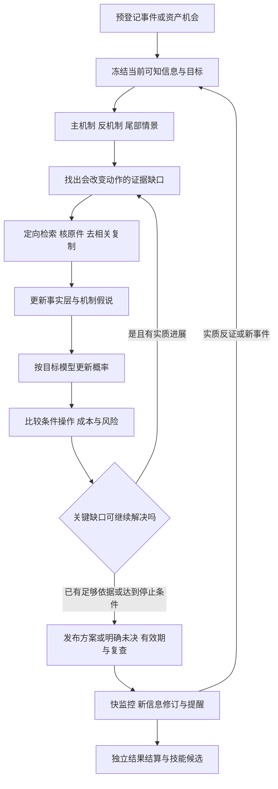

# 决策方法、概率与效果评价合同

日期：2026-10-17（北京时间）。基线：`decision-product-control-2026-10-17.review-4`，本次review-5补审。状态：**`paused_for_document_review`**。用户已批准review-4及OKX USDT线性永续建议/paper范围，随后要求实施前完成一次完整文档复核。本轮只读源码、一手资料并补文档；未启动产品、测试、构建或登记试验。下述新增规则是补审设计，不是当前已实现能力；恢复实施以总控记录为准。

**技术补正：**[07代码层诊断](07_ARCHITECTURE_REPAIR_BLUEPRINT.md)补充了预算先于内容判定、只准一次独立复核、动态根因问题无法映射旧requirement等实现问题。T04先解除这些具体障碍，再落实本篇概率与行动接口；不能只通过评测反复调结果。新增问题以能力范围内的RequirementRevision进入同一研究循环，原Task与历史判断保持不可变。

本文把[事前决策主方案](../market-risk-v1/DECISION_FIRST_PRODUCT_PLAN_2026-10-13.md)、[可执行规格](../market-risk-v1/executable-product-v1/README.md)与[工程复盘](../../retrospectives/SOFTWARE_ENGINEERING_REVIEW_2026-10-17.md)中的方法接缝写清。既有 Action 协议、已冻结试验及历史原件仍按原版本解释；本文新增接口和阈值须经后续实施及协议登记才生效，不以设计文本宣告当前能力通过。

## 1. 交付对象与方法边界

用户从关注资产或重要事件开始，得到**事前情景及概率、当前条件操作、改变判断的证据、下一次检查与有效期**；新信息引起可追踪修订和提醒；结果到期后对照原判断，生成经验证、下一次研究实际消费的经验。报告解释这条链，不替代这条链。

首个完整切片覆盖 **BTC/ETH 双向建议和纸面执行**：事前列出事件发生/结果、条件上涨/震荡/下跌、尾部和交易净收益的不同概率，针对空仓、已有多仓、已有空仓分别比较建仓、加仓、减仓、平仓、条件操作与维持。用户已选定 **OKX USDT 本位线性永续 `BTC-USDT-SWAP`、`ETH-USDT-SWAP`**；范围批准不代表实现或数据资格已经通过。旧现货合同、样本与原件继续按旧版本解释，不能凭旧现货能力宣称永续已支持。本轮不自动下单、不接真实账户交易。

**新产品目标为 4h/24h/72h**，沿用[已确认的4小时至3天范围](../market-risk-v1/KRONOS_INTEGRATION_RESEARCH_PLAN_2026-10-15.md)；当前30m/24h/72h旧合同和独立7d基线保留各自历史含义。4h schema、合约行情、概率绑定、发布、监控和独立标签/样本须真实贯通；72h预测不自动取得72h持仓资格。黄金、纳指、恒科沿相同合同扩展，不能仅接行情就称完成。缺历史样本时允许明确标识的结构化主观概率和条件首选方案；没有校准资格不等于强制 `no_trade`。

因果链在本产品中是**有证据和可反驳预测的机制假说**。观测到消息与价格同时变化，或 LLM 能给出流畅解释，并不完成统计因果识别。系统应在新结果发生前写出预期传导、替代机制和失效条件，用后续观测判断是否值得继续采用。

**当前事件范围。** CPI只是已有数值分支和演示实例。BTC/ETH首交付在T03–T08内同时完成CPI、PCE、完整就业报告、FOMC的事前情景/概率来源/双向条件方案/阶段更新/结果回看；广泛宏观日历和加密资金费、到期、运行与规则事件也进入同一研究、监控链。各族可用结构化主观方法交付，统计模型不合格不能变成不研究该事件的理由。黄金/纳指/恒科是T09的资产扩展；更多合格统计方法是后续增强，不再与核心宏观事件支持捆绑延期。范围、实际代码与首版方法见§2.1及§5.2.1。

## 2. 当前实现、可复用函数与新增切口

以下“已有”只表示本轮读到对应实现，不表示 release33 已正式整链通过。不要把历史架构文档中的“拟建”机械当成今天未实现，也不要把函数存在当成交付通过。

| 环节 | 已有模块/函数 | 当前边界与拟增量 |
|---|---|---|
| 事件事前输入与联合情景 | [event_scenario_snapshot.py](../../../packages/kernel/decision_hub_kernel/application/event_scenario_snapshot.py)：`freeze_event_scenario_snapshot_in_session`、`read_event_scenario_snapshot_in_session`；[cpi_event_scenario.py](../../../packages/kernel/decision_hub_kernel/decision/cpi_event_scenario.py)：`compute_cpi_scenario_body`、`score_joint_event` | 已冻结 CPI 输入、历史残差、九格联合概率和目标；当前比较**上月值**，不是市场共识。新增共识目标必须独立 target/version，不能改名复用旧成绩。 |
| 宏观背景和历史响应 | [event_macro_context.py](../../../packages/kernel/decision_hub_kernel/application/event_macro_context.py)：`collect_event_macro_context_in_session`；[event_response_path.py](../../../packages/kernel/decision_hub_kernel/application/event_response_path.py)：`collect_event_response_model_in_session` | 当前明确保留日频背景、非历史 vintage、未绑定 survey consensus/event pricing 缺口；补合格共识、公开时点与首次发布值来源后才允许相应目标。 |
| 响应与规则基线 | [event_response_model_v2.py](../../../packages/kernel/decision_hub_kernel/decision/event_response_model_v2.py)：`replay_policy_path`、`estimate_v2`；[event_opportunity_policy.py](../../../packages/kernel/decision_hub_kernel/decision/event_opportunity_policy.py)：`select_event_policy`、`evaluate_event_policy` | 现有 V2 明示为按当前宏观背景选择规则的历史 what-if，不能标成历史时点回测或金融合格。保留作诊断/规则基线；前瞻样本另记。 |
| 外部观点 | [public_opinion.py](../../../packages/kernel/decision_hub_kernel/application/public_opinion.py)：`PublicOpinionImportService.import_acquisition`、`PublicOpinionResearchContext.prepare_candidates_in_session`、`freeze_selected_in_session` | 已将归属作者的观点作为 `authority=unverified` 候选、保留条件并要求反证；需在机制节点、来源簇与行动引用之间补完整可见关系。 |
| 研究轮次与结束 | [agentic_research_graph.py](../../../packages/orchestration/langgraph/graphs/agentic_research_graph.py)；[research_graph_projection_v3.py](../../../packages/kernel/decision_hub_kernel/application/research_graph_projection_v3.py)：`quality_for_state`、`should_continue_after_round`、`project_round_v3`、`finalize`；[research_quality.py](../../../packages/kernel/decision_hub_kernel/decision/research_quality.py)：`assess_research_quality` | 复用已有 Graph/DSH 和质量侧车，补“哪个机制缺口影响哪个动作、下一次搜什么、何时结束”的明确输入。不能另起一套 Agent Loop。 |
| 概率绑定 | [research_probability_binding.py](../../../packages/kernel/decision_hub_kernel/application/research_probability_binding.py)：`probability_first_freeze_in_session`、`probability_phase`、`store_probability_values_in_session`、`resolve_probability_commit_in_session` | 复用冻结选择和发布绑定；扩展 target 类型及概率来源字段，禁止把事件概率写进方向或行动成功率槽位。 |
| 从研究到行动 | [action_research_integration.py](../../../packages/kernel/decision_hub_kernel/application/action_research_integration.py)：`register_action_opportunities_in_session`、`ActionResearchIntegration.publish_committed`；[action_publication.py](../../../packages/kernel/decision_hub_kernel/application/action_publication.py)：`ActionPublicationService.publish` | 复用机会登记、可信研究与行动发布；拟增加行动比较原件，解释为何选该动作而非最高概率情景对应的机械方向。 |
| 条件与修订 | [action_policy.py](../../../packages/kernel/decision_hub_kernel/decision/action_policy.py)：`evaluate_condition_expression`、`confirmed_bar_streak`、`select_plan_event`；[action_monitor.py](../../../packages/kernel/decision_hub_kernel/application/action_monitor.py)：`ActionMonitorService.process_due`；[action_revision.py](../../../packages/kernel/decision_hub_kernel/application/action_revision.py)：`plan_revision_changes` | 保留三值条件、失效/退出优先、租约及不可变版本；补概率/机制变化到修订和提醒的映射。快监控不等待长报告或学习。 |
| 行动及事件结果 | [action_execution.py](../../../packages/kernel/decision_hub_kernel/application/action_execution.py)：`ActionExecutionService.observe_evaluation`、`execute_intent`、`observe_episode`、`read_outcome`；[event_outcome.py](../../../packages/kernel/decision_hub_kernel/application/event_outcome.py)：`EventOutcomeService.process_forecast`、`process_due` | 两类账本各有目标与时钟；纸面成交、事件响应重放、用户真实采纳分别计账。缺报价或次序不明不能补成盈利。 |
| 经验生成、资格和消费 | [research_learning_scanner.py](../../../packages/kernel/decision_hub_kernel/application/research_learning_scanner.py)：`TerminalOutcomeScanner.scan`；[research_learning_packages.py](../../../packages/kernel/decision_hub_kernel/application/research_learning_packages.py)：`LearningPackageBuilder.build`；[component_registry.py](../../../packages/kernel/decision_hub_kernel/application/component_registry.py)：`shadow/review/activate/rollback`；[research_skill_consumption.py](../../../packages/kernel/decision_hub_kernel/application/research_skill_consumption.py)：`SkillConsumptionService.prepare_in_session/freeze_in_session/read_consumed_in_session` | 已有工程资产；学习包执行器目前限制为 `spot_evidence/features/hypothesis` 三节点布局及允许的输入修改。先完成其真实闭环，不能声称可自动创造任意工具、工作流或模型。 |

### 拟新增的最小接口

这些是**待实现的接口草案**，不是当前可调用函数。优先增量扩充既有 schema、role 原件与 ports，不另建知识图数据库、概率服务或评价平台；代码生成继续使用仓库现有流程。

| 接口草案 | 所属边界与输入 | 输出与强制限制 |
|---|---|---|
| `bind_mechanism_review(candidate, frozen_context, claims, evidence_clusters, prior_review)` | 既有研究 role/`MechanismReview` 合同；DSH 生成 candidate，Kernel 只校验与绑定 | 节点/边、支持与反证、缺口、行动敏感性、版本。节点引用原件，机制文字不能伪装事实。 |
| `plan_material_gaps(review, capability_catalog, remaining_budget)` | 既有研究 requirements/quality 接缝 | 有序检索任务：`gap_id/claim_id/question/source_kind/acceptance_rule/affected_actions/stop_condition`；无可用来源时返回具体不可解原因。 |
| `collect_consensus_snapshot(event_key, as_of, source_binding)` | 现有 `cpi_pre_event_context/event_macro_context` 的来源端口 | 原件版本、样本/调查截止、单位、precision、公开/收到时点、headline/core 共识；缺失返回 unavailable，不能用 nowcast 冒充共识。 |
| `estimate_target_distribution(target_spec, frozen_inputs, model_binding)` | 现有纯 `decision` 概率计算及 `research_probability_binding` | `target_id/value或分布/kind/calibration_ref/train_end/known_at/sample_clusters/gaps`；无资格或数据不足不自动填 0.5。 |
| `compare_action_candidates(snapshot, position_context, action_catalog, cost_policy, utility_policy)` | 既有 ActionPolicy 纯函数边界；网络/SQL/LLM 不进入 | 每候选可行性、净收益分布/范围、风险约束、选取理由和关键敏感性；不存在可信分布时输出规则型研究试用，不制造精确 EV。 |
| `score_frozen_forecast(prediction, label, protocol)` | 复用 `score_joint_event` 及既定 `tools.action_evaluation` 方向 | 不同 target 的 Brier/校准/行动/告警分开计分；校验时点、版本、分母、缺件并输出终态。实施前需核实该 CLI 的实际存在状态，本文不提供可执行命令。 |

#### T03/T04 可落实的文件、类型和签名

下列均为**拟新增或增量修订**。机制与缺口仍由 `contracts/schemas/research_signal.schema.yaml` 定义；旧 `decision_product_v1.schema.yaml` 保留，新增 **`contracts/schemas/decision_product_v2.schema.yaml`** 作为下述双向行动、合约、三类概率及发布窗口的canonical来源，通过现有生成链产出Py/TS类型。共识外部原件DTO放在拟新增 `ports/event_consensus.py`，其余跨模块类型经拟新增小型 `ports/decision_method.py` 导出。03/04/05引用同一版本，不在模块内再造enum，不手改generated文件。

```python
# 拟新增 ports/decision_method.py 导出的核心 DTO 语义（不是可运行代码）
TargetSpecV1 = {
    "target_id": str,
    "target_family_hash": str,
    "kind": Literal["event_occurrence", "event_outcome", "market_return", "market_path", "action_net_profit"],
    "event_key": str | None, "scope_id": str | None,
    "anchor": Literal["scheduled_pre_release", "post_release_response", "publication_bound", "eligible_fill"],
    "start_offset_seconds": int, "horizon_seconds": int,
    "thresholds_ref": str | None, "unit": str,
    "instrument_ref": str | None, "clock_policy_ref": str,
    "conditioning_ref": str | None, "conditioning_hash": str | None,
    "partition_ids": tuple[str, ...], "label_rule_ref": str,
    "baseline_ref": str, "protocol_ref": str, "payload_hash": str,
}
# 所有 Decimal 使用既有十进制字符串 wire；日期有时区并规范 UTC。
ProbabilityEstimateV1 = {
    "target_ref": str, "target_hash": str, "as_of": datetime,
    "probabilities": tuple[tuple[str, Decimal], ...] | None,
    "kind": Literal["model_estimate", "subjective", "calibrated", "unavailable"],
    "qualification": Literal["research_trial", "qualified", "blocked"],
    "model_ref": str, "model_hash": str, "input_manifest_ref": str,
    "calibration_ref": str | None, "train_end": datetime | None,
    "sample_count": int, "event_cluster_count": int, "gaps": tuple[str, ...],
}
MaterialGapV1 = {
    "gap_id": str, "claim_id": str, "question": str,
    "source_capability": str, "acceptance_rule": str,
    "affected_actions": tuple[str, ...],
    "priority": Literal["critical", "decision_material", "background"],
    "stop_condition": str,
}
```

`TargetSpecV1` 是尚未实施的sidecar草案类型，review-3调整其完整定义，不改历史wire。kind子合同分别必需：事件发生的可观察定义/期限/未发生与不可观测规则；事件结果的event_key/partition；市场的instrument/价格基准/三分类阈值；行动的condition/fill/cost/position/exit/margin协议。`conditioning_ref/hash`进入target hash；给定事件结果的q与event_family_only基线不能共享target身份。二元目标用true/false完整分布，不能同时保留矛盾的value与probabilities。`ConsensusSnapshotV1` 为available/unavailable判别联合：前者含metric/reference_period/value/unit/survey_cutoff/publication_precision/source_public_at/received_at/known_at/source_ref/raw_ref/raw_hash；后者只含reason与缺失项。

三类概率DTO共同内嵌 `ProbabilityEstimateV1` 的来源、资格、截止和模型身份，缺数用nullable联合类型，不能塞默认0.5：

| 新类型 | 必需语义 |
|---|---|
| `EventProbabilityV1` | `event_definition_ref/occurrence_target_ref/outcome_target_ref/occurrence_distribution/outcome_given_occurrence/joint_partition_ref/observation_rule_ref`。scheduled事件的日历存在不等于会按时发布的统计100%；结果概率可明确条件于“已按定义发布”。unscheduled事件的发生/未发生是完整分区，发生后结果概率另记，不能条件在“最终已发生”样本上宣称发生率。 |
| `ConditionalMarketDistributionV1` | `instrument_ref/market_target_ref/event_scenario_ref或null/conditioning_ref/direction_distribution{up,neutral,down}/tail_targets/path_distribution_ref或null/support_by_scenario/extrapolation/uncertainty_ref`。给定情景q和混合后的边际分开原件；尾部不与三分类相加，方向neutral不是操作。 |
| `ActionOutcomeDistributionV1` | `candidate_ref/position_ref/fill_probability/trigger_probability/no_fill_mass/conditional_on_fill{net_profit,zero,net_loss}/net_pnl_distribution_ref或null/mae/tail_loss/liquidation_probability或null/cost_funding_margin_refs`。必须标明条件于fill；无账户只作单位名义分支，不能声称真实账户可执行。 |

共享版本键为 `opportunity_id + instrument_ref/hash + target_family_hash + target_ref/hash + as_of + model_ref/hash + forecast_version`；行动再加 `account_ref/hash + position_ref/hash + utility_ref/hash + candidate_ref/hash + fill/cost/funding/margin_policy_hashes`。所有新目标、ProbabilityModelBinding、ProbabilityEstimate、三类概率与行动/发布DTO均归`decision_product_v2.schema.yaml`；Mechanism/MaterialGap继续research_signal。原件保存在既有role/event/output/Action引用链，新增DTO不代表新增服务或数据库。

publication_bound的候选概率先绑定不可变candidate target ref/hash，状态为pending_anchor；首次发布创建独立`FrozenForecastV1`，同时引用candidate概率ref/hash、PublicationAnchorReceipt ref/hash与final target ref/hash。最终窗口绑定不会覆盖候选概率或它的target/hash，也不重写model参数/数值；评分沿FrozenForecast验证整条绑定链。其他已固定时刻目标可直接绑定final target。03的派生comparison只能引用这条合法链，不自行替换概率身份。

| 拟落文件（均相对 `packages/kernel/decision_hub_kernel/`，最后一行例外） | 带类型的拟接口 |
|---|---|
| `application/research_signal.py`，复用既有机制 role 原件路径 | `bind_mechanism_review(candidate: MechanismReview, context: FrozenResearchContextRef, claims: tuple[ClaimSignal, ...], clusters: tuple[EvidenceClusterV1, ...], previous: MechanismReview \| None) -> MechanismReview`；candidate 由既有 DSH 调度生成，函数仅校验/绑定。 |
| `decision/research_quality.py`，纯函数增量 | `plan_material_gaps(review: MechanismReview, capabilities: tuple[SourceCapabilityV1, ...], budget: ResearchBudgetViewV1) -> tuple[MaterialGapV1, ...]`；现有 quality projection 将返回项转换为既有 requirement。 |
| 拟新增 `application/event_consensus.py`，通过来源端口读已采集原件 | `collect_consensus_snapshot_in_session(session: Session, *, event_key: str, as_of: datetime, binding: ConsensusSourceBinding, archive: RawArchiveReader) -> ConsensusSnapshotV1`；网络采集仍在 source adapter，函数不在事务内联网。 |
| 拟新增 `decision/target_probability.py`，复用现有事件/反应模型 | `estimate_target_distribution(target: TargetSpecV1, inputs: FrozenTargetInputsV1, model: ProbabilityModelBindingV1) -> ProbabilityEstimateV1`；application 负责取得完整输入、冻结和持久化。 |
| `decision/action_policy.py`，纯比较函数增量；拟增 `decision/perpetual_accounting.py` 只算合约现金流 | `compare_action_candidates(snapshot: DecisionMethodInputsV1, position: PositionContextV2, candidates: tuple[ActionCandidateV2, ...], costs: CostPolicyV1, utility: UtilityPolicyV2) -> ActionComparisonV2`；账户/合约/保证金均为已冻结输入，返回逐候选可行性、收益风险或未知原因、首选及次选。 |
| 拟新增 `tools/action_evaluation/scoring.py`，与既定 Action 评价命名空间一致 | `score_frozen_forecast(prediction: FrozenForecastV1, label: VerifiedTargetLabelV1, protocol: EvaluationProtocolV1) -> TargetScoreV1`；按 target 分派已有或新增 scorer，纯读取输入，不补采集或改产品库。 |

新类型按下表冻结最小语义，T03/T04负责 schema 生成和兼容实现，不重新决定其业务含义。只传既有原件引用，不复制正文。

| 拟类型 | 最小字段与跨模块验证约束 |
|---|---|
| `FrozenResearchContextRef` | `run_id/task_ref/context_ref/context_hash/as_of/known_at_max/scope_id/horizons`；各引用可认证，`known_at_max<=as_of`，同 Task/scope；该候选的后续阶段不得改其截止。live下一轮可在Task固定采集上界内生成新context/候选和新as_of，旧版不回写；replay历史边界不推进，详见03 §6与08 §7。 |
| `EvidenceClusterV1` | `cluster_id/root_refs/member_refs/dependency_refs/claim_ids/clustering_version`；成员必须来自冻结证据集；同源转载只占一个根事实，依赖不明标 unknown，不计独立源增量。 |
| `SourceCapabilityV1` | `binding_ref/version/source_kind/supported_metrics/scopes/units/time_precision/licence_status/availability/reason`；单位与精度匹配 target，未授权或不可用能力不可生成执行检索任务。 |
| `ResearchBudgetViewV1` | `task_deadline/rounds_remaining/tool_calls_remaining/cost_remaining/observed_at/no_progress_rounds`；由已有 Task 与真实消耗投影，非负且恢复不重置；候选不得自报剩余预算。 |
| `ProbabilityModelBindingV1` | `model_ref/hash/target_ref/hash/parameter_ref/training_manifest_ref/train_end/calibration_ref/status`；target/scope/horizon一致，训练标签在 as_of 前成熟；资格只读注册记录，缺校准不得标 calibrated。 |
| `InstrumentContractV1` | `venue/inst_id/instrument_kind/linear_or_inverse/base/quote/settle/ct_val/ct_mult/ct_val_ccy/lot_sz/min_sz/tick_sz/price_basis_refs/rule_source_ref/hash/effective_at/known_at`，并绑定funding_schedule与margin_tier规则版本。新scope为`crypto:perp:okx:{inst_id}:trade:1m`；index/mark/spot不得冒充合约成交价。 |
| `AccountSnapshotV2`、`PositionContextV2` | 前者含`source=user_declared|verified|paper_policy|unknown/as_of/account_mode/positions/collateral/equity/available_margin/fee_tier/limits`及原件；后者含`flat|long|short|unknown/signed_contracts/entry_price/isolated_margin/margin_mode/position_mode/leverage/liquidation_estimate/source/ref/hash`。未知值为空，不用旧catalog的10000 USDT假设冒充用户余额；hedge账户保留两腿原件，首版不净额后隐去风险。 |
| `ActionCandidateV2` | `candidate_id/action=open|add|reduce|close|conditional|no_change/target_side=flat|long|short/instrument_ref/position_ref/account_ref/condition_refs/nested_action_ref或null/size_policy_ref/exit_ref/valid_until/cost_ref/funding_ref/margin_ref/fill_ref/target_refs/basis_refs/execution=paper_only`。conditional必须引用具体合法子动作；open只从flat进入，add同向增仓，reduce同向减绝对数量，close到0，no_change保持。反手是close回执后另行重核open，不能一张sell穿过0。 |
| `ActionComparisonV2` | `snapshot_ref/as_of/position_branch/selected_action_id/alternative_action_ids/selection_kind/candidate_results/unknown_reasons/binding_hash`；每结果含`feasibility=feasible|infeasible|unknown/rejection_codes/net_distribution_ref或null/utility或null/risk_metrics/sensitivity/assumptions`。单位名义建议可标`account_feasibility=unknown`，不能升级成纸面已成交；未知utility不参与数值排序，规则选取另给依据。 |
| `UtilityPolicyV2` | `policy_ref/hash/source=user|research_default/objective/risk_penalty/max_gross_notional/max_planned_loss/tail_constraints/position_scenario/margin_buffer_policy/allowed_leverage`；单位和适用账户明确。首版采用§5.5 mean_net及硬约束，参数未知给单位名义与翻转边界，不猜用户风险偏好。旧连续组合J的0.5权重不冒充用户偏好。 |
| `VerifiedTargetLabelV1` | `target_ref/hash/event_key/scope_id/window_start/end/value或category/known_at/settled_at/source_refs/coverage/status/version`；窗口完整且成熟，目标定义一致；缺件或次序歧义为unscorable；修订追加版本。 |
| 其余引用载体 | `FrozenTargetInputsV1/DecisionMethodInputsV1`含context/target/事实/模型/合约/成本引用与hash；`CostPolicyV1`含maker/taker费率、滑点、币种、来源及假设标识；`FrozenForecastV1`含预测单元主键、概率原件、PublicationAnchorReceipt与可见回执；`EvaluationProtocolV1`含机会/发布窗口、标签、基线、全部分母和scorer版本；`TargetScoreV1`含主键、数值或null/资格/缺口。均禁止跨target、未来版本及未注册单位。 |

**旧DTO兼容。** `ProbabilityEstimateV1`是新增、有精确target绑定的sidecar；Decimal以十进制字符串保存。现有Action概率槽仍为有限JSON number和`subjective/calibrated/unavailable`：只有target/scope/horizon/条件完全相同才转换，`model_estimate`在旧槽映射为`subjective`并保留sidecar provenance，合格校准映射为`calibrated`。边界校验后转换[0,1]有限number，不借转换获得资格。事件概率或不同条件行动概率不能填入旧方向槽，该槽保留`unavailable/value=null`并由新视图显示sidecar。接口增量服务于当前条件建议，不以训练新模型作为具证规则建议的前置条件。

### 2.1 事件族合同：配置、事实、方法与消费者

**维护方式。** 复用`packs/crypto_macro/pack.yaml`及`application/research_binding.py`的有界读取/冻结；拟升manifest版本声明`event_family_pack_refs`，配置放`packs/crypto_macro/events/<family_id>.yaml`。拟增`application/event_family_registry.py::EventFamilyRegistryV1.resolve(ref, hash)`仅解析获准配置并装配allowlist处理器，不动态加载网页代码、不另立激活指针。配置不能藏网络、SQL或LLM调用；解析适配器属于`packages/source_adapters/official_feeds/`或`packages/provider_adapters/market/`，纯分区/校验属于Kernel `decision/`，事务归既有application服务。

以下三个类型在`contracts/schemas/decision_product_v2.schema.yaml`定义，经原codegen生成，`ports/event_family.py`导出。这里规定业务字段，03负责唯一写者、存储及兼容迁移。

| 拟合同 | 必需字段与含义 | 直接消费者 |
|---|---|---|
| `EventFamilyPackV1` | `family_id/version/payload_hash/schedule_source_bindings/actual_source_bindings/metric_specs/occurrence_rule_ref/scenario_partition_ref/baseline_policy_ref/estimator_bindings/stage_specs/monitor_policy_ref/label_policy_ref/coverage_policy_ref`。metric定义名称、单位、季调、精度、参考期、首次值/修订值和raw定位；stage定义来源、精度、依赖及pre/post时钟；estimator显式区分统计候选与`structured_judgment.v1`，不存在的模型不能填名称占位 | source presets/适配器按binding产事实；`event_lifecycle.py`排期；`event_scenario_autoproduction.py`按family分派；研究RolePlan读取模板；`event_realization.py`/`event_outcome.py`按分区与标签规则认证 |
| `EventFamilyBindingV1` | `pack_ref/hash/event_key/reference_period/schedule_ref/hash/stage_id/event_cluster_id/dependency_refs/metric_snapshot_refs/baseline_refs/target_refs/conditioning_ref/hash`；reference_period允许月、季度、周、会议或合约结算键，不适用可null，不把FOMC塞成CPI月份；所有输入known_at受该冻结cutoff约束 | Task/context及概率sidecar；`event_owned_opportunity.py`、`research_probability_binding.py`、`action_publication.py`；query将同一binding投影给PC |
| `EventAgendaSnapshotV1` | `as_of/instrument_refs/window_start/window_end/entries/coverage_refs/payload_hash`。每entry含binding ref、stage schedule/precision、materiality_reason、overlap_group、dependency_refs、next_check_at；覆盖已知会落入该4h/24h/72h窗口的事件及具名可能事件，缺源显式留下coverage gap | `risk_research_admission.py`合并机会；既有context/RolePlan读取；行动比较按全agenda查重叠风险；monitor用新agenda产生关联复查；评分按事件簇去重 |

`materiality_reason`由可观察规则给出：四核心族默认进入；其他事件至少满足已登记利率/增长/流动性传导、影响所选交易所/合约可用性、资金费改变持仓成本，或已有方案显式引用之一。外部“高重要性”星级只是线索。agenda负责发现和排期，不能凭名单完整宣称已穷尽所有潜在冲击；覆盖失败会显示，具名意外事件沿§5/11进入相同合同。

| 事件族与BTC/ETH首版交付 | 已有真实代码及边界 | T03–T08拟增与消费者 |
|---|---|---|
| `cpi`：保留已有数值预案并贯通新行动 | `official_feeds/cpi_schedule.py`、`bls_cpi.py`、`cpi_nowcast*.py`；`decision/cpi_event_scenario.py`和`application/event_scenario_autoproduction.py`可生成九格。`event_realization.py`仍直接读BLS CPI四指标并调用CPI band | 以CPI pack绑定既有handler；旧reader和历史目标保持原义。新perp三期限/共识目标独立；scenario→opportunity→review/publication→monitor/outcome沿原链 |
| `pce`：事前通胀情景与条件多空方案 | `calendar.py::_event_family`能识别PCE，但`official_feeds/presets.py`当前未装配BEA日历；不等于已有PCE actual/nowcast估计器 | 拟`official_feeds/bea_release.py`采BEA schedule及Personal Income and Outlays首次发布；拟`decision/event_family_scenarios.py`验证PCE九格；既有DSH生成主观p/q、原发布/监控链消费 |
| `nfp`：就业、失业率、工资与修订一起研究 | BLS `OfficialCalendarSource`可识别Employment Situation为nfp；现有`macro_event.py`只有单标量actual/consensus等槽，不能代表完整就业向量 | 保留兼容family键nfp，展示“就业报告”；拟`official_feeds/bls_employment.py`产结构化向量，family分区器产四情景；研究检查增长与政策双机制，实际值认证选已审分支 |
| `fomc`：利率决定、声明/SEP、发布会阶段方案 | `OfficialHtmlCalendarSource`已有Fed会议**日期**；`ports/event_scenario.py`仅预留`fomc_rate_discrete` enum，无FOMC producer；FrozenEventScenarioBase仍强制published<T0 | 拟`official_feeds/fed_policy.py`按官方会议链接采statement/implementation note/SEP与发布会材料；阶段binding与主观联合情景；旧CPI pre reader不改作发布会live reader |
| 扩展宏观：PPI、GDP、零售、JOLTS、初请、央行讲话/纪要、ECB/BOJ等 | BLS calendar覆盖PPI等；未匹配标题退为scheduled_macro_event，JOLTS需明确新增映射。Fed/ECB/BOJ已有HTML日期入口；BEA/Census/DOL schedule需补装配。日历文本本身不认证actual | 本版采用同一pack模板登记具名指标或文档条件，经source acquisition/原件认证、`risk_research_admission`、DSH结构化情景、发布/监控/结果链；无合格数字解析时可依有引用文档发布研究方案，自动事实分支须等认证。GDP版本(advance/second/third)、初请周次必须进identity；不挤占四核心族的完整解析任务 |
| `crypto_funding`：所选OKX永续资金费与结算时点 | `okx_research.py`已有`funding_rate/open_interest/mark_price/index_price`公开事实查询；尚非完整结算日历、未来费率分布或paper费用账本 | 拟`provider_adapters/market/okx_event_context.py`读fundingTime/nextFundingTime及已结算history，冻结每合约结算版本；成本/保证金→comparison revision→monitor/paper outcome。预测费率与结算实际值分开，不硬编码8小时 |
| `crypto_expiry`：BTC/ETH相关到期与结算 | 现有OKX研究模块没有完整FUTURES/OPTION到期事件链；永续自身没有固定到期日 | 同拟OKX事件适配器由公开instruments的expTime/合约类型构建关联到期agenda，并保留OI/价格时点。首版覆盖OKX公开可得BTC/ETH到期上下文；其他场所尚无binding时显示覆盖缺口。到期与OI不直接推出价格方向或“最大痛点”概率，主观机制方案独立标识 |
| `crypto_operations`与具名可能事件：交易所维护/规则/故障、链升级与监管/安全事件 | 现有source acquisition/discovery可接材料，未有通用可认证实际值与全部官方源覆盖 | 所选交易所官方状态/公告与instrument规则变更必须接入；BTC/ETH已公告升级、具名监管决定/安全风险通过官方项目/监管原件和现有研究入口登记定义/期限/来源覆盖。维护按时/延期/影响恢复、升级发生/未发生和影响分开。已证实故障可激活保护；未核传闻保留unknown。不给未定义的“所有黑天鹅”填发生率 |

这些配置/薄适配器为本版有界增量。`event_scenario_autoproduction.py`的租约/CAS/不可变原件可复用，CPI来源和计算选择须抽为handler；`event_realization.py`的认证/版本责任可复用，四指标band不能泛化成利率或就业算法。拟`decision/event_family_scenarios.py::validate_partition(pack, scenario)`校验分区、单位和完整概率；`classify_outcome(pack, binding, verified_metric_snapshots)`只对具有数值标签规则的已认证输入分类。文本语义返回有引用的研究解释，不由此函数制造客观actual。`macro_event.py`保留历史标量投影，新向量/阶段走v2 sidecar。现有forecast/realization表的月度reference_period和日slot限制按03迁移，新合同不得靠截断事件键规避。新模型尚未合格不阻普通BTC/ETH研究、主观事件计划或成本保护链。

## 3. 因果研究是一条可继续、可结束的工作链



### 节点合同

每个重要机制节点保留 `node_id/type/claim/as_of/horizon/input_refs/source_clusters/support_refs/counter_refs/status/gaps`；边保留 `from/to/mechanism/expected_sign/lag/regime/observable_check/falsifier`。`type` 至少分为已核事实、模型估计、外部观点、机制假说、行动条件。这里的图首先是可读、可校验的结构化原件，无须引入通用图执行引擎。

例如“CPI 低于共识→政策路径预期下修→实际利率/美元变化→风险资产估值和资金需求变化→BTC 短时上涨”需逐节点核验。相反机制包括增长担忧、事件前已充分计价、拥挤仓位平仓和同期其他消息；ETH 另考虑自身资金流与网络事件。出现 CPI 降温不自动把后续节点全部标成 true。

每轮先写**待证问题和可改变的决策**，再调用工具。例如“共识究竟是本期核心环比还是同比”“两篇文章是否同引一个调查”“突破由新买盘还是清算造成”“当前信息足以撤销新增风险还是只调整观察优先级”。工具成功次数、支持文章数量和同一假说重复表述不构成概率增量。

### 缺口再检索与停止规则

1. 检索优先级按影响排列：会推翻动作/风险上限的关键反证；会改变条件或有效期的缺口；最后才是说明性背景。每条缺口指定可以解决它的来源能力和验收条件，不能只写“再多搜一点”。
2. 每轮比较新增的**独立事实、已解决冲突、可执行条件或实质假说变化**。只有新页面而无新增信息不算进展；当前 Graph 已有无进展与预算判定，沿该接缝扩展。
3. `sufficient`：当前目标所需事实及关键反证可核，主要/相反/尾部情景齐备，动作/失效/期限明确，剩余缺口不会改变该档位建议。资格按 direction/path/execution 各自记录，不能把某模型尚未合格写成所有条件操作都不可见。
4. `bounded_partial`：来源确定不可用、缺口尚不可解、连续两轮无实质进展或达到已声明预算时结束当前研究，保留已有可信结果和逐项缺口；不能冒称 sufficient。已有 `no_progress/round_budget/tool_budget/cost_budget/deadline/no_actionable_path` 继续保留，不增加第二套运行状态机。
5. `blocked`：原件身份、时间、scope/单位或关键价格不可认证，阻断受影响动作；可独立认证的风险说明和其他期限不受无关缺口连带覆盖。
6. 每次停止同时给 `next_review_at/reopen_triggers`：官方发布、共识修订、关键来源恢复、失效条件触发、概率/风险跨越预登记阈值。没有新事实时按既有冷却和去重规则处理，不以定时重写报告冒充学习。

研究期限由任务级预算和实质进展共同控制；HTTP 等待、快速条件 tick、后台研究和评价成熟期限各自独立。不能用“60 秒无结果”代替研究充分性判断。当前质量函数的 `full` 同时检查方向、路径和执行；后续修改须明确哪些档位可发布，不能以删去检查或把 unknown 改名来获得完成。

## 4. 来源分层、外部观点与复制去重

| 来源类型 | 可以支持什么 | 接入处理 |
|---|---|---|
| 官方发布、监管文件、交易场所原始报价 | 具体发布值、规则、报价、发布时间等事实 | 原件/时点/修订/单位均需核验；“官方”不自动证明经济解释正确，也不保证历史分钟可得性。 |
| 调查共识、模型 nowcast、衍生品隐含信息 | 分别提供调查预期、模型预测、在特定定价假设下的市场信息 | 三者有不同 target 与来源，不能互换。保留方法、样本、截止和成本/风险溢价假设。 |
| 新闻报道、研究报告 | 发现事件、传导解释、来源线索和分歧 | 将引用事实追溯到原始来源；记者独立采访可作为独立证据，但同引官方公告仍属同一事实簇。 |
| TradingView、社区帖、专家观点 | 技术结构、条件机会、反方机制和待核线索 | 作为有作者/时间/条件的 ClaimSignal；核查标的、图表时区、指标参数和价位。帖子本身不是涨跌事实，点赞、作者名气、广告不得直接增加概率。 |
| 历史案例、技能、Kronos 输出 | 待核机制、检索步骤、独立模型候选 | 必须检查适用资产/制度/期限与资格；模型预测不作为自己的外部事实证据。Kronos 单独 shadow、单独评价。 |

归一化 URL、原文 hash、作者/发布版本、引用链与相似段落用于构造 `evidence_cluster_id`；同一公告的新闻转载、社区转述、翻译只计一个根事实。不同媒体独立取得同一调查数据可以增强原件真实性，仍不能当多个独立经济样本。两个看似独立数据源若同用一家底层供数商，也记录依赖。

冲突不靠简单投票消除：先查时间版本、定义、币种、环比/同比、季调/非季调及报价场所，再记录尚存的实质分歧。无法访问全文时标部分覆盖，只使用已保留内容；删除/编辑追加版本，不能重写旧 cutoff。所有外部文本都是待处理内容，不能控制工具权限、写入路径或要求跳过核验。

## 5. 概率分层、更新与行动选择

令 `I_t` 为时点 t 已实际可用并被冻结的信息，`S_j` 为同一目标下互斥且穷尽的事件结果，`R_h` 为固定窗口市场收益，`X_t` 为事前市场状态，`a` 为冻结的条件行动策略。

| 概率 | 定义 | 不能替代 |
|---|---|---|
| 事件发生与结果概率 | `o=P(E在[as_of,deadline]发生\|I_t)`；`p_j=P(S_j\|E,I_t)`；联合为`o*p_j`，另有`P(未发生)=1−o` | 结果分区和发生定义分别冻结。发生率不由仅发生过的事件样本推导；scheduled日历是事实/条件，延期取消须进入定义。 |
| 条件市场反应概率 | `q_jc=P(Y_h=c\|S_j,X_t,I_t)`，`c∈{up,neutral,down}`；每行和为1 | Y按正/负阈值分三类；neutral表示窗口内涨跌幅处于带内，不是等待或对冲动作。期末方向不能替代路径风险。 |
| 边际市场反应概率 | 完整情景下`m_c=Σ_j p_j*q_jc`；有未发生分支时`m_c=(1−o)q_no_event,c+oΣ_jp_jq_jc` | 只有目标、窗口和条件一致才能混合；少一个必要q则统计混合不可用，不把无条件基线偷偷填入。 |
| 尾部概率 | 分别定义`P(min_t(P_t/P_start−1)≤−d)`与`P(max_t(P_t/P_start−1)≥u)`；多仓关注下尾、空仓也关注上尾 | 两个路径事件可同时发生；不能与up/neutral/down相加，不能用`1−p_up`替代下尾或空仓强平概率。 |
| 条件行动净收益概率 | `P(Π_net(a)>0 \| fill, I_t)`，净收益取冻结入场/退出/成本/期限规则 | 不等于触发率，也不等于前述方向概率；未成交不进入交易胜率分母。 |
| 机会层行动概率 | `P(fill \| I_t)`、`P(fill且Π_net>0 \| I_t)` 分开记录 | 不以“只挑已成交赢家”代替全机会评价；连续组合仍包含所有等待与未触发时段。 |

### 5.1 已有 CPI 模型：从原始输入算出九格

`compute_cpi_scenario_body` 的四维向量顺序固定为 `(headline_mom, core_mom, headline_yoy, core_yoy)`。`f_t` 是当前 Cleveland nowcast，`f_i^(s)` 是历史月份 i 在相同日历信息阶段 s 的 nowcast，`a_i` 是该历史图表的实际值，`b_t` 是当前冻结上月值。输入值用百分数的数值存储，例如 `0.30` 表示环比 **0.30%**；两者相减单位为**百分点 pp**，`0.05pp` 不能误写成 `0.05` 的收益 fraction。

```text
e_i = a_i - f_i^(s)                       # 同月四指标残差，单位 pp
z_i = f_t + e_i                           # 当前事件的一次四维经验抽样
band(x,b) = cooler, x-b < -0.05pp
            near,  -0.05pp <= x-b <= 0.05pp
            hotter, x-b > 0.05pp
S_i = (band(z_i.headline_mom,b_t.headline_mom),
       band(z_i.core_mom,b_t.core_mom))
n_j = sum_i 1[S_i=j]; N = 样本历史月份数
p_j = (n_j + 0.5)/(N + 4.5), j=九个互斥完整情景
```

这里是同月残差向量重用，保留四项相关关系；同比参与联合输入和支持区间，但九格分类只用两项环比。当前代码没有随机 Monte Carlo 抽样，而是逐一使用每个合格历史月份。`0.5` 是 Dirichlet 对称先验伪计数；最后一格以 `1−前八格之和` 消除 Decimal 舍入残差。各指标 p10/p50/p90 是这些同一批 `z_i` 的 nearest-rank 支持分位数，不是区间校准证明，不能相乘两个边际概率假装 headline/core 独立。

**实际样本截止规则。** [select_stage_pairs](../../../packages/kernel/decision_hub_kernel/ports/cpi_nowcast_history.py) 从当前源的 `M/D` 更新标记得到相对参考月份的 offset（只准0或1）和 day；历史月份取该阶段当日或之前最后一条四指标齐全且早于实际公布日期的预测。月末不存在的日期取该月末日。它只纳入 `reference_period < 当前目标期`，要求月/年图表日期一致且四个 actual 唯一完整；现版本显式排除2025-10/11特殊方法期，并保存每个排除原因。当前 cutoff 必须在 T0 前，历史源 `known_at<=cutoff`，当前四项 nowcast 与上月值均由输入合同认证。这是“今天能获得的历史图表用于未来预测”，没有证明历史每次 nowcast 在当时系统已收到；不得用历史图表日期伪造历史 received_at。

该模型已说明：历史当前收到数据并非已认证历史 PIT vintage、跨制度等权、nowcast 不是调查共识、历史残差支持外的尾部缺少建模。其数值可作为明确标识的模型估计，不能由此声称已校准，更不能把 `event_result_probability` 显示为策略胜率。

**新增共识预期差目标。** 以同口径首次发布值 `A_first` 和发布前冻结调查共识 `C_t` 定义 `surprise=A_first−C_t`；需要标准化时用仅来自训练窗口、同一指标的历史预期差尺度 `z=surprise/σ_train`。标准化和三分箱阈值都在 target_spec 内登记。共识、首次值、修订值与 nowcast 各有 ref/hash；缺共识时保留相对上月目标，不输出“高于预期”。联储 CPI 研究发现公告反应随事前关注度和时期显著变化，支持把市场状态纳入条件分析，但不能把研究中的平均效应直接作为 BTC 概率。[来源 S1](https://www.federalreserve.gov/econres/feds/how-markets-process-macro-news-the-importance-of-investor-attention.htm)

**更新规则。** 数值更新由下表登记的估计器、明确标识的结构化主观判断方法或已验证校准映射产生。若确有似然模型，可用 `P(S_j|E,I) ∝ P(E|S_j,I)P(S_j|I)`；条件独立性未成立时不能把多篇同源新闻的似然连乘。LLM 可提出新的机制/分箱/条件，但进入新候选版本验证；不凭“很利多”加 20 个百分点，也不把相同信息的模型共识当独立证据。无法量化时标 subjective 或 unavailable，并保留定性条件建议。

校准映射必须绑定 `target_id/scope/horizon/model_version/train_end/calibration_version`，训练和验证按时间切分，训练标签成熟后才可用。事件结果、资产反应、入场后净收益分别校准；更换目标、成本或入场规则后旧校准资格不自动继承。概率评价采用适当评分而非仅按是否超过 50% 命中，才能让概率本身受到约束。[来源 S2](https://sites.stat.washington.edu/people/raftery/Research/PDF/Gneiting2007jasa.pdf)

### 5.2 首版估计器的明确决定（T03/T04设计合同，尚未实现新增部分）

**review-3统计裁决保留，review-4明确适用范围仅为CPI。** 撤回“九格各n≥20才发布条件q”的首版策略：月度CPI九格至少180个不同月份，名义上已需15年且稀有格仍可能不满；不能以等待它们齐全作为产品前置。CPI首版统计候选q采用下述低维收缩多类模型；Beta只作诊断。它的headline/core编码不能原样用于就业或FOMC，PCE也须独立方法/样本资格。其他族首版按§5.2.1提供`structured_judgment.v1`明确主观判断，具名缺口确实不能支持数值时才unavailable；无条件频率始终是另一个baseline target，不补缺格。以下门槛沿已批准review-4设计保留，属于研究展示的工程决定，不是统计功效、校准或盈利证明。

| 对象/入口 | 算法与固定输入 | 降级、更新与验证断言 |
|---|---|---|
| 现有历史诊断 | 原样复用`estimate_v2`→`estimate`及`replay_policy_path`：正收益次数w、事件数n，`(w+0.5)/(n+1)`；现有区间为原始频率Wilson区间。当前24h目标、相对前值情景、当下宏观选规则和假设费用均按旧版本保存。 | 必须标`retrospective_what_if/estimated_uncalibrated`；其原件真实不等于历史PIT。不得把旧24h窗口、费用或Wilson区间改名后用于新4h/72h/共识目标或校准成绩。 |
| 新PIT样本选择 | 每个`instrument+horizon+event_family+target_family`共享最近最多120个合格事件簇，**不按九格分别取120**。每簇每目标一行，按事件时间/event_key稳定排序，训练label_known_at≤train_end≤as_of；输入首次值/前值或共识、事前波动与合约价格的公开/收到时点可核。 | BTC/ETH不合池；现货与永续不混；情景定义/时钟变化是不同family。已发生结果S是训练时标签侧的条件变量，预测时只能作为假设S_j，不能当发布前已知实际值。历史PIT样本与冻结后的前瞻样本分列；不按收益筛样本。 |
| CPI首版条件市场q | `event_conditional_multinomial_ridge.v1`，同一CPI模型产生所有九格的up/neutral/down行；输入headline/core的−1/0/+1类别与事前波动一个状态，共8参数，公式见下。总N≥30、每个方向标签至少3簇、两项事件编码在训练中各至少两种值，且当前状态在训练最小/最大值内，才发布model_estimate/research_trial。 | 不要求各格20；每格仍报n及是否未观测组合。稀疏格概率由明确的加性/收缩假设得到，标`pooled_model`，不谎报格内样本。若某事件编码取值从未观测，不发布该格统计q；零散缺格不以基线补齐。 |
| 支持不足的固定退路 | 同target完整的`structured_judgment.v1`→unavailable；若统计q只有部分格合格，整张主观分布另存，不能与统计行拼接为同一个model_estimate。 | event_family_only三类平滑频率只作对照：`b_c=(n_c+0.5)/(N+1.5)`，另target、另来源。N=0不可把1/3显示为证据预测；缺口不阻断可核的方向、条件和首选建议。 |
| Beta诊断 | 单一预登记二元目标的`Beta(w+0.5,n−w+0.5)`与均值`(w+0.5)/(n+1)`；区间为BetaPPF的2.5%/97.5%分位。 | 名称为95%后验可信区间，依赖可交换/Bernoulli假设；只描述该分组，不再是首版条件q，也不是把三个Beta均值归一化成三类分布的理由。 |
| 尾部与条件行动分布 | 尾部首版使用同target完整路径的等权发生频率/Beta诊断；行动按冻结的两方向成交、退出、费率、资金费率和保证金规则回放完整路径，保留`未触发/触发未成交/已成交Π_net/MAE/强平/数据缺口`。filled三类采用`(n_c+0.5)/(n_fill+1.5)`；触发/成交另为二元，不能与收益类别混为一行。 | 尾部/行动样本须与各自条件一致；n_all≥30且n_fill≥20才发布研究经验估计，达不到给主观路径假设/范围或unavailable。旧spot路径、close/open模拟或缺mark/funding的路径不能冒称perp可执行PnL。q三分类本身不产生路径、强平或收益幅度。 |
| 主观概率与收益假设 | 登记`structured_judgment.v1`：DSH按固定模板输出target、互斥完整情景概率、方法/依据、最强反证、与基线差异、适用范围及不确定性；独立审核核引用、时间、概率和、论据与行动一致性。 | 通过结构审核仍为`subjective/research_trial`，没有校准ref；不通过则unavailable并保留条件建议。主观收益范围必须另标assumed，不能当经验样本。方法/prompt/模型/独审版本和原输出均冻结，不允许自评自晋升。 |
| 新信息更新 | 新独立证据只重算其实际改变的输入、适用性或已登记主观判断；新成熟标签才增加统计训练样本。每次生成新forecast/model/action版本，保留旧分母与评分。 | 同源转载、重复抓取或改写理由不增加w/n；主观方法必须写明哪条新证据导致何项假说/概率改变，不能只写“加20%”。冻结方法内重新判断合法，改变方法本身则新候选版本并重新验证。 |
| 必须验证的断言 | 固定输入必得同统计结果；n=0不产0.5；同簇复制不改计数；换asset/horizon/scenario/共识目标不借旧标签；未来修订不入训练；未成交不进胜率分母；成本增大不能提高同路径净收益。 | 还须验证条件不足退回的是新基线target、主观值不显示calibrated、所有旧版本可重读；same-cutoff配对Brier/校准与行动净效用分别评价，工程断言通过不授金融资格。 |

**三分类目标的唯一定义。** `h∈{14400,86400,259200}`秒，`R_h=P_end/P_start−1`为fraction。用as_of前最后完整24小时的1440个1m对数收益算`σ24=sqrt(Σr_m²)`；任一必需分钟缺失则该阈值不可计算，不前向填充。冻结`θ_h=0.25*σ24*sqrt(h/86400)`，`up:R_h>θ_h`、`down:R_h<−θ_h`、`neutral:−θ_h≤R_h≤θ_h`。0.25是首版工程参数，平方根缩放只是确定标签的方法，不声称真实收益独立同分布；三期限各自模型和标签。阈值方法进family hash、该次σ/θ原值进payload hash。零波动/非正θ返回缺口；修改带宽须新target版本。

**训练与推断的准确公式。** 令`x_i=(h_i,c_i,z_i)`，h/c分别是该target定义下cooler/near/hotter的−1/0/+1（共识目标另训练，不混用前值）；`z_i=(log σ24_i−μ_train)/s_train`，均值与样本标准差只取本次训练窗，标准差0时z固定0并记录。neutral为参考类：`η_neutral=0`，`η_up=α_up+β_up·x`，`η_down=α_down+β_down·x`，`q_c=exp(η_c)/Σ_d exp(η_d)`。求唯一最小值：

```text
L(α,β)=−(1/N)Σ_i log q_{y_i}(x_i)
       +(0.1/2)Σ_{c∈{up,down}}(α_c²+||β_c||²)
```

截距也收缩、λ固定0.1、无交互项，共8个参数；以log-sum-exp计算，收敛容差/迭代上限/软件版本写进method manifest，未收敛不发数。使用类别编码避免把范围情景随意取一个连续“代表冲击”；代价是同一格内幅度差异与交互未建模，必须显示。λ或特征调整只能登记后续候选，不能在同一验证窗挑最优。惩罚多项logistic是通用统计方法，参数门槛与首版标签是本项目设计，不能借论文获得金融资格。[S10](https://www.jstatsoft.org/article/view/v033i01)

训练是已有方法注册/参数原件的一次小型离线计算：`fit_event_conditional_model(training_manifest, method_spec)->ProbabilityModelBindingV1`建议放`decision/event_conditional_probability.py`，application负责读取认证样本与保存参数，禁止在发布SQL事务内训练。生产`estimate_target_distribution`只读取冻结参数、当前σ与假设情景做softmax。模型按成熟样本新增生成新版本，推断不临时调参。按时间顺序保留训练外预测，与同目标三类频率基线配对Brier/log loss，独立前瞻覆盖/行动效用另报；首版不建新的ML平台。

**不确定性。** 每格显示总体N/各类n/本格n、特征支持域、外推标记和模型假设。固定200次、长度3的连续事件移动块重抽样，每次重拟合相同模型，报告各q的2.5%/97.5%分位为“块重采样稳定性范围”，不是校准区间或保证95%覆盖；seed/块样本/失败数保留，少于180次成功则区间unavailable。混合m的范围须在同一次重采样中重算整行q与m；固定p时只叫“条件于当前p的稳定性范围”，不声称含事件p不确定性。首版不为了出区间引入MCMC。后续可登记连续预期差或分层模型挑战者，并通过同窗口训练外比较决定保留；当前仍只有这一首版统计策略。

**普通入口时钟：采用发布绑定，撤回600秒新默认。** `decision_as_of`仍是知识截止；candidate在审核前冻结`anchor=publication_bound`、60秒bar网格、期限、阈值/方法、valid_until与`candidate_target_hash`。首次正式发布事务由唯一发布者读取数据库UTC时间`assigned_at`，取**严格晚于**它的下一个UTC分钟边界为target_start（恰整分也加60秒），target_end=start+h，原子写`PublicationAnchorReceiptV1`和不可变`target_ref/hash`、概率commit、Action引用及outbox，并以slot的first_publication作CAS；重试沿用receipt，不重新锚定。assigned_at只是事务内分配时间，不是假装事先知道提交完成时刻。提交后另记`commit_observed_at`及PC的`visible_at`事实回执；任一越过target_start分别标`publication_late`、`user_visible_late`，保留slot/原目标而不补事前成绩，缺回执为unknown。发布后不带入新行情重算旧概率；target哈希由candidate目标、receipt中assigned_at/clock rule和start/end确定，后来的可见回执不改hash。价格采用该边界闭合的合约trade 1m close；无合格价则unscorable。

预测概率应描述“首次可发布后固定h窗口”；历史训练必须具有同锚点合同和实际发布回执，事件T0样本不能直接冒充该类模型。首版普通市场若无该训练样本，明确使用结构化主观三分类，不偷借事件q。**完整机会分母仍由预登记每小时slot和事件队列产生，早于研究/发布**；首个审核合格、未过valid_until的候选立即发布，禁止按随后行情择时。候选过期记stale/late或missed，新的revision不删除原slot，也不替换首个合格版本的主评分。协议发布截止固定为下一小时slot到期；这只界定机会未交付状态，不允许等到截止才发布。另记录从slot到发布/可见的延迟及期间MAE、机会错失；这个新窗口只衡量可用后的预测，不能掩盖之前的漏报。旧600秒草案/若有已冻结协议保持历史身份，不重锚、不混分数。

**发布延迟的确定处理。** 概率有效期冻结到原opportunity deadline（普通每小时slot最迟下一小时边界；scheduled预案最迟T0）和更早的具名事实失效条件，不另加统一120秒或600秒研究上限。发布前确定性核事件/关键事实版本、合约/账户身份，以及行情是否跨过该候选已冻结的适用域、sensitivity或失效边界；超时或概率条件失效将旧forecast标stale，保留原件与missed/late分母，关联后继Run更新受影响研究，不能在同opportunity反复换版挑成绩。普通市场主观方法必须明确其概率对“在此有效期与适用域内首次合法发布绑定后h窗口”的判断；只支持原起点的模型不能伪装成publication_bound。仅报价/费率变化且概率条件仍成立时可确定性重算行动比较，生成具名comparison版本，保留原概率；报价新鲜度由合约报价port独立校验。年龄和实际研究/可见延迟如实展示及评分，不单凭年龄抹掉有效4h研究。`PublicationAnchorReceiptV1`的不可变部分含candidate_target_hash、assigned_at、start/end、clock_policy_ref/hash和commit_id；提交/可见观测用追加回执保存。所有新信息重估都必须发生在新概率冻结与正式发布之前；发布后不追补旧数值。

确定性重算仅限原review覆盖的候选集合、计算方法版本和适用域；发布后通过03规定的ActionPlanService revision CAS更新偏好，不再次publish同Run/同机会。新增候选/方向规则或越过review范围必须关联后继Run复核；旧精确candidate hash不能批准任意新内容。沿现有发布/修订链实施，不新建另一套发布平台。

**scheduled主目标必须覆盖公告冲击。** CPI事前主方向使用`anchor=scheduled_pre_release`，P_start为闭合时间**恰等于T0−60s**的合约trade 1m close，end=start+h；缺该分钟则unscorable，不取更早或T0后价格补齐。主评分使用T0−30m知识截止之前最后一条合格冻结版，且须在target_start前提交/可见；没有版记missed，晚提交/可见记late，不拿事后研究补领。即时冲击另记录该起点至T0+60s的收益及上下MAE，不能因主期限4h而隐藏首分钟损失。起点前真实行动仍依自己的fill时钟计算，不假装方向标签已覆盖全部持仓期。

公布后分支另有`anchor=post_release_response`、起点T0+60s闭合trade 1m close、end=start+h；两种锚点是不同target_family。首版同一个8参数估计器按两个family分别取样/训练，数据不足各自退回主观分布，不能复用一个q或资格。原V2使用对应bar open的窗口继续legacy。事前计划同时冻结T0前风险/机会建议与T0后基于post q的可选分支，快monitor只求值已审条件、撤销/提醒；深研究在后台更新解释和后继方案。事件后新研究若已错过该post起点，改用新的publication_bound响应目标，不移动旧窗口。

官方实际公开时间另行认证；提前公布时，主预测必须同时早于实际公开时间才有事前资格。若冲击早于已冻结pre起点，标`early_release/target_not_covered`保留原机会与失败，不把计划T0或后来重锚伪装成提前捕捉。日历在cutoff前合法修订可生成新版本并固定新T0，旧版仍保留；cutoff后变动不能抹除漏报。

**跨事件方法身份。** `payload_hash/target_ref`绑定具体事件/预测窗口；`target_family_hash`由kind、venue/instrument_kind/inst_id/settle/price_basis、horizon、锚点/取整、阈值方法/单位、条件定义及label/cost/fill/exit/funding/margin方法版本计算，排除event_key、具体cutoff、来源原件ID与具体窗口时刻。训练按family共享、逐行核完整target/PIT；不同月份不要求payload hash相同。统计方法parameter hash与target family分别绑定，禁止旧spot/24h校准或技能资格流入perp/4h。

**unscheduled事件可落地边界。** 对“未来24h交易所暂停某币提币”“未来72h某机构发布可认证决定”等具体假说，先冻结主体/行为/来源/发生截止/撤回处理/观测覆盖规则。首版`structured_judgment.v1`给发生o、未发生1−o及发生后的完整结果分布，写依据/反证/主观范围与可改变建议的条件；来源完整且期限到期才能判未发生，没抓到页面不等于事件没发生。结果以该事件首个合格官方公开时间认证，事前资产预测仍从自身publication_bound起算；若做“从实际发生起算”的条件响应，须独立target并标未发生时not_applicable。后续发生率模型只在有**包括未发生机会**的PIT队列后登记离散时间logistic hazard，按`o=1−∏_t(1−h_t)`聚合；当前不要求先造hazard平台。完全没有可验证发生定义的泛称“黑天鹅”不得给精确发生率，但其价格尾部仍可单独估计。

### 5.2.1 非CPI事件的首版可执行方法与官方输入

下表是**拟实现并冻结的首版方法**，不表示当前已有统计模型。所有事件仍区分发生o、发生后的结果p、各结果下价格q与行动净收益；scheduled日历不能充当o=100%的统计估计。官方日历/发布给事实，不给“市场共识”：调查共识需另行获准来源；没有合格共识时可使用发布前冻结的自有估计或前值，但目标/页面必须准确改名，不能叫“预期差”。事件发生定义均含允许的发布时间区间和官方发布身份；延期/取消留在发生账本，数字缺失或源未覆盖为不可观察。

| 族/阶段 | 首次actual映射、来源与时间 | 互斥完整情景及首版概率/行动方法 |
|---|---|---|
| PCE `release` | [BEA日历](https://www.bea.gov/news/schedule/full)的Personal Income and Outlays，取该参考月首次新闻稿中的PCE price index与excluding food and energy的**月变动**；同比、real PCE与修订作为独立字段。示例发布页明确区分这些口径及修订，不能以当前交互表覆盖首次稿。[BEA发布样例](https://www.bea.gov/news/2026/personal-income-and-outlays-august-2026) | 主分区`pce_joint_3x3`：headline/core各按actual减冻结baseline分lower/near/higher；首版容差各0.05pp，闭区间near，数值目标明定为官方**公布精度**的月变动，区别于旧CPI连续指数推导目标。p与每格BTC/ETH的q由同cutoff结构化判断给出，不能借CPI残差或CPI ridge参数。观察首次值后只匹配已审分支；增长/通胀相反传导需反证。 |
| Employment Situation `release`，family键`nfp` | [BLS就业日历](https://www.bls.gov/schedule/news_release/empsit.htm)；首次[就业报告](https://www.bls.gov/news.release/empsit.toc.htm)中的非农总就业月增量（B-1/摘要，千人）、U-3失业率（A-1，季调%）、私人非农平均时薪月变动（B-3/摘要，%）。另存前两月非农修订及各自原值；CES企业调查与CPS住户调查不当成同一指标 | 主分区`employment_joint_4`：将NFP surprise、**负的**失业率surprise、工资surprise按冻结容差转−1/0/+1；全0=near；全非负且至少一正=firm；全非正且至少一负=soft；其余=mixed，四类穷尽。推荐容差为25千人、0.05pp、0.05pp，均是设计参数须进pack hash。修订不是偷偷加权的第四票；它以具名输入影响同方法p/q与行动适用域，若要成为分区须新版本。首版p/q为主观，mixed仍须给条件方案，不能仅凭非农一项机械追涨跌。 |
| FOMC `statement`，以及同批`sep` | [Fed会议页](https://www.federalreserve.gov/monetarypolicy/fomccalendars.htm)链接的statement/implementation note为利率上下界、投票与资产负债表安排原件；标星会议才有SEP。SEP按明确年份取联邦基金利率预测中位数和经济预测，长期值另列；“点阵图”不能当委员会承诺 | `fomc_rate_discrete`先识别上下界同步移动，按Δbp分`cut_ge50/cut_lt50/hold/hike_lt50/hike_ge50`，改变区间宽度/制度进入`nonstandard`，不得丢尾部。首版p由冻结政策材料/合格市场定价快照支持的主观判断；报价隐含概率若可用须另列工具/假设/时间，不能冒充官方概率。声明/SEP另用`easing/unchanged/tightening/mixed`**解释标签**，joint场景由明确rate分区×解释分区组成；语气解释始终为主观、带原文引用/反证，独审不能把“鹰派/鸽派”升级为客观actual。利率数值标签可独立评分。 |
| FOMC `press_conference` | 同一meeting/event_cluster下的官方直播/实录材料，逐段保存public_at/received_at/known_at；结束后实录不回填为14:30已知。通常statement在14:00、发布会14:30 Eastern，但每次须有官方事件级时间证据；日期页只能给date精度。[联储研究对分阶段时钟的说明](https://www.kansascityfed.org/research/economic-review/estimating-the-effects-of-monetary-policy-an-ongoing-evolution/) | 阶段解释分区沿`easing/unchanged/tightening/mixed`，明确**相对已经公布的statement/SEP**；每次live判断条件于截至当刻已见材料。已认证numeric目标、文本解释与后续价格结果分别评；live新材料走后继Run，新市场预测采用publication_bound，不借旧14:01窗口或事前概率。 |
| PPI/GDP/零售/JOLTS/初请等 `release` | 依次绑定BLS、BEA、[Census发布日历](https://www.census.gov/economic-indicators/)、BLS和[DOL初请发布档案](https://oui.doleta.gov/unemploy/archive.asp)。引用该次first release中的具名指标、period、seasonal adjustment和precision；初请周次与续请周次不同，GDP首估/次估/终估是不同阶段 | 共用`scalar_release_3`，冻结单一主指标、baseline和以该指标公布精度为最小带宽的lower/near/higher；辅指标及修订作机制证据。多项冲突进入明确的条件计划，不能给单标量打包“利好”。首版主观p/q与来源绑定可直接被ActionComparison消费；未完成认证时只允许由已核价格/风险事实触发保护，文档研究不伪装自动numeric标签。 |
| 资金费/到期/运行 `settlement/effective/status_update` | [OKX public API](https://www.okx.com/docs-v5/en/)的合约与资金费/结算字段、[instrument更新说明](https://www.okx.com/docs-v5/trick_en/)以及官方状态/公告。记录发布、预计生效、实际生效/结算、首次known四种时点；链升级用官方公布的区块/epoch规则另存chain时间 | funding未来每次结算费率按冻结现金流容差分lower/near/higher，已结算费用是actual；未来缺数时使用明确费率范围并重算多空成本敏感性，不默认当前费率沿用72h。expiry事实是合约到期/延后，方向p/q为独立主观机制；operations按该具名计划的按时/延期/取消和受影响服务恢复规则，缺观察为unknown。交易所/协议暂停是可用性保护，不需伪造价格概率才生效。 |

**结构化判断的可执行步骤。** 原Graph/DSH从family pack取得分区、研究问题与允许来源；冻结baseline、首次值观察规则及完整agenda，逐情景提交`p_j`、每资产/期限/anchor的`q_j{up,neutral,down}`、主要证据ref、最强反证、关键假设、区间/敏感性与缺项；有发生不确定性时同时给o和未发生分支。独审检查分区和为1、时间/单位/引用、主反机制和行动一致性。数值通过后存`subjective/research_trial`，引用方法/prompt/模型/独审版本；没有经验样本则`sample_count=event_cluster_count=0`且`calibration_ref=null`，不能将引用资料数量当经验样本。部分q缺失时不能计算完整边际；给可支持的条件首选和未知影响，必要时以另存的完整主观分布替代整个候选，禁止统计/主观行偷偷拼表。long与short均进比较，不能用“未有统计模型”一律改为等待。

**有限研究与时间规则。** 四核心族的排期、事前结构化预案、实际值/阶段事实认证、条件分支和结果链是本版交付；统计增强逐族推进。研究继续遵循材料缺口、反证与行动敏感性停止条件，不设60秒内容截止；每次阶段发布有自己的cutoff/valid_until，过原窗口的新研究用新目标。没有数字共识、缺分钟历史或不合格模型只阻其对应统计/标签能力，不阻一切有证据建议。

### 5.2.2 阶段时钟、多事件重叠与归因边界

四核心族在**已认证精确T0**时可共用scheduled主目标的T0−60s和post目标的T0+60s bar规则，4h/24h/72h分别绑定family、stage、conditioning和价格合同；主评分沿T0−30m截止选版。共用的是时钟合同，p/q和模型资格不共用。date精度或生效区块尚不能映射精确时刻时，只显示日期/范围、提前研究与复查点，禁止把UTC午夜充当T0；取得官方时间的新schedule版本再生成可评分目标。实际提前/延迟沿既定异常规则，不能移动旧目标迎合结果。

FOMC statement与SEP若同时发布，使用一个`release_bundle`依赖组，分别保留来源及缺件状态；press_conference是同meeting后的阶段，minutes是未来另一次release并依赖meeting。事前主窗口必然覆盖后续发布会：q描述该完整路径，不能宣传为“纯利率冲击”。14:01的预设post计划须事前写明发布会前的适用范围、保护/复查条件以及未获新判断时的有效期。已经看到statement后的预测保留旧事前版、冻结新conditioning；发布会后得到的新信息不回写statement时的p/q，也不以“另一次独立FOMC”增加样本量。

每次4h/24h/72h判断都先冻结agenda。若两个事件同刻或影响窗口重叠，首版只采用两种可审计表示：①已冻结的**联合互斥完整场景表**，包含其他/未发生分支并由同一结构化方法给总概率；②按阶段的条件树`P(S1|I) × P(S2|S1,I)`，第二项必须有自己的conditional evidence/method，不可用边际`P(S2|I)`替代。公式表达概率链，不意味着独立；若不能支撑联合数字，展示各族条件概率和完整agenda下另存的主观市场分布，不能把各事件方向q相乘、平均或叠加成“总胜率”。

例如BEA日历可能把GDP和PCE排在同一08:30发布：两项actual可各自认证，市场窗口标`compound_event`并引用两者；就业与初请同刻亦然。一个因果叙述不能把同段BTC收益分别认领为两个独立事件的成果。训练清单必须记录overlap/dependency，首版CPI统计候选只取满足预登记其他重大事件排除窗口的样本（推荐该目标[start,end]内无其他核心宏观release；排除日志公开）；重叠导致支持不足即主观退路，不偷删失败样本后仍宣称全机会成绩。预测/提醒机会保留，学习与评价按meeting/同时发布簇和重叠时间块分组；相关BTC/ETH、期限和阶段不能提高独立样本数。

agenda变化只产生新原件和关联复查，快monitor继续读已发布条件：已审的保护/成本分支可直接更新，新增机制/联合分区须后继研究审核。新合约或同账户多事件计划仍共用总风险预算，不能每个事件都独立用满余额。未知或新增事件并不自动让原72h预测失去历史身份；页面说明当前方案因何需重评，旧target按原协议结算。

### 5.3 校准究竟计算什么，现有代码能复用到哪

当前 [probability_phase](../../../packages/kernel/decision_hub_kernel/application/research_probability_binding.py) 读取研究图 `item.subjective_probability`，只有 action 为 long/short 且冻结 activation/production 匹配时调用 [transform_probability](../../../packages/kernel/decision_hub_kernel/application/calibration.py)。所选模型早先输出另存 `selected_model_probability`，不会替代图最终值。当前数学输入为 `authenticated_graph_subjective_probability.v2`，标签是 **该研究所选方向是否正确**；低可信结果允许弃权，不自动反向交易。这与“资产会上涨”仅在方向本身为 long 且窗口/阈值一致时才有对应关系，更不等于扣费胜率。

现行 [Platt实现](../../../packages/evals/forecast_calibration.py) 为 `p_cal=σ(a×logit(clip(p))+b)`，`clip` 下界1e−12、上界1−1e−12，`σ(x)=1/(1+exp(−x))`。`_fit_platt` 从 a=1、b=0 开始，800步、学习率0.03，以平均二元交叉熵梯度拟合。已认证校准器按时间折分，且**逐条**要求训练标签在测试原点已可得；其 report/inputs/hash、训练范围、策略和期限全被冻结。当前 evaluator 报告中的累加回报是该旧校准协议的诊断，不代替本篇连续组合现金流及 ΔJ。

**首版选择：新三类ridge q和九格p保持`model_estimate/research_trial`，主观分布保持`subjective/research_trial`。** 不继承旧Platt资格，也不逐类套二元Platt后忘记概率和约束。后续多类校准另登记一个保持和为1的映射，用此前真实冻结的同target/model预测作为输入、按时间切分验证；不能将全样本拟合值回填历史。数值不足、只有一类标签、验证无改善或资格缺件时，保留未校准估计/降级。结构化主观概率只有其同方法/目标的后续预测通过对应合同才可能获得校准来源；调用函数或通过结构审核均不授资格。

### 5.4 模型输入、输出和持久化对应表

表中路径按表后目录说明解析；**拟增**项没有宣称当前能调用。业务只持有ref/hash和领域DTO，模型计算不在SQL写事务中联网/推理。

| 模型/状态 | 文件与函数；确切输入→输出 | 保存位置与禁止混用 |
|---|---|---|
| CPI残差九格／已有 | `decision/cpi_event_scenario.py::compute_cpi_scenario_body`；`CpiPreEventContextBinding`、`CpiContextSource`、月/年history原文→`CpiEventScenarioSnapshot`的九格、counts、sample_hash、分位数、假设 | Run侧由`application/event_scenario_snapshot.py::freeze_event_scenario_snapshot_in_session`保存`RunRoleOutputRecord(role=event_scenario_forecast.cpi)`；事件定时侧由`event_scenario_autoproduction.py`保存`EventScenarioForecastRecord`。两种owner均保存原目标；不伪造Run，不写入方向槽。 |
| V2历史规则诊断／已有 | `decision/event_response_model_v2.py::response_sample_v2/replay_policy_path/estimate_v2`；历史CPI actual/prior、OKX分钟路径、**当前**macro_context、固定policy/成本→`EventResponseModelV2/EventProbabilityEstimate`，24h反应及策略结果 | `application/event_response_path.py::collect_event_response_model_in_session`认证输入；模型及估计嵌在`EventOwnedOpportunitySnapshotV2.model`和分支原件，由`application/event_owned_opportunity.py::commit_prepared_event_owned_opportunity_in_session`写`EventScenarioOutputRecord`。不能转称历史PIT或4h；路径真实不证明当时策略真实发布。 |
| PIT条件q／拟增 | `decision/event_conditional_probability.py::fit_event_conditional_model`仅在参数生成时拟合；`decision/target_probability.py::estimate_target_distribution`读取参数推断；`TargetSpecV1+FrozenTargetInputsV1+ProbabilityModelBindingV1`→`ConditionalMarketDistributionV1`。参数、λ、μ/标准差、样本支持及重采样原件由model_ref/hash绑定，样本清单由manifest解析 | application扩展既有`research_probability_binding.py`，用`RunRoleOutputRecord`保存versioned target sidecar；事件owner复用其forecast/opportunity链。普通market首版使用自己的主观方法、publication clock和目标，不调用事件q冒充普通预测；不另建概率数据库。 |
| LLM结构化判断／已有执行链、目标合同拟增 | 既有Graph/DSH输出+`structured_judgment.v1`模板→target绑定的主观分布、依据/反证/方法版本 | 既有graph role原件及概率sidecar；`subjective`与统计q并列，不取平均、不给LLM任意加点入口。缺证据可以保留条件建议。 |
| 方向校准／已有 | `application/calibration.py::transform_probability`＋`packages/evals/authenticated_forecast_calibration.py::evaluate_authenticated_forecast_calibration`；认证历史图预测/方向标签＋冻结production→`KernelCalibratedValue` | 既有calibration生产/activation记录及`RunRoleOutputRecord(role=research_probability_value_finalization/commit)`；记录graph值、selected值、kernel值。保持`input_definition`身份，不能服务不同目标。 |
| 路径到动作／既有回放、双向比较拟增 | `decision/action_policy.py::compare_action_candidates`＋拟增`decision/perpetual_accounting.py`；完整冻结路径或明确assumed收益、instrument/account/position/candidate/fill/cost/funding/margin/utility→`ActionComparisonV2`与`ActionOutcomeDistributionV1` | 同Run的`action_comparison` role原件，发布绑定ref/hash；沿现有ActionPlan/Outcome表的v2区分合约账本。旧spot会计不靠负quantity复用为short，不能把现有回放称为已实现perp。 |

以上`decision/`和`application/`均位于`packages/kernel/decision_hub_kernel/`。新增sidecar最小实现是原件、校验、读模型三个接缝；样本成熟后复用已有结果/评价入口更新新版本。它服务操作理由和结果回看，不能扩成一个先建设完才允许交付建议的评测平台。

**4h与双向迁移落点。** 当前`application/research_probability_binding.py`的HORIZONS/Horizon、FrozenProbabilityValues.slots及probability_outcome检查固定30m/24h/72h；旧schema也只有这三项。真实文件为`decision/action_research_policy.py`，其scope只认BTC/ETH spot、size内shorts=false、equity=10000为研究假设，72h仍`max_hold_seconds=min(duration,86400)`。旧`decision/action_paper_accounting.py`要求多仓止损低于ask且卖出不超持仓，这些不能仅加short enum解决。T03/T04从v2 canonical/codegen分别贯通4h/24h/72h与perp：InstrumentContract、双向quantity/side、bid/ask、mark/index、funding、margin、触发/退出/结算与UI；保留旧三槽读法与旧spot账本。新增4h从本身14400秒标签生成，不复制旧标签；新72h持仓须独立funding/margin/exit合同，未完成时卡片明确“预测72h／本策略最多持24h”。

### 5.5 最大概率情景不等于最优操作

最可能的情景只回答“更可能发生什么”。行动按所有情景和路径的净收益、风险与约束比较：`a* = argmax_a E[U(Π_net(a), risk_path) | I_t]`。每个期限同时提出有依据的long、short、维持/减平候选及替代，再依当前仓位、保证金/风险和流动性筛选；不能先排除short，使结论永远只剩等待。没有可信金额分布时给明确方向/条件首选、次选、失效与换选边界，`selection_kind=evidence_rule`，不制造EV或胜率。

简单二结果例子：`EV=pG−(1−p)L−C`。70% 赢 1R、30% 亏 3R、成本 0.05R，EV 为 −0.25R。高概率方向也可能已经计价、缺少可成交价格或承担巨大尾部损失。已有多仓的减险评价还必须计卖出后错失上涨；不能把减仓次数当盈利交易次数。

**同一分支先比较同一起点权益。** 已有多仓/空仓从当前决策价重置比较基点，过去浮盈亏仍留历史账但不偏置下一步动作。每条路径算`ΔEquity_a=期末可清算权益−当前可清算权益`；现金/保证金转移不是利润，不能加一遍名义本金。现货仍按自己的现金+bid资产估值；perp把已实现损益、未实现损益与现金成本合并，long剩余按可卖bid、short按可买ask清算价值，mark另用于保证金。相同完整初始仓位下，持有、减半、全退的机会成本自然进入同表。

**USDT线性永续净损益。** 对每段固定合约数量，令`d=+1(long)/−1(short)`、`Q=abs(contracts)*ctVal*ctMult`，Q单位须是base币；`gross=d*Q*(P_exit−P_entry)`。每次fill扣`abs(Q_fill)*P_fill*fee_rate`；long开按ask/平按bid，short开按bid/平按ask，实际买卖价已有spread不重复扣。滑点已计fill则不二扣；资金费现金流为`funding_cash=−Σ_k d_k*Q_k*mark_k*rate_k`，只包含确实跨过该次结算且仍有仓的段。`Π_net=Σgross−Σtrade_fee−额外未入fill的slippage+funding_cash−liquidation_cost`。正rate通常长付短收、负rate反向；未来费率未知时用显式情景/压力而非将当前值当确定值。[OKX永续资金费用](https://www.okx.com/help/perps-funding-fee-mechanism)

合约张数、面值/乘数、最小张数/步进、tick及结算币都来自`InstrumentContractV1`当时规则原件；不能用spot的BTC数量充作swap张数。官方API注明衍生品size以contracts计，规则可变，实施时须核对应区域及合约当前状态，不在文档硬编码实时contract size。[OKX API instrument与order规则](https://www.okx.com/docs-v5/en/)

**首版纸面配置与保证金。** 推荐`position_mode=net(one-way)`、`margin_mode=isolated`，新建仓基准profile的名义/初始保证金=1；首版仅认证该1倍paper profile，已有其他杠杆/全仓/hedge可展示原声明与单位名义建议，但不能声称已完成其纸面强平模型。hedge两腿须保留，不能净额消失。显式paper账户/保证金原件齐全才能成交；真实账户未知不阻断单位名义推荐，却使账户可行性和强平概率为unknown。

逐路径在每个合格mark点重算未实现盈亏、资金费后的逐仓权益、合约档位对应维持保证金和预计清算费用。简化单腿检查`margin_equity <= abs(Q)*mark*(tier_mmr+close_fee_buffer)`只在该冻结规则适用时触发强平事件；实际交易所档位、费用和清算过程仍需由规则版本验证。强平优先于事后止盈，记录强制退出价/滑点/费用，不能假定正好止损价；分钟内顺序无法证明或缺mark路径则ambiguous/unscorable。1倍也不意味着不会强平；缺账户保证金时不能给虚构强平价。[OKX逐仓规则](https://www.okx.com/en-eu/help/vii-introduction-to-the-isolated-mode-of-single-multi-currency-portfolio-margin)、[强平说明](https://www.okx.com/en-us/help/forced-liquidation-faq)

先剔除违反冻结最大名义、计划损失、保证金缓冲、流动性和有效期的候选，再按`E[ΔEquity_a]`排序；`UtilityPolicyV2.objective=mean_net/risk_penalty=0`，风险通过硬约束处理。相同期望按较低尾损、较少换手、稳定candidate_id破同分。另报`P(Π<0)`、预期损失、路径MAE、两倍交易成本/不利funding压力以及最坏可观测损失；样本外跳空不保证被止损封顶。未知约束只给单位名义敏感性，不能判“适合你全部资金”。当前flat分支可首选open long或open short；long/short分支可首选add、reduce、close或no_change；close后反向open必须作为有平仓回执和重核风险的后继候选，分别计算费用。

存在完整条件路径分布时，按§5.6的完整情景权重求`E[Π_a|I_t]`；若p只条件于事件发生，则`Σ_j p_j E[Π_a|S_j,E,I_t]`也只表示条件于E的期望。**q只描述上涨/震荡/下跌标签，不能给出盈亏幅度或止盈止损次序**。`P(Π_net>0|fill)`只在成交子集计算；新建仓未成交为零现金流，已有仓位下不触发调整仍承担原仓位收益，不能也记零。单位可为USDT、起始权益fraction或冻结R，同一次比较统一。`neutral`和未校准不是动作禁令；“没有足够量化依据”和“已比较但无净优势”须区分。

旧spot组合评价保留既定`J=net_return−0.5×MDD_1m_bid`及A1/B1身份；新perp协议必须另登记双向清算权益曲线的MDD、funding/强平和双向基线，不能把bid-only现货J改名继承成绩。[旧评价规格](../market-risk-v1/executable-product-v1/EVALUATION.md)。具证规则建议、方法试用、金融qualified与真实自动交易许可是不同状态，均不能由LLM自评混升。

### 5.6 概率一致性、尾部与同账户风险

**成交选择改变权重。** 令完整互斥情景权重为π_k（有发生不确定性时含`1−o`和`o*p_j`），`F=实际模拟成交数量>0`、`f_k=P(F|S_k,I)`、`w_k=P(Π>0|F,S_k,I)`。必须满足`P(F)=Σπ_k f_k`、`P(F且Π>0)=Σπ_k f_k w_k`、`P(Π>0|F)=Σπ_k f_k w_k/Σπ_k f_k`；分母0则最后一项null。仅有条件p或缺no-event/fill分支时不得发布无条件数值。条件订单还须满足`P(F)≤P(trigger)`、`no_fill_mass=1−P(F)`。

全机会效用为`Σπ_k[f_k E(ΔEquity|F,S_k)+(1−f_k)E(ΔEquity|¬F,S_k)]`，含部分成交后的真实数量及原有仓位。不能以`Σπ_k w_k`代替成交胜率，也不能仅按成交者期望给不同触发率候选排序。例如两情景各50%、成交率20%/80%、成交后盈利率90%/10%，总成交率50%、机会盈利率13%、成交胜率26%，不是50%。这是数学反例，不是市场估计。

路径分布若支撑同一p/q的行动比较，按同target阈值聚合后必须复得相应q/m，并保持同一conditioning、时钟和成本；不一致标`incoherent_distribution`，不靠重新归一化修补。单独的`assumed`压力路径只授假设EV/敏感性，不能包装成该统计q导出的收益分布。§9的成交后数值另假设所列路径在F子集中仍保持相同权重；真实fill未知时不能据此得出机会层EV。

**尾部跨期限。** 相同资产、起点、conditioning、价格基准及固定3%障碍下，4h路径触及事件包含于24h、再包含于72h，因此上下尾各自须`P_4h≤P_24h≤P_72h`；同一路径产生的概率自然满足。独立主观/统计估计违反时保留原件并标联合不一致，重审或登记保持约束的新方法，不能在页面静默排序。期末up/neutral/down与各期限θ不同，没有此单调要求；不同起点也不强套。未见极端损失、Beta区间或经验最大损失都不是样本外损失上限。

**BTC/ETH共用账户的首版门。** 各资产边际q无法推出联合亏损、组合VaR/ES或强平概率。首版不授相关性分散抵扣：同一account快照汇总已有仓位与已预留候选的gross名义、保证金、费用缓冲，以及各腿在冻结不利价格/资金费/跳空压力中的损失上界之和，逐项不得超过账户限制；压力损失和只界定所列压力集，不是概率分位或最大可能损失。多空跨币种不能按net抵消；缺任一必要压力/账户输入则组合可行性unknown，仍可展示单位建议。同合约多期限沿04作互斥备选。

预算预留、成交消耗与取消释放归既有paper账户head事务/CAS；BTC/ETH并发请求必须重读同一剩余预算，不能各自通过后双占。保护性减平优先且不受新增暴露预算阻塞；跨资产统计联合模型以后须有同步路径与独立前瞻资格才可替换此门，不是本轮新平台。

### 5.7 首版perp paper成交协议

**冻结`perp_quote_paper.v1`。** 沿已有execution protocol/fill_ref扩展，默认`reaction_delay=1s`、`quote_max_age=5s`、`entry_wait=30s`、`top_size_participation=10%`；这是明确的模拟设计假设，非OKX实测或人类反应速度。独立压力回放使用5s/15s反应延迟，保留主账与机会分母，不按结果择优。每次协议绑定精确值及版本，实施前不得用未填参数启动paper。

协议显式选择并启用`server_auto_paper`或`manual_after_visible`，不同模式绑定独立paper account/protocol，账本与成绩隔离，同一账户不同时启用两种模式。前者只在用户已启用且覆盖该范围的paper协议内随已审条件执行；后者必须有对应revision的display回执和用户执行命令，不能把ack当下单。`eligible_at=max(方案可用、触发已知、intent提交、资格生效)+reaction_delay`；只取观测时间严格晚于eligible_at且收到时年龄≤5s的首个合格quote（时钟区间须能证明此顺序）。bar close触发不能回填同bar open/high/low；新仓到eligible_at+30s、valid_until或失效条件即missed/no_fill，不能随后挑有利报价。

首版仅模拟触发后按市价执行，不模拟被动限价排队。买取ask、卖取bid并计冻结滑点/费用；成交张数为请求量与该quote对手可见size的10%两者较小值，再按lot向下舍入并核minSz。size须有合约单位及原件；当前旧`ParsedQuote`仅bid/ask，无size，不能凭该对象证明新perp数量可成交。部分成交只记已成交数量、对应成本和保证金，新开仓余量取消；同账户同quote容量不能重复消费。退出余量仍保留持仓与保护，在后续不同quote继续处理，30s未完成显式告警，不把保护到期当平仓。盘口快照仍非交易所真实fill证明。

只有分钟OHLC且止损/止盈/强平顺序无法证明时，新perp主结果一律`ambiguous/unscorable`；最不利顺序可另列压力结果，不能混入观测净收益/胜率。缺mark或报价同样不补造路径。此裁决细化§7，不改变旧协议已冻结的保守规则。参考LEAN官方对部分成交、陈旧报价及回测/实盘差异的明确限制，只借鉴模型边界，不引入LEAN运行时或照搬其默认即时成交。[S14](https://www.quantconnect.com/docs/v2/writing-algorithms/reality-modeling/trade-fills/key-concepts)、[S15](https://www.quantconnect.com/docs/v2/writing-algorithms/live-trading/reconciliation)

## 6. 时点、版本与资产适配

### 一次预测不可被后来信息改写

每次冻结保留 `opportunity_id/event_key/scope/target_spec_hash/as_of/known_at_max/forecast_version/model_hash/calibration_hash/evidence_manifest_hash/skill_hashes`；行动另绑定 `plan_revision/position_context/condition_hash/cost_hash/fill_policy_hash/utility_hash/valid_until`。

严格分开来源首次公开、原始观测、系统收到/接受、研究 cutoff、发布、通道投递、页面实际显示、用户确认、条件成立与首个可执行报价。标签实际值也保留首次公开、系统可得和最终结算时点。日精度历史发布日期不能变成当天 00:00 已知；ALFRED 支持按历史实时区间取值，但其日期粒度及部分日期来源不能单独证明分钟级可得性。[来源 S3](https://fred.stlouisfed.org/docs/api/fred/realtime_period.html)、[来源 S4](https://alfred.stlouisfed.org/help)

新数据产生新revision和supersedes；原预测、概率、动作、资格与已模拟入场/退出规则保留。scheduled事件按§5.2固定cutoff选版、必须T0前可见；普通机会按首次合格发布receipt选版；两者都不能追逐最新版本挑成绩。revision另评及时性与净效用变化，不能重复计独立机会。旧spot/600秒/30m协议各自继续按原规则评分。

### 共用合同与独立资产机制

| 范围 | 共用部分 | 必须独立绑定/验证 |
|---|---|---|
| BTC/ETH | 事件、来源簇、研究轮次、概率 target、行动生命周期、结算/学习 | 各自波动、流动性/价差、资金与仓位、事件暴露；ETH 特有机制不能用 BTC 参数替代。USDT 与 USD 报价不混用。 |
| 黄金 | 宏观利率/美元信息和相同决策合同 | XAU 现货、黄金 ETF、期货是不同 instrument；交易日历、费用、展期、实际利率/供需/央行与资金因子分别适配。 |
| 纳指 | 利率/风险情景、事件提醒和结果协议框架 | NDX 指数非可成交品，ETF/期货需明确映射；交易时段/跳空、盈利/估值、成分与财报事件独立处理。 |
| 恒科 | 相同机会/条件/修订/学习合同 | HSTECH 指数与可交易品种、香港日历、CNH/HKD、内地政策/盈利/南向资金和时差分别核验。 |

使用既有 `InstrumentBinding + Calendar/Horizon + DomainPack + SourceBinding + EvaluationProtocol`；公共宏观事实可以共享，反应方向、参数和资格不能无条件复制。Kronos 继续独立模型候选，先检验它对某 target 相比基线的增量；不负责替代事件事实、因果研究、操作成本和技能闭环。

### 6.1 Kronos 放在哪里、实际做到哪一步

**推荐定位：独立进程里的 OHLCV 价格路径预测器，含成交额时为 OHLCVA；当前只保留研究候选。** 它学习量价序列和日历时间的模式，输出未来K线；没有直接读取CPI共识、官方实际值、新闻正文或用户仓位的入口。[原论文](https://arxiv.org/abs/2508.02739)和[锁定推理源码](https://github.com/shiyu-coder/Kronos/blob/67b630e67f6a18c9e9be918d9b4337c960db1e9a/model/kronos.py)支持该边界。不能因模型生成上涨路径，就推断它已经判断了通胀或政策传导。

本仓实际状态以[现行K2计划](../market-risk-v1/executable-product-v1/KRONOS_K2_PROSPECTIVE_SHADOW_PLAN_2026-10-17.md)和[执行日志](../market-risk-v1/executable-product-v1/EXECUTION_LOG.md)为准，10月15日源码审计的“尚未运行”属于当时记录：

| 状态 | 已有原件/代码与明确结论 |
|---|---|
| K1已执行，有限离线候选 | [run_kronos_shadow.py](../../../tools/research_evaluation/run_kronos_shadow.py)已有`export/infer/evaluate`三个子命令；`export`只读认证行情库，`infer`在隔离运行时读取锁定模型并保留原路径，`evaluate`读取独立标签作基线对照。每资产两个原点、每例16路径，BTC/ETH合计4例64条；不是64次市场预测。原件在[固定K1 trial](../../../artifacts/decision-product-v1/core-main-flow-20261015/K1/trial-02/)。本轮仅读，未运行这些命令。 |
| K1结果 | `engineering_trial_complete=true`，`financial_admission=false`。34/1536根生成K线违反OHLC几何；ETH 2026-10-14实际尾部下跌约3.054%，16路径的对应跌幅频数为0；CPU fixture失败。保留这些失败，不重跑挑新结果，不宣告正式概率能力。 |
| K2仍为计划 | `PathForecastRuntime`薄端口、外部进程adapter、显式opt-in `kronos-shadow` worker及新`kronos-path-shadow.v1` trial 尚属接线任务。沿`PathShadowTick → PathShadowJobService → RiskPathLedger`复用调度/租约/标签能力；不改旧`path-shadow-24h.v1/v2`的COND_VOL_V1模型身份。默认产品启动不带Kronos。 |
| K2范围 | 按现存计划在release33全新BTC核心门通过并冻结后，首轮BTC 24h、固定28日前瞻，所有slot记账，结论只能retain/stop/insufficient；仍不自动金融准入、不写Action、不自动Promotion。ETH另准入。该长期观察不阻塞当前产品设计与功能交付。 |

**模型输入/输出合同。** 当前K1使用512根已闭合1h K线、未来24根、16条路径，T=1、top_k=0、top_p=0.9、seed=20261015。现有`raw_function`只在内存中移除上游sample-axis mean，并显式保留切片/反归一化的sample维；参考仓未修改。上游默认`predict/predict_batch`只给平均路径，不能从均值恢复尾部。锁定代码后逐次保存模型/tokenizer revision及文件hash、适配代码hash、输入manifest、参数、设备、dtype、推理起止和失败状态。

```text
ForecastRequest（拟扩展同一ports合同，不是另一个业务任务）
  target_ref/hash, scope, bar_interval, input_cutoff, forecast_origin,
  target_start/end, closed_bars_ref/hash, volume/amount来源,
  model/tokenizer/adapter hashes, seed_set, T/top_k/top_p, sample_count
     → 隔离Kronos runtime（无业务库写权限）
ForecastDistribution
  raw_paths_ref/hash [sample, step, OHLCVA], generated_at,
  valid/invalid counts, endpoint_quantiles, path_risk_summaries,
  target_ref/hash, calibration_ref或null, status/failure_reason
     → Hub校验/既有shadow账本 → 通过资格后才可被候选研究引用
```

上游输入缺volume会把volume/amount设零，缺amount会用volume×OHLC均值估算；产品选择显式`observed/derived/absent`模式并冻结，禁止悄悄把推算成交额标成原始数据。输入只使用cutoff前已收到且闭合的bar，UTC时间网格连续，未来时间戳只含日历信息。该输入规范化、token采样、反归一化行为以[固定源码输入处理](https://github.com/shiyu-coder/Kronos/blob/67b630e67f6a18c9e9be918d9b4337c960db1e9a/model/kronos.py#L519)为依据；在adapter里执行有限值、正价、非负量及OHLC几何检查。

对第k条合法路径，`r_h^(k)=C_h^(k)/P_anchor−1`，`d_h^(k)=min_u(L_u^(k)/P_anchor−1)`；`f_up=Σ1[r_h^(k)>θ]/M`，`f_drop=Σ1[d_h^(k)<=−0.03]/M`。这是**所选模型及采样参数下的经验频数**；不是已验证的真实市场概率。16路径的格距为6.25个百分点，零次极端路径不能说明市场风险为0；增加M主要减少模型采样噪声，不能消除错模型、未知预训练数据或市场漂移。生成路径不得进入真实事件样本计数或填补真实价格标签。首版建议该slot任何非法路径即标`distribution_unavailable`，保留原始诊断和全部分母；不删坏路径后重归一化、不修剪尾部。今后若采用修复/过滤方法须另版本验证。

| 新产品期限 | Kronos后续候选设置 | 与已执行范围的关系 |
|---|---|---|
| 4h | 15m历史、最多512根、目标16根；输入由完整1m因果聚合 | 产品优先期限；K1/K2现有24h不授4h资格。需新增4h target/合同/样本，不改UI标签。 |
| 24h | 1h历史、最多512根、目标24根 | K1实际有限样本；K2先用该范围前瞻接线。 |
| 72h | 1h历史、最多512根、目标72根 | 新预测版本，独立采样稳定性/标签/校准；不据24h成绩外推。 |

K1/K2按已登记的原时钟运行，不随本稿迁移。未来新Kronos候选须单独声明scheduled_pre_release、post_release_response或publication_bound合同；模型推断原点早于发布时，保存完整桥接路径，目标只能按冻结规则切片，不能在发布后重采样挑路径。粗bar的low无法证明止损/止盈顺序；操作监控仍用真实1m/报价及mark。现货K1/K2没有授予永续、4h、ETH其他目标或黄金/指数任何资格。

**融合顺序的明确选择。** 首版并列：事件模型给p、§5.2收缩模型或完整主观方法给q、Kronos独立shadow路径摘要。未准入Kronos不改正式概率或Action；缺模型不阻断具证建议。后续若K2值得保留，再沿[既有融合方案](../market-risk-v1/KRONOS_INTEGRATION_RESEARCH_PLAN_2026-10-15.md)登记同instrument/target/horizon的训练外融合候选；如融合三类概率须softmax并保持和1，若沿用二元logistic必须另标二元目标。它不替换首版、不靠LLM调权；只有相对事件/价格/Kronos各自基线有独立增量才考虑准入。`p_event*f_up`不是融合，多模型投票不是独立样本。

K2设计只写既有shadow ledger和外置路径原件。建议后续adapter落在`packages/provider_adapters/forecasting/kronos.py`，ports在现有`decision_hub_kernel/ports`边界扩展，runtime仍隔离Torch；这些文件名为待实现位置，不把离线脚本称成已部署服务。原始预测引用进入`ProbabilityEstimateV1.input_manifest_ref`，合格概率进入对应sidecar，发布仍走原Action审核。Kronos准入证据必须覆盖原路径合法性、同cutoff无未来数据、失败与迟到分母、同目标前瞻校准、尾部漏报、相对基线增量、成本/时延，工程完成与金融效果分字段。

### 6.2 其他开源项目的采用裁决

沿既有研究范围，不再增加平台或模型清单；下表是本设计的明确选择，尚无“已接入”主张。

| 项目 | 本轮采用/不采用 | 进入现有系统的位置与具体产物 |
|---|---|---|
| Qlib | 采用PIT版本、训练/推断处理分离和滚动验证方法；**不把整个Qlib平台或股票回测运行时移入主产品** | `MarketPathStore/原件manifest + calibration_inputs + tools/research_evaluation`复用这些约束。今后传统监督基线只交付同一ForecastDistribution/ProbabilityEstimate，不新建Qlib权威账本。官方PIT实现主要面向季度/年度财报，不能代替分钟CPI发布时间认证。[PIT](https://qlib.readthedocs.io/en/latest/advanced/PIT.html)、[滚动/在线模块](https://qlib.readthedocs.io/en/latest/component/online.html) |
| RD-Agent | 当前主线不接依赖、不替换Graph/DSH；后续只允许有限离线因子/模型候选生成 | 入口是已有LearningPackageBuilder/ComponentRegistry的候选版本：输出假说、代码差异、训练数据与参数清单、实验结果及失败，不直接改生产指针。它的研发反馈循环是研究自动化能力，不是校准或金融晋升证据。[官方研究与开发框架](https://github.com/microsoft/RD-Agent#-framework) |
| Chronos-2 | 推迟为Kronos之后的第二个模型挑战者；本轮不安装、不训练、不作为交付依赖 | 将来放在同一forecasting adapter/runtime边界，输入历史序列与当时可知协变量，输出同target的分位数/预测原件。官方支持单变量、多变量及协变量，但分位数预测不自动提供联合OHLC路径或bar内成交顺序；未来CPI实际值不能作为“已知未来协变量”。[官方接口](https://github.com/amazon-science/chronos-forecasting#forecasting) |

这些项目提供方法/计算内核；来源原件、研究解释、动作权限、提醒与真实结果学习仍由现有Hub承担。首版用已有CPI模型、明确未校准的低维三类模型或结构化主观分布、双向具证规则完成闭环，不以外部大模型或新评测平台到齐为前置。

## 7. 评价可执行合同

### 预测单元、标签与窗口

评分主键为 `protocol_id + opportunity_id/event_key + scope + target_id + horizon + fixed_cutoff + method_version`。headline/core 九情景是一条联合预测；BTC/ETH 是两个资产输出但同一次 CPI 冲击，统计上需同簇；多个 revision、条件分支或一分钟观测不扩充独立样本数。

| 目标 | 期限、阈值及标签 | 标签成熟/评分边界 |
|---|---|---|
| 现有 CPI 事件结果 | 相对冻结上月的 headline/core 九格；沿用当前 0.05pp 容差和原 target_definition | 官方对应口径实际值可得后按 `score_joint_event` 评分；公告显示舍入值与连续值定义不能混用，冲突标不可评分。 |
| 新共识预期差 | 首次发布值对冻结共识；新 target 预登记容差/尺度 | 共识缺失、截止不明或只有修订历史时不评分为“预期差”；不能写回旧九格成绩。 |
| 资产事前事件目标/普通市场 | scheduled_pre_release以T0−60s闭合trade分钟close起算，包含公告冲击；普通按PublicationAnchorReceipt；4h/24h/72h，θ按§5.2冻结；另设期间下跌≥3%与上涨≥3%路径target | 起点/终点及路径成熟可核才评分。另报T0−60s至T0+60s即时冲击；三类方向不等于PnL。缺件unscorable，旧θ=0/30m/24h open窗口保持旧身份。 |
| 事件后条件响应 | post_release_response以T0+60s闭合trade分钟close起算；独立q、模型/主观原件及family | 只支持该起点之后的条件操作，不能授权公告前动作或替代事前分母；错过起点的新版采用独立publication_bound目标。 |
| 未预定事件发生/结果 | 发生期限与认证来源/观测覆盖先冻结，含发生、未发生及独立结果分区 | 未发生只有完整观测规则满足才能标0；缺覆盖为unknown。条件于发生的结果不发生时not_applicable，仍保留在发生目标分母。 |
| 条件行动 | 冻结条件、有效期、首个合格 bid/ask、费用滑点、退出及持有上限；成功标签 `net_pnl>0` | 未触发/未成交/到期/零收益分开；新perp同bar双触次序不明按§5.7为ambiguous；旧协议按原保守规则，均不默认止盈先发生。 |
| 预警/漏报 | **新增协议默认建议**：预登记 `未来24h内相对当时参考价跌幅达到3%` 风险对象；报警阈值和最短可见提前量登记为 target 参数 | 警报以实际可见时刻计提前量；完整路径可确定事件发生后，再作一对一匹配。数据断档属于观测缺失，不能充当 true negative。 |

新增方向和路径 target 只是默认提案，不能不经登记直接套用旧风险协议资格。预警阈值可在训练段选择，但必须在验证窗口前冻结；最低提前量建议先登记为 5 分钟，晚于事件发生的事实提醒单独报告。事件定义、匹配窗口与事件簇合并规则均写入 protocol，不能事后围绕某次下跌移动起点。

**主观预测也须承担可观察评分。** `structured_judgment.v1`与统计方法按各自冻结method/model/prompt版本，在同cutoff、同target、同机会集合配对基线，另报coverage；没有历史样本不阻止前瞻记分，也不能因后来分数差删除预测。发生o对发生标签评分；p仅在E发生且结果可核时评分；条件q仅评分**实际发生的S对应那一行**，其他反事实行无真实Y标签，不能九行各算一次成功。完整边际m对同窗口市场Y评分；若协议另登记联合(S,Y)评分，使用`π_k*q_kc`，不把它再算一个独立事件。没有观察覆盖不作0标签，未选动作的假想成交只属what-if。

主观反证、论证质量和文本“鹰/鸽”等解释标签的审核分，与数值Brier/log loss分开；后一类解释不得由同一个生成模型事后自贴标签证明自己正确。更新版另列固定lead-time/阶段成绩与决策改善，首版主成绩不以最新或最好revision替换。[S2](https://sites.stat.washington.edu/people/raftery/Research/PDF/Gneiting2007jasa.pdf)支持适当评分原则；上述条件选择及版本分母是本项目明确的评价合同。

**重叠期限的评价边界。** 同起点4h/24h/72h逐target计分但按同机会/事件簇分组；滚动72h每小时预测的分数可用于描述性均值，不把小时数当独立n。验证切分剔除训练标签窗口越过验证起点的记录，按成熟时点取样；置信区间/显著性协议预登记时间块长度，至少覆盖最长标签/持仓窗口并做相邻更长块敏感性，仍有相关性时不得宣称独立。未预登记推断协议时只报原分数、覆盖与相关性限制，不用旧48h块给72h授资格。

### 固定基线和全部分母

事件概率基线使用同一目标、同一cutoff前训练窗的历史频率及显式平滑；无合格历史时unavailable。市场反应保留登记的简单价格/波动基线。旧spot行动沿用A1自主增强候选对B1固定v0，B0为现金/同初始仓位持有；新perp另冻结同合约/账户/成本/两方向的B0与固定规则B1，旧long-only成绩不授新双向资格。不能看到结果后换基线。

A28 沿用每小时两资产的 28 日机会分母 `28×24×2=1344`，scenario/method/revision 均不重复加分母。事件队列在此之外单列 event_key 分母，不能把稀少 CPI 事件按 1344 个独立宏观样本解释。主状态恒等式继续为 `N_expected=N_actionable+N_no_edge+N_unknown+N_late+N_failed+N_missed`。结果成熟后同时报 N_due、N_label_verified、N_filled 和 N_event_clusters；缺失不能补收益 0。

| 指标 | 固定算法/分母 | 解释与通过条件 |
|---|---|---|
| Brier/log loss | 二元`mean((p−y)^2)`；九格或三类联合`mean(Σ_j(p_j−1[y=j])²)`，不除类别数、范围0–2；多类log loss=`mean(−log p_observed)` | 同机会/同目标配对基线；零概率遇实际发生则log loss为∞，不能评分后临时裁剪。缺概率不入分数但保留coverage；三类、九格和交易分数不混成一个胜率。 |
| 校准 | 冻结 10 个等宽概率箱；每箱 n、平均 p、实际频率与不确定性；样本不足 30 的箱仅展示原数和“不足” | 观察可靠性与分辨能力，不靠所有预测退到常数概率获取优势；校准图不替代净收益。前瞻不重调分箱。 |
| 概率/数据 coverage | 有效数值预测/N_expected、已核标签/N_due、已核路径分钟/所需分钟；事件/市场/行动目标分别统计 | 技术/主动弃权/无优势/未触发分开；低覆盖的好分数不能独立宣称普遍有效。 |
| 提前量/延迟 | `event_onset−first_visible_at`；另报来源公开→收到→发布→可见各阶段 | 未实际显示只报服务端提前量，不能称用户收到；漏报不从延迟样本中无声删除。 |
| 误报与漏报 | 一对一匹配后 `precision=TP/(TP+FP)`、`recall=TP/(TP+FN)`、`FP/完整资产日`；零分母 null | 重复通知合并为一个 alarm episode；预期之外事件另列探索性分析，不改正式分母。 |
| 净收益/风险 | 连续现金/保证金/持仓账本；long按bid、short按ask清算价值，mark保证金、费用/滑点/funding/强平、MDD/MAE/net_R；两倍交易成本与不利funding压力 | 不相加每小时重叠24h收益；多空减险都计机会成本；缺价/mark/资金费用时partial/unscorable。旧spotΔJ与新perp另列协议。 |
| 行动胜率 | `N(完整episode且net_pnl>0)/N(完整成交并结算episode)`，零收益单列 | 同时披露盈亏比、成本、出手率、尾部损失及共同事件簇；不以高胜率替代优势。 |
| 学习增量 | 同输入、同预算、同窗口配对 full/memory_off；机制采纳、行动变化、成本、覆盖、净效用逐项比较 | 实际读取/执行/消费是工程门；增益是独立金融/方法评价，拒绝或无增益都是合法结果。 |

### 工程交付与金融效果分别结束

- 工程 G/E/V 功能门：从真实事前机会、实际搜证、同 Run 行动，到条件监控、可见修订、合法标签、候选经验和下一正常 Run 消费，证据可读且时点正确。至少 BTC/ETH 各一条真实链；自然未触发不伪造触发。一条链只能证明功能，不能证明稳定盈利。
- 旧A28：固定28日及T1+28h结算，只给工程状态和`insufficient/no_observed_gain/descriptive_gain_unconfirmed`。停机、等待、漏接及缺价保留，不延长凑成功。新perp/72h须按其最后允许持仓、费用结算与标签成熟规则单独冻结结算终点，不能照搬28h。
- 旧A180：保留既定冻结策略、180日、成对时间块/事件簇、覆盖、成本与风险门。162个完整成对日、81个48h块、每scenario 100个episode、70%附加门160个建仓episode是旧协议底线，不证明独立性/功效，也不自动适用于新增perp策略。新双向协议在首版工程链后按同原则独立登记，不能以等待180日阻塞功能交付。
- “达到70%”须指明具体冻结策略、成功定义、窗口、分母、费用与覆盖，并满足现有协议的相关性校正单侧97.5%下界≥0.70及其他门。7/10、14/20、一个 CPI 同时命中 BTC/ETH，或模型报0.7，都不能支持稳定70%结论。

历史 LLM 回放还可能含模型参数记住未来信息的问题；原件 PIT 不能自动消除它。历史 what-if 用于发现合同/机制错误，正式效果依靠冻结后的前瞻记录。评价脚本正常退出和金融 qualified 是两个字段；不足、无增益和失败均有有限终态，开发不持续空等金融观察期。

## 8. 结果如何变成下一次真正使用的技能

1. **先结算再归因**：独立价格/官方结果与冻结预测绑定，分开事件预测错、机制错、市场条件变化、入场/退出规则差、费用/延迟、缺数据、执行故障和遗漏机会。不是每次亏损都证明原概率错误，也不能用“市场偶然”免除已违反的条件。
2. **生成可检验的 ReflectionDelta**：关联 outcome/原判断/证据，写具体修正、适用资产/情景/期限、反例及不能推广的边界。例如“headline降温但core上行时核对核心与实际利率反应，再决定新增风险”，不能只写“下次更谨慎”。
3. **候选包与行为验证**：复用 LearningPackageBuilder、现有三节点布局和允许修改资源，建立真实候选 hash；用既有上涨/下跌/假突破/横盘等行为样例检查不适用、缺数和反例。种子、手工样例和真实结果候选分别标识；包生成不自动取得 trial 或正式资格。
4. **受控试用与效果评价**：经方法试用准入后，同输入配对有/无技能、记录全部尝试，再做独立后续窗口。新增来源、修改动作和记忆变更逐项消融，避免同时变更后无法归因；不以模型自评分批准自己。
5. **真实消费证据**：后续正常 Run 保留 selected→loaded→executed→consumed 回执、skill_id/version/hash、触发问题、执行输入/输出、采纳/拒绝依据、影响的 claim/condition/revision。只出现在提示词、目录或报告末尾不算消费。允许“核验后维持原方案”，但须指出证据和理由。
6. **晋升与回滚**：复用 ComponentRegistry 的 shadow/review/activate/rollback 和指针 generation。方法试用资格与金融优势资格分别登记；无增益维持候选/退出试用。身份/时点/越权错误立即停用候选，效果恶化按预登记监测规则触发复核/回滚；回滚移动当前指针，保留全部旧包和消费/成绩记录。

Reflexion 研究提供“外部任务反馈→反思文本→后续尝试消费”的方法先例；其任务成绩不能证明金融泛化、稳定胜率或无限自改有效。这里采用可追踪反馈和消费结构，金融增量仍由自己的冻结样本验证。[来源 S5](https://arxiv.org/abs/2303.11366)

## 9. 可手算的完整例子：合成事前概率→双向首选→修订与结果

**本节全部事件、概率、价格、费用、资金费与账户条件均为人工合成，仅检验合同和算术；不是实盘行情、模型训练结果、回测成绩或当前投资建议。** 完整对象链以`opportunity=synthetic-demo-01`、`forecast_version=1`、`instrument=OKX:BTC-USDT-SWAP`、`horizon=4h`为例；ETH须独立参数和原件，本例算术可作其合同样例，不能借BTC概率用于ETH。

**1．先定义发生和结果。** 假设一个scheduled数字公告，`E=按预登记来源在T0公布首次值`。本例只评价“条件于E”的结果；日历已确定不等于系统估得发生率100%。以一个合成标量预期差`A_first−C_frozen`定义降温`<−0.05pp`、近中性`[−0.05,+0.05]pp`、偏热`>+0.05pp`三个互斥完整结果，结构化主观判断给`p=(0.50,0.30,0.20)`。这是独立三格演示target，不改写现有headline/core九格。真实公告延期则按发生/延期合同处理，本条件结果不强行打分。

给定各结果，另一份明确的主观市场分布如下。所有q共用合约、`scheduled_pre_release`窗口（T0−60s至start+4h）和冻结`θ4h=0.5%`（假设σ24使§5.2公式得此值）；各行和为1。为演示softmax计算，第一行也可写为`η_up=ln(2.4), η_neutral=0, η_down=ln(0.6)`，除以`2.4+1+0.6=4`即得到该行；这些人为logit不是已经拟合出的ridge参数。

| 条件事件S | p(S) | q上涨 | q震荡 | q下跌 |
|---|---:|---:|---:|---:|
| 降温 | 0.50 | 0.60 | 0.25 | 0.15 |
| 近中性 | 0.30 | 0.35 | 0.40 | 0.25 |
| 偏热 | 0.20 | 0.15 | 0.25 | 0.60 |

```text
P(up)      = .50×.60 + .30×.35 + .20×.15 = .435
P(neutral) = .50×.25 + .30×.40 + .20×.25 = .295
P(down)    = .50×.15 + .30×.25 + .20×.60 = .270
sum        = 1
```

概率卡显示“上涨43.5%／震荡29.5%／下跌27.0%，主观研究估计”，不是“上涨最可能，所以做多”。模型ref、p/q分开target、引用/反证、as_of和有效期随原件冻结。未知事件例也同样可算：若人工给`o=.2`，发生后两结果`.6/.4`，联合是`.12/.08`与未发生`.8`；只有再给未发生分支市场q才可混合资产边际概率，不能把`.12`称为资产上涨率。

**2．额外提供完整路径，才有净收益。** 冻结一个`assumed`三路径分布：终点收益分别`+2%、0、−4%`，概率即`.435/.295/.270`；路径从起点单调到终点，无其他止损/强平/条件触发，入场到评分起点的桥接价格不变。于是本例“期间下跌≥3%”概率27%，而“上涨≥3%”为0；这是这些合成路径的结果，不是由方向概率必然推出的尾部。现实有未知桥接或路径内触发时，下面EV不可用于立即入场。

每个新建仓用**100 USDT名义**作单位比较，假设单边手续费和滑点合计0.06 USDT，往返0.12；整个持有段long支付资金费0.03、short收取0.03。这是简化合成固定成本，并非当日OKX费率。路径盈亏按该名义归一化；真实纸面张数必须以当时contract size/lot/minSz舍入再重算，小于最小张数不能成交。未知真实账户只显示单位比较，不声称用户有100余额。

| flat候选 | 上涨路径净PnL | 震荡路径净PnL | 下跌路径净PnL | E[净PnL\|fill及所列假设] | P(净盈利\|fill及所列假设) |
|---|---:|---:|---:|---:|---:|
| open long | +1.85 | −0.15 | −4.15 | `2×.435−4×.270−.15=−.36` | 43.5% |
| open short | −2.09 | −0.09 | +3.91 | `−2×.435+4×.270−.09=+.12` | 27.0% |
| no_change flat | 0 | 0 | 0 | 0 | 不适用，未交易 |

仅在“各候选立即足量成交且所列路径权重保持”的额外反事实假设下，按相同`mean_net`与所列风险约束，**flat首选open short、次选no_change、最后open long**；这是单位研究比较，实际fill未知时机会层EV仍null。short成交后净亏损概率73%，但亏损幅度小于盈利幅度，假设期望仍为正；胜率不能独立决定行动。不同候选触发/成交率或成交路径选择不同，须按§5.6重算，不能直接复用本排序。

事前还须冻结T0后各结果的条件comparison，不能实际结果已知后继续用边际m做入场判断。**此处另造一份post_release_response合成q及路径**：为方便算术，假设T0−60s到T0+60s价格恒定、post窗口的三条收益路径及q恰与上表同数；这是额外假设，不是可复用pre概率的数学结论。真实系统必须分别取得两类q，否则事后分支不报此EV。

| 事前冻结的结果分支 | long条件EV | short条件EV | flat首选 |
|---|---:|---:|---|
| 降温 | `2×.60−4×.15−.15=+.45` | `−2×.60+4×.15−.09=−.69` | open long |
| 近中性 | `2×.35−4×.25−.15=−.45` | `−2×.35+4×.25−.09=+.21` | open short |
| 偏热 | `2×.15−4×.60−.15=−2.25` | `−2×.15+4×.60−.09=+2.01` | open short |

这些分支与报价、保证金、失效条件共同审核冻结；快monitor只选择已批准分支。若出现未覆盖的事实或价格越界，转撤销/续研，不能临时创造“降温改做多”的新建议。已持仓仍按其独立position分支先减平或维持，不凭本表直接反手。

**3．已持仓须另算，不能把空仓推荐复制过去。** 以当前100名义long/short为共同起点，历史入场成本已发生不再扣；若维持，终点平仓费0.06与整段funding计入；若立即平仓，只付当前0.06且后续无funding。减半两次各0.03平仓摩擦，总0.06，剩余一半funding为0.015。

| 初始仓位与候选 | E[从当前开始的权益变化] | 同分支排序 |
|---|---:|---|
| long：no_change（持到终点平） | `−.21−.06−.03=−.30` | 第3 |
| long：reduce 50% | `−.105−.06−.015=−.18` | 第2 |
| long：close | `−.06` | 首选 |
| short：no_change（持到终点平） | `+.21−.06+.03=+.18` | 首选 |
| short：reduce 50% | `+.105−.06+.015=+.06` | 第2 |
| short：close | `−.06` | 第3 |

此例`max_gross_notional=100`，已有100名义不允许add；若放宽至200，必须另核总尾损和保证金，不能只因加倍期望更高就加仓。已有long首选close，**close成功后**才有独立conditional→open short候选；要重核当时价格、成本和适用条件，两次intent与费用均保留，不单个sell越过0。已有short首选维持，不是再建一份short。position=unknown时把这三分支一起给出，不猜用户当前仓位。

**4．翻转边界与有限敏感性。** flat开空相对不变的优势条件是`4*p_down−2*p_up > .09`，当前左侧`.21`；固定p_up=.435时需p_down>.24，下降到24%时两者打平。若往返交易成本翻倍至.24而仍收到.03 funding，short EV变为0，按少换手规则选no_change；若资金费从收到.03变为支付.03，short EV为+.06。若本分支允许的最大列示路径损失低于2.09，short不可行，flat维持成为首选。上述翻转都是公开假设的结果，不能说真实尾部最多亏2.09，不能把首选short包装成稳定赚钱。

**5．同一版本到结果。** p/q在T0前freeze并按固定cutoff进入评分；事件实际值到达后快monitor只匹配已批准分支、检查保护条件和提醒，慢研究可输出forecast_v2但不改v1。真正paper执行另须有效InstrumentContract、显式paper账户/逐仓保证金、可核bid/ask与mark/funding记录；否则本例仅是单位名义比较，fill_probability和强平概率留空。到期分别结算事件、三类方向、尾部和净交易target；未触发不是盈利，short无成交不能按下跌记胜利。一条合成例和一次真实结果都不能晋升概率/技能资格。

## 10. 一手来源核查及具体限制

以下是直接支撑设计的一手页面/论文，核查日期2026-10-17；开源细节同时对照仓内锁定源码审计和实际K1原件。未据论文或上游示例承诺本产品市场成绩。

| 编号 | 来源 | 支持的设计决定与限制 |
|---|---|---|
| S1 | [Kroner，FEDS 2025-022：How Markets Process Macro News](https://www.federalreserve.gov/econres/feds/how-markets-process-macro-news-the-importance-of-investor-attention.htm) | CPI 公告反应可随事前关注度和时期变化；本系统保留预期差/状态/反机制。论文样本不等于当前 BTC/ETH 条件概率。 |
| S2 | [Gneiting & Raftery，2007：Strictly Proper Scoring Rules, Prediction, and Estimation](https://sites.stat.washington.edu/people/raftery/Research/PDF/Gneiting2007jasa.pdf) | 概率用 proper score 并在相同预测问题上比较；概率评分不能代替交易效用。 |
| S3 | [St. Louis Fed：FRED API Real-Time Periods](https://fred.stlouisfed.org/docs/api/fred/realtime_period.html) | 按过去可知区间取数据，不能默认取今天修订后的历史值。API 日期边界仍需结合原始发布时间。 |
| S4 | [St. Louis Fed：ALFRED Help](https://alfred.stlouisfed.org/help) | vintage 的发布时间可能来自原发布者、供数商或首次入库日期；分钟级可得性和精度须独立说明。 |
| S5 | [Shinn 等，2023：Reflexion](https://arxiv.org/abs/2303.11366) | 外部反馈与可消费反思记忆；其结果不证明金融技能晋升资格。 |
| S6 | [Kronos原论文](https://arxiv.org/abs/2508.02739)、[固定commit推理源码](https://github.com/shiyu-coder/Kronos/blob/67b630e67f6a18c9e9be918d9b4337c960db1e9a/model/kronos.py) | 金融K线token化/自回归预测和默认样本平均接口；以锁定实现为准。论文实验不授本项目OKX资产/时域/成本资格。 |
| S7 | [Qlib PIT](https://qlib.readthedocs.io/en/latest/advanced/PIT.html)、[Online Serving](https://qlib.readthedocs.io/en/latest/component/online.html) | 使用历史可知版本和时间顺序训练/推断；其季度/年度PIT及日频示例不能直接当分钟事件时钟。 |
| S8 | [RD-Agent官方仓库](https://github.com/microsoft/RD-Agent) | 假说、实现、实验反馈的研究循环；本设计只允许离线候选，不授生产修改或金融晋升权。 |
| S9 | [Chronos官方仓库](https://github.com/amazon-science/chronos-forecasting) | Chronos-2支持多变量/协变量及分位数预测；后续同合同挑战者，未来未知实际值不可伪装已知协变量。 |
| S10 | [Friedman/Hastie/Tibshirani，2010：Regularization Paths for Generalized Linear Models](https://www.jstatsoft.org/article/view/v033i01) | 惩罚多项logistic及L2收缩的方法依据；本稿固定λ、截距收缩、标签带宽和研究门是自己的设计，不是论文证明的最优参数或金融效果。 |
| S11 | [OKX API V5](https://www.okx.com/docs-v5/en/) | 合约类型、ctVal/ctMult/ctValCcy、lotSz/minSz/tickSz与contracts数量语义；实施须取当时合约规则原件，不能把现货数量/权限继承为永续。 |
| S12 | [OKX永续资金费用](https://www.okx.com/help/perps-funding-fee-mechanism) | 长短资金费方向及按结算时实际持仓/mark名义计算；结算频率可调整，不能硬编码每8小时或默认未来费率等于当前。 |
| S13 | [OKX逐仓规则](https://www.okx.com/en-eu/help/vii-introduction-to-the-isolated-mode-of-single-multi-currency-portfolio-margin)、[强平FAQ](https://www.okx.com/en-us/help/forced-liquidation-faq) | 线性合约多空PnL、逐仓保证金/档位和mark相关风险；区域/账户合同必须另核，1倍也不等于无强平。本设计只声明首版paper profile，不代表交易所对该用户的可用性。 |
| S14 | [LEAN成交模型概念](https://www.quantconnect.com/docs/v2/writing-algorithms/reality-modeling/trade-fills/key-concepts)、[Latest Price Model](https://www.quantconnect.com/docs/v2/writing-algorithms/reality-modeling/trade-fills/supported-models/latest-price-model) | 默认模型的全量/即时成交、陈旧价和特定订单同时间数据限制必须显式建模；本文采用自己的quote/容量/延迟规则，不声称上游默认值认证OKX成交。 |
| S15 | [LEAN回测与实盘对账](https://www.quantconnect.com/docs/v2/writing-algorithms/live-trading/reconciliation) | 市场冲击、执行延迟、限价队列和数据更新可造成差异；paper一致性不能证明真实可成交或盈利。 |

主要可行性判断：现有事实/原件、Graph/DSH、概率绑定、行动/监控、结果与组件注册已经提供接缝，可按现有模块增量接通。当前主要方法缺口是共识与历史 PIT、资产条件反应样本、来源独立性到机制/行动的显式关系，以及真实结果学习后的后续消费与增益证据。

review-4保留的四项实施风险继续归属原任务：①BEA/就业/Fed parser及精确阶段时间用官方原件与实际采集验证（T03）；②CPI月键/日slot/pre-only reader兼容扩充（T03/T05）；③共识/PIT与排除重叠后的样本不足走主观退路（T04/T06）；④OKX结算/规则/状态与报价覆盖实测（T03/T05/T07）。review-5新增的成交选择、同账户压力、paper模拟和评分接缝沿§5.6/§5.7/§7纳入原T04–T08；当前依用户新指令暂停于文档复核，不撤回既有整包与OKX范围批准，也不凭文档自行恢复实施。

限制必须跟随输出：CPI 每月仅少量独立冲击，按制度/资产/九情景细分会更稀疏；历史图表可能有修订；调查共识和分钟报价可能受接入/许可限制；成交与跳空不能靠收盘价保证；机制链可被检验但不自动具有因果识别资格。合理结果可以是“规则型研究试用可用，某类概率未校准，金融样本不足”，但这不能成为取消事前操作、提醒和真实学习闭环的理由。
