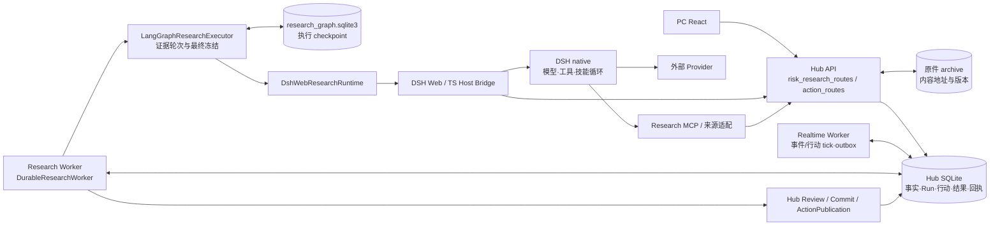
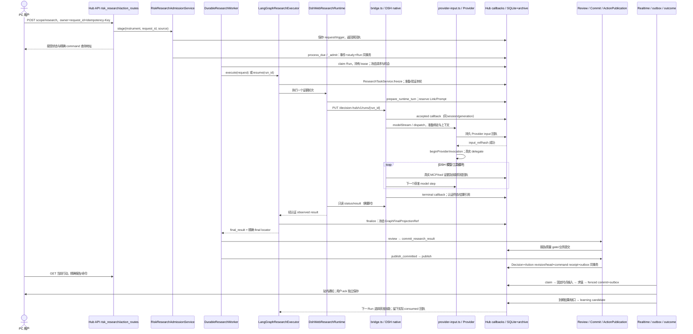

# 运行时、状态权威与数据契约

设计基线日期：2026-10-17。状态：**review-5及OKX永续建议／纸面验证方案已于2026-10-18获准实施**。当前切片、完成门与证据以[execution-contract.json](execution-contract.json)和[执行日志](EXECUTION_LOG.md)为准。下文“已有”是设计审阅时的源码快照；“拟议 / planned”仍须实际实现和验证，不能由批准状态推定已交付。

本文落实同目录总控的技术边界。使用现有 Python/FastAPI/SQLAlchemy/SQLite、React、DSH Web 与 LangGraph；不引入第二套 Run、agent 循环、任务平台、消息中间件或经验数据库。工程成功与预测、概率校准、成本后效果分别验收。

**代码审查补正：**[07](07_ARCHITECTURE_REPAIR_BLUEPRINT.md)发现Kernel行动reader反向依赖DSH私有mapper、composition按具体runtime类接线，以及Provider结束与回执完成仍耦合。本文“唯一责任”是目标合同，现行代码尚未完全达到。T02按07进行port抽取和阶段拆分，不能只调整timeout。预算与成果资格、按候选版本重审由07补正T04。原Task保持不可变；新增根因问题通过能力范围内的版本化requirement修订接入下一轮，不回写原Task。

## 1. 真实基线及必须纠正的旧设计映射

依据是[工程复盘](../../retrospectives/SOFTWARE_ENGINEERING_REVIEW_2026-10-17.md)、旧[ARCHITECTURE](../market-risk-v1/executable-product-v1/ARCHITECTURE.md)、[IMPLEMENTATION](../market-risk-v1/executable-product-v1/IMPLEMENTATION.md)、[主流程计划](../market-risk-v1/executable-product-v1/CORE_MAIN_FLOW_EXECUTION_PLAN_2026-10-15.md)，以及下述源码。旧设计里的文件名不自动代表现行实现。

| 能力 | 当前真实入口与边界 | 本文处置 |
|---|---|---|
| PC 主动研究、自动研究准入 | `apps/hub_api/risk_research_routes.py:risk_research_router`；`application/risk_research_admission.py:RiskResearchAdmissionService.stage/process_due/_admit` | 复用受理、owner 回执、去重及研究队列；不新增研究命令平台 |
| 持久研究 Worker | `apps/hub_worker/research.py:DurableResearchWorker.tick/_execute_claim`；`apps/hub_worker/composition.py:build_research_worker` | 普通/优先 Worker 共用同一业务表，以 lease 选 owner |
| Graph | `packages/orchestration/langgraph/executor.py:LangGraphResearchExecutor`；`graphs/agentic_research_graph.py:build_agentic_research_graph` | 现行外层仅 `research_round → next_round/finalize`；不是每个专科再建独立模型循环 |
| checkpoint | `packages/orchestration/langgraph/checkpoint/recovery.py:CheckpointStore` 使用 `AsyncSqliteSaver`；正常 composition 注入 `data_dir/checkpoints/research_graph.sqlite3` | 已持久化；不计划“从内存改持久化”，重点验证与业务表的恢复一致性 |
| DSH Python 接口 | `packages/runtime_adapters/dsh_runtime/web_runtime.py:DshWebResearchRuntime`；`web_host_client.py:DshWebHostClient`；`research_runtime_binding.py:prepare_runtime_turn/authenticate_runtime_binding` | 保留适配层，对象身份、提交/观察和执行准备在该边界收敛 |
| DSH Host/native | `extensions/dsh/decision-hub/src/host/bridge.ts:DecisionHubHostBridge`；`model-dispatch.ts`、`provider-input.ts`、`session-result.ts` | native DSH 保持唯一模型、工具、子 agent 循环；Host 处理服务协议与回执 |
| 审核、报告、行动 | `application/research_review.py:ResearchReviewService.review` → `application/commit.py:CommitDecisionService.commit_research_result` → `application/action_research_integration.py:ActionResearchIntegration.publish_committed` → `application/action_publication.py:ActionPublicationService.publish` | 报告提交与行动发布不是一个跨服务原子事务；补偿使用已有 `reconcile_missed_hooks`，不得重新调用模型 |
| 行动查询/命令 | `apps/hub_api/action_routes.py:action_router`；`/v1/actions/*`、`/v2/actions/current` | 旧设计的 `decision_routes.py` 不存在，不重复创建同类 API |
| 行动监控 | `application/action_monitor.py:ActionMonitorService`；`apps/hub_worker/action_tick.py:ActionMonitorTick` | 已有 25 秒上限、最多 4 opportunities/2 scopes、取消后 join；该上限不施加于深研究 |
| 事件主线 | `apps/hub_worker/event_scenario_tick.py:install_event_scenario_on_realtime` → `application/event_lifecycle.py:EventLifecycleProcessor.tick` | 已串联 coverage、realization、monitor、outcome；需验证实际正常 Worker 的同事件链 |
| 结果与执行 | `application/event_outcome.py:EventOutcomeService`；`application/action_execution.py`、`action_paper_product.py`；既有 `outcome.py` | 旧 `action_outcome.py` 不存在；先对现有多类 outcome 明确映射，禁止只因旧文档列出文件就另建结算实现 |
| 技能消费 | `research_skill_use.py:SkillUseService`、`research_skill_consumption.py:SkillConsumptionService`；`apps/hub_worker/research_learning_bootstrap.py` | selected/loaded/executed/consumed 各有证据；不能把 selected 当 consumed；自动结果到非种子技能的整链仍未证明 |

上表 `application/` 均指 `packages/kernel/decision_hub_kernel/application/`，`graphs/` 指 `packages/orchestration/langgraph/graphs/`。本文代码定位以文件和符号为准，避免后续行数变动使设计失效。

### 1.1 进程边界

正常启动入口是 `infra/dsh/run-product.ps1`，官方停止入口是 `infra/dsh/stop-product.ps1`。其现行组合包括 Hub API（8047）、DSH Web（3097）、research MCP（8037）、source acquisition worker（8038），以及 documents、realtime、research、research-priority、historical、evolution Worker。端口只是既有本地默认值；隔离集成环境使用独立空闲端口、数据目录和 DSH_HOME，不复用正式运行身份。

Graph 在 Research Worker 进程内执行。TS Host 插件在 DSH Web 进程内执行。MCP/采集进程读取外部来源，经 Hub 端口保存证据；它们不能直接认定业务 Run 完成。历史数据与学习任务不占用 realtime 条件求值的唯一 owner。



## 2. DSH、Graph、Hub 的唯一责任

“唯一”指权威决策者；跨进程调用者可以请求状态变化，但不能自行重写权威事实。

| 层 | 唯一责任 | 禁止越界 |
|---|---|---|
| DSH native + Host | 一轮研究中的模型/工具/子 agent 执行、实际输入/输出、native session 顺序与终态；使用被冻结的任务、能力和技能版本 | 不能直接批准可发布行动、判金融效果或修改 Hub Run；不能用完整自然语言回答代替工具原件 |
| Graph | 固定 Task 下的证据轮次、覆盖/停止理由、结果冻结和可恢复执行位置；读取经 Hub 验证的观察结果 | 不复制 DSH 内循环；不根据 checkpoint 内自报字段授权新 recipe、技能或 scope；不凭模型说“够了”跳过确定性资格 |
| Hub application/persistence | 身份/准入、事实时间资格、研究 lease、权限和取消、业务终态、报告与行动发布、条件求值、outbox、结果、技能资格及消费账本 | 不生成第二套模型调用循环；不把通知发送当阅读、条件触发当成交；不从后验结果修改旧判断 |
| API/query/PC | 发具名命令、读取有界投影、展示“当前状态+最近进展+原因+下一动作” | GET 不进行完整历史认证/临时采集/启动模型；UI 不能把 HTTP 超时判成研究失败或自动换键再提交 |

### 2.1 状态与唯一写者

当前代码存在多个业务 service 操作同一个 head；目标约束为**一个受围栏保护的 repository 提交入口、每次一个合法 owner**，不是要求所有动作都由同一个常驻进程写。

| 对象/持久位置 | 现行状态及权威写者 | 拟议收敛约束 |
|---|---|---|
| 研究命令/准入：`risk_research_requests/triggers/plans`（`persistence/risk_research_records.py`） | `RiskResearchAdmissionService`，`stage` 保存请求，`process_due/_admit` 建 event/run；owner command 精确回查 | `accepted` 只表示受理；已有 active request 合并时保留原 command→request 关系；不据 UI latest 指针确认某命令 |
| 业务 Run：`runs` | `RunService`，`DurableResearchWorker` 以当前 lease 提交；枚举 admitted/running/completed/degraded/failed/cancelled | 新执行阶段放在原 Run 的投影/事件中，不添加第二个 RunStatus 真相；终态不可被迟到 callback 改写 |
| 冻结任务/执行/Graph/审核原件：`run_role_outputs`，过程 `run_events/research_trace_events` | 各冻结 service 写具名 role/ref/hash；Task 首次输入由 `ResearchTaskService.freeze` 保存 | role 的生产者固定；原件只追加/幂等同内容；checkpoint 携带 locator，不以“最新同 role”替代原 locator |
| native session Link：`dsh_session_links/prompts` | `DshSessionLinkService.reserve/accepted/observe/complete`；callback 认证后落库 | `(run, session, request_hash, generation, plugin_build_hash)` 一致；旧 generation 无权更新；native state 与 Run state分别显示 |
| native session 日志 | DSH SessionController；Host `session-result.ts` 从真实 session 投影 | native terminal 是执行事实来源，Hub 认证后才成为业务处理依据；Host map 不能成为重启后的唯一凭据 |
| Graph checkpoint | `CheckpointStore`/`AsyncSqliteSaver`，thread_id=run_id | 与业务 SQLite 分库存储，无跨库事务；恢复先验冻结 Task/lease/原件，再幂等推进 |
| 事实：`research_evidence/research_facts/raw_captures/parsed_versions/fact_versions/run_input_refs` | Evidence/Fact/Lineage service，经来源端口写入 | 增量修订保留原版本和首次可用时间；数据供应者时间不授权回填事前资格 |
| 决策/行动：`decision_opportunities/decision_snapshots/action_plan_revisions/action_plan_heads` | `ActionPublicationService`、`ActionPlanService`、`ActionMonitorService` 经 `ActionRepository` 受控提交 | head 以 revision+state_version+lease_generation CAS；immutable revision 保留旧依据；并发命令/修订/监控只能一方成功 |
| 条件：`action_condition_evaluations` | `ActionMonitorService.claim/_complete` | `(plan_id,revision_id,tick_at)` 唯一；true/false/unknown 与 error 分开；同闭合 bar 不能重复累计确认 |
| 事件实际值/监控/结果 | `EventLifecycleProcessor` 调用各 event service；包括 `event_outcomes` | 未来预案、实际值、条件求值、结果沿同 forecast/event/版本链；actual 迟到只影响新版本，不覆盖事前预测 |
| 通知：`outbox` | 业务事务内 `OutboxService.enqueue_subject`；发送由 `NotificationDispatcher.claim_one/finish` | 已有 report/risk_alert/action_revision/event_opportunity 主体；保留 dedupe_key 和 claim_generation；发送重试不重发业务命令 |
| 纸面执行/结果：`action_*` 执行表、`action_outcomes` | `action_execution.py` 的执行 service 与既有 outcome service | 条件计划、纸面成交、自报采纳、未来真实订单分开；缺可执行报价=不可评分，不伪造赢亏 |
| 学习/技能：`research_learning_*`、`research_skill_use_events`、`experience_case_skill_links` | learning service 生成候选；`SkillUseService/SkillConsumptionService` 写实际载入/执行/消费证据 | 升级资格与真实消费均绑定 version/hash/目标/截止；候选未准入不改活跃指针；本次消费不得引用本次未来结果 |

## 3. 正常成功路径：可定位的真实调用顺序

以下是当前设计期读到的**实际调用关系的成功分支**，不是宣称 release33 已真实成功。每一步均可定位到现有文件；虚线“下一 Run”是产品闭环待整链验证部分。



报告提交后进程中断时，`ActionResearchIntegration.reconcile_missed_hooks` 从已提交原件和预登记机会补发布；已保存的成功 receipt 返回原结果。不得再发 DSH PUT，也不得拿旧报告给新 Run 补成绩。查询应同时反映 research_status、report availability、action publication 状态，避免“研究 completed”被误解为全部产品环节已完成。

### 3.1 先交付合格方案再继续补证的明确路线

当前`action_research_reader.py`要求Run为completed/degraded，`ActionPublicationService.publish`的幂等键为hash(run_id, opportunity_id)。本包**保留此约束**：同一活跃Run可以产生多版内部候选和复核，但不反复调用正式行动发布。决定先交付时完成该Run→正式发布→登记关联复查；下一Run产生行动revision。旧方案监控与后继深研究可并行，既有建议不因后台还在查就消失。

拟将08的ContinuationProposal作为`ActionReviewIntent`新版本的具名来源，沿`application/action_review.py::ActionReviewService.stage/discover`和既有RiskResearchAdmission接线；保留原opportunity、parent_run、revision_set_hash、due_at，增加proposal ref/hash及获准tracking policy ref。普通next_review与本次补证合并为同一机会/版本集/到期复查，不能被两个scheduler重复创建。

发布成功的业务事务同时保存待复查请求原件ref和幂等事件（拟增`research.continuation.requested`，沿已有run_events）；网络/模型不在事务内运行。这一事务失败则行动与请求均不提交。`reconcile_missed_hooks`补发布时同样补请求；提交后，后台发现器由请求生成ActionReviewIntent并交原准入。未发布不得声称后继已有可用父方案；提交后的意图物化失败不撤销已确认行动，保留pending并由同键恢复。后继Run仍须通过现有review原件校验与ActionRevision的head CAS，旧parent和旧review不能替新候选授分。

新任务使用已授权持续跟踪policy的预算、冷却、截止和总任务上限；原Run取消或用户暂停跟踪时不自动续研。没有新证据/可解决问题时仅登记下次触发，不用连续新Run绕过单Run预算。首版不引入同Run多次业务提交协议。

## 4. 时间预算、进展与无空转合同

release29 的 35 秒 submit signal、release30 的重复源码扫描、release31 的 catalog 30 秒超时、release32 的 Provider 前 428.562 秒消耗说明：把所有时间都归为“模型慢”无法定位失败。[历史证据](../../../artifacts/decision-product-v1/core-main-flow-20261015/release33/PLAN.md)

| 边界 | 当前证据/代码 | 目标合同（拟议，保留已冻结研究预算） |
|---|---|---|
| 浏览器→API 命令 | 受理路由已经持久 stage；客户端可能等待失败 | 受理只做 owner、schema、幂等、短写事务；拟本地 p95≤2s；超过等待窗口显示“回执待核对”，用原键 GET，不重新发研究 |
| Python→Host 单次 HTTP | `DshWebHostClient`/Host `operationTimeoutMs`；历史 35s | 传输等待有限，和 Task/研究期限分开。已 accepted 的工作不因 HTTP caller signal 结束而撤销；提交未知先查 deterministic session/原命令 |
| 准备/认证 | `prepare_runtime_turn`、catalog、model binding、provider-input receipt；R33 在准备阶段不启动 model watchdog | 使用原 Task deadline+具名阶段 deadline；同一 native Future 继续观察，不能每次等待重建预算。writer_wait/original_read/source_capture/receipt_commit 单独计时 |
| DB writer | `ModelDispatchService.bind` 在 BEGIN IMMEDIATE 获锁后开始 writer 计时；`PreparedOriginals` 的读集/写集 fence | 锁外准备；锁内只 fresh permission、readset/version复核和短写。获取锁前消耗不算 writer hold；SQLite busy 可延期同一原任务，未知 commit 先查回执 |
| Provider step | `bridge.ts`、`model-invocation-watchdog.ts`、`provider-input.ts` 的 R33 候选 | input receipt 成功后、首次 delegate 前创建唯一 deadline=`min(task_deadline,provider_started_at+600s)`；重入/SDK重试/child/finally不续杯、不夺别人的 timer |
| Provider 传输 | `infra/dsh/provider-transport.mjs` 分 request_started/headers_received；R33 阶段记录含 first_sdk_chunk | connect/首字节/stream idle 形成精确失败；保持当前 adapter 300000ms idle 合同并由配置证据核对。收到 chunk 不自动延长 Task/model 绝对期限 |
| Task 总预算 | `agentic_research.schema.yaml` ExecutionBudget；冻结 Task/Link deadline | 首次准入冻结绝对期限、round/tool/subagent/cost上限。恢复不续杯。超过60秒且持续真实进展是合法后台研究 |
| 行动/事件调度 | 60s cadence；ActionMonitorTick 25s有界；事件 lifecycle复用 realtime | 25s只约束有限同步批次；深研究单独 await。拟正常本地source accepted→条件发布且站内通知可查询 p95≤110s；仅对活跃在线PC，查询可用→真实展示回执 p95≤10s；端到端p95≤120s须另行实测，不能由两段p95相加推断 |
| 终态传播 | 既有 `<15s` 门主要测 authenticated receipt→Run/API | 拟拆两段测量：native terminal→authenticated receipt、receipt→业务终态。正常本地各≤15s；存储不可用时显示“观察到执行终态/认证确认待恢复”及来源资格，不能把未认证观察写成业务成功，也不等到 Task到期才报告 |

**真实进展**是一个新的持久事实：阶段完成、原件验证集合推进、合法工具 reservation→completion、Provider request/首chunk/finish、证据/轮次冻结。heartbeat、重复读相同 Link、重复输出“正在处理”、重扫同一目录不算进展。阶段投影需要 `stage_started_at/last_progress_at/progress_seq/blocked_reason/next_check_at`；无进展触发具名诊断与有界检查，不用统一 60 秒取消模型思考。

拟先设准备阶段 30 秒“可见告警窗口”，表示必须给出阶段/工作量/剩余期限；它不是失败时间。各准备阶段最大耗时与工作量上限在首个隔离集成任务按实际闭包测量冻结；在冻结前不得把无限扫描伪装成正常长研究。Provider 的无chunk等待按 Provider合同判断，不能拿“没有新字”推断模型空转。

上述通知SLA分开记录 `source_accepted_at → condition_committed_at/outbox_enqueued_at → inbox_available_at → displayed_at`。活跃在线指PC已连接、页面能正常轮询/接收并成功提交展示回执；用户离线或页面挂起时仅保证服务端发布/站内投递，展示状态保持 `pending/unobserved`，不纳入在线展示时延样本，也不宣称用户已看。外部通知通道另记provider accepted/failed，不能用provider accepted代替display；上游公开到采集收到的延迟独立统计。所有分位数同时报告样本数、不可观测数和失败数，避免只统计成功快样本。

## 5. 首因、取消、恢复、幂等与 outbox

### 5.1 首因和结果存在性是两个维度

R32 的 native `failed/dsh_model_step_timeout` 合法携带 `result_ref=null,result_hash=null`，Host `/result` 二次报 `host_terminal_result_binding_mismatch` 覆盖了首因。R33 已有严格双空快路代码；尚未正式验证。[精确根因](../../../artifacts/decision-product-v1/core-main-flow-20261015/release32/BTC_FAILURE_ROOT_CAUSE.md)

拟冻结以下顺序：先校验 authenticated terminal 的 Run/session/generation/request hash/发生时间/seq；其原始 failure 作为 immutable `primary_failure`。之后的结果读取、归档、公开投影、关闭异常写入 `secondary_failures`，不得取代 primary。没有经认证 native 原件时，现有 transport failure 可作为暂时首因但标 `authority=transport`；随后只能通过明确 supersedes 事件补充权威原因，保留历史展示。

合法 failed 双空不读不存在的 result；failed 双完整引用可读取 partial result；单边空、成功态双空、身份/哈希漂移继续拒绝。部分 evidence可回看，但不自动成为因果链、报告或行动。原件缺失不应全量隐藏已经保存的可核证据。

### 5.2 取消与恢复

1. owner 的取消意图先在 Hub 持久化，之后向同一 DSH session/generation请求取消；请求未返回不代表尚未取消。Host `command-cancellation.ts`、`terminal-quiescence.ts` 与现有 canceled-session reconciliation 复用。
2. 取消最终状态只能由当前 owner在重新检查权限后提交；迟到 Provider/tool结果可保留为审计原件，但不能继续发布/启动下一步。取消与成功竞态依据持久 commit顺序和既有 fence，不按最后到达的网络包决定。
3. `asyncio.to_thread` 被取消不等于线程停止。复用 `HeavyWorkAdmission`、ActionMonitorTick 的 shield/join：同步写者真正退出前不释放执行槽，不启动第二个写者。无法及时停下则展示 cancel_pending 与阶段；不得伪称已停止。
4. 重启先从 `runs` 查询可恢复 owner，再核原Task、checkpoint、Link、generation、原件hash、取消/绝对期限；已有 native session 先观察，不直接新 PUT。checkpoint只是位置，不能自行恢复授权。
5. checkpoint落盘与业务表提交不原子：业务原件已提交而checkpoint未推进时，重执行节点必须返回原回执；checkpoint已完成但报告未提交时，以精确 final locator补提交；报告已提交但Action缺失时执行已有hook reconciliation。每种崩溃窗口要有进程级验证。

### 5.3 幂等键和事务边界

| 写入 | 现有/目标幂等身份 | 同键异内容 |
|---|---|---|
| owner研究命令 | owner+scope+command request_id，经 trigger指向 durable request；Run idempotency=`risk-research:{request}` | 409，不生成第二Run |
| DSH submit | 已有 deterministic session/request + run/request_hash/generation | 拒绝身份冲突；未知响应先GET |
| callback/Provider receipt | run/generation/execution session/dispatch或call identity+payload hash | 拒绝，不调用第二次Provider来“补回执” |
| Action发布 | `system:action-publication:v1` + `publish_` hash(run,opportunity)；原final locator进入command hash | `action_hook_key_conflict` |
| owner Action命令 | owner_id+request_id，expected_revision_id/state_version | 冲突回原状态，不自动覆盖 |
| monitor/outcome | plan+revision+tick；结果绑定mode/protocol/version；新修订追加 | CAS失败退出；结果不同必须新版本 |
| outbox | revision/transition/channel或event主体生成dedupe_key；已有 UNIQUE | 不重插，不跨主体复用 |

ActionPublication已在同一 session中保存snapshot、revision/head、command receipt与outbox；monitor保存evaluation、CAS head与outbox也需保持同事务。报告与Action跨事务的差距由显式pending/failed状态和reconcile补偿。发送在事务外执行，`NotificationDispatcher.finish`核claim owner/generation，网络重发仍可能重复；接收端以dedupe_key防重复呈现。`sent/provider_accepted/displayed/acknowledged`不可合并成“用户已收到”。

## 6. 数据时间与版本：阻止未来信息进入事前判断

这些时间已经在不同DTO/表中存在，不建议复制另一套Fact。缺项以追加合同版本或原件sidecar补齐，不能随意往 `additionalProperties=false` 的旧DTO塞字段。

| 时间 | 定义/当前落点 | 使用规则 |
|---|---|---|
| scheduled_at / event_time | 事件计划时间/真实发生时间；macro event/vintage、event forecast | 计划可提前知晓，不表示actual提前可用；改期另存版本 |
| published_at | 来源声明的发布时间；evidence/fact已有nullable字段 | 不能独自证明系统当时拿到数据；未知保留null，来源修订不能回写旧版 |
| observed_at | 采集到的观测时间；价格bar闭合时间另用window_end | 源字段语义必须声明；bar未闭合不可作为闭合bar条件 |
| received_at | Hub首次收到这份来源数据/回执的服务器时间 | 不能由后到payload倒填；网络晚到证据不能进入较早决策截止 |
| accepted_at / recorded_at | 校验后接受/持久化时间；各表已有 | 解析后的事实晚于原始发布是正常情况，不能为满足截止改成发布时间 |
| known_at / available_at | 可供本系统使用的最早时刻；`fact_versions.known_at`、Run.available_at已有不同语义 | `fact_lineage.bind_facts`已取fact/evidence received/accepted最大值；扩展时仍取完整依赖可用时刻最大值，不能覆盖Run报告可用时间语义 |
| decision_cutoff_at / pit_cutoff_at | 前者为候选知识快照；后者为本Task允许的采集上界。live与replay不同，见下文 | 按每一候选的版本过滤 `known_at<=decision_cutoff`；固定采集上界不等于“开研即禁止新增信息”；发布还须早于被评估目标窗口 |
| action published / displayed / ack / fill | 发布、用户展示、确认、模拟/自报执行各自时点 | 可执行报价晚于 max(方案可用、触发已知、资格生效)+协议反应延迟；无display不声明该用户当时看到 |

现有 `fact_store._validate_fact_pit` 已检查 `published<=observed<=received<=cutoff` 及完整窗口；`fact_lineage.py` 对 `FactVersionRecord.known_at/observed_at<=as_of` 作查询约束。需特别核对：新来源的“经济统计期”和“发布时间”不能映射为同一个 observed_at；旧adapter若语义不同，应修adapter及新版本，不能放宽全局未来数据门。

**live多轮检索的三种时钟不可合并。** `apps/hub_worker/research.py`构造live请求时将`pit_cutoff_at`设为原deadline，replay则取原输入的历史边界；`research_graph_projection.py::_initial_decision_cutoff/_round_cutoff`允许live的`decision_cutoff_at`由trigger推进到该轮结束/候选参考时刻，且不超过原pit上界；`research_context_selection_v4.py`每轮取`min(original.pit_cutoff_at, selection_clock)`。因此新网络材料在本轮真实收到后可以进入**下一候选快照**，不能倒填到旧候选。Task/旧candidate/hash不变，新的revision绑定它真正用到的known_at最大值。

事前CPI目标另取`min(task采集上界, 事件公布前截止)`约束新候选与实际发布时刻；过T0形成的判断进入事件后响应，不领取事前成绩。历史replay固定历史边界，不随着今天的检索时间推进。尚未发布且仍在授权边界内的正常补证留在同Run；已先交付并结束原Run，或需超出原采集上界/期限时，按§3.1/08的ContinuationProposal进入获准关联新Run。这样既可主动补证，也不把后来知道的内容伪装成早已判断。

结果取证使用其到期后价格是合法的，但只能写outcome并引用原Decision/Target/Protocol，不可再写入当时研究输入。历史回放可按“当时公开可得”与“本系统实际已知”分别实验；其cohort、cutoff和缺口必须显式标识，后者缺乏原件就不能自称已验证事前可得。

跨资产沿用同一身份/时点合同，分别版本化 venue、交易日历、币种/单位、时区、行情种类、闭合bar、目标窗口和成本。黄金/指数不能套用24×7现货时间边界；Kronos未准入结果只写shadow对象，不污染正式概率/Action资格。

## 7. 将完整认证移出热路径，同时保留安全证据

现行基础可复用：`persistence/original_preparation.py:PreparedOriginals/prepare_originals`，`persistence/research_source_snapshot.py:PublicationSourceReadScope`，`persistence/callback_source_lease.py`，`application/research_publication_runtime48.py:ServerRuntimeAttestation/FrozenDescriptor`，`ModelDispatchService.bind` 和 `ProviderInputReceiptService._record_in_source_scope`。它们已有读集、源码句柄和写前/写后围栏；优化不能等同于缓存“此Run仍有权限”。

| 边界 | 完整认证做什么 | 热路径保留什么 | 失效条件 |
|---|---|---|---|
| 构建/部署封存（拟收敛） | 枚举**当前实际执行闭包**，含Python/TS产物、contracts、选中recipe/component/skill；生成manifest+文件hash+构建身份。历史目录保留但不每次递归 | 加载时验证部署manifest和实际字节；清楚区分当前实现与历史归档 | 构建身份、动态选中版本、文件内容/集合/路径身份改变，不能只依赖mtime |
| 原件入库/发布 | 校验来源receipt、raw body、parser version、lineage、schema/hash与时间；不可变内容地址保存 | 读取明确ref/hash和必要局部原件，已受保护的原件解析结果可按完整键复用 | hash/身份变化、文件替换、DB原件版本变更；受信保护失效后必须重新认证 |
| 同一准备操作内 | 锁外一次 source/readset收集，绑定issued PreparedOriginals与既有source lease | 同一操作复用读集与已经读过的字节；选中对象的OCC；writer内复核 | 事务/owner/generation/选中对象变化即丢弃prepared对象；不跨任务冒用 |
| 每次执行/写边界 | 不重扫全部历史 | **必须fresh**：owner/取消、Task绝对期限、Link/generation、能力/模型/技能资格、lease、readset版本、目标原件hash、postwrite fence | 任一失效直接阻止副作用，缓存不能延迟取消 |
| GET用户投影 | 消费已保存的资格/状态及原件链接 | 有界查询；必要精确对象完整性校验；不触发全树扫描或模型 | 投影缺失返回typed pending/unavailable并给后台job身份；不在GET自动创建认证任务 |

拟议缓存键至少包含 build/closure hash、validator/schema version、原件ref/hash、选中版本；它只缓存不可变内容解析/验证工作，不缓存 authorization、Run状态或“最新”。Windows原件句柄/source lease若不能保证跨操作不可修改，缓存范围缩回单个操作；不得把一次进程启动校验当成永久内容防篡改。非Windows不存在同等句柄保障时保持受限能力或用已验证替代，不假设平台等价。

首任务需要以当前部署闭包跑冷/热路径测量：阶段耗时、文件数、字节数、重复认证次数、writer hold。通过目标为成本随**实际选中的输入和代码闭包**增长，不随历史归档总量线性增长；要求相同输入重复调用不会重新遍历约57,111个历史源码文件。不能在没有数字前承诺具体加速倍数。新增cache必须以文件替换、同mtime异内容、取消、generation改变、过期、writer竞争负例证伪。

## 8. 最小接口补充（全部为 planned）

优先扩展现有 DTO 和服务函数，不新增平行状态存储。生成物由现有 contract_codegen流程产生，不能手改 `generated/`。以下是评审用签名，当前源码**不存在这些新函数/类型**；具体schema版本在首任务核兼容性后冻结。

### 8.1 执行进度投影

**planned**：在 `contracts/schemas/research_product_view.schema.yaml` 增加版本化 `ResearchExecutionProgressV1` 组件，由现有研究详情query/API返回；如果现有版本拒绝扩展，新增V2响应，不强行更改V1。它只有投影身份，没有自己的Run/调度/终态。

```python
# planned: packages/query_views/research/service.py:ResearchQueryService
def execution_progress(
    self, *, run_id: str, owner_id: str, at: datetime
) -> ResearchExecutionProgressV1: ...
```

输入：已有run与owner。输出：`run_id, business_status, native_state, stage, stage_started_at, last_progress_at, progress_seq, task_deadline_at, stage_deadline_at?, provider_started_at?, primary_failure?, secondary_failures[], publication{report,action}, recovery_state, next_check_at?`。均由原事件/回执投影；缺失显示unknown，不能由UI猜。public failure不含prompt、token、URL/header原文；原件引用受已有owner边界保护。

拟DTO必须 `extra=forbid`，时间为UTC RFC3339，`progress_seq`为非负整数、来自持久事件序号；不能按GET次数增长。`business_status`复用RunStatus；`native_state`复用既有DSH状态并允许null。`stage`限定 `admission/preparation/provider_wait/provider_stream/tool_execution/graph_finalize/review/publication/terminal/unknown`；没有阶段证据则两个progress时间为null。`publication.report/action`分别取 `pending/published/blocked/failed/unavailable` 并附原件ref与reason；`recovery_state`限定 `none/eligible/awaiting_auth/recovering/forbidden`，由原Task/lease/取消/终态计算，不保存新状态机。failure形状为 `code,stage,occurred_at,authority,source_ref,source_hash`；authority限定 `authenticated_native/transport/hub`，后两项无原件时为null。secondary最多返回20条并给 `secondary_total`，完整事件走既有分页。owner无权或Run不存在沿现有API身份/404规则处理，不泄漏跨owner元数据。

### 8.2 有界认证准备

**planned**：沿 `persistence/research_source_snapshot.py` 增加已封存闭包入口，并由现有 `ProviderInputReceiptService`、`ModelDispatchService`调用；不新增通用授权服务。

```python
# planned: packages/kernel/decision_hub_kernel/persistence/research_source_snapshot.py
def prepare_bound_source_scope(
    *, manifest_ref: str, manifest_hash: str, selected_refs: tuple[OriginalRef, ...],
    deadline_at: datetime, checkpoint: Callable[[], None]
) -> PreparedSourceScope: ...

# planned: application/provider_input_receipts.py，先增加内部helper，不改外部PUT语义
def prepare_input_originals(
    self, payload: ResearchProviderInputSubmit, *, scope: PreparedSourceScope,
    deadline_at: datetime
) -> PreparedOriginals[_Prepared]: ...
```

`OriginalRef/PreparedSourceScope`在此为拟议类型名；`_Prepared`复用 `provider_input_receipts.py` 已有的 `boundary: ExecutionBoundary, input: ProviderInputOriginal, owner: str`，不复制Provider input DTO。输出仅含本次已验证的对象、声明读集、原件身份和source lease；不含“长期有效的权限”。existing writer按当前session重新验证issued preparation、取消、Link与lease后写 receipt。若不能证明该缩小闭包与当前所有消费代码等价，首任务判失败，保留既有校验。

拟 `OriginalRef`为不可变 `ref:str/hash:sha256/schema_version:str`；解析仅允许既有archive/registry的命名空间，禁止任意路径或网络URL。拟部署manifest含 `build_hash/validator_version/closure_hash/files[{relative_path,sha256,size}]/selected_refs/max_files/max_total_bytes`；路径归一化后必须在批准root内，拒绝重复、越界与未声明文件，预算不能由请求payload扩大。`PreparedSourceScope`只保存manifest身份、已验证闭包、选中ref、readset/source guard、唯一操作token和deadline；与既有issued-object检查绑定，不可序列化。deadline已过、校验不符或资源上限耗尽均返回具名准备错误并阻止Provider，不降级为跳过认证。

`PreparedSourceScope`须为有显式close/context-manager语义的操作所有者；source lease贯穿准备到writer commit/rollback及session close，finally统一释放。它不得进入checkpoint或作为跨进程缓存对象；文件数/字节数/持有句柄数必须有界。进度指标不能以释放句柄后继续使用旧校验结论换取速度。

### 8.3 真实组件集成入口

**planned**：扩展现有 `tools/dsh_native_acceptance.py` 的 `ScenarioRuntime` 能力；新增场景函数仍放在该文件，测试与fixture见下一节。

```python
# planned: tools/dsh_native_acceptance.py（内部函数，以下参数不是已有CLI参数）
def run_native_main_flow(
    *, root: Path, scenario: Literal["success", "terminal_null", "cancel", "recover"],
    provider_mode: Literal["recorded", "live"], fixture: Path | None
) -> NativeMainFlowReceipt: ...
```

输出 `NativeMainFlowReceipt`（planned）仅汇总同一command/request/run/session/generation、源码/fixture身份、真实组件清单、各gate结果、阶段时间、model/tool调用计数、report/action/outbox/checkpoint/skill消费原件引用及失败首因。它不是新的业务Run。默认recorded无外部Provider访问；拟议内部live模式只供已授权的有限真实Provider验证，不通过默认测试CLI启用。调用不得覆盖旧root或重用正式身份，退出保留现场。

## 9. 真实本地组件集成：可行入口与首任务证伪

本节是T01随具体功能改动选用的验证目录，不是独立建设验收平台的任务。T02先围绕已定位的代码问题形成最小修改和对应证明；不要求先补齐本节所有故障场景才能修主流程。执行次序只以[05](05_IMPLEMENTATION_PLAN.md)为准。

已有 `tools/dsh_native_acceptance.py:ScenarioRuntime` 启动真实Hub API、research MCP、官方DSH Web和Research Worker；`infra/dsh/presets/decision-research/replay.patch.yml` 以 pinned upstream `@deepseek-ai/dsh-llm-replay` 只替换模型transport，官方Session/Agent Loop/Tool/JSONL保留。现有入口 `uv run python tools/dsh_native_acceptance.py --scenario success` 及 partial_failure/insufficient_or_stale 场景可以作为基础，**本轮未执行**。现有argparse还支持 `--serve`（必须配scenario）和 `--recovery`（不得与scenario/serve合用），没有 `--root` 或 `--provider-mode` 参数。

不能声称该入口已验证本次产品链：它目前使用旧 `replay.research` 能力、旧replay模型catalog和fixture，需接入现行 prepared Task、selected skills、Provider input回执、Graph final、独立审核和Action。`host.spec.ts` 使用FakeWebServer/FakeSessions；`test_terminal_error_provenance32.py` 使用直接返回unavailable的Host替身。两者有局部价值，但不足以替代真实native组合。

生产 `infra/dsh/provider-transport.mjs:providerRoute` 拒绝loopback且要求HTTPS；不能为测试放宽该安全合同。首任务优先验证已有upstream replay adapter能否经过真实 `model-dispatch.ts/provider-input.ts` 中间件和现行模型绑定。如果绕过这些路径，则“仅替Provider”假设被证伪：记录为部分组件门，把未覆盖边界交给受控有限真实Provider门验证；若后续需测试专用provider plugin适配，单独列明成本和范围，不能假装现有replay已覆盖。不能把FakeSessions通过写成native通过。

拟新增：

- **planned** `tests/integration/decision_product/test_native_main_flow.py`：进程级场景与断言，复用ScenarioRuntime而不复制launcher。
- **planned** `tests/fixtures/decision_product/native_main_flow_v1.json`：版本化Provider流、工具响应、时间/输入边界、预期结果；真实格式从保存原件提取并脱敏，不能手造“直接完成Run”。
- **planned** 在 `tools/dsh_native_acceptance.py` 增加 `decision_main_flow` 场景，统一保留receipt/log/archive/checkpoint；隔离root继续由该工具的场景根目录逻辑生成，内部负例由pytest参数化选择。
- **planned 命令，场景尚不存在**：`uv run python tools/dsh_native_acceptance.py --scenario decision_main_flow`。自动断言入口为 **planned** `uv run pytest tests/integration/decision_product/test_native_main_flow.py -q`。启动前检查现有依赖和构建产物，缺失明确报错；测试不得暗中触发正式build或迁移正式库。

| 必须场景 | 保留真实组件 | 可替边界 | 通过证据 |
|---|---|---|---|
| 正常完整一次 | API/准入/Worker/Graph/Python runtime/TS Host/native DSH/Hub callback/SQLite+archive/Review/Commit/Action/outbox | Provider流、外部新闻/行情响应 | 一个命令一个Run，实际工具/证据/因果链/独审/报告/Action同Run；selected→loaded→executed→consumed真实回执 |
| R29提交确认慢 | 同上 | 暂停某个确认响应 | accepted后HTTP等待结束不取消native；原键GET可发现；submit/Provider不重复 |
| R30/31准备与catalog | 同上，真实source/readset | 注入文件集合规模/读延迟/SQLite writer竞争 | 原件校验仍生效；无历史目录全扫；精确阶段、无Provider提前调用、等待不续预算 |
| R32 failed双空 | 真实native session terminal→Host result route→Runtime→Worker→API | Provider确定性失败/超时流 | native first failure与公开首因一致；双空不错误读取；单边空与身份漂移仍拒绝 |
| R33分时计时 | 真实input receipt + middleware + watchdog | 可控时间/准备阻塞；另有真实时间短场景 | 准备不吃model预算；receipt失败Provider调用0；同step重入不续杯；Task clamp |
| 取消与崩溃窗口 | 真进程/DB/checkpoint | 明确阶段故障注入 | 线程退出前无第二owner；重启不第二PUT；report→action补偿仅一次；outbox重放无重复呈现 |
| PIT/修订 | 真Evidence/Fact/Action/Outcome服务 | 版本化来源时间与价格 | 晚到/修订/未来bar不进入旧cutoff；结果不改原Decision；缺报价不可评分 |

便宜门可复用 `tests/runtime/test_runtime_preparation_same_future.py`、`tests/research/test_terminal_error_provenance32.py`、`tests/decision_product/test_action_research_integration.py`、`tests/decision_product/test_event_lifecycle_main_flow.py`、`tests/e2e/test_outbox_worker.py` 与Host provider/watchdog specs，作用是快速定位。完整本地门通过后，才进入有限真实Provider BTC→ETH和PC/重启验收。这里的成功证明工程组合与契约；不证明情景概率或金融收益。

## 10. 分层落地与数据迁移设计（拟议）

### 10.1 将跨应用装配移到共享入口

按[01 §1A/1B](01_CAPABILITY_TRACEABILITY.md)的真实import审查，拟在既有`packages/pilot_runtime`内新增`bootstrap/`，分别为`documents.py`、`research_skills.py`、`frozen_harness.py`、`history.py`。API与Worker只调用这些构造入口；该层允许导入Kernel服务与具体adapter，但禁止反向导入`apps.hub_api`或`apps.hub_worker`。这是共享装配代码，不是新进程、新数据库或第二个调度器。

迁移采用先搬构造函数、保持签名和配置解析，再替换两端import；不改动业务准入/身份逻辑。`application/market_risk_data.py`的OKX采集及raw capture走现有provider端口注入，Kernel不自行选择交易所。`ResearchSourceVerifier`及`CanonicalDecisionSource`按07提取到Kernel port，DSH特有的原件验证在adapter中实现。新运行底座必须通过同一port，不能让业务层再加`isinstance(CodexRuntime)`分支。

### 10.2 新合同的唯一归属、写者与索引

以下均为设计，不表示表已迁移。优先把不可变载荷保存到现有archive及`run_role_outputs`，有必要按状态领取/筛选的对象才增加索引；不可让长JSON文档兼任可变任务队列。具体字段与算法分别由08和02定义，本节固定持久责任。

| 合同/对象 | schema及业务代码归属（新增均planned） | 权威写者与持久方式 | 查询/消费方及唯一性 |
|---|---|---|---|
| RolePlan、RoleTask、RoleResult、ChallengeResolution | `contracts/schemas/research_reasoning.schema.yaml`；08的角色协调/绑定服务 | Hub验证真实child session、执行身份及原件后保存；RolePlan/结果为不可变archive+role ref，角色状态由既有trace事件投影 | Graph/质量服务；键含run、requirement revision、role task、attempt；角色重试不能覆盖原尝试 |
| InquiryProposal、RequirementRevision | 同上；`application/research_inquiry.py` | `admit_inquiry`在同业务事务中保存新修订原件和版本head；head使用parent hash+当前lease CAS | 下一轮execution/context binding；唯一(run, revision_no)，同内容重放返回原ref，冲突重新读取head |
| ContextPacketV1、SemanticSummaryV1、MechanismGraphV1 | 同上；沿08 context binding及机制图；02 MechanismReview继续其原合同 | 保留每条引用、选用/省略原因、PIT、反证、摘要来源；规范化原件哈希冻结 | 角色输入、合成与审核共同引用同一context/机制版本；禁止“latest”替换被冻结引用 |
| TargetSpecV1、ProbabilityEstimateV1、ProbabilityModelBindingV1 | 沿02拟建`contracts/schemas/decision_product_v2.schema.yaml`；`ports/decision_method.py`；机制/缺口仍在research_signal | 02的确定性方法服务计算、绑定、保存；模型提供候选观点，不自己认证数学资格 | 按target hash、cutoff、method version、source hash绑定；event occurrence/result、market response和action PNL分别命名 |
| PublicationAnchorReceiptV1、ActionComparisonDerivationV1 | 新`decision_product_v2.schema.yaml`；02规定锚点算法，§10.6规定派生比较授权 | 首发布者保存anchor；Hub确定性方法生成derivation原件。均沿archive及Action revision索引，不另建Run | anchor重放不重新定时；derivation绑定原review、完整候选/方法/适用域、输入hash及parent revision，不能由模型自签 |
| InstrumentContractV1、AccountSnapshotV2、PositionContextV2、UtilityPolicyV2、ActionCandidateV2、ActionComparisonV2及三类概率DTO | 拟建`contracts/schemas/decision_product_v2.schema.yaml`；02定义算法，§10.5固定写入/读取接线 | 合约/报价由adapter原件验证；账户输入由owner设置命令保存；确定性计算器产生动作比较，模型只能提案 | `EventProbabilityV1/ConditionalMarketDistributionV1/ActionOutcomeDistributionV1`不可互换；旧v1现货合同原样读取，不向旧对象塞short枚举 |
| DecisionSettingsRevision、DecisionUiCurrentViewV3 | 新v2 schema的设置合同及既有query schema新增投影；04定义页面语义 | owner设置服务保存不可变revision和CAS head；query仅消费，不创造设置或研究任务 | 版本含instrument/position/account/utility refs；旧行动settings_stale，不能因改设置重写原情景概率 |
| SkillReleaseReceiptV1、FailureAttributionV1、ComponentChangeProposalV1 | 08指定的`research_learning.schema.yaml`新版；ReflectionDelta沿已有合同 | 学习服务生成候选/资格原件；复用已有ComponentRegistry.activate/rollback与`market_component_*`指针审计，禁止新建第二套active指针 | 新增方法试用结果读取器及SkillSelection消费接线；按目标/期限/scope资格选择，当前Run冻结旧版本，下个Run用新版本 |
| SkillSelectionSetV1 | 08 §11.1；现有`research_skill.schema.yaml`新增envelope版本 | selection service冻结每scope/target family/horizon成员的包、资格、pointer generation与执行计划；沿run_role_outputs/archive保存 | role/Provider/执行/consumption逐member绑定；component_ref编码method family+target family+horizon，复用现有registry键，旧24h reader保留 |
| EventFamilyPackV1、EventFamilyBindingV1、EventAgendaSnapshotV1 | 新`decision_product_v2.schema.yaml`；拟`ports/event_family.py`及`application/event_family_registry.py`，详见§10.7 | Pack沿现有domain pack封存；事件/研究服务保存不可变binding/agenda原件，原事件表及run_role_outputs保存精确ref/hash；registry仅解析已冻结配置 | family版本不能替代event_key；按occurrence/stage/target定位，注册不产生金融资格或自动交易授权 |
| ResearchExecutionProgressV1 | §8.1既有research product schema扩展 | 只投影既有Run/trace/回执，不新增可写Run状态 | 研究详情API/PC；GET无新增执行、副作用与自增进展 |

`research_reasoning.schema.yaml`是08新增角色/追问/机制图/上下文合同的拟唯一来源；数学沿02、学习沿08表中的既有schema扩展。07的骨架不是另一个schema定义。禁止为同一个RoleTask在Graph、TS、API各手写一套不兼容类型。

**不可变Task与新增问题的绑定：**原Task/request hash永不覆盖。第r轮执行必须同时保存`root_task_ref/hash + requirement_revision_ref/hash + effective_requirements_hash + role_plan_ref/hash + context_manifest_ref/hash`；有效需求为原需求与获准增量的规范合并。Provider input、child任务、candidate及review都绑定同一组合。旧回执只证明旧组合，不能给新问题或v2候选授分。超出原授权资产、来源、模型或deadline的提议留下具名缺口；不自动续授权。

### 10.3 4小时期限必须贯穿迁移

现有`agentic_research.schema.yaml`、`decision_product_v1.schema.yaml`多处只允许30m/24h/72h；`research_probability_binding.py`同时硬编码集合和恰好三个horizon，学习注册还有限定24h的现有合同。只改页面标签或只给enum增加一个值都不能完成需求。

设计采用新旧版本并读：旧研究、Action、校准和试验保留legacy三期限；新的主研究profile请求4h/24h/72h并绑定新的schema/method版本。API/UI按响应版本解释，用户仍可读取旧30m和独立7d观点；不把30m历史样本转为4h。4h从原始PIT价格重算独立标签、成本、覆盖和校准资格，缺历史数据时使用02允许的明确资格输出，不挪用24h的胜率。旧24h learning协议不扩写；4h/72h使用新协议注册，各自到期。

T03在现有contracts生成流程增加新版本组件，T04更新context要求/Graph输出/概率绑定/Action，T06新增对应标签与学习scope，T07更新API消费和PC。各端通过版本路由兼容后，才切新profile默认值。当前4h功能仍未实现。

### 10.4 数据与发布迁移顺序

1. 新类型先生成Python/TS，旧reader保留；DB只做追加字段/索引/表，不重写原件或旧hash。
2. Hub与Worker先具备新旧版本读取和新索引写入能力，feature flag默认关闭；DSH插件与运行profile随后启用新合同，必须记录build/schema/profile同组身份。
3. 用库副本验证原Run/Action/通知/技能回读与新增一次事务。新索引不能由“全历史重新研究”生成；可以从现有精确ref重建查询投影。
4. 按新版本创建第一个Run；旧在途Run仍按其冻结profile继续或按原取消语义结束，不升级其合同。发生故障先关闭新准入，回滚profile/active指针，保留新原件与旧reader，不靠删除DB恢复。

此设计仍需通过05对应任务证明；DDL具体revision编号由迁移创建时的仓库head决定，禁止覆盖其他会话新增迁移。该编号不是待决定的业务语义。

### 10.5 双向永续产品的完整接线，不能只改枚举

本轮推荐首版为OKX BTC-USDT-SWAP、ETH-USDT-SWAP USDT线性永续，建议、跟踪与纸面执行；实际交易账户和真实下单不在本包。旧现货scope及历史仍可读取。现有`ports/action_quote.py::require_scope`限定spot，`decision/action_policy.py`只支持旧long动作，`action_paper_product.py`沿spot与示例账户，API/query有30m/24h/72h硬约束。它们必须与新版本同组迁移。已有perp研究目录不构成上述支持。

| 层及拟改位置 | 输入→输出和责任 | 硬约束/恢复 |
|---|---|---|
| 既有OKX adapter + `ports/action_quote.py`的版本化port | venue合约原件、mark/index/trade、bid/ask深度、funding时点、position tiers→`InstrumentContractV1`及具名行情原件 | ctVal/计价币/lot/tick/保证金阶梯各自版本化，不写死“1张=1BTC”；研究价格、可执行买卖价和mark风险价分列 |
| 拟`application/decision_settings.py`，复用action_routes的owner command模式 | 具名设置命令→`DecisionSettingsRevision`与`PositionContextV2/AccountSnapshotV2/UtilityPolicyV2`refs | owner+idempotency key；相同键不同载荷冲突；unknown余额/仓位保留null。设置head按owner+account_kind+account_id+instrument+profile隔离；paper与用户声明账户不可互相覆盖；没有交易接口写入 |
| `decision/action_policy.py`新版与拟`decision/perpetual_accounting.py` | 三类概率、情景收益路径、合约/账户/风险规则→`ActionComparisonV2` | 纯函数：不得联网/读DB/调用模型；open/add/reduce/close/conditional/no_change与target_side分离；每个候选有可执行性和拒绝原因 |
| `application/action_research_reader/integration/publication.py` | 认证Run结果→新版Decision/Action与target bundle引用 | 原发布幂等/补偿保留；验证instrument、目标、风险设置和源hash，不读“最新账户”替换被冻结上下文 |
| `application/action_monitor.py`和既有event lifecycle | 同一revision条件+具名最新事实→true/false/unknown、stale、需重评事件 | 定价触发与mark风险分别用指定source；funding/规则变化越阈值使动作成本失效；不会悄悄把计划成交价改成新价 |
| `action_paper_product/opening/execution*.py`与`decision/perpetual_accounting.py` | 显式paper账户/保证金、行动意图、有效报价→纸面订单/成交/现金流/保证金/结果 | 新市场kind分发到perp计算器，旧spot reader不改；没有明确paper账户不得套默认10000。资金费按实际结算时点/持仓保存，缺数据结果incomplete |
| `packages/query_views/decision_product.py`及`apps/hub_api/action_routes.py` | 既有projection+版本化instrument/settings/target→`DecisionUiCurrentViewV3` | 路由保留旧响应并显式协商新版本；缺新版本返回typed unsupported，不把perp请求静默降为spot |
| `apps/decision-desk/src/api/actionPlans.ts`及产品组件 | 生成V2动作与V3投影→双向首选/备选/条件/监控/纸面结果 | query缓存键至少含owner、instrument hash、target family+horizon、settings revision；旧long-only checkBranch只读旧schema，不用于判新short无效 |

`InstrumentContractV1`的canonical字段以02为准：`instrument_kind`、`ct_val/ct_mult`等；本文market_type、contract_value等中文表意不是第二套wire字段。它必须表达venue/instId、perpetual/linear、settle_ccy、合约面值/乘数及原单位、lot/tick、有效时间和源ref/hash；不可执行或停用状态保留。`PositionContextV2`区分flat/long/short/unknown，signed_contracts、margin_mode、position_mode、leverage及账户ref可空。`ActionCandidateV2`的side不是用户仓位；反手分为close旧仓→确认纸面结果→按新余额/行情重核open的两个intent，不能一次sell越过零仓。

首版paper基准明确为单向净仓、逐仓、初始名义/保证金比1；它是显示在纸面账户创建页的模拟profile，不是用户真实杠杆默认值，也不保证永不强平。hedge双腿不得压成净仓；暂不支持其纸面执行时显示明确能力缺口，但保留两腿输入以免错误推荐平仓。真实账户未知仍可给单位名义long/short/flat排序，仓位数量与强平距离显示不可计算。模型不能编造权益。更高杠杆或新保证金模式必须增加明确合同及直接算例，不用现货净值公式假装兼容。

收益/费用/资金费公式以02为准。mark用于保证金风险计算，bid/ask和冻结滑点规则用于纸面成交；仅有last trade不能宣称可成交。规则、资金费、报价迟到分别影响对应候选或结果，不取消所有研究。交易所元数据和资金费源的准确格式来自[OKX API](https://www.okx.com/docs-v5/en/)，[mark价格说明](https://www.okx.com/en-sg/help/ii-mark-price-and-last-price)说明其与last的不同职责；实现时保存实际源版本，而不是把网页说明当价格原件。

设置持久化拟增`decision_settings_revisions`（owner、account_kind、account_id、instrument/profile、revision_no、parent_hash、immutable_ref/hash、created_at）和`decision_settings_heads`（同分区键、revision_id、state_version）；同事务保存既有product command回执及outbox。account_kind限定user_declared/paper，未知声明账户也分配稳定account_id，不能以null合并所有账户；用户可删除活跃设置但审计原件按既有保留政策处理。

账户/风险设置只触发相关ActionComparison重评：设置事务写revision+outbox，现有ActionReview/discover消费具名`settings_changed`并去重。可确定性重评的成本/数量先重评；需要新的市场假设时再经既有admission研究。引用旧设置的建议标stale并保留历史；同一宏观事实/概率不会因用户从long改short而被改写。

**stale不取消已有持仓保护。** 旧建议不得新增暴露，但已触发paper episode继续按原冻结退出/保护条件监控；新风险设置可生成更紧的保护修订，经相同合法性与CAS生效，未生效前原保护仍在。关闭跟踪/取消后继研究不等于平仓。有效报价缺失时不得伪造成交，必须显式告警保护/退出尚未完成。合约规则改变需重评保护可行性，不可把风险状态静默清空。

**共同复用与隔离：**同一CPI原始发布、共识vintage、美元/利率和去重新闻簇可以跨资产复用；asset反应参数、contract成本、target时钟/阈值、账户风险和方法资格分别绑定。纯计算器复用实现，输入和成绩不共享；BTC现货24h资格不能授给ETH永续4h。详见[11全链合同](11_END_TO_END_DESIGN_CONTRACT.md)。

### 10.6 首发布锚点与确定性重评的提交边界

首发布仍由`ActionPublicationService.publish`负责，保留hash(run,opportunity)幂等。02的`PublicationAnchorReceiptV1`与最终target hash、概率commit、Action/outbox原子保存；candidate review绑定冻结的锚点规则和candidate_target_hash，发布者只能按规则补入实际锚点，不能改变概率/阈值/期限。第一个成功绑定的slot版本由唯一约束/CAS固定，重试返回原receipt。事务内分配的服务器时刻、提交观察时刻、页面显示时刻分别保存；若提交/可见已晚于起点，按02记late，不能事后移动start或补造事前可见。scheduled主目标使用02的T0−60s闭合价格锚点，纳入公布冲击；T0+60s是独立post_release_response，不得混其参数、概率或事前成绩。

新comparison无需新概率，并不表示可以用旧review任意发布新内容。当前`ActionPlanService.record_command`只支持pause/resume/display/ack，**没有可直接复用的改价重评接口**。拟在既有`application/action_revision.py`增加内部`apply_comparison_revision`，沿`ActionRepository`提交，禁止接受前端任意金融载荷；不是再调用原Run的publish。

```python
# planned internal entry; schema via decision_product_v2
def apply_comparison_revision(
    *, parent_revision_ref, expected_state_version,
    settings_ref, verified_quote_cost_refs,
    derivation: ActionComparisonDerivationV1,
) -> ActionRevisionReceipt: ...
```

采用该路径的前提是新v2 review已经绑定：完整候选集合、概率原件、确定性comparison方法/code hash、可变输入白名单（合法账户/风险/quote/fee/funding）、各变量适用域与失效条件。旧v1精确候选审核没有这个授权域，不能自动享用。`ActionComparisonDerivationV1`至少包含parent/review refs及hash、method/ref、allowed_domain_ref、input refs/hash、settings revision、输出comparison ref/hash、validator/build与requested_at；Hub锁外计算/认证，锁内复核当前owner/head/输入版本及域内有效性，CAS提交新immutable revision、原回执和outbox。幂等键是parent revision+settings+input set+method hash；同键冲突拒绝。快路径只在已审核集合内重选，不增新机制/候选，不重估旧概率。

发布前仅成本输入发生域内变化时，同样生成派生证明，首次Action引用原review及derivation；若没有相应v2授权，只能保持原候选合法成本边界或要求新复核，不能拿旧candidate hash批准新任意内容。发布后改变settings可走该内部路径；新规则、概率适用域失效、账户模式不支持或新方向候选不在集合，则标新暴露stale并走既有ActionReview→后继Run。已有episode的保护不因此取消。新revision的显示/知悉回执重新登记，旧receipt不挪用。

此新增入口归T04/T05，直接反例是：同一合法输入重放不新增revision；越域或旧v1 review拒绝；成本翻转只改变比较不改概率；CAS输家重新读取不覆盖新设置；触发中episode保持原保护。无需每次成本更新重新跑DSH，也不能以降低时延为由跳过审核的授权范围。

**事件实现后的分支选择也是受审域内的确定性动作。** 事前已发布的情景策略应冻结各情景自己的conditional q、comparison和触发/失效条件。实际结果被认证后，monitor选择对应分支，并重新核对报价/账户/成本；不沿用事前混合m，也不凭“偏热/降温”临场造新方向。未预审的情景或新冲突只发布具名变化并安排后继研究。pre-release与post-release目标不同，其q不能互借；条件分支是事前提交的策略，真正fill与评价仍分别保存。

### 10.7 事件族扩展合同：配置、专用方法和通用生命周期各有边界

**当前证据。** `ports/event_scenario.py::EventDistributionSpec`仅接受cpi/fomc，`FrozenEventScenarioBase`要求`as_of<=published_at<scheduled_at`；`application/event_lifecycle.py::_realize_due`直接选择BLS源，`event_realization.py`调用CPI band算法。`persistence/event_scenario_records.py`与`event_realization_records.py`把`reference_period`设为非空月度字符串，forecast/job的`slot_id`按日槽设计。因此“已有event_family字段”不能证明新事件只加枚举即可接入。现有CPI前值/nowcast模型保留为专用实现，不能自动承担PCE、完整就业报告或FOMC。

**选定边界。** 在已有`packs/crypto_macro/pack.yaml`体系内拟增`events/<family_id>.yaml`。首批核心宏观`family_id`采用cpi/pce/nfp/fomc，nfp界面与语义指完整Employment Situation就业包，不限一个非农人数；加密原生采用crypto_funding/crypto_expiry/crypto_operations，其他重要宏观与具名可能事件按02的有界模板进入同链。新manifest版本声明`event_family_pack_refs`，由既有`application/research_binding.py`的有界pack读取和冻结机制纳入闭包；旧manifest reader保留。拟`EventFamilyRegistryV1`只是`application/event_family_registry.py`中的静态索引及组合层允许清单，不下载插件、不执行任意配置代码、不维护第二套active指针。模型/技能的晋升仍沿既有ComponentRegistry与08资格流程。

三个合同唯一schema源是`contracts/schemas/decision_product_v2.schema.yaml`，由既有`tools/contract_codegen/`生成Python/TS类型；`ports/event_family.py`声明Kernel侧协议与语义校验，不能再手写一套不兼容字段：

| 合同 | 必填语义与身份 | 不允许隐含的默认值 |
|---|---|---|
| `EventFamilyPackV1` | canonical字段沿02：`family_id/version/payload_hash/schedule_source_bindings/actual_source_bindings/metric_specs/occurrence_rule_ref/scenario_partition_ref/baseline_policy_ref/estimator_bindings/stage_specs/monitor_policy_ref/label_policy_ref/coverage_policy_ref`。metric定义单位/季调/修订；estimator显式区分统计方法与`structured_judgment.v1` | “已注册”不等于已采集、已校准或可执行；未知共识不能默认为前值。结构化研究判断必须保留其方法/资格，无专用统计模型不伪装成已有数值模型 |
| `EventFamilyBindingV1` | canonical字段沿02：`pack_ref/hash/event_key/reference_period/schedule_ref/hash/stage_id/event_cluster_id/dependency_refs/metric_snapshot_refs/baseline_refs/target_refs/conditioning_ref/hash`；reference_period由metric定义，不适用时为null；parser/method版本由其精确binding refs可追溯 | family不是事件实例；计划修订不覆盖原occurrence身份；前值修订与当期首次发布不互换；不以某月字符或UTC日期推导唯一事件 |
| `EventAgendaSnapshotV1` | canonical字段沿02：`as_of/instrument_refs/window_start/window_end/entries/coverage_refs/payload_hash`；entry含binding ref、stage schedule/precision、`materiality_reason/overlap_group/dependency_refs/next_check_at`；所有引用known_at受as_of约束 | 只冻结当时已知日程；不能假定同日事件独立，不能按列表顺序覆盖当前建议；新增日程使下一agenda变化，不改旧快照 |

拟议port至少提供`resolve(pack_ref, expected_hash)`、`bind_event(pack, occurrence_ref, stage_id, cutoff)`、`build_agenda(scope, target_refs, cutoff)`；来源采集通过既有source ports，纯计算通过允许清单中的handler。registry只检查兼容版本和声明完整性；发布者仍复核来源/PIT、方法准入、当前owner及Action资格。配置没有改变事实或金融目标语义时可以只改配置；新指标解析、非数值结果、修订逻辑、情景划分或结算定义需要新增对应adapter/纯函数及具名合同反例，不能把Python表达式塞进YAML。

| 层 | 确切现有落点及拟变更 | 保持的单一责任 |
|---|---|---|
| 日程与实际值采集 | `packages/source_adapters/official_feeds/{calendar,cpi_schedule,bls_cpi}.py`保留；拟新增同层`bea_release.py/bls_employment.py/fed_policy.py`及`packages/provider_adapters/market/okx_event_context.py`，复用source注册/原件保存 | 源时间、时区、单位和原始修订由adapter解释并给原件；不在UI或Graph解析官方HTML；资金费/到期/规则变化身份绑定具体合约与场所 |
| 事件发现与快照 | `application/macro_event.py`、`event_scenario_autoproduction.py`、`event_scenario_snapshot.py`读取binding；CPI context/history/算法仍通过具名CPI handler使用 | 通用服务拥有发现、claim、幂等和发布；专用handler拥有该族输入与数学语义；不得每新增族复制一个完整Worker |
| 真实值与生命周期 | `event_lifecycle.py`、`event_realization.py`、`event_coverage.py`、`event_opportunity_monitor.py`、`event_outcome.py`按binding分派受支持handler；拟`decision/event_family_scenarios.py`只承载类型分区/校验 | 实际值认证、阶段完成、条件求值、结果评分分别写原有账本；FOMC后续阶段不能被第一份声明提前标全事件完成；新增分区器不冒充统计估计器 |
| 持久化 | 扩展`persistence/event_scenario_records.py`、`event_realization_records.py`、`event_coverage_records.py`、`event_monitor_records.py`、`event_outcome_records.py`及追加迁移 | 原件继续不可变；增family/binding/agenda refs、stage与target身份的可查询索引。新envelope允许不适用的reference_period为null；旧CPI行保持旧语义，不填伪月度 |
| 研究与行动 | `application/research_binding.py`、`risk_research_admission.py`及Action integration/publication读取精确agenda/binding；Graph只接任务引用 | 一次复用共享事实可形成多个目标；执行中的Run冻结原agenda，新增重大日程/阶段产生具名修订或后继Run，不热换输入 |
| API/PC | `packages/query_views/event_prevision.py`、`event_lifecycle.py`，`apps/hub_api/event_prevision_routes.py`、`event_lifecycle_routes.py`和对应TS API | 投影给family、stage、next_check_at、能力/缺口及版本；GET不执行事件算法，PC不以CPI专用文案判定其他事件结果 |

**多阶段与重叠事件。** 业务时钟不复用Provider watchdog。每个stage保存计划时刻/精度、实际known_at、依赖状态、预案截止、标签锚点和下次检查；日期级日程不可当精确午夜时刻。FOMC的`statement/sep/press_conference`阶段按当次日程登记，SEP是否存在由当次事实决定；同刻阶段可并列，后继阶段改变信息集。`scheduled_pre_release`与`post_release_response`沿02定义，后者是新目标，不能把事前forecast改为事后发布以绕开原校验。同一4h/24h/72h窗口有CPI/PCE/就业/FOMC或市场事实相互作用时，agenda冻结其依赖；02的联合/条件路径或明确研究联合场景承担组合，不把各事件概率直接相乘。

阶段键沿02使用`release/statement/sep/press_conference/minutes/settlement/effective/status_update`。statement与当次SEP属于同`release_bundle`依赖组和event_cluster，不能作为两个独立冲击相加；发布会live研究使用`publication_bound`的新目标，不复用先前声明的post_release锚点。资金费的预期时点与真实结算、规则公布与生效、故障开始与恢复分别保存；永续本身不能被赋予期货到期日，相关到期上下文须引用真正到期的合约。

**共享与隔离。** 原始官方发布、行情、美元/利率事实和新闻簇按source/ref/hash/PIT共享，统一采集无需为BTC/ETH复制原件。特征变换绑定transform版本；模型参数/校准/样本标签按family、stage、instrument/market/venue/price basis、target family、horizon、conditioning与method版本分区。学习资格及回滚同粒度；跨族或跨资产池化必须由02显式模型与独立评价授权，不能靠共用数据表隐式共享参数。用户账户/风险设置只进入ActionComparison，不改变共享事件事实或事件概率。

**持久身份与迁移。** 新job幂等身份明确含`event_key + stage_id + slot_id + job_kind + scope/target + binding_hash + input_hash + method_hash`；slot由stage policy定义，不能截成UTC日期。结果引用原forecast/realization及目标，不用“最新同family”连接。实现时为新envelope追加列、约束及索引，并显式迁移旧非空reference_period约束；只对可证明的旧CPI数据建立legacy binding映射，映射回执与旧hash分开保存。其他旧对象没有证据则保持unknown，不猜family/stage。沿§10.4先双读、影子核对、再单writer启用；旧在途任务保持旧合同，回滚关闭新准入后仍完成既有监控/结果责任。

**兼容性是启动条件。** 部署manifest必须列出schema、domain pack、family pack、parser、method、runtime/profile与生成类型的精确版本和支持组合。新增字段只有在旧reader明确容忍时才视为兼容；改变概率目标、单位、stage/锚点、枚举或必填字段需新合同版本。reader按schema分派，未知版本返回typed unsupported并保留原件，不降成wait/neutral。Pydantic模型负责字段与语义校验，不能替代数据迁移或兼容策略；其默认可能忽略额外字段，信任边界须在合同中显式决定`extra/strict`行为并做跨Python/TS样例核对。[Pydantic官方模型说明](https://pydantic.dev/docs/validation/latest/concepts/models/)

### 10.8 资源所有权、确定性与增长边界

**资源由创建它的组合/事务边界关闭。** API/Worker各自启动一次database/HTTP客户端/archive服务；一次业务操作拥有自己的Session，不能跨线程或等待Provider持有写事务。`to_thread`内同步工作持有的writer必须结束后释放owner，取消外层await不等于其停止。Graph saver生命周期由Worker管理，runtime拥有native session/stream，单step watchdog由其创建者清理；新owner不得清理旧owner尚运行的计时器、句柄或线程。重试只领取原job/generation，不借重建对象重置截止时间。

业务SQLite与Graph checkpoint继续分开；先保存可恢复业务原件/回执，再checkpoint引用它们，反向恢复则重新验证身份并幂等补齐缺失业务步骤。SQLite WAL允许读写并发，但同库只有一个writer，多库事务也不提供整个数据库集合原子性；因此锁外I/O/计算、短写事务、claim/CAS与补偿仍是本项目边界，不因增加worker便假设写吞吐线性增长。[SQLite官方WAL说明](https://www.sqlite.org/wal.html) Graph checkpoint保存执行位置，Hub保存发布/账户/通知权威；跨Run经验沿已有学习库，不能靠checkpoint顺便构造第二个长期记忆真相。[LangGraph官方持久化说明](https://docs.langchain.com/oss/python/langgraph/persistence)

纯算法只接受冻结输入及显式clock/seed/rounding policy，返回结果与理由；联网、文件查找、读“latest”和模型调用留在adapter/application。同输入重算须产生相同canonical结果hash；动态quote/actual/settings是新输入版本，触发新派生结果。幂等证明“一次业务效果”，不承诺网络只送一次；外部响应未知先查原回执，不能自动再次调用Provider或再成交。

代码与数据增长有各自上限：活动代码扫描使用显式根和部署manifest，`artifacts/`、`data/`、依赖及所有`*_versions/`不作默认递归输入；实际选中的历史版本仍按manifest精确ref验证，不能因排除目录免验。archive以引用可达性/保留政策、校验和与离线归档管理，热查询按事件/时间有索引和分页；不能通过删除失败原件、历史分母或仍在途引用解决容量。采集、模型、监控、通知分别记录队列年龄、并发、读文件数、writer等待/持锁、WAL/磁盘与过期原因；额外存储/队列/框架须有测得的容量或隔离阻断才立项。

停止条件分两层：运行任务按原deadline、取消、不可重试失败或已登记无进展政策停止新工作，并保存已合格成果/缺口；到期事件不继续无限轮询，记录missed/unknown并转结果责任。工程切片在直接用户场景、受影响合同/恢复反例和必要迁移回滚通过后结束；不以“也许可扩展”为由继续全仓重构。若新事件必须改Graph/DSH核心循环、每个业务GET都要重扫历史，或第二次相同跨层失败仍无明确owner，则回到07变更影响矩阵核查边界，不能只追加下一版本。

### 10.9 单机交付质量场景、数据质量与依赖降级

本节是review-5补入的**工程提案，尚未实现或实测**，适用于Windows上单owner、PC保持开机且用户明确启用的运行时段；不承诺24×7云服务。已批准的OKX永续建议/跟踪/paper范围不变，paper成交/盘口与账户算术唯一规范仍为02。新增数值均为本机profile建议值，实施切片冻结配置及测量条件后验证，不能写成现行SLA或金融资格。质量场景按“环境→触发→可测响应”描述，遵循[arc42质量场景](https://docs.arc42.org/section-10/)；下表数字是本项目提案，非外部标准。

| 场景/责任 | 拟议响应与可测门 | 证据和失败处置 |
|---|---|---|
| owner打开当前页、查看回执或提交命令；T02/T07/T08 | 已启动、1个PC客户端、后台1条普通研究及既有快监控；本地只读API p95≤1s、持久受理p95≤2s；每类至少100个有界样本并记录数据规模/硬件/并发 | API与PC可见等待分别计时；失败/超时、请求数和冷启动另列，不能只筛成功样本。研究完成时间依冻结Task预算，不能套用交互延迟 |
| 用户启用期间服务故障；T02/T05/T08 | 本地核心可用率建议≥99%，分母为交付后连续7日内登记的启用分钟；每分钟探测当前投影和原回执能否在2s内正确返回；显式计划关闭时段不入分母，意外休眠/崩溃计不可用 | 研究、行情/保护监控、站内通知能力分别记可用分钟及原因；API返回200不替其他能力授分。无启用样本记insufficient；T08只交有限场景证据，7日自然观察到固定终点出报告，开发不空等 |
| 来源空值、缺bar、重复、乱序或修订；T03/T05 | SourceAvailability绑定source/capability/instrument/用途与policy版本，记录expected/observed/missing/duplicate/revised、last_success/last_failure、source_time/received/known、age/max_age/next_due和raw refs；1m连续行情建议最近闭合bar年龄≤120s，窗口缺口显式保留 | 报价/mark/资金费等阈值按02及对应port逐项冻结，不能用bar或HTTP健康代替；原spot报价已有10s校验不自动授perp资格。宏观actual按该stage到期判缺失，背景/新闻按用途和失效规则；不统一套分钟TTL、不插值补事实、不由重采旧值刷新known |
| 系统时钟偏移、休眠或夏令时切换；T02/T03/T05 | 持久时刻统一UTC RFC3339；展示可转Asia/Shanghai，官方日程保留IANA zone、原时区/offset及精度；耗时用monotonic，跨进程期限用冻结UTC。建议启动/唤醒及每15分钟留校时来源、offset、检查时刻 | 建议绝对偏差>2s、检测到回拨或校时状态unknown时，阻止新增依赖精确时点的发布/纸面成交，保留研究与历史读取；已有保护标明无法可靠求值并告警，不伪造退出。修正时钟后重核原截止，不给Task续期；不得把源时间改成接收时间 |
| Provider/搜索/官方源/OKX/外部通知失败；T02/T03/T05 | 依赖分别暴露last_success、失败码、受影响用途、retry_at及原绝对deadline；只对可重试读取作有界退避并尊重Retry-After，鉴权/合同错误立即停该能力；原调用结果未知先按原身份核对 | Provider失败保留旧合格建议与本地保护；源过期使相关新暴露不准入，不能静默换venue/price basis；缺有效quote/mark时保护未完成可见且不虚构fill。通知失败留outbox待原键重试，站内原件仍可读；依赖恢复不补造过去事前成绩 |

记录延迟、流量、失败及队列/磁盘饱和即可支持本机诊断，复用`/v1/operations`、现有回执与日志，不新建监控平台；只把已经影响能力、需要owner行动的故障显式提示。成功与失败请求时延分列，依赖可用和用户结果分列，参考[Google SRE监控原则](https://sre.google/sre-book/monitoring-distributed-systems/)。

### 10.10 配置、身份和私有数据边界

**现状定位：**`infra/dsh/run-product.ps1`统一注入DATA_DIR/DSH_HOME、模型和feature flags并写本地`.credentials.yaml`，同时仍使用固定本地Host/MCP/采集共享key。`apps/hub_api/main.py::require_owner`只验证`X-Owner-Id`非空/与声明相等；`local_owner_session.py::LocalOwnerSessionAuthority`有签名、过期、origin/CSRF校验，但现行cookie路径仅`/v1/harness`。不能把owner标签、loopback或该局部实现写成全部业务路由已认证。

拟由T02/T07在相关私有读取、设置/研究/纸面命令开放前复用现有签名principal模式：服务端确定唯一owner，命令核origin/CSRF及权限，隔离owner/account分区；伪造owner、缺/过期会话和跨owner读取均拒绝且不产生业务写入。内部Host/MCP/采集使用分用途随机secret，经受限本地配置注入和轮换；浏览器会话不得复用服务key。不引入多租户IAM；扩大到LAN/公网须另行设计和授权，当前只允许loopback绑定。

交付配置清单保存代码/构建hash、依赖lock、schema head、profile/flags、监听端口、DATA_DIR/DSH_HOME、Provider/来源标识和**脱敏**配置hash；写出实际生效值、来源与优先级，不能依靠环境默认猜测。secret只记配置项和来源，不入hash原文、URL、命令回执、截图或普通日志；`.env`/credential store/备份目录限制为owner和受信进程可读。凭据更换须使旧会话/服务key失效并验证新连接，不能靠重试旧key恢复。

账户声明、上传资料、完整prompt/tool原件及备份按私有数据处理，公共投影只给必要字段与受控ref。发送Provider只包含该Run授权且必要的上下文，账户secret永不作为研究材料；外部来源遵守其已登记使用权。既有原件保留规则继续生效；上线交付清单明确每类数据的存放点、访问者、保留规则与删除/导出步骤，删除活跃设置不等于删除审计原件。未完成恢复/在途/评价分母的引用不得因清盘被静默删除；备份不包含可直接复用的会话cookie及服务secret。

### 10.11 启动、发布、备份恢复与持续使用交接

**现状不是运行证明。** `main.py`的`/health/live`仅返回ok，`/health/ready`调用本地health；`PilotReadinessService.report`不调用外部adapter，并明确列有live canaries。`run-product.ps1`对来源与DSH检查允许Optional，最终仍可能打印“Product is ready”；所以进程存在或本地ready不能代表全部能力。拟T02/T08按既有服务状态投影`阅读/新研究/行情与保护/paper/通知/学习`能力，各带available/degraded/unavailable、checked_at、原因和版本：阅读可独立可用，研究需Host/MCP/Worker及有效Provider证据，保护需对应Worker和新鲜合格数据；未验证外部能力显示unverified。readiness GET不发付费研究。

发布按现有`build-product.ps1`/validated build receipt→`run-product.ps1`/`stop-product.ps1`，由T08交付者负责本次版本、迁移和恢复，单机owner负责启停/电源/网络与可见故障处置。发布前清单绑定旧/新build、schema兼容范围、flags、数据集和恢复点；只关闭新准入并排空当前writer后切换，不能同时让新旧writer迁移同库。`Database.initialize`目前随API启动`alembic upgrade head`，须在迁移前完成备份并指定一次迁移owner，失败则阻止写服务就绪；参考[FastAPI部署中的单次前置步骤](https://fastapi.tiangolo.com/deployment/concepts/#previous-steps-before-starting)。

旧[Windows验收runbook](../../runbooks/windows-product-live-acceptance.md)已有单库备份要求和历史迁移记录，但不证明本次多存储集合恢复。拟恢复集合包含Hub SQLite、Graph checkpoint库、被引用archive、选中recipe/component/skill版本与DSH session日志及脱敏manifest；停新工作、等待writer退出后同一恢复点封存，逐库使用SQLite Backup API或已验证闭库流程，保留hash/大小/schema和引用清单。在线Backup API只保证单库一致快照，不能让独立Hub/checkpoint自动原子；不能运行中仅复制主`.sqlite3`遗漏WAL。[SQLite备份说明](https://www.sqlite.org/backup.html)

建议本机恢复目标为RPO≤24小时、RTO≤60分钟（同等硬件、已具有效备份与依赖；RPO为故障时刻距最近一致恢复点的时间，RTO从宣告恢复到所声明能力恢复计）；每日及迁移前备份，保留最近7份日备份和2次迁移前恢复点，已有审计保留期更长时服从原规则。第二份副本应处于独立故障域并受同样访问保护；若只有同盘副本，必须标明不覆盖磁盘损毁，RPO/RTO未证明。实际目录/容量/权限和是否具备第二介质由T08清单记录，不猜可用存储。

T08在隔离目录执行**一次对应本候选的一致恢复演练**：校验manifest、SQLite完整性/schema、原件引用闭包，再读取代表性Run/Action/账户/outbox与checkpoint，核已发布head/幂等回执；恢复后使用新启动generation，先对原任务/外部已发送回执作核对，旧Provider请求或通知状态不明不得自动重发。失去恢复点之后的数据必须标明时间窗与未决对象，不能标为从未发生。恢复期间错过的价格/事件沿原协议记unknown/missed，不追造paper成交。

回滚优先关新feature/profile准入并保留兼容reader；仅在已证明schema兼容时回旧build。不可逆迁移禁止盲目downgrade；若必须恢复备份，先封存失败后数据、停止全部相关writer，在隔离恢复校验后切换完整集合，保留损失窗口/未决回执和补偿责任。恢复或回滚不得删除新原件、重写旧预测或重复产生业务效果。

随T08交一份有界运行交接记录：候选manifest、准确启停命令/能力开关、各能力证据、备份位置与最近恢复演练、常见失败对应的原键查询/暂停/恢复步骤、值守责任及已知限制；沿现有手册和operations入口更新。测试分层仍按05：相关纯计算/合同负例→真实本地组件→有限真实依赖与PC→一次迁移/恢复；持续可用率在已登记7日终点结项，失败进入现有债项，金融长期协议沿02，不新增全仓测试门或等待型开发目标。

**门的时机：**开工前冻结本切片涉及的能力/失败行为、配置责任、数据时间/用途及测量方法；源真实覆盖、速度、校时、认证接线、恢复时长和7日可用率只能在相应实施/运行中取得证据。文档完整可允许受限实施；能力开放和长期可用结论必须分别满足其实际门，不能互相替代。

## 11. 实施归属与技术风险

唯一执行顺序在05：T02+随行T01处理装配、来源port和运行阶段；T03/T04/T05/T07先贯通一个双向用户切片，再覆盖BTC/ETH三期限、核心事件族及阶段和02的加密原生/扩展事件入口；T06完成结果与新经验消费，T08确认正式主链。UI随每个切片完成，不能排在所有后台任务之后。本文原R0–R4平行清单已合并；[10技术债](10_TECHNICAL_DEBT_REGISTER.md)说明每项缺口与T任务的关系，不构成第二条任务队列。

需要在对应实现切片中验证的风险是：replay对当前Provider中间件覆盖、动态import部署闭包、Windows句柄保障、两SQLite恢复、真实child/skill回执可用性。每项先用本次改动相关的一个正常路径和必要反例核实；缺覆盖保留明确事实并使用有限真实边界验证，不无限扩展fixture。金融作用由02/05的独立协议观察，不要求开发停工空等数周。

review-4批准保留；当前按用户最新指令完成review-5文档补审，待其结束暂停后沿05恢复，不重问已确认市场。文档审查不构成性能、准确率、收益或可交付性证明。


## 实施裁决：生产Harness与Provider完整记录（2026-10-19）

证据：BTC-02 `safe-binding-phases.json`。根会话两次绑定成功后，根与三个子会话并发准备发生在原件认证/源码闭包重验阶段，27秒旧预算断连；Task仍余近一小时、writer尚未取得。当前修复已合入17，实际新Run复验待完成。


| 接缝 | 代码落点与执行合同 | 直接验证/实际证据 |
|---|---|---|
| 准备阶段截止 | bridge.preparationDeadline → consumeHarnessModel → HubClient.harnessExecution/recordHarnessRoot/bindModel，沿用该关联Task绝对截止，服务端再取持久link截止的min；取消信号仍生效 | 单例45秒准备在原1小时内通过；实际新Run待验 |
| 根输入见证 | Harness RootConsumption精确匹配原prompt、request/generation/Host scope；bind携带witness hash；Node与fetch使用同一受保护头 | 真loopback核对witness/deadline头；坏hash在IO前拒绝 |
| 输入与输出原件 | guardedModelStream在见证之后依次调用保留根上下文验证、ProviderInput、技能回调、delegate、Emission、Finish；根和子会话各有准确execution身份 | focused排序通过；V2强制同call emission及arguments hash，篡改拒绝 |
| 模型步骤窗口 | beginProviderDelegate在durable input与技能回调完成后启动现有模型窗口，受Task剩余时间约束；准备耗时不会伪装成模型思考耗时 | 排序门已验；实际长思考与报告仍待本轮真实Run |
| SQLite writer | model_binding_request仍在BEGIN IMMEDIATE取得后启动独立短持有预算，完整Run/owner/lease/source/Selection原件与最终fence保持 | 本次未修改服务端writer协议 |
| V2 synthesis | decision-binding(source_call_id)读取同次ProviderEmission；后续reader/report读取其input_ref，不用根见证替代输出/输入原件 | exact decision_v2不能走旧v1 receipt shortcut |

无原Task截止、无ProviderScope的独立旧Harness helper继续原ABI。生产live路径保留根见证，并保存全套Provider原件；原件存在本身不授予金融资格或部署资格。不得由0条Provider记录推断0次模型调用，旧分支的记录缺失已在本次修复。当前模型、情景与动作数学合同仍按02执行。

## ADR：未受理研究的显式关闭与竞态恢复（2026-10-19）

这是受理生命周期修复，不取消已接受Run，不改变研究时长、概率或来源规则。实现复用 `ProductCommandRecord` 原 `_key(owner, request_id)`，新增kind `perpetual_research_closed`；不新建表/队列。规范DTO为 `PerpetualResearchClosureReceiptV1`，canonical在decision_product_v2.schema.yaml，使用官方生成。

| 操作与状态 | 实际合同 | PC行为 |
|---|---|---|
| POST研究响应未知、GET原回执404 | 不能据此判定未受理 | 保留原命令；仅允许显式关闭 |
| 签名POST `/v1/decision-settings/research/commands/{id}/close` | 完整原command、原Idempotency-Key、既有CSRF；BEGIN IMMEDIATE查同一命令键 | 等待认证回执，不重复研究 |
| 原accepted先赢 | 核owner/command_hash并返回精确原queued回执 | 恢复原Run，不解锁新UUID |
| closure先赢 | 持久原command/hash/closed_at及密封closed receipt | 完整认证closed后允许明确新研究 |
| 晚到原研究commit | `_precheck`及`commit_in_session`最前识别同键closed，业务写前拒绝 | 不生成晚到Run |
| closure响应丢失/503 | 结果仍未知，GET同原命令恢复closed/queued | 持续锁定；不把网络失败当确定拒绝 |
| 自动slot request | 现有RiskRequest身份核对，拒绝关闭该自动请求 | 使用既有周期暂停，不伪造人工关闭 |

前端另保存原request/hash及安全HTTP status/reason诊断，原05:08响应缺失仍记unknown，不能用后来probe反推。历史queued回执schema及字节不改。当前验证是ISO真实SQLite生命周期与focused UI，Main实际Chrome关闭/新研究在candidate19中验收。证据：D2/merge-08/closure-stage与ISO artifacts/d2-perpetual-command-closure。

## ADR：模拟账户平仓补齐与下一笔身份（2026-10-19）

- `ExecutionEpisodeHeadRecord`为同账户book的单调CAS调度头；一笔新entry采用新logical episode ID及空交易body，head version不重置。不得继承旧entry intent、entry时间、退出latch、费用和funding状态。`read_execution`按原receipt的episode_id读取该episode最新不可变版本，不能改读当前新仓。
- closed/remaining0的next_due是资金费待办。`ActionExecutionService.process_due`顺序是保护→已确认pending intent→closed reconciliation；仅配置funding source时运行最后一步。
- `PerpetualFundingHistorySource.collect_coverage/prepare_coverage`保留官方time/history/time和before/after分页、400上限及终止空页原件。持仓区间用原fill clock receipt转换保守provider包络。只有完整覆盖且零settlement、初始ledger完整、当前仍flat及双CAS一致，才追加零费coverage receipt、ledger/episode/outcome新版本；旧unknown不改。
- `defer_closed_episode`对暂时来源问题持久5/10/20/40/60分钟退避。该本地metadata/CAS收尾不复用已经过期的tick checkpoint，不新增网络/金融写，也不放松读集和版本校验。结构缺原件、initial funding未知在采集前typedpark；有settlement但缺mark/时点持仓则blocked并停抓，仍未知。
- 0103仅给既有closed可变头排期，不修改旧金融原件；legacy缺initial ledger字段由typedpark处理，不KeyError。迁移前已有SQLite只读Backup API完整备份。
- 完整时PC显示实际纸面funding/net结果；不完整时保持未知。下一笔必须重新读取同账户、保存新account revision、重新研究，旧建议不是新开仓授权。跨settlement完整费用仍是能力缺口，不以零费替代。
- 工程证据：ISO artifacts/d2-paper-account-reuse/manifest.json `b5bce559a0f6996af98194c915079c7c99940d122184384b7fbb180261d649c8`，Main D2/merge-08；实际PC第二笔须另验。官方接口依据：[OKX API文档](https://app.okx.com/docs-v5/zh/#public-data-rest-api-get-funding-rate-history)，2026-10-19一次真实协议smoke已保留。

### 2026-10-19 ADR：公开行情页的临时连接恢复

PerpetualCloseSource.collect_window每个逻辑页仅针对httpx.NetworkError/TimeoutException最多3次transport尝试，1/2秒异步退避；每次独立CaptureBatch，保留真实失败RawCapture。只有成功HTTP、严格parse完成的capture_id进入窗口。5..MAX_PAGES仍是成功逻辑覆盖页数，原as_of/最新完整分钟/120秒新鲜度/单次边界refresh不变。HTTP4xx/无效响应/解析/归档/DB异常不使用该重连；不重试研究、commit或模型，不缩短研究或思考时长。实际19首请求ConnectError为本次依据；同路由当前200不证明历史底层errno。

代码/证据：D2/merge-09，focused RED2F3P→GREEN5P9.37s，ruff0；独立审查c36068ba通过。20真实联调仍待验，不能据此声明接口永不失败。

### 2026-10-19 ADR：已保存计划损失上限的手动模拟接线

`PerpetualManualPaperService._prepare`使用既有_policy_limit和已认证settings/equity/readset解析limit；max_planned_loss不再一概unsupported。tail_constraints/margin_buffer门不弱化。queued是条件意图，非风险检查通过或成交。`execute`在现authority、readset、首eligible且5秒内quote通过后，于同writer/CAS下用本次available_qty、协议实际entry价、止损触发侧的不利tick/slippage假设exit价及双边trade_fee计算stop交易损失；超限写typed no_fill，金融fill/ledger不写。允许成交episode附planned_loss_assessment，scope明确stop_trigger_trade_scenario_only，funding_cash/net_loss_bound=null、guaranteed_loss_cap=false，PC明示资金费未知及跳空可超过计划。不能将此诊断纸面能力称为未来全部净损失上限认证。

复用decision/perpetual_accounting现Q/gross/price/fee函数，不改02方法或canonical；内部prepared字段不新增API权限。policyRED1F21.32s→focused7P51.07s/ruff0、独立reviewdbc0abe3；Main merge10三路径包括中文提示，实际paper尚待21验收。


### ADR：V2原生研究与V1选定技能协议匹配（2026-10-19）

`taskSkillCapability`必须与服务端`SkillPreparation.prepare`的精确output schema资格一致：仅V1 decision/live/current_decision可使用现有`decision_hub_skill`及selected-delivery。V2仍走其永续方法、普通研究、多角色/独立审核和synthesis；不造V1 spot selection、不把任意409当降级许可、不关闭全局学习。V2编译工作流/选择/实际Provider消费需专用兼容实现并形成真实证据后才能宣称支持。直接测试涵盖真实Bridge pre-step与工具可见性，不等同完整Native通过。


### ADR：原Task截止时间与Harness凭据可同时携带（2026-10-19）

模型绑定原生回调同时携带绝对deadline及可选harness witness。前者只收窄到原Link截止，后者必须由现有ModelDispatchService校验真实原件；两者不互斥，也互不替代。原生含witness和无witness路径共用owned线程、callback source lease与取得writer后才开始的独立30秒写入切片，取消仍drain同一操作。legacy不含原deadline时保留旧ABI。仅头语法合格不能当作witness通过；域服务拒绝必须原样传播。

## BTC06实际准备与生命周期合同校正（2026-10-19）

- 普通市场`market.event_scenario_ref=null`是规范允许的非事件条件分支；若非空则必须匹配本次自身`event_probability_ref`。市场target、instrument、conditioning及概率/路径一致性继续严格核验。不得改成虚假的事件条件来绕过准备失败。
- 候选与服务器允许域分别到期。准备请求时间必须同时早于两者；允许候选比服务器策略更早结束。冻结策略原件不缩写、不续期。实际独立审核、finalize、发布和Action再次按真实时刻检查；revision有效期受候选、授权和所选动作最早期限约束。
- DSH对已完成child的合法冷恢复继续沿用原持久session。research资格必须保留birth floor/父身份，验证明确释放、完整header和旧native前缀；未知或重叠residency不授权。历史census v1诊断可保持unknown，不冒充覆盖新residency。
- 实现/真实回放/独立审查索引：`artifacts/decision-product-core-20261018/D2/merge-14/`。这些直接检查不代表实际独立审核或PC报告已交付。


### 2026-10-19 BTC07：区分三种容量边界

完整Provider input的UTF8字节量、SDK模型token窗口、HTTP外层JSON转义量是不同量。BTC07离线重构1,010,431B在本地100万字节门拒绝，不能把该码解释为模型token溢出。修复采用专用8MiB input工程cap并同步Host/canonical/generated/kernel record+readback；工具参数和finish不因共享常量顺带放大，响应回执门不改。模型继续gpt-6.1-sol/262144上下文/32768输出；原研究期限与证据、审核、概率要求不变。当前为批准的最小修复设计，真实报告仍待验。


### 2026-10-19：Original Task 与实际执行请求的职责

这是merge-15真实正常主线RED所得的实现约束，不能再把不同表示的全文相等当成通用身份校验。

| 对象 | 负责什么 | 代码认证入口 |
|---|---|---|
| Original Task | owner、资产/市场、原始能力、风险与总预算、任务期限；不可覆盖 | research_graph_binding._original_request / Factory原件 |
| Context Selection | 在原Task允许域中选择当轮材料、缺口与requirements；实际请求可合法不同 | research_context_execution.read_selection_in_session |
| Prepared Execution V3 | 当前generation与完整Selection/request/hash/binding；不可用runID或部分hash替代 | research_execution_binding._read_generation → verify_generation_in_session |
| Native V2 carrier | 模型实际综合及独立审核，保留mapping_input_generation | web_runtime.py:1436–1455 的V2映射分支 |
| Perpetual Graph | 首片仍要求base/actual round1与previous=None；按已认证实际请求接纳，金融授权仍来自原Task | research_perpetual_graph._binding / _check_round_request |
| 报告与行动 | 同Run、指定mapping代次、原件和当前有效期；成功持久化才能供PC使用 | read_graph_round / publication / advice reader |

`actual == Original Task`保留既有完整认证路径；`actual != Original Task`须先完成V3 Selection全量认证，再检验当轮requirements/剩余budget投影。它不是“任意不同请求也接受”。首次无条件投影会错拒原来合法的exact Task路径，已由兼容RED证实；最终正常selected与exact两路径同命令2P。后续改动必须注明比较的是哪一种请求，保留原件、映射代次与权限，不使用白名单绕过。
