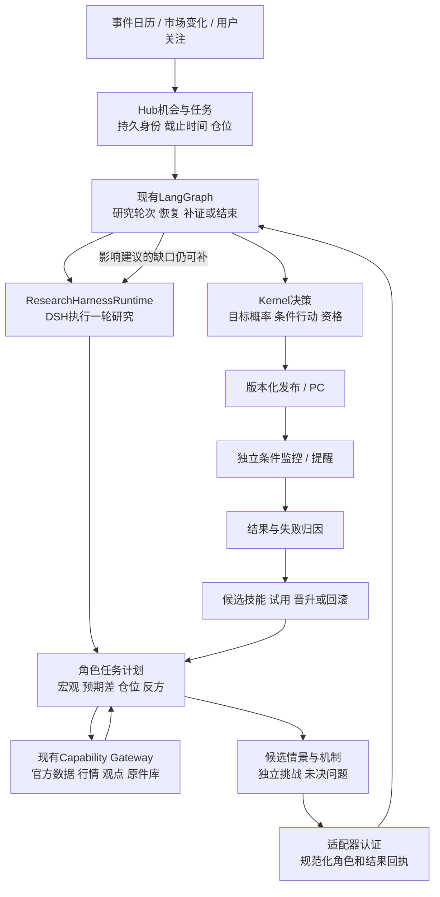

# 代码层架构诊断与修订方案

日期：2026-10-17。**review-4及OKX USDT线性永续建议/paper范围已获用户确认；用户随后要求先核完整文档，当前实施暂停。以下新接口、代码骨架和迁移步骤均未实现、未运行。**

范围补正：本文是一次局部代码诊断，不是完整架构基线。现状模块以01、Agent/上下文/学习以08、数学以02、数据迁移以03、唯一执行顺序以05为准；此前范围确认保留，最新暂停指令优先。先前针对本文的builder核查不能代替实施许可或证明其余模块完整。

本文件补正本包上一轮的不足：00–06已整理需求、对象和验收，但对现行代码为何反复失败、哪些约束妨碍研究、具体怎样拆开责任，论证不够。不能把文档一致性评审当作架构正确或产品可交付的证明。本文修订T02/T04/T06的实现方法，不另建目标或替代需求清单。

本轮整体对抗审查补充：保留原功能和验收ID，新增多空双向事前建议的必要架构变更；具体技术债统一登记在[10](10_TECHNICAL_DEBT_REGISTER.md)。每项分别记录已发现、已设计、候选实现和已验证，不能把这份蓝图写完视为修复完成。建议、纸面与监控范围已确认，实施依最新核文档要求暂停。

## 1. 结论：有局部能力，主链存在结构问题

当前不能宣布可交付，也不能据此断言金融判断方法已经被证明无效。最近release32连有效合成、独立复核、报告、同Run行动都没有产出，首先暴露的是运行链路问题；同时，概率语义、复核迭代和学习能力也确有尚未完成的产品缺口。

必须区分三件事：

1. **能执行**：输入能到模型，工具和子角色能运行，结果能持久化、恢复和发布。
2. **能给事前方案**：事件场景、条件反应、当前建议、触发/失效/期限在事前形成，并随信息更新。
3. **有稳定增益**：相同数据截止和资源条件下，相比直接使用模型，判断、提醒或行动结果更有价值。

前两项需要具体产品代码完成。第三项需要运行后的证据，不能靠增加框架、角色数、token或测试数量直接宣称。

### 1.1 这次核实的代码问题

以下`application/decision/ports`均位于`packages/kernel/decision_hub_kernel/`；行号是本次只读快照定位。

| 问题 | 代码及原件 | 影响与修订 |
|---|---|---|
| 正式入口不是薄Python SDK调用 | `infra/dsh/run-product.ps1:922,938`指定`dsh-web`；`web_runtime.py`→`web_host_client.py`→TS Host | 已有Python SDK adapter，但不能据此说正式路径只封装官方SDK。需要先收缩Web桥接责任，再决定是否切SDK。 |
| 业务层反向依赖DSH内部实现 | `application/action_research_reader.py:221–224`导入adapter的event/result mapper和私有`_sdk_run`；后续要求`DshSessionResult`并重放映射 | 更换runtime会牵动行动发布。把DSH原件认证/映射移至适配边界，Kernel只消费版本化、可验证的研究来源合同。 |
| 模型执行和回执持久化仍混在同一个等待链 | `host/model-dispatch.ts`在delegate前执行绑定和input receipt；`host/provider-input.ts`同步等待emission/finish receipt；`host/bridge.ts`在整个stream返回后才释放watchdog | 起点修正不等于生命周期解耦。必须分开准备、Provider执行、原件落盘、终态认证的状态和计时。当前各段耗时尚未重新实测。 |
| 预算状态会覆盖已经得到的完整成果 | `decision/research_quality.py:319–334`先判断`not budget_available`，后判断`full`；`application/research_quality_projection.py:91–106`用`>=`判断工具、子agent、轮次和费用耗尽 | 静态代码可证明：满足完整内容条件仍可能因刚好用到上限被判`unresolved/research_only`。预算应决定能否新增工作，已有成果应按真实性、有效时点和内容资格判断。 |
| 复核只允许一次，修订后不能再送审 | `extensions/dsh/decision-hub/src/final-review-gate.ts:781–785`；`dsh_runtime/profile.py:352–368`明确失败/拒绝也消耗唯一尝试，修改后只准research-only | 与“反驳→补证→修订→重新复核”目标冲突。按候选版本授权复核；同一回执不得给新候选背书，合理的新版本也不能被全局一次规则永久挡住。 |
| 新发现的根因问题不能自然成为新检索任务 | `decision/research_loop.py:100–102,174–230`只沿已声明requirement路线继续；无法映射的追问可能仍伴随sufficient结束 | 增加具名追问提案和能力目录约束下的需求修订，保留原Task，冻结下一轮的修订引用。不能丢掉影响动作的未决问题。 |
| 事件结果概率尚不等于市场与行动概率 | `application/event_scenario_snapshot.py:86–87`提供event result概率，asset reaction和strategy net profit为None；`event_macro_context.py:82`保留共识/定价未绑定缺口 | 修好runtime也不会自动补齐这段决策能力。T03/T04必须实现目标分离和条件传导，而非在报告里换一个概率标签。 |

### 1.2 已有能力与不能误判的地方

- 外层Graph确实主要是`research_round → next_round/finalize`，但DSH profile已有specialist和独立reviewer；不能仅凭外图节点少就说没有多agent。
- 当前V3 `research_graph_projection_v3.py:227–230`保留方向及原主观概率；legacy图的`_fail_closed_horizon`有0.5重写，但不能归因到当前V3所有运行。
- `ActionPolicy.select_plan_event`允许`research_trial`与`qualified`计划求值。不能说没有长期胜率资格就一定完全不准给建议；真正应追踪的是每条候选在哪个门被拦、为什么。
- 已有持久Worker、checkpoint、来源/证据库、机会/行动版本、监控/outbox、结果和技能消费服务，应保留复用。
- R33已有双空结果错误分类、Provider计时起点等候选修复。本轮没有重新运行，不能把这些已改过的点再列为“尚未写代码”，也不能宣布已恢复真实主链。

### 1.3 为什么过去会持续返工

已保存的release32原件说明：准备阶段约428秒挤占原600秒模型窗口；原始`dsh_model_step_timeout`又被结果读取的次生绑定错误遮蔽；最后没有报告和行动。此处不是“研究得太深入”的证据。[失败原件](../../../artifacts/decision-product-v1/core-main-flow-20261015/release32/BTC_FAILURE_ROOT_CAUSE.md)

架构层面的归纳是：原件、权限、来源、模型输入、终态和业务发布的责任跨层交错；开发时修复一个可见错误，下一层组合错误才暴露。过去一些局部测试使用替身，未覆盖真实组合；随后又依赖昂贵的完整发布发现接缝。这解释了一部分返工，不能把所有历史耗时都归为同一个原因。

执行方法也需纠正：以“修复多少错误/通过多少门”替代了“用户新增完成哪段主流程”；文档不断追加，而未及时把已证实的责任错误改成模块重构。这是工程推进问题，不能继续归咎用户需求不清楚。

## 2. 目标架构：只保留一个研究循环的调度者



图中的DSH负责一轮内的模型、工具和子角色，Graph负责轮次与恢复，Hub负责持久业务状态。不会再把候选`supervisor_candidate_graph.py`套在正式研究之上形成第二套主管循环。该图也不代表新建微服务：继续在现有Worker、Host和Kernel边界内实现。

### 2.1 文件级拆分及依赖规则

| 文件/模块 | 处理 | 明确职责 |
|---|---|---|
| `ports/research.py::ResearchHarnessRuntime` | 保留 | 仍然是模型/工具研究入口，避免同时维护第二套AgentRuntime。 |
| `apps/hub_worker/composition.py:846,889,915` | 移除业务能力对具体`DshWebResearchRuntime`的类判断 | 当前native harness/skill/context接线依赖具体类；抽取prepared-context、skill-delivery等明确能力port，由组合层装配，不能仅新增一个`execute()` adapter便声称可替换。 |
| 拟建`ports/research_source.py` | 从现有reader抽取规范化数据类型和Protocol | 描述已认证研究输入、候选、复核、执行身份与出处；不导入DSH、网络或私有mapper。 |
| 拟建`runtime_adapters/dsh_runtime/action_source.py` | 搬移`_native_action_from_originals`的DSH特有逻辑 | DSH session/trace/result原件→规范化来源；既有严格绑定测试随迁移保留。 |
| `application/action_research_reader.py` | 缩窄并注入来源适配器 | 在已有只读快照内读业务原件，调用匹配runtime/version的验证器，组装现有发布输入；不主动启动模型。 |
| 拟建`dsh_runtime/runtime_preparation.py`与`runtime_lifecycle.py` | 从`web_runtime.py`按职责抽取 | 前者冻结/复用本轮准备材料；后者提交、观察、取消、终态。先搬移行为，再消除重复验证，避免一起改完无法定位。 |
| 拟建`host/run-lifecycle.ts` | 从`bridge.ts`抽取 | Provider阶段、native终态、回执待持久化/认证分开；bridge只保留路由和组合。 |
| `decision/research_quality.py`及projection | 修订判定顺序和输入语义 | 成果有效性与继续执行资格分开。不得用预算耗尽推导行情中性。 |
| `final-review-gate.ts`与`profile.py` | 版本化复核合同 | 候选变更后可获得新复核；同版本重复回调幂等；不能沿用旧结论批准新内容。 |
| `research_learning_packages.py`等 | 保留结果→候选→消费链，扩展候选类型 | 新技能究竟改变查询、因果问题、上下文选择还是概率模型，必须可定位，不能只有反思文本。 |

应用组合层注入runtime适配器；Kernel业务模块不得反向导入`packages/runtime_adapters/`。历史DSH原件仍使用旧版本验证器读取，不迁移/重写旧判断以假装新合同已存在。

### 2.1A 保留、拆开与暂不改动的边界

| 边界 | 本轮设计决定 | 交付理由与停止条件 |
|---|---|---|
| 业务库、原件、checkpoint | 保留现有存储与各自owner；用引用、幂等和补偿连接 | 不引入跨库伪原子事务。能重放缺失发布/回执且不重复模型工作，即结束该切口 |
| Graph与DSH | 保留Graph外轮/恢复、DSH轮内角色/工具 | RolePlan说明必须覆盖的能力及复用输入；按问题启动角色，不默认每轮重跑完整团队。必要独立复核不取消 |
| 来源认证 | 拆出规范化来源port和DSH verifier | Action无需理解DSH原生通知；真实性断言和历史reader保持。仅包装类名而继续调用私有mapper不算完成 |
| API/Worker装配 | 搬至01/03所述中立bootstrap；进程各持入口 | 共享已验证配置与构造函数，不共享服务启动副作用；无需创建另一套容器/依赖框架 |
| 行情与交易品种 | 从现货用例拆出能力声明和品种规则，复用存储/采集基础 | 先支持首版perp的真实缺口；不建通用全交易所撮合引擎，不把spot与perp别名化 |
| application与persistence | 当前Session留在明确事务owner内 | 先移走具体provider/SDK和跨模块head写入；全仓仓储化、文件变小、import图漂亮均不作为业务验收 |
| 三类monitor | 保留event/risk/action含义；统一freshness、claim、通知基础约束 | 事件actual、事实变化与已发布动作触发不是同一个事件；不为去重代码合成巨型引擎 |

这组选择约束重构范围；其余纯化只在实际阻断可见建议、恢复或独立升级时进入原T任务，不能无限扩充首交付前置。

### 2.2 接口骨架：来源验证不再散落到行动业务

下列是拟实现的类型和调用边界示意，**不是声称可直接运行的补丁**。迁移时复用既有`ObservedExecutionRef`、`ResearchDecisionSynthesis`及身份字段，生成schema沿仓库现有流程。

```python
# 拟建 ports/research_source.py（Kernel不认识DSH SDK类型）
@dataclass(frozen=True)
class CanonicalDecisionSource:
    run_id: str
    request_id: str
    generation: int
    runtime_id: str
    runtime_version: str
    candidate_hash: str
    context_hash: str
    cutoff_at: datetime
    synthesis: ResearchDecisionSynthesis
    evidence_refs: tuple[ObservedExecutionRef, ...]
    review_ref: ObservedExecutionRef
    review_candidate_hash: str
    validation_receipt_ref: ObservedExecutionRef

class ResearchSourceVerifier(Protocol):
    def verify(
        self, raw: ResearchTransportObservation,
        mapped: ResearchMappedObservation,
        request: ResearchSessionRequest,
    ) -> CanonicalDecisionSource: ...
```

`verify`由受信任的组合层按冻结runtime/version选择实现；不是让模型返回`verified=true`。Kernel继续检查同Run、权限、当前generation/lease、截止、引用原件和review绑定。DSH mapper、session内部结构、SDK通知解析留在实现侧。先把现有逻辑完整搬过去，再考虑替换SDK，避免以“解耦”为名删掉已有真实性约束。

### 2.3 新增能力应影响哪些模块：维护与扩展矩阵

本轮架构目标是让常见变更有明确落点和验证范围；它不能保证以后没有返工。CPI用于检验一条完整链，首产品的加密宏观事件覆盖按00/11包含CPI、PCE、完整就业包和FOMC，并包含02定义的加密原生事件及有界扩展宏观入口；不能把其余核心事件全部推迟到其他资产阶段。各族可以先使用各自明确资格的结构化研究判断；专用统计模型只有在确有数据/方法时准入。下面的新增类型/文件均是拟议，精确schema、唯一写者、阶段及迁移见03 §10.7。

| 变更 | 应修改的确定边界 | 应稳定的边界 | 随变更必须验证的合同/直接场景 |
|---|---|---|---|
| 已有行为范围内新增事件族配置/指标映射 | `packs/crypto_macro/events/<family_id>.yaml`、新版`pack.yaml`引用、`application/event_family_registry.py`允许清单；复用`ports/event_family.py` | Worker、Graph/DSH循环、行动会计与PC通用结构 | Pack/schema/Python/TS同例；错误单位/未知handler拒绝；两族同日分别绑定event_key/stage，旧CPI仍可读。不是仅检查YAML能解析 |
| 新事件有不同来源、修订或多阶段行为 | 同层`source_adapters/official_feeds`解析器；`decision/`专用纯算法；`event_scenario_autoproduction/event_realization/event_lifecycle`通过port接线；阶段/标签policy | 通用claim/lease/outbox/通知/结果身份，无每族专用Worker | 扩展现有`tests/decision_product/test_event_lifecycle_main_flow.py`、`test_event_realization.py`、`test_event_coverage_and_poll.py`；FOMC声明后仍等后续阶段、就业修订与新期实际分离、PCE无CPI算法暗用 |
| BTC/ETH之外新增资产或品种 | `application/market_scope.py`、对应行情/合约adapter、InstrumentContract、日历/交易时段、纯会计/标签policy；02条件模型绑定 | 原宏观事实与已冻结事件agenda；研究/发布/通知协议 | 实际交易时段/报价基准/成本/目标窗口；新资产资格隔离；既有`test_action_contracts.py`、`test_action_repository.py`及新增品种算例；有数据连接不等于资产完整可用 |
| 新概率方法、特征或学习候选 | 02的`ports/decision_method.py`、`decision/`实现、版本化feature/label定义、ComponentRegistry及08 selection/consumption | 原件、目标hash、发布者/主建议规则；无需改DSH工具循环 | 相同冻结输入可重算；PIT、method支持域、样本资格、跨family/stage/instrument/horizon拒绝；新版本回滚不影响在途Run，不直接重标历史成绩 |
| 替换模型供应者或研究runtime | `runtime_adapters/`、冻结runtime/profile配置、`packages/pilot_runtime/bootstrap`及必要Host协议 | `ResearchHarnessRuntime`/`ResearchSourceVerifier`、业务Action/账户/outbox及event handlers | prepared-context/skill-delivery能力、真实原件映射、候选review绑定、取消/终态/恢复；复用03真实组件场景，不仅验证execute返回文本 |
| 新合同版本/字段/阶段目标 | 唯一YAML schema、`tools/contract_codegen`、Python/TS reader、append migration、版本协商与发布manifest | 历史schema/hash与原件；单一当前写者 | 扩展`tests/contracts`跨语言样例和`tests/migrations/test_event_main_flow.py`：双读、unknown版本拒绝、旧行不重解释、回滚保留新原件及保护责任 |
| 更多归档、worker或事件数量 | 部署闭包manifest、明确索引/分页、scheduler batch/claim、公平性与资源指标 | GET不采集/认证整树，archive不是在线代码发现器；单业务库owner约束 | 相同活跃输入增加无关归档后读取集合不膨胀；writer竞争/重启无重复模型/动作；按实际队列年龄和锁等待决定容量改造 |

**配置与代码的分界。** EventFamilyPackV1声明来源、指标单位/修订、情景/方法、stage时钟、监控、标签和覆盖政策；它引用已部署允许清单中的实现，不承载任意脚本。出现新解析语义、概率目标、结果类型或会计规则就属于代码/合同变更，必须按本表补直接场景。静态EventFamilyRegistryV1沿现有domain pack冻结，不再建插件市场、通用规则语言或活动指针数据库。现`ports/event_scenario.py`的cpi/fomc枚举、`event_lifecycle.py`的BLS过滤、月度reference_period/日slot字段属于待搬出的假设，不能用新名字包装后仍隐藏在通用服务中。

**数据复用不传递资格。** facts/archive和纯函数实现可共享；参数、特征定义、标签、基线、校准、资格与回滚按family/stage/instrument/target/horizon/conditioning/method版本隔离。联合事件agenda明确前后依赖，不按事件个数相乘概率，也不让后来的单一事件卡覆盖仍有约束的其他事件。账户风险只改变适用动作，同一官方事实不会因用户仓位变化而改变。

**变更完成的维护证据。** 每个变更随05原任务记录一个用户场景、上表受影响模块/合同、唯一owner、版本兼容和回滚位置。只改配置时不重新生成整套运行框架；改runtime时不重算金融标签。若实际改动越过“应稳定”列，先说明新增语义或发现的耦合并修订相应合同，再实施，不能悄悄扩成全仓改写。验证聚焦直接风险和被改变的接缝，已通过后即交付该范围。

### 2.4 Agent合同的文件落点（08补充，仍随原T任务）

| 责任/复用点 | 确定落点与边界 | 直接证明 |
|---|---|---|
| T04角色隔离与汇聚 | `research_execution_binding/research_graph_binding`冻结角色身份，DSH执行并作语义汇聚；adapter认证真实子session，`research_graph_projection_v3`只消费具名结果与挑战。单位/引用/目标对齐提取为纯校验helper供汇聚与review共同使用 | 同源多角色不加权；冲突/失败角色有去向；第一阶段反方实际输入无主结论 |
| T04候选状态与停止 | `final-review-gate.ts`认证候选/attempt；`research_review_effects.py`继续读取既有resolution/issues；`research_quality/research_loop`分别判内容与续研，发布者只读取派生资格 | rejected不因预算耗尽变accepted；v2不消费v1复核；无路线但关键缺口未解不变sufficient |
| T04检索、摘要与预算 | `research_context_selection_v4`后继合同保存查询/候选集和revision；selector/helper负责PIT、来源簇、完整语义预算；delivery核实际输入身份。查询adapter不决定发布资格，缓存不成为事实库 | 新vintage/ACL/revision失效不污染旧快照；protected装不下有具名缺口而非无限拆任务 |
| T02/T04外部文本权限 | `packages/workbench_adapters/durable_research_gateway.py`核有效Task与role权限，Host绑定真实子session；`research-tool.ts`只提交合法查询，`reviewer-tool.ts`保持空工具allowlist | 文本诱导重定向/账户查询/伪回执无法扩大能力；普通来源事实仍能进入研究 |
| T06学习包与撤回 | 复用`research_learning_packages/research_skill_compiler/research_skill_gateway`的受控执行；拟议release读取器核父版资格后调用`component_registry`原CAS，selection/调用/发布分别核资格 | 恶意literal或SKILL不变权限；撤权停止受影响在途调用；父版已撤回时不得盲目rollback，既有纸面保护持续 |

上述接线与反例均待实施。共享的是原件验证、schema、纯校验和现有队列，不把Graph、Host、Gateway各扩成全功能Agent框架；状态写者沿03 §2.1，具体合同沿08，不在本表复制DTO或新增active指针。

## 3. 运行稳定性：剥离等待，不削弱研究

### 3.1 一次模型调用明确分四段

```text
prepare/freeze → provider_started → provider_finished → receipts_confirmed
     准备               模型/网络           证据落盘及确认
```

记录各自开始/结束时间、最后进展和错误来源。Provider结束时停止该段计时；结果回执尚未确认时保持`receipt_pending`，不能伪装成模型仍在思考。业务Run只在既有Hub受控入口进入终态。原始错误、回执错误、读取错误各自保存，不用后发生的错误覆盖首因。

回执失败不能发布未认证的建议，但也不能继续启动模型重做整份研究；恢复只重放缺失的幂等落盘/认证步骤。终态失败有原始结果时保留原件；没有结果时明确没有结果。

### 3.2 认证成本的处理

当前input/emission/finish路径反复准备原件并验证来源；status/result也触发完整任务绑定。改造为：部署/方法/输入不变部分按**内容哈希+版本+输入身份**验证并复用不可变回执，日常读取只访问该次Run所需引用。原件有变化则失效，不能只按mtime判断。

权限撤销、取消、lease/generation、当前有效时间仍在副作用发生前新鲜检查；不缓存这些实时授权。代码闭包不在每个模型事件里重扫整个历史快照目录。新版本耗时必须分段实测，本文不承诺未经测量的加速比例。

### 3.3 研究预算与成果资格拆开

拟改的核心规则：

```python
# decision/research_quality.py 的目标判定顺序示意
if integrity_invalid or result_after_valid_cutoff:
    return rejected_result(reason=exact_reason)
content = assess_existing_material(frozen_result, evidence, reviews)
continuation = decide_more_work(budget, material_gaps, progress)
return QualityDecision(content=content, continuation=continuation)
```

字段落实到现有quality schema的版本升级，不能在代码中临时塞未声明属性。取消后的新发布依旧受Hub控制；“成果仍可保存/说明”不等于“取消后还可发布新的行动”。预算耗尽停止新增工作，不抹掉此前合法完成的结果；未知成本不能直接变成“没有市场判断”。

长研究继续异步。进展包括新增有效证据、解决关键冲突、改变场景/动作、完成子角色任务；心跳和重复相同检索不算研究增益。预计下一条信息会改变哪种动作，是继续检索的优先级依据。无法量化信息价值时保留理由和受影响方案，不制造精确收益分数。平台仍需要资源管理，但不把60秒、单次review或少数轮次当作金融方法。

### 3.4 有限批次、积压与恢复必须形成同一个合同

`scheduler.py::run_forever`已有独立channel；同步工作也已有取消后join，不能误写成“目前全部串行、没有恢复”。具体接缝是`event_scenario_tick.py:14,51`把CPI forecast和lifecycle包进`risk_enhancement_tick`，再await旧history/enhancement。一个包装内仍共享调度顺序、timeout与诊断，且等待结束后才sleep cadence，不能从60秒配置推出60秒检查保证。

T02/T05把事件forecast、既有事件monitor/outcome登记为显式工作种类，复用现有scheduler和持久claim，不建第二队列。每类冻结单批上限、最大并发、工作截止及重试策略；新触发按原identity合并，记录排队年龄、延期/过期原因、失败数和最后真实进展。行情/条件监控及已拥有仓位的保护优先于新深研，历史回填不得耗尽新事实通道；普通请求仍需有最大等待与公平性记录，优先队列不等于允许无限饿死普通请求。

重启后只由有效lease/generation续作未完成批次；取消先等所属同步writer结束或取得可证明终态，再准入接替owner。Provider已结束但回执pending只恢复原回执；Action发布失败只恢复原发布hook。禁止因积压扩大模型预算、重置原cutoff、回填事前published或重复通知。直接验收用一次慢采集/一个writer竞争/一次进程重启，观察快监控仍推进、原任务没有第二模型调用和重复纸面动作；这些是未来验收场景，本轮未执行。

资源与容量不靠隐式全局对象维持：Session由一次业务操作持有，HTTP/数据库客户端由进程组合层关闭，Graph saver由Worker管理，native session/stream与watchdog由runtime对应owner管理。IO/模型/归档准备在写锁外，事务内只复核和提交。03 §10.8规定线程取消、双SQLite恢复、确定性计算、归档增长和停止条件；只有实测的锁等待、队列年龄或部署需求超出既有边界，才评估更换数据库/队列。多worker并不消除SQLite单writer约束，也不构成引入新平台的理由。

## 4. 研究智能：已有多角色怎样真正形成闭环

### 4.1 复用DSH内部执行，增加可恢复的角色任务合同

在既有research合同中新增版本化`RoleTask/RoleResult/ChallengeResolution`，通过现有role输出/原件引用保存，不新建任务平台。

```text
RoleTask:
  task_id, parent_run_id, candidate_version, role, question,
  requirement_ids, context_manifest_ref, allowed_capabilities,
  expected_output_kind, upstream_task_refs
RoleResult:
  task_id, execution_ref, claims, support_refs, counter_refs,
  unresolved_gaps, affected_scenarios, proposed_next_questions
ChallengeResolution:
  challenge_id, challenged_candidate_hash, evidence_delta_refs,
  resolution, revised_candidate_hash, reviewer_receipt_ref
```

独立宏观、市场预期/定价、资金仓位任务可并行；反方先独立提出替代解释，再检查主方案关键弱点。汇总不按“几个角色赞成”换算概率，因为角色和信息并不独立。角色给出的置信度也不直接平均为市场胜率。

现有specialist支持`continuable`。同task/context/revision的中断可恢复原session并读取真实回执；改变问题、cutoff或revision需新role task/session，只复用适用的原结果引用，不能接着旧对话冒充隔离。LangGraph接收一轮已认证材料并决定续研；DSH内层不自行宣布业务发布成功。汇聚采用08 §2.2的事实对齐、来源去重、冲突保留与反证覆盖；不能让主session自行消掉reviewer未解决项。

### 4.2 复核改成按候选版本工作

1. 冻结候选v1，review只绑定v1 hash及其实际证据集。
2. reviewer提出`requires_new_evidence`时，生成具名缺口任务，优先补会改变推荐动作的证据。
3. 新证据形成v2，明确保留v1、改动原因及未解反证。
4. v2可重新申请复核。重复v1回调只返回原回执；失败重试有明确attempt身份，不能伪装新的独立意见。
5. 到达期限或没有可执行补证路径时，发布符合条件的当前研究方案与缺口；不把未经复核版本标为已通过，也不把拒绝强制改成接受。

独立reviewer保持只读，不任意安装工具或扩权限。需要核对新来源时提出任务交给采集路径。这样允许多轮研究，同时可追踪到底哪次反驳改变了判断。

模型还可以提出新的`InquiryProposal {question, affected_claims, affected_actions, desired_source_kind}`。拟建`application/research_inquiry.py::admit_inquiry`在原Task允许的资产、来源和capability范围内，将其转成不可变`RequirementRevision {parent_ref, added_requirements, route_bindings, reason, hash}`。下一轮execution/context binding引用该修订；**不修改原Task、原request hash或旧回执**。需要新增未授权capability时返回具体缺口，不能自动扩大权限。与动作相关的未决追问不能仅因没有旧requirement ID就从quality中消失。

实际改动接缝：`research_context_selection_v4.py/research_execution_binding.py`冻结role plan和inquiry revision；`research_graph_binding.py/research_graph_projection_v3.py`接纳真实角色、挑战、修订回执；`decision/research_loop.py`选择可执行的新旧路线；DSH内部执行，外图仍用既有`next_round`。

### 4.3 上下文组织

每个角色只加载自己的问题、必要事前事实、相关历史案例、技能版本和反证引用。共享完整原件库；摘要包含来源和可回读引用，压缩不能丢掉未决挑战、时点、单位和有效条件。

当前`research_context.py:82–106`以12项为基础，另加review/CPI/scenario/opportunity专用项、总上限50；每项4000字符、并发2、轮次最多10；native v4会使用selector v3。`research_context_selector_v3.py:153–175`截取非protected材料，protected超限报错。这不等于所有输入被静默截断，但必须给核心反证和新增根因问题明确保护与回读路径。总时长/reserve还随pack版本变化，实际影响须按Run冻结配置核对，不能只改一个默认值就宣布研究变深。

上下文采用必需/优先/按需三类，并记录实际选中与遗漏原因。发现缺口可继续检索原件；不能简单全量拼接历史台账，也不能以固定字符截断造成事实或条件残缺。旧Skill全文不塞进每轮prompt。模型输出限制应根据角色输出结构设置，截断是可恢复执行失败，不算“已经没有看法”。

## 5. 概率和操作：补齐缺失的决策路径

以CPI为例，分开保存以下对象，接口及估计细节延续02的`TargetSpecV1`等设计：

```text
事前信息 I
  → P(CPI情景 s | I)
  → P(BTC/ETH指定期限反应 r | s, 预期差, 已定价, 宏观状态, 仓位)
  → 当前仓位下行动 a 的收益/损失/费用/触发/失效分析
  → 推荐动作 + 次优替代 + 哪条新信息会改变推荐
```

`高于前值`、`高于市场共识`、`资产下跌`、`某策略净盈利`是不同预测目标。没有共识数据时允许给基于自有估计的情景，但明确它不等于市场预期差。缺条件样本时允许给有证据的主观概率，标记依据和不确定性；不能用一个校准器把未建模的传导链变成已校准数字。

每个动作候选必须有：适用仓位、期限、进入/减仓/退出条件、失效条件、关键风险、证据与概率口径。若收益分布可信则比较净期望效用；若不足以算可信EV，则给规则型条件方案，说明使排序改变的关键假设。不得为产出一个数字编造精确EV。

建议需要明确倾向；`wait/hold`也要有触发后转入哪种动作、何时重评、错过机会的记录。未知不能一律回写50%，70%也不能成为默认值或强制出单阈值。高概率并不自动等于好操作，例如赢1、输4的收益结构下，70%胜率仍是负期望；这是动作排序必须考虑损失的原因。

时域分工：宏观/流动性状态解释背景，事件与预期差解释催化，资金仓位解释放大机制，分钟行情主要服务触发和风险控制。黄金、纳指、恒科共享事件/宏观/证据/机制框架，但各自实现资产传导、交易时段、报价、成本与结果标签，不复制BTC策略或混用样本。Kronos继续作为价格路径候选证据，不代替宏观事件模型。

### 5.1 多空双向不是给现货动作换文案

现状由源码直接限定：`decision_product_v1.schema.yaml:1097–1113`和`action_policy.py:257`只接受long三动作；`action_research_policy.py:40,78`绑定OKX现货与30m/24h/72h；`action_quote.py:30,219`只验SPOT；`action_paper_accounting.py:22–26,134,193`只允许现货scope、低于买价的多头止损和不超过持有量的卖出。`market_scope.py`的BTC永续研究入口不能解除这些限制。

新增F33要求同合约/期限下具备多头与空头方案。首版**已确认选型**是OKX BTC/ETH USDT线性永续，单向净仓，研究建议和纸面结果，不自动真实下单。维持旧现货版本；为perp新增版本化instrument能力、风险政策和Action/quote/execution合同，不覆盖原schema的旧枚举解释。

| 必须同组改变的责任 | 目标规则与直接反例 |
|---|---|
| 市场能力与来源 | 能力表绑定instrument/venue/contract spec/price basis、采样精度、历史/实时覆盖和PIT。spot价格可作为显式辅助变量，不能伪装perp盘口或mark；单点OI不能当OI变化/资金流 |
| 候选与选择 | flat比较合法open long/open short/no_change及具体条件动作；long与short各自有持有/减仓/退出及必要反向后继。unknown展示各分支；账户/风险快照不全时仅单位风险研究。首选由02效用/规则及敏感性决定，不把看跌强制映射为做空 |
| 合同与发布 | 新建`decision_product_v2.schema.yaml`；ActionCandidateV2按`action=open/add/reduce/close/conditional/no_change`和`target_side=flat/long/short`建模，不往旧v1塞新short枚举。候选、复核、Action、target、account/risk policy、instrument spec在同一不可变绑定内。v1多头回执不能批准v2空头候选；旧客户端收到不支持版本需明确提示 |
| 条件监控 | 空头止损方向、退出与失效独立求值；price basis声明trade/mark/index/bid-ask的用途。新反证优先撤掉冲突推荐；盘口缺失或mark陈旧标degraded，不以现货绿色值放行 |
| 纸面与结果 | short开仓用bid、平仓用ask并记录费用/滑点；资金费按冻结账期和方向进入结果；合约面值/数量步长、margin mode、leverage、保证金与强平假设具有版本。缺输入时结果不可评分，不把gross或价格下跌记成净盈利 |
| PC与学习 | current视图按同instrument/venue/账户/目标/期限过滤并持久引用冲突；4h/24h/72h及spot/perp样本与资格分别绑定。旧long成果仅作历史，不自动成为short页主推荐 |

论文/经验迁移可共享宏观机制和输入原件；市场反应目标、资金费路径、费用、强平与方法资格需要各自验证。三期限可以先用各自合法基线运行研究，自动学习发布逐期限开放；缺一项不能借其他期限资格，也不阻断已具备合同的建议切片。T03拥有来源/品种能力，T04拥有候选比较与发布，T05拥有监控，T06拥有分目标学习，T07/T08随切片交付PC和验证。详见TD-08至TD-14。

## 6. 自反思、自进化具体改什么

当前学习包存在`spot_evidence/features/hypothesis`三节点执行布局限制；不能称已经具备任意技能生成。先复用已有结果→learning job→候选包→trial→消费链，再逐项增加可变部分：

| 候选类型 | 可修改内容 | 不允许直接修改 |
|---|---|---|
| 检索技能 | 哪类事件检索哪些来源、查询和反证，何时过期 | 来源时间、真实权限、原始结果 |
| 因果研究技能 | 替代机制、反例、需要验证的关键链条 | 将观点变成已验证事实 |
| 上下文策略 | 哪种问题选哪些历史案例/字段，保留哪些未决挑战 | 隐藏不利结果或偷看未来 |
| 概率/行动方法 | 特征、估计器参数、适用状态；经独立版本准入 | 自改评分分母或直接覆盖活跃模型 |

这些变化存为结构化artifact及可读SKILL说明，并标明输入/输出、适用资产/事件/期限、依赖版本、支持与失败案例。只有真正调用并影响后续任务，才记录consumed；下载、选中、读取都不等于学会。

反思先归因：漏采、消息太晚、预期差判断错、传导错、概率失准、动作成本/路径错、提醒延迟，分别产生不同候选。运行时异常不能自动生成金融策略；一次行情巧合不能直接晋升长期经验。新工具适配器属于开发变更，仍需代码审查和版本部署，不由研究Agent自由改生产源码。

## 7. 是否换DSH、Codex或Claude SDK

| 选择 | 可获得什么 | 对本项目的判断 |
|---|---|---|
| 收缩现有DSH Web适配器 | 保留已接工具、子agent、回执和业务入口，修复最直接 | **第一阶段采用**。同步解开Kernel逆向依赖，不再向大bridge里继续堆业务。 |
| DSH官方Python SDK | 官方subprocess/JSON-RPC、session、通知和配置能力 | 已有adapter可复用，但锁定0.1.1rc1与当前Web主线合同不同；不是改一个配置就具备native V2全部接线。作为下一运行方式候选。 |
| Codex SDK | 官方会话执行/续接；当前官方文档也提供Python异步接口 | 适合实现同一runtime port的候选；不能替代市场数据、概率、行动和学习设计，切换时必须验证工具/出处/取消/恢复合同。 |
| Claude Agent SDK | 官方agent loop、context、subagents、MCP、sessions/hooks | 同样是执行底座；需另核模型、凭据、费用和行为。当前用户指定gpt-6.1-sol，不将其作为默认迁移。 |

这里的选择是依据当前代码的工程判断，不是已测出DSH效果更好。换SDK可以减少自研运行管理，无法自动消除业务层耦合，也无法自动提高预测胜率。若收缩后仍需在官方runtime外重复维护同类session/model循环，应按本节port切换候选实现；不得再让业务层依赖候选SDK内部类型。

官方依据：[DSH Python SDK](https://github.com/deepseek-ai/deepseek-harness/blob/master/python/sdk/README.md)、[Codex SDK](https://learn.chatgpt.com/docs/codex-sdk)、[Claude Agent SDK](https://code.claude.com/docs/en/agent-sdk/overview)、[LangGraph工作流与Agent模式](https://docs.langchain.com/oss/python/langgraph/workflows-agents)。这些是2026-10-17查询的上游资料，不代表项目锁定版本已具备最新接口。本轮未安装/升级/复制框架代码。

## 8. 与实施计划的对应：以05为唯一顺序

下表只是本诊断的问题到05任务的映射；不得作为第二份可独立开工的计划。此前review-4范围确认保留，最新文档核实暂停解除前以下均不执行：

| 次序 | 对应任务 | 必须交付的代码结果 | 最小必要证明 |
|---|---|---|---|
| 1 | T01+T02 | 来源验证port抽取、生命周期/时钟分段、终态首因保留；既有R33修复合并核对 | 当前真实组件成功/原始失败各一条；复用现有harness，未覆盖部分明确列出。 |
| 2 | T04前置 | 预算与成果资格解耦；候选修订可重审；已有方向与概率不被无关故障改写 | 末次调用完成成果仍可保留；v1被挑战→新证据→v2独立复核，旧回执不能批准v2。 |
| 3 | T03+T04 | CPI等事件的共识/估计与PIT；角色任务；场景→资产反应→条件建议 | 在发布前生成同截止方案，加入相反证据后能说明修改；仍不能声称达到某胜率。 |
| 4 | T05+T06 | 新信息修订、条件监控、通知；真实结果触发候选技能并在后续任务消费 | 同机会版本链和两次Run可追踪，不用预置seed冒充自学习。 |
| 5 | T07+T08 | PC当前方案/原因/变化/操作及完整交付 | 同一候选版本真实BTC/ETH流程与PC实操；失败保留原件，停止无关全仓测试扩张。 |
| 6 | T09+T10 | 黄金/纳指/恒科资产适配与Kronos候选 | 各自数据、传导、交易时段和结果标签，独立说明支持范围。 |

T01不单独长成新的验收产品；它随T02只覆盖眼前真实接缝。效果观察随可用产品持续进行，不要求开发任务空等数周才能完成。具体评分仍沿02，不能以单元测试替代实盘价值。

每次提交只记录：修复的业务阻断、变化的代码责任、用户现在能完成的步骤、直接验证及未证实项。保留失败的原件和旧分母。没有证据时不写“核心完成”或“效果优于原生模型”。

### 8.1 用可见结果切片，保持05为唯一实施计划

以下是05任务的交付包装，不新增可单独运行的计划或批准：

| 切片 | 随行的原T任务 | 可以交给用户核验的结果 | 尚不能宣称 |
|---|---|---|---|
| 真实研究可交付（05 D1） | T01/T02＋T04预算/复核＋T07状态读取 | 一份真实输入的研究完成或保真失败；Provider结束/回执pending/发布状态可分辨；中断只续缺失步骤 | 有金融增益、已支持所有角色/资产 |
| 一个事件的双向事前建议（05 D2子片） | T03/T04＋T05基本监控＋T07 | 一个首版合约、一个已登记期限上，flat/long/short分支、反证、首选与条件事前可见；市场能力缺口有影响说明 | 两资产三期限已完成、perp纸面净收益已验 |
| 双向纸面与变化闭环（05 D2子片） | T03所需报价/费用＋T04/T05＋T07/T08 | 同一建议的触发、失效、资金费/成本、纸面结果与用户回执可追溯；慢深研不阻塞保护 | 真实成交/自动下单、收益优势 |
| 两资产三期限、多事件与真实经验消费（05 D2/D3） | T03/T04/T05/T06/T07/T08 | BTC/ETH、4h/24h/72h各自目标与资格，核心事件族/阶段及02加密原生/扩展事件入口完整接线；一条非seed改变下次实际执行，再按到期结果评价 | 借一资产/期限/事件的通过授予另一项，或用consumed代替金融改进 |

每片的完成是对应范围的工程/产品完成，仍分别登记未实现和未验证项。过渡版本的旧reader、数据与账户账本保留；开关撤回到旧scope时不能让新perp仓位失去保护，需先停止新意向并处理已有纸面episode，再退回仅历史读回。跨层反例与技术债直接验收集中于10/11，实施记录只落05指定位置。

后续治理工具也必须跟随当前合同：`tools/acceptance/validate_market_risk_plan.py`现固定旧`market-risk-v1`路径和spot scope，`tools/context/build_task_context.py`现固定旧contracts.v1/ADR-0001并将DSH/Pi内部列为禁改范围。这些旧约束不能继续误拒本次明确的perp/runtime任务。按05在获准首切片内小改原工具，读取唯一当前execution contract的版本、范围及真实增量paths；旧合同保留历史，工具不能从旧active_goal或一条README文字推断本包已批准。该修订属于TD-03/13的执行边界，不建立新的计划平台。

## 9. 产品超过直接模型调用的价值在哪里

可交付的差异应是：自动关注事件和资产、保留当时可知的信息、并行核对机制和反证、给当前仓位的条件建议、持续监控自己提出的条件、保存每次修订并从真实失败中改进下一次研究。单份报告的文字长度和多agent数量不能证明这种价值。

工程效果看同一任务能否可靠完成及恢复；研究效果看具体遗漏是否被补齐、建议是否在事前给出且会更新；预测/行动增益再使用相同截止/资源的直接模型基线比较。若产品只能增加延迟、约束和复杂度，不能更早形成可用方案，这次重构就没有达成目的。

## 10. 旧项目复用核查：已有教训不能再重复

本仓[2026-09-08交接文档](../../plan/Decision_Hub_项目背景与讨论交接文档_2026-09-08.md)明确关联两个旧项目。本次读取远端关键文件，HEAD分别为`crypto-macro-decision@7dd8d784bf494051baf0642d2a90efbf6c929f9e`、`crypto-manual-alert@9b370f4f3e87ef441ae84dc27368b987abbbb117`。

| 已读内容 | 复用与拒绝继承的内容 |
|---|---|
| [旧Skill](https://github.com/luguochang/crypto-macro-decision/blob/7dd8d784bf494051baf0642d2a90efbf6c929f9e/SKILL.md)、references、agents/openai.yaml | 复用事实/推论/情景分离、预期差、priced-in、根因链和反证。内部扮演四角色不等于真实独立执行；界面default_prompt不是团队调度；投票和固定分数不作为校准概率。 |
| [okx_snapshot.py](https://github.com/luguochang/crypto-macro-decision/blob/7dd8d784bf494051baf0642d2a90efbf6c929f9e/scripts/okx_snapshot.py) | 可参考字段和缺失说明；只有当前OI不能冒充变化。证书失败后跳过TLS验证的重试不移植。 |
| [旧研究选择](https://github.com/luguochang/crypto-manual-alert/blob/9b370f4f3e87ef441ae84dc27368b987abbbb117/backend/src/crypto_alert_v2/agents/research_harness_selection.py#L37)及[研究实现](https://github.com/luguochang/crypto-manual-alert/blob/9b370f4f3e87ef441ae84dc27368b987abbbb117/backend/src/crypto_alert_v2/agents/deep_research.py#L133) | 搜索和委派各限1次；首次工具结果后复用整批缓存，不能按新问题继续检索。这些收窄规则不能带进本次重构。保留其来源编号、未知引用拒绝、内容去重和查询成功/失败分母的思想。 |

当前[Domain Pack映射](../../domains/crypto_macro/README.md)早已规划过上述方法拆分。问题不需要再导入一份超长Skill解决，重点是方法在实际研究中是否被执行、反证是否改变结果、结果是否进入后续学习。

两个旧仓本次根LICENSE读取为404，树中未发现许可证文件，许可记未知；不据依赖Aegra的许可证推断整个仓库可复制。本轮仅研究方法和代码边界，没有复制第三方实现。
