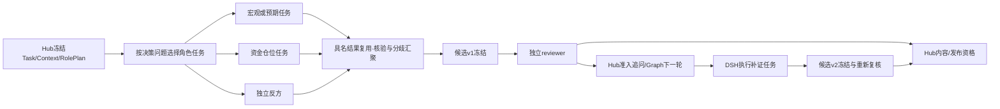

# Agent 研究、根因链、上下文与自进化技术规格

日期：2026-10-17。状态：**review-4范围及OKX USDT线性永续建议/paper已获用户确认；随后用户要求先核实完整文档，当前实施暂停。** 本轮补充仍是设计，未实施、未验证；恢复执行以最新用户指令为准，不撤销此前范围决定。

本篇细化[02 方法合同](02_DECISION_METHOD_AND_EVALUATION.md)、[03 运行合同](03_RUNTIME_AND_DATA_CONTRACTS.md)和[07 架构修订](07_ARCHITECTURE_REPAIR_BLUEPRINT.md)，不另建编排平台。下文“拟建/拟扩展”均不是现有能力或通过证明。review-4采用动态RolePlan、三类概率、双向永续建议及多事件议程合同；本轮只读核源并修订文档，不修改产品代码、运行测试、构建、启动、安装或登记试验。

目标时域沿已确认review-4的 **4h/24h/72h**，对应用户既有“4小时至3天”方向；现有 `30m/24h/72h` 合同及历史样本保持原版本，不能把 30m 成绩改名为 4h。当前学习登记/试用还限 24h，扩展必须分别登记目标与结果窗口。

## 1. 源码现状与设计切口

文中短路径以 `packages/kernel/decision_hub_kernel/` 为根；`DSH/` 指 `extensions/dsh/decision-hub/src/`。

| 已读入口/符号 | 已有行为 | 本篇拟改接缝 |
|---|---|---|
| `packages/runtime_adapters/dsh_runtime/profile.py::_build_research_prompt` | 要求真实 specialist 子任务和独立 reviewer；但提示词限制一次 reviewer、只能引用已声明 requirement | 结构化角色任务、候选版本绑定复核、新问题准入；保留真实来源与权限约束 |
| `DSH/final-review-gate.ts::readQualifiedReviewerContext/evaluateFinalReviewGate` | 从真实日志重建冻结候选；限定 generation=1、已花费尝试；候选三期限硬编码含30m | 复核资格按 candidate hash、evidence-set hash 与 attempt 身份管理；新4h合同与旧读器并存 |
| `application/research_context_selection_v4.py::_body/ContextSelectionService` | 冻结选择原件、时点和 selector 身份；实际调用 `select_context_v3` | 为角色、requirement revision 和语义摘要追加版本化选择合同 |
| `application/research_context_selector_v3.py::select_context_v3` | 按 evidence ID 去重；protected→任务输入→相关性/权威/新近排序；按数量选择，非protected摘录投影 | 增加来源簇、机制覆盖、反证保留及原文回读；不把固定截断当研究方法 |
| `decision/research_loop.py::assess_research_loop` | 只对 known requirements 分配路线；自由问题无法自动成为新 requirement | 只读经过 Hub 准入的有效 requirement 集；未准入问题显式保留 |
| `application/research_learning_jobs.py::LearningJobs.enqueue_source` | 真实 `action-outcome.v2` 可入队；execution_observation 不作为成熟结果入队 | 事件预测结果须另加读取器和来源合同，运行异常不冒充金融结果 |
| `research_learning_packages.py::LearningPackageBuilder.build/validate_supported_workflow_layout` | 产出 immutable、registered_unadmitted 包；普通执行器只支持 spot_evidence/features/hypothesis 三节点 | 先使用支持的变更；扩展节点与操作要有实际执行器，不能由说明文档代替 |
| `research_skill_selection.py` / `research_skill_trial_selection.py` | baseline 和有限 trial 可选；qualified pointer消费尚未安装，trial 仍限24h | 接通既有ComponentRegistry发布/回滚指针与方法资格读取，保持原选择/消费链 |
| `research_skill_consumption.py::SkillConsumptionService` | 核验实际模型输入、父输出和具体机制节点/边引用，写 executed/consumed | 保留强消费证据；扩展执行 DAG 后相应泛化父节点集合 |

事件现状有两条支路：CPI 数值/情景到 event-owned opportunity 是确定性支路，未必创建 Run；普通市场风险 alert 经 admission→Run→DSH。目标是将事件支路的 `ScenarioSnapshot` 冻结为研究输入，按已有 admission 触发需要解释/修订的研究，并继续提供确定性条件预案；不能画成今天所有 CPI 预案均必经 DSH，也不添加第三个控制器。

## 2. 真实 Agent、职责与依赖 DAG

**多事件研究输入。** Task冻结02/03的`EventAgendaSnapshotV1`及精确`EventFamilyBindingV1`引用；RolePlan依据相同议程分派宏观/市场结构/合约风险等独立子任务。共用来源、宏观事实和新闻簇只采一份，角色按问题选择并回读原文；每个角色结果标明适用family、stage、target及截止时间。FOMC声明与发布会的后到材料只能进入后继RequirementRevision/Run；不能污染早期CPI/PCE/就业预案。由汇聚者与独立reviewer核对多事件依赖和相互矛盾的机制，再形成一份可比较的当前方案；不得把角色数当独立样本、直接平均概率或相乘重叠事件边际值。CPI专用模型不隐式用于其他族；结构化判断使用02具名方法并保留其主观资格。

本项目选择“**独立子 session specialist + 独立 reviewer + 主 session 汇聚**”。同一上下文中依次写“现在扮演宏观/反方”只能称角色提示，不能记作多 Agent 执行。真实子 Agent 必须有 child_session_id、独立实际输入、工具权限、执行日志/终态、输出回执和父子关联；in-process spawn 不影响 session 隔离的定义。

各角色默认使用用户指定的 `gpt-6.1-sol`。独立 session 提供任务与上下文隔离，不提供模型、信息来源或统计误差独立性；角色投票、平均置信度不能变成概率。实际 model/profile hash、reasoning effort、工具能力要记入执行身份；不能仅凭请求模型名声称实际 Provider 已使用该配置。

| 角色 | 最小输入与产物 | 依赖与边界 |
|---|---|---|
| 宏观机制 specialist | 事件定义、历史发布、利率/美元/流动性背景→机制节点、支持/反证、传导滞后 | 可与预期、仓位并行；不输出最终动作 |
| 预期与已定价 specialist | 合格共识/自有估计、前值、事件前价格与政策定价→预期差、已定价假说 | 共识缺失就标未知；前值和日频变化不能替代共识/事件定价 |
| 资金与仓位 specialist | 现货量价、真实流量来源、OI历史、funding/basis、深度→放大/挤压机制 | 市场仓位与用户仓位分开；当前OI不是资金净流入 |
| 独立反方 specialist | 问题、事实切片和目标→替代机制、否证条件、最有价值追问 | 第一阶段不看主结论；候选冻结后可定向挑战其关键边 |
| 数据质量检查/按需specialist | Hub先确定性核单位、时钟、修订、来源；有语义冲突时才调用specialist解释 | 合同验证不能交给模型自报通过；相关核验需在候选冻结前完成 |
| 汇聚主 session | 已核验 RoleResult + MechanismGraph→候选、分歧清单、待补问题 | 不伪造未返回子任务、不把共识人数当独立证据 |
| reviewer 子 session | 完整冻结候选、证据摘要/回读引用、控制块→ChallengeResolution | 只读核查；缺新材料提出 InquiryProposal，不能直接扩工具/改事实 |



上述是业务依赖 DAG，不是另一个调度器。Graph 是外层证据轮次、汇聚点、停止/续研位置的唯一 owner；DSH 是一轮内模型/工具/子 Agent 执行的唯一 owner；Hub 是权限、事实、业务终态与发布的唯一 owner。角色结果汇聚须等所有已开始任务得到 terminal receipt，或由 Host 确认超时/取消并保留 partial 状态；不能只等最快几个后把其余记作“无反证”。

DSH只启动依赖已满足的节点，实际并发继承冻结 `task_policy.max_parallel_tasks`，当前上限2；DAG可并行不意味着一次全部启动。子任务不得再任意委派。恢复时复用同 task/context hash 已认证的结果，只补缺失节点；上下文、截止或 requirement revision 改变则新建 role task/子session，不把旧 child 的对话继续当成新鲜事实。

### 2.1 RolePlan按问题选择，已获证据复用

上表是能力目录，不要求每一轮固定调用全部角色。`RolePlanV1`增加`decision_questions/affected_targets/selected_tasks/reused_results/skipped_with_reasons/required_challenge_coverage`。选择顺序：先由Hub验证事实资格，主session定位可能改变事件概率、资产传导或动作排序的缺口，再按已安装能力派任务，记录哪个问题由哪个输出回答。宏观CPI任务通常选择预期/宏观/反方；纯funding变化先走确定性成本重算，只有传导假说变化才启动相应研究；普通价格bar仅求值已有条件。

相同事件、cutoff、输入ref/hash、method与有效窗口的宏观研究可由BTC/ETH共同引用；不能把带账户或某资产价格目标的产物当通用结果。新截止/新事实使旧结果不再适用时需新任务，旧已知事实仍可引用但不能标为新采集。最终候选仍须独立挑战关键机制和独立review；复用需有真实receipt及明确适用范围，不靠删掉反方节省调用。

已启动任务须收齐terminal/partial/cancelled事实，才能确定候选实际包含什么。非关键任务失败不自动废弃完整候选；关键不确定性未解则在相应概率/动作标出影响，必要时发布附条件方案并登记续研。是否继续取决于可观测的新证据/缺口和冻结政策，不是60秒墙钟，也不是为凑角色数重复检索。

### 2.2 并行结果怎样汇聚（T04）

汇聚先由Hub验证每个RoleResult的task/attempt、实际child输入、revision、cutoff与引用资格，再按目标、指标、单位、窗口和来源簇对齐claims；不能让模型选择性忽略失败角色。重复来源只保留一次证据权重；不同vintage/窗口不视为同一事实冲突。数值/单位/引用不符由确定性校验产生缺口；同一合格事实的不同机制解释保留为MechanismGraph的alternatives/unresolved_challenges，由汇聚者说明所选解释、反例及改变排序的条件。

每个已验证结果都在候选的引用/挑战中说明采用、反驳或不适用的依据；角色失败也落到受影响target/机制，不能以“其余一致”消除。关键冲突若会改变可执行方向或保护条件且未获解决，对应范围保持不可发布；能列出可检验分支时才按02形成条件方案。独立reviewer读取原角色原件及未采纳的反证，不能只看主session整理后的共识。第一阶段反方输入不得含主结论、主概率或其摘要；实际输入回执用于证明这一边界，模型/来源独立性仍不得假定。

## 3. 新类型的生产者、消费者与持久位置

以下均为 planned，统一经 canonical schema 生成 Py/TS 类型。角色、根因图、追问、修订、挑战、上下文与续研类型归拟建 `contracts/schemas/research_reasoning.schema.yaml`；context-selection新版只引用其ref/hash。归因、组件变更提案和发布回执归 `research_learning.schema.yaml` 新版本；ReflectionDelta继续现有v1。概率与行动严格沿02的 `research_signal.schema.yaml/decision_product_v2.schema.yaml`；旧decision_product_v1保留读取，不混写。

`run_role_outputs` 保存不可变具名原件，`run_events/research_trace_events` 保存发生记录，archive 保存大正文；checkpoint只持引用。若现有 role 唯一键不能容纳多修订，先以稳定 family role 保存不可变目录原件、每个修订独立 output_id/原件；目录本身亦版本化，需要改变唯一键时显式迁移，不覆盖旧行。

| 新类型 | 核心字段 | 生产者 → 消费者；存放处 |
|---|---|---|
| `RolePlanV1/RoleTaskV1` | run_id, graph_round, task_id, role, depends_on, requirement_revision_ref, context_ref, capability_ids, output_kind, model_profile_ref | `research_graph_binding`/runtime准备层 → DSH Host；`run_role_outputs` role_plan原件+archive |
| `RoleResultV1` | task_id, child_session_id, execution_ref, context_hash, claims, support_refs, counter_refs, gaps, proposals, terminal_state | DSH观察映射/Hub认证 → Graph汇聚；`run_role_outputs` role_result原件 |
| `MechanismGraphV1` | graph_id, parent_ref, target_refs, nodes, edges, unresolved_challenges, evidence_set_hash | 汇聚模型提案/Hub验证冻结 → reviewer、概率桥接、PC、学习；候选sidecar原件 |
| `InquiryProposalV1` | id, question, affected_nodes/edges/actions, missing_observable, desired_source_kind, dedupe_key, proposed_routes | specialist/reviewer → `application/research_inquiry.py::admit_inquiry`（拟建）；role_result或review原件 |
| `RequirementRevisionV1` | task_ref, parent_revision_ref, added_requirements, route_bindings, proposal_refs, admitted_at, hash | `admit_inquiry` → selector/execution binder/research_loop；`run_role_outputs` requirement_revision原件 |
| `ChallengeResolutionV1` | challenge_id, candidate_hash, evidence_set_hash, reviewer_execution_ref, resolution, addressed_by_refs, successor_hash | reviewer+Hub认证 → Graph/发布门；review原件，不能由主Agent自签 |
| `ContextPacketV1/SemanticSummaryV1` | partition, scope, cutoff, included/excluded_refs, spans, leaf_refs, hashes, unresolved_refs, summary_method_version | selector/受控摘要器 → 对应role/reviewer；context原件+archive；全部引用可回读 |
| `ContinuationProposalV1` | parent_run/task_ref, gap_refs, expected_decision_change, progress_refs, proposed_policy_ref | Graph质量投影 → 既有admission；`run_role_outputs`及研究请求表；不直接续写旧期限 |
| `FailureAttributionV1` | outcome_refs, source_decision_refs, class, affected_loci, support/counter_refs, identifiability, next_change_kind | `research_learning_context`拟增归因步骤 → reflection planner；learning context阶段原件 |
| `ComponentChangeProposalV1` | missing_operation, input/output_contracts, target_failure_refs, proposed_component_kind, required_sources, acceptance_cases | reflection规划器 → 后续工程工作包；learning reflection原件；不是可执行代码 |
| `SkillReleaseReceiptV1` | scope/target/horizon, candidate/parent, trial/comparison_refs, qualification_kind, valid_from, revoked_at/reason, component_audit_ref | 拟建 `research_skill_release.py`方法资格读取器 → `ComponentRegistry`与selection；learning comparison原件+archive，复用market_component指针/审计表 |

`ReflectionDelta`、`OriginalRef`、`LearningBinding`、`LearningProtocol`、`MethodTrialProtocol`、技能消费事件均已存在，继续使用其真实版本；若增加字段则升级schema，不能向 `additionalProperties=false` 旧对象塞属性。账户上下文以已有仓位/portfolio原件引用进入 `ContextPacketV1(partition=account)`，不再造第二套账户状态。

## 4. 根因图：从“理由文字”到可追问的机制

节点必须区分 `observation / expectation / hypothesis / scenario / asset_response / action_condition`。共同字段：`id, proposition, scope, horizon, as_of, known_at, valid_until, source_refs, counter_refs, status`；观测另含 `metric/value/unit/instrument/venue/window`，假说另含 `falsifier, alternatives, uncertainty_reason`。市场预期必须声明 `basis=survey/implied/own_estimate/unknown`，不可凭语言推断成已知共识。

边字段：`id, from, to, relation=supports|contradicts|transmits|conditions, sign, mechanism, lag_min/lag_max/unit, applies_when, fails_when, support_refs, counter_refs, alternative_edge_refs, causal_status`。`causal_status`沿用 supported_association/testable_hypothesis/unknown 语义；证据重复不能把假说升级为已识别因果。反馈机制按时间展开节点，使同一候选计算依赖无环。

每条传导边另携：`surprise={actual_ref, expectation_ref, transformation, value?, unit?, basis}` 和 `priced_in={status:unknown|partial|supported, observation_refs, observation_window, hypothesis_ref, limitation}`。公布前 actual/value 为空；“已定价”是需证据的假说，不能用“价格先跌了”独立证明。方向、强度和滞后不能只写“利空”；必须能产生可观测预测，例如若真实利率未随预期差上行，该传导环节未获支持。

以下为字段示例片段，不是可执行完整候选；ref/hash由真实冻结服务填充：

```json
{
  "id":"edge-cpi-real-yield-btc","from":"cpi_surprise","to":"btc_response_4h",
  "relation":"transmits","sign":"negative","causal_status":"testable_hypothesis",
  "mechanism":"超预期通胀推动真实利率上行并压制风险偏好",
  "lag_min":0,"lag_max":4,"lag_unit":"hour",
  "support_refs":["macro-original-ref"],"counter_refs":["weak-demand-original-ref"],
  "applies_when":["收益率确有同窗确认"],"fails_when":["增长担忧主导利率下行"],
  "surprise":{"actual_ref":null,"expectation_ref":null,"basis":"unknown"},
  "priced_in":{"status":"unknown","observation_refs":[],"limitation":"缺事件前定价序列"}
}
```

建图顺序是先列可核事实→列预期与缺口→提出主/反机制→标出影响场景或动作排序的关键边→为每条关键边找支持、反证、滞后和失效条件。reviewer检查的是这些可定位节点/边，不只评价结论文风。行动概率和条件收益继续通过02的目标/概率合同计算，不从图的边数、引用数或角色人数生成胜率。

资金/仓位是研究输入：至少区分真实流量（如有合格来源的申赎/资金净额）、存量暴露（OI）、融资价格（funding/basis）、成交与深度、拥挤代理和用户已有仓位。OI变化要求同venue/合约/计价单位/比较窗口的两点或合格历史；价格变化引起的美元名义OI变化需单独解释。订单簿不平衡只能作为短时深度代理，不能冒充爆仓、杠杆总量或资金净流入；各渠道缺失保留缺口及受影响边。

## 5. 新问题如何变成合法采集与候选修订

`InquiryProposal`先表达“哪个未知量可能改变哪个判断”，模型提供的 route/ID 只作建议。Hub按冻结Task资产、事件、来源域、capability目录、工具输入schema、PIT、成本政策检查；必要事实缺失、已尝试失败与新工具未安装分别处理。

```python
# 拟建 application/research_inquiry.py；示意，不直接执行
def admit_inquiry(proposal, frozen_task, parent_revision, catalog, owner):
    verify_lineage_and_owner(owner, frozen_task, parent_revision)
    key = hash(owner.id, frozen_task.hash, parent_revision.hash,
               canonical_question_window_routes(proposal), proposal.affected_loci)
    if existing_admission(key):
        verify_same_root_lineage(existing_admission(key), frozen_task, parent_revision)
        return existing_admission(key)
    routes = catalog.resolve(proposal.missing_observable, within=frozen_task.allowed_capabilities)
    if not routes: return persist_gap(proposal, reason="no_admitted_route")
    requirements = compile_typed_requirements(proposal, routes)  # units/window/PIT/importance
    return freeze_revision(parent_revision, requirements, routes, proposal_ref=proposal.id)

# 外层Graph；不包含DSH模型/工具内循环
effective = original_requirements + read_admitted_revision_chain(revision_ref)
round_cutoff = min(original_task.pit_cutoff_at, selection_server_clock)
selection = freeze_role_context(effective, round_cutoff, prior_verified_refs)
execution = freeze_execution(original_task_hash, revision_ref, selection.ref, role_plan.ref)
observed = await existing_dsh_runtime.execute(execution)
round_result = authenticate_then_project(observed, effective)
```

执行闭环：revision→`research_context_selection_v4`的后继合同→`research_execution_binding`新execution request hash→已声明capability采集→raw/evidence/fact与真实回执→role result→更新图/候选→按新hash复核。`research_loop.assess_research_loop`只读取该 effective 集，不从自由文本盲造 requirement。原Task/request hash、旧execution、旧review与旧截止不修改。

同一问题若有新来源、新时窗或前次可重试传输失败，可生成具名 attempt；重复已成功采集或未改变输入的死路，不作为进展。`no_admitted_route`保留为研究缺口，必要时形成 `ComponentChangeProposal`；不能换一个已有 requirement ID 偷渡未授权能力。问题重要性根据是否改变场景/动作及触发资格确定，不把每个新问题都升为阻塞整个报告的 hard gap。

复核改为 `(run, candidate_hash, evidence_set_hash, reviewer_policy_version, attempt)` 身份：冻结v1→独立复核→requires_new_evidence→合法补证→v2→新复核。相同版本同一回调幂等；传输失败是重试事实，不是第二份独立赞成；新版本不能复用旧“接受”。`final-review-gate.ts`保留产品重建控制块、实际输入/输出与hash比对，移除“整Run只能一次”语义需与新合同一起完成。

### 5.1 候选复核的唯一状态来源（T04）

复用现有`independent-review-receipt.v2`的resolution/issues与`research_review_effects.py`认证投影，ChallengeResolution引用该回执及issue身份，不再保存另一份可写review_status。下表是读取语义；Hub发布门仍是唯一发布决定者，Graph只据原件安排下一步。

| 原件事实 | 候选展示与下一步 |
|---|---|
| 冻结但没有匹配回执；reviewer执行中/失败/输出无效 | 未复核/复核中/复核失败分别显示；均不能默认accepted。传输或格式恢复沿原attempt谱系，不把同候选换reviewer当抽到通过为止 |
| `requires_new_evidence`或存在open/deferred issue | 保留blocking_scope和影响；准入追问，缺合法路线仍是未解决，不升级为充分 |
| `rejected` | 保留拒绝；仅实质改动候选或证据后重新冻结复核，不能只改hash、措辞或重复请求消除拒绝 |
| `accepted`或`bounded` | accepted仍须过内容/时间/权限门；bounded仅允许回执明确未阻断的范围，不能把“有限结论”解释为整份Action通过 |
| 新候选、证据集或控制绑定变化 | 旧回执只证明旧版本，新版本重新复核；02/03允许的确定性域内派生仅按其derivation合同处理 |

## 6. 何时继续、停止、保存与发布

把 `content_assessment` 与 `continuation_decision` 分开。先校验已经取得的成果及来源资格，再判断是否有重要缺口、合法可执行路线和新增信息价值；资源额度只约束进一步工作，不证明研究充分，也不把已经形成的方向改写成中性。

冻结参数继承现行 `ResearchSessionRequest.execution_budget`：`max_evidence_rounds/max_tool_calls/max_subagents/total_deadline_seconds/per_tool_timeout_seconds/per_model_step_timeout_seconds/max_structured_repairs/max_estimated_cost_usd`，v2另含 `closing_reserve_seconds`；上下文/并发继承task_policy。配置来源、schema、profile/pack hash都随Task保存。需要改变这些参数时由受控 admission 选择新版本policy并形成新Task/执行合同，不能由Agent改默认值、补丁旧hash或自动无限加预算。

| 条件 | Graph/Hub行为 |
|---|---|
| 新有效事实、关键冲突解决、实质机制/动作变化，且仍有合法路线与余量 | 下一轮只处理影响判断的缺口；记录预期收益理由，无需伪造精确信息价值分数 |
| 没有新增材料且同问题/路线/输入重复 | 结束本轮，输出当前内容、未决点和下次可触发条件；心跳不算进展 |
| 资源到限/采集关闭，但此前候选合法完整 | 保存并评估当前成果；仅当该候选满足内容、复核、有效期与权限门才可发布 |
| 期限到达、取消、lease失效 | 停止新增工作/副作用；保留已有原件，Hub决定业务终态；迟到结果不能越权发布 |
| 仍有高价值未解问题，需要更长工作或事件发布后新事实 | 产出ContinuationProposal；由既有admission按已授权持续跟踪policy建立关联新任务/新截止；没有授权政策则保持待处理 |

“用户已有方案可看、后台继续补证”的首版实现采用**已发布方案+关联后继Run**，不设计活跃Run中途多次发布Action。当前`action_research_reader`只接completed/degraded Run，`ActionPublicationService`幂等身份绑定(run,opportunity)。候选尚未发布时可在同Run多轮修订/复核；达到可发布资格且决定先交付时，先finalize当前Run并走原发布流程，随后按已授权持续跟踪policy将ContinuationProposal转成关联复查Run，后继研究经既有Action review/revision更新。具体事务与恢复见03 §3.1。不得复用原发布键覆盖旧行动，也不得将不合格草稿作为“先发布”。

未知资金指标可以限制相应机制/概率确信程度，不自动使所有期限/仓位方案无效；缺少某动作必需的报价、仓位或条件基线时，该动作明确不可求值。不得新增随意经验阈值，让系统一律输出 no_trade；也不能为了有动作而编造证据。

“停止检索”不等于“研究充分”：`no_admitted_route`、context_incomplete、关键冲突或review缺失分别保留在content_assessment与受影响范围；无新增信息只决定本轮不再调用。若完整性、独立复核与发布条件不足，保留研究材料和续研触发，不能因工具已用尽/检索无结果生成`sufficient`。这直接约束`research_loop.py`、`research_quality.py`及其projection的消费顺序，不新增一套Run终态。

## 7. 四类上下文及持续运行隔离

| 分区 | 权威来源/作用域 | 跨轮、跨事件规则 |
|---|---|---|
| task：临时任务状态 | Task、当前requirement revision、role plan、未解挑战、已尝试路线；run/role/revision限定 | 同Run按引用增量恢复；新事件重新建Task和角色输入，不继承前一事件整段聊天 |
| facts：共享事实与原件 | 既有evidence/fact/version/archive；asset/event/source/window/vintage/known_at | 可共享原件；每次按本次cutoff重筛，不把旧摘要的“已确认”作为新证据 |
| experience：版本化经验 | 已登记案例、技能manifest、trial/release资格、适用/排除条件与反例 | 冻结本次可用版本，method_first_known_at及发布生效时点不得晚于cutoff；后学技能不能回填旧Run |
| account：账户与仓位 | 现有账户/portfolio/仓位版本、risk mandate；owner/account/as_of限定 | 仅行动合成和风险任务最小载入；禁止跨用户、跨账户共享或写入通用技能记忆 |

分区不是四个新数据库。LangGraph官方将单thread checkpoint与跨thread长期数据区分，本项目继续用现有checkpoint保存运行位置，用Hub原件/事实/技能表保存跨任务知识，不因引入“记忆”再造一个事实权威库。[LangGraph persistence](https://docs.langchain.com/oss/python/langgraph/persistence)

**live与replay必须区分三种时间，不能把Run开始时刻当成全部补证的上限。** 当前 `apps/hub_worker/research.py:995–1005` 对live设置 `pit_cutoff_at=deadline_at`，对replay使用历史输入截止；`research_context_selection_v4.py::_body` 每轮用 `min(original_pit_cutoff_at, selection_clock)` 选择已经收到的材料；`research_graph_projection.py::_initial_decision_cutoff/_round_cutoff` 允许live的决策截止从触发时点推进至本轮结果或候选reference时点，但不超过原pit/deadline，replay保持历史边界。

目标延续这个可执行区分：Task冻结的是**本任务采集上界/期限与授权**；每轮context冻结的是**该次选择时点及实际输入**；每个候选冻结的是**实际使用全部材料的知识截止**。live工具在选择之后取得的新证据保存真实received/known_at，候选冻结时需满足 `max(依赖known_at) <= candidate_cutoff <= freeze_at <= original_upper_bound`；后续候选可用新事实并有新cutoff，旧候选/摘要/回执不变。不能按Task最初的input cutoff排除全部后续网络采集。

例如t0建Task、t1冻结v1、t2取得反证、t3冻结v2，合法关系为t0<t1<t2<t3≤固定上界；v1不含t2事实，v2明确增加该事实。尚未发布且处于授权边界内的补证留在同Run；已先交付并结束原Run，或需超过原上界时，由第6节ContinuationProposal进入获准关联新Run。CPI事前预测还须将目标允许上界收紧至实际发布前，并在发布门重查事件已发布状态；T后actual只能进入事后新判断，不能扩大事前候选的信息边界。该目标限制不能因还有计算预算而放宽。

PIT硬过滤先于相关性排序：检查scope/权限/文档选择同意、来源身份、版本、完整窗口；使用03规定的实际known_at依赖最大值，不仅比较网页published_at。当前selector的event-owned输入使用已认证Task publication clock特殊规则，必须保留其来源区分并核验叶子市场事实的截止，不能将此例外扩展到普通证据或事后actual。

摘要保存 `summary_ref/hash, method_version, created_at, leaf_refs/hashes, leaf_known_at_max, claim_to_spans, units/windows, unresolved/counter_refs`；引用指向完整原件或稳定段落。生成于cutoff之后的摘要不能假装旧Run当时已读；历史重建需另标reconstructed cohort。需要关键数字、原句、来源冲突或发布资格时，Host通过既有受权读取路径回读原件并验证hash，而非让模型凭摘要补全。

### 7.1 新闻、社媒和检索记忆的信任边界（T02/T04/T06）

来源可靠性与指令权限分开：官方正文、社区帖、用户选定文档、工具输出、旧报告和其摘要均为待解释数据；hash只证明字节身份。其中“忽略规则、调用某URL、读取账户、提升技能”不能成为控制指令。摘要与RoleResult保留叶子来源和相同信任属性，不能经多次摘要洗成系统规则或已批准技能。

目标执行边界由`DurableResearchCapabilityGateway`及Host在每次调用核Task允许能力∩RoleTask能力∩当前权限；模型参数不能更换owner/account、URL允许域、source route或工具集合。研究读工具不暴露shell/写账户/发布指针；reviewer沿现有空工具allowlist，经Hub准入补证。外部文本不能扩大获准网络目的地或把账户数据拼入公共搜索查询，公共研究角色根本不接收账户分区。原件回读仍核ACL/版本，不能只靠prompt中的“不信任”句子。

允许引用有争议观点并保留其原文；检测到指令污染时记录具体span和受影响引用，拒绝越界调用，必要时隔离相应候选/技能资格而保留审计。直接验收用同一新闻/帖子分别夹入工具重定向、伪造review回执、长期记忆规则三种内容：合法事实仍可研究，控制/发布/学习权限不得变化。这里指定接缝反例，不声称文本分类器能彻底消除注入。[AgentDojo原研究](https://arxiv.org/abs/2406.13352)

## 8. 检索、去重、摘要与淘汰算法

```python
# 拟扩展 selector；候选集由具名查询/分页获取，不能全量历史堆入prompt
pool = query_by(scope, event_type, target, horizon, mechanisms, cutoff, account_acl)
eligible, excluded = pit_and_authority_filter(pool)  # 记完整排除原因
clusters = cluster(eligible, keys=[content_hash, canonical_source, upstream_origin, window, vintage])
representatives = select_original_plus_independent_sources(clusters)
protected = task_controls + unresolved_challenges + material_counterevidence + required_action_facts
ranked = sort(representatives, by=(decision_impact, mechanism_gap_coverage,
              role_question_relevance, source_independence, authority, freshness_in_valid_window))
packet = pack_semantic_units(protected, ranked, actual_token_budget, reserve_for_output_and_tools)
if protected_does_not_fit(packet):
    packet = split_into_dependency_tasks_with_verified_summaries(protected, ranked)
freeze(packet, included_spans, excluded_reasons, readback_refs, selector_version)
```

`decision_impact`是“会改变哪条机制、概率目标、动作或失效条件”的可审计优先级，不是虚构的精确金融分数。排序和同分规则版本化、稳定；事实、观点、经验不得混排成同一种权威。历史案例优先匹配事件/状态/期限与失败机制，同时检索相反结果；“只找上次赚钱案例”不可接受。

同源转载形成一个来源簇，保留各URL与上游来源，不能累加成独立支持。相同source/window的修订版本与不同测量结果不去重抹平；保留supersedes关系、可用时间及冲突。反证只有经过具名challenge resolution才能降级为已处理，不能因过旧或与主结论不一致从必需集静默消失。

预算治理使用完整语义单元及引用索引：事实的数值/单位/窗口/条件、反证的否定词、文章引语归属不可切断。资料过大则按问题拆子任务并汇聚带引用摘要；原文仍可按需回读。实际输入token、遗漏原因和回读日志随manifest保存。protected超限应显式重规划或报告context_incomplete，不能静默扔掉反方，也不将摘要当全文读过。

检索可重复性落在现有context-selection后继原件：保存实际query/filter、排序/索引版本（上游无版本时保存返回页/候选ref/hash）、分页游标/覆盖范围、查询成功/失败及排除原因。缓存键含scope/ACL、问题与requirement revision、cutoff/window、selector/summary/skill版本；查询相同文字不能复用另一事件或账户结果。底层原件可共享，重用摘要或查询缓存前仍按当前引用的版本、撤回状态及权限重筛；新vintage使当前工作集过期，不覆盖历史快照，也不把空页/超时当“不存在反证”。

上文拆任务沿原RolePlan与冻结总预算，不递归生成无界子任务。每个Provider输入的实际预算包含控制块、工具schema、技能、历史回执及输出预留；若最低必需语义在合法拆分后仍装不下，标受影响目标context_incomplete并保留材料，不启动注定超限的模型调用。角色复用的是经验证的结果引用；改变问题、cutoff或revision后不得复用旧聊天上下文。

淘汰指从工作集/检索缓存移出：过期报价、已被修订取代的当前值、重复低增益正文、已完成任务聊天可移出。旧版本原件、未解挑战、失败案例和法定/项目保留证据不因此物理删除。长期案例按适用条件、时效、来源撤回、反例和漂移标记可检索/退役，历史审计仍可回读。

持续运行隔离：每Run固定task/采集上界/skill version，每候选固定自己的knowledge cutoff；每role固定初始context hash并追加真实工具回执；内容均视为数据而非工具指令；昨日结果不写入系统指令；同一外部观点被多次转述不变成多份事实。状态更新用新revision与CAS，晚到callback验证generation；新事件重新检索，账户变化只触发相关行动重评，不污染公开研究事实。上下文策略本身也版本化，变更必须留下选择差异原件。

## 9. 完整 CPI 执行例：数据缺口也有闭环

下例是假设性的执行轨迹，数字仅展示字段语义，不代表真实CPI或投资建议。`T`指已确认的发布时间；每一步保存具体ref/hash、服务器时间和版本。

1. **T前登记**：事件支路冻结日历/ScenarioSnapshot及event-owned opportunity；既有admission根据关注资产BTC/ETH与研究政策建立Run。场景目标分别标“相对前值/合格共识/自有估计”；4h/24h/72h资产反应另建目标，不能共用一个概率槽。
2. **冻结上界与输入快照**：例如T−40min冻结Task、初始context、允许来源、预算、情景输入与flat/long/short/unknown仓位引用；合约和风险设置单独绑定。采集/交付上界取执行期限与发布前目标界限的较早者。给三个期限列出当时已知方案条件；共识未取得时保留unknown，ScenarioSnapshot旧算法若只比较前值继续标旧目标。
3. **按需并行研究**：RolePlan选取会改变本次判断的问题：宏观检查利率/美元/增长替代机制；预期寻找合格共识/定价；仓位查同窗口OI历史、funding/basis/深度；反方独立提出替代机制。已有合格产物复用；Hub确定性核时点和同源性，语义冲突才调用数据specialist。
4. **第一轮汇聚**：支持链为CPI偏热→真实利率上行→风险偏好下降；反链为增长走弱/拥挤空头→利率下行或回补→价格反弹。只有当前OI时保存“暴露水平”，不写成资金流入；没有合格共识不计算actual−consensus。
5. **追问准入**：反方提出“利空是否已被提前交易”；InquiryProposal指向关键边及long/short/flat排序，要求事件前利率与BTC窗口。Hub找到允许的历史数据路线后追加RequirementRevision；若未安装该数据路线，明确no_admitted_route，不用日频背景冒充同窗定价。
6. **补证与v2**：DSH采集新增窗口，Hub保留真实received/known_at；live可在固定采集上界内形成新候选cutoff，使新事实进入v2，不回填v1。超过上界或已经越过CPI发布边界的材料只能进入关联后继任务/事后判断；replay始终受原历史截止约束。图标出新增支持/反证和概率变化原因，未解的已定价问题保留为条件假设。
7. **冻结与复核**：完整候选含三期限、事件/市场/操作三类概率口径、flat/long/short分支、触发/失效/再评时间。reviewer可因“把前值当共识”要求新证据；修正含义产生v3后重新复核。只有新候选真实回执匹配才进入Hub发布门。
8. **T前交付**：按02合成算例及实际输入分别比较long/short/flat净收益分布，明确首选和备选、费用/资金费/尾部影响。若首选short，空仓给条件开空或已满足时开空方案；已有long给减/平仓并在确认后重评反手；已有short给持有/加减/平仓排序。不能把三种状态统称“卖出”。未知账户显示单位名义分支和数量缺口，不编造余额。没有历史胜率可给明确标为未校准的判断；不能把缺概率默认50%。
9. **T后更新**：真实actual进入事件支路并产生新版本。只有确有合格共识时，示例actual=0.4%、consensus=0.3%才得到+0.1个百分点预期差；无共识则标actual−own_estimate。监控求值与研究修订分别引用同一event版本，通知通过已有outbox。
10. **到期与学习**：4h/24h/72h各按冻结目标与费用/可执行价格结算；事件情景评分和纸面行动收益分开。若实际偏热但价格上涨，先查利率是否确认、是否已定价、仓位是否反转及提醒/成交是否延迟，不直接总结“偏热CPI应买入”。后继经验须经过第10节链路才能被下一次研究选择。

## 10. 自进化链：每一步都要有真实输入与消费者

Reflexion原论文使用任务反馈产生语言反思，并在后续任务检索这种经验；它不是模型权重更新，也没有证明该方法在金融市场有收益优势。本项目据此采用“可验证结果→候选行为变更→独立观察”的受控设计，效果仍按02登记评价。[Reflexion 原论文](https://arxiv.org/abs/2303.11366)

| 阶段 | 具体入口、输入→输出 | 持久位置与下一消费者 |
|---|---|---|
| 实际Outcome | `EventOutcomeService.process_forecast/process_due`读取实际事件值；`ActionExecutionService.prepare_outcome/read_outcome`读取冻结行动、报价路径、费用、execution receipt | `event_outcomes`、`action_outcomes`及原件；事件与行动不同目标。`OutcomeService.record`旧一般评价不直接当新纸面收益 |
| 来源准入 | `TerminalOutcomeScanner.scan`→`LearningJobs.enqueue_source`→`ActionLearningSources`核scope/target/method/protocol/hash/available_at | `research_learning_units/bindings/protocols`与archive，复用EvolutionJob lease队列；execution_observation保留分母，不作成熟利润标签 |
| 失败归因 | `LearningContextBuilder.build`拟加入FailureAttribution读取原判断、机制、输入、提醒/执行与实际结果 | context阶段原件→`ResearchRecipeLearningHandler`；只引用冻结allowed_refs，不从后来叙事补造当时理由 |
| 反思 | `ResearchRecipeLearningHandler.execute_claimed/_validate_reflection`调用真实planner，输出现有`ReflectionDelta` | `research_learning_stages` dispatch/reflection +archive→package builder；无改进可no_candidate，运行问题可operational_followup |
| 候选包 | `LearningPackageBuilder.build`检查父hash/允许路径/变化；`SkillPackageService.prepare/register`；`compile_skill_package/workflow`核DSL/组件 | immutable package manifest/resource archive +package阶段；状态registered_unadmitted，注册不是试用或发布 |
| 有限试用 | `LearningTrialProtocolFactory.prepare_for_claimed`冻结行为案例/未来窗口；`TrialAdmissionService.evaluate/admit`；`TrialSkillSelectionService.prepare_current`实际选择 | `research_skill_behavior_originals`、`research_method_trial_originals/pointers`、trial阶段；当前24h窗口/4次quota是现实现，不是通用金融资格 |
| 后续真实消费 | `SkillUseService`证明进入实际ProviderInput；节点执行；`SkillConsumptionService.freeze_in_session`核消费位置 | `research_skill_use_events` selected/loaded/executed/consumed；具体node/edge引用与Provider emission→比较器 |
| 对照与发布 | 现有comparison阶段承载真实消费与paired outcomes；拟建`research_skill_release.py::evaluate_release`作为方法原件读取器，接`ComponentRegistry.review/activate` | comparison原件+archive；复用`market_component_reviews/pointers/audits`，资格区分行为可用/金融有证据；selection接通有效指针 |
| 回滚 | 同读取器提供撤回理由；复用`ComponentRegistry.rollback`的CAS/审计并补资格失效规则，切回仍合格父版或baseline | 追加撤回回执与pointer generation，后续新Run读取；在途Run保留冻结版本，必要时取消发布资格，历史不改写 |

当前学习登记 `LearningRegistrationService.POLICY` 仅覆盖BTC/ETH指定现货scope与24h，允许改 `SKILL.md/workflow.json`、能力仅 `spot_market_facts`；`LearningContextBuilder`目前只接受 `registered_template`，显式声明未证明父包被源决策消费。扩展“实际已消费父包”需通过真实selection/consumption读取器关联，不能把模板归罪为亏损原因。事件预测学习还需新增source_kind/reader、数据库check/schema及独立目标protocol；未完成前只形成结果与待研究归因，不能塞进action_outcome假标签。

归因类别是 `data_missing/data_late/expectation_error/transmission_error/priced_in_error/crowding_error/probability_error/action_path_or_cost/notification_or_execution/runtime_or_contract/undetermined`；允许多因及unknown。先核系统是否实际形成/送达可执行建议，再区分预测错、策略错和未执行；无利润标签、无可执行价或运行超时，不生成“金融策略亏损”归因。服务错误直接走运行修复记录；不得为喂学习器伪造Outcome。

```json
{
  "schema_version":"research-reflection-delta.v1","outcome":"operational_followup",
  "reason":"Provider失败，未形成可发布行动，无法评价金融方法",
  "source_refs":[{"ref":"verified-source-ref","hash":"<原件64位hash>"}],
  "parent_manifest":{"ref":"registered-parent-ref","hash":"<父包64位hash>"},
  "hypotheses":[],"changes":[],"limitations":["仅示意字段；没有成熟结果时不走action_outcome入队"]
}
```

可改进的研究假说另须填 `supporting_refs/counter_refs/positive_case_refs/negative_case_refs`、`applies_when/excludes_when`、`observable_counterfactual` 与 `expected_behavior_change`；`ResourceChange`给出真实path/before_hash/after_body。例：“当OI只有单点时禁写资金流，并查询可用历史窗口；缺历史则输出该机制缺口”，必须影响下一次真实检索或机制节点，不能只在SKILL中多写一句提醒后声称已学会。

## 11. DSL 能做什么，新组件怎样落地

编译器 `OPS` 已列出 `fact.select/evidence.acquire/component.compute/case.retrieve/hypothesis.check/decision.compose/monitor.propose`，但列名存在≠全部运行器可用。当前普通学习包严格保留三节点、依赖/输入键布局，只允许spot_evidence节点已有literal输入值的受控变化；`features/hypothesis`接线不可任意改。当前消费验证还要求精确覆盖两个父输出。

因此第一步真实自动改进只能落在已安装操作、组件、route、输入schema与现有布局支持范围内。新增CPI预期差、资金历史、案例选择或任意DAG，需要先扩展并部署对应操作执行器/节点ledger/消费证明，然后开放新 `allowed_operations/resource_paths/capability_surface` 协议版本。Markdown可以改变被实际读取的研究方法，不能凭空生成新API、行情、计算器或权限。

```python
# 候选处理示意：复用现有队列/原件，不让模型编辑生产代码
attribution = read_verified_failure_context(source)
if attribution.only_runtime_or_unidentifiable:
    save_reflection(outcome="operational_followup" if attribution.operational else "no_candidate")
elif proposal.requires_uninstalled_component_or_executor:
    save_component_change_proposal(input_contract, output_contract, failure_refs, acceptance_cases)
else:
    delta = validate_reflection_against_frozen_parent_and_cases()
    candidate = builder.build(delta)        # immutable, unadmitted
    admission = trial_service.admit(candidate, registered_protocol, real_behavior_receipts)
    next_run = existing_admission_queue()  # 真正未来任务，独立冻结cutoff/选择
    consumption = read_actual_input_node_and_consumer_receipts(next_run, admission)
    compare_only_when_outcomes_mature(consumption, parent_method, registered_target)
```

组件变更是工程工作：定位 `ports/component_registry.py::ComponentManifest`、`application/component_registry.py`及真实adapter；定义输入输出/单位/时间、实现计算或采集、直接验证适用与反例、登记代码hash、部署版本，再由新DSL引用component_ref。`ComponentChangeProposal`在确认的实施包中处理，研究Agent无权自动安装依赖、改生产源码或扩大凭据。

发布应先核输入/结果完整性、独立保留案例、相同cutoff/目标/成本的父版比较和回滚条件；样本不足保留“行为可用/金融未证实”，不自动写高胜率或抹去失败。已有ComponentRegistry具备activate/rollback，但当前ComponentQualification的passed要求sample_qualified/cost_verified；不能把行为测试通过偷换成这一金融资格。方法读取器、目标/期限绑定、资格分类和selection接线须版本化扩展；无需第二套发布指针。首次自动发布与允许的资格种类需用户确认政策；即使以后授权自动晋升，也只由确定性release服务执行，反思模型不能自签通过。

下一次消费的最低证明是：新Run选择具体非seed版本→真实输入载入→对应操作执行→某机制node/edge引用该输出→最终候选保留该使用或明确否决原因。后续到期Outcome与此链匹配才形成效果评价闭环；不需等Outcome到期才记录已经真实发生的consumed。仅下载、selected、loaded或出现技能名都不足。当前consumed证明行为实际使用，不单独证明建议更好；收益增益仍需配对/保留样本与完整分母。

### 11.1 三期限如何选择与独立回滚

当前`SkillSelectionService`按(run, role)存一份选择，第二版本会冲突，body仍写24h；`TrialSkillSelectionService`也固定24h。ComponentRegistry指针键实际为`(kind, component_ref, scope_id)`，不会自动按horizon分开。故不能仅把4h加入enum就宣称学习扩展完成。

拟在现有`research_skill.schema.yaml`新增`SkillSelectionSetV1`（wire `research-skill-selection-set.v1`，不是覆盖已有selection.v1/v2/v3），成员键为`(scope_id, target_family_hash, horizon)`。每成员保存`target_ref/hash, package_ref/hash, qualification_ref, component_pointer_ref/generation, compiled_plan_ref/hash, context_ref/hash, selection_reason`；集合通过run_role_outputs保存不可变原件。首次dispatch冻结本Run全部成员的package/qualification/pointer generation/compiled-plan版本；后轮新envelope只可更新本轮context与该family下实际target实例引用，不能重选包或热换指针。晋升/回滚由后继Run消费，撤权则停止受影响成员使用并记录缺口；旧选择不覆盖。

发布仍复用ComponentRegistry：研究方法的稳定`component_ref`由`method_family + target_family_hash + horizon`定义，scope沿原键。这里使用02的**目标定义family hash**，排除具体事件ID和日期，才能把上次经验用于下次同类事件；本次完整target hash仍分别绑定结果。4h晋升/回滚不覆盖24h/72h指针；同包可共享代码和资源，但各目标必须有自己的资格，不能互授金融成绩。

RoleTask和Provider input声明实际消费的selection member refs；编译计划、执行节点、父输出及consumed回执增加member/target绑定，不能整Run一次loaded便把三期限全部判为consumed。若多期限共用一次采集，其原件可共享，各目标的使用证明仍独立。旧24h Run继续原selection reader，新版本缺任一成员就明确该目标缺口或使用其合格baseline，不偷用其他期限包。

T06修改`research_skill_selection.py`、`research_skill_trial_selection.py`、现有delivery/use/consumption绑定及registry调用者。分两步接线：T04新profile先使用显式注册、可执行的perp基线方法及静态selection set；按目标记录baseline/尚无晋升资格，不能借spot24h金融资格。T06再接候选/试用/有效指针及后继真实消费。首批用户建议不等待自动晋升平台全部完成；整包D3经验闭环仍须完成，不能改名为未来金融观察而遗漏。

perp基线方法能力必须由工程先安装（合约/资金费/mark/报价及机制输入），其ComponentManifest和DSL消费证明同T03/T04交付；当前spot_evidence三节点不能自动获得此能力。对已安装的perp事实选择/窗口/问题策略开放受控literal变更，其他节点冻结；需要新操作时按ComponentChangeProposal进入具名工程任务。一次paper样例证明算账与消费路径，不授金融资格；旧真实spot成熟结果可证明旧学习机制，但不能替新perp/4h/72h目标签通过。

### 11.2 可执行范围、漂移与撤回消费者（T06）

`SKILL.md`是方法资源，不能改变可信控制块、capability或发布政策。保留`LearningPackageBuilder`已有路径/父hash/操作/能力检查；编译后只由已部署catalog中具名执行器处理DSL，literal参数仍过输入schema、来源域与窗口校验，不能解释为eval、shell、模块路径或动态安装请求。有限试用采用同一Gateway的最小读权限和独立trial选择，不能拿“沙箱试用”授予生产写权限；合法正例与越权/时间泄漏/来源污染反例须进入现有behavior原件。

发布协议预登记按scope/target family/horizon的观察窗口、成熟/缺失分母、父版比较指标、适用域与触发后动作；样本不足记录未证实，单次亏损不推导方法漂移。输入单位/来源/制度变化导致已登记适用域失效，与有足够成熟结果支持的效果恶化分开记录；前者停用受影响资格，后者按登记规则复核或回滚，不由反思模型临时改阈值。

`research_skill_release.py`读取上述证据，经既有registry审计追加撤回原因；selection在新Run准入核有效资格，Host/Gateway在下一次受影响调用及Hub发布门重查撤权。普通效果回滚只影响后继Run；身份、来源污染或越权撤回同时阻止在途版本继续调用/发布，保留其冻结输入与旧结果。已发布纸面仓位的确定性保护继续由T05承担，不随方法指针失效消失。

`ComponentRegistry.rollback`当前沿审计回到上一版本，未在该函数重新判资格（`component_registry.py:280–320`）。拟议release读取器必须先验父版仍适用且未撤权，再调用同一CAS；父版不合格则用已登记合格baseline或停止该scope新建议，不能盲目反复rollback。所有动作复用market_component指针/审计和SkillReleaseReceipt，不新增active方法库。

## 12. 落地依赖、审阅点与待确认项

实施顺序接07/T04/T06：先候选版本复核与预算/内容解耦；再role/inquiry/context合同与真实采集接线；再根因图和4h目标；再结果归因、已支持DSL候选及下一次真实消费；最后扩展组件/发布回滚。任一步未实现都以具体缺口记录，不将整个链路写成已完成。

未来直接验收围绕可观测失败：真实子session与角色提示可区分；反证使v1→v2并重新复核；新问题有合法revision及采集原件；跨事件/账户与晚到事实不串入；摘要可回读；运行错误不变金融标签；非seed候选在后续Run真实consumed并可回滚。上述是设计验收条件，本轮未执行验证。

review-5及OKX双向永续建议／paper已于2026-10-18获准实施，包含DSH独立specialist/reviewer及Graph外轮、4h/24h/72h、预算内补证及获准后继任务；当前切片和验收证据以执行合同／执行日志为准。付费来源的实际费用、是否允许自动晋升及其资格范围仍待发生具体取舍时确认；缺付费来源不阻止现有合法材料下的条件研究。

本轮一手依据：LangGraph的[checkpoint与跨thread数据区分](https://docs.langchain.com/oss/python/langgraph/persistence)支持沿用现有存储owner；Anthropic的[简单组合、并行与评价迭代模式](https://www.anthropic.com/engineering/building-effective-agents)仅支持角色分工设计，不证明角色统计独立或金融增益；AgentDojo支持第7.1节的外部工具数据威胁模型。以上是设计参考，未引入新框架；本轮只做源码/文档核对，新增接线和反例尚未执行。
