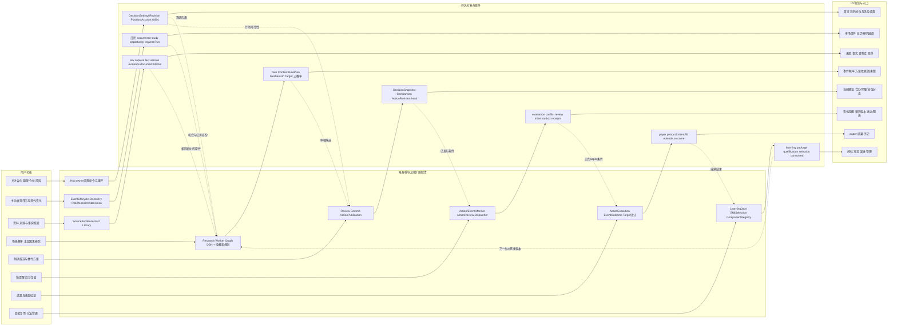
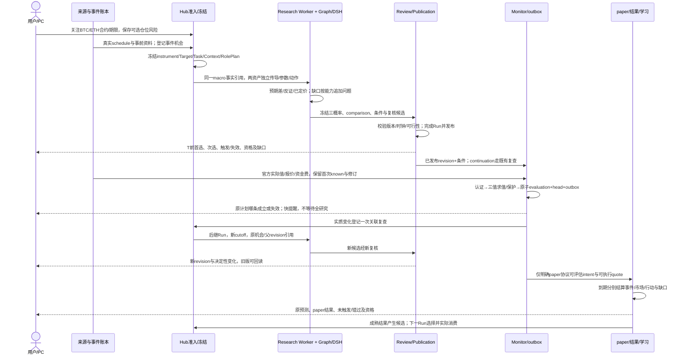
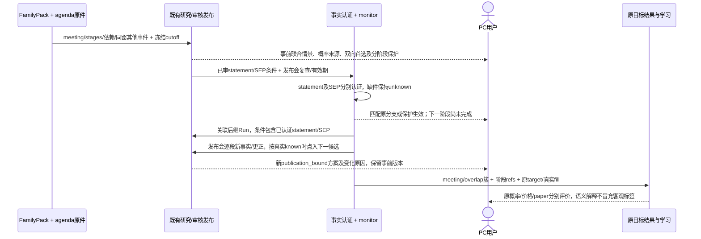
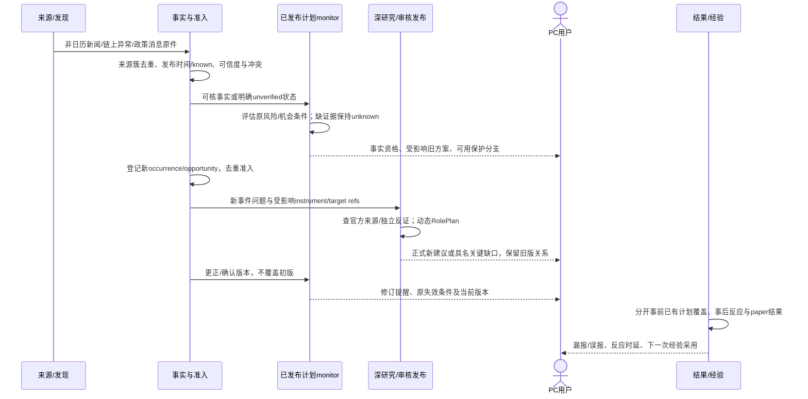
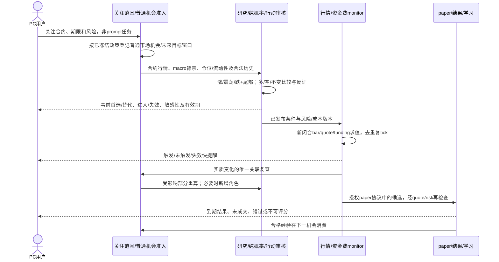

# 端到端业务、技术与用户合同

设计基线日期：2026-10-17。基线：`decision-product-control-2026-10-17.review-5`。状态：**已于2026-10-18获准实施**；实时进度与证据见[执行合同](execution-contract.json)和[执行日志](EXECUTION_LOG.md)。本文把01现状、02方法、03运行、04用户流程、05工作包和08研究／学习连成同一套设计；新增接口仍须实际实现与验收，不能把设计描述当成运行证据。

产品要完成的是：用户给定关注资产、合约、期限和可选风险约束后，系统在事前提供有依据的场景概率与明确首选，在事实变化时及时指出哪个条件成立或失效，后台修订，到期区分预测与纸面结果，再把合格经验用于后续判断。已选定近期范围为OKX BTC/ETH USDT线性永续双向建议与paper；旧现货能力兼容保留。用户无需写prompt，未知账户仍有单位名义分支；自动下单不在本包内。

**事件范围。** 当前优先BTC/ETH全部已登记重大周期/可能事件的发现、事前判断与持续修订；CPI是有既有代码支撑的演示实例。首版必须跑通CPI、PCE、完整就业报告和FOMC四个核心事件包；既有ECB/BOJ等全球政策日历、PPI/GDP/零售/JOLTS/初请、所选交易所资金费/到期/维护与规则，以及具名监管/链上运行风险进入相同agenda、研究和提醒。日期/actual解析/来源覆盖/方法资格分开显示。没有专用统计模型时按02结构化主观合同给有依据的多空条件首选；黄金、纳指、恒科仍属后续资产扩展。

## 1. 整体功能怎样落到模块、对象与页面

下面每一行是同一用户能力在四层的对应。共享对象只有一份权威原件，页面读取有界投影；箭头不是新增消息队列或微服务。



底层仍用现有Hub业务SQLite、archive、Graph checkpoint和DSH session，不引入第二个Run、学习库、任务平台或消息中间件。上图末尾回到研究是后继Run消费已成熟经验的业务关系，不是当前任务对自己未来结果的依赖。

### 1.1 可核对的真实落点

| 功能模块 | 真实代码入口/拟改范围 | 表、对象、消息 | 页面 |
|---|---|---|---|
| 关注/设置/重评 | `action_routes.py`现有owner命令模式；拟扩设置用例与纯action comparison；`RiskExposure.tsx`仅本地假设工具 | 03定义的设置revision/冻结PositionContextV2、AccountSnapshotV2、UtilityPolicyV2；复用`product_commands`回执模式，配置变更登记既有复查 | ProductPages/RiskDashboard中的设置入口；旧假设计算器保留 |
| 事件/市场发现 | `event_lifecycle.py::EventLifecycleProcessor`、`discovery_admission.py`、`risk_research_admission.py::stage/process_due/_admit`；拟EventFamilyRegistry按原pack装配 | 日历/schedule版本、EventFamilyBinding/EventAgendaSnapshot原件、`occurrences/studies`、`risk_research_requests/triggers/plans`、`decision_opportunities`、`runs` | EventPrevision/EventLifecycle、ResearchProgress；显示阶段与源覆盖，不把日期日历等同完整事件支持 |
| 来源/事实/资料 | `source_ingest.py`、`source_acquisition.py`、`research_evidence.py`、`fact_lineage.py`、ResearchLibrary | `source_poll_attempts/source_acquisition_receipts/raw_captures`、`parsed_versions/fact_versions/research_evidence/run_input_refs`、`research_document_versions/blocks/corrections` | SourceAudit、Facts、ResearchLibrary、原件回读 |
| 研究/概率 | `DurableResearchWorker`→`LangGraphResearchExecutor`→`DshWebResearchRuntime`→Host/native；02纯概率模块 | `run_role_outputs/run_events/research_trace_events`保存Task/Context/RolePlan/Mechanism/Target与三概率；checkpoint仅引用 | 研究进度、ResearchPage、DecisionGraphCanvas、三类概率 |
| 审核/行动 | `research_review.py`→`commit.py`→`action_research_integration.py`→`action_publication.py` | `decision_snapshots/action_plan_revisions/action_plan_heads`、comparison原件、发布回执与outbox；`reconcile_missed_hooks`补缺，不重跑模型 | ActionPlanPanel和current V3 |
| 监控/复查/通知 | `action_monitor.py`、`event_opportunity_monitor.py`、`action_review.py`、NotificationDispatcher | `action_condition_evaluations`、event monitor/evaluation/notice、冲突/失效原件、复查intent、outbox、display/ack回执 | 变化、Delivery、旧版/新版本对照 |
| paper/评分 | `action_paper_product.py`、`action_execution.py`、`event_outcome.py`，02目标评分 | `action_execution_protocols/intents/receipts/fills/episodes/observations`、`action_outcomes/event_outcomes`；新perp协议与旧spot分开 | ActionPaper、ActionReview、HistoryOutcomeResults |
| 学习/管理 | TerminalOutcomeScanner→LearningJobs→LearningPackageBuilder→selection/use/consumption；ComponentRegistry | `research_learning_*`、skill/case/ref、资格/指针、selected/loaded/executed/consumed；不直接改生产源码 | ActionMethod、MarketMemory、演进、管理 |

`application/`路径位于`packages/kernel/decision_hub_kernel/`；前端位于`apps/decision-desk/src/`。新合同统一放`decision_product_v2` schema及现有相应research schema，不手写另一套前端金融语义。03定义状态唯一写者，02定义数值含义，04定义投影；11不复制三套相互竞争的实现。

## 2. 哪些共用，哪些必须隔离

| 对象/能力 | 可共享的范围 | 不能共享的部分与检查 |
|---|---|---|
| 各事件族日历/官方事实/调查原件 | BTC与ETH同事件、同cutoff可引用同ref/hash；一次合格采集复用；family pack与agenda沿原pack冻结 | 不共享资产反应概率；事后修订不能进入旧候选；FOMC rate/SEP/text分别绑定，PCE与CPI口径不混 |
| 宏观机制材料 | 利率/美元/增长事实和来源簇可共享；RolePlan声明复用 | BTC/ETH的传导强度、已定价、流动性、尾部、目标和参数独立；两个资产不算两个独立CPI样本 |
| 事件概率 | 相同事件/场景定义/信息集可共享 | 与不同共识基准或前值基准不是同目标；不能填到价格上涨槽 |
| 市场概率与动作 | 共享DTO、估计接口和确定性计算规则 | instrument、price basis、window/horizon、threshold、parameter/model/qualification分别绑定；旧spot结果不授perp资格 |
| 当前账户与风险 | 同owner同paper账户的权益/总预算按明确快照共同检查 | 私有账户不能进公共macro context；未知值不补；净仓不抹去hedge双腿；各期限不得重复占用全部预算 |
| 源、资料、经验 | 公开源可复用；授权资料按scope；历史经验按获准版本 | owner/private资料隔离；历史结论不是当前事实；4h/24h/72h资格不能互授 |
| 快监控和深研究 | 读取同一已发布revision及事实版本 | monitor只求值已发布条件/确定性保护；新机制和新建议须审核；GET不承担两者 |
| 纸面与实盘 | 可共用合约规则和公开报价原件 | paper账户、模拟成交、自报实际操作独立；本包无真实交易接口 |

合约版本必须包含contract size、lot/tick、结算币、linear/perpetual、保证金/资金费规则原件；mark、index、可执行bid/ask、funding各自有用途和时点。仅换页面标题成“永续”无法完成这些隔离。

## 3. 同一对象版本怎样贯穿整条链

每条建议的追溯集合至少包括：

```text
owner/scope + account_id/account_kind + instrument_ref/hash + market_profile_version
opportunity_id + event_id/schedule_ref（非事件机会可空）
event_family_pack_ref/hash + family_binding_ref/hash + agenda_ref/hash
stage_id + event_cluster_id + dependency_refs + next_stage_check
target_ref/hash + target_family_hash + horizon + price_basis + label_rule
fact/input_manifest_ref/hash + knowledge_cutoff_at
run/task/context/role_plan/requirement_revision refs
scenario_ref + EventProbability ref + ConditionalMarketDistribution refs
position_context_ref + account_snapshot_ref|null + utility_policy_ref + settings_revision
candidate/comparison/review ref/hash
DecisionSnapshot → plan_id/revision_id/head state_version
condition_evaluation → outbox subject/dedupe → display/ack receipt
paper protocol/intent/fill/episode → outcome → learning package → next Run consumed
```

这是引用集合，持久化沿现有原件/表实现，不要求增加万能巨表。公共macro事实变更产生新fact版本；资产参数变更产生新model binding；用户风险变更产生新settings/comparison；它们都不能覆盖旧研究。页面点开旧提醒须落到该revision，不能跳到最新报告冒充原提醒内容。

**两阶段行动时钟。** 事前发布的是“现在的偏向与可求值计划”，不是已经成交。每个候选分别保存`decision_as_of/published_at/valid_until/eligible_at`；触发时保存输入known/received、evaluation及可执行quote时间；paper fill只在条件成立、有效期内且风险/规则仍通过时产生。事件窗口概率若从T0开始，不能无桥接路径就支持T0之前立即开仓的EV；具体收益时钟必须使用02定义的目标。深研究发布晚于事件时只能标事件后方案，不能领取事前成绩。

同Run内部可以多候选/多次复核，但正式Action发布仍沿03的Run终态约束。先交付时结束当前Run发布，ContinuationProposal与已发布版本关联，后继Run再出新revision；不能为了界面“实时”绕过旧review或反复提交同Run行动。

此处后继Run指新研究结论。只变账户/风险/成本而仍处v2 review已授权候选与变量域内时，使用03 §10.6内部`apply_comparison_revision`，保存`ActionComparisonDerivationV1`并CAS新revision，不重跑DSH、不再次调用同Run首次publish。原概率不动；旧v1审核、越域或新机制仍须新复核。

CPI主`scheduled_pre_release`目标以T0−60s闭合的合约trade分钟close为start，end=start+h，计划须在start前可见，主评分覆盖公布跳动。T0+60s的`post_release_response`另外冻结target/q/参数/资格，用于公布后条件入场；事前q不能自动授给post。普通入口的publication_bound再独立，三种时钟在页面名称和评分身份中都可辨认。

## 4. 定时事件事前到结果：CPI作为已有实现例



具体规则：

1. 事前事件概率按相对前值/合格共识/自有估计的各自目标生成；无调查共识不能把nowcast写成市场共识，也不阻塞所有条件研究。
2. 公开macro只采集/核验一次；BTC/ETH使用各自行情/参数/持仓/风险候选。RolePlan动态启用关键专业任务和反证，复用原件要有引用；不是每次固定跑全部角色。
3. 实际值只是新的事件实现证据。快路径激活已发布分支，不将“CPI偏热”直接映射成无条件做空；价格、利率、成本、账户保护仍求值。
4. 动作具备分布就报其成本后效用与敏感性，缺分布则明确具证规则依据；两者都要有可读首选。失效旧版先标明，不能等后继深研究完成。
5. 结果从原机会登记统计：未形成建议、晚到、未触发、不可成交、正常不变都有归属；不能只选择已成交盈利样本。下一Run消费先证明行为，再用独立成熟结果评价增益。

### 4.1 同一链怎样交付其他当前核心事件

事件族与来源/方法明细以02 §2.1/5.2.1为准；这里说明跨层消费，避免把“新增一个registry名称”当完工。

| 用户事件 | 输入→研究/分支→实际值/监控→结果 | 最低完整交付 |
|---|---|---|
| PCE | BEA schedule与首次Personal Income and Outlays→headline/core月变动九格、增长反机制及主观p/q→官方两指标匹配已审条件分支→PCE首次值标签、BTC/ETH市场标签与paper结果分账 | 无共识时显示相对自有估计/前值；无PCE专用统计模型也有可解释的条件多空方案；不能借CPI样本或资格 |
| 就业 | BLS schedule+非农、失业率、时薪与前月修订→firm/near/soft/mixed四类→完整向量认证后选择分支，关键项缺失保持unknown→就业事件标签与价格/行动结果分别结算 | 不只盯非农一个数；mixed须说明利率与增长机制冲突、当前首选和换选条件；修订不覆盖先前首次值 |
| FOMC | 官方meeting日期/精确时间证据→rate×statement/SEP的联合场景及发布会预案→statement/SEP到来先选已审分支，发布会事实新增conditioning→阶段修订和同meeting结果簇 | numeric利率概率、主观语义解释和价格概率分开；不是看到降息就必然开多。下节固定阶段生命周期 |
| 其他宏观/全球政策 | 现有或新增官方日历→agenda按已登记传导/重大性准入→通用scalar或政策文本结构化研究→可信actual/文档事实或具名缺口→监控已发布条件/价格保护→独立目标回看 | ECB/BOJ日期精度照实保留；没有专用parser不宣称自动actual已核。符合准入的事件须有研究/计划消费者，不停在列表 |
| 加密资金费/到期/运行 | OKX合约/资金费时间/结算history/公开到期信息及官方公告→agenda+持仓成本/流动性/可用性机制→费用、规则、可用性改变先重评已审comparison/保护，重要新机制后继研究→实际费用/提醒/交易结果 | 永续自身无固定到期，相关期权/期货到期只是外部上下文；首版明确OKX覆盖及其他场所缺口；不能从OI或到期日直接产生价格概率 |

首次实现先贯通一个合约一个目标以暴露装配错误，随后T03–T08完成本表核心范围；不要求先等各事件积累多年统计样本。通用registry只承接已登记pack；发现重要新事件时走现有source/discovery/研究准入，记录覆盖缺口与处理结果，不自动安装来源或创建执行代码。

### 4.2 FOMC连续阶段与重叠事件的实际处理

一个meeting使用同一event_cluster；`statement`和有安排的`sep`属于同时发布组`release_bundle`，`press_conference`有对前组的依赖，未来`minutes`是另一个发布但保留meeting关系。官方会议页的date精度不足以推定14:00；取得该次精确安排后才建立T0。收到晚出的完整实录，不能把全文标成发布会开始时已经知道。



事前FOMC的4h/24h/72h q包含未来发布会及agenda中其他已知事件的可能路径；14:01的post分支只在已冻结适用域内执行，并写明发布会前后的保护、复查和有效期。后继Run有新结论才发布新revision；无新结论时不能假装旧分布已考虑刚说出的内容。官方数值可激活预审数值条件；临时LLM“语气鹰派”不能绕过事实认证/审核在快路径直接下新方向。

GDP与PCE同刻发布、就业与初请同刻、FOMC后还有次日数据等，都进入相应4h/24h/72h的EventAgendaSnapshot。多个事件的条件q不能直接相乘或按权重平均成市场概率：采用02规定的联合场景或有证据的条件树；无法支持联合数字时另给完整agenda下的主观市场分布，并保留各事件条件解释。已发生第一阶段只收缩其条件空间，第二阶段不会自动视为独立。一个价格窗口不能重复授予每个事件独立成功样本；现有结果链保存各target，资格和学习按event_cluster/overlap时间块分组。

资金费结算点在72h内可有多次，agenda必须逐次列出已知时点和来源版本，未来未知费率用范围；合约维护/规则生效可能截断可成交期，ActionComparison与monitor直接消费。更换来源/延后事件/新增具名冲击产生新agenda与一次关联复查；旧预测原件、漏报分母和已产生paper费用保留。页面同时显示“当前首选、哪个阶段已知、还在等什么、下一检查时刻”，不让用户自行在多份报告中拼出当前计划。

## 5. 意外事件：先识别事实资格，再响应

对于事前已提出的**具名可能事件**，先冻结可观察定义、发生截止与来源覆盖，例如“未来72h某机构公布一项可认证决定”。用户在消息出现前可看到发生/未发生概率、发生后结果，以及发生和未发生两侧的市场/动作分支；混合市场概率必须包含未发生分支。到期未抓到页面不等于事件没发生，只有观察覆盖满足才可标未发生。下面时序从新材料到来展开，已有具名预案沿原opportunity更新；真正此前没有定义的事件才登记新的机会，二者不重复计算事前成绩。



“意外事件”不存在可捏造的事前具体新闻预测。系统可以预先给一般风险/机会条件；意外消息出现后新的研究属于事件后响应。真实消息与假消息都进入来源/机会分母，但未确认帖子不自动成为realization，也不能因多次转载变成多份独立确认。若已发布保护条件只依赖真实价格而非消息真伪，价格条件仍可独立成立，提醒须说清两者。

## 6. 普通市场：没有大新闻也有计划



普通预测采用02的新`publication_bound`：机会slot先于研究预登记；首个合格候选立即发布，事务分配的assigned_at严格下一个UTC分钟边界确定start，冻结PublicationAnchorReceipt及target，重试不重锚。发布后commit/可见回执若越过start，标publication_late/user_visible_late并保留原目标和slot；缺回执保持unknown。首个合格发布版主评分，后继revision不换掉原分母；slot至发布/可见期间的延迟、MAE与错失另计，不能切掉漏报。没有同发布锚点样本时普通市场用明确结构化主观分布，不借事件q。未出现大事件也需事前计划；资金费/设置变化先重算受影响部分，必要时深研。

从首次使用到持续运行统一沿04 §1.1：保存关注/设置→启用跟踪→看事前卡→独立启用paper模式/账户→条件变化→结果。返回首页先显示当前可做/待触发、未完成保护和服务健康；关闭浏览器与主机休眠不同，采集/monitor中断必须保留覆盖缺口。暂停研究/新paper不撤已有保护；恢复读原intent和账户head，历史补采只用于结果/诊断，不能补造当时成交或可见提醒。

## 7. 完整可读产品例：同一组数字贯穿页面与后台

**以下完全是02 §9的合成演示，不是市场预测、回测、模型试跑或实际投资建议。** 数字只由02定义。本例是4h、100 USDT单位名义、三种事件情景与三条完整路径，账户未知，因此没有用户金额/张数、真实保证金可行性或成交声明。

用户关注“BTC USDT线性永续、4小时”，尚未填账户。页面先说：**按这组已标明的假设，空仓分支首选做空，次选保持空仓；是否建立新空仓取决于已发布触发条件与当前成本/风险检查，具体数量未知。** 已有多仓/空仓分支须按当前持仓的增量成本另算，见下文；不能复制flat结果。

| 事件情景 | 事件概率 | 条件上涨 | 条件震荡 | 条件下跌 |
|---|---:|---:|---:|---:|
| 降温 | 50% | 60% | 25% | 15% |
| 近中性 | 30% | 35% | 40% | 25% |
| 偏热 | 20% | 15% | 25% | 60% |
| 对事件情景积分后的市场边际 | — | 43.5% | 29.5% | 27.0% |

这里的p条件于事件E按预登记来源在T0公布；日历存在不等于发生率100%。合成标量预期差A_first−C_frozen的分区为小于−0.05pp、[−0.05,+0.05]pp、大于+0.05pp；市场震荡阈值为±0.5%。它不是现有CPI九格的模型结果，延期不强打本条件结果分数。主表q对应scheduled_pre_release；post_release_response是另一个目标与原件，本例明确假设其q恰好同数，T0−60s到T0+60s桥接恒价。真实产品不允许因此复用两类q/资格。假设三条完整单调路径价格变化为+2%/0/−4%，入场到各自评分起点桥接价格不变，无其他触发/强平；100 USDT名义往返费滑共0.12，长付资金费0.03、短获0.03：

| 空仓候选 | 上涨路径净变化 | 震荡路径净变化 | 下跌路径净变化 | 条件于fill及所列假设的期望净变化 |
|---|---:|---:|---:|---:|
| 开多 | +1.85 | −0.15 | −4.15 | −0.36 USDT |
| 开空 | −2.09 | −0.09 | +3.91 | +0.12 USDT |
| 保持空仓 | 0 | 0 | 0 | 0 |

此例额外假设候选立即足量成交且路径权重不因fill改变，故上涨概率43.5%最大而做空的假设期望更高；短仓净盈利27.0%、净亏损73.0%均**条件于fill及这些假设**。实际账户未知时trigger/fill概率、机会层EV与强平概率保持空值；0.12只属这份单位研究比较。条件触发会选择不同路径时须按02 §5.6重算，不能把此表当机会层排序或实盘承诺。

已有100名义持仓按02 §9另算：历史入场成本已发生，不再扣；保持到终点只扣未来平仓0.06及相应资金费；立即平只扣0.06，后续无funding。最大名义100故不能再加仓。

| 当前持仓 | 维持到终点平仓的期望变化 | 减半的期望变化 | 立即平仓的期望变化 | 首选 |
|---|---:|---:|---:|---|
| long 100名义 | −0.30 | −0.18 | −0.06 | close |
| short 100名义 | +0.18 | +0.06 | −0.06 | no_change |

金额为从当前开始的权益变化、单位USDT；减半候选两次各0.03退出摩擦及剩余一半资金费共用02原件。它们是独立仓位分支比较，不是flat的−0.36/+0.12。未知真实规模只展示这组单位分支及假设。

**依据与换选条件：** 下跌尾部幅度大于上行，少数下跌路径收益可超过上行/震荡损失；反证是上行更强或空头拥挤回补。开空优于空仓边界为`4×p_down − 2×p_up > 0.09`，当前左侧0.21；允许的列示路径损失低于2.09 USDT/100名义时开空不可行。这不是实际尾部损失保证。若往返费滑翻倍为0.24且仍收0.03资金费，short EV=0，按少换手选空仓；若仅资金费从收0.03变付0.03，EV降至+0.06，尚未翻转。后台按新cost版本重算，事件概率不因此改变。

**触发前页面：** 展示偏向做空、未触发原因、已发布条件、合约/报价/资金费缺口及单位名义限制；不得写“已开空”。若用户明确建立模拟协议，显示首版net/isolated、1倍透明paper基准、模拟初始保证金和合约规则，另行冻结paper身份。

预案同时在事前审核并冻结下面**独立post_release_response**的三支comparison，供T0后事实匹配；单位仍为100 USDT名义且沿同一合成路径/成本。

| 实际结果匹配的预演分支 | 条件long EV | 条件short EV | flat首选 |
|---|---:|---:|---|
| 降温 | +0.45 | −0.69 | open long |
| 近中性 | −0.45 | +0.21 | open short |
| 偏热 | −2.25 | +2.01 | open short |

因此降温实现时页面可以明确显示“事前整体偏空；当前匹配已审核的降温分支，首选做多”，并链接两份目标和原件。这是事前计划中条件分支切换，不是monitor临时生成新预测；不能拿主pre的概率去替代post。已有仓位仍按其独立分支先减平/保持，不凭此flat表直接反手。

**触发后页面：** 官方实现S后，监控只选择事前已审核发布的S条件分支，不继续把混合概率m当已知S的条件概率。有效报价、账户、成本和风险仍须通过，paper有独立intent/fill才显示模拟成交；价格跳出适用域或成本变坏时标错过/不可行，不按旧价补fill。未事前覆盖的新机制交后继Run审核。已有仓位反手仍须平仓回执后重核新开仓。

完整paper路径还须消费02 §5.7的冻结模式、延迟与size：intent合格后首个新quote→可成交数量/部分成交→剩余仓位保护→费用/资金费/结果。02 §5.6的同账户预算在BTC/ETH两个intent之间原子预留；unit示例不创建账户或预留。结果按02 §7只评分实现的条件分支及相应边际，主观概率不豁免评分，也不对未发生分支伪造标签。

**风险修改与结果：** 在T0前且事实仍与主表相同时，用户把逆向尾损上限收紧到低于2.09，新settings版本使空仓分支首选翻为保持空仓；市场分布仍43.5/29.5/27.0，旧开空建议保留历史。事件实现后的分支则使用它自己的q，不把该主表当成最新条件概率。到期分别评事件标签、4h市场标签与真实paper fill产生的episode；未建paper账户或没成交不显示交易盈亏。若结果说明尾部假设错误，只形成有证据的候选经验，后续Run按资格消费，不当场自晋升。

## 8. 全链反例与确定处理

这些反例直接落到上述三条链和05现有任务，不另建大型测评平台。

| 反例 | 输入→状态/算法→用户→结果处理 | 归属 |
|---|---|---|
| 核心或扩展事件预定时间未发生或官方取消 | 无actual不能激活情景；schedule新增延迟/取消版本，原时间不改。依赖发布时点的入场条件过期/待重评；PC显示未发生及新安排。原机会保留delayed/cancelled/no_realization，不填事件预测错或0收益；改变窗口的新方案另冻结target | T03/T05/T07，U01/U07 |
| CPI提前发生，研究仍运行 | 以真实最早公开/known时点认证；原任务不能拿原计划T0掩盖已公布事实。早于实际发布的已发布方案保留事前资格，晚方案进入事件后组；PC标提前/晚到，机会分母不删除；新actual触发原保护与关联复查 | T03/T04/T05，U04 |
| 热点假消息被多站转载 | 原件归同来源簇，未核消息不成为realization；价格保护可独立触发并说明依据。官方否认产生新事实/修订/提醒；已经真实发生的paper fill与成本不撤销。结果分开误报、模型响应与行情结果 | T03/T04/T05，U07 |
| 资金费突变或合约规则修订 | 新funding/rule版本重评相应候选成本/保证金和失效；macro/事件概率不必改变。快提醒标“成本/规则改变”，旧版停作当前适用；不得拿旧成本开paper。未来真实费用进入outcome，不回写旧预测EV | T03/T04/T05/T06，U04/U10 |
| FOMC只收到statement、SEP迟到或发布会推翻原解释 | 各stage独立known与缺件，选已审可用分支/保护；不得把statement解释当完整会议actual。后继Run按新conditioning发布；PC标下一阶段与理由，原pre和post目标不重锚，meeting只计一个相关事件簇 | T03/T04/T05/T06/T07 |
| PCE与GDP同刻，或72h内连续出现重大事件 | agenda显式关联/重叠，联合场景或条件树解释；不能独立乘p/q或双算样本。同账户计划检查总预算；新增事实对旧适用域产生具名影响，关联复查、原分母不删除 | T03/T04/T05/T06/T07 |
| 用户收紧风险时旧Run恰好发布 | command与publish核account_id/account_kind/settings/head，用户自报与paper不共用head；旧研究可存但不得成为新约束首选或新增暴露。已有paper episode的保护/退出继续按冻结规则监控，settings_stale不撤止损。一次重评后PC显示新revision，原display/ack不搬到新版 | T04/T05/T07，U09 |
| BTC做空页收到ETH/spot旧响应 | query/API/cache同时校instrument/market/price basis/target/settings；不匹配拒绝显示。合法事件预案也不能跨市场补位；旧source继续可查但不授新资格 | T01/T04/T07，U03 |
| mark有价但无可执行quote | 市场/保证金仍按各自价基求值，paper不可成交；PC明确缺价，不以index/mark补fill。机会计入no_fill/unscorable相应分母 | T03/T05/T06，U10 |
| BTC/ETH或多期限同时推荐100%暴露；hedge被净额化 | 同账户按02 §5.6检查已有/预留总gross、保证金和不利压力损失，不抵扣未经验证的相关性；原子预留防并发双占。同合约多期限仅作备选，hedge两腿保留且首版paper不支持，不把net=0当flat | T04/T06/T07，U03/U09/U10 |
| 通知已发送但浏览器断网/用户未读 | outbox sent、displayed、acknowledged独立；重放业务不重复，恢复仍显示原revision。提前量按真实可见记录，发出不能替代看到，知悉不能替代成交 | T05/T07/T08，U04/U05 |
| 触发bar同时越过止盈止损、报价容量不足或服务停机 | 同bar不可排序按02 §5.7记ambiguous；size不足只记部分成交且保留余仓，停机历史价格不能补成当时fill。04 §1.1展示覆盖中断、未完成保护与恢复回执 | T05/T06/T07/T08，U05/U10 |

## 9. 依赖方向与先后次序

代码依赖方向是`PC/API → query或application → 领域规则/ports`；adapters实现并依赖ports，composition导入并注入具体实现，不能教Kernel反向import adapter。application经port在运行时调用adapter，运行调用和源码依赖分别表示。Graph调用runtime port，Kernel不导入DSH私有mapper。页面只消费已冻结概率/建议，不自算金融概率或调用模型；纯规则不读UI和数据库。

工程依赖是有向的：**T01/T02必要主链修复 → T03本切片数据/合约/目标 → T04本切片研究与行动 → T05监控修订 → T06本切片结果/经验**。每一段同步携带对应T07页面和T08有限完整任务验证，不能把用户页面全部排到最后。三期限完整学习/更多资产继续在原总控中完成，早期24h学习链不授4h/72h资格，也不能代表全产品结束。

CPI确定性预案不依赖完成DSH深研究才运行；其他核心事件的结构化研究也不依赖CPI统计模型先达标。合法基线/具证规则不依赖Kronos或自动学习先成功；监控不等待后继Run；结果只依赖冻结目标与成熟数据；下次研究读取已有资格经验，不等待本次未来结果。未获批准的新组件形成现有计划内具名工作，不由学习任务自动安装。

第一条可见子切片按05先以BTC永续24h完成一次事前预案/普通机会→正式建议→页面→条件变化→提醒/修订，不能仅完成库重构；D2继续完成BTC/ETH两资产的4h/24h/72h、四核心事件族、广日历及加密事件的有界支持、普通链和paper结果。子切片不代表整包完成；核心事件支持不可挪到黄金/指数的T09。09的关键输入、预期差/三分类、动态RolePlan、风险设置、敏感性和及时性在对应合同中处理；统计增益、source实际覆盖、模型准入和真实延迟仍需实施证据。

## 10. 本文交付边界

本文提供整体关联、共用/隔离、事件族与连续阶段、三个入口时序、同对象版本和有限全链反例。review-4已获批准，当前按用户后续要求处于文档复核暂停；恢复实施沿00/05的有效指令。review-5补审只把缺失合同写明，不证明产品跑通、概率有效、paper支持完毕或实盘收益。所有既有来源/资料/历史/管理能力按01/04保留。
