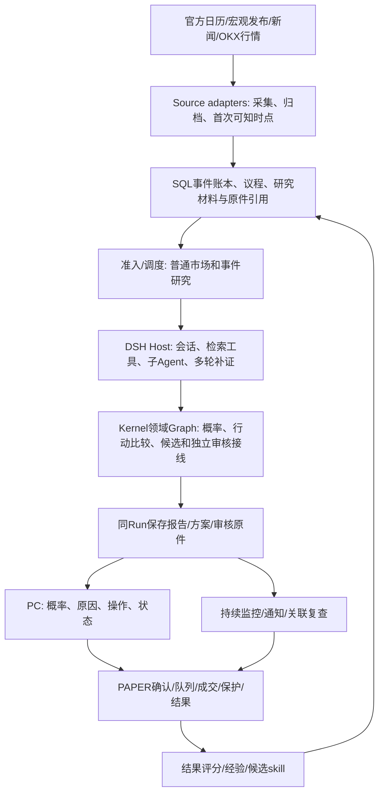

# Decision Hub 项目交接：目标、实际状态、失败原因与剩余工作

交接日期：2026-10-23，北京时间约11:10。范围：本会话 `decision-product-control-2026-10-17.review-5`，结合现有代码、正式库只读核对、发布回执、真实研究和隔离修复原件。

**当前结论：产品尚未交付，不能称为稳定可用。服务能启动、两份真实研究报告可读，与完整核心流程可用是两个完成项。总控中的 T01—T08 仍全部为 `in_progress`。**

本文件是交接时点的摘要，不另建一个竞争目标。需求以00总控和02/03/04/08/11设计为准，执行状态以本次更新的 `execution-contract.json.latest_runtime_checkpoint` 为准。长执行日志中的旧候选、PID和“下一步”均须按日期辨别。

## 1. 先给接手者的结论

- 用户要的是**事前决策产品**：主动发现重要事件与市场变化，搜集当时可知的证据，分析根因和反证，给出各情景概率、BTC/ETH条件方向概率，以及具体多空方案、触发/失效条件，持续跟踪并用结果改进。报告是用户查看判断的载体。
- 正式产品现在有 BTC、ETH 各一份经过真实独立审核且在PC读过的 **4h** 报告/建议。没有证据证明预测质量已经达标，也没有完成稳定自动运行、长周期、多事件和PAPER闭环。
- 当前25笔 `perpetual_research` 产品命令对应：**17失败、6有限结果、2取消、0活跃**。其中“有限结果”不能全部算合格建议。此口径只指这25笔产品验收命令，不是全历史数据库。
- 正式库 `action_execution_fills` **0条**。隔离库中的模拟成交和保护退出，不能算正式产品已成交。
- 正式运行候选为 **49c**。下一批修复在隔离工作区，**未合入、未构建、未上线**。交接时没有继续启动模型、研究、构建或正式源合并。
- 目标工具在2026-10-23 11:00实查为 **paused**，最后状态更新时间10:46:16；未改成完成，未新建目标。此前总控写“active”的文字已过时，本次更正。现有49c服务保留，供接手者查看。

最新只读事实快照：[state-snapshot.json](E:/project/study/codex/dsh/decision-hub/artifacts/decision-product-core-20261018/D2/handoff-20261023/state-snapshot.json)。含查询口径、源文件/包哈希和当前Run。正式数据库写入0。

## 2. 目标是什么，怎样才算完成

### 2.1 本轮范围

| 项目 | 已确认范围 |
|---|---|
| 用户端 | PC，原账户/设置可恢复，研究在后台运行，离开页面后能回来读同一结果 |
| 资产/市场 | BTC-USDT-SWAP、ETH-USDT-SWAP；OKX USDT线性永续 |
| 期限 | 4h、24h、72h，各自有正确的目标、时钟和结果标签 |
| 事前判断 | 普通市场与重要事件；事件结果概率p、给定情景的资产方向概率q、依据/根因/反证 |
| 操作输出 | 含费用/资金费等成本的多空比较、入场/止损/退出、触发/失效条件；有依据地给条件建议 |
| 自动运行 | 日历/市场变化驱动研究，持续条件监控，变化提醒，必要的关联复查 |
| 验证与学习 | PAPER确认→成交→保护→退出/结算→结果；下一轮真实研究消费相关经验 |
| 暂不做 | 真实自动下单、手机验收；黄金/纳指/恒科和Kronos为后续独立包 |

“70%以上胜率”是用户表达产品价值的例子，现阶段没有可支持该承诺的统计结果。不能编造已校准概率，也不能以尚未校准为由把所有有依据的研究方案都输出成等待。

### 2.2 最小可交付结果

接手者必须能用原PC产品完成：保存设置→发起/自动产生研究→真实信息获取和必要多轮补证→独立审核→**同一个Run**打开概率、原因和多空条件方案→变化后有提醒/正确失效或更新→PAPER合法成交与保护退出→结果可读→下一轮能用到经验。

BTC/ETH和三个期限的未完成项都必须逐项交代。服务200、页面能打开、局部测试通过、受控fixture产生报告，均不能代替上述用户结果。历史金融效果需要后续固定观察；工程交付不能冒充金融效果已证。

## 3. 已花多久，时间花在了哪里

目标工具创建时间：**2026-10-18 12:50:42，北京时间**；到本次交接已接近 **5个自然日（约4天22小时）**。工具返回累计执行计时287487秒，约79小时51分钟；该计数不等于持续CPU占用、当前一次执行时长或费用账单。本交接没有做全会话token费用归因。

期间实际工作包括：真实研究接线、上下文/审核/提交恢复、情景概率与行动合同、报告原件读取、设置与提醒、PAPER和经验接入，以及多个发布接缝修复。**确有有效代码进展，但用户结果远少于代码/验证产出，执行效率和交付管理不合格。**

近期关键时点（北京时间）：

| 时点/版本 | 实际发生 | 当前意义 |
|---|---|---|
| 既有 BTC18 / ETH02 | 真实研究、独立审核、同Run报告/建议与PC回读通过 | 证明4h主链曾成功；不能证明稳定性或预测有效 |
| Main merge40—42 | 合入完整事件情景/报告/监控接线；历史副本占盘修复；UI类型修复 | 当前409受控路径，已由49c构建 |
| 10-23 09:19:40，49c | 正常完整构建exit0，前端/Host均成功 | 构建失败已结束，不能继续按49/49b旧失败处理 |
| 09:31:59 | API200，三个新Worker fresh，错误为空 | 仅证明该时点启动就绪 |
| 09:32:47 | PC原账户ETH72h一次提交受理 | 原回执已核验，无重复提交 |
| 10:03:43后 | native报上下文错误；尚未prepare/独审/finalize | 发生在工程运行层，未产生新合格建议 |
| 10:06:50 | 同Run收为degraded，保留材料artifact | 外层已收尾；没有证据证明永久空转 |
| 本次交接前 | 隔离区完成并发问题回放修复；PAPER长周期/PCE来源已封包 | 尚未上线，不计产品完成 |

## 4. 已完成、部分完成和未完成

| 能力 | 正式环境已证明 | 隔离区/局部进展 | 交付缺口 |
|---|---|---|---|
| 启动与配置 | 49c完整构建/正常启动；原账户、持久设置可回读；模型为gpt-6.1-sol | — | 连续核心流程可靠性仍不足；进程存在不等于任务成功 |
| BTC/ETH研究 | BTC18、ETH02真实独审4h报告/建议在PC读过 | 后续失败保留原件 | 新版本真实研究仍失败；24h/72h无可用终稿证明 |
| 事前概率/操作 | 普通方向概率和多空建议路径存在；事件方案代码已合Main40并由49c构建 | 受控9情景native→Graph→SQL→发布→监控→签名报告读取通过 | 新真实模型没有完成这套事件概率p/条件q/预审操作链验收 |
| 日历和多事件 | 可识别CPI、就业、FOMC日历类别；议程进入研究 | BEA PCE官方ICS真实采集/归档/回读通过 | 重要性选择、提前准备窗口、多族实际值/共识/阶段/概率/行动尚未完整接线 |
| 自动研究 | 周期准入、受理、部分研究和审核有真实记录 | — | 尚无首份可用自动终稿；周期计划当前暂停v6 |
| 条件监控/提醒 | 到期提醒和暂停已有PC证据；条件监控/后继准入代码已上线 | 受控情景变化和通知恢复有直接验证 | 真实市场条件→通知→后继合格研究未完成 |
| PAPER | 正式账户/准入/保护相关基础存在，正式成交0 | 普通/事件24h/72h补齐，旧4h兼容；正常队列、保护退出、PC直接验证通过 | 新增期限未上线；正式合法入场、成交、保护、退出/结算未完成 |
| 结果与学习 | BTC18成熟预测结果可读；该经验进入后续7次完成的模型调用有原始输入证据 | 经验管线/skill基础存在 | 未证明实际判断因该经验改善；PAPER结果消费/候选经验完整循环未完成 |
| PC体验 | 两份报告/建议可读；原设置、72h选择、一次提交、进度/材料展开、离页恢复同Run通过 | 长周期PAPER组件直接测试通过 | 新ETH72h仍失败；错误摘要偏技术化；完整用户手册与最终顺畅交付未完成 |
| 长期效果 | 无足够证据 | 方法/评价设计存在 | 不可声称70%胜率、已校准或持续盈利 |

总控任务状态：T01真实集成、T02运行合同、T03时点/事件、T04条件行动、T05监控、T06经验、T07 PC、T08正式交付均未关闭；T09新资产、T10 Kronos仍为后续范围。

## 5. 为什么反复失败：已证明的原因与尚不能下的结论

### 5.1 检查冲突确实存在

| 已发现问题 | 证据/影响 | 目前状态 |
|---|---|---|
| 内部材料容量与Host能力不一致 | 曾出现内部262144字符拒绝而Host允许1048576；情景catalog旧384000字节上限只余1922字节。不是模型只剩2K token | 已有容量/共享表示修复随Main40/49c上线；不能据此认为所有上下文问题都解决 |
| prepare与final完成语义混淆 | BTC09曾prepare成功即被Host主动取消，未进入审核 | 已修；旧原件保留，不能说成用户取消 |
| 深研究与外层时钟/新鲜度语义冲突 | 历史有外层准备窗口、研究/行动期限耦合；AUTO48还暴露单位/成本和自拟新鲜度问题 | 部分已修，快行情确认/重比较完整接线仍缺；不能只删时限或把旧行情当新行情 |
| 合法子Agent回传触发全事件相等检查 | 当前Run实际591快照/592实时事件回放：新增正常inbox relay使`retained-context.ts:242`拒绝 | ISO最小修复已封包，Main仍旧；现场缺少原inspect前缀/throw stack，不能断言这是全部历史失败的唯一原因 |
| 历史源码与当前消费者耦合 | 修改源码后，旧GraphRecipe原件/签名GET曾409；旧模块和保留范围遗漏会破坏回读 | 已有多处修复和原件保留；下一次发布仍需正确携带本次新选择原件 |

源代码依据：[严格事件日志比较](E:/project/study/codex/dsh/decision-hub/extensions/dsh/decision-hub/src/host/retained-context.ts:242)、[pre-step入口](E:/project/study/codex/dsh/decision-hub/extensions/dsh/decision-hub/src/host/bridge.ts:1794)。

**处理原则：**取消、所属账户、不可篡改原件、事前时点和资金边界有明确业务责任，应保留。正常并发被误判、重复表示导致超限、阶段时钟不一致，应修实现。不能因为“门禁”这个词把上述问题混在一起；也不能通过降低研究深度、截掉反证或让失败静默成功来得到绿色结果。

### 5.2 不止是检查问题

1. **纵向接线没有先收敛。** DSH会话/工具/子Agent、Python领域Graph、鉴真原件、审核、版本发布、报告、行动和PC之间的契约错误，多次到真实运行才暴露。局部正确没有组成稳定的整条用户流程。
2. **已有设计没有逐项落地。** EventFamilyPack/Binding/registry、核心多事件族、提前准备和联合情景等早已在T03/02/03写明，但实现仍主要围绕CPI数值场景；文档中的计划不能算能力。
3. **隔离通过与上线完成混淆。** 全期限PAPER、PCE来源、最新并发修复仍在ISO；正式用户不会自动得到这些修复。此前状态文字更新滞后，会使执行者重复追旧问题。
4. **发布和保留实现成本过高。** 每版复制历史original-view/retention导致文件和磁盘累加；49还实际遇到空间不足。已有暂存历史的哈希核对/硬链接修复，完整保留生命周期仍未实现。不能把所有磁盘变化都归因本项目。
5. **局部排错/验证占据了主线。** 多次修一处后重新走长研究/构建，新的跨层错误接着出现，用户可见产出没有同步增加。已有有效证据应复用；不应再建立一批门禁来证明已通过的内容。

这些是基于原件和代码的工程判断。尚无证据证明“模型天然过度保守”“DSH与LangGraph必然冲突”“缺token就是所有失败原因”“暗盘信息缺失是本次失败原因”。本次ETH72h在独审前就失败，不能把它归因成金融判断不肯给操作。

## 6. 最新真实失败：接手时不要重跑来定位

| 字段 | 原值 |
|---|---|
| Run | `run_13b596fd7295472d9db23713864d792d` |
| 用户操作 | 原owner、原PAPER账户；ETH、72h、设置v1；只提交一次 |
| 账户/限制 | 纸面权益2500，最大名义500、计划最大损失25；非真实下单 |
| 受理/终态 | 2026-10-23 09:32:47 / 10:06:50，北京时间 |
| 产品终态 | degraded，artifact `art_ad19b776cb3b429d82a9167460c8bb9e`，gate=research_only |
| native | generation1，seq593错误；native link终态failed、last_seq=596。596本身是`agent/inbox/spliced`事件，不能写成failed事件。错误码`research_provider_native_context_invalid` |
| 实际进展 | 29次模型输入/完成记录，18 Gateway工具调用；prepare/独审/finalize均0 |
| 已排除 | Python同名错误分支的29份输入五项身份字段全部匹配；1920源输入逐hash无变化；causal-synthesis技能加载本身成功 |
| 已复现 | 实际591→592事件前进时，异步读取后的旧快照与live全量比较冲突 |
| 未证明 | 现场具体throw stack唯一归属；新修复上线后的真实模型成功 |

原件：[终态](E:/project/study/codex/dsh/decision-hub/artifacts/decision-product-core-20261018/D2/ETH-72H-02/terminal-result.json)、[输入核对](E:/project/study/codex/dsh/decision-hub/artifacts/decision-product-core-20261018/D2/ETH-72H-02/provider-input-five-scalar-checks.json)、[源冻结](E:/project/study/codex/dsh/decision-hub/artifacts/decision-product-core-20261018/D2/ETH-72H-02/source-freeze-at-native-error.json)。

PC原样截图：[研究失败后的真实页面](E:/project/study/codex/dsh/decision-hub/artifacts/decision-product-core-20261018/D2/ETH-72H-02/pc-terminal-degraded-context-error.png)、[原设置/72h/同Run恢复](E:/project/study/codex/dsh/decision-hub/artifacts/decision-product-core-20261018/D2/ETH-72H-02/pc-restored-original72h.png)。进行中的截图不算最终建议通过。

## 7. 架构和代码交接地图

下图表达目标连接及现有组件关系，**不代表每一条已验收**；完成度以第4节为准。

| 层 | 现有入口（仓库相对路径；根目录见第8节） | 接手重点 |
|---|---|---|
| 数据采集 | `packages/source_adapters/official_feeds/`、`presets.py` | 官方来源真实可取、时区/精度/版本；ISO新增`bea_release.py` |
| 日历/信息集 | Kernel `application/official_schedule_original.py`、`perpetual_event_agenda.py`、`cpi_pre_event_context.py` | 目前静态FAMILIES；PCE在Main仍typed unavailable；准备期不应被4/24/72h当前预测窗截掉 |
| 研究准入/快照 | `application/risk_research_admission.py`、`research_context_selection_v4.py`、`research_execution_binding.py` | 原请求/版本/时钟一致，避免阶段职责重复检查 |
| Agent运行 | `extensions/dsh/decision-hub/src/host/{bridge,retained-context,child-research-context,model-dispatch}.ts` | 最新并发修复只改bridge；不新建第二套Agent supervisor |
| 领域图/概率/审核 | Kernel `application/research_graph_binding.py`、`research_graph_projection_v3.py`、`event_scenario_snapshot.py`；TS `perpetual-event-preparation.ts`、`perpetual-synthesis-protocol.ts` | Python领域计算与DSH运行职责分清；CPI专用算法不直接套其他事件 |
| 报告/行动 | `application/action_research_integration.py`、`action_publication.py`；`apps/hub_api/perpetual_saved_report_routes.py` | 同Run、正确版本、旧报告可回读；不能通过GET隐式新研究 |
| 监控/PAPER | `application/action_monitor.py`、`event_scenario_manual.py`、`perpetual_manual_execution.py`；API `perpetual_manual_paper_routes.py` | 原期限和单位、保护/退出时钟、正式流水；无成交不能造结果 |
| 经验/skill | `application/research_learning_registration.py`、`research_learning_jobs.py`、`research_skill_package.py`、`research_skill_consumption.py` | 用到输入≠因果使用≠效果改善；学习不能自行改生产源码 |
| PC | `apps/decision-desk/src/product/`，重点`PerpetualAdvicePanel.tsx`、`PerpetualManualPaperPanel.tsx`和对应API客户端 | 用户先看到判断/操作/原因，技术属性/哈希/错误细节按需展开 |
| 合同/生成 | `contracts/schemas/decision_product_v2.schema.yaml`、`packages/contracts_py/.../generated/`、`packages/contracts_ts/` | 正常生成一致；旧协议保留，不在调用方偷偷补值 |

Kernel路径前缀均为 `packages/kernel/decision_hub_kernel/`。已有分目录分层；跨层时钟、版本和运行状态仍耦合，不能仅凭目录存在宣布架构已解耦。未完成完整静态依赖/循环依赖审计。

### 日历选择的明确缺口

当前[议程收集](E:/project/study/codex/dsh/decision-hub/packages/kernel/decision_hub_kernel/application/perpetual_event_agenda.py:38)按传入`window_end`筛选，事件排序主要按时间；没有完整的重要性选择和独立提前准备窗口。当前Main的[PCE占位](E:/project/study/codex/dsh/decision-hub/packages/kernel/decision_hub_kernel/application/perpetual_event_agenda.py:189)仍为unavailable。

当前应准备的重要例子包括10月27—28日FOMC，以及10月29日GDP/PCE；日期已从[美联储日历](https://www.federalreserve.gov/monetarypolicy/fomccalendars.htm)和[BEA发布安排](https://www.bea.gov/news/schedule/full)核对。日期超出当前72h市场目标窗，不应让它们从未来准备议程消失。尚未实现该选择/准备能力，不能把这些网络核对说成产品已完成。

通用流程应复用：选事件→目标/阶段→信息检索→根因/反证→事件结果p→条件方向q→含成本多空方案→监控→结果学习。CPI/PCE数值口径、就业的非农/工资/失业/修订联动、FOMC的利率/声明/发布会分阶段需各自定义；同窗事件不得无依据地把边际概率直接相乘。

## 8. 工作区、运行物和待合入包

### 8.1 路径与运行状态

| 项目 | 位置/原件 |
|---|---|
| 正式工作目录 Main | `E:\project\study\codex\dsh\decision-hub` |
| 隔离工作目录 ISO | `E:\project\study\codex\dsh\.worktrees\decision-hub-decision-settings-d2` |
| 正式库 | `Main/data/core-live-20260913/db/decision_hub.sqlite3`；巡检使用只读URI/query_only |
| PC | `http://127.0.0.1:8047/`；已有用户入口文件`Main/data/product-local/private-settings/Decision Hub.url`，含私密入口，不复制到文档 |
| 当前构建 | [49c发布回执](E:/project/study/codex/dsh/decision-hub/artifacts/decision-product-core-20261018/D1/candidate-49c/product-validated-builds.json)，SHA256 `2bc144fc4bdc3dcaa11766aea1927d71e9d8dfe32753baaad9a71d7138d567e6` |
| 当前源清单 | [merge42清单](E:/project/study/codex/dsh/decision-hub/artifacts/decision-product-core-20261018/D2/merge-42/release-source-manifest.json)，409路径，SHA256 `c41585ad89feabbb6b7b7ba239dc86e1ee38e3de969d72aa00065fa830def6b8` |
| 启动就绪原件 | `D1/candidate-49c-startup-current.json`；09:31:59的API/三个fresh Worker成功 |
| 当前日志 | `Main/data/product-local/logs/20261023T012141585Z/`；不要输出私密启动stdout/入口token |
| 标准运维入口 | `infra/dsh/run-product.ps1`、`stop-product.ps1`、`build-product.ps1`；最近实际参数见`D1/start-candidate-49c*.ps1`及下一scope参数文件 |

交接只读巡检仍见supervisor24492及四个wrapper PID 26172/2184/18424/5756存在，8047 TCP可连。**PID和TCP不能代替最新API/Worker/真实业务验收**；本次没有重新跑完整健康验收。正式库全部Run状态无queued/running；10条旧cancelled记录缺finished_at，不是活跃研究。

ISO的`.venv`、`node_modules`与Main共享/链接。冻结运行期间不得从ISO重新安装依赖或执行会改共享安装状态的包管理操作；现有固定测试入口已足够。此项是避免相互写坏环境，不是压缩研究能力。

### 8.2 三个待集成包

| 包 | 已有直接证据 | 未完成 | 封包 |
|---|---|---|---|
| 全期限PAPER | 普通队列3P、签名API3P、旧4h wire1P、事件reader12P、受控长事件2P、PC43P | 未合Main/正式构建/正式用户成交；短技术退出不可计金融效果 | [14路径packet](E:/project/study/codex/dsh/.worktrees/decision-hub-decision-settings-d2/artifacts/d2-paper-horizon-extension/packet.json)，SHA `b51ce0f261ab65c160a57fb391ea850ad8bfbaaec2a829576224f60485c83a2e` |
| BEA PCE来源 | 9直接用例；真实官方ICS200，ISO临时库35条PIO入库/归档/议程重读；Fed原件date精度保留 | 未上线；不是完整多事件；BLS403保留，另2个未改CPI fixture缺路径失败，不是全套绿 | [11路径packet](E:/project/study/codex/dsh/.worktrees/decision-hub-decision-settings-d2/artifacts/d2-event-family-sources/packet.json)，SHA `da059e10a20466a4ae777e09d066c2de568e33dc6ab9c4c2db476aeea7affa9c` |
| Host并发快照 | 实际private retainedPreStep原591/592输入RED→GREEN；稳定只读1次；历史改写/取消/原deadline仍拒绝；有限增量独立审查无具体P0/P1 | 唯一生产文件bridge净+18行；未编译/正式运行验证；现场唯一根因归属未证 | [native packet](E:/project/study/codex/dsh/.worktrees/decision-hub-decision-settings-d2/artifacts/d2-native-context-diagnosis/packet.json)，SHA `21eb8f2cc72d5f5fe4a837214680b93164f142929f64dd92cdb2030b0f49061b` |

并发修复保持同一controller、绝对deadline和current；重读完整前进快照，稳定后同步make/replace。没有新增模型调用、没有丢relay/证据，没有放宽历史前缀。Main bridge哈希仍`823a119f…ed809`，ISO为`d7099bb3…b3b73`。

回放使用原prototype上的private retainedPreStep及真实事件/proof正文；IO/注册表是离线facade，token估算为有效整数stand-in。未创建真实SDK Session，未证明真实token计量或修复后的完整SDK运行；这些限制不能被“RED→GREEN”省略。

### 8.3 下一次合包前必须接着做的有限准备

- 已有25路径组合预检：`ISO/artifacts/d2-core-combined-next/{inputs,preflight}.json`，当时before/after均25匹配，409→415仅预览；**未应用**。
- 最新native包尚未加入；且native Agent追加了同一个`PAPER_HORIZON_ALIGNMENT_FIX.md`，其当前ISO哈希`ff364f…addd4`与25路径封包时`ccb73b…71c1f`不同。需要明确合并这一份共享文档after-image，不能宣称“最新26路径完整预检已通过”。
- `Main/artifacts/decision-product-core-20261018/D2/merge-43/`仅准备了旧文件保护：`source-before-base25.zip` SHA `2d416916dab724b2c41266c51ba767dd34c7ffabf0df4e8cd6944f6973e07a5a`，`prior-source-root`中21个实际旧文件；4个新物理路径、6个新增受控路径。**还没复制生产源**。bridge旧文件也须随最终包保全。
- 下次不能盲继承49c旧21行selection scope。本次ETH72真实Graph V2 `51e00f40…2a433`尚未登记到旧registry；改PCE源码后旧scope会让正常prepare省略它。已按原格式准备 **22行scope=原21行逐字段保留+本次1笔原件**，正式库只读。
- 新scope：[22行数据库](E:/project/study/codex/dsh/decision-hub/artifacts/decision-product-core-20261018/D1/next-selection-eth72-20261023/original-selection-index-excerpt.sqlite3)，SHA `25651266a372b3aa494442c6d816577247427360557c9019e31303f632ed6cf2`；[下一构建参数](E:/project/study/codex/dsh/decision-hub/artifacts/decision-product-core-20261018/D1/next-selection-eth72-20261023/scope-preparation.json)。沿用49c prior receipt、原3项source roots并追加merge43 prior-source-root。
- **正常prepare/新构建尚未执行，51e00…a433实际归档登记尚未通过。** 不新建保留平台，不重新复制全部历史目录；按现有格式延续。

## 9. 接手后的主线顺序与停止条件

本节细化现有05计划的接续位置，未扩展范围；交接当下不执行。

| 顺序 | 具体工作 | 本步用户结果/验收 | 避免重复 |
|---|---|---|---|
| 1 | 将三个已封包增量合成一次候选；对齐共享计划文档、保护旧源码、携带新22行scope | 代码/生成合同一致，历史原件不丢；实际标准prepare登记本次Graph版本 | 不重跑已封的旧GREEN，不再新造一轮完整评测 |
| 2 | 全部活跃Run只读核对后正常停启；一次必要标准构建和启动 | 新版本API/Worker就绪；原账户/设置/原报告可读 | 不并行起第二套构建/观察器；旧49c成功结果不需再证明 |
| 3 | 修复版本发一笔新的真实BTC24h或ETH72h研究，精确跟随原回执 | 必须进入prepare→独审→同Run可读终稿/双向条件方案；有新信息时允许多轮补证 | 不原样重投旧失败Run；本地可复现错误先本地修，不靠付费模型反复撞错 |
| 4 | 从事件日历选近期重要事件，补齐T03多族配置/准备时钟/实际值与阶段接线；普通市场保持可用 | PC可看未来重要事件和事前预案，明确概率/原因/触发；不同事件族有正确语义 | 不只验CPI、不复制多份CPI算法；准备期与市场目标期分离 |
| 5 | 用有效方案做一次合法PAPER确认→成交→保护→退出/结算→结果 | 正式流水真实、用户可回读、重启恢复正确 | 不为得到fill强制不合格入场；无价/费用未知如实展示 |
| 6 | 第一份自动研究终稿；一次真实条件变化提醒/后继研究；下一轮消费成熟经验 | 不盯页面也有可用结果/提醒；经验内容与实际输入/结论能对应 | 已有成熟经验进入7次调用的证据复用，不重新证明同一事实 |
| 7 | 补齐其余资产/期限和PC手册，按真实页面简化信息层级 | BTC/ETH×4/24/72h完成矩阵和用户手册；明确仍缺的项 | 不扩黄金/指数/Kronos/mobile，不把预测统计观察塞回每轮阻断 |

若同一故障两次相同失败：记录**同一个**错误输入/层级/调用时钟和本地复现结果，修根因后再发下一次研究。不能把“继续研究”当作修复软件错误的办法；也不能增加任意60秒、轮数、token阈值来掩盖未完成。深研究时长与用户页面请求等待时间分开；慢任务要有可见进度/持久结果。

## 10. 接手阅读顺序与注意事项

先读本文件和[00总控](E:/project/study/codex/dsh/decision-hub/docs/design/decision-product-control-2026-10-17/00_MASTER_CONTROL.md)，再读[当前执行合同](E:/project/study/codex/dsh/decision-hub/docs/design/decision-product-control-2026-10-17/execution-contract.json)的最新检查点；只按需展开原件，不从长历史日志开头重新推演整个项目。

设计对应关系：

- 01：现有能力/模块映射；02：概率、条件行动、数学方法和评价；03：运行/数据/时点合同。
- 04：PC产品合同；05：T01—T10执行计划；07：架构修复；08：Agent研究、上下文、学习/skill。
- 10：技术债；11：端到端连接；12：工程就绪/交付；06/09保留审查和演变。它们是设计依据，**不全是已实现能力**。
- [EXECUTION_LOG.md](E:/project/study/codex/dsh/decision-hub/docs/design/decision-product-control-2026-10-17/EXECUTION_LOG.md)保留操作；ISO packets保存精确改动、输入、直接验证和限制。

不要覆盖其他会话/Agent的未提交改动；按sealed packet及before/after hash识别本批，不整目录覆盖。不要删当前数据库、报告依赖源码、原件或失败证据。历史构建清理应在有明确引用范围后单独处理，不能再次成为本轮主线。

不需要用户重复解释“想做什么”：目标已明确。接手者的责任是把尚未接通的部分落实成可用闭环，持续记录实际用户结果；在实际结果未出现前，保持“未交付”的结论。
