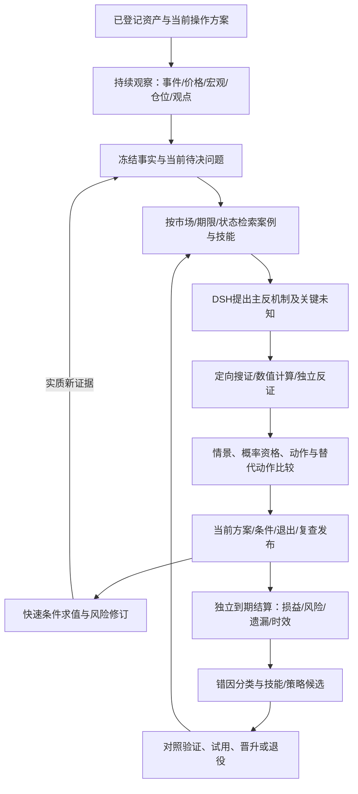

# 智能体、经验技能与全球信息：事前决策方案技术附件

具体开发合同已收敛到[可执行产品规格V1](executable-product-v1/README.md)，含技能包/工作流schema、代码与数据层划分、实际加载/消费接口、工作包与评价门。本附件保留方向和审计依据，不作为开发时重新解释接口的来源。

日期：2026-10-13，Asia/Shanghai。状态：代码/原件审查与技术方案；新增合同、接入和效果尚未实施。本附件细化[事前决策主方案](DECISION_FIRST_PRODUCT_PLAN_2026-10-13.md)，不另起平行产品目标。[当前入口](CURRENT_FOCUS.md)是接续入口，旧工程卡片仍是P0子阶段。

## 1. 本轮纠正与可行性裁决

产品要持续发现风险与机会，调用工具和经验，提出有条件的当前操作，用新证据调整，并用真实结果学习。报告是这条决策链的解释视图。不能以保存成功、技能数量、研究轮数或报告篇幅代替产品价值。

上一版D2的两套固定规则降为**测试基线与受控策略候选**，不再代表最终智能体能力。它们可用来证明行动/监控/结算接线，也必须与AI主动发现因素后的方案比较。不能把历史两次行情调成必胜模板。最小经验调用与反思链前移到D1–D4首个交付；D5才是批量方法优化与多资产扩展。

| 判断 | 裁决及原因 |
|---|---|
| 自动发现材料、针对假说搜证、给条件操作、跟踪和反思 | 工程上可实现；现有DSH工具循环、事实版本、监控、案例、组件注册可复用，尚缺端到端产品合同与验收 |
| 经验转为可重复使用的研究技能 | 可实现；需要适用范围、运行记录、外部评价和版本退役。保存一段总结不等于学会 |
| 宏观与社区内容产生预测增量 | 有条件可检验；取决于信息时效、真实共识/仓位、机制与执行成本，不能用信息量推断有效性 |
| BTC/ETH方法直接迁移到黄金和股指 | 仅基础设施/共性机制可复用；资产机制、报价/日历、触发、标签和效果须分别绑定 |
| 特定策略达到70%以上胜率且有净收益 | 待验证的效果目标，不能由模型口述或接入某开源项目保证；不要求等100%确定才给研究试用建议 |

## 2. 为什么已有改动没交付价值

这是当前证据下的工程归因，不是对每次历史行情原因的断言。

1. **完成口径错位。** 最近83回执证明研究与报告的限定工程路径；行动价值、经验增量与概率校准仍未通过。反复修复外围而没有一条可演示的用户决策闭环，是本轮必须纠正的推进方式。
2. **目标在协议和输出中不完整。** `packs/crypto_macro/doctrine/causal-chain.md`已有主反因果链、预期、传导、触发/失效；但当前首页7d规则与短期限AI观点不同步，缺独立ActionPlan。不是完全没有分析思想，而是思想没有落实到持续操作对象。
3. **保守性部分来自产品语义。** `packages/runtime_adapters/dsh_runtime/profile.py:278`把必要指标/基线/阈值不可得映射为no_trade；`:307`等待已启动角色结束才综合；现行commit还存在资格失败→no_trade/0.5投影。应按具体动作区分缺口：缺交易深度可限制新增杠杆，不应自动抹去已有仓位的风险提示。来源造假、错品种/错时点仍须阻断相关动作。
4. **技能已有调用，学习价值未证。** 最近真实30m/24h原件有skill工具调用；经验选择诊断进入上下文，不等于合格案例实体被消费，更不等于改变决策。详见下节。
5. **预算是否导致漏判尚无证据。** 当前pack声明最多10轮、100工具、32子agent、1800秒、估算10美元；这是上限，不是实际用量。10月7日原件sufficient且bounded=false，不支持把该次失败归因为token耗尽。不同runtime默认参数也不能直接当真实DSH Run配置。后续逐Run保存实际模型/终止原因/裁剪清单/缺口；期限紧迫时先发布已有依据的风险修订，深研究继续，不能静默丢弃关键反证。

### 本轮实际调用证据

- [原24h报告](../../../artifacts/core-goal-20261011/pc83_01/natural24h-browser-report01.json)：`rounds[0].tool_invocations`有1次`dsh.internal.skill`调用；[原30m报告](../../../artifacts/core-goal-20261011/pc83_01/natural30-browser-report01.json)有2次。对应结果成功，摘要为0条attested market evidence；加载方法无需创造市场Fact，不能据0条认定技能调用失败。
- 两报告的context manifest包含`market_case_context_selection_…`选择诊断；本轮未发现`market_case_context_{casehash}`案例实体。因此可以证明选择路径留下痕迹，不能证明已有合格经验改善本次结论。
- `research_policy.py`和`research_binding.py`冻结doctrine/role指令；`packs/crypto_macro/skills/`另有4个技能。后续须把确切skill版本/hash、加载与使用位置绑定Run；目录有文件不代表每次都加载，也不能根据tool名猜使用了哪一个。

### 更深的实现断点：现有“进化”到底能改变什么

| 实现证据 | 当前能力与局限 | 增量改法 |
|---|---|---|
| `dsh_runtime/profiles/decision-research.cordis.yml:27–42`；`infra/dsh/run-product.ps1:791` | 已启用原生skill插件和技能目录；实际调用DTO缺确切技能版本。原始trace可能另有资料，本轮未继续读取 | 从DSH真实加载结果产生版本回执，不只记录泛化tool名 |
| `apps/hub_worker/composition.py:748`与`market_case_context.py:535` | 普通spot/DSH研究接MarketCase，按同资产、24h、当前已认证方法/稳定recipe筛选最多4例；`market_case.py:539`还有扫描100例上限 | 记录排除首因；按查询索引选取而非固定扫描造成遗漏。事实资格与“可学习的失败案例”资格分别定义，避免只有成功/认证案例才能教系统改进 |
| `application/live_observation.py:644–717` | Experience有Outcome/Evaluation血缘，但lesson来自候选proposal文字；在新候选评估前产生 | 初始candidate保持；结算后的错因、反例和实验结果追加成有版本知识单元，不能自动当验证结论 |
| `application/evolution_context.py:53–240`；普通研究MarketCase接线 | 所审resolver未消费ExperienceRecord/experience引用；普通研究另走MarketCase。写入经验与后续实际消费断开 | 在既有context service建立Experience→具名案例/技能候选的桥，保留原始血缘与资格，不另造并行记忆库 |
| `application/candidate_execution.py:10–42`；`candidate_runtime.py:37–91` | 可执行进化只有4条预定义规则：引用冻结证据、区分缺件、反证检查、冲突时观望。自由proposal文字只是展示元数据 | 明确这是固定规则配置能力；增加可验证研究方法/数据依赖/行动配方的真实版本编译，不能把漂亮proposal当新能力 |
| `apps/hub_worker/composition.py:985–1008` | 默认Evolution评估接FixtureEvaluationPlanFactory；测试可核工程行为，不能证明真实市场增益 | 保留契约fixture，同时增加真实时点快照+独立结算的评价adapter，两类成绩分开 |
| `application/evolution.py:1058`；`application/component_registry.py:104–280` | Experience状态函数可置verified/retired但本身不验证效果；另有组件shadow/review/CAS/回滚可复用 | 经验资格由具名评价回执驱动；晋升统一走既有组件证据链，防止两套状态互相背书 |

这组证据说明当前可执行优化空间偏向输出约束和观望，不能代表用户要求的自主能力增长；**它提供了方向偏移的具体代码依据，但不能证明某次涨跌必然由这四条规则造成漏判。** 本轮ROOT与候选工作目录对应13个技能/记忆/演进关键文件hash一致，结论并非只针对一个明显落后副本。

## 3. 固定价值目标，分开六种长期状态

| 状态 | 存什么 | 怎样更新/消费 |
|---|---|---|
| 产品使命 | 事前行动、动态修订、全分母评价、记忆增量、跨资产边界；需求ID和当前交付 | 固定短清单进入每次研究和开发接续；有变更才换版本。市场反馈无权自动改用户目标 |
| 事实账本 | 原件、事件时间、发布时间/精度、first_seen/known_at、修订、授权与单位 | 追加版本；按研究截止时点重建，不能覆盖旧事实 |
| 案例经验 | 当时假说/动作/信息缺口、触发与结算、成功/失败原因候选及反例 | 先选择符合时点/资产/状态的案例，再读必要原件；成功与失败都保留 |
| 研究技能 | 搜证、计算、反证、机制检查的可重复工作流 | 有输入输出、依赖、触发/不适用条件、测试、版本与调用痕迹 |
| 策略/模型 | 行动规则、参数、概率映射、成本/止损、适用状态和评价协议 | 独立版本、时间外评价；技能程序可运行不等于交易策略有优势 |
| 用户上下文 | 已明确的仓位、期限、风险预算和关注资产 | 用户提供后独立保存；未提供不猜测，展示空仓/已有仓位的分支方案 |

接续只加载当前入口、短状态、当前需求和必要证据索引；研究只加载当前使命、快照、待解决问题与相关经验/技能。完整台账保留在外部存储。压缩摘要须保留未决反证、有效期、原始引用与下一步，不能把“未验证”压成“已知”。

## 4. 三条协作循环及边界

**快速循环**复用风险Worker、monitor/outbox，求值已发布条件、撤销过期方案、提高风险等级；不等待全部专科重跑。**深研究循环**由DSH选择与当前问题相关的工具/技能/角色，Graph管理既有证据轮次和冻结；重大新增风险建议须有独立反证审查。**学习循环**异步读取已结算案例，提出有限候选并评价，不争抢紧急告警路径。

统一只有一个Run身份/发布/取消终态。DSH仍拥有工具、技能安装与内层Agent Loop；Hub拥有事实可信性、产品状态、组件资格与结算。扩展现有component/context注册，不能再造另一套Skill安装器或把TradingAgents/Voyager整个运行循环叠上来。分层不要求每层新建常驻进程。

### 自主研究每轮具体做什么

1. 由新信息、接近条件、事件日历、定时机会或旧假说失效触发问题；默认不要求用户手写研究题目。
2. 输出“驱动→市场预期/仓位→传导→资产差异→时间窗口”的机制假说。区分观察、推断与情景，至少列真正可能改变动作的反方。
3. 为每个关键未知提出可获取的信息与预期用途：支持、推翻、改变仓位/价位或只增加解释。先解决会改变动作的未知；保留开放发现通道，不能只在固定指标清单里寻找。
4. 按所需技能调用工具。可观测因子进入数值模型；LLM给主观情景时标明资格，不能把多个agent投票换算为70%成功率。对“暗盘/操纵”只保留待证机制，不把不可观察原因填成事实。
5. 明确选择当前动作或条件动作，说明替代动作为何较差、哪条信息会推翻、何时复查。等待也有条件和机会成本；工程上不能靠一直等待通过验收。
6. 每轮停止须给完成项、仍影响哪些动作的缺口、实际终止原因。无新证据的反复辩论不增加置信度；重大未知可以继续深研究，但已有风险告警不因此被扣留。

## 5. 经验怎样真正转成技能

优先复用`ports/market_case.py`、`application/market_case.py`、`evolution_context.py`、现有context provider与`ports/component_registry.py`。新增字段通过项目schema/生成流程；以下名称是拟议合同，不是已存在的API。

| 合同/记录 | 核心字段 | 检验点 |
|---|---|---|
| SkillVersion（组件扩展） | id/version/hash/parent、kind、适用资产/期限/状态、输入输出、依赖、触发/排除、原案例、评价协议 | 同名不覆盖旧版本；方法与策略分开；没有依赖不假装可运行 |
| SkillUseReceipt | Run/skill版本、选择理由/候选排除理由、实际加载hash、工具调用ref、输出被哪条假说/动作引用 | 入选、加载、执行、消费是四个状态；证据完整才记为有效调用 |
| ReflectionCandidate | 原预测/行动/结果、错因候选、支持反证、可复现修正、受影响需求/技能、未解释部分 | 不以输赢直接判推理好坏；区分数据缺失、状态错配、方向/路径、时机/成本、交付失败、运气 |
| SkillEvaluation | 输入快照、基线/候选、逐例结果、错误适用、遗漏补齐、行为差异、时延/用量、行动效用 | 同输入有/无技能配对；对照中的未来信息不能进入原研究 |

生命周期拟为`candidate → contract_verified → research_trial → active`，有`rejected/quarantined/retired`分支。**技能的工作流资格与金融策略资格分开**：方法可以在契约和针对性案例通过后进入研究试用，建议明确展示试用状态；宣称概率校准/金融优势须另有成熟样本。这样既能给出可用操作候选，又不会把新技能自动包装成已验证胜率。

在预先登记的权限/版本/评价规则内自动生成候选、跑对照、试用和晋升；不要求用户逐篇审批反思。候选不得自己改评分规则、扩大交易权限或覆盖旧预测。退化/数据契约破坏时隔离新版本，恢复上个有效版本；保留退役原因。市场状态不适用可暂停某策略，不能删除历史失败。

首个种子技能建议为`cross-horizon-risk-review`：来源于10月7日已证问题，检查长期偏多与盘中风险是否分开、风险条件能否实际求值、复查是否已登记。输出必须引用具体ActionPlan/ConditionPlan及缺口；它不内置“遇到美元涨就卖出”的结论。另选上行催化/失败突破等对照情境，避免一学会下跌就永久保守。随后才让已结算结果自动提出第二个候选；允许评价后拒绝，而非为展示自进化强行晋升。

学习对象也必须包括成功机会：例如事前发现催化、判断尚未计价、及时建立条件方案，以及在错误突破时退出。不能把学习器奖励设置为“减少犯错/增加观望”单目标。首个增强研究同时具备上行和下行问题入口；种子技能只是补已知缺口，不得限制主持者提出新因素或有证据的建仓建议。

## 6. 全球信息与社区观点接入

“tradingnews”尚未定位到唯一服务，本轮用TradingView及官方全球源作为可核候选，不将二者视为同一产品。采集完整性按因果链需要衡量：政策/增长/通胀、利率/美元/融资、仓位/资金、供需/盈利、技术结构、事件预期/分歧。每个资产按适用项展示最新有效时间和缺口；篇数与点赞数不作为全面性指标。

| 来源 | 本轮核验与用途 | 落地条件/边界 |
|---|---|---|
| TradingView官方MCP | 已有新闻、OHLCV、经济数据/日历、股票分析师预期；2026-09-16 public beta，Essential及以上、OAuth 2.1 | 使用官方接口及账户权限；尚未接入。当前工具目录未列社区Ideas；新闻接口未文档化历史as_of/改稿版本，不能直接授历史PIT资格 |
| TradingView Ideas/具名作者观点 | 用于发现新机制、预期分歧、反方与未来催化 | 本轮未核到官方批量Ideas接口；采用已获授权的供稿/渠道，缺权限时保留链接与获取缺口，不能承诺自动抓帖完成 |
| Fed、ECB、BIS、FRED/ALFRED | 官方发布、讲话、经济数据及部分修订历史 | 各自核公开时间精度、历史覆盖与内容使用权；日期级vintage不伪造分钟级时间 |
| 交易所/发行人与资产专属源 | 仓位、基差、ETF/申报、成分/盈利等 | 通过现有adapter统一品种/单位/时点，不把一个场所数据称全市场 |

TradingView旧API帮助与新MCP公告存在差异，以具体新服务能力和授权范围核验；不能说所有API均不存在，也不能推导MCP允许任意商业归档/分发。只启用研究所需工具，账户列表/告警修改不作为采集副作用。[新MCP公告](https://www.tradingview.com/blog/en/tradingview-mcp-server-public-beta-60864/)、[工具文档](https://www.tradingview.com/mcp/docs)、[平台条款](https://www.tradingview.com/policies/)。

观点处理管道：`授权原件/链接 → 版本与转载簇 → 主张拆分 → 可检验假说 → 原始数据/反方核验 → 条件监控 → 成熟结果`。

- 主张记录来源/作者/原帖、发表/修改/首次接收/系统知悉时间及精度、hash、语言、引用簇、推广/利益冲突标记；正文留存按授权，不能抓不到原文就编造全文。
- 区分reported_fact/inference/forecast/scenario/advertisement。作者说“将上涨”是观点；对应统计值须另由原件证明。缺期限/条件的作者观点标不可评分，不替作者补承诺。
- 在机制图中挂支持/反证、时滞、市场预期、影响资产、可能已计价程度。转载十次仍只有一个信息起点；分歧可以触发研究，不能多数表决生成事实。
- 作者信誉按领域/期限、全部已登记观点、可评分比例、提前量与独立结果评价；不能只挑好帖，也不能把匿名/推广内容权重抬成官方事实。没有覆盖完整历史时只称本系统所收样本表现。
- 原文撤回/改稿追加版本，必要时触发DecisionRevision。抓到新版本的时间才是系统可用时间，不倒填旧Run。

原始渠道：[Fed RSS](https://www.federalreserve.gov/feeds/feeds.htm)、[ECB历史版本API](https://data.ecb.europa.eu/help/api/data)、[BIS RSS](https://www.bis.org/rss)、[ALFRED vintage](https://fred.stlouisfed.org/docs/api/fred/series_vintagedates.html)。BIS讲话批量下载有非商业用途限制，具体来源许可需按产品用途确定，不能以“公开”代替。[BIS说明](https://www.bis.org/speeches/central-bank/download)

## 7. GitHub与技能市场复用裁决

2026-10-13已查官方论文、仓库与关键源码；未安装/迁移，未宣称兼容性验收。实施时固定commit与LICENSE/NOTICE，软件许可不附赠数据订阅。

| 项目 | 可复用部分 | 不能直接承诺 |
|---|---|---|
| [Reflexion](https://github.com/noahshinn/reflexion)，MIT | 外部反馈→经验→后续检索的数据结构与对照方法 | 原实验非市场收益；不引入其第二套ReAct循环 |
| [Voyager](https://github.com/MineDojo/Voyager)，MIT | 程序技能+描述+检索组合思想 | Minecraft技能不是交易优势；自动critic仍有LLM判断，同名覆盖须改为本项目版本机制 |
| [ACE](https://github.com/ace-agent/ace)，Apache-2.0 | 带ID条目的增量playbook，避免每次重写全记忆 | helpful/harmful是诊断；金融实验含抽取/数值任务，不是预测收益；当前源码UPDATE/MERGE/DELETE仍有TODO |
| [GEPA](https://github.com/gepa-ai/gepa)，MIT | 离线候选优化的evaluate/trajectory/multi-objective adapter | 奖励函数决定优化方向；首期不用它大规模调参，不能优化报告完整度冒充净收益 |
| [Anthropic financial-services](https://github.com/anthropics/financial-services)，Apache-2.0 | thesis-tracker、catalyst-calendar、earnings等方法内容 | 官方定位分析工作稿；不能当现成交易决策引擎。仅选方法片段适配，付费连接器另需账号 |

先用Reflexion/ACE的经验结构及financial-services的观点/催化跟踪方法，按本项目现有DSH skill格式适配；Voyager作为可执行程序技能的参考，GEPA留给已具备可信评价器之后。当前不需要同时引入4套框架。

技能市场只用于发现候选。`skills.sh`安装热度不代表金融准确率；可执行脚本、依赖和MCP必须接入现有gateway/adapter，外部文本作为待审方法或材料。DSH安装/运行职责保持，Hub只登记可用于本产品的能力及资格。[Agent Skills渐进加载](https://www.anthropic.com/engineering/equipping-agents-for-the-real-world-with-agent-skills)、[技能市场说明](https://www.skills.sh/docs)。

## 8. 性能与上下文：服务于及时决策

- 小规模先使用现有SQL/上下文选择器，按资产、期限、市场状态、已知时点、依赖和版本过滤，再按问题相关性排序；相关技能先加载摘要、需要时展开正文和原件。先不引入独立向量数据库。
- 同一宏观快照各资产共享，原件只保存一次；缓存键包含as_of、来源版本、技能/模型/日历版本。重算只沿受影响的假说/动作，不能因价格每跳一次重复全网研究。
- 子agent拿自足的角色包与原件引用，回传可校验结论和未决反证；主持者可取原文，不只看到层层摘要。无需每次强制所有角色执行相同抓取。
- 后台学习候选串行或有限并行，复用任务/Worker，不为每个技能启动进程。原件IO/模型调用在写事务外，短事务只做状态和版本提交。
- 记录context选择/遗漏、实际用量、skill选中/加载/消费、端到端耗时。资源上限按有效性和延迟实测配置；耗尽时给明确未解决动作及继续条件，不静默把研究降为中性。完整研究与快速风险修订分开交付。

## 9. 直接实施切口与有限验收

各项嵌入主方案D1–D5，不另外铺设大规模底座。表中路径是现有模块；新增合同为计划。

| 工作项 | 代码切口/交付 | 通过标准 |
|---|---|---|
| A1 对齐使命与动作（D1） | doctrine/profile、query_views/research/service、commit及schema；同期限DecisionSnapshot/ActionPlan | 有依据的当前建议可见；unknown/no_edge/权限分开；不伪造0.5；7d不覆盖短期；每次run引用使命版本 |
| A2 可追踪的技能与经验（D1–D2） | market_case/context、Experience桥接、research_binding、DSH profile、component_registry；SkillUseReceipt | 真实Run可逐步核skill版本/输入/消费；符合时点的案例实际进入；无案例与选择诊断分开；至少一条真实新研究使用种子技能，不全靠fixture |
| A3 观点与主动搜证（D2） | 现有source adapters/FactVersion/capability gateway；ClaimSignal与ResearchQuestion增量 | 一个已获准的真实新信息→可检验假说→独立原件/反证→行动或明确不采纳理由；缺外部账号不反复空跑，可用已可用官方源先完成主链 |
| A4 运行中的方案（D2–D3） | risk_monitor DSL V2、review_schedule、outbox、ActionRevision、PC投影 | BTC/ETH均真实生成并武装可求值Plan；真实条件未成立保持未触发，不无限等待；持续求值、新证据修订可见、过期撤销/重启可恢复。触发/修订/失效机械正例可用隔离输入，单列fixture，不计自然预警或收益；固定基线与AI增强分别保留 |
| A5 结算推动下一次研究（D4） | outcome/evaluation、market_case、evolution/context | 至少一条真实到期结果→错因候选→新技能版本候选→下一次研究真实消费；相同输入对照、负例/状态错配可拒绝；生成候选不强制晋升 |
| A6 扩展与优化（D5） | 注册绑定、日历、领域包、候选评估器 | 黄金/NDX/HSTECH各自完成来源、研究、行动、监控、结算。模型优化只能读取已成熟且不泄漏的训练分区；无增益明示，不增加无期限调参循环 |

首个PC演示顺序：打开当前资产→看到当前行动与关键待决问题→展开“用了什么新信息/历史经验”→查看可运行条件→看到真实新信息引起调整→查看到期结果→下一次研究显示所吸取经验及适用理由。主屏不暴露hash/协议字段；证据、版本和原文可展开。用户无需自行组织研究流程。

### 指标和结束条件

1. **功能交付与效果资格分列。** A1–A5工程闭环可先交付，不等待28天全部成熟才让用户使用研究试用建议；金融效果严格按主方案独立协议统计。
2. **技能功能验收**：每个使用版本100%可追踪；冻结正例/反例/跨资产错配/过期/反事实缺失控制不得误用；真实新Run消费有证据。门槛是功能正确，不宣称由此提高胜率。
3. **技能价值**：配对比较遗漏纠正率、错误适用率、动作差异、时效/用量及成本后效用。拒绝不适用技能也算正确行为；强行改变建议不算收益。每个候选先固定对照/测试分区，一轮一个主要变化，保留所有失败。
4. **信息价值**：机制覆盖、重复来源比例、可用延迟、关键反证发现、实际改变动作的比例、撤回响应；不能只数新闻/skills数量。
5. **操作效果**：主方案的提前量、漏报/误报、机会捕获、覆盖/等待、净期望/回撤/尾部和概率校准；70%按具体策略与置信区间报告。达到胜率但成本后亏损不算合格。
6. **有限推进**：先通过A1–A5的一个纵向切片再拓展更多技能/资产；每步只记需求ID、改动、首个失败、修复、实际回执和下一步。缺源探针沿用主方案有限次数；不能把所有全球信息收齐作为交付前置条件。

## 10. 黄金、纳指与恒科保持解耦

截至最近已核验状态，黄金独立分析未开放，纳指/恒科完整链未接通，真实宏观surprise/crowding输入仍有空项。本轮没有实现这些能力。

公共层提供事实/时点、美元/利率/流动性、机制图、skills调用、行动/条件/评价接口。资产包提供机制、数据依赖、报价/日历、交易对象与独立评价：BTC/ETH为24×7衍生品/ETF/链上；黄金为实际利率/ETF/COT/央行及实物；纳指为盈利/估值/权重与美国交易时段；恒科为中国政策/盈利、CNH/HKD与南向资金及港股时段。共同事件可产生不同甚至相反结论。

具体实现沿用[多资产方案](CROSS_ASSET_CORE_PLAN_2026-10-13.md)，先共享机制与基础设施，再分别准入和检验，不能复制BTC阈值/胜率或只改symbol。OpenBB/AKShare/exchange_calendars/Qlib仍是有条件的adapter/离线工具候选；本轮未新增安装。

## 11. 本轮交付边界

已完成：三agent并行代码/原件/网络复核、根因与可行性裁决、技能/观点/动作的具体合同与代码切口、首个纵向切片和验收指标；更新主方案及短入口。未完成：新增生产实现、外部授权接入、新回测/前瞻成绩、自进化有效性及70%胜率。目标卡片未重建，原需求未标完成。
