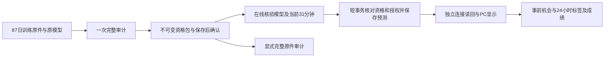

# 在线预测的核心架构整改：冻结资格与短事务

状态：正式47已安装12文件（7生产/5测试），一次标准UI1/Host1构建P，validated83e74a66…；当前两资格与原48机会协议独立原生RO均P，未重训、未签新grant、未重新注册。47首启动因artifact wrapper StrictMode泄漏F，原件保留；仅清理三已核对所属PID，不改标准源、不重构建。同一构建47b于2026-10-10 01:33:00.140846 UTC三Ready200/七fresh/schema0090单快照P，launch20261010T012740694Z，连续健康未证。 首UTC00:00双资产14原生/自然90秒/独立ACK/按时2项P；应用writer_hold BTC0.1560172s/ETH0.0767868s两次≤0.5P，独立OS锁/并行AI共存/后续小时待。 核心研究仍失败：46真实Run run_664096f1f03e43b285f05ce9bddc68f7，usage误将terminal drain827/result snapshot816判为内容变化，掩盖原dsh_provider_input_transport_timeout。DEV usage48必要17控P、旧期望1F保留，未安装；Host输入超时仍未解决。本机完整输入核验已定位34.760秒超原30秒门的诊断观察，不延长预算，不宣称未来Run恢复。 首页47已安装但实际PC入口F：HomeHistoryForecast只接受okx:spot:*:trade，真实API及首页审计scope为crypto:spot:okx:*:trade:1m，导致新小时风险入口return null隐藏。UI48修复与真实API scope交集控制正在DEV准备，未安装；47全PC未过。 R2私有诊断P不授正式issuer/GET/0091/R3–R5/≤2秒；成熟/统计/金融待，原44/45失败与28日不变。见[当前一页纸](CURRENT_FOCUS.md)。

## 问题与可复现证据

|真实场景|模型深核|写锁持有|最终结果|
|---|---:|---:|---|
|39一次ETH显式生产|37.092秒|8.615秒|60.625秒后保存并读回|
|20点BTC自动任务|87.766秒|未进入预测写入|90秒预算耗尽，取消，无预测行|
|20点ETH自动任务|89.625秒|未进入预测写入|90秒预算耗尽，取消，无预测行|

每次核验涉及1,061个文件、208,395,540字节及254,444条历史行。共享SQLite的其他连接只等待5秒；在线预测反复重构训练数据，又把历史重核放在写锁中，造成竞争与自动任务超时。并发验收已记录8次后台首次异常，尚未证明每次异常的唯一锁持有者。

[实际阶段耗时](../../../artifacts/market-risk-implementation-20261007/B2/release39/actual-phases39_01.json) · [自动任务与原生对账](../../../artifacts/market-risk-implementation-20261007/B2/release39/core39-runtime-first-failure01.json)。旧失败不删除，不重放过期小时。

## 具体处理与实现边界

1. **资格发布**：在同一个物理只读快照里完整核验每个精确模型的原件、数学重算、全部原生行类型/值、完整schema、来源字节、owner、dataset/K与model/P。只复制这些依赖，BTC/ETH相同依赖去重，不复制整个3GB数据库。
2. **不可变资格包**：保留逻辑ref/完整SHA、完整原生行和schema、全部raw与来源字节、模型分布、首次获知与上下文。物理路径映射显式存入原件；不得硬链接到可变文件，或改写旧ref。初始上限180秒/512MiB/30万选中行、内存块16MiB，先核对真实manifest再执行，超限保留失败。
3. **资格状态**：prepared/confirmed/revoked/unconfirmed。完整保存后，用新连接独立读取成功，再取服务器真实确认时间S和不可伪造确认凭据。未知提交保存fence，只允许只读对账；未确认、撤销或授权改变时禁止服务。
4. **在线准备**：锁外流式核验整个冻结包SHA、资格原件、精确owner/grant/source/model/P/K及当前31条分钟数据的raw/capture/schema/候选。服务器自己取T；使用已认证的原模型分布，不再重算87日历史数学，也不以TTL缓存授予资格。
5. **短写事务**：只核对资格状态/版本/hash、当前授权和owner、31分钟完整候选与readset、唯一请求/截点；保存预测头及原件引用。禁止在写锁里读取208MB历史字节或25万历史行。
6. **独立读回**：新连接重新核验完整冻结包、模型与当前输入SHA/readset和已保存结果。外部字节跨事务改变时结果保持unconfirmed、不可展示概率，fence禁止重复提交。
7. **完整审计**：明确的独立只读入口，使用冻结快照适配器重算原数学；当前库与冻结库漂移单独记录，不改变历史K或已保存模型。保留38/39旧读者；仅接受有限的旧/新来源向量，不动态执行归档源代码。
8. **API与PC**：复用本机签名登录、CSRF与现有受管进程；资格发布有独立服务器准入，用户只选资产。状态页分开显示资格确认、任务执行、原件核验及金融效果；未读回成功不展示概率。

## 模块与交付顺序

新增ports/history_model_qualification_v3、records、0090迁移、history_model_freeze_v3、history_model_qualification_v3、history_qualified_forecast_v3、有限dispatch41和bootstrap/hourly41。现有DSH普通研究、40结果链及旧28日试验各自保留生命周期。

候选实现与必要控制 → 活动ETH研究到终态 → 单次标准迁移/构建/启动 → 真实87日模型一次有限资格冻结 → 一次新预测与独立读回 → 同时普通研究/自然小时 → PC截图及回执。资格包生成不重复拟合，活动研究期间不执行重I/O。

## 实际验收指标

- 在线过程不执行历史训练重算；真实数据库写锁持有≤0.5秒，小时任务不超过原90秒预算，在线准备与读回目标≤60秒，事前机会发布截止按40预登记H+5分钟验证。
- 分别保存审计、准备、等待、持锁、提交、读回、ACK耗时；同时普通SQLite写入和DSH研究正常完成。小库fixture不替代真实模型门。
- 六组必要控制覆盖完整冻结、身份/ref/schema/类型篡改、并发短事务、保存后时钟/未知提交/fence、旧新读者、PC取消与状态；失败按首因修复，不增加无关矩阵。
- 预测结果接40的48个事前机会、实际确认S、1440分钟成熟标签和完整分母。缺失/迟到/放弃全部保留；未满足独立日/事件证据时CI为空，金融有效性仍为false。

该改造的工程目标是稳定产生可审计的事前结果。是否提高预警准确性，必须另按[验收指标](ACCEPTANCE_AND_METRICS.md)验证。
