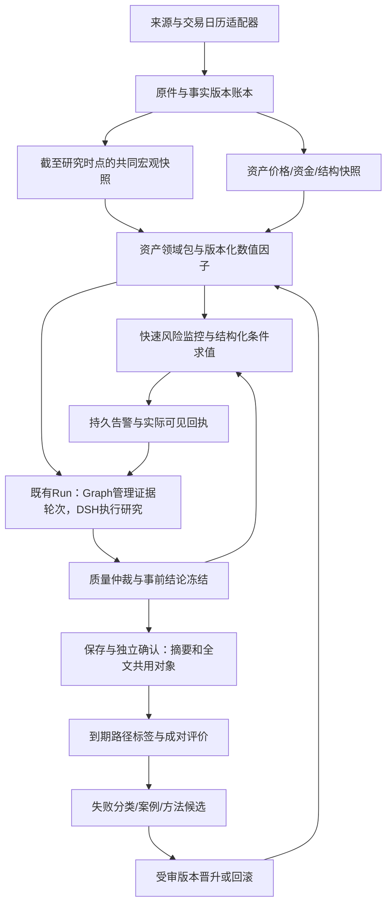

# 多资产核心主线：实现审计、分层方案与复用评估

日期：2026-10-13。依据现行源码、最近真实83验收、10月7日产品方案及原33项协议；本轮为三个Agent并行只读审查与官方网络检索。没有安装候选库或修改运行源码。本文件是执行方案，不是功能通过回执。

同日后续产品价值纠正已记录在[事前决策整改方案](DECISION_FIRST_PRODUCT_PLAN_2026-10-13.md)：本文件的采集、时点和多资产边界服务于“当前操作方案→条件求值→动态调整→结果结算”。先做BTC/ETH行动闭环，宏观来源与新市场按策略需要接入；第7节原P1/P2优先顺序由最新D1–D4顺序细化，不把补齐全部数据/市场作为首次行动交付前置条件。

## 1. 当前结论与原目标校正

**BTC/ETH的部分真实工程链路可用，完整金融产品需求未完成。** 最新83验收已有真实事件研究、自然30分钟复查、原24小时复查合法恢复、完整报告保存/独立确认、读取/下载/刷新及父子往返。当前启动证据为当次7个fresh Worker、4个健康接口200，不据此宣称持续无故障。

[PC四里程碑](PC_CORE_FINISH_2026-10-13.md)包含等待体验、报告阅读、PC矩阵/性能和写事务可靠性，范围确实偏工程。它应作为完整产品的工程子阶段。根主线仍是：**可靠事实与共同宏观背景→各资产机制→趋势和路径危险→持续监控及实际可见→完整报告→事前评价→经验复用与受审升级。**

原33项保留，旧审计统计8项限定工程验收、22项部分实现、3项未满足不能换算成产品完成率。宏观MR05/MR30、黄金MR29、AI质量MR16/MR17、预测评价MR22–26、经验MR27与正式组件升级MR28没有因报告保存而全部通过。最新事实以[短执行入口](CURRENT_FOCUS.md)和具名回执为准，旧release79/62记录作为历史保留。

### 原八层与当前缺口

| 层 | 原本要交付 | 当前已有 | 本轮确认未完成 |
|---|---|---|---|
| L1 采集 | 价格、宏观、新闻、仓位/资金，多频率获取 | BTC/ETH closed 1m与原件；部分FRED/Yahoo背景 | 权威宏观发布版本、事前共识、真实跨所拥挤输入及新市场数据 |
| L2 事实与时点 | 来源、单位、首次公开/系统知悉、修订、原件血缘 | FactVersion、事件vintage、Run引用和价格单位隔离 | 宏观历史时点资格；最新修订值不能冒充过去可知信息 |
| L3 状态与风险 | 宏观状态、资产状态、未来方向与路径风险 | 固定特征及已观察MAE/MDD/穿越计算 | 宏观传导、未来风险概率校准、新市场日历/标签 |
| L4 AI研究 | 主反机制、关键反证改变结论、质量仲裁 | 真实DSH、完整主反报告、上下文/质量结构 | 重要证据消费与消融、反证影响和金融增量验证 |
| L5 持续监控 | 结构化触发→实际可见告警→研究/复查→恢复 | DSL、租约/fence、通知、真实事件及自然复查样本 | 完整连续暴露下的提前量、漏报、误报与覆盖证明 |
| L6 用户交付 | 先看危险与变化，再展开证据/全文 | 已确认报告读取/下载/刷新/往返 | 旧提示、技术词、等待、目录准入状态及完整PC矩阵 |
| L7 评价 | 事前冻结、成熟标签、全分母、基线配对 | 账本/观察/评分代码与部分记录 | 正式样本资格、成熟配对、概率校准及预测增益 |
| L8 经验/升级 | 失败归因、真实检索消费、独立升级回滚 | case/context provider与组件注册合同 | 合格案例消费、有无记忆对比、正式升级/回滚验证 |

代码注册、公式存在、页面有卡片、保存成功、金融效果通过，是不同状态，应分别记录。

## 2. 黄金、纳指、恒生科技实际支持情况

| 市场 | 当前事实 | 产品结论 |
|---|---|---|
| BTC/ETH | 特定真实研究与自动复查链路已有验收；现行路径/自动准入主要限两种现货 | 有限定可用路径，完整默认用户流程和金融效果未全部交付 |
| 黄金 | `GoldMarketSpec`及准入守卫存在；`market_scope.py:49` 黄金research/outcome均False，领域包未实现；Yahoo的GOLD映射`GC=F` | 日线黄金期货背景输入；独立XAU/指定黄金合约研究、监控和评价未开通 |
| 纳斯达克 | 现行目录、provider allowlist与研究/评估注册未找到NDX/IXIC/QQQ/NQ分析链 | 未接通独立分析，不能以SPX/SPY背景替代 |
| 恒生科技 | 同范围现行源码未找到HSTECH的scope/provider/domain pack/标签链 | 未接通独立分析 |

**目录与准入还有表达缺口。** `/v1/product/research-scopes`原样返回静态目录，两现货项显示未全局发行；`run.py:123`可通过当前spot resolver冻结本Run准入，`market_scope.py:123`接受current/frozen admission。真实研究成功与静态False并不矛盾，但UI应分别展示全局发行、当前受控研究资格、数据/Worker状态、本Run冻结准入与预测资格。风险监测目录不是研究授权。黄金不能沿用BTC/ETH的例外准入。

### 黄金与加密资产、股指的复用边界

| 市场 | 共享宏观与基础设施 | 必须独立的机制/数据/标签 |
|---|---|---|
| BTC/ETH | 美元、利率、流动性、增长/通胀事件；原件、研究、报告、监控、评价接口 | 24×7；funding/OI/基差/清算、ETF/链上/稳定币；BTC供应与ETH质押/费用/供应机制分开 |
| 黄金 | 美元、实际利率、风险/不确定性、共同事件 | XAU报价与GC合约/连续期货不同；美元/盎司、日历/roll；ETF/COT、央行/实物需求 |
| 纳指 | 美国宏观、美元融资、利率/风险偏好 | 明确NDX与IXIC，以及QQQ/NQ观察或交易对象；成分/权重版本、盈利预期、估值、行业集中度、交易时段 |
| 恒生科技 | 全球利率、美元融资与公共事件 | 中国增长/政策、CNH与HKD资金条件、南向资金、公司盈利/监管、指数成分及港股午休/假日 |

上述驱动是待验证的机制集合，不设固定作用方向。美元/利率变化不能直接生成所有资产相同的涨跌结论。黄金的机会成本、风险、经济需求及资金动量共同作用，官方框架也采用多驱动。[世界黄金协会](https://www.gold.org/goldhub/research/gold-mid-year-outlook-2026) 纳指100有自己的非金融成分及权重规则，须冻结有效版本；恒科同样按官方方法维护。[Nasdaq方法](https://indexes.nasdaq.com/docs/Methodology_NDX.pdf)、[恒科官方页面](https://www.hsi.com.hk/en-hk/indexes/all-indexes/index-details/?seriesCode=hstech)

## 3. 分层架构与单一运行主线

三条线路保留不同职责：快速监控、DSH深研究、有限方法试验。分层不等于每层新启进程。分钟数据用于观察路径与及时求值；宏观状态按发布事件、日/周频率更新并携带有效期，不能因一分钟没有新宏观数值就填造新信息。深研究耗时期间，现有合法监控继续工作。

- **Kernel/ports**：定义时间、品种、快照、准入、状态与纯计算合同；不导入OpenBB/AKShare/Qlib。
- **Provider adapters**：供应商鉴权/下载/限流/字段映射/原件捕获；第三方DataFrame在此转换成项目DTO。
- **Composition root**：根据注册绑定注入provider、calendar、domain、model；策略层不识别交易所SDK。
- **Application/Worker**：现有持久任务、Run、幂等、租约和发布主线；外部库不建立第二套业务终态。
- **UI/query**：统一投影；不得自己计算模型结论或以是否有行情决定研究准入。

现行`agentic_research_graph.py:134`已经定义DSH拥有内层模型/工具/子agent循环，Graph决定下一证据轮次与冻结。保留此边界；数值风险、告警求值和结果评分由可复现组件负责。多agent意见不是独立统计样本。

## 4. 当前耦合与具体改造切口

| 现行切口 | 问题 | 选定改法 |
|---|---|---|
| `ports/market_path.py:79`、`risk_research_admission.py:45` | 两资产硬编码、BTC否则ETH标签 | 从已验证的Instrument/AnalysisBinding注册解析；旧spot V1保留适配，拒绝未准入的新scope |
| `decision/path_risk.py:118`、`market_features.py:82` | 连续全天分钟、固定30m/24h端点 | 增量Calendar/Horizon V2；expected bars按可交易分钟生成，关闭市场与数据故障分开 |
| `decision/horizon_contract.py` | 30m/24h/72h与墙钟绑定 | 新scope明确墙钟/交易时间/下一session；旧报告仍按原V1解释，不重算历史成绩 |
| `market_risk_data.py:309/363` | source/feature引用固定OKX spot | composition按AnalysisBinding注入组件引用；公式与provider分离 |
| `market_enhancements.py`、正常bootstrap`:509` | 宏观DTO绑定两资产；crowding venues与surprise为空 | 公共宏观快照独立存一次；资产引用exposure；接真实多venue与actual/consensus/prior，不用零代替缺失 |
| `macro_event.py:486` | 展示surprise z分数未明确预测cutoff/周期/单位/单次release | 保留展示语义；另建版本化PIT因子，历史回放不消费展示全样本统计 |
| `market_extension_registry.py:112` | writer事务内做原件核验IO，扩展后可能加重争用 | 封存不可变输入，事务外核验；短事务核对版本/hash/CAS后写入；保留权限、退出和原件重核要求 |
| 研究目录/Run准入 | 静态发行与受控资格表达不同 | 一个产品投影展示各维状态；不直接放开全局守卫 |

现有`component_registry.py`已有source_parser、feature、model、research_recipe、monitor_rule及version/hash/shadow合同，扩展它即可。预测/研究策略、数据源、参数和资产绑定分别版本化；改来源不自动改模型资格。

### 增量合同（复用现有对象，V2为拟新增）

| 合同 | 必需字段与约束 |
|---|---|
| InstrumentSpec V2 | asset_class、现货/期货/ETF/现金指数、venue、币种/价格/成交量单位、合约乘数/到期、roll/adjustment、日历引用；名称相似不代表同品种 |
| SessionCalendar/Horizon V2 | IANA时区、版本/hash、session/午休/假日/半日市、可交易分钟；墙钟或交易时间目标、起止/到期/下一复查与标签规则 |
| FactVersion/EventVintage | 观测期、source public time或可靠上下界、received/accepted/known_at、revision/vintage、原件ref/hash、单位、延迟/权利；未知时间不伪造精确值 |
| Macro/FactorSnapshot | cutoff、输入版本集合、level/change/surprise、公式版本、覆盖/缺口/有效期；低频观测不伪装实时数据 |
| EventSurprise | actual、发布前consensus、prior各自来源与时间；同事件/观测期/单位；修订prior单列 |
| AssetAnalysisBinding | 共享因子引用、资产exposure、领域配方、模型/监控/标签版本及准入证明；共同DXY原件不改写成各资产价格 |
| Forecast/Evaluation | 发布前冻结forecast/阈值/窗口/失效条件；成熟标签、缺失分母、基准、相关事件分组、评价协议与资格状态 |

宏观首轮按四组建立来源能力矩阵：①利率/美元/实际利率与融资条件；②通胀/就业/增长发布与预期差；③政策/央行与流动性；④市场仓位/资金及冲击事件。当前bootstrap的FRED仅DGS2/DGS10/DTWEXBGS，不能当作四组已齐。新闻、期货曲线、信用或政策叙事缺口必须在快照中显式列出。

ALFRED保存首次发布及后续修订版本，但vintage日期不当然提供秒级发布时间。需要按来源校验时间精度；线上回放使用当时系统已知的版本，事后历史研究另标当时公开可得证明，不冒充当时线上预警。[美联储ALFRED说明](https://fred.stlouisfed.org/docs/api/fred/alfred.html)

## 5. GitHub复用：技术可行性与取舍

检索日期2026-10-13。下列候选尚未安装或与项目依赖锁验证。项目Python为3.12；支持该Python版本的声明不等于兼容当前FastAPI/Pydantic/LangGraph完整依赖树。

| 候选/官方来源 | 已核能力和软件许可 | 接入边界与取舍 |
|---|---|---|
| [exchange_calendars](https://github.com/gerrymanoim/exchange_calendars) | Apache-2.0；session、午休、半日市和交易分钟；候选4.13.1 | 优先做CalendarPort包适配；XHKG/美股/24×7分别验证。CMES不能自动代表所有COMEX或XAU供应商时段，需具体合约日历和公告覆盖 |
| [OpenBB V5](https://docs.openbb.co/odp/python/installation) | 模块化core/provider；V5 Apache-2.0，V4及之前AGPL | 选FRED/CFTC等少量provider适配，先核实际字段/修订/发布时间。依赖冲突时放既有采集Worker边界，避免整个API/UI/MCP平台进入业务主线 |
| [AKShare](https://github.com/akfamily/akshare) | MIT；中国宏观、香港指数等接口；Python>=3.11 | 隔离collector候选补充源；缓存增量、限流、主源交叉验证。SPDR持仓接口是金十镜像，不能代表央行/实物/黄金全集 |
| [Microsoft Qlib](https://github.com/microsoft/qlib) | MIT；因子、训练、回测、PIT设计；候选0.9.8 | 隔离离线评估，输入本项目冻结数据、输出有限评估artifact；不搬存储/在线服务或直接套股票Alpha158到币/黄金。官方提示公共数据可能不完整 |
| [TradingAgents](https://github.com/TauricResearch/TradingAgents) | Apache-2.0；分析师、主反辩论、风险管理、事后结算；候选0.6.0 | 参考角色/结算函数设计，少量代码复用须锁版本、保留许可/出处并适配DTO。整体框架已有自己的checkpoint、SQLite、cache/model配置，会增加终态责任；当前不整体导入 |

以上工具分别解决日历、采集、离线评估或研究设计；可靠预测仍须项目自己的时点、标签、基准与真实效果验收。OpenBB成功核得develop SHA `7c9d4221bdf66965e3f6c7f4dc6ee848073e5ae2`；其余使用官方分支/发布记录作候选信息，没有完成版本锁定。正式采纳须固定tag/SHA、依赖锁和NOTICE，并核数据源权利。软件许可证不授予数据存储/再分发/商业使用权。[OpenBB许可说明](https://docs.openbb.co/odp/python/faqs/license)

## 6. 分阶段实现、价值指标与验收

下列P0–P5是主线实施顺序；每阶段交付独立可检查对象，不用“持续打磨”充当完成标准。M1–M4归入P0，原金融验收协议保留。

| 阶段/关联原需求 | 实现对象 | 必要验收与结束条件 |
|---|---|---|
| P0 工程可用/MR15–21/31–33 | 当前恢复进度、同键GET、真实状态中文报告、核心矩阵、当前writer诊断 | 同动作至多1POST；迟到/拒绝/刷新及真实Saved/ACK；当前BTC/ETH核心闭环和原性能门；无原日志的历史holder保留Unknown，有界定位当前问题 |
| P1 资产扩展边界/MR28–29 | Instrument/Calendar/Horizon/AnalysisBinding V2与目录投影；先做exchange_calendars候选探针 | BTC/ETH V1回归；香港午休/半日市、美股DST、周末、黄金指定日历；错误品种/单位/未准入拒绝；升级不改变旧Run、报告hash和历史标签 |
| P2 宏观与仓位真输入/MR05/30 | 四组来源矩阵、事件vintage/consensus、共享快照；按下方首批对象接真实reader | 首批对象的真实最低覆盖通过；原件/单位/时间/ref可核；修订/晚到/未来news/事后consensus负控；快照实际进入DSH冻结输入及报告解释。全Unknown只通过缺失处理，不能通过本能力 |
| P3 黄金首个扩展/MR29 | XAU-USD报价研究优先，有限provider探针；若不可得则明确选择GC指定合约独立scope，不能暗中替代XAU；领域包、监控、报告与独立标签 | 一次真实取数→冻结宏观+黄金快照→触发/研究→完整报告Saved/ACK→PC刷新/导出→首个30交易分钟标签；按下方有限窗口记录结果。来源/日历失败不显示正常；金融概率资格另验 |
| P4 纳指与恒科 | 各自scope/domain/calendar；默认研究对象NDX与HSTECH，ETF/期货另登记；接有效成分/权重、财报/盈利、政策/资金 | 分别跑同一端到端合同；指数无成交量不伪造零量，ETF量不冒充指数量；成分/财报未来数据负控；休市正确；不改BTC/ETH/黄金消费者 |
| P5 价值评价与经验/MR16–17/22–28 | 从P1/P2开始预注册同cutoff、标签/分母、一个基线与一个宏观增强候选；成熟路径标签、真实可见告警与独立晋升/回滚 | 沿用原配对协议/28日有限诊断；先完成首轮单候选裁决，不等全部市场接入。仓位/AI/记忆各自另注册有限试验；给出优势/无增益/不足结论，样本不足不得晋级，周期内不改规则追行情 |

P1的纯合同与日历工程可行性高；P2–P4取决于来源覆盖、时间精度、历史数据与权利，先用有限真实能力探针裁决。P5的结构可实现，金融增益存在不确定性，不能用增加agent数量或token预算保证。到期观察与样本积累不能通过重复构建加速；历史时点合格数据可用于离线研究，但不能伪装线上结果。

### 首批数据、研究消费与有限截止

1. **P2最低真实对象**：FRED/ALFRED的DGS2、DGS10、DTWEXBGS与拟接DFII10分别验证level、相邻有效发布版本change、单位及时间精度，至少提供两个有效历史版本。DTWEXBGS是广义美元指标，不能标成DXY。一个美国CPI或非农事件必须取得官方actual/prior及发布前consensus；共识候选先核Trading Economics calendar/PIT，`Forecast`与其自有`TEForecast`分开。仅有发布后网页共识不合格。[官方snapshot](https://docs.tradingeconomics.com/economic_calendar/snapshot/)、[PIT说明](https://docs.tradingeconomics.com/economic_calendar/point-in-time/)
2. **P2拥挤数据**：先核OKX与Binance公共衍生品来源，每个BTC/ETH对象提供合约身份、funding、OI、基差的真实有限样本；按同期/币种/合约单位归一。衍生品是现货分析的机制输入，不能覆盖现货价格身份。单venue仅能报告该venue状态，整体拥挤质量降级；拿不到数据时原输入保持缺口，不能把空tuple升级为完成。
3. **能力探针有界**：每个候选源最多三项请求（能力/身份、有限样本、时间/版本证明），单请求原timeout内结束；确定性拒绝不重复请求。首选失败可核一个预登记替代源。缺凭据/覆盖/时点证明时出具真实缺口与采纳裁决；探针可以结束，相关能力仍标未完成，不购买、不造数据，也不无限重试。
4. **实际消费门**：同一真实Run保存增强snapshot ref/hash、selected/excluded证据及上下文选取理由；报告应引用至少一个有效宏观状态/事件和适用资产机制。给定关键反证，验证它使风险、置信资格、unknown、监控条件或“有理由维持原结论”的解释发生可核变化。仅在附录列出数据不通过。未来知识负控只能用于隔离测试，不计真实效果。
5. **黄金首验时限**：在准入前冻结scope/provider/calendar与首个30个可交易分钟窗口；到期读取最迟在窗口结束后4小时完成，窗口上限为两个provider session。到期无法取得完整真实标签记录不足与首因；不延长窗口换成功。24h/72h等后续窗口另登记。短窗口只验证标签链路，不证明宏观中长期预测或概率资格。
6. **首轮效果协议**：P1/P2开始登记基线、宏观增强候选、资产/窗口/阈值、cutoff及预登记机会分母。只有可比较且时点合格的历史数据进入离线配对；线上继续原固定28日协议，未满足样本/基线资格时明确不足。先评价宏观这一增量，再决定仓位、AI和记忆试验顺序，不把四种试验同时变成当前工程目标的结束条件。

### 两类完成指标分别记录

- **工程**：成功/失败/未知提交、幂等、真实Worker、Saved/ACK、全文与hash、重启、原性能门与预算。每条列动作、输入/版本、返回、截图/日志和未修复项。
- **金融与用户价值**：方向与路径危险分开；Brier/分位损失、区间覆盖/宽度、校准、尾部事件召回、每资产日误报、真实可见提前量、完整暴露/中断覆盖，以及相同cutoff基准差。遵守[原评价规格](ACCEPTANCE_AND_METRICS.md)，无有效概率/标签时记不足，分母为零返回null。相关资产/同冲击不得充独立样本。
- **经验**：记录检索到哪些合格案例、相似与差异、哪个证据改变何种结论；同输入有/无记忆配对。模型自写反思不自动成为有效经验或升级依据。
- **报告**：默认展示当前状态/适用时间、主要危险与触发条件、趋势判断/置信资格、宏观与资产依据、反方/缺口、已启用监控及下一复查；展开因子/事件时间线/来源/完整报告。未形成方向或概率不合格时明确表达。解释依据与计算可以核对，不用LLM编造精确因子贡献百分比。

## 7. 防止再次偏离主线

1. 当前一页纸和短机器状态只保存当前阶段、最近真实结果、下一动作和阻断；历史日志保留在artifact，按问题读取。
2. 每一阶段按“原需求ID→代码/数据合同→用户结果→验收artifact→剩余缺口”记录。设计通过、代码存在、已发布、真实工程通过、金融资格分别标记。
3. 构建、内存排查和性能工作须对应当前用户流程的具体失败或原门；没有影响核心的证据不扩展到外围优化。
4. 调整agent/token/上下文前固定输入做消融，保护关键证据和反方及时间信息；不为了缩短上下文丢掉风险缺口，也不加载整本历史执行台账。
5. 本轮下一实施前先完成P1/P2的组件绑定与来源能力清单，确定有限探针和验收对象；P0实际阻断并行收口，避免新资产接入后再次拆共享层。

## 8. 本轮记录与接续

- [x] 回查原八层、三线路和33项，区分已有工程证据与未完成金融能力。
- [x] 三Agent审查现行源码、跨资产耦合与官方GitHub候选。
- [x] 明确黄金/纳指/恒科未完成，确认正常crowding/surprise真实输入缺口。
- [x] 写出增量合同、阶段、有限验收与价值指标；校正短入口及历史文档当前标题。
- [ ] 候选工具隔离兼容/真实源探针、P1/P2设计对象实现与验收。
- [ ] P0未完工程项；P3/P4各市场真实链路；P5合格效果与经验评价。

本轮完成的是审计与可执行方案，不是新增市场或金融效果完成。后续按本文件的阶段与原33项记录，不以PC收口目标代替完整产品需求。
