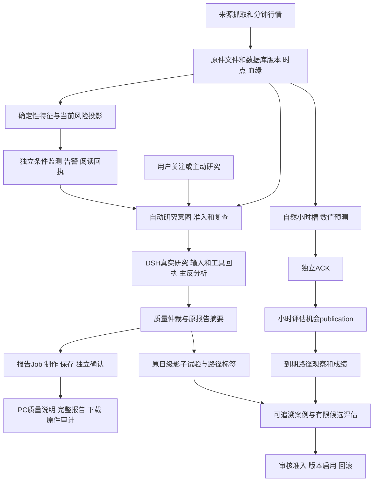

# 当前架构、整改执行与交付验收

## 55当前检查点（目标paused）

55单源晋升、一次UI/Host标准构建、完整读回、CheckOnly/标准START及Ready实际P，schema0091；服务运行，launch20261010T145337206Z。目标现已paused，本轮只记录，不新开发/发布/测试。 目标paused，先读[两天多进展与偏离复盘](PROGRESS_REVIEW_2026-10-10.md)；未获新授权不开发、发布、测试、重发研究或CAS。恢复后主线仍是同原BTC正常Saved→独立ACK→完整读取/PC原字节，不能以Ready或纯控制代验。 连续只读scope已安装但只覆盖后半段；实际初采仍重复full maps、报告queued未SavedACK。未增加deadline/heartbeat/续租/预算；纯控不算真实报告/性能。[55结果](CORE_ACCEPTANCE55_RESULT.md)给出待验边界；下文设计与原历史记录保留。

本页把现有八层设计接到当前代码、持久数据和用户流程。详细实现与公式见[技术设计](TECHNICAL_DESIGN.md)、[验收指标](ACCEPTANCE_AND_METRICS.md)；全部原需求与当前状态见[33项清单](IMPLEMENTATION_CHECKLIST.md)。本页不替换原协议，不以静态接线证明业务成功。

当前54已正常STOP，55必要后继待合并/构建/启动，schema0091。历史54构建/读回/START/Ready及资料PC P保持。停前同BTC inspect queued/gen18/attempts16/version21、eligiblefalse、Saved/ACK0，无新CAS；53 usage身份F保留。单次无locals栈见FrozenReplay旧quality/context/policy重复全源核验；正常Worker180秒仅lease，不是执行deadline，阶段进度/续租和55 scope边界待验，不称loop或完全fix。原八层、数据/协议/F保持，见[54结果](CORE_ACCEPTANCE54_RESULT.md)与[当前任务](CURRENT_FOCUS.md)。

## 1. 当前产品与架构

产品首先帮助用户看见市场变化、证据、风险和待验证假说，持续监测条件，并核对过去判断的实际结果。AI研究需要真实工具和证据；数值风险、条件监测和统计评价分别有确定性合同。单次摘要、代理数量、报告长度均不是预测能力指标。

DSH承担真实模型、工具和会话执行；Hub/Worker承担业务意图、授权、持久状态、监测和报告交付。LangGraph是研究内部编排，不能取代DSH原生执行回执或Hub的业务真相。三个系统的绑定由Run、上下文、执行、提示词、会话link及终态原件核对。

### 落库数据如何给用户看

路径相对于项目根目录；`K`为`packages/kernel/decision_hub_kernel/application`，`W`为`apps/hub_worker`，`A`为`apps/hub_api`，`P`为`apps/decision-desk/src/product`。

| 层/责任 | 当前写入或执行入口 | 数据库及原件 | DTO/API与PC页面 | 验收重点 |
|---|---|---|---|---|
| L1行情/来源 | `K/market_risk_data.py`、`source_ingest.py` | `market_candles/market_path_acquisitions/source_poll_attempts/raw_captures`；原响应文件 | `RiskTimelineView`、`/v1/risk/scopes/{scope_id}/timeline`；`RiskDashboard/SourceAuditPage` | 完整closed路径、失败退避、缺口可见；来源尝试不能冒充已接受事实 |
| L2时点/血缘 | `K/fact_lineage.py/macro_event.py` | `fact_versions/run_input_refs/macro_event_vintages/calendar_corrections`；版本原件 | `FactVersionView/MacroEventVintageView`；`FactsPage/EventArchivePanel` | 发生、发布、获取、可知、修订时点分清；旧cutoff不读未来版本 |
| L3当前风险 | `K/market_features.py`、`packages/query_views/market_risk.py` | 消费行情和研究；当前summary是投影，不是独立预测表 | `RiskSummaryView`；`RiskDashboard` | 数值单位、资产/报价scope、陈旧与unknown；多空路径风险不能用终点涨跌替代 |
| L4意图/AI研究 | `W/market_risk_loops.py`、`K/risk_research_admission.py`、`W/composition.py` | `risk_research_requests/triggers/studies/runs/dsh_session_links/run_calls/run_role_outputs` | `RiskResearchStatus/ResearchRunDetailView`；`RiskResearch/ResearchProgressPage/ResearchPage` | 意图不等于Run；真实输入、主反证据、工具、终态及完整上下文绑定 |
| L5独立监测 | scheduler风险通道、`K/risk_monitor.py` | `risk_monitor_plans/risk_condition_evaluations/risk_alerts/risk_alert_delivery_receipts` | `RiskAlertView/RiskMonitorCommandReceipt`；首页监测和告警详情 | 慢研究不阻塞tick；暂停/恢复、冷却、失联不解除风险；显示与知悉分别留痕 |
| L6完整报告 | `W/main.py::publication_loop`、`K/research_publication_jobs48.py`、lifecycle | `research_publication_bundle_jobs/bundles/confirmations/state_events/research_quality_sidecars`及bundle文件 | `ResearchQualityViewV1`、report status/download/audit；`ResearchQuality` | 原内容保存和独立ACK后才可读取；失败有实际原因和合法恢复入口 |
| L7小时链 | `W/history_cadence48.py/history_hourly41.py/history_outcome_runtime40.py` | `market_history_v2_hourly_slots/forecasts/outcome_opportunities/publications/observations/scores` | history schedule/forecast-index/evaluations/status；首页小时卡与`HistoryOutcomeResults` | slot、预测ACK、publication、到期标签分别核；原48机会分母不回填 |
| L7日级试验 | `W/market_risk_loops.py::PathShadowTick`、`K/path_shadow_jobs.py/risk_path_ledger.py` | `risk_shadow_trials/path_jobs/predictions/path_observations/evaluation_reports` | `CurrentTrialView/ScoreView`；`RiskPathScore` | 固定窗口、模型、样本/事件数、误报漏报及不足结论，不借小时样本提高独立日数 |
| L8案例/增强 | `K/market_case.py/market_enhancements.py`、`W/market_case_context.py` | `market_cases/market_case_relations/market_extension_registrations/admissions`；增强和组件原件 | `CasesView/MarketEnhancementsView`；`MarketMemory/MarketEnhancements` | 案例是否真正被消费、是否有增益分别证明；描述数据不冒充PIT合格输入 |
| 黄金准入 | `K/market_scope.py/market_extension_registry.py` | MarketSpec、extension registration/admission | `/v1/product/research-scopes`；`ResearchMarketPanel` | 来源权利、报价品种、单位、日历、路径和标签单独合格；当前未上线 |

数据库保存索引、身份、关键时点和状态；正文及可审计原件另存文件并以hash绑定。可视化必须保留原件入口，同时把用户解释放在默认视图，不能把技术属性堆成结论。

## 2. 报告交付状态与恢复

| 状态/条件 | 用户理解 | 允许动作与验收 |
|---|---|---|
| queued | 已排队，尚无完整材料 | 读状态；正常Worker处理，不重复提交研究 |
| claimed / prepared | 已认领或已准备材料，尚未独立确认 | 原lease/generation/version约束；不能开放完整下载 |
| confirmed | 原bundle已保存且独立确认 | 同原report/decision/bundle身份快读、下载和显式全原件审计 |
| unconfirmed | 后台整理已停止或未确认 | 先定位具体失败；正常recovery_status明确eligible后，按真实request/generation/version一次CAS恢复 |
| 提交未知或存在围栏 | 原提交结果未知 | 保持阻塞并独立核对；围栏是独立条件，不能直接删围栏或SQL重置 |
| cancelled / revoked | 制作取消或原发布已撤销 | 明确原因；撤销后拒绝原confirmed读。撤销控制用隔离样本验证，不撤销用户原报告来制造通过 |

完整报告一次验收顺序：原publication内容绑定→当前Job头→合法恢复（仅必要时）→正常Worker Saved→独立ACK→status confirmed→quality→download原字节/ETag→显式audit→PC实际阅读与刷新返回。

54历史验收复用原正常工具与显式精确参数，当前已正常STOP待55必要后继；正确BTC inspect仍限release50输出根。Ready/STOP原件见[54结果](CORE_ACCEPTANCE54_RESULT.md)。state/pointer/launch/build/source projection须实际绑定，不能猜latest；完整响应原≤2秒门保持，SHA不能覆盖性能F。首次Ready/目录F保留，不放宽门。

## 3. 当前整改执行顺序

历史51：构建、原授权读回、正常启动/Ready P，BTC05正常停机隔离P。BTC完整报告复验仍拒绝，原库RO确定runs列序误比较；52只修该点并合并已封页面/来源候选。下面50原失败和已通过证据保留，不能覆盖为全部完成。

| 优先级/关联原项 | 具体动作 | 通过门 | 当前证据与剩余 |
|---|---|---|---|
| P0 MR02/28 | 5项50修复标准发布：短stage路径、精确首BEGIN BUSY、publisher有限诊断 | 官方版本留存/覆盖、源码前后守卫、标准构建/授权读回/启动 | 官方11捕获覆盖48选择P；精确5源码P；标准UI1/Host1 P；读回P；标准启动/Ready P（三健康200、七新鲜在线心跳），完整用户门待 |
| P0 MR16/19 | 两已有Run完整报告正常交付 | 正常Saved/ACK、同字节读取/下载、显式audit、PC页面 | 旧ETH正常Worker confirmed/v11及PC原下载P；快速status/quality/download全部≤2s。新BTCgen2/v4恢复因全局归档判断F；逐Run归属修复及完整报告待。audit正确性P、30.541s性能F |
| P0 MR12/23/26 | 找出并修正在线publisher实际未处理原因 | 真实bound/enter/exit阶段、原机会publication、自然新小时链；迟到/缺失保留 | 50真实publisher和一次完整原生RO已证BTC05队首有匹配认领前fence/receipt、gen0/leaseNULL，所有subject/ACK均无；ETH05无围栏。实现合法隔离解除队首阻塞，原BTC仍UNKNOWN；同机会恢复另验，不清围栏 |
| P0 MR15/18 | 验人工和自然自动研究、ETH与durable复查 | 意图→fresh demand→准入→同Run真实DSH→完整报告→实际复查回执 | BTC人工真实执行/摘要P；旧ETH完整读取P；旧ETH30m/24h原身份已核匹配，真实失败为核验等待超时/通道busy且Host终态未确认，72h仍计划；新BTC完整报告、ETH新研究、自然自动和实际复查待 |
| P1 MR13/14/19/21/31/32 | 完成剩余PC页面和按钮主线 | 成功/禁用/过期/403/陈旧/失败/刷新返回/切资产具名回执与截图 | 复用已P未改页面；新风险和剩余主线逐项验，手机排除 |
| P1 MR17/32 | 使用量完整性与运行手册 | 父/子会话、provider attempts、输入/终态、drain、tokens和费用来源清楚 | 当前usage partial，费用未知；不能由10工具或字段求和推导完整费用 |
| P1 MR19/20 | 修复摘要及显式全原件审计性能F的实际首因 | 原100次真实摘要HTTP p95≤500ms；慢样本保留 | 原摘要p95 .6453166s、原audit30.541s均F保留；不得将完整审计换成快速核对冒充通过。先核心交付，再按实际query/锁/投影证据优化，未变已P不反复压测 |
| 资格 MR05/30 | 来源能力、宏观PIT、共识/仓位覆盖核对 | 各来源发布精度/vintage/consensus/rights和失败退避可核 | BLS403/至少24h退避、FRED描述资格保留；缺数据不晋级，也不以页面可见称完整宏观分析 |
| 资格 MR22–27/29 | 固定评价、Q05与记忆比较、黄金准入 | 原样本/事件/方法门及有限结项；黄金独立来源准入 | 当前不足/未成熟/未开通如实列示；工程可用研究产品不无限等待28日，但不能声称金融合格 |

每步记录：需求ID、代码和版本、真实输入身份、动作时间、预期、实际P/F/unknown、原回执、截图、失败首因、修复以及尚未通过的门。保留首次失败，只新增必要的复验；不得以反复构建、工具准备或文档数量作为产品完成度。

### PC动作矩阵

沿现有导航验收：首页资产切换/风险/监测/研究/小时卡；来源尝试与原件；事实版本和时点筛选；市场事件与范围；研究进度/报告/证据/质量/下载/审计；资料主线；成绩及小时评价；案例/增强；反馈和历史；管理页健康/使用量/恢复。

对各可用动作记录正常结果、disabled原因、重复点击幂等、刷新后状态及返回原资产/报告；身份过期隐藏受保护内容，401恢复返回原位置，无资格403显示真实缺口。前端有响应不等于后台写入成功，后台成功也不等于用户实际读到。当前失败和既有截图见[PC验收与修复](PC_ACCEPTANCE48_AND_FIX49.md)。

## 4. 两套评价协议与金融边界

| 协议 | 时间/分母依据 | 结束与限制 |
|---|---|---|
| 原日级28日shadow | UTC00:00 cutoff、00:01发布/窗口；固定基线与单候选；原trial原件 | 按原期限结束并出优势、无增益或不足；不能重训0N冻结模型或延长窗口追结果 |
| 当前小时48机会 | 以保存的history-outcome protocol、acceptance及每个原opportunity为准 | 按原发布门判按时/迟到/失败/缺失；slot ACK不是publication；维护缺失也计入原分母 |

原28日结束北京时间11月4日08:00，末路径11月5日08:01、末标签11月6日08:01；原试验时间不因本轮维护改变。小时样本、相关资产与同次冲击不能凑成100独立日或30独立事件。未来预测优势、风险预警价值、AI/记忆增益需要各自真实评价，不能用事后解释或一次研究报告宣布通过。

## 5. 交付与可维护性

工程签收需要：核心无未解释失败、真实研究到完整报告可用、自动监测与研究共存、用户可完成主要PC动作、错误可恢复、原件与关键时点可追、启动和停机可复用、剩余边界清楚。当前尚未达到。

统计/供应商资格单独签收：宏观PIT/共识/仓位、黄金真实权利和报价、模型样本与增益、Q05及三用户理解未满足时保持未合格。可交付受控研究试用不等于金融预测合格；不能把外部不足藏进“全部通过”。

运行复用原标准`infra/dsh/run-product.ps1`；54历史wrapper仅委托原标准启动/三配置，并设项目TEMP/TMP/SQLITE_TMPDIR至E盘后恢复。当前已正常STOP，55入口待实际合并/构建/读回；不直接沿旧wrapper重启绕过维护。原权限保持，见[当前任务](CURRENT_FOCUS.md)、[54原回执](CORE_ACCEPTANCE54_RESULT.md)、[临时存储方法](OPERATIONS_TEMP_STORAGE.md)及[PC手册](PC_USER_GUIDE.md)。

接续只读取当前任务、本页执行表和33项当前列；需要诊断时再打开对应原件，避免把整个历史台账灌入上下文。代理独立审查关键变更；最终产品动作与真实结果由Root核对。每层通过稳定端口、schema和版本原件独立扩展，候选评估/审核启用/回滚分开，原资格不随代码升级继承。
