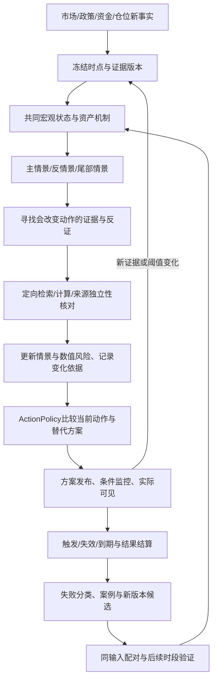

# 事前决策产品整改：操作方案、动态根因链与效果闭环

**技术实现与验收已细化到[可执行产品规格V1](executable-product-v1/README.md)。** 本文件保留业务主线和历史证据；固定策略、成本、采样窗口、模块合同与任务顺序如有后续差异，以新规格包明确的V1决定为准，不追改已经登记的旧试验。

日期：2026-10-13，Asia/Shanghai。状态：本轮只读审计与整改方案，尚未实现下列新合同或证明策略胜率。用户本轮纠正作为产品价值优先级：**在事前及行情发展过程中给出明确操作候选、触发/失效和调整，并用实际结果改进；不能长期停留在事后解释与无期限等待。**

此前[多资产架构方案](CROSS_ASSET_CORE_PLAN_2026-10-13.md)已记录，仍作为底层支撑。本文件补齐其中缺少的“预测怎样变成行动、行动怎样持续更新和评价”主线。PC工程目标只是工程子阶段；新增市场不应阻塞BTC/ETH首先形成可用的决策闭环。

同日最新补充：[智能体、经验技能与全球信息技术附件](AGENT_LEARNING_AND_INFORMATION_DESIGN_2026-10-13.md)。已核真实skill调用、经验选择及Evolution的四条固定执行规则/fixture边界。自主问题发现→搜证→行动→结算→可调用技能是本方案主线；下方固定v0策略只是基线。最小学习闭环随D1–D4实施，不能一直推迟到D5。附件列出真实代码切口、来源接入条件、技能合同和逐步验收，尚未实施。

## 1. 用户要的结果和本次方向修正

用户接受不确定性，希望系统利用当前可得信息给出有优势的判断与操作，不要求每次正确。70%以上可以作为特定、事前定义策略的样本外目标；目前没有证据声称项目已达到该目标。准确率必须说明预测对象、期限、样本和成本，不能由LLM自行打分。

产品需要同时回答：现在倾向做什么；为什么；什么条件下开始/继续/加减风险/退出；方案何时失效；新信息会怎样改变判断；结果究竟改善了多少决策。能够输出“等待”，但必须给出原因、改变条件、监控状态和最迟复查；等待、错过机会和过晚提醒也进入评价。

首屏以**当前方案、有效期、关键条件、风险和最近调整原因**为核心。根因链、概率依据和完整报告用于支撑这张方案。给人工使用的研究建议与自动下单许可分别定义；当前请求不包含真实账户下单。

## 2. 两个案例回溯：已证明的问题和证据边界

以下是10月7日保存的历史原件核对，不是10月13日行情，也没有将新回放冒充当时的预测。

### 2.1 10月7日下跌：已有逆风，没有形成持续操作调整

22:04:26北京时间OKX现货滚动24小时快照：BTC从86,274.4到83,187，−3.57858%；ETH从2,712.56到2,566.83，−5.37242%。这是滚动24小时口径，不能当08:40报告之后的收益。[报价原件](../../../artifacts/predictive-direction-review-20261007/read-snapshot01.json)

BTC研究Run `run_f828b7cf46d948fba9eb072642f00122` 于08:40保存；本次已有导出未包含认证的decision_cutoff_at，不拿保存时间替代。报告已使用美元上涨、实际/名义利率偏高、两场所负基差、资金费分歧、量能比0.9237及近期负收益。另有SPX/VIX和单场所盘口偏多信息；独立复核指出它们不足以证明持续买盘或宏观主导方向。[来源与结果](../../../artifacts/predictive-direction-review-20261007/read-latest-case01.json)、[复核原件](../../../artifacts/value-root-cause-review-20261007/frozen-quality01.json)

| 当时对象 | 实际观点及条件 | 可证明的价值缺口 |
|---|---|---|
| BTC永续30m | long，主观概率0.55/未校准；现货维持85,400–85,500附近、买深优于卖深；两所跌破/卖深占优或基差资金费恶化失效 | 有文字方向与条件；未形成该原件可核的行动状态与连续求值记录 |
| BTC永续24h | long，0.57/未校准；SMA20/SMA60趋势支持；跌破SMA20并伴美元/利率增强等失效 | 日趋势与盘中危险没有独立动作；14:34建议复查未接续 |
| BTC永续72h | long，0.54/未校准；日线趋势与宏观逆风条件 | SMA60距参考价约−9.73%，不能直接承担当日风险处置阈值 |
| BTC现货7d规则 | 已有现货持有倾向、空仓多头候选优先，入场风险另评估 | 只是长期方向参考，不能替代短期限操作方案 |

报告为research_only、Run degraded、内部研究completed，stop_reason=sufficient且bounded=false；原件记录一轮、9工具、4子agent，token/费用未记录。三个概率未触碰现行源码的0.65门，不能把该门认定为本案例的首因。没有当时精确交易Gate输出，不能补称当时已获执行许可或明确输出no_trade。

截至22:09，该Run的review_plans和child_runs均为空，最新研究仍停在早晨。这证明该报告的持续交付断点；缺少原件说明为什么未登记、组合失效条件何时实际发生以及是否另有通知。30m观察当时为estimated且未命中；24h/72h/7d当时未成熟。[复查原件](../../../artifacts/predictive-direction-review-20261007/read-review01.json)

**可确认的漏项是：已有反方风险没有稳定转成独立路径危险、条件求值、持仓处置与后续调整。** 不能仅归因为少抓信息，也不能把未知归因为省token、框架冲突或操纵。市场涨跌的完整因果仍需时点、仓位和路径证据。

### 2.2 8月19日ETH上涨：候选案例已核，原系统预测缺失

OKX ETH-USDT的UTC日线开收1,917.88→2,252.67，+17.4563%；Coinbase ETH-USD独立核对+17.4738%。该窗口为北京时间8月19日08:00至20日08:00。同日BTC约+7.12%；北京零点日线ETH约+11.51%，口径不可混用。[历史价格原件](../../../artifacts/value-root-cause-review-20261007/recent-daily01.json)、[独立核对](../../../artifacts/value-root-cause-review-20261007/case-exchange-confirmation01.json)

所审库最早研究记录是9月13日，8月18–19日为0；不能评价当时系统具体给了什么，也不能据此推断所有其他旧库均无记录。可核候选机制包括Fidelity相关托管/质押安排的8-K（事件日8月7日，实际SEC接受8月10日）和8月19日财政部长期国债流动性回购公告。后者不能单凭日期进入8月19日00:00Z之前的输入，也不等于新增货币总量翻倍。[SEC提交时点](https://www.sec.gov/Archives/edgar/data/2000046/000119312526342079/0001193125-26-342079-index.htm)、[财政部公告](https://home.treasury.gov/news/press-releases/sb0607)

该案例后续分别检验：公告前是否识别上行脆弱性/潜在逼空；新信息后是否及时修正情景；突破形成后是否仍有成本后机会、何时退出。不能要求模型事后精准预言全部17.46%，也不能把涨完后的解释算捕获机会。

## 3. 现行代码中的五个断点

这些是现行源码事实；除上节原件明确覆盖的情况外，不宣称旧Run必然命中某个分支。

| 断点 | 代码证据 | 改造切口 |
|---|---|---|
| AI多期限观点没有同期限行动投影 | `packages/query_views/research/service.py:1809`仅从日线receipt构造7d market_view；`:1837`无此receipt即unresolved/等待。Graph V3`:186`保留30m/24h/72h原假说 | 增量per-horizon DecisionView/ActionPlan；7d规则单独作为基线，不能覆盖短期限 |
| 资格失败与市场判断混合 | `decision/gate.py:45`模型p<=0.65；`application/commit.py:2141`覆盖/复核/方向校准共同判发布；`:290`发布路径使用该判定，`:2184`失败投影为no_trade和0.5 | 分开假说、概率资格、建议资格和自动执行。unknown保留unknown，不能造50%；真实no_edge与资料不足分开。`commit.py:1126`有真实Kernel校准路径，不能笼统说任何70%都被禁止 |
| 总体质量依赖多种不同能力 | `decision/research_quality.py:278`full同时要求方向、路径、执行等；侧车有用量/路径/执行unknown | 按当前决策需要的证据定义结束条件；缺某资产/某机制只限制相关建议。引用/时点/关键冲突仍是实质门 |
| 报告条件不是可执行的条件合同 | HorizonDecision trigger/invalidation是字符串；`review_schedule.py:608`消费外部失效metadata；`ports/risk_monitor.py:12`DSL仅close_return | ConditionPlan V2绑定事实、来源/单位、时限、比较器和复合条件；复用monitor、episode、outbox并核送达 |
| 没有完整持仓行动生命周期 | 当前RiskExposure为假设线性盈亏；有限检索未见持久ActionPlan/position_snapshot状态机；query trade_authorized固定False | 可选PositionContext + 人工ActionPlan持久化。无仓/已有多仓/已有空仓分别解释，人工建议资格不依赖自动交易开启 |

原件保存主观假说已有实现；新设计扩展其可信投影，不能直接把未审核原文当合格信号。当前quality full未过不自动证明所有分项无价值；必须明确是哪项证据影响哪个动作。

## 4. 核心对象：把判断转成可追踪的操作方案

新增对象按既有schema/ports生成流程管理，字段和状态为设计，尚未实现。

| 对象 | 必须保存的内容 | 作用 |
|---|---|---|
| DecisionSnapshot | scope/instrument/horizon/as_of/valid_until、情景集、原假说、证据ref/hash、风险路径、版本与资格 | 同一时点下的判断可以重读，后续更新不覆盖旧判断 |
| ActionPlan | 动作、适用仓位、entry条件/价格依据、撤销/退出条件、目标/持有到期、风险预算依据、成本、替代方案、概率目标/资格 | 条件已满足时可以给明确当前建议；未满足时给预先登记的触发计划 |
| ConditionPlan V2 | feature refs、单位/比较/AND或OR、持续bar数、freshness/日历、有效期、升级/撤销动作、原始文字引用 | 文本条件编译为受限表达式；不执行任意LLM代码；每次求值可解释 |
| DecisionRevision | previous_id、旧/新情景与动作、变化证据、产生/发布/实际可见时间、替换原因 | 新数据或反证真正改变方案，并通知用户哪些内容变了 |
| ActionOutcome | 方案实际可见且条件成立后的首个合格报价、bid/ask/成交假设、触发/撤销/到期、成本来源、路径/收益、基线差、未知理由、用户是否实际采纳 | 研究模拟与用户真实操作分别计账；未确认采纳不能伪造成实际交易 |

动作覆盖建立多头/空头候选、持有、增加或降低暴露、退出、对冲候选和等待；动作必须符合准入品种/账户上下文。现货、期货及借贷做空不能互换。未提供仓位时分别显示“已有多仓”“已有空仓”“空仓”的条件说明，不猜用户持仓或杠杆。

人工方案状态：`proposed → armed → triggered → active → exited/invalidated/expired`，同时有`unknown/blocked/no_edge`分支。条件触发不等于用户成交；active的模拟状态与实际采纳状态分别保存。每个等待方案均有触发条件与下次检查，不无限沿用旧建议。

概率三种含义分开：①模型主观情景判断；②样本校准的事件概率；③策略扣成本后的成功率。未校准不自动抹掉有依据的方向/规则建议；规则型和研究试用方案可明确提供条件动作，不能宣传为已验证70%胜率。关键价格/来源不可用时阻断相关价格动作，而非编造报价。

## 5. 根因链、搜证与概率更新怎样运行

根因链每个环节包含可观察因素、作用机制假说、时滞/期限、预期已计价程度、支持/反证及来源簇。至少比较主情景、相反情景和尾部情景；不能只数支持报道。多个来源转载同一消息按一个信息源簇处理；OI是双边合约量，不能直接读成净多头。

检索优先级由“这条信息会不会改变当前方案、风险或时限”决定。发现新机制时形成可审查的需求/能力提案，复用已有来源能力，避免需求列表将视野永久固定。每轮保留原假说和修改原因；新增证据、外部计算或真实结算可以驱动修正，同一段文字反复辩论不能累计置信度。

概率由明确模型及其校准映射提供；LLM负责提出机制、审查反证和解释。已有经验基线/条件波动组件继续复用，首个增强候选只增加预登记的宏观/仓位状态条件，不直接增加一组难以归因的复杂模型。没有合格映射时保留定性/主观假说及资格，不用随意加减20个百分点模拟贝叶斯更新。

快速条件求值与行动调整复用现有风险Worker；深研究继续由DSH执行、Graph管理证据轮次。小型DecisionRevision通过自身事实/版本/幂等校验后持久发布，完整报告引用同一版本；紧急风险升级不能依赖长报告生成完毕。严重度变化可绕过普通深研究冷却，但重复通知仍合并并解释。

## 6. 行动策略与70%目标怎样评价

“未来24h收涨”“24h先触及盈利目标还是风险线”“持仓途中是否先下跌3%”“减仓是否改善既定风险效用”是不同目标。操作成功首先固定进入条件、退出/目标、期限、价格类型和成本，结果成熟后再计分。触及顺序在同一根bar内未知时记录不确定或按预登记保守规则处理，不能默认先止盈。[三重边界/Meta-labeling方法说明](https://mlfinpy.readthedocs.io/en/stable/Labelling.html)

简化两结果策略的净期望为 `EV = p × G − (1−p) × L − C`。示例仅说明算术：70%赢1R、30%亏3R、成本0.05R，EV为−0.25R。因此70%应和盈亏比、成本、尾部损失、覆盖率一起看，不能靠大止损小止盈或几乎不出手制造高胜率。实际有未成交、到期、多状态或动态退出时按完整分布评价，不硬套两结果公式。

| 价值维度 | 首轮必须记录 | 禁止的偷换 |
|---|---|---|
| 事前预警 | 预定义事件召回、真实可见提前量、每资产日误报、覆盖/中断 | 已跌3%后的事实报警不算提前预测3% |
| 机会捕获 | 事前条件准备、触发后响应延迟、可执行价格后的成本收益、漏接与未成交 | 涨完18%才写看多不算捕获18%；不用事后最低/最高价作成交 |
| 概率 | Brier/可靠性图、区间覆盖/宽度、样本量与时间外分组 | 主观0.7不当历史70%；未知不自动变0.5 |
| 操作价值 | 每动作/资产/期限的成本后净期望、回撤/MAE、与持有/等待/简单规则的配对差 | 方向正确不等于操作赚钱；忽略成本不算优势 |
| 覆盖与等待 | 全部预登记决策机会、建议率、弃权/缺数据/超时/过期、等待原因及固定基线机会代价 | 只统计少量命中动作；通过永远等待获得“低风险高准确” |
| 学习 | 错因证据、实际检索消费、同输入有无改动、后续样本成绩 | 写反思或多一个agent不算学会 |

70%是候选策略的目标，不写成当前产品承诺。每个结果展示原样本成功率、置信区间、样本/事件簇、收益风险与覆盖。具体70%目标策略使用独立登记的Action协议；原风险协议的100时间block/30事件block和28日规则不能直接借用为行动资格，亦不能修改旧协议凑分数。

首轮保持一个简单基线和一个增强候选、固定参数与成本，先做时间外比较再前瞻记录。宏观、仓位、AI机制、记忆增量分批做消融；不在同一验证窗口不断换策略挑赢家。连续观察按固定终点给优势/无增益/不足结论，不足继续标未合格，不以无限等待代替实施交付。

## 7. 研究检索对方案的约束

| 原始研究/官方工具 | 可用于本项目的机制 | 证据边界 |
|---|---|---|
| [BIS Crypto carry](https://www.bis.org/publications/working-paper-1087-crypto-carry) | 把期现升水、杠杆需求、套利资金约束作为脆弱性候选因子 | 统计关系支持检验，不证明哪天必跌，更未证明10月7日完整根因 |
| [Gneiting/Raftery概率评分](https://sites.stat.washington.edu/people/raftery/Research/PDF/Gneiting2007jasa.pdf) | Brier、分布和区间评分，评价概率而非只计方向命中 | 评分方法不直接生成市场优势 |
| [arch预测](https://arch.readthedocs.io/en/latest/univariate/forecasting.html) | 解析/模拟/bootstrap的波动基线，路径尾部与期末方向分开 | 不自动预测新闻冲击；外生变量多步、版本和对齐须有限验证 |
| [金融LLM历史泄漏研究](https://arxiv.org/abs/2309.17322) | 数据PIT之外核模型历史记忆；做日期/公司匿名敏感性诊断 | PIT数据库不能清除模型参数中的未来知识，历史回放不冒充前瞻成绩 |
| [ICLR 2024自纠错研究](https://proceedings.iclr.cc/paper_files/paper/2024/hash/8b4add8b0aa8749d80a34ca5d941c355-Abstract-Conference.html) | 反思绑定新增外部证据/计算/已结算结果并测改善 | 其推理实验不证明所有金融自反思都无效；也不能假定反思必然增益 |
| [回测过拟合研究](https://www.davidhbailey.com/dhbpapers/backtest-prob.pdf) | 登记所有尝试，滚动时间划分、窗口隔离和独立测试 | 不能只展示反复调参后的最佳历史成绩 |

上述方法作为本项目设计依据；本轮没有安装arch或移植第三方交易框架。现有采集/账本/DSH/监控/组件注册可承载增量，重点是补齐ActionPolicy与结果合同。

## 8. 实施优先级、输出与结束条件

| 顺序 | 具体交付与现有切口 | 验收对象/有限结束 |
|---|---|---|
| D0 两案例诊断包 | 保存本轮原件/源码证据；后续按原时间拆分已知/未知，取得分钟路径与信息时间线；不足有明确清单 | 本轮完成原件回查；未来回放以2个用户案例+预先选定对照做功能诊断，不能据此报70%。相同缺件不无限搜；新增源按能力探针出裁决 |
| D1 同期限观点与行动语义 | 修改query投影并增量DecisionSnapshot/ActionPlan；分离no_edge、unknown、blocked、概率资格；复用保留的Graph原件 | 真实30m/24h/72h各自正确显示；7d独立；未校准不造50%；有证据规则/条件方案可见；严重引用/时间错误仍阻断相关动作；旧原件不改 |
| D2 自主研究与两类行动场景 | BTC/ETH下行风险降低/上行机会场景；DSH按问题检索技能、搜证和反证，形成可执行条件。下方v0只作固定基线，与AI增强方案分别冻结输入/动作/版本 | 五态隔离控制齐全；每资产至少一条真实受控Decision→已武装或已触发Plan→持续监控，不能全用fixture或unknown/no_edge代替。真实技能/案例使用可追踪；真实未触发如实记录，不能伪造自然交易 |
| D3 条件与持续调整 | ConditionPlan V2、受限组合求值、ActionRevision、monitor/outbox/实际可见；接配方需要的最少真实宏观与仓位输入 | 每项发布条件对应持久plan或具体不支持原因；新事实→求值→调整→站内可见→完整报告同版本；重启/过期/晚到/去重及风险升级；复用原新鲜bar到PC可见p95≤120s门，上游延迟另计 |
| D4 事前行动结算与首次学习 | 按下方独立Action协议登记28日窗口、每小时双资产机会及标签/成本/时点；真实结算→错因→候选技能→下一次消费的最小闭环 | 工程先跑到期动作闭环并保留首次失败；原假说/概率不能覆盖；技能加载与实际消费分别验收，不强制无增益候选晋升；到有限终点出真实样本和不足，70%只有独立样本证据达标后才能宣称 |
| D5 结果驱动改进与扩展 | 失败分类→候选机制/数据需求/策略改动→有无改动配对→后续验证→版本晋升；复用多资产binding | 首轮只一个增强候选；没有增益则不晋级。黄金/NDX/HSTECH分别复用Action接口、日历、领域配方和独立成绩，不复制BTC阈值/胜率 |

首个可交付增量是：**BTC/ETH能主动研究、给出当前方案、运行条件、新信息调整、结果结算，并让下一次研究真实使用经验。** D1–D4从一个有限纵向闭环推进，D0诊断与数据可行性为其提供证据；现有PC阻断并行修复。多资产与数据增强根据策略需求接入，不把全部市场数据补齐设为首次行动产品交付的前置条件。

### 固定基线v0：验证行动链的候选配置

以下为拟登记的规则试用初值，尚未回测或证明有优势，不是当前市场操作建议，也不作为自主研究的最终算法。它用于检验行动链及提供比较基线；AI新增的机制、数据与方案通过独立版本参与试用/评价。参数可在能力探针发现单位/不可实现问题后修订，但须产生新版本并说明原因，不能按这两个已知行情的盈亏挑阈值。

- **scope/目标**：BTC-USDT和ETH-USDT现货各自绑定venue、quote与价格单位；先24h操作窗口，30m只作复查/状态更新，7d独立参考。现货首版用无仓/已有多仓两种纸面组合；已有空仓仅解释风险，实际做空/对冲须另有衍生品准入。
- **必需输入**：截至as_of已接收的closed 1m路径、可核bid/ask、成本假设、独立主反假说及关键引用；价格单位U取过去20根完整1h bar的true range中位数，U<=0或路径缺失即相关价位方案unknown。箱体为当前bar之前6h的最高/最低价，均不得包含未来bar。量能比为本次完整1h量/此前20个完整1h量中位数。
- **增强输入与定义**：宏观逆风M为同一冻结快照中广义美元最近5个有效发布观测期变动>0且2年收益率变动>0；拥挤C为至少两venue单位归一后6h OI增加、funding>0且spot 6h收益<=0。M/C各自可unknown，不把unknown当false；OI只作有条件的杠杆需求线索。当前描述性观测可用于已知时点的前瞻规则，不能因此授历史PIT或概率资格。
- **下行配方**：M与C同时成立即发布脆弱性/减少新增风险方案，在纸面已有多仓组合把暴露降至原一半；无仓准备下破保护条件。两根完整1m收盘跌破此前6h下沿则已有多仓退出纸面剩余暴露；恢复条件为M/C不再成立且两根bar重新进入箱体，生成新版本再评价，不自动翻倍加回。所有比例是归一化模拟参数，真实用户数量依据其明确风险预算另算。
- **上行配方**：可采纳的新催化/机制主张已入快照、关键反证无未解决冲突且M不为true，先登记上破计划；若M unknown则标为规则研究候选，不能算宏观增强合格。两根完整1m收盘越过此前6h上沿且1h量能比>=1.2，按首次可执行买价生成纸面多头；初始风险距离1U、目标2U、最长24h。催化被正式撤回/关键反证成立时提前失效。该触发属于事先登记后的市场确认；若计划在突破后才发布，则单列事件后响应成绩。
- **冲突仲裁**：关键数据/身份/时间问题优先限制相关动作；明确失效/退出优先于新增风险；M=true阻止上行配方新增风险；其余候选比较同成本/期限的规则依据和风险。没有校准概率时不伪造EV精确值，保留规则候选与风险情景。给出no_edge必须带已比较的替代方案。
- **登记与真实链路**：以上formula、scope、source版本、参数和cost模型形成recipe hash，经契约控制和独立审查后才能参与试用。真实链路至少证明方案使用当前来源、进入持久监控且更新可见；行情未触发时只证明已武装计划，不能计盈利或操作命中。宏观/仓位输入缺失可以通过缺失处理，但增强能力仍未完成。

### 行动价、观察机会和有限截止

1. `eligible_action_at=max(plan_visible_at, trigger_true_at, admission_valid_at)`；模拟买入取该时刻之后首个合格ask，卖出取bid。每个报价含时间、来源、scope和hash；不能用触发bar最低价或发布前价格。固定人工反应延迟场景为0/60/300秒，单列比较，不把零延迟模拟当用户实绩。
2. 费用采用登记时可核官方费率表或明确的试用费用假设；价差来自bid/ask，滑点为预登记基准/压力参数，换手逐笔计入。缺成本/关键报价的动作不可评分；持仓资金成本依品种独立计。止损不保证成交价，跳空使用后续首个合格报价；同bar内顺序无法确定时保留未知/预登记保守界限。
3. 独立新Action协议：T0为正式登记成功后的首个UTC零点，T1=T0+28日；最后机会的24h标签结算截止T1+28小时。该长度是本方案新选择，不能复用旧风险协议的身份/成绩或回填旧T0。届时必须出优势/无增益/不足报告，数据不足不在同一协议中延期换结果。
4. 每个UTC整点为两资产各登记一个决策机会，每天48个；28天预期1344个机会，包括无仓/持有/等待/缺数据/停机/迟到。两配方是该机会内的替代方案，不重复扩充分母；同资产同一纸面组合同时最多一个净持仓，修订不重复开仓。同冲击和重叠窗口按时间/事件簇统计，1344不是独立样本数。
5. 首次方案的目标发布时限为机会时点后120秒；深研究后到的新结论产生新as_of和revision，不能倒填原机会。实际可见、页面关闭/未收到和模拟通道分别记录；原风险系统120秒工程门不自动代表这条新增方案已通过。
6. 数据探针每源最多三个有限请求，确定性拒绝即停止同样请求，可评估一个预登记替代源；缺凭据/覆盖/时间证明记首因。工程D1–D3验收不等待28天效果窗口结束，D4效果资格保持待证；真实全链/功能、历史诊断与前瞻成绩分别记录。

每阶段只记录需求ID、改动、实际结果、证据路径及下一项，旧历史按需读取。现有PC卡片仍是工程范围，不能宣称它完成即本计划或原33项完成。本轮请求是记录、理解、检索和整改方案；本轮未执行这些策略代码改造，也没有新建或完成目标卡片。
