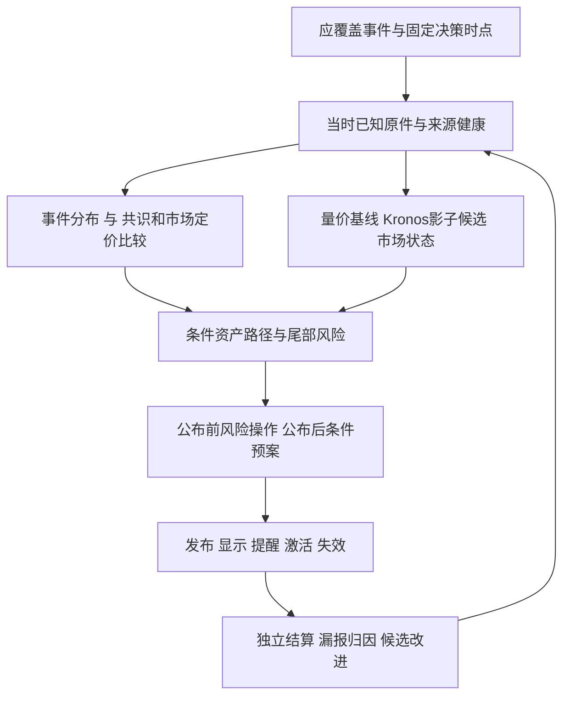

# Kronos 接入可行性与 CPI 事前决策缺口审查

2026年10月15日，北京时间。结论：**原方案的分层与隔离方向可用，Kronos 值得做独立对照试验；直接据此启动整套团队、图和新期限改造，仍不能保证填上最重要的事前决策缺口。** 本次先复核昨晚 CPI 漏覆盖，再调整实施顺序和验收标准。

审查基于当前工作区、normal15 正常库只读证据，以及今天另一会话的[架构总案](PRODUCT_VALUE_AND_PLUGGABLE_FORECAST_IMPLEMENTATION_BLUEPRINT_2026-10-15.md)、[Kronos 源码审计](KRONOS_SOURCE_AUDIT_2026-10-15.md)、[融合研究方案](KRONOS_INTEGRATION_RESEARCH_PLAN_2026-10-15.md)、[团队与机制图方案](PLUGGABLE_RESEARCH_TEAM_AND_MECHANISM_GRAPH_DESIGN_2026-10-15.md)。原总案读取的是 OP112；目前已经到 OP114，宏观三源、差异化 V2 预案已安装并正常生成，不能继续写作“尚在候选”。完整 PC、公布激活、提醒、结果学习和跨资产仍未交付。

本文件是审查与实施修订提案；未接入 Kronos 权重、修改正式业务代码、运行数据库迁移或恢复暂停目标。

## 一 昨晚发生了什么

本次事件是 **2026年10月14日20:30北京时间**公布的美国9月 CPI，对应 08:30 EDT。下表采用公告显示值；当前代码内部的连续指数环比另有精度口径，不能直接混用。

| 指标 | 上月公布值 | Reuters 事前调查预期 | 本次实际值 | 对当前设计的意义 |
|---|---:|---:|---:|---|
| 总体 CPI 月环比 | 0.4% | 0.6% | 0.6% | 比上月高，但本项不高于这份调查预期 |
| 核心 CPI 月环比 | 0.3% | 0.2% | 0.3% | 相对上月持平，相对调查预期偏热 |
| 总体 CPI 同比 | 3.4% | 3.6% | 3.7% | 高于调查预期 |
| 核心 CPI 同比 | 2.4% | 2.5% | 2.6% | 高于调查预期 |

来源：[BLS 当期公告](https://www.bls.gov/news.release/archives/cpi_10142026.htm)、[Reuters 公布前调查报道，页面标注10月14日00:01 EDT](https://www.marketscreener.com/news/high-gasoline-prices-expected-to-boost-us-consumer-inflation-in-september-ce785dd2db89fe26)。不同调查、机构点预测和采样时间可能不同；表中没有把某家机构预测冒充唯一市场共识。

公布后的报道同时记录了美债收益率、美元上行及股票下跌，另有 BTC 跌破 82,000 美元和黄金走弱的市场报道。这与“核心通胀高于预期→政策路径重新定价→风险资产承压”的机制相容，不能据同一时段的价格变化断言全部跌幅由 CPI 单独造成。[Reuters 市场反应](https://www.marketscreener.com/news/us-consumer-prices-accelerate-in-september-on-costlier-gasoline-core-cpi-firmer-ce785dd2df88f027)、[BTC 与黄金反应报道](https://cointelegraph.com/markets/bitcoin-price-dips-yields-surge-as-high-oil-prices-spike-us-cpi-inflation)。本轮未另做逐交易所分钟收益归因，不把不同文章时点的跌幅拼成一个精确事件收益。

**事前并非没有可讨论的风险分支。** MUFG 标注10月13日的预览以核心环比约0.19%为中心，同时列出0.3%情景可能推升加息预期、压低债券价格，以及0.1%的相反情景。这是本产品应能采集、核查和转成条件风险预案的材料。[MUFG 原研究](https://mufgresearch.com/macro/us-inflation-update-october-13-2026/)。该网页是本轮回看取得，不能补写为系统昨天已经读取，也不能将其事后仍可见的日期当作不可变历史原件。

## 二 本产品为什么没有提前给出来

### 1 这次首先是漏覆盖

正常0097库只读核查发现：

- `event_scenario_forecasts`只有一条，面向 **11月10日**；估计与发布时间是今天14:20左右。
- 现存 CPI 日历和 forecast jobs 涉及11月10日、12月10日；已发布 forecast 与所有机会只属于11月10日。没有10月14日对应的事前 forecast。
- 旧 `bls-calendar` 与 `bls-releases` 共分别200、199次采集尝试，均失败且 accepted 为0；其中199、198次发生在本次公布前。最后一次公布前错误为 `source_access_denied`。
- BLS API 首次成功在今天02:42:54，晚于昨晚公布约6小时12分；新的 schedule/nowcast/history 首次成功在今天14:18–14:19；三项宏观背景在16:20才进入当前链。
- 本轮查询范围内未找到该 CPI 的 event/watch/job 或相应事前 outbox 提醒。已有 `fact_change` 风险记录不能当作这次 CPI 事前预测。

所以不能把昨晚归类成“已发预测但模型方向错误”，更不能拿今天11月的九格作命中证明。应记为 **应覆盖事件未进入事前生产与交付链**。这类失败先计入覆盖与交付分母；没有概率就没有可算的该次 Brier 分数，不补造50%再评分。

查询范围、时间与安全证据见[漏报审计](../../../artifacts/decision-product-v1/kronos-review-20261015/CPI_MISS_FORENSICS.md)及[只读证据](../../../artifacts/decision-product-v1/kronos-review-20261015/cpi-miss-safe-evidence.json)。这些结论限定在核查的正常库和结构化产物，不等于搜索过全部自由文本后断言无人提过 CPI。

### 2 预测目标与用户关心的目标错位

`decision/cpi_event_scenario.py`已实现 Cleveland 同阶段历史联合误差与当前 nowcast 组合，不能说完全没有数值预测。但九格比较的是 `prior_month`，不是市场调查预期。代码也明确历史残差跨状态合并、当前下载的历史不等于历史可得版本、未覆盖样本之外的极端尾部。

昨晚的核心 CPI 就是反例：公告口径0.3%相对上月0.3%持平，却相对调查0.2%偏热。**“通胀比上月高/低”与“结果比市场定价热/冷”需要分别建模和展示。** 当前允许共识缺失继续计算 prior-month 模型本身可以成立，但不能给它市场 surprise 或资产胜率的名称。

### 3 事前预案尚不能兑现为事前风险管理

现有 V2 有条件资产反应和成本后策略回放，不应写成完全缺失。但当前宏观状态选择的是人工阈值规则，再回放旧价格；这属于当前规则的历史假设检验，尚不是按历史宏观版本验证的可交易概率。

更具体的缺口：

- 当前动作是空仓 `enter_long`、持多仓 `reduce_long`，没有完整空头/对冲协议。空仓在下行情景里无法从“看跌”自然得到获利动作；这要作为产品能力范围明确展示。
- 入场窗从 T0+60秒开始，连续已收盘分钟确认后再延迟60秒；这是公布后确认式预案，不能替代公布前的减险方案。它并非要等6小时才行动。
- `return_6h`是滚动六小时收益，非公告时刻锚定收益。假设同一滚动窗口内公布前段涨3%、公布后段跌2%，累计仍约+0.94%，可能仍满足正收益阈值；是否触发还取决于量比与连续确认。应拆分公告前趋势和公告后反应。
- `volume_ratio_1h`取完整UTC小时。北京时间20:30公布后至21:00前，最近完整小时对应19:00–20:00，完全在公告前；21:00后才纳入包含公告的20:00–21:00整小时，不能把此前的量比标成“公告后成交量确认”。
- 日频实际利率和广义美元可描述环境，不能替代公告附近的利率、美元、成交深度和资金头寸信息。
- 实际情景认证、事件监控、站内提醒和独立评分未接成正常闭环；代码中写了反向可能，不代表反向变量已参与计算。

代码依据：[CPI 概率](../../../packages/kernel/decision_hub_kernel/decision/cpi_event_scenario.py)、[规则选择](../../../packages/kernel/decision_hub_kernel/decision/event_opportunity_policy.py)、[机会构造](../../../packages/kernel/decision_hub_kernel/decision/event_opportunity_v2.py)、[历史回放](../../../packages/kernel/decision_hub_kernel/decision/event_response_model_v2.py)。

### 4 工程优先级需要纠正

过去完成了不少原件、版本、回放、审核和运行修复，但“重要事件在源失败时仍登记、发布前出预案、用户能看到提醒”没有成为先决验收门。来源长期失败后缺少覆盖兜底，让整件事连漏报分母都未形成。这是产品链路与验收优先级问题，不能用模型随机性、token 或用户未手写问题解释。

当前详情还存在真实首字节超过客户端30秒的记录；这影响用户及时读取。应修该具体路径，同时保留有进展的后台长研究，不能把所有研究压成30或60秒。[现有读取诊断](../../../artifacts/decision-product-v1/normal15/integrated-release-01/RELOAD_FAILURE_DIAGNOSIS.md)。

## 三 多 agent 对抗审查的裁决

| 审查问题 | 独立质疑与反例 | 裁决 |
|---|---|---|
| Kronos能否补齐 CPI 预测 | 输入是OHLCVA及时间，未输入共识、公告、政策；同一K线可对应不同公告结果 | 可作量价先验候选，不能承担宏观事件模型或据此承诺准确率 |
| 多路径是否已是概率分布接口 | 上游推理把样本维平均，均值曲线无法恢复先止损/尾部风险 | 必须取得原路径并独立校准；未改造不能称有产品所需分布 |
| 原架构边界是否值得保留 | 预测、研究执行、机制查询三种能力拆分，SQL权威账本和独立模型环境合理 | 保留；不另建事件/动作平行账本，不把Torch放进API |
| 是否先做4h、换Harness、上图数据库 | 这些各自会扩迁移和验收面，且不能修复昨晚没有事件记录的问题 | 暂后移；先复用现有期限和边界，必要时才做同合同Harness对照 |
| 是否只先做CPI闭环即可 | CPI月频，普通日仍需要当前风险判断；仅等下次CPI会再次失去日常价值 | 保留“常态24h条件方案＋事件前风险方案”双模式，Kronos影子并行 |
| 能否将Kronos塞入旧shadow协议 | 现有`path_forecast.py`固定`COND_VOL_V1`等语义和晋级限制 | 只复用数据/标签语义，建立新的trial身份；不得改写旧实验结果 |
| 多agent讨论能否代表独立确认 | 同模型、同新闻转载、同错误数据会产生相关错误；投票不校准概率 | 保留独立首轮、定向反证和真实回执；评价讨论改变了什么，不评价角色数量 |

技术与方法细项：[Kronos反方审查](../../../artifacts/decision-product-v1/kronos-review-20261015/KRONOS_REDTEAM.md)、[预测价值反方审查](../../../artifacts/decision-product-v1/kronos-review-20261015/FORECAST_VALUE_REDTEAM.md)。

Kronos的上游源码、权重和示例不是同一种交付。`model/`薄内核可隔离复用；WebUI、CSV微调及演示回测存在静态审计风险，不能用于证明本项目收益。当前本机没有取得Kronos推理基准，8GiB显存可否满足选定模型、窗口和路径数仍需实测。[官方仓库](https://github.com/shiyu-coder/Kronos)、[原论文](https://arxiv.org/abs/2508.02739)。

## 四 应补齐的具体能力

### 概率链与动作目标

分别保存三类目标：

1. `P(事件结果 | 公布前可得信息)`：nowcast、历史误差、分项证据；与指定共识快照比较得到 surprise 分布。
2. `P(资产路径 | 事件结果, 当前市场状态)`：状态含已计价程度、利率/美元环境、波动、流动性和头寸；BTC和ETH分别估计。
3. `P(策略净结果 | 资产路径, 动作规则, 成本)`：按完整路径模拟入场、减险、退出、滑点和费用，输出净期望及尾部损失。

三者不能互换。公布前综合资产路径时要对未知事件结果加权；市场状态也不完全可知，数据缺失应扩大不确定性或限制依赖该变量的动作。Kronos若已包含市场预期的价格影响，不能再简单叠加一遍宏观方向分数，应通过训练外预测学习融合，并与“只有事件”“只有量价”对照。

### 数据和代码边界

以下是增量实现建议，新增文件尚不存在时按新合同评审，不当作已实现接口。

| 能力 | 复用与新增边界 | 关键字段和行为 | 最小验收 |
|---|---|---|---|
| 应覆盖账本 | 复用calendar/scheduler；新增薄`event_coverage`用例 | event/period/T0、来源与时区、应产出slot、ready/missing/missed；官方来源失败仍保事件身份 | 源403、漏日历、晚启动均产生具名缺口；不能静默跳到下一期 |
| 共识与定价 | 新`ports/event_expectation.py`与对应adapter/application；原件仍用现有归档 | statistic/unit/seasonal、survey时间/供应方/分歧、机构预测独立、known_at/version | 同期且cutoff前；机构点预测不冒充共识；没有共识的prior-month结果另列 |
| 事件及状态特征 | 扩展现有feature合同和版本化model | pre_event_return、announcement_anchor、post_event_return、事件窗口量/价差；报价场所、时效与缺失 | 公布前上涨/公布后下跌反例不混淆；缺盘口不假装流动性正常 |
| 公布前动作 | 新事件风险policy，复用动作DSL和风险预算 | 有效期、适用仓位、风险预算、何时减险/何时继续持有、失效条件；与公布后预案分开 | T0前已发布并可见；长研究未完成仍交付可认证基线/具体缺口；不能统一no_trade遮盖结果 |
| 激活和监控 | 沿既定`event_realization`与event-owned monitor方案 | official actual/修订→唯一情景→确认→outbox→display/ack；不伪造Run | 错期/晚到/更正、重复bar、重复调度、重启不重复动作；保留事前版 |
| 结果与学习 | 复用outcome/evals/组件治理，补事件target | 概率、反应、净策略各自标签；missed/late也入台账；learning候选有样本与版本 | 不把未发预测当模型命中；真实结果才能支持晋级，来源故障不能靠生成skill文本解决 |

### 外部分析材料怎样真正产生价值

将MUFG等机构预览、研究文章和社区帖子提取为 `ExternalForecast/ResearchClaim`：作者、发表时间、系统抓取时间、适用事件/资产/期限、数值预测、条件分支、支持/反证、修订和原文引用。一个来源的转载聚成一簇；机构预测、调查共识、市场隐含概率、已公布事实分类型存储。

研究角色按主张检索补证，而不是把所有帖子拼进长上下文。只引用截至cutoff能取得的版本；后来的文章只能进入新修订。评分分别看该来源的校准、覆盖和边际信息，不能因为转发多、模型赞同多就提高概率。MUFG的0.3%上行情景可成为事前风险分支，其“约30%加息概率”仍是机构判断，不能当作实时市场价格。

### 自反思与技能沉淀的边界

先分类失败：来源不可得、事件漏覆盖、统计口径错、模型分布错、策略错、触发迟到、通知未展示、成交假设错。每类有不同改进出口。昨晚首先应产生来源/覆盖整改项，不该直接训练“CPI高就做空”的通用技能。

可重用技能应绑定场景、输入要求、适用市场状态、失效条件、原证据、训练/验证边界和版本；先影子评价再晋级。后续研究必须记录是否读取并执行该技能以及是否改变了方案。生成了文件、检索到了旧记忆，都不等于完成自进化。

## 五 改后的实施顺序与明确出口

原W0–W9与CE需求继续保留；建议修订当前里程碑的验收优先级，不为Kronos另开吞掉主线的大目标。以下单元均交付代码、真实运行证据和PC结果，按依赖推进；不承诺新增模型会盈利。

| 顺序 | 有限工作内容 | 完成后用户得到什么 | 退出条件 |
|---|---|---|---|
| P0 覆盖与事前可见 | 应覆盖账本、源故障告警、事件前slot、具体读取失败修复；保留常态24h入口 | 每个重要事件在公布前有方案或明确缺口，公布前可采取的风险处理与公布后预案分开 | 已知事件应产出项全部可对账；有限故障用例和真实未来slot通过；首开不再因30秒读取上限失效 |
| P1 预期与反应定义 | 共识vintage、nowcast uncertainty、surprise新target、公告锚定特征；冻结策略 | 看到比市场预期热/冷的分支、依据、概率资格和条件机会 | 昨晚口径反例、未来泄漏、错期、滚动收益反向例通过；对真实可得来源完成采集与正常回读 |
| P2 激活到评分 | 实际结果认证、事件监控/站内提醒、display/ack、独立结算 | 原预案怎样触发/失效，提醒是否看到，最后收益风险与判断结果 | 工程闭环用隔离时间推进验；正常前瞻原件单独积累，不把模拟当真实命中 |
| K1 并行候选试验 | Kronos薄内核、锁版本/权重、原始路径、独立trial，既有24h数据与标签 | 研究对照报告，决定这个模型是否值得进入正式候选 | 先格式/资源/时点，再对冻结机会集合比基线；不影响正式经理和动作，失败可停用 |
| P3 团队和机制增量 | 现有角色独立首轮与定向反证；SQL机制查询/依赖失效 | 能看到新增证据为何改变当前动作；无变化也有真实记录 | 同输入同预算消融有增益才扩大；不以更换框架或更多角色作为完成指标 |

4h新期限、真正72h持仓、FOMC专属模型、黄金/纳指/恒科仍在原清单。事件日历、原件、模型端口、调度、通知和评测框架可共用；各资产的交易日历、价格来源、机制系数、成本和资格独立。跨资产宏观关系是待检验特征，不能把BTC阈值复制给黄金。

## 六 怎样判断 Kronos 和整次改造值得继续

### 工程门

- 以固定机会集合登记全部成功、失败、晚到与漏报；每项必须有终态，不允许只统计有报告的样本。
- 预测输入不含未来已知值、未收盘K线或事后修订；用未来数据后缀变化的负控核对。
- 预测、发布、页面显示与提醒分别记时；错过预登记窗口记late，不能挪动目标起点。
- 停掉Kronos或遇OOM，正式已合格基线、提醒和监控仍能工作；原件和旧版本仍可回读。
- 核心事件公布前 T−24h、T−2h、T−30min 的slot统一配置，错过阶段如实记账。发布后的提示必须区分“事前预案”与“事后触发”。

### 数值与金融门

首轮沿用BTC既有24h数据和标签语义建立**新实验身份**，ETH和事件日单列，不改旧`COND_VOL_V1`结果。对照B0历史/零收益分布、B1现有简单策略、B2廉价统计模型、Kronos、事件模型及融合。训练、调参、校准与最终评价时间隔离；同一事件及BTC/ETH同刻聚类，不能把64条模型路径当64次独立市场试验。

进入正式候选前，先冻结主评分、最小有意义增益、费用/滑点、延迟和尾部风险上限。以下采用方法反方附录的数值门作为统一评审起点，避免主文与附录给出两套阈值；**它们是拟预登记的产品政策，尚非已接受的生产资格，也不是已取得的结果或金融事实。** 实施前按真实成本和风险预算定案，看到结果后不得改门槛。

| 资格 | 拟预登记的判定 |
|---|---|
| 工程可用 | 应交付项100%有记录；按期率至少95%；PIT、版本、幂等负控全部通过，模型失败不阻塞既有监控 |
| 模型数值 | 配对CRPS相对最强简单基线改善的95%区间下界大于3%；下行Brier差不劣于0.01；有效预测覆盖下降不超过1个百分点 |
| 空仓策略 | 同风险预算、全机会口径，每24h单位敞口的扣成本增量净收益95%下界大于5bp；尾损增量95%上界不超过10bp；更差成本/延迟压力不能出现确定负增益 |
| 已有多仓减险 | 胜过相同平均敞口的固定减仓基线：预登记下行风险改善95%下界大于10%，净收益差95%下界至少−5bp；与继续持有的机会成本单列 |

区间按事件/时间块、候选选择和预定检视次数处理，不能将大量试验里最好的一条普通区间当资格。样本不足时维持候选并报告压力结果；无有意义增益则停止扩大该复杂度，不阻塞已完成的产品工程闭环。分布资格通过也不自动赋予操作资格。

事件模型用Brier/log-loss和尾部覆盖；资产路径用CRPS/分位损失、下行触达与区间；策略用成本后净效用、回撤、尾部损失和暴露。胜率只是其中一个维度。70%不能由模型自报、多agent投票或一批挑选交易得到；须有冻结策略、完整分母、独立样本及区间。

28日可用于运行与数据诊断，不足以自动获得月频CPI或72h长期效果的统计资格。工程交付按上述明确门结束，长期观察另列；不再以“等足够多市场结果”无限拖延可用功能。

## 七 审查结论

**可行的是：保留当前事实与发布骨架，补事件覆盖、共识与定价、事前风险动作、激活提醒和独立评分，再让Kronos作为可替换量价候选接受对照。** 原方案无需推倒，但需要减少同时改动的范围，并把昨晚真实漏报列为第一验收案例。

昨晚的数据不能保证能提前猜中，事前识别该事件、列出核心偏热分支、说明利率与资产风险、给出适用仓位的行动条件，本应是这个产品的基本能力。当前没有做到，原因已经可以落到数据、目标定义、策略时序和交付链路，不能继续用笼统“AI仍需优化”概括。
