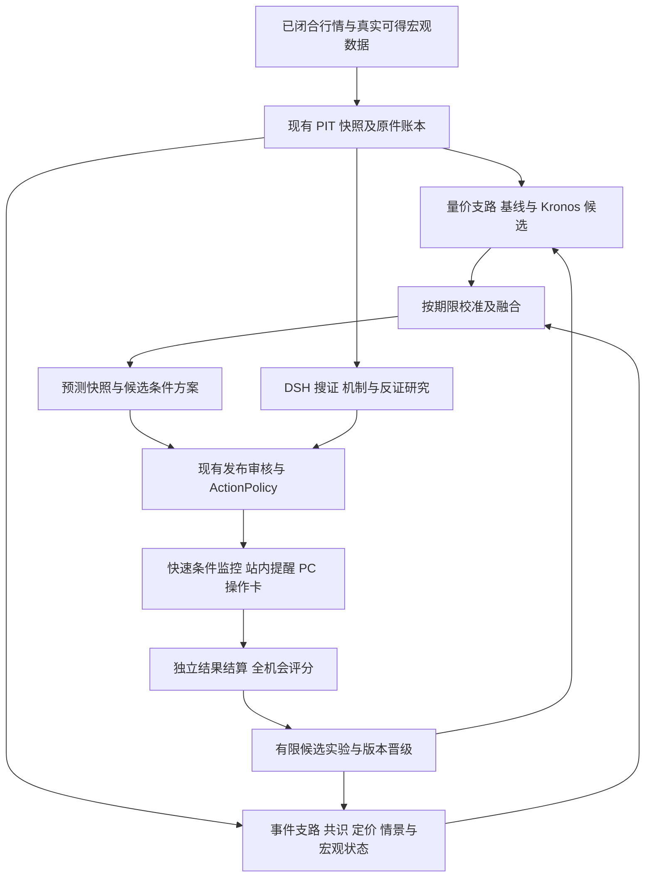

# Kronos 融合与事前决策交付研究方案

日期：2026 年 10 月 15 日，Asia/Shanghai。状态：研究提案。用户确认优先支持未来 4 小时至 3 天的操作辅助。

建议以现有 Decision Hub 为产品底座，补通“事前预测—条件行动—持续监控—提醒—结算”，同时把 Kronos 接为量价预测挑战者。第一阶段交付 BTC/ETH 的可使用研究试用，随后用冻结的向前试验决定模型是否提高了准确率和决策价值。模型未胜出时，产品仍应完成交付。

本提案细化现有 [CE01–CE09 核心事件实施计划](executable-product-v1/CORE_EVENT_EXECUTION_PLAN.md)，保留原 W0–W9、33 项、27G/E/V、12I 和既有金融协议。新增实验另行版本化，不修改旧分母、阈值或历史结论。本轮研究没有安装模型、运行金融回测、修改业务代码或验证当前正式服务。

## 1 用户最终应得到什么

关注 BTC/ETH 后，无需手动发起研究，首页按 4h、24h、72h 显示当前预测及操作方案。没有重大宏观事件时，量价预测仍按固定时点更新；有 CPI/FOMC 时，增加事件条件预案。深度研究可以继续运行，已有有效快照、监控和提醒保持可用。

| 用户问题 | 产品必须给出的内容 |
|---|---|
| 接下来可能发生什么 | 上涨/横盘/下跌或收益分布、预测期限、参考价、发布时间、概率是否校准、当前样本支持 |
| 我现在该如何应对 | 空仓和已有多仓分别给候选入场、持有、减险、退出或有条件等待；不猜测实际持仓 |
| 什么条件下改变 | 可由机器求值的入场、失效、退出、到期条件，以及下一次检查时间 |
| 预判为什么变化 | 新旧版本对比、改变判断的事实、模型或规则、影响的具体动作 |
| 提醒是否真的到了 | 发布、进入通知队列、页面显示、用户确认分别记录；队列成功不等于已看到 |
| 到底有没有用 | 原始事前观点、随后路径、成本后纸面结果、错过/迟到/未出手、相对基线表现 |

V1 保留现货 BTC-USDT、ETH-USDT 的已有 scope。出现下跌预测时，已有多仓可得到减险候选，空仓可得到暂缓入场条件；“做空”只能作为另行准入的永续/借贷品种能力。跨资产继续沿用 CE09，不阻塞 BTC/ETH。

产品默认展示操作卡和变化原因，完整报告、原件、研究轨迹和历史评分作为展开内容。预测不是每次都要促成交易；每个等待必须有原因、解除条件和到期时间，并进入覆盖率与错过机会评价。

## 2 当前项目的真实断点

本次检查的是本地工作树；HEAD 为 `1f5a31d`，存在大量未提交变更，因此不能以该提交代表全部当前实现。状态依据优先采用 10 月 15 日的 CURRENT_FOCUS 和 CE 计划；旧 README、10 月 10 日运行记录只作历史参考。

| 已核事实 | 对产品的影响 | 优先补齐 |
|---|---|---|
| Worker 已安装事件自动生产，约每 60 秒轮询 | 已有自动事前生产入口；代码接线尚不等于正式运行和用户交付验收 | 复用入口验证正常环境，不再新造调度平台 |
| 九种 CPI 情景主要改变机制文字，共用同一套价量入场/退出条件 | 概率不同不能稳定变成不同操作 | 版本化情景规则、宏观状态和同规则回放 |
| 事件机会类型固定 `armed=False`、`automatic_monitoring_armed=False` | 目前事件预案不能自己激活和持续提醒 | 补官方结果认证、事件 owner 的激活及监控 |
| CPI 联合分布比较的是上月值，nowcast 不是调查共识 | “比上月降温”不能解释成“低于市场预期”，更不能直接等同币价上涨 | 独立接共识/已定价输入，分别定义概率目标 |
| 机会输入尚未绑定完整宏观和市场定价背景 | 背景可以出现在解释里，却未改变模型和行动 | 背景进入认证输入、hash、模型与 policy selector |
| 当前响应概率是固定纸面策略的小样本估计 | 换模型或换策略后不能沿用旧胜率 | 模型、策略、标签、成本、校准联合版本化 |
| 已有 `score_joint_event`，在当前 packages/apps 检索未找到正常调用 | 有评分函数不等于公布后自动核对和学习 | 实际值 join、成熟 outcome、评分作业接线 |
| 已有 PIT、原件守卫、ActionPolicy、lease、outbox 和结果账本 | 可复用的基础很多 | 把完整用户流程接通，限制新增抽象与服务 |

直接代码证据：

- [自动生产安装](../../../apps/hub_worker/main.py#L243)、[轮询](../../../apps/hub_worker/event_scenario_tick.py#L17)。
- [情景文字与相同机器规则](../../../packages/kernel/decision_hub_kernel/decision/event_opportunity.py#L23)、[未武装合同](../../../packages/kernel/decision_hub_kernel/ports/event_opportunity.py#L33)。
- [CPI 残差及 prior-month 分格](../../../packages/kernel/decision_hub_kernel/decision/cpi_event_scenario.py#L37)、[评分函数](../../../packages/kernel/decision_hub_kernel/decision/cpi_event_scenario.py#L76)。
- [机会输入及准备](../../../packages/kernel/decision_hub_kernel/application/event_owned_opportunity.py#L25)、[现有盈利估计](../../../packages/kernel/decision_hub_kernel/decision/event_response_model.py#L67)。
- [Action 发布身份约束](../../../packages/kernel/decision_hub_kernel/application/action_publication.py#L431)、[监控与通知事务](../../../packages/kernel/decision_hub_kernel/application/action_monitor.py#L521)。

最新 CE 记录称认证配对价格样本只有两次成熟 CPI 事件；这是交付记录中的数量，本轮没有重新查询正式库确认。无论精确数量如何，都必须先统计每个情景、资产、期限的有效样本，不能把宏观残差月份数当成价格响应样本数。

我的判断：主要矛盾是“目标定义、输入消费、行动激活、到期评分”之间尚有断点；模型能力也需要提升，但单独换模型无法解决完整交付。

## 3 Kronos 可以带来什么

Kronos 将金融 K 线编码为离散 token，再用自回归模型生成后续序列。官方公开 mini、small、base；small 为 24.7M 参数、512 根上下文，base 为 102.3M、512 根，mini 为 4.1M、2048 根且配套不同 tokenizer。large 当前未公开。[官方仓库](https://github.com/shiyu-coder/Kronos)

最适合本项目的用途是提供未来收益、波动及路径风险的候选特征：例如未来 4h 的收益分布、24h 的下行极值、72h 的趋势持续性。它的输入是量价和日历时间，宏观新闻、共识、资金费率和因果解释需要在外部融合。[输入与接口说明](https://github.com/shiyu-coder/Kronos/blob/master/README.md)

关键实现细节：官方 `auto_regressive_inference` 在解码后对样本轴求均值，`predict`/`predict_batch` 默认返回平均路径。增加 `sample_count` 并不会直接给出可用于风险计算的完整样本集。接入时须提供保留每条样本路径的薄封装，再独立计算分位数、涨跌频率和路径极值；平均路径的极值不能替代各路径极值分布。[推理源码](https://github.com/shiyu-coder/Kronos/blob/master/model/kronos.py)

论文报告的改进是指定数据与实验下的预测、波动和模拟投资指标，不能转述成“BTC 胜率提高 93%”。论文预训练截止 2024 年 6 月、测试自 2024 年 7 月开始；加密预测实验使用 Binance 现货且去掉 volume/amount，小时预测设置为未来 12 根。我们的 OKX、OHLCVA 输入、72h 期限和人工响应延迟都需要单独实验。[论文与实验设置](https://arxiv.org/html/2508.02739v1)

仓库许可证为 MIT，Kronos-small 模型卡也标注 MIT。实施时固定代码提交、模型和 tokenizer revision，并保存权重校验值与相应许可；不能只保存会变化的 `main/master` 名称。[代码许可](https://github.com/shiyu-coder/Kronos/blob/master/LICENSE)、[small 模型卡](https://huggingface.co/NeoQuasar/Kronos-small)

不采用以下捷径：把一条漂亮折线当置信区间；把模型采样比例当已校准真实概率；把生成数据计入真实成功样本；拿股市横截面排序成绩替代 BTC 时序判断；先微调到历史表现好看，再寻找解释。

## 4 相关项目的选择

采用方法和有限模块，保留本项目的业务账本、发布权限、原件和前端主线。

| 项目 | 借鉴与融合 | 本轮位置及限制 |
|---|---|---|
| [Qlib](https://github.com/microsoft/qlib) | PIT、训练/推断处理分离、滚动训练、统一实验记录 | P0 采用评测纪律；MIT。优先补现有评测器，不移入整个股票研究平台。[PIT](https://qlib.readthedocs.io/en/latest/advanced/PIT.html)、[滚动模型](https://qlib.readthedocs.io/en/latest/component/online.html) |
| [Chronos-2](https://github.com/amazon-science/chronos-forecasting) | 多变量、历史及已知未来协变量、分位数预测 | P1 作为第二个模型挑战者；Apache-2.0。事件日历可预知，未来 CPI 实值不能冒充已知协变量。[模型卡](https://huggingface.co/amazon/chronos-2) |
| [RD-Agent](https://github.com/microsoft/RD-Agent) | 假设、因子实现、实验、反馈的有限循环 | P1 小规模离线探索，P2 扩大；MIT。接现有候选与晋级机制，限制实验次数，不自动改生产策略 |
| [NautilusTrader](https://github.com/nautechsystems/nautilus_trader) | 事件回放、费用、延迟、成交模型 | P1/P2 选少量案例独立复算；LGPL-3.0。暂不引入实盘执行栈。[行为模型](https://nautilustrader.io/docs/latest/concepts/behavioral_models/) |
| [vectorbt](https://github.com/polakowo/vectorbt) | 快速核验少量阈值、持有期、成本敏感性 | 可选离线工具；当前是 Apache-2.0 加 Commons Clause，不能视为无额外限制的 Apache 依赖。[许可](https://github.com/polakowo/vectorbt/blob/master/LICENSE.md) |
| [TradingAgents](https://github.com/TauricResearch/TradingAgents) | 多空反证、风险复核、结构化决策日志 | 借角色审查思想，复用 DSH；当前仓库 Apache-2.0。多角色不提供独立金融样本，LLM 重跑也可能不同 |
| [FinRL](https://github.com/AI4Finance-Foundation/FinRL) | 成本敏感的环境与仓位动作约束 | P2；MIT。原项目定位教育/研究，本轮不以强化学习作为交付依赖 |

具体取舍：本轮模型只比较 Kronos-small 与一个传统监督模型；Chronos-2 待同一评测器稳定后加入。Nautilus/vectorbt 二选一进行独立核验即可。RD-Agent、额外多代理和 RL 不进入最短交付关键路径。

## 5 融合架构与职责



两种更新节奏共用现有调度和账本：

- 快速链负责固定时点数值预测、已批准条件求值、有效期和通知。模型不可用时仍输出本次机会的失败/降级状态，不静默漏报。
- 深研究链负责重要事件、新证据、冲突和异常状态下的搜证、解释与新方案审核。长研究不占行情监控的写事务，也不作为所有数值预测完成的前置条件。

DSH 负责提出有证据的机制假说和行动候选；数值概率来自可复算模型，动作资格来自已有规则。研究不能私自把“不确定”改成“50%”，也不能把外部模型结果直接变成下单权限。

事件 owner 的机会目前与 Run owner 的 Action 发布身份不同。接法是新增有版本的事件 realization/activation/monitor 合同及通知主体，复用条件求值和 outbox；需要升级为 ActionPlan 的内容再走真实研究和原发布审核。不得伪造 Run、Graph 回执或将 `armed=False` 直接改成 True 绕过合同。

## 6 四种概率目标必须区分

| 对象 | 回答的问题 | 输入与标签 |
|---|---|---|
| 事件结果概率 | CPI 数值落在哪个区间，FOMC 作何政策决定 | 当时可得数据、nowcast；官方初次公布标签 |
| 相对预期惊喜概率 | 结果高于、符合还是低于当时市场共识 | 明确期次、指标与精度的调查共识/政策定价；不能用前值替代 |
| 资产路径分布 | 在当前状态及情景下，未来 4h/24h/72h 的价格和风险如何 | PIT 量价、宏观状态、事件条件；真实路径标签 |
| 策略净盈利概率 | 特定入场/退出/成本/延迟规则下是否净盈利 | 同一策略版本的实际可用路径、成交假设和完整机会集合 |

数学上可用情景混合表达 `P(资产路径 | 当前信息) = Σ P(情景 | 当前信息) × P(资产路径 | 情景, 当前状态)`。但只有联合定义一致、条件分布有数据支持时才能这样估计。

Kronos 已经从价格中看到部分市场预期，不能再把事件概率和它的“上涨比例”直接相乘，造成重复计入。第一版优先用简单可解释的融合器：将 Kronos 分位数、传统量价特征、距事件时间、宏观状态和可用共识共同作为特征，在滚动训练外的预测上拟合逻辑回归或受约束线性校准器。

样本不足时先做三件事：保留量价预测；显示有明确边界的情景条件预案；将事件到资产的概率标成不可估计或未校准。不要为了显示九格精确概率而复制策略、任意补数或无限细分状态。

## 7 数据建设顺序

| 数据 | 最小要求 | 复用与处理 |
|---|---|---|
| BTC/ETH 分钟行情 | 已闭合、升序唯一、scope/报价/单位一致；缺口和晚到可见 | 复用 MarketPathStore；因果聚合成 15m/1h，禁止使用未闭合大周期 K 线 |
| 成交量和成交额 | 区分基础币数量、报价币成交额、合约张数 | amount 优先用真实成交额；推算值单独标识并纳入消融，不冒充观测值 |
| 宏观事件与初值 | 期次、指标、季调、单位、scheduled/published/received/known、修订版本 | 复用官方来源与事件账本；公告延迟和更正追加记录 |
| CPI 共识与 nowcast | 两种输入分开；调查机构/发布时间/修订和原件可核 | Cleveland nowcast 是模型估计，不能充当调查共识；共识源先做覆盖和权限探测 |
| FOMC 已定价预期 | 会议、合约、方法、采集时点、概率定义可追溯 | CME FedWatch 属于由联邦基金期货推导的概率，不是 CPI survey；采集接入条件另核 |
| 宏观与拥挤状态 | 明确美元指标、名义/实际利率、风险代理、资金费率/OI 的来源和频率 | 先接已认证输入，按缺失模式降级；日频数值不冒充实时传导 |
| 费用与执行条件 | 手续费、点差、滑点、人工响应延迟；永续另含资金费 | 当前纸面假设保留旧版本，新策略用可核来源或明确区间做压力测试 |

ALFRED 可以按历史 real-time 区间获取当时数据版本，但它的日期粒度不能独立证明某条信息在盘中何时可用。4h 研究仍需保存精确发布时间和系统首次获得时间。[FRED 实时版本说明](https://fred.stlouisfed.org/docs/api/fred/realtime_period.html)

[Cleveland 官方 nowcast](https://www.clevelandfed.org/indicators-and-data/inflation-nowcasting)与[CME FedWatch](https://www.cmegroup.com/markets/interest-rates/cme-fedwatch-tool.html)可以作为不同类型的输入来源。公开网页可读不等于已取得稳定 API、历史覆盖或产品再分发权限；这些是数据接入验收项，不预先假设已经具备。

冻结快照同时保存 `source_published_at`、`first_received_at`、`known_at`、`cutoff_at`、`published_at`。系统前瞻成绩只能使用发布时系统真实获得的输入；今天下载的旧资料可以构造注明限制的历史研究数据，不能回填成系统当时预测过。

## 8 Kronos 的最小技术接入

建议从 Kronos-small 开始，不先微调。本机只读核对为 RTX 4060 Ti、8188 MiB 显存、约 31.8 GiB 内存；尚未实测模型推理速度、显存峰值或依赖兼容性。GPU 适配器使用独立依赖环境，避免 Torch/CUDA 依赖影响当前 API/Worker 的可恢复运行。

| 预测期限 | 首轮候选设置 | 限制 |
|---|---|---|
| 4h | 15m 输入，生成 16 根，最多 512 根历史 | 这是新候选设置；监控和结果核对仍可使用真实 1m 路径 |
| 24h | 1h 输入，生成 24 根，最多 512 根历史 | 更粗粒度不能证明分钟内止损先后顺序 |
| 72h | 1h 输入，生成 72 根，最多 512 根历史 | 单独标注长预测期验证；不借 24h 成绩取得资格 |

输入 K 线时间戳严格统一 UTC 的 bar-open/bar-close 约定，未来时间戳只含日历信息。不同频率先分别运行；不把同一资产多频率预测当多个独立投票者。

预测时间与发布时间分别定义：保存 `forecast_origin`、`input_cutoff`、`target_start/end` 和实际发布时刻。新协议可把 target_start 固定为输入截止之后的下一个预登记合法 bar 边界，给推理和发布留出预算；必要时多生成桥接 bar，上表的 16/24/72 是目标评价步数。发布越过 target_start 则记 late，不将已发生的前半段计为事前成绩，也不移动原窗口掩盖迟到。模型参考价与操作可成交价分开，后者必须取发布及响应延迟之后的下一可得报价。

模型接口仅承担输入快照到预测原件的转换：

```text
ForecastRequest
  scope + horizon + bar_interval + cutoff + forecast_origin + target_start/end
  input_manifest/hash
  model/tokenizer revision + sampling configuration + seed set
        ↓
ForecastDistribution
  raw_paths_ref/hash + generated_at + data_as_of + valid_until
  endpoint quantiles + path-risk summaries + status + failure_reason
  calibration_ref + target_definition + model_version + inference_receipt
```

接入步骤：

1. 在 provider/model adapter 外层读取认证快照，模型库不接触业务数据库写事务。
2. 薄封装保留采样路径，原路径外置文件并以 hash 入账；冻结 seed、temperature、top-p、采样数量、代码与设备信息。固定 seed 提高可复算性，不承诺跨设备逐位一致。
3. 先用 16 条样本完成格式和性能探测，再比较 32/64 条的稳定性、延迟和显存。采样次数在同一次实验中固定；未通过稳定性门不输出过细概率。
4. 校验 OHLC 顺序、非负量、有限值和极端异常。无效路径按预登记政策处理并报告比例，不能悄悄挑选有利路径。
5. 保存每条路径的终点收益、最大不利/有利变动。粗粒度 K 线内同时触及止盈止损时标注顺序未知或使用预登记保守规则，不假装知道先后。
6. 单独验证 OHLC 与真实 OHLCVA 两种输入；比较 Binance 训练域与 OKX 目标域的表现，不跨场所借资格。
7. 基于独立验证段校准分布和事件频率。终点涨跌/分位数、触达保护线、路径极值、固定策略净盈利分别对应不同标签，前者校准不能给后者借资格。16–64 条路径先用于格式、稳定性和粗概率诊断，不足以支撑精细尾部概率。增加路径数量减少的是模型采样噪声，不能证明市场概率更可靠。
8. 超时、显存不足、格式失败或版本缺失时记录失败；新预测使用合格基线或显示不可用。旧卡过期后不继续冒充当前判断。

推荐代码落点为新增 `packages/provider_adapters/forecasting/kronos.py` 与对应 ports/契约；目录名是提案，具体以模块边界审查为准。复用现有持久化模式与调度通道，不为每个模型建立一套业务状态机。

旧 `PathForecastParameters` 固定了日级实验与 `COND_VOL_V1`，不能在旧试验中把 Kronos 替换进去。新建模型比较协议，保留旧经验基线和历史成绩。

期限迁移需要贯穿产品合同：当前 Research/Action 候选多处只允许 30m、24h、72h，不能只增加一个 4h 模型参数。首批需按 canonical schema/codegen 流程增量贯通 4h candidate、发布、监控、UI 和 outcome，并验证旧版本仍可读。现 `action_research_policy.py` 中标为 72h 的既有 target 仍限制最多持有 24h；72h 预测与操作持有期必须分字段呈现。若新增真正持有至 72h 的策略，应采用新的 target/policy 和成本、到期测试，不能复用旧成绩。[现有期限策略](../../../packages/kernel/decision_hub_kernel/decision/action_research_policy.py#L78)

## 9 从预测变成可执行的人工方案

第一版采用少量固定策略族，避免模型输出任意交易文字：趋势确认、突破确认、已有多仓减险、有条件等待。策略选择由市场状态、分布、成本和证据决定，参数在看最终测试结果前冻结。

每个方案包含适用仓位、期限、入场触发、退出/失效、保护条件、最大持有时间、成本口径、风险预算依据、下一次检查、来源和模型版本。用户未提供资金/仓位时仅给条件与风险比例规则，不编造具体持仓数量。

同资产的 4h、24h、72h 建议需要统一的纸面组合投影，预登记净持仓、总暴露、冲突优先级和加减仓规则。同一份模拟资金不能被三张卡重复使用；保护/减险动作与新增风险动作的优先级须可测试。各期限预测独立评分，产品组合收益按实际合并后的纸面现金流计算，不能把重叠方案收益直接相加。该投影复用现有 ActionOutcome，不另建真实账户执行链。

动作判断依据应是成本后期望和风险约束，而不是一个通用的 `p > 0.65`。可以表示为 `净收益期望 = 各情景收益加权 − 费用 − 点差/滑点 − 适用的资金费`；真实实现使用固定策略在路径上的完整现金流。同样胜率可能因盈亏比不同产生相反结果。

事件预案分成两类，页面必须明确：

- 事件前可采取的候选动作：基于当前可得信息的持有、减险、暂缓追价，或经审核的条件入场；事件尚未公布不会阻止展示这类预案。
- 公布后才允许触发的预案：公布前冻结，官方实际值认证后选择唯一情景，再求值价量条件。事前预案和公布后修订分别计时、计分。

临近事件的价格锚点可以事前保存“取 T0 前 6h 高低点”的 recipe，在合法截止时刻解析成数值和原件。不能今天就把未来一个月事件的绝对入场价固定下来，也不能用包含当前 bar 的滚动高点冒充公告前固定区间。

机器规则需要真正区分情景。例如相同价量输入下，核心通胀偏热与明显偏冷应可能选择不同允许动作、确认门槛或减险逻辑；“可能利好/可能利空”的文案变化不算完成。规则本身也是假设，须与无事件规则做样本外比较。

首页卡片示意，不代表当前行情或建议：

```text
BTC · 未来 4 小时 · 截至 t 的事前版本
判断：趋势延续候选；概率显示校准状态和支持样本
空仓：条件 A、B 连续满足后，出现入场候选提醒
已有多仓：条件 C 成立时，出现减险候选提醒
失效：条件 D 或数据过期；有效至 t+4h
下一检查：下一根合格分钟 bar；重大事件到来时重估
风险：预测区间、最大不利路径估计、费用/延迟假设
变化：与上一版相比改变了什么、依据是什么
结果：到期后链接原版、触发记录、纸面结果与基线
```

人工建议资格、数值概率资格和真实交易权限分别保留。证据不足应限制受影响的结论，而不是用统一 no_trade 隐藏所有有用预测；关键价格不可用时仍不能给伪造价格动作。

## 10 怎样验证准确率真的提高

先冻结目标和分母。4h 为首个主评价期限，24h/72h 分列；不允许最后挑表现最好期限宣布整体成功。方向阈值、横盘带、成本、延迟、风险预算、预测时点与样本切分写入协议。

| 层次 | 对照组 | 要回答的问题 |
|---|---|---|
| B0 | 不交易、持有与零收益/历史分布基线 | 新系统是否超过简单行为；不同基线各自适用于哪个指标 |
| B1 | 现有经验路径风险基线，以及固定动量/均值回复规则 | 现有确定性能力是否已经足够 |
| B2 | 逻辑回归或 LightGBM，使用同样可得的量价特征 | 基础模型是否优于更便宜易解释的监督模型 |
| K | Kronos 单独 | 收益、分布、尾部风险是否有独立增益 |
| E | 事件/宏观模块单独 | 共识、状态和情景差异是否增加价值 |
| K+E | 固定融合与校准 | 融合是否超过最佳单模型，还是重复计入信息 |
| 后续挑战者 | Chronos-2 | 协变量模型是否替代或补充 Kronos |

数据及切分纪律：

1. 能取得合格历史时，目标覆盖 18–24 个月以上多种市场状态；具体可用窗口以来源审计为准。所有模型使用配对机会集合，披露缺失、失败与样本剔除。
2. 使用按时间滚动的训练、验证、测试。归一化、特征选择、阈值、校准都不能看到测试期；融合器只能用训练期之外产生的预测训练。
3. 72h 标签重叠时，训练与测试边界按实际标签结束时间剔除重叠样本；必要时增加预登记间隔。CPI/FOMC 按整个 event_id 分组，不能随机拆事件分钟。
4. BTC/ETH 同期和相邻预测高度相关。置信区间采用时间块/事件块，报告有效独立样本，不把每分钟、每条模型路径当独立试验。
5. 冻结模型 checkpoint，记录已知预训练截止及未知覆盖。历史回放即使使用 PIT，也不能消除基础模型或 LLM 记忆历史结局的风险；最终依赖冻结后向前样本。
6. 留一个最终保留集，仅在候选确定后评估。RD-Agent 不读保留集；失败候选和搜索次数也保存，防止反复试到“赢家”。

| 维度 | 指标 | 防止怎样的误判 |
|---|---|---|
| 预测分布 | Brier/log-loss、CRPS 或分位数损失、区间覆盖与宽度 | 曲线好看不等于概率可靠；无限放宽区间也不能算优秀 |
| 方向与路径 | 分类表现、上涨/下跌分组、最大不利变动及尾部漏报 | 终点上涨不能掩盖中途巨大回撤 |
| 操作价值 | 扣成本收益、回撤、换手、风险暴露、尾部损失、净期望 | 高胜率但少数巨亏，或靠加大风险获得收益 |
| 可用性 | 应发布/实际发布/迟到/失败、提前量、触发率、等待率 | 只展示成功报告或只出手极少几次 |
| 执行真实性 | 条件成立、提醒显示、人工响应延迟、下一可得报价 | 用信号出现前的价格或 bar 收盘价回填成交 |
| 新模块贡献 | K/E/B2/融合的配对消融与计算成本 | 不知道究竟是数据、模型、规则还是风险预算带来改进 |

旧策略每边费用和滑点假设合计 0.15%，只属于旧版实验。新策略至少检验基础成本和更差成本，并纳入人工延迟的多个预登记档位。minute bar 不能证明大额订单成交；未接账户实单时始终统计纸面结果。

首个 28 日向前窗口是工程和模型诊断节点：固定版本、全机会记录、按期出“有增益/无增益/证据不足”的结论。28 天只有约 28 个不重叠 24h 窗口、9 个 72h 窗口；CPI/FOMC 独立事件更少，不能凭这一窗口证明长期胜率。工程交付不必等全部统计问题解决。

晋级规则在试验前登记：主评分优于最佳简单基线且不牺牲覆盖率；扣成本策略在相同风险预算下改善用户指标；尾部风险、时效和缺失不能显著恶化；按预定时间块给置信区间。无法确认增益时保留候选身份，基线继续运行。70% 胜率只能是特定策略和分母下的待验证目标，不能成为上线时必须编出来的数字。

## 11 与现有实施任务对齐

| 工作包 | 对应现有任务 | 主要落点 | 可验收产物 |
|---|---|---|---|
| P0 当前版本和正常链核对 | CE01、CE02 | 当前发布流程、worker、query views、PC | 从正常环境读取同一事前预测，刷新/重启后身份不变；缺口完整列明 |
| P0 期限合同与兼容 | CE04、原 Action 规格 | canonical schema、4h candidate/发布/monitor/outcome、UI | 4h 全链可用，旧 30m/24h/72h 可读；预测期限与持有期分别核对 |
| P0 差异规则与宏观输入 | CE03、CE04 | event_owned_opportunity、event_response_model、event_opportunity、provider adapters | 至少两种情景在同市场输入下行为不同，原件与回放算法一致 |
| P0 激活、监控和提醒 | CE06 及事件合同 | event realization/monitor、ActionPolicy、outbox、通知 schema | 事前冻结→官方结果→唯一激活→条件触发/失效→页面显示回执 |
| P0 结算和完整分母 | CE07 | score_joint_event、outcome ledger、scheduler | 自动成熟评分，失败/迟到/未触发都可查；旧版不可覆盖 |
| P1 量价预测适配与协议 | CE04 的量价补强 | forecasting adapter、新预测合同、现有调度和 ledger | 同快照 B1/B2/K 对照、全样本路径和推理回执 |
| P1 校准、融合和反证消费 | CE04、CE08 | 纯 decision 模型、DSH typed 工具、query view | 预测原件真实进入研究/策略；消融能定位贡献 |
| P1 正常安装与恢复 | 原工程矩阵、CE02/08 | 标准发布、PC、故障恢复手册 | 正常安装可用，不依赖候选目录、测试库或临时脚本 |
| CPI 子交付后继续既有主线 | CE05、CE09 | FOMC 专属模型、独立资产准入 | CE05 仍属整体完成要求；首批 CPI 通过不代表整个 CE 已完成，不借 CPI 或 BTC 成绩为其他事件/资产背书 |

不为 Kronos 新建第二套事实、Action、通知和晋级账本。新预测合同按 canonical schema/codegen 流程生成；模型输出通过 ports 进入 application，领域计算保持纯逻辑，网络和 GPU 计算放在短写事务外。只读 GET 不触发采集或模型。

## 12 排期与停止条件

以下为具备 1 名主工程、1 名数据/模型工程和量化复核能力时的工作量估计；可由同一人兼任但日历时间相应延长。数据权限、历史覆盖和正常发布故障是主要不确定项。工程目标约 4–6 周，前瞻观察并行进行，不承诺届时证明盈利优势。

| 时间 | 主要工作 | 阶段出口 |
|---|---|---|
| 第 1–2 个工作日 | 核对当前正常版本；冻结 4h/24h/72h 目标、数据及对照；复现一个用户断点 | 一份权威差距表、一套评测协议、一个可重现失败；不继续扩页面 |
| 第 3–5 个工作日 | 基于现有底座先接条件预案、监控、提醒与到期任务；简单基线先供数 | 正常 PC 可见事前卡及生命周期；开始记录真实未来机会。真实市场尚未触发时，单列隔离回放验证，不伪造触发 |
| 第 2 周 | 官方结果 join、差异 policy、同规则回放；Kronos 薄适配和硬件探测并行 | 最小用户闭环可复现；Kronos/B1/B2 有同口径历史诊断报告 |
| 第 3 周 | 按期限校准，事件及宏观输入真正消费，净成本/延迟评测 | 配对消融、候选排序、失败原因；不合格候选停止扩大 |
| 第 4 周 | 固定版本向前影子，PC 体验、正常安装与恢复，手册 | 工程试用交付；预测、操作、提醒、结果均可追溯 |
| 第 5–6 周 | 根据已成熟结果做诊断；必要时加入 Chronos 或有限微调 | 给明确晋级/保留基线/证据不足结论；事件样本继续积累 |

停止或降级条件：

- 2 个工作日内无法证实共识源的权限、时点和字段，则将其登记为独立依赖；继续量价与 prior-month 条件预案，不冒充 surprise 模型。
- Kronos 未通过输入、性能或稳定性门，保留诊断结果并使用基线交付；不靠延长全部 Worker deadline 兜底。
- 一次预登记历史比较加首轮前瞻诊断未显示增量价值，不继续扩大模型、代理或搜索预算；先检查数据、目标与可用性。
- 若只改说明文字、只在测试库可用、没有新的正常用户回执或没有到期评分，本工作包不得标为交付完成。
- 正常发布故障优先走现有恢复/版本机制，不以旁路数据库、替代目录或更改旧验证门制造通过。

## 13 首次交付的具体验收

以下是新增提案验收点，原已登记阈值继续有效；任何新时效指标需在新协议内预先冻结，不拿来放宽旧失败。

1. 固定预测机会无需手动研究即可生成；按 scope×horizon×slot 预登记分母，发布成功/失败/迟到均入账。
2. 用户能在窗口开始前或协议规定的事前截止前看到预测；错过固定 deadline 的预测标 late，不回填成准时样本。
3. 每条有效方案都有入场、失效、退出、期限和下次检查；真实数据变化使机器状态改变，产生可见提醒。
4. 情景切换和宏观状态反事实测试能改变机器允许动作或分布；同一规则在在线求值与回放中得到一致结果。
5. 真实运行至少完成一条从事前原件到成熟结果的全链；CPI/FOMC 未到时，普通固定期限链先验，事件链分别登记回放与待真实事件项。
6. 研究、预测、事件预案和模拟操作使用正确 owner 和权限；未授权自动下单始终保持关闭。
7. 数据过期、模型超时、来源失败、重启和重复轮询不会产生旧建议冒充新建议、重复提醒或重复纸面成交。
8. UI 能看同一版本的原始预测、变更、提醒显示/确认、路径与净成本结果；不能只展示最终摘要。
9. 正常安装包、数据库迁移、关闭/重启、回滚和说明文档通过，候选目录不能代替正式交付。
10. 28 日诊断按时产出，无效或不足也可结项；金融能力状态继续单独展示，不能把工程通过写成准确率达标。

建议新增日常运营面板：应发布数、准时数、遗漏数、有效卡比例、数据健康、过期卡数、提醒显示延迟、待结算数、模型降级数，以及各期限的滚动评分。这些指标直接解释“为什么今天没有事前建议”。

## 14 优先决策

推荐采用“现有 CE 主线补交付，Kronos-small 并行做挑战者”的路线。首批只承诺两资产、三期限、有限策略族、站内提醒和纸面结果；工程验收与金融增益分别退出。

第一笔投入应放在认证数据、差异规则、激活监控和完整分母，其次才是微调、更大模型或更多代理。最有价值的成功既可能是 Kronos 提升了某个期限的预测，也可能是发现简单模型更可靠，但系统终于能在事前交付可核对的操作方案。

下一步可直接以第 11 节工作包制定有限源码范围和可回滚提交，沿既有 SDD、BDD、TDD、ADR 及正常发布流程实施。本提案不改变 CURRENT_FOCUS、tasks.json 或当前执行状态。
