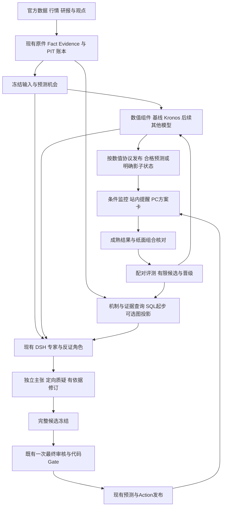

# 可插拔预测组件 多角色审议与机制图设计方案

日期：2026 年 10 月 15 日，Asia/Shanghai。状态：架构与产品提案，未实施。目标：在现有 Decision Hub 中融合 Kronos 等开源能力，让不同研究角色交流、质疑和核验，以可追溯的机制链支持 BTC/ETH 未来 4h、24h、72h 的事前决策。

建议保留现有产品和技术主线，增量建设三项能力：可替换的数值预测组件、有边界的多角色审议、带时间和证据的机制查询。先用已有 SQL 账本与机制合同实现最小查询，达到真实查询和性能需求后，再增加 Neo4j 读投影。每项能力分别验证增量价值；图数据库、多代理数量和模型规模均不作为交付完成指标。

本方案是 [Kronos 融合研究方案](KRONOS_INTEGRATION_RESEARCH_PLAN_2026-10-15.md) 的技术附件，不替换 [CE 核心事件计划](executable-product-v1/CORE_EVENT_EXECUTION_PLAN.md)。本轮读到的 CURRENT_FOCUS 为 OP111：normal14 继续运行，normal15 是候选批次，整体及金融效果未通过。这是入口记录，本轮没有重新验收线上服务，也没有修改现有运行配置、执行状态或业务代码。

## 1 产品目标和最短交付单元

用户应先看到一个具体结论及其条件，再按需查看预测分布、团队分歧和证据链。产品首页不以展示代理聊天或庞大关系网络为主要任务。

最短交付单元是：一份真实事前快照产生基线和 Kronos 候选；研究角色指出关键支持与反证；现有审核与规则产生可用方案；监控持续求值并提醒；到期自动结算原判断和方案。首次以 BTC、4h 为主目标，ETH、24h、72h 分列扩展；旧 CE 中 CPI、FOMC 和跨资产要求继续保留，子交付不代表整体完成。

| 用户实际看到的内容 | 背后必须存在的产品对象 |
|---|---|
| 当前倾向、适用仓位、有效期、入场/减险/退出条件 | 已发布的数值预测、事件预案或经审核的 ActionPlan，各自身份、目标与资格明确 |
| 预测是什么时候形成、依据截至何时 | 输入截止、目标窗口、实际发布/页面显示时间、不可变快照 |
| 最强支持、最强反证、尚未解决的问题 | 原件绑定的主张、挑战与处理结果 |
| 团队讨论改变了什么 | 讨论前后主张/方案差异及依据；允许最终没有改变 |
| 哪一条传导机制可能起作用 | 有适用状态、时滞、确认和失效条件的机制链 |
| 接下来观察什么，何时改判 | 明确数据源、指标、阈值/事件条件、下一检查与失效时间 |
| 最后有没有帮助 | 原始预测、真实触发、提醒时效、纸面净结果、基线差异 |

无宏观事件时仍按固定时点生产数值预测。有事件时同时提供“公布前可采取的应对”和“公布前登记、公布后才触发的预案”。不会因深研究尚在运行，就让所有有效预测与监控一同停止。

“事前效果”分开计量：已知事件的预案看是否在公告前发布及提前量；固定 4h/24h/72h 预测看目标窗口开始前是否可见及后续评分；变化出现后的风险检测看发现和提醒延迟。价格已经下跌后触发的告警可以有价值，但不能记成提前预测了这次下跌。未预告冲击也不能仅凭事后机制链宣称可以预知。

## 2 总体架构



边界固定如下：

- Hub/Kernel 继续拥有事实、版本、资格、预测、行动、结果和通知的业务真相。
- DSH 继续拥有模型、工具与子角色执行循环。LangGraph 继续负责产品生命周期、证据回合、恢复和最终冻结。
- 数值模型是计算组件，不包装成会自由聊天的专家。Kronos 输出预测原件，量价研究角色负责检查和解释。
- 图是关系模型与查询能力。图中被引用的内容仍须回查原账本；它不拥有行动发布权。
- 学习只生成候选，依照既有试验、审核、晋级和回滚流程启用，不允许讨论角色自行替换生产模型。

业务 owner 保留现有身份：研究使用真实 Run，自动事件预测/预案使用 event_key/forecast_id，固定时点预测使用 opportunity/slot。上图研究审核支路只代表需要该审核的候选；数值发布按自己的协议、事件 activation/monitor 按事件合同运行，不强行依赖新研究 Run。审议通过引用消费这些原件；事件预案升级为 ActionPlan 时，才走真实 Run/Graph 原件和既有发布审核，不伪造身份。机制索引同时支持 ResearchMechanismReview.run_id 与 EventCausalChain.owner_forecast_id。

## 3 已有代码能够复用什么

下表是本次读到的源码能力及边界，不是正常运行验收声明。

| 当前代码 | 复用方式 | 必须补充或保持的约束 |
|---|---|---|
| [ComponentManifest](../../../packages/kernel/decision_hub_kernel/ports/component_registry.py#L11) | 已有 source_parser、feature、model、research_recipe、monitor_rule 五类 | 复用注册体系；不增加第二套插件市场 |
| [ComponentRegistry](../../../packages/kernel/decision_hub_kernel/application/component_registry.py#L70) | register、shadow、review、activate、rollback 与 generation CAS | 注册不等于准入；改变输入/输出合同需新 component 身份，不能沿旧 parent 偷换 ABI |
| [能力组合入口](../../../apps/research_mcp/capability_composition.py#L40) | MCP 与 Skill 使用同一 capability 构造器 | 新查询须补 manifest、query schema、adapter 和 gateway 验证；不是只添加一个工具名字 |
| [ResearchHarnessRuntime](../../../packages/kernel/decision_hub_kernel/ports/research.py#L33) | 原生研究执行接口 | 数值预测不塞入 AgentRuntime，不再造另一套 ReAct/agent loop |
| [DSH 角色与审核约束](../../../packages/runtime_adapters/dsh_runtime/profile.py#L320) | 市场、宏观、新闻、反证、数据质量子角色 | 讨论放在最终冻结前；最终 reviewer 仍只执行一次 |
| [原生模型分派](../../../extensions/dsh/decision-hub/src/host/model-dispatch.ts#L35) | 已记录真实 provider/model 与 ProviderInput | 多模型身份以执行回执为准，角色自报不算证明 |
| [研究图](../../../packages/orchestration/langgraph/graphs/agentic_research_graph.py#L120) | 生命周期和无进展停止 | 不把 DSH 内部讨论重复实现为外部 LangGraph 模型循环 |
| [机制合同](../../../contracts/schemas/research_signal.schema.yaml#L436) | 节点、边、时滞、支持、反证、可验证 feature、影响方案 | 当前边仍是 hypothesis；新增验证记录不能把旧边直接变成“因果真相” |
| [现有决策图投影](../../../packages/query_views/research/decision_graph.py#L83) | 主链、反链、证据与 Gate 的有界展示 | 先补跨 Run 查询，不从零造一套图页面 |
| [学习包执行限制](../../../packages/kernel/decision_hub_kernel/application/research_learning_packages.py#L10) | 固定 spot_evidence→features→hypothesis 布局及有限参数候选 | 当前不是任意 DAG 执行器；新团队协议须有明确执行支持，不能仅生成 YAML 就声称可用 |

现有 profile 支持 specialist 的 modelSelectionSettings，但这不证明当前已按角色稳定路由不同模型；reviewer 当前调用也没有因此自动获得多模型能力。新路由需要实际输入、provider/model、fallback 和费用回执验收。

## 4 把可插拔设计成三层

第一层是**固定领域合同**：解释预测目标、证据、概率状态、机制、行动与结果。它不依赖 Kronos、Neo4j 或某个 LLM SDK。

第二层是**已有治理与应用服务**：选择已登记的版本、冻结输入、执行任务、校验结果、保存回执、构造研究工具。该层统一管理身份和资格。

第三层是**可替换适配器**：Kronos、后续 Chronos/传统模型、SQL/Neo4j 查询、特定来源提取器。库和设备依赖限制在这里。

| 能力 | 领域接口与输出 | 注册/接入位置 |
|---|---|---|
| 数值预测 | ForecastModelPort → ForecastDistribution | model；新增 forecasting adapter |
| 派生特征 | 已认证输入 → FeatureSnapshot | feature；保留源与计算版本 |
| 研究角色与讨论协议 | RolePolicy/DeliberationPolicy → 结构化主张与问题处理 | 版本化 domain profile/recipe；执行支持明确后接现有治理 |
| 机制查询 | MechanismQueryPort → 有界子图与证据引用 | 查询 adapter；SQL 和 Neo4j 实现同一 port |
| 图文抽取 | 文档版本 → Claim/Mechanism 候选 | source_parser 或受控研究能力；输出不是认证事实 |
| 条件规则 | 已有 feature 与状态 → 条件求值 | monitor_rule/现有 ActionPolicy；不能由模型输出任意代码 |

设计示意，以下类型和方法不是现已实现的 API：

```python
class ForecastModelPort(Protocol):
    async def predict(self, request: ForecastRequest) -> ForecastDistribution: ...

class MechanismQueryPort(Protocol):
    async def query(self, request: MechanismQuery) -> MechanismSubgraph: ...

class ForecastApplicationService:
    async def execute(self, job: ForecastJob) -> ForecastReceipt:
        binding = self.components.resolve_frozen_binding(job.component_version)
        snapshot = self.inputs.read_verified(job.input_snapshot_ref)
        result = await self.adapters[binding.adapter_id].predict(
            build_request(job, snapshot)
        )
        validated = self.validator.verify(job, snapshot, binding, result)
        return self.ledger.commit_with_receipt(job, validated)
```

适配器由组合根从允许列表构建，不从模型输出的类名、仓库 URL 或任意 Python 路径动态加载。代码 hash 解决完整性问题，不自动赋予网络、写库或交易权限。GPU 推理可运行在隔离进程/独立依赖环境；超时与显存失败返回类型化状态，保持 API/行情监控可恢复。

ComponentManifest 保持当前外层语义：component_ref、scope_id、input/output_contract、code/resource_hash、parameters。模型特有信息放进受 hash 绑定的 typed execution manifest：模型/tokenizer revision、依赖锁、支持频率/期限、设备、采样参数、已知训练范围及未知项、许可证与测量结果。不要添加一份含密钥的通用插件配置。

新增 schema 通过 canonical codegen 生成 Python/TS 类型。改变合同身份时按当前 registry 的规则建立新 component_ref；旧运行固定旧版本，切换 active pointer 只影响后续机会，不改变正在运行和历史快照。

## 5 Kronos 的实际接入链

1. 现有行情采集将已闭合 K 线和原响应写入账本；因果聚合 15m/1h，记录交易所、品种、报价和成交量单位。
2. 固定时点创建预测机会，冻结输入及模型 binding。4h/24h/72h 分别登记目标、窗口和发布截止；必要时生成桥接 bar，保证评价窗口在事前发布之后开始。
3. worker 调用 ForecastApplicationService，由 forecasting adapter 执行 Kronos-small；同时执行简单基线，保存各自结果和失败。
4. 封装保留原始采样路径，计算收益分位数、方向频率与路径风险。终点、触达事件与策略盈利分别校准；平均路径不能代替尾部风险分布。[Kronos 推理源码](https://github.com/shiyu-coder/Kronos/blob/master/model/kronos.py)
5. 研究通过 `forecast.read` 读取已经提交的原件，通过 `model.compare` 读取同一机会的模型对照；GET/读取工具不隐式启动昂贵推理。若允许显式请求新推理，须单独的有预算 job 命令和去重身份。
6. Kronos 尚在 shadow 时，其输出带影子资格，只参与试验和明确标注的研究诊断；不能因已经接成工具就获得行动权。未通过新协议时，现有合格基线继续供正式链使用。
7. 后续加入 Chronos、LightGBM 或其他开源项目，只增加对应 adapter、manifest、合同验证与试验，不改 ActionPolicy 和业务账本的核心语义。

ForecastDistribution 最少保存：目标及单位、horizon/bar_interval、forecast_origin、input_cutoff、target_start/end、model/tokenizer/version、输入与输出 hash、路径引用、采样配置、概率目标与校准状态、失败/缺失状态。actual provider/device、计时和成本由执行器注入回执，不能相信模型自报。

本机已核 RTX 4060 Ti 约 8GB 显存；small 先做小批次探测，原始 16/32/64 路径只用于性能、稳定性及粗分布诊断，不预先承诺精细尾部概率或推理延迟。详细模型和回测限制沿用上篇研究方案。

4h 必须同时扩展当前 Research/Action candidate、发布、monitor、outcome 与 UI 合同；现有部分 72h Action 最多持有 24h，预测期限和策略持有期分别显示。不能只加一个模型参数。

## 6 多角色和多模型怎样交流

讨论围绕会改变判断的具体问题进行。它的目标是纠错、补证和明确分歧，不能以达成共识或增加信心为目标。

| 职责 | 输入与产物 | 复用方式 |
|---|---|---|
| 量价分析 | 基线/Kronos 原件、市场状态 → 模型一致与冲突、风险、适用限制 | 现有 market/derivatives specialist |
| 宏观与机制分析 | 共识、已定价、时点子图 → 主链、替代机制、可观测前提 | 现有 macro/cross-asset specialist |
| 新闻与来源核验 | 原始文档、转载血缘 → 哪些是事实、观点、重复或过时信息 | 现有 narrative/data-quality 职责 |
| 反证分析 | 独立形成判断，再检查他人主张 → 最强反例与证伪条件 | counter-thesis；不强迫无依据唱反调 |
| 经理与汇总 | 问题处理记录 → 最终候选、保留异议、行动变化依据 | 原 manager/synthesis |
| 最终审核 | 已冻结完整候选与可信证据摘要 → 正式审核回执 | 既有一次 restricted reviewer |

首个实验可让量价、宏观、反证三个分析席位提交独立主张，来源质量作为验证能力；已有 profile 的必需角色和节点仍须满足。缩减或重排正式职责需新 profile/协议及验收，不能用新方案跳过现行要求。

标准流程：

```text
共同输入包冻结
  → 独立首轮主张提交并封存
  → 对齐目标/期限，去重来源，整理真正分歧
  → 对最可能影响操作的 1–2 个问题提出质疑
  → 一轮定向补证/回应，保留、撤回或修订主张
  → 汇总已解决与未解决问题，形成完整候选
  → 最终候选冻结
  → 既有一次最终审核与发布规则
```

独立首轮只读共同输入与分配的职责，看不到其他角色的回答、身份和票数。需在 DSH 子上下文及实际 ProviderInput 中证明隔离；若当前运行时不能保证，实验应标为非独立，不能声称取得独立集成效果。工具新增数据必须遵守同一 PIT；晚到事实另起可关联版本，不偷偷加入旧快照。

“4h 看涨、72h 看跌”可以同时成立，不自动视为矛盾。机器先按资产、目标、期限、参考时点与条件对齐主张，再提出问题。同源转载、同一个指标的衍生特征、多个模型对同条新闻的重复引用，不形成多份独立支持。

有效改口依据包括：新增合规证据、误读纠正、计算纠正、反例成立、假设被否定。仅因对方说得更有说服力或多数同意而改变观点，记录为无依据修订，不能提高概率资格。

允许不同角色使用不同模型家族，但首版无需依赖昂贵异构团队。ModelRoutePolicy 固定 role→允许 provider/model、fallback、预算；实际使用复用 model-dispatch 的原生回执。fallback 不得冒充原模型；同源模型/不同角色的错误可能高度相关，应通过实测估计。

讨论的控制是有界阶段与业务问题预算，不是把现有长研究强制裁成几十秒。初始提案为独立首轮、一轮质疑、一轮回应；重大且可核验问题可在新协议预算内追加一次定向核验。沿用当前 wall-clock、调用、费用与停止约束；无新证据/有效纠错、不可观测问题、预算或截止临近都应停止，继续保留异议。

新协议为交付显式留时：讨论截止不晚于该研究发布 deadline 减去完整冻结、一次审核、持久化及页面/提醒交付的保留预算。预算按真实阶段耗时预登记，不能挤掉必需审核。快速预测与长研究使用各自的发布窗口；讨论耗尽时，同一预测机会已经合格的基线仍按自身链准时发布，未审完的行动不能借此放行。晚到讨论另发有真实时间的新版本，不回填原事前成绩；此机制不擅自缩短现行长 Run 的已登记预算。

最终冻结后仍遵守当前一次 reviewer 规则。修改任何已审核候选字段后，旧审核不覆盖新版本；不能反复召集 reviewer 直到同意。若此时需要新版本，依照现有 research-only/新研究流程处理。

## 7 讨论的数据合同与概率边界

不复制已有 Fact/Evidence/Run，只添加缺失的结构化记录并关联其原始 ID。

| 新增或扩展合同 | 必需内容 |
|---|---|
| ResearchRolePolicyV1 | 职责、requirement_ids、允许能力、输出 schema、模型路由、预算、禁止动作 |
| ModelRoutePolicyV1 | 路由版本、允许模型和参数、fallback；不含密钥 |
| ArgumentPacketV1 | claim/scope/target/horizon/cutoff、支持/反证 refs、模型原件 refs、假设、可证伪条件、可能影响的动作 |
| ChallengeRecordV1 | 指向原 claim、问题类型、争议前提、所需核验、影响范围 |
| ResponseRecordV1 | retain/revise/retract、前后 claim、变化依据、核验回执、未解决项 |
| DeliberationReceiptV1 | 输入 hash、policy、真实参与者执行绑定、阶段产物、预算和停止原因 |
| ArgumentDispositionV1 | 作为假说保留/纠正/不采用/未解决、依据、异议、对候选的具体影响 |
| DecisionContributionV1 | 原方案、新候选差异、采用/拒绝了哪些预测与机制、为什么改变、资格结果 |

这些是拟议类型，实施时优先复用现有 independent_review 的 issue、blocking_scope 和 resolution 结构，复用 research_signal 的 claim/mechanism/action，不增建第二套“审核真相”。新记录只描述冻结前讨论；最终 review 仍是原合同。

概率来源分开：

1. 模型原始分布及样本外校准结果；
2. 研究角色的主观判断和假说；
3. 讨论发现的结构化特征，如某证据失效、机制前提不成立、数据时间不匹配。

第一版讨论主要影响证据选择、限制说明和候选条件，再由原审核/规则决定可否发布。角色不得直接给模型概率加减百分点。以后只有积累足够配对数据，才让讨论特征进入可版本化的融合/校准器，并验证其独立增益。

资格必须沿贡献链传播：shadow 模型经角色改变入场、仓位、减险或退出条件，仍属于 shadow 对行动的影响，不能通过自然语言“洗成”正式建议。正式 Run 默认只获得相应准入的输入；shadow 团队使用分离的实验上下文和原件，DecisionContribution 记录其资格。未经晋级的条件变化只进入实验臂；可独立认证的原始事实允许经正常合格链重新推导，但不能顺带带入未合格模型的结论。

同样，多数票不是概率，审核接受不是校准，机制链完整也不是获利保证。每个角色可以认定“当前没有优势”或“条件不足”，但必须具体说明触发改变的条件和观察期限。

## 8 图模型先解决哪些问题

图首先回答五个有产品价值的问题：

1. 当前方案依赖哪些当时已知的事实、观点和机制？
2. 某条来源修订或失效，会影响哪些仍有效的预测/方案？
3. 某条机制的支持、反证、替代解释和历史失败案例是什么？
4. 哪个尚未核实的中介或领先指标，最可能改变当前操作？
5. 相似机制在什么市场状态下失效，是否应改变适用范围？

先实现跨 Run 的有界查询和增量追踪，不把每根分钟 K 线都变成图节点。高频序列留在现有行情存储，图只保存认证 feature snapshot、指标身份和路径原件引用。

四种关系视图可以共用存储，但不能混淆含义：

| 关系视图 | 节点/边示例 | 如何解释 |
|---|---|---|
| 来源事实 | 文档版本 REPORTS 事件，观测 MEASURES 指标，版本 REVISES 旧版 | 表示出处和身份，不声明因果 |
| 主张证据 | 原件 SUPPORTS/CONTRADICTS 主张，文章 DERIVED_FROM 原报道 | 支持来源去重、反证和可追溯 |
| 机制假说 | 事件/预期/利率/美元/资金/资产之间的有向机制关系 | 保留适用状态、方向、时滞、混杂、证伪条件；默认 hypothesis |
| 决策依赖 | 预测 USES 快照/机制，方案 DEPENDS_ON 条件，结果 EVALUATES 原预测 | 证明当时用了什么，支持失效传播与复盘 |

复用现有 ResearchMechanismReview/CausalCase 的节点边。新增持久 MechanismAssessment 关联旧机制原件，区分观察关联、特定假设下识别的效应、证据冲突、过时等状态；不修改旧 `status=hypothesis` 的含义。不要让一个 0–1 confidence 同时表示来源可信度、因果强度和预测概率。

## 9 时间 身份与图查询的正确性

每个实体关系或断言版本保留：canonical_id/version、source refs/hash/span、source_published_at、first_received_at、recorded_at、适用时间、系统可知时间、supersedes/retraction 关系、抽取器与本体版本。更正追加新版本及替代关系，旧预测继续引用旧快照。

金融时点至少有两条轴：现实中何时发生/适用，以及系统何时知道。9 月数据可能 10 月公布、11 月修订；11 月修订不能进入 10 月事前判断。未来会议可以提前知道，故过滤依据是“截至 cutoff 是否已知”，不能简单禁止 `event_time > cutoff`。

实体身份必须包含指标、期次、单位、季调、市场与品种。headline/core、MoM/YoY、调查共识/nowcast/prior、美元代理/DXY、现货/永续分开。实体别名合并本身也需版本，避免今天才知道两实体相同而改变过去查询路径。

机制查询合同示意：

```text
MechanismQuery
  scope + horizon + as_of + input_snapshot_ref
  query_kind: evidence_trace | counterevidence | affected_plans | mechanism_cases
  root_ids + allowed_relation_types + max_depth + node/edge_budget
  mode: prospective_snapshot | retrospective_reconstruction

MechanismSubgraph
  node/edge versions + canonical refs/hashes
  query/policy version + source cutoff + snapshot id
  projection_watermark + coverage/gaps + stale status
  provenance groups + support/contradiction refs
```

工具只开放类型化查询，不给 LLM 任意 Cypher/SQL 写入权限。所有结果经原件 reader 和时点检查；“没查到路径”要区分不存在、覆盖不足和索引落后。

更隐蔽的泄漏来自派生信息：摘要、embedding、社区报告、实体合并和图结构也可能吸收未来资料。只过滤边的日期并不足够。Graphiti 当前实体/社区保存实现可更新相同 UUID 的属性，因此不可直接把最新摘要用于历史快照。[官方保存实现](https://github.com/getzep/graphiti/blob/main/graphiti_core/models/nodes/node_db_queries.py)

历史重构必须冻结检索语料、索引、摘要、抽取和模型版本及各自输入截止。向前成绩保存当时真实产生的检索结果/hash；今天生成的过去语料摘要只能标为 retrospective_reconstruction，不能冒充系统当时读到的内容。底层 LLM 的预训练记忆另列限制，PIT 检索不能消除它。

## 10 根因链怎样产生事前作用

从需要提前判断的变量反向找上游机制与可观测领先信号，再用当前证据逐项检查。重点是提前保存“如果什么发生，我会改变哪项判断”，而不是下跌后拼接一条顺畅叙事。

示意机制，不是当前市场结论：

```text
已知的通胀数据/共识差异
  → 政策路径预期可能变化
  → 实际利率/美元可能改变
  → 资金风险偏好与拥挤状态
  → BTC 的收益与下行路径风险
```

每条边同时登记：在哪种状态下可能成立、预计时滞、确认指标、失效指标、潜在共同原因和替代机制。例如“已提前计价”“美元变化由另一事件驱动”“去杠杆主导”都应保留；不能默认冷 CPI 必然利多。

具体事前流程：

1. 事件前冻结当前状态、数值预测和主/反机制；区分已观察条件与未来情景。
2. 图查询指出尚缺的关键中介。经理只为可能改变方向、风险或条件的问题安排补证，避免无目的抓取更多资料。
3. 可观测条件编译成既有受限监控 DSL；不能观测或没有可靠数据的边保留为未决假说。
4. 新事实改变某条边的支持状态时，找到依赖它的有效方案，触发一次去重的重估/失效核验，保存变化依据。方案发布时须在权威 SQL 的同一事务保存依赖索引；必要重估集合从该索引取得，异步图仅补充发现和展示，不能因图投影落后漏掉刚发布方案。受影响方案依照既有撤回/unknown/重新审核规则处置。
5. 更新预测和候选通过正常审核发布。未来窗口成熟后，核对“哪个领先条件曾出现、提前多久、误报漏报多少”，同时评价相同输入不使用图时的表现。

Kronos 提供量价统计视角，机制链提供适用条件、反证和搜证方向。二者不直接相乘：价格已包含部分事件预期，未经验证的融合可能重复计入信息。初版简单融合器及机制状态特征只做离线/shadow 对照，按冻结样本外协议检验；正式概率继续来自已合格版本。讨论特征进入正式校准器还须满足第 7 节的配对数据和晋级条件。

图数据库存关系，多跳 RAG 找资料，因果估计检验假设，预测模型评估未来分布，这四件事应分别验证。DoWhy 提供假设、识别、估计和反驳流程，但反驳测试通过并不能证明图真实。[DoWhy 官方流程](https://www.pywhy.org/dowhy/v0.13/user_guide/causal_tasks/estimating_causal_effects/index.html)、[建模边界](https://www.pywhy.org/dowhy/main/user_guide/modeling_causal_relations/index.html)

真正因果试验限定在可定义、数据足够的局部问题。知识图可以有金融反馈环；进入要求 DAG 的模型时，按时间展开为“价格_t→清算_t+1→价格_t+2”，明确混杂和识别条件。普通条件情景/敏感性分析不能标为已识别干预效应；事后异常根因分析也不能计为事前预测成功。

## 11 何时引入图数据库及开源组合

| 能力 | 推荐定位 | 选型边界 |
|---|---|---|
| SQL 关系与机制索引 | 第一版；权威原件、机制版本和决策继续在现账本 | 固定 2–3 跳、有限结果，先验证产品查询 |
| Neo4j | 后续可重建的多跳查询投影 | CE 单实例、GPLv3；EE 有商业许可与更多运维能力。选定部署形式后核适用条件，不因协议方便而迁移主账本 |
| Graphiti | 借鉴时态断言、来源和实体消歧；可作抽取挑战者 | 当前仓库 Apache-2.0；依赖图后端与模型。Zep 托管产品与开源 Graphiti 不混为一谈 |
| Microsoft GraphRAG | 离线大量文档的主题归纳、反证与机制候选检索 | MIT；默认索引输出含 Parquet/向量存储，并不要求 Neo4j。成本、派生快照与更新时间需要实测 |
| DoWhy/PyWhy | 少数局部机制的离线识别、估计和反驳 | MIT；不能替代数据库、源认证或金融前瞻验证 |

依据：[Neo4j 能力](https://neo4j.com/docs/operations-manual/current/introduction/)、[许可](https://neo4j.com/open-core-and-neo4j/)、[Graphiti](https://github.com/getzep/graphiti)、[Graphiti 许可](https://github.com/getzep/graphiti/blob/main/LICENSE)、[GraphRAG 索引](https://microsoft.github.io/graphrag/index/overview/)、[GraphRAG 项目](https://github.com/microsoft/graphrag)、[DoWhy](https://github.com/py-why/dowhy)。

第一版不同时部署 Neo4j、Graphiti 和 GraphRAG。先做好自己的类型和时间合同，保持 query port 可替换。以后选其中一个抽取/检索方案做对照，再决定是否启用。

Neo4j 的接入门是：多个真实产品查询需要跨 Run、多关系、多路径遍历；经过索引和有界查询优化的 SQL 仍达不到预先登记的延迟目标；图 adapter 在相同数据与权限下通过正确性、恢复和费用验证。文档多或图形好看不足以证明现在需要新服务。

投影方式：原业务提交在短事务内登记待投影项，worker 以幂等键推进到图后端；图记录 source sequence、manifest/snapshot 和 watermark。现通知 outbox 有明确主体限制，不能直接把图更新塞成通知；实施先核可复用通用事件队列，没有合适接口时新增最小 `graph_projection_jobs` 持久任务索引。它只管理派生投影，不成为新事实账本。

图写入失败不会回滚已提交预测，也不会阻塞行情/提醒。查询过期时回读限定 SQL 子图或返回明确缺失；重估只影响依赖图结果的部分。支持全量重建、增量追赶和旧快照校验，禁止业务代码双写 SQL 与 Neo4j 后假设同时成功。

watermark 表示对应投影版本/分区的连续完整提交，不能取已处理序号的最大值。并发或重试留下前序缺口时不能越过；一笔源事务的节点、边及撤回全部投影完成才推进。查询绑定可证明一致的投影快照，不混合新旧版本或半完成批次。全量重建完成原件/数量/查询核对后原子切换读取版本。证据失效传播始终以权威 SQL 依赖索引为底线。

## 12 最小新增持久化与代码落点

以下是拟议落点，实施前结合当时工作树核对；不预分配 migration 序号，避免与正在推进的 CE 批次冲突。

| 位置 | 变化 |
|---|---|
| `contracts/schemas/forecast_distribution.schema.yaml` | 新数值输入/输出与执行回执；保存路径引用及目标时间 |
| `contracts/schemas/research_deliberation.schema.yaml` | 角色、路由、主张、质疑、回应、处理与贡献合同；复用原 claim/review 定义 |
| `contracts/schemas/mechanism_query.schema.yaml` | 查询、子图、验证记录、投影状态及时间语义 |
| `kernel/ports/forecast_model.py`、`mechanism_query.py` | 不依赖具体 SDK 的接口；使用 canonical 生成类型 |
| `provider_adapters/forecasting/kronos.py` | 模型预处理、原始样本保留、执行状态；不写业务表 |
| `provider_adapters/knowledge/sql_mechanism.py` | 第一版有界查询；后续 `neo4j_mechanism.py` 实现相同 port |
| `kernel/application/forecast_models.py` | binding、快照、调用、校验、回执和状态落库 |
| `kernel/application/research_deliberation.py` | 接收/核对结构化产物、引用与状态；不承担模型或代理循环 |
| `kernel/application/mechanism_index.py` | 从已认证原件生成机制索引/关系版本、影响查询和投影任务 |
| `runtime_adapters/dsh_runtime/profile.py` 与 profile 资源 | 冻结前讨论协议与模型路由接线；保留原最终审核 |
| `apps/research_mcp/capability_composition.py` 与 gateway/catalog | `forecast.read`、`model.compare`、`mechanism.query` 的类型化能力 |
| worker composition 与既有调度 | 有限推理、投影、失效重估和结算任务；不新增常驻 agent 平台 |
| query_views 与 Decision Desk | 当前方案、模型对照、关键分歧、有限机制链和贡献结果 |

其中 `kernel/...` 和 `provider_adapters/...` 分别指 `packages/kernel/decision_hub_kernel/...`、`packages/provider_adapters/...`，文件名是设计建议，尚未创建。

持久化尽量以不可变原件加轻索引实现：

- 复用已有 forecast/预测机会语义，只有新模型协议不能表达时才增加分布原件索引；不另建一套预测成绩账本。
- 增加 deliberation receipt/argument 索引并关联 Run/原生执行；正文和较大产物外置 hash 绑定。
- 复用已有 claim/mechanism 原件，补跨 Run canonical identity、assessment 和依赖边版本索引。
- 需要外部图后端时再增加 projection jobs/watermark；不提前引入通用消息中间件。

拟议只读 API 按业务 owner 提供：真实 Run 下的 deliberation/contribution；event_key/forecast_id 下的事件预案、机制和激活状态；固定 opportunity/slot 下的 forecast-comparison。机制查询统一引用各自 canonical owner，不能为了 URL 方便补造 Run。API 命名最终与当前路由规则统一，返回 query DTO；UI 不计算概率、不直接访问图数据库，也不通过 GET 启动模型。

## 13 为什么增加的能力有用要分别证明

组件、团队、图检索和最终操作各有独立实验，避免把更多数据、更多 token 和更大风险敞口混成“架构提升”。沿用上篇计划的 PIT、时间滚动切分、重叠标签剔除、同风险预算、成本、人工延迟和前瞻窗口要求。

| 试验 | 固定对照 | 要检验的贡献 |
|---|---|---|
| 模型 | 简单基线、传统监督模型、Kronos，同输入和机会 | 数值模型是否改善分布、方向、路径风险与成本后操作 |
| 讨论 | 单角色等预算、独立多角色汇总、独立首轮加结构化讨论 | 收益来自更多推理、观点多样性，还是讨论本身 |
| 多模型 | 同模型多角色与不同模型家族，同协议 | 是否降低错误相关，而不只是增加费用 |
| 检索 | 当前 SQL/关键词或已存在检索、相同语料的机制图查询 | 支持/反证召回、来源独立性、缺口定位、查询成本 |
| 图特征 | 同样额外信息的平面特征与图机制特征 | 提升是否来自图结构，而非仅增加数据 |
| 全链 | 相同可用机会、风险预算和人工延迟 | 准时交付、净成本价值、回撤和错过机会是否改善 |

讨论研究的结果并不一致。早期论文在部分推理任务上报告收益；后续研究指出讨论未必稳定胜过独立集成，并可能把正确判断说错。这些研究均不能直接作为金融有效性的证据。[早期研究](https://arxiv.org/abs/2305.14325)、[对比评估](https://arxiv.org/abs/2311.17371)、[说服导致错误研究](https://arxiv.org/abs/2509.05396)

第一轮讨论主试验冻结证据集；允许额外检索的试验另列，否则无法分辨收益来自讨论还是多看了资料。保存独立首轮、讨论后及最终结果，衡量纠错率、正确被改错率、无依据改口、重复证据放大和关键未决问题。

图的工程收益看事前证据/反证 Recall@K、原件可追溯率、复核时间、时点违规、延迟和费用。金融收益另看 4h 主目标的 Brier/CRPS、路径风险漏报、覆盖及同风险预算净结果。图更容易解释，不自动代表预测更准。

结果驱动的改进先区分输入错误、机制适用错误、概率失准、规则/成本问题与交付迟到。一次亏损不能证明某条机制无效，一次盈利也不能把边升为事实。研究可提出新机制、反例、角色政策或特征候选，保存依据和适用范围，再走现有不可变候选包、行为验证、配对试验与晋级；不让每次复盘直接修改 active 模型、图解释或交易条件。

保留所有失败、迟到、缺失和未触发机会。跨期限建议通过统一纸面组合投影处理净持仓与总暴露，不把同一资金在 4h/24h/72h 上重复计算。28 日是诊断节点，CPI/FOMC 和 72h 的独立样本仍可能不足。

若讨论未优于独立汇总，停用交叉讨论；若图未改善预测但显著帮助追溯，可只保留查询功能；若 Kronos 未优于基线，保持 shadow。每条路径都能给明确结果，不要求所有新技术必须进入生产。

## 14 实施拆分和退出门

| 工作包 | 实施内容 | 可见产物与退出门 | 关联原主线 |
|---|---|---|---|
| P1 合同与基线 | 固定预测、讨论与图查询合同；4h 兼容迁移；冻结评测协议 | 同快照、目标与权限可核对，旧版本继续可读 | CE02/04、原 Action 规格 |
| P2 模型插件 | Kronos-small adapter、原样本、回执、只读工具 | 正常 worker 生成基线与 shadow 预测；失败可降级且不堵监控 | CE04 |
| P3 最小团队审议 | 独立首轮、结构化质疑/回应、贡献记录、原审核接线 | 正常真实 Run 中看到争议、依据和处理；实际模型身份可查 | CE08 |
| P4 最小机制图 | 既有机制原件跨 Run SQL 索引、时点查询、反证与依赖追踪 | 五个产品查询可用，历史截止负控通过，能定位受影响方案 | CE03/04/08 |
| P5 事前交付 | 固定生产、事件激活、条件监控、站内提醒、成熟结算和 PC | 至少一条真实固定期限全链；事件链区分回放与真实事件验收 | CE02/06/07 |
| P6 向前对照 | 模型/讨论/图贡献分开诊断；正常恢复与手册 | 按期出晋级、保留基线或不足结论，整体仍按原矩阵验收 | CE08、原工程矩阵 |
| P7 可选增强 | Neo4j、Graphiti/GraphRAG、局部 DoWhy 或更多模型 | 仅当查询瓶颈或独立增益已证明后实施 | 后续扩展；不阻塞 CE05 FOMC |

依赖顺序：P1 先行；P2 与 P4 可并行；P3 先消费已有合格基线与证据，不必等 Kronos 晋级；P5 沿现有 CE 持续推进，不等待完整图或更多代理。P6 尽早开始记录新机会，P7 不进入首批交付关键路径。新团队 recipe 超出现学习 executor 的固定布局时，必须新增明确支持与行为验收，不默认生成即能运行。

资源假设为主工程、数据/模型工程和量化复核能力。合同及薄适配约 1 周；团队/SQL 机制查询及全链接线约 2–3 周；正常恢复、PC 和首轮诊断约 1–2 周，可部分并行。总工程目标延续此前约 4–6 周估计，取决于当前 CE 缺口、数据可用性和真实运行结果。它不是所有金融效果在六周内成立的承诺。

## 15 必须覆盖的验收场景

1. 更换 model adapter 不改变领域目标/Action 接口；不兼容合同被拒绝，旧快照可重放。
2. Kronos 超时/缺模型/非法 OHLC 时保存失败，合格基线及既有监控继续；不以过期预测兜底。
3. 独立首轮没有读到同轮其他角色结果，真实输入与模型身份可核对。
4. 同源转载不累计独立支持；不同期限观点不会被误判为矛盾。
5. 无依据改口不会提高概率/行动资格；补证后修改记录可追到原件。
6. 讨论发生在最终冻结前，正式 reviewer 仍一次；审核后变更不能沿用旧授权。
7. 新知识、修订、最新实体摘要/embedding/社区报告不能进入过去快照；合法已知的未来日程可用。
8. 图查询落后、不可用或实体消歧冲突时明确降级；不会把“未覆盖”当成“无风险”。
9. 一条证据失效只触发依赖它的有效方案重估，重复投影/重启不会重复提醒；旧预测不可覆盖。
10. 事实、关联、机制假说、校准预测分别展示，未识别的因果效应不冒充已证明根因。
11. 正常 PC 能查看原始事前版本、关键分歧、实际改变、提醒回执和成熟结果，而非只有候选测试输出。
12. 到期报告同时给出工程可靠性和新增模块的配对贡献；无增益允许撤回组件，产品主体仍可用。

首批优先验证“插件确实产生原件并被研究消费”“讨论确实纠正可核问题”“机制查询确实改变搜证或条件”“结果确实在事前交付”。这四个事实成立后，再扩大模型数量、关系规模和自动学习范围。
