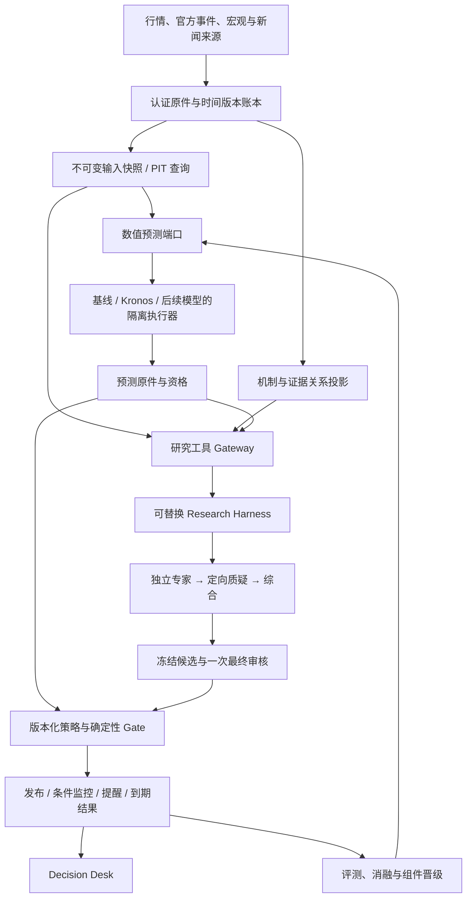

# Decision Hub 事前决策产品与可插拔研究架构实施总案

日期：2026-10-15。状态：研究与实施提案，未开始接入模型、迁移运行时或安装图数据库。

本文件汇总本轮代码核查、Kronos 仓库静态审读及官方网络资料，作为本次讨论的完整阅读入口。前两份研究稿仍保留背景，涉及选型、现状与审读深度，以本文件和[源码审计附录](KRONOS_SOURCE_AUDIT_2026-10-15.md)为本轮更新。它不修改已接受的 ADR、CURRENT_FOCUS、W0–W9 或 CE 交付状态。

## 1 推荐决策与产品价值

保留 Decision Hub 的事实、时点、发布、监控、结果和用户入口；把它推进为 **BTC/ETH、未来 4h–72h 的事前判断与条件操作辅助产品**。Kronos 是第一个可替换的量价预测候选；团队负责提出、核验和修订假设；机制图负责查传导、反证和失效影响。三者通过统一证据与结果合同协作，各自接受增量价值检验。

已有工程资产有复用价值，但不能把工程复杂度等同于已实现的用户价值。当前最重要的缺口是：在固定时点交付明确方案，让方案随条件变化进入可见状态，并在到期后用同一口径判定效果。模型、更多代理和图数据库只有进入这条闭环，才值得投入。

推荐的优先级：

1. 承接正常版本交付主线，先兑现可准时查看、可触发、可失效、可回查的条件方案。
2. 用统一预测接口比较简单基线与 Kronos；通过独立依赖进程隔离，不整仓嵌入。
3. 将现有多代理能力补成有执行回执、独立首轮、有限质疑和贡献评分的真实研究团队。
4. 把已有机制链变成可查询、可订阅、带时间版本的机制资产；有实测需求后再增加图数据库。
5. 对研究运行时保留可推翻的选择：DSH 是已有候选 A；必要时与当前 LangGraph 子代理模式作同合同对照，谁满足交付要求且维护成本更低就选谁。

### 用户每天应获得什么

| 用户问题 | 改造后的具体交付 | 用什么验证价值 |
|---|---|---|
| 接下来几小时要关注什么？ | 按固定时点生成 4h 判断、区间、条件和有效期，24h/72h 单独列出 | 应发布、准时、迟到、遗漏的完整分母 |
| 现在需要行动吗？ | 空仓与已有多仓分别给出候选入场、减险、继续观察的条件 | 条件可机器求值，触发后有可见回执 |
| 为什么这样判断？ | 数值预测、机制假设、支持和反证分开；可以看团队真正改变了什么 | 有真实原件和执行身份，不能仅凭角色卡 |
| 什么发生后就错了？ | 失效条件、证据撤回、期限和下一次检查 | 自动标失效或修订，旧版本仍可查看 |
| 系统究竟有没有用？ | 原始预测、提醒时间、纸面成交、成本和到期结果配对 | 与简单基线比较，并报告风险、覆盖率和不确定性 |

首版承诺辅助判断、条件预案与纸面结果。用户没有提供实际仓位时，展示适用情境和风险比例，不虚构持仓；既有真实下单权限不因接入开源项目而改变。

“准确率”需要拆开：终点方向、概率校准、风险区间、条件触发、扣成本操作效用不是同一个指标。方向更准而巨亏更多、只在极少机会出报告、或总在行情结束后发布，都不能算产品进步。

## 2 本轮核查范围与当前状态

核查的是工作区源码和正式设计记录，不是仅看旧 Git HEAD。工作区有大量既有修改和并行候选工作；本轮没有修改业务代码，也没有用源码存在证明某次正常运行已经执行成功。

最终读取的执行入口为 **OP112，2026-10-15T07:34:55.842520+00:00**：记录称 normal14 仍运行；宏观真实采集、分情景 V2、恢复和元数据检查在隔离候选完成部分验证；正常 V2 安装、PC、重启与研究心跳稳定性尚未通过；公布激活、提醒/评分、共识/FOMC、研究学习、跨资产仍待完成。这是当时的项目记录，本轮未独立复跑其中测试或检查在线进程。[当前执行入口](CURRENT_FOCUS.md)

所以不能继续笼统写“系统没有自动预测”或“所有情景规则相同”。工作区旧 V1 的情景动作较同质；OP112 已记录候选 V2 的差异规则进展，但不能将它视为正常产品已经交付。后续先对齐实际安装 hash、候选 hash、数据库 schema 和用户页面，再决定增量改造范围。

### 当前代码结构

```text
apps/decision-desk                    React 用户入口
apps/hub_api                         查询、命令接收和产品装配
apps/hub_worker                      持久调度、研究/监控/到期任务
apps/source_acquisition_worker       来源采集
apps/research_mcp                     受控研究工具入口
packages/kernel                      领域合同、决策、用例和持久账本
packages/orchestration/langgraph     产品研究回合、状态、恢复与路由
packages/runtime_adapters/dsh_runtime 研究会话执行适配
extensions/dsh/decision-hub          DSH 原生插件、回执与审计接缝
packages/provider_adapters          市场、宏观、搜索等外部能力
packages/query_views                同账本的产品视图
contracts/schemas + contracts_py/ts  canonical schema 与生成类型
packages/evals                      比较、回放与评测
packs/crypto_macro                   领域角色、来源、规则及预算
```

现有后端为 Python 3.12、FastAPI、SQLAlchemy/Alembic、Pydantic、LangGraph/LangChain；正常单 owner 本机账本采用 SQLite。Torch 不在主依赖中。Kronos 引入的 GPU/NumPy/Pandas 依赖不应污染正常 API 和研究 Worker 的环境。[依赖声明](../../../pyproject.toml)

| 已有资产或问题 | 代码证据 | 对本次设计的影响 |
|---|---|---|
| 研究会话与研究工具已分端口 | [ports/research.py:14](../../../packages/kernel/decision_hub_kernel/ports/research.py#L14) | 继续区分 Harness 和数值模型，不把 Kronos 伪装成 LLM Agent |
| 组件 manifest 有版本、哈希、scope 和输入/输出合同 | [component_registry.py:11](../../../packages/kernel/decision_hub_kernel/ports/component_registry.py#L11) | 复用注册、影子、审核、激活、回滚；它还不是任意代码加载平台 |
| 专家、反方、质量角色及一次最终审核已存在 | [profile.py:320](../../../packages/runtime_adapters/dsh_runtime/profile.py#L320) | 增强结构化协作，而非再创建一套角色概念 |
| 真实模型输入与 provider/model 可审计 | [model-dispatch.ts:35](../../../extensions/dsh/decision-hub/src/host/model-dispatch.ts#L35) | 在执行层证明多模型，不能用角色自报代替 |
| 角色卡可由证据 requirement 投影 | [role_packets.py:26](../../../packages/query_views/research/role_packets.py#L26) | 卡片存在不等于相应子代理真正运行；补执行回执 |
| DSH 内层、LangGraph 产品回合已有边界 | [agentic_research_graph.py:120](../../../packages/orchestration/langgraph/graphs/agentic_research_graph.py#L120) | 不让两层重复驱动相同模型/工具循环 |
| 正常装配硬依赖具体 DSH 类型 | [composition.py:808](../../../apps/hub_worker/composition.py#L808)、[851](../../../apps/hub_worker/composition.py#L851) | 抽出已安装运行时和技能准备能力接口，才可能真实替换 |
| 子代理 ID 部分靠上游文本解析 | [session-result.ts:294](../../../extensions/dsh/decision-hub/src/host/session-result.ts#L294) | 收敛到版本兼容层与协议回归；优先采用可用的结构化上游事件 |
| 学习执行存在 Kernel 反向依赖 orchestration | [research_learning_packages.py:6](../../../packages/kernel/decision_hub_kernel/application/research_learning_packages.py#L6) | 按 ADR-0006 修复有限边界，不扩大为通用 DAG 平台 |
| 已有 MechanismReview、CausalCase 和关系视图 | [research_signal.schema.yaml:436](../../../contracts/schemas/research_signal.schema.yaml#L436)、[decision_graph.py](../../../packages/query_views/research/decision_graph.py) | 从已有机制合同扩展，不平行新建一套“因果事实” |
| 4h 尚未贯通现有候选期限 | [action_research_policy.py:78](../../../packages/kernel/decision_hub_kernel/decision/action_research_policy.py#L78) | 需要 schema、生成类型、发布、监控、评分和 UI 一起迁移 |
| 现有 72h target 最多持有 24h | [action_research_policy.py:89](../../../packages/kernel/decision_hub_kernel/decision/action_research_policy.py#L89) | 预测期限与策略持有期分字段；真正 72h 持仓须新协议 |

这些耦合是静态代码事实；本轮没有证明它们就是用户每次无法得到事前方案的直接运行原因。第一实施工作包要取一条真实正常 Run，串起 installed preset → child sessions → ProviderInput → 角色产物 → 最终候选 → 审核 → 发布 → 监控 → outcome，找到实际断点。

## 3 为什么此前没有呈现出用户想要的 team

历史上确实出现过固定工作流问题。[ADR-0008](../../decisions/ADR-0008-agentic-research-runtime.md)记录了旧图没有真实工具补证与充分度循环、重复产出 no_trade 的情况，并已接受 Manager/Supervisor＋specialists＋counter-thesis/data-quality 的多代理方向。该历史问题不能不加区分地套到现在。

当前正式 preset 已有子代理、继续会话、模型选择与工具范围；角色职责多数仍由 delegation prompt 指派。[正式 preset](../../../infra/dsh/presets/decision-research/agent.cordis.yml#L80) 当前更接近经理派工后综合，缺少可机器验证的独立首轮、主张—质疑—回应协议、稳定角色模型路由和讨论贡献计分。

当时选择 DSH 的理由是复用其原生会话、工具、子代理和审计，避免同时重建或引入多套 Harness；LangGraph 保留产品生命周期。这是可理解的历史权衡，不是对其他 team 框架能力的否定，也不是永久锁定 DSH 的理由。

这里将用户所说的 team/multica 按“多代理团队、必要时使用多模型”理解，没有把尚未给出地址的名称假定为特定项目。四个概念分开验收：多代理有独立执行主体；team 有分工和交接；debate 是质疑协议；多模型由实际调用证明。角色数量、争论次数和达成共识均不直接代表预测更可靠。

### 官方检索后的运行时比较

| 候选 | 值得使用的能力 | 主要代价 | 本次选择 |
|---|---|---|---|
| 当前 DSH | 已有会话、工具、子代理、插件与真实输入审计 | 具体类型耦合、兼容接缝和团队协议仍需补齐 | 候选 A，先做团队能力实证 |
| LangGraph＋当前 LangChain subagents | 显式状态、持久化、并行子角色与上下文隔离，能够定义固定讨论阶段 | 若重建整套工作台会扩大范围；需要同样的领域权限接入 | 最优先的候选 B，在有限适配实验中比较 |
| Microsoft Agent Framework | typed workflows、多种团队组织、显式 checkpoint/session 等 | 新依赖和新恢复边界，迁移面需验证 | 跨服务、跨语言或受管运行成为实需时升级为主候选 |
| CrewAI Crews/Flows | 高层角色协作、委派、流程状态和 checkpoint | 与现有编排职责重叠；自动 checkpoint 非业务事务保证 | 团队搭建速度确为瓶颈时做候选 |
| AutoGen | 可借鉴消息式团队思想 | 官方已进入维护模式，新项目指向 Agent Framework | 不新增为主运行时 |
| TradingAgents | 金融角色、研究辩论、风险决策的完整应用参考 | 自带数据、目标与交易假设，无法直接继承本项目资格 | 做隔离应用基准；有价值的协议通过端口落地 |

以上依据：[LangGraph](https://docs.langchain.com/oss/python/langgraph/overview)、[LangChain subagents](https://docs.langchain.com/oss/python/langchain/multi-agent/subagents)、[Agent Framework](https://learn.microsoft.com/en-us/agent-framework/overview/)、[其 checkpoint](https://learn.microsoft.com/en-us/agent-framework/workflows/checkpoints)、[CrewAI checkpoint](https://docs.crewai.com/en/concepts/checkpointing)、[AutoGen 维护声明](https://github.com/microsoft/autogen)、[TradingAgents](https://github.com/TauricResearch/TradingAgents)。维护状态核查于 2026-10-15。

选型纠正：`langgraph-supervisor-py` 官方仓库已于 2026-09-20 归档；推荐的是当前 tool-based supervisor 模式，不是再安装该旧封装包。[归档仓库与推荐](https://github.com/langchain-ai/langgraph-supervisor-py)

有限对照保持同一快照、同一工具权限、同一模型池、同一预算和同一团队协议。必须测试：首轮隔离、定向回访、真实身份、取消与超时、阶段恢复、拒绝越权、冻结审核和按期交付。先用固定模型/工具回执加故障注入验证编排，再以真实模型重复运行比较团队质量，避免把 LLM 随机波动误判为框架优劣。DSH 若需大改核心仍无法通过，而 B 能以较低维护成本通过，就提出替换 ADR；B 若引入双重循环和重复状态，则不迁移。实验不同时接入四套框架，不在金融成绩尚无证据时宣称某框架最优。

## 4 Kronos 究竟复用什么

Kronos 是具有模型源码、公开权重入口、推理、微调、示例和演示 UI 的开源研究项目。它的 README 自己明确区分演示微调/回测与生产量化系统；large 权重没有公开。不能把“仓库完整”理解为数据、权重、评测和实盘产品都能无条件复现。[官方仓库](https://github.com/shiyu-coder/Kronos)、[论文](https://arxiv.org/abs/2508.02739)

本轮已锁定源码提交 `67b630e67f6a18c9e9be918d9b4337c960db1e9a`，源码阅读覆盖与未验证范围在附录逐项列明。前次确实只是关键推理代码和资料阅读，这次补齐源码审读，不能把两次工作混称为早已全仓验证。

| 部分 | 采用方式 | 理由 |
|---|---|---|
| `model/__init__.py`、`model/kronos.py`、`model/module.py` | 锁定版本、独立封装复用推理内核 | tokenizer、Transformer、自回归采样属于项目真正差异能力 |
| small 权重＋base tokenizer | 首个外部模型候选，单独锁定 HF revision/hash | 先验证输入域、时效和增量价值，不先追大模型 |
| 基本预测示例 | 作为接口理解和回归参考 | 不复用其本地路径、数据获取或展示状态 |
| 原始样本回归测试 | 在隔离环境执行并保留，增加自己的合同测试 | 证明兼容性；不能证明 BTC/ETH 的操作收益 |
| Qlib/CSV 微调与回测 | 本轮只读审计；后续离线候选研究 | 数据域、预处理、未来信息、设备和训练入口要先修复验证 |
| Web UI、GUI、下载器、示例交易回测 | 不进入产品运行链 | 全局状态、路径、时间与评测问题会破坏现有边界 |
| “量价序列语言”、多尺度比较和分布预测思想 | 借鉴并通过同一合同适配其他模型 | 不以 Kronos 的类或字段定义产品领域 |

直接整仓嵌入、复制 Flask UI 或让训练脚本访问产品数据库，都不推荐。最小生产包只保留必要推理代码和许可证，使用明确包名，例如 `decision_hub_kronos_vendor`，保留上游提交、文件映射与补丁清单；避免 `from model import ...` 和修改全局 `sys.path` 造成命名冲突。若上游后续提供稳定安装包，再通过相同端口更换分发形式。

当前 `predict()` 会把多条样本平均后返回，无法从均值曲线还原分位数或路径风险。第一次适配优先验证重复 `sample_count=1` 的原始路径调用；若性能不足，再对底层采样做小范围显式 `return_samples` 补丁，保持原默认行为和回归输出，记录补丁 hash。不能把平均后的 DataFrame 当完整概率分布。

Kronos 输入是历史 OHLC 及可选成交量/成交额和时间特征，不直接阅读 CPI、新闻或资金流；batch 也不等于跨资产联合因果模型。宏观信息通过独立事件/状态特征和后续融合器进入，不塞成假 OHLC 列。样本频率是模型内部采样比例，经过独立校准前不叫真实市场概率。

## 5 目标架构：稳定产品核心、三类可替换能力



三类接口必须分开：

- **预测计算端口**：认证输入快照 → 数值预测及推理回执；可无 LLM、无工具循环。
- **研究能力/运行时端口**：受控事实查询与结构化团队产物；可切换 DSH 或其他 Harness。
- **机制查询端口**：截至指定时点的支持、反证、链路和影响集合；可由 SQL 或图投影实现。

产品只依赖 canonical 类型和这些最小 ports。Torch、DSH SDK、Neo4j driver、CrewAI 等只能在外层 adapters/composition 中出现。模型、研究团队和图均不得拥有正式发布或交易权限。

### 可插拔不是任意加载脚本

复用现有 `ComponentManifest` 和原件审核流程。新运行时 bundle 描述单独版本化，绑定已有 `code_hash/resource_hash`，不偷偷改变 v1 manifest 的合同。bundle 至少记录：实现 ID、输入/输出 schema、入口协议、依赖锁文件、源码提交、权重与 tokenizer revision、支持资产/场所/频率/期限、资源上限、超时、许可证和回放能力。

注册后状态仍是未准入；通过 shadow、原件审核、批准和 CAS 激活才改变当前指针。输入/输出合同发生破坏性变化时按现有注册约束建立新组件，不改旧版本语义。原件保存本次实际使用的 bundle hash，升级只影响新机会。

执行装配使用受控 factory/映射，不接受来自模型或用户文本的任意 Python import。注册、执行、准入、发布四种职责分离；MCP 只暴露 typed 能力，不另造第二个插件商店。

## 6 数值预测的具体技术接入

### 接口与身份

新增 canonical `forecast-computation.v1`，沿既有 codegen 生成 Python/TS 类型。以下是逻辑字段，不是绕开 schema 的临时字典：

```text
ForecastRequest
  request_id, opportunity_id, owner_ref, scope_id, target_spec_ref
  input_snapshot_ref/hash, input_cutoff, forecast_origin
  bar_interval, target_start, target_end, deadline_at
  model_bundle_ref/hash, sampling_config_ref/hash, seed_set

ForecastResult
  request_id, model_bundle_ref/hash, input_snapshot_hash
  generated_at, available_at, status, failure_reason
  raw_paths_ref/hash, endpoint_summary, path_summary
  invalid_path_count, calibration_ref/status, valid_until
  inference_receipt_ref: code/weights/device/dtype/dependencies/latency
```

`owner_ref` 应有真实 owner 类型。研究 Run、独立定时预测、事件 forecast 的来源不同，不能为了调用当前 `ActionPublicationService` 伪造 Run。研究动作沿既有 Run/冻结投影准入；事件和定时预测的正式操作需要经过各自明确的 owner admission，最终复用 Action/monitor/outcome 领域，不能另建平行账本。

### 运行与故障隔离

初版为本机长驻隔离子进程，独立环境、预加载权重、带请求 ID 的结构化 IPC；stdout 仅协议，诊断走 stderr。可以后续换成服务适配，不改变业务接口。无需现在增加 Kafka、Redis 或跨主机部署。

Hub Worker 拥有 durable job、lease、attempt、deadline 与 commit；模型进程只读经过认证的快照、写独立临时输出，不持有产品数据库凭据。GPU 并发先设一个槽位、有界排队，避免模型任务拖住通知或研究心跳。网络/GPU/大文件哈希和模型计算均在短写事务外执行。

主进程先验证输出，再将内容寻址文件原子入库，最后以当前 lease/generation CAS 提交原件引用。进程崩溃、旧 attempt 晚到、重复响应都不能重复发布。取消不能及时中止 GPU 时终止该隔离进程并重新加载；不得让过期结果覆盖新的版本。清理未引用临时输出按保留期进行，不破坏既有原件。

先提供明确的降级：超时、OOM、输入断档、异常值或版本缺失 → 记录失败 → 使用已合格基线或显示不可用。旧卡到期后不能继续冒充当前预测。模型权重在安装/准备阶段取得并核验，正常预测不临时跟随 HF main 自动下载新模型。

### 期限、采样和校准

首轮候选：4h 使用 15m 历史生成 16 个目标 bar；24h/72h 使用 1h 历史生成 24/72 个目标 bar。small 历史窗口最多 512。它们是待评测设置，不能继承论文或其他期限的资格。

明确 bar-open/bar-close、UTC、base volume/quote amount、缺失数据政策和场所。只用已收盘且当时已获得的 bar。未来时间戳可以由交易日历生成；未来真实值、修订数据和公告实际值不允许混入输入。

预测原点、目标窗口与发布时间分别入账。若采用下一预登记 bar 边界作为目标开始，模型必要时生成桥接 bar；目标评价步数仍为 16/24/72。错过 deadline 或 target_start 的输出标 late，不能挪动窗口掩盖迟到。交易参考价取发布和人工响应延迟后首次合法报价，不能用模型输入的最后收盘价回填成交。

先以 16 条路径探测格式、时延、显存，再固定比较 32/64 的稳定性。验证 OHLC 关系、价格和量、有限值；无效路径按预登记规则处理并披露比例。粗 K 线同 bar 止盈止损同时触达，标顺序未知或使用冻结的保守规则。终点分位数校准不代表路径触达概率也校准；增加采样只减少模型采样噪声。

本机此前只读硬件识别为约 8 GiB 显存、32 GiB 内存，尚无 Kronos 推理基准；不承诺 small/base 的实际延迟、并发或微调容量。第一轮性能实验决定模型与采样预算。

## 7 如何真正实现“事前”，避免等待长研究才有输出

采用两种任务节奏，沿同一事实与发布体系运行：

1. **定时预测与条件监控**：预先登记 scope×horizon×slot 和 deadline，认证市场数据 → 基线/合格模型 → 固定策略与门控 → 准时卡片。已有合格输入可直接供数，不等待临时全文研究。
2. **事件准备与深研究**：日历提前触发，维护主/反机制、预期、定价、待验证节点与情景规则；新证据使原件版本更新，再在下个合法决策点消费。复杂研究仍使用既有时间/成本预算，不为了“快速”任意把全部研究压到 60 秒。

固定时点的首版建议可以是有条件观察或减险，但应说明下一触发、失效与到期；不能用统一 no_trade 遮蔽所有预测信息。缺少关键价格则不编造价格动作；概率没有资格时显示未校准或不可用，不填默认 50%。

事件前冻结的是情景和合法可观测条件。公布后用官方实际值、同一 reference_period 和当时可得版本选择唯一情景，再检查市场确认条件。事件前预案与公布后修订分别计时。CPI 上月值不等于市场调查共识；真实 surprise 模型需要可用时间、样本与权限明确的共识来源。

OP112 的 V2 差异规则先沿当前主线正常交付；本方案在其基础上加预测组件，不重新做一个 V1。FOMC 需要自身的利率决定、预期路径、声明/发布会时间结构与专属验证，不能复制 CPI 分格规则。

### 从数值预测到操作

固定少量策略族：趋势/突破确认、已有多仓减险、有条件等待。策略拥有独立版本；输入为可用特征、事件状态、合格预测及成本，输出为结构化条件，不允许任意生成代码。

判断依据是指定策略在完整路径上的扣成本现金流、风险和可成交条件，不能只凭 `上涨概率 > 65%`。事件发生概率、资产上涨概率、先止盈后止损概率、策略净盈利概率分别有 target_id、标签与资格。

4h/24h/72h 的操作先在同一纸面组合中合并：统一净暴露、冲突优先级、风险预算和加减仓规则，防止一份资金重复使用。预测可按期限分别评分；组合收益依据合并后的真实纸面现金流，不把重叠卡片收益相加。

## 8 团队协议：让争论产生可核对的变化

首个团队复用现有能力：量价、宏观、反证角色，以及任务需要的新闻与质量职责；经理协调；最终独立 reviewer 保持既有边界。当前正式 profile 的必需角色与 requirements 保持，缩减角色只能在新的候选协议通过验收后启用。常规机会复用研究原件时，必须核对 scope/target、版本、有效期、证据撤回和机制适用状态；异常、重大事件或实质分歧才进入新增讨论。

协议阶段：

1. `prepare`：冻结共同输入、目标、工具权限、role→model 路由和预算。
2. `independent`：各角色独立首轮，仅可见授权原件，不能看同轮其他角色结论；全部首轮封存后再共享。
3. `challenge`：经理选择最多 1–2 个足以改变方向、风险或条件的争议，定向发给原作者；提出需要什么观测才能区分假设。
4. `respond`：通过受控工具补证，原作者选择保留、修订或撤回，附新增依据与受影响字段。补证受本轮 cutoff 与可得性约束；晚到事实需要新的 Decision Snapshot/证据回合，不能混入已封存首轮或回写为当时已知。必要时一个追加回合，不无限辩论。
5. `synthesize`：输出条件候选及未解决分歧；不能通过投票平均出概率。
6. `freeze/review`：完整候选冻结后仅一次最终 reviewer。后续修改导致原审核失效，按现有受限修订政策处理，不能反复请求直到过审。

新增结构化合同建议：

| 合同 | 必要内容 |
|---|---|
| `RoleExecutionReceipt` | assignment、角色、真实 session/parent、模型调用身份、输入快照/上下文 hash、工具调用引用、开始/结束/状态 |
| `ResearchClaim` | claim ID、资产/期限、fact/inference/scenario、支持、反证、可证伪条件、影响目标、资格 |
| `ResearchChallenge` | issue ID、目标 claim、严重程度、待观察事实、提出角色、截止、状态 |
| `ClaimResponse` | retain/revise/retract、前后版本、依据、影响字段 |
| `DeliberationResult` | 参与回执、未决问题、讨论前/后候选 hash、停止原因、成本和时延 |

这些是可审阅的结论、依据和变更记录，不要求保存模型隐藏思维过程。模型选择与 fallback 由运行时实际回执证明；同一模型扮演五个角色不能展示为五个独立模型。相同新闻的转载共用来源簇，模型间共识也不能变成五份独立证据。

持久化保存产品阶段与结构化产物，不复制整个 Harness 会话引擎。阶段恢复用同一 execution ID 对账；已封存首轮不得在恢复后悄悄改写。整个团队和单角色都有预算，剩余不足时停止补证，预留综合/审核/发布时间并记录降级。

新 Kronos、图抽取器或新团队策略处于 shadow 时，其产物不能通过被正式经理阅读而间接影响已准入操作。实验输入空间与正式空间隔离；一旦正式候选依赖未准入组件，资格限制沿来源传递。已有合格基线的独立正式输出可以继续运行。

## 9 机制图如何帮助提前发现变化

用户提出的根因链方向有价值，但图的直接作用是保存“哪种机制成立需要哪些证据、何时起作用、什么会推翻、影响哪些方案”。它不能凭节点和边自动证明真实因果，更不能把市场解释提升为确定性预测。

先把已有 `MechanismReview` 变成可重用机制资产：事件/预期/可观测变量/资产影响，边上保留方向假设、lag、状态条件、支持、反证、可测试特征和作用期限。共识、已定价状态和拥挤度单列；宏观变量与资产关系可能随市场状态反转。

示例机制（仅为建模示例）：已知通胀日历 → 调查共识及市场定价 → 实际值与预期差 → 利率路径变化 → 美元/实际收益率 → BTC 风险与资金流。公告前可以监视共识修订、定价变化和拥挤程度；公告后才知道实际 surprise。图可以提前发现“传导节点已经偏离、某条风险链更值得观察”，不能提前知道尚未发生的随机公布值。

### 先落地三个查询

1. `support_and_counter(claim, as_of)`：该假设有什么支持、反证和缺失环节？
2. `affected_plans(fact_revision)`：一条事实修订/撤回后，哪些主张和操作需要失效或复核？
3. `leading_watchpoints(scope, horizon, as_of)`：未来窗口内，哪些中间变量最早可观察，能区分主机制与反机制？

输出可以绑定 `Watchpoint(feature_ref, expected_change, lag_window, deadline, affected_claims)`，交给现有监控机制求值。只有受控特征和已经验证的政策能改变操作；LLM 新造的关系先作为 hypothesis 进入研究。

### 存储和时间规则

SQL 账本保留权威原件、机制版本与依赖；第一版用关系表和有界查询即可。图数据库未来作为可重建查询投影，不能单独决定发布资格。现有图 UI 也不是图数据库，两者不混淆。

至少区分事件/事实有效时间、来源发布时间、系统获得时间、入账时间、推导时间与版本。允许事前已知的未来日历事件；查询资格依据“当时是否知道”，不能简单以事件时间排除所有未来节点。历史修订追加版本，不覆盖当时可见值。

历史回放连摘要、实体消歧、embedding 和社区报告都要受时点控制；不能把未来资料形成的摘要倒灌到旧事件。Graphiti 的时间边很有参考价值，但可更新的实体摘要不能未经版本约束直接成为金融 PIT 原件。[Graphiti 官方说明](https://github.com/getzep/graphiti)

如引入图投影：SQL 事务落原件和持久投影任务；消费端幂等写入节点、边、撤回后再推进该分区的连续完成水位，不能用最大已处理序号冒充中间无缺口。查询绑定同一不可变读版本；重建完成后原子切换。图延迟时显示水位并回退 SQL。关键证据撤回与行动失效在权威事务/发布检查内处理，不等待最终一致图更新。

现通知 outbox 有特定业务事件类型，不能直接塞入图任务假装已有通用消息总线。没有合适 durable 通道时，只增最小投影任务表、lease 与幂等处理，不引入额外平台。

### 图技术选型

| 选项 | 有价值的部分 | 何时接入 |
|---|---|---|
| 现有 SQL＋机制合同 | 时点、事务、可复算，部署成本低 | 第一阶段默认 |
| Graphiti | 增量实体/关系抽取、时态与溯源方法 | 当固定语料实验显示反证/机制检索增益，再作抽取/检索候选；不是权威因果引擎 |
| Neo4j 等图后端 | 多跳遍历、关系检索和可视化查询 | SQL 查询无法在预登记规模/延迟预算内满足真实问题时引入；提前核许可证/运维 |
| GraphRAG | 文档社区、关系与摘要检索 | 离线长文研究检索候选，不放入分钟级必经路径 |
| DoWhy | 对明确局部因果问题做建模、识别、估计和反驳 | 有可识别假设与数据时做离线研究，结果不能靠“通过反驳”自动升级为因果真相 |

参考：[GraphRAG 数据流](https://microsoft.github.io/graphrag/index/default_dataflow/)、[DoWhy 因果任务](https://www.pywhy.org/dowhy/main/user_guide/causal_tasks/estimating_causal_effects/index.html)。知识关系网可以有回路；做因果估计的局部图需要明确时间与识别假设，不能直接把整张关系网当 causal DAG。

## 10 其他开源项目放在哪一层

| 项目 | 本产品的用途 | 纳入顺序与边界 |
|---|---|---|
| [Qlib](https://github.com/microsoft/qlib) | PIT、滚动实验、数据/模型基线和组合评估方法 | 立即借鉴评测规范；离线实验可选复用，不把股票数据与训练依赖装进 API |
| [Chronos-2](https://github.com/amazon-science/chronos-forecasting) | 多变量/协变量预测挑战者 | Kronos 与基线接口验证后再加入；未来已知协变量只含当时真已知内容 |
| [TradingAgents](https://github.com/TauricResearch/TradingAgents) | 完整团队应用对照和角色交互参考 | 隔离运行、固定数据/工具/预算比较；不把其股票收益结果当 BTC 证据 |
| [RD-Agent](https://github.com/microsoft/RD-Agent) | 离线提出特征/模型实验、追踪失败候选 | 有固定评测与保留集后；无生产自改、自晋级或读取最终保留集权限 |
| Graphiti/GraphRAG/DoWhy | 关系抽取、检索与可证伪机制研究 | 与模型/Harness 选择分开，不因“大家都使用图”同时引入 |

模型与数据许可分开核对，下载权重并不获得上游训练数据或交易所数据的再分发权。相关项目本轮为官方资料/接口与适用性研究，**未声称都做了全仓源码审计**。任何决定进入生产的新项目都需要与 Kronos 相同的版本、依赖、合同和失败审查。

## 11 怎么证明改造有用

先冻结主目标：BTC 4h 为首个主评价 scope，ETH、24h、72h 单独出成绩和资格。分清产品范围与晋级顺序，不能拿 BTC 通过替 ETH 背书。目标、预测时点、期限、横盘带、策略、成本、反应延迟、缺失处理和停止条件在看测试结果前固定。

### 数值与操作对照

- B0：零收益/历史分布、不交易和持有，分别用于适当指标。
- B1：现有经验风险模型及简单动量/均值回归策略。
- B2：同可得特征的逻辑回归或 LightGBM 等廉价模型。
- K：Kronos；E：事件/宏观模型；K＋E：使用训练外预测学习的固定融合/校准。

不能把模型意见简单投票。若融合使用新权重，只能在训练/验证数据上学，最终保留集不参与选择。保持相同机会集合和风险预算，报告模型失败与缺失，不只比较双方成功的漂亮子集；同时可以列配对成功子集作辅助诊断。

### 团队与图的消融

先比较等预算单代理、独立多角色汇总、加有限讨论、必要时异构模型路由；记录哪个 claim 因什么新事实而改变。图比较必须与同一冻结语料的平面检索比较，不能因为图组多拿资料就宣称图结构有用。

衡量预测概率用 Brier/log-loss、分位数损失或 CRPS、覆盖与宽度；衡量操作用扣成本结果、回撤、尾部风险、暴露与换手；衡量交付用准时率、提前量、有效卡覆盖、提醒显示延迟、到期结算完整度；衡量架构用维护代码量、适配点、恢复成功率、时延和成本。

所有训练、归一化、调参、校准按时间滚动。重叠标签按实际结束时间从边界剔除，事件按整个 event_id 分组；置信区间按时间块/事件块处理相关性。BTC/ETH 同时点、每分钟重复判断、模型的 64 条路径都不是 64 个独立市场试验。

冻结模型版本与已知训练截止。历史 PIT 不能消除模型预训练已见结局的可能，特别是 LLM 历史事件研究；最终依赖真正向前记录。旧数据回放与真实当时已发布预测分别标记。

第一轮 28 日仅作工程与模型诊断：大约只有 28 个不重叠 24h 窗口、9 个 72h 窗口，宏观独立事件更少。工程可以按时交付，统计资格可能仍为不足；不能为满足交付日编造胜率。没有增益时保留基线、停扩资源，也是一项可验收的模型研究结果。

## 12 源码改造落点与迁移方式

以下新增路径为提案；现有模块继续复用，最终以有限范围设计评审确定。

| 范围 | 建议落点 | 交付内容 |
|---|---|---|
| 预测合同 | `contracts/schemas/forecast_computation.schema.yaml`＋生成类型 | 输入、输出、回执、错误及资格；4h 兼容迁移 |
| 预测 port | `packages/kernel/decision_hub_kernel/ports/forecasting.py` | 领域最小接口，不导入 Torch/DSH |
| 模型客户端 | `packages/provider_adapters/forecasting/` | IPC、快照封装、结果验证、超时与来源映射 |
| 隔离模型执行器 | 独立环境的 `apps/forecast_worker/` 或单独分发 runtime bundle | 锁依赖、权重、上游源码、补丁；不读写业务账本 |
| 任务与发布 | 现 `hub_worker`、application、Action/event admission | 复用调度/lease/恢复模式，正确 owner、CAS、到期任务 |
| 团队合同与回执 | canonical research schemas、DSH plugin/adapter、query views | 独立首轮、challenge/response、身份和变更轨迹 |
| Harness 解耦 | `ports/research.py`、`apps/hub_worker/composition.py` | installed capability、skill preparation 显式能力，移除业务对具体类的判断 |
| 学习边界 | `research_learning_packages.py` 与 orchestration executor | Kernel 经最小 executor port，框架装配外置 |
| 机制查询 | 既有 mechanism contract＋`ports/mechanism_query.py` | SQL 首实现、版本依赖、watchpoint、可选图投影 adapter |
| 评测 | `packages/evals/`、隔离离线工具 | 配对对照、训练外校准、全分母与前瞻诊断 |
| 产品 UI | `apps/decision-desk` 既有首页/研究/事件 | 事前卡、变化、真实角色贡献、触发与结果，同身份下钻 |

新字段先 additive、双版本读取；旧记录不回填虚构概率、不改旧 hash。旧 `COND_VOL_V1` 日级路径实验不替换成 Kronos，新建比较协议。数据库迁移、canonical codegen、API 与前端同步，拆成可回滚提交。

回滚通过组件指针/feature flag 停用新执行器，保留预测、团队与结果原件；老 reader 继续能读旧版本。不能通过删除失败记录或迁移历史结果制造成绩。正式安装包必须包含模型环境准备/健康检查/恢复说明，不能依赖开发候选目录。

## 13 后续工作包与交付次序

以下为具备产品/后端主工程、数据模型工程和量化复核能力时的量级估算。一个人兼任则时间延长；实际以正常版本稳定性、数据权限和模型性能探测修订。不是承诺若干周内盈利达标。

| 工作包 | 预计工程量 | 先做什么 | 阶段出口及与现有主线关系 |
|---|---|---|---|
| W-A 现场基线与价值合同 | 1–2 个工作日 | 锁正常/候选身份，追一条真实 Run，冻结 4h 主目标与分母 | 可重现用户断点；登记 slot、目标起点、发布截止、审核/交付保留时间、p95/超时/恢复/费用阈值；承接 CE01/02，不重置原状态 |
| W-B 首个可用事前闭环 | 3–5 日起，依赖正常发布 | 接上已有 V2 宏观/差异规则，贯通期限、发布、激活、提醒、到期 | 正常 PC 可见原始方案和状态变化；承接 CE03/04/06/07，开始前瞻记录 |
| W-C 预测插件与基线比较 | 约 1 周，可与 W-B 并行 | 独立环境、协议、small、原路径、输入和性能验证 | 同快照 B1/B2/K 历史诊断；无增益或资源不适合可停用 |
| W-D 真实团队与运行时判断 | 约 1 周 | 三席首轮、1–2 个争议、回执、恢复；必要时 A/B Harness spike | 每个角色实际执行可查，讨论改变可核；决定保留或替换的证据 |
| W-E 机制资产与监控联动 | 约 1 周 | 三个图查询、版本/撤回、watchpoint，SQL 首实现 | 中间变量变化能影响指定主张/方案，有反证对照；不强制图数据库 |
| W-F 融合、安装与交付 | 约 1–2 周，与前瞻并行 | 校准、消融、故障恢复、正常安装、用户操作手册 | 工程交付报告与金融资格分开；CE05 FOMC、CE08/09及原学习/跨资产范围继续兑现 |

整体约 5–8 周工程规划，最小用户闭环应在首阶段先出现，不等所有插件完成。前瞻观察从 W-B 开始；图数据库、大规模微调和 RD-Agent 属于有增益证据后的扩展，不作为首版必经依赖。

每个工作包提交合同、行为验收场景、有限源码范围、测试证据、正常安装回执和回滚说明。不能只交付一份报告或几个单元测试就标产品完成。

### 关键测试与退出门

| 层面 | 必须验证的行为 |
|---|---|
| 依赖/合同 | 卸载 Torch 或停掉模型进程后 API/监控仍可运行；更换基线/Kronos不改 UI 合同；Kernel 不新增框架依赖 |
| 时间/数据 | 未收盘 bar、未来修订、迟到公告被拒；改未来 suffix 不改同 cutoff 预测输入；历史回放摘要不漏未来 |
| 模型 | 上游回归、输入输出形状、路径有效性、seed/版本、超时/OOM、错误时间戳和依赖缺失 |
| 团队 | 首轮看不到同轮同行答案；模型身份与真实调用一致；挑战回应可定位；崩溃后不重写封存意见 |
| 准入 | shadow 数据不能绕过经理影响正式动作；失效审核不能复用；不同 target、资产、期限不能借资格 |
| 事务/恢复 | lease 过期旧结果不能提交；重复 tick不重复通知/成交；重启回读原件；长计算不占 SQLite writer |
| 机制图 | 事实撤回使依赖方案受限；图滞后不阻止权威失效；投影重建结果一致、读版本不混合 |
| 用户交付 | 正常安装用户能在 deadline 前看到卡片、触发提示与到期结果；缺失/迟到原因可见 |

验收样例包括：同样价量下不同 CPI 情景出现不同允许动作；宏观反证使趋势追入改为等待/减险；Kronos 超时仍按协议交付基线；事件尚未公布可先看预案，公布后唯一激活；同 bar触达双阈值不编造先后；72h预测与24h持有差异明确；跨期限冲突只使用一次风险预算。

最终应交付：正常安装版本、可运行的事前闭环、模型组件与版本清单、真实团队回执、机制查询和失效联动、基线/候选对照报告、完整前瞻分母、用户手册及运维恢复手册。某个新模型无增益时明确保留基线；不能因此阻塞整个产品交付，也不能因此宣称模型已经提高准确率。

## 14 首轮实施的确定顺序

第一步先审计一条正常环境的完整真实链，承接正在实施的 normal15/V2；第二步完成固定时点和到期闭环；第三步独立接入 Kronos 并比较；第四步把现有团队补成有回执的协作协议；第五步用机制查询与 watchpoint 增加事前解释和失效能力。

这条路线保留现有可验证资产，也允许替换不能满足需求的运行时或模型。首个成败标准是用户能及时获得、跟踪并核对一个真实方案；后续每项开源能力必须证明自己的额外价值。
