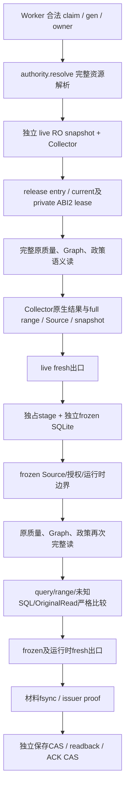

# 原报告整理的材料读取架构改造：有限实现设计

日期：2026-10-12。状态：只读设计，未写 ROOT，未运行 SQL、HTTP、模型、构建或服务动作。此设计没有授予生产成功资格。

## 1. 先给结论

原 ETH `run_a748b561e04166b41b3534b681137d9d` 在 release78 的原样本恢复仍失败。继续增加几个局部 memo 再发布的收益没有证据。本轮应把一次整理中的资源和原生材料读取收口为公开、显式、不可变的合同，再用同一原样本在隔离库证明完整两段读的成本与结果。

可以确定存在重复资源读取和原生结果编码；不能确定 `capture.reader` 的 65.797 秒中，Source、原生 census、JSON Schema、Pydantic、政策重算分别占多少。因此“新合同一定让原 ETH 小于120秒”目前是 **Unknown**。必须在生产发布前消除这个 Unknown，而不能继续用实际生产恢复作性能探针。

保留三件独立的事情：① live 原库完整语义读及捕获；② 独立 frozen 库完整语义读与四类严格比较；③ 保存和确认的独立 writer/CAS/fence。合并的是每段内部对同一不可变字节和结果的重复工作；两个独立语义读不能合成一个结果。

## 2. 原样本证据与预算

实际证据：`E:/project/study/codex/dsh/decision-hub/artifacts/core-goal-20261011/pc78_01/eth-independent-terminal10.json`。本设计读取了其中已有 `subphase_terminal` 和 `actual_native_exit`，没有重新查询生产数据库。

| 项目 | 实际值 | 解释 |
|---|---:|---|
| 原 Run hash | `5fbda03e006d906063ab3df768d8cabd61e8b6cc2f97d65b239f7db01a9a8847` | 不能用新 Run 替代 |
| generation / native PID | 21 / 2968 | 本次原恢复执行 |
| native interval | 23:44:45.860141 → 23:46:46.825426 UTC | native finish/exit/Future done 均已观察到 |
| compute | 120.843 秒 | `compute_budget_exceeded` |
| capture.reader | 65.797 秒 | 包含嵌套工作，不能据此归因一个函数 |
| capture.resolve | 11.328 秒 | 已完整解析和验证资源来源 |
| capture.source_lease enter / exit | 2.281 / 4.938 秒 | 原 ABI2 入口及独立出口 |
| capture.release exit | 3.562 秒 | 完整 archive/installation fresh 出口 |
| replay.reader | 13.531 秒后失败 | 尚未完成的读，不能当完整 replay 耗时 |
| Saved / ACK | 0 / 0 | 受理不是保存成功 |

阶段时间可能重叠，不能直接把表中数字相加。原120秒覆盖 capture 和 replay 的整个 compute，不能把 replay 改归 save 或再获得一个120秒预算。依据 `research_publication_execution.py:172–180`、`research_publication_jobs48.py:2261–2272`。save120 / total270 / lease180 / client45 均保持。

另一个已 Saved 的 ETH scheduled child `run_f4747607befb450e87774d4e6752aa54` 在77单独确认 compute95.422秒、resolve28.500秒、replay.reader30.718秒；它没有新 live capture，且不是相同样本。证据 `.../pc77_01/native-and-subphase01.json`。这些数值不能作为原 a748 的完整 replay 下界或完成证明。

## 3. 现有链路和精确重复位置



下列行号对应 release78 当前 ROOT 文件。细节随改造移动前，实施者必须以随本文封存的源 SHA 核对。

| 重复或边界 | 方法 / 行号 | 已证实的工作 | 可以怎么改 |
|---|---|---|---|
| 资源 resolve 和 capture selection | `research_publication_resources.py:183–301`、`research_publication_runtime48.py:964–985` | resolve 已 `_verified_release_uncached`；capture 再完整同 archive 入口 | 同一次 live 读的显式材料合同可保留其 entry 字节及完整验证结果；最后做独立 fresh 出口，不用新 bool/permit |
| 冻结入口 | runtime48 `690–703` | frozen 新 Session 再 entry 验证 | 独立 Session，不能借 live 的原生/权限/语义结论；可借仍持有且正常注册的 Source 字节身份，不能借任意材料代码 |
| 多个 Source 重读 | stage `74–120,126–146`；frozen_io `123–139,205–227`；resources `622–632,657–681` | stage入口+出口、IO入口+出口、authority.verify 各重新读相同文件 | 一个公开 Source 字节读取所有者处理相同 physical identity 的去重，各组件仍声明自己的逻辑角色，最终独立 fresh 检查 |
| ABI解析重复 | runtime48 `247–316`、capture `967–971`、replay `707–724` | 重建 manifest、JSON index、校验3个 ABI 源 | 同阶段 index/manifest canonical bytes 可一次解析；两阶段 ABI 身份各自检查，3个原 ABI 文件绝不修改 |
| SQL结果和 full range | `publication_dependency_native.py:453–487` | 每个 distinct query 额外 `_result(statement)` + `_result(range_sql)`，重复编码同完整 native cell | scoped immutable result ledger，仅 exact SQL+typed参数可去重；所有业务 SQL 仍真实执行，full range及类型/成员检查保持 |
| census 已有去重 | native `459–462` | 同 query_id 只增 read_count | 不再把这项说成新收益；需查的是不同 query 共享 exact range 或相同 native cell 的成本 |
| snapshot 编解码 | native `532–549`；runtime `1008–1032` | 完整 canonical→json.loads 复制大对象，再最终 canonical 写文件 | 内部 immutable frame保留结构和canonical编码，legacy导出在边界一次；最终完整材料hash仍保留 |
| 私有完整质量读 | history `2056–2216` | selection、Graph、sidecar、全部政策、terminal出口 | 单次 full Graph 已传给 `_retained_policy_materials:1694–1777`，不能声称那里还有第二次 full Graph |
| 原材料回放 | `frozen_publication_material.py:127–183` | full native DDL/typed cells恢复、逐行类型读回、独立RO Session | 必须保持；不能只投喂已知 query 答案或读取 live DB补充 |
| 旧 Saved 读取 | runtime `1047–1151` | 多次 whole material hash、canonical parse、原frozen读、fresh normal出口 | 单个公开只读材料句柄可复用正常已验证的不可变 bytes，并保留 copy与出口独立检查；旧文件和bundle不能改 |

## 4. 新公开合同：数据合同，不是执行权限

新增 `ports/research_publication_material_read.py`。对外只提供不可变描述和显式读取方法；不提供 `verified=True`、`skip_guard`、`allow_current`、私有 token 或 ContextVar 写入口。

```python
@dataclass(frozen=True)
class PublicationMaterialIdentityV2:
    run_id: str
    recipe_ref_json: bytes
    receipt_ref: str
    receipt_sha256: str
    registry_ref: str
    registry_sha256: str
    selected_index_sha256: str
    mode: Literal['current-installation', 'retained-installation']
    # tuples of frozen scalar records; no dict/list/model共享可变子树
    resources: tuple[MaterialResourceV2, ...]

class PublicationMaterialRead(Protocol):
    identity: PublicationMaterialIdentityV2
    def read_registered_source(self, namespace, logical_ref) -> bytes: ...
    def read_declared_data(self, namespace, logical_ref) -> bytes: ...
    def read_release_index(self, namespace) -> ReleaseIndexDataV2: ...
    def require_snapshot(self, session, run_id) -> None: ...
    def consume_live_original(self, callback) -> OriginalPublicationRead: ...
    def consume_frozen_original(self, callback) -> OriginalPublicationRead: ...
```

入口是正常安装源中的 `open_publication_material_read(...)` 工厂。它只接正常 lifecycle 的 server claim、normal registry、受管根和精确已选 recipe；不能接客户端传来的路径、source list 或自称已验证的 DTO。DTO 本身对 save/ACK 没有权限。该工厂完全验证原来源后创建 owner，在同线程/任务/Session/Connection/transaction/SQLite/savepoint内保留不可变字节。明确对象传参，不把当前模块的 `_ACTIVE`、`_VERIFIED_RELEASE_READ` 或 class对象写进历史模块命名空间。

`consume_*` 是 normal callback seam：返回值只能在整个工厂 context成功退出后交给既有 preparer issuer。异常不得返回“部分成功”。Phase live 与 frozen 使用独立的 snapshot owner 和 native ledger；同一个 tuple 原生结果不能跨二者复用。

### Source字节所有者

新增 `application/research_publication_material_read.py` 和 `persistence/publication_material_source_read.py`。以 `(canonical final_path, file identity, bytes, sha256, role)` 为 key。先校验受管根/ancestor/reparse/hardlink/正常安装source位置，读取并hash完整 bytes，再持有 deny-write/delete 的原有 Windows文件机制。字符串bytes不可变；解析后的 index数据使用 tuple/scalar或 canonical bytes，消费者需可变模型时返回新解析值。

入口一次完整验证不是“一次hash后永久相信”：期间每次访问检查 owner/native边界和原持有handle身份；出口打开 fresh path、重新hash完整字节、校验安装receipt/registry/selection/native terminal与入口一致。出口先完成再释放handles，防止读取结果先逃出再发现篡改。异常/换线程/换任务/换Session/COMMIT-BEGIN/Root路径retarget均失效。

Source和授权资源保持不同角色。`read_registered_source` 只从正常注册位置读取代码；material中`.py`仅可作hash/length attestation，不能成为 compile 来源。`read_declared_data` miss 仍失败，没有 Root回退或通配授权。

**ABI3保持的限制**：现有 `research_source_snapshot.py`、其port、`research_graph_binding.py` 三文件原字节不改。current/private两个已有 ABI2 工厂仍独立正常建立；不能给二者塞入共享 `_ACTIVE` 或伪造 lease。新 Source owner只能减少外围重复读取；这两个工厂的自身入口/出口可能仍有剩余成本。不能把“统一 owner”写成“已消除全部 Source校验”。

## 5. 方法级改造清单

### 5.1 `OriginalPublicationResourceAuthority`

新增公开 `open_material_read(session, run_id, normal_binding)`；复用现有 `resolve`所有 receipt/manifest/runtime/lookup-index/注册身份/资源bounds验证，返回 explicit owner与identity。在该context内 `read_source_bytes/read_normal_source` 委托公开Source owner读取不可变**正常**字节，`authorize_frozen`仍对完整sources set/base64/length/hash逐项验证。独立 standalone调用 `resolve/read_normal_source` 保留现有 fresh 语义。

在第一个实现阶段不删除 resolve 当前出口。只有同一对象覆盖到 capture final退出、证明原出口规则全被新的独立fresh出口包含后，才把中间重复fresh读移至外层；每一项原验证规则要在“旧门→新入口/新出口”表中找到归属。没有覆盖证明的门保持原样。

### 5.2 `ManagedFrozenPublicationPreparer.capture_and_prepare`

把 `resolve→capture→frozen_replay→material write` 放进 explicit read合同。`capture.selection`仍读取当前 Session 选定注册并比较 exact tuple，但使用合同的同阶段 `ReleaseIndexDataV2`，不重新调用全部 archive读取。live reader/collector成功退出后才开始 frozen。原 `OriginalPublicationRead`相等比较、物化材料hash、preparer issuer `_issued`、proof对象身份保持。

### 5.3 `FrozenDescriptor` / `frozen_replay`

descriptor持有显式公开read接口。`release_bytes/selected_bytes/current_bytes/current_authorization_read`分别路由到“声明data/正常source/正常授权”，不再多层自发读同 physical file。授权一次 read仍检查logical role和exact_ref。loader仍由正常 sourcebytes编译，shared模块清单保持，unknown descriptor/目录直接拒绝。现有 FrozenIO audit允许集来源不变，unknown open/connect/numeric FD仍拒绝。

frozen Phase独立打开restore生成的 SQLite，重建自己的ABI leases/native collector，重跑完整质量/Graph/政策。读后的4类比较仍为：exact statements+typed参数；projected结果/full ranges/types/member/emptyrange；unresolved/native_changes；replayed OriginalRead与expected。任何一项F不能补成P。

### 5.4 `OwnedPublicationResourceStage` / `FrozenConsumptionIO`

stage获得已经正常认证的 Source bytes，并写独占stage；代码不能取自capture base64。stage数据文件仍逐项size/hash/fsync。仅当一个公开owner覆盖stage生命周期、并在末尾独立校验normalSource和stage全部文件后，取消组件之间同一文件的中间重复hash。原 stage cleanup resolved-root防护保持。

IO只负责deny/audit角色边界，把entry/exit的whole-set字节校验委托显式合同，不能仅把 `require_unchanged`变成空方法。source/staged/runtime/authorization角色disjoint、present/absent、runtime解释器/DLL元信息、unknownSQL检查保持。独立/legacy IO调用仍执行旧full校验。

### 5.5 `NativeCollector`：优先验证的成本候选

新增内部不可变 `NativeResultFrame`/`NativeCellFrame` 和 scoped exact-result ledger。key是 exact SQL bytes + 全部 typed参数 + 当前native snapshot identity，禁止泛化SQL、按table/latest找值或忽略Python类型。

- 业务ORM语句始终真实执行；不通过mock cursor给业务 reader答案。
- 首次 `_result`真实读取全部native列和cell；相同exact census SQL/params再出现时只复用同snapshot的不可变 frame。
- projected结果与range若exact key不同，分别认证；不能看到行数相同就判等。
- `_schema`本来已有缓存，保持。原128MiB计量仍按原语义 charge；即使共享storage，也不能减少charge让超限输入过门。
- 编码后的cell canonical bytes/长度可按exact immutable cell复用，避免重复 `json.dumps`巨型text。`query_id/read_count/native_select_count`仍表示真实业务读取，完整range/membership输出不变。
- Collector已拥有 `report_r1_...` savepoint（native336–349），trace拒绝COMMIT/ROLLBACK/其他非读（358–371），scope结束验证marker（551–579）。新的ledger复用还须要求unresolved为空；退出必要unique result/range fresh读取并全比较，原savepoint与Source出口保留。
- 新ledger只活在一个collector，frozen用新的collector，不能复用live memo。未支持SQL/跨connection/异常都走原失败，无fast fallback吞错误。

### 5.6 解析合并的边界

index/manifest/resource描述/同一个native cell的canonical编码可一次生成。大材料使用immutable frame，避免 `NativeCollector.snapshot`内部整包canonical→json.loads拷贝；r1序列化出口仍产生同字段/同语义，完整hash保留。

不能假称已经解决历史所有模型重复解析。protected binding与已存档的原 JSON Schema/Pydantic reader不调用新decode接口。历史 `binding_contract_base.py` shape memo的32KiB单值门（该文件43–46）使大值不能自动复用；不改历史代码、不抬memo门、不注入验证结论。首次private Graph已被直接交给policy materials，不能用“缺final scope”凭空宣称节省。只有实际调用数/纯解析耗时证明某个新公开consumer等价地消除重复时再实现该consumer，否则保留 original reader并标Unknown。

## 6. 旧 Saved与新材料兼容

先保留 `FrozenPublicationBundleV1`、现有r1 material格式、Saved/ACK表、旧bundle/material/report hash和原as_of，不要求数据库迁移。对旧Saved只能正常打开原文件、完整入口hash、独占copy、独立出口hash、原 reader回放，不能重新生成“等价材料”替换原hash。

第一阶段将内部 frame转换成现有r1外部字段。与现有原consumer比较的是所有语义字段及全native内容；新的读取计量不得冒充旧原材料hash。未来若r1重复结果序列化自身仍构成成本，才单独版本化 material.v2：它用完整native row/cell/query索引去重，reader恢复full ranges并严格比对，而不保存摘要/截断。新增版本需要普通release真实Source注册及旧r1 dispatch，不从data里的schema label获得执行权限。**v2不是本阶段必须发布内容，也不是当前120达标证明。**

原 a748 当前Saved0，因此未来经过合法新key恢复可以产生新的合法材料；原DSH结果、Run、recipe/freeze必须相同。原 f474 已 Saved+ACK1的JSON/bundle/material不改变。

## 7. Failure / fence / CAS

正常issuer proof必须在Source/material/native合同独立出口成功之后才创建。`save_verified:483–533`继续校验preparer对象身份、归档受理、独立prepared CAS/readback；`_confirmed:619–642`继续检验Job/Saved/ACK exact request/gen/hash/time。未知COMMIT依旧fence，不靠新字节owner宣告成功。

预算/stop/source/typed result/row-range任一错误：清空各段ledger并关闭其handles，保留原异常；既有 `PublicationBundleWorker.process_one:2274–2305`记录失败、清理proof、遇fence停止写。不能用 future.cancel 当 native exit，不能仅撤lease后发新claim。真正native finish/exit/Future done字段仍由既有 execution coordinator记录。

公开material合同没有写数据库的方法，没有renew/claim/CAS/token，也不能成为permission-bearing cache。new public lease对象不能传入 `expected_lease_owner` 绕过 fresh writer；writer的180秒lease/独立新连接/ownergen校验原样。

## 8. 候选源范围与可维护性

下面是分阶段上限，不是立即把全部文件作为一个发布批次。原65+3的实际路径清单已对照；以下现有目标均不在原68中。ABI3保持原字节。

| 阶段 | 源 | 具体职责 |
|---|---|---|
| A 新增 | `ports/research_publication_material_read.py` | frozen scalar/tuple描述、显式public read协议 |
| A 新增 | `application/research_publication_material_read.py` | owner lifetime、entry/fresh-exit、snapshot/角色组合 |
| A 新增 | `persistence/publication_material_source_read.py` | 正常Source不可变bytes/handle/path验证 |
| A 改 | `application/research_publication_resources.py` | normal factory和Source读取委托、完整来源门归属 |
| A 改 | `application/research_publication_runtime48.py` | explicit合同贯穿capture/replay、旧Saved正常读 |
| A 改 | `application/research_publication_resource_stage.py` | 托管stage与owner的明确校验职责 |
| A 改 | `application/research_publication_frozen_io48.py` | 保留deny/audit，字节校验委托 |
| A 改 | `application/research_graph_history_versions.py` | 正常公开材料读取seam；旧独立/unknown版本严格fallback |
| B 改 | `persistence/publication_dependency_native.py` | scoped exact result/cell frame、原charge与census语义 |
| B 改 | `persistence/frozen_publication_material.py` | immutable frame恢复接口，原r1/native全校验 |
| B 可能改 | `application/research_publication_frozen_reader.py` | 显式合同传递，保持原完整consumer与compare |

`research_publication_jobs48.py`、bundle lifecycle、API、UI、DB schema、SDK编排和原运行预算不需要为此性能改造改动。若实施时发现必须改，先提出具体调用证据；不能顺势扩大批次。对历史不同Source版本，公开合同只复用bytes，未证明其consumer语义的分支仍旧full reader。

## 9. 真实隔离验收：发布前必须做

本节是待执行程序，设计阶段没有运行。

1. 使用已正常停机生成的物理备份 `.../db78_01/decision_hub-before0092.sqlite3`，备份SHA `f108c9ecf9de079f12a03f9b575f237b179034389e27185fe36804605d69df14`。原a748 Run/DSH结果/冻结引用保持；以新隔离目录readonly打开，SQLite完整原像和Source receipt均校验。原生产claim不复制成有效执行许可，不向生产提交恢复。
2. 普通隔离producer入口调用同完整capture与frozen路径，使用相同120/120/270/资源/Native bounds。baseline和candidate分别独立RO/native/Source scope。只读case不能claim产品Saved/ACK P。
3. 利用既有observer的capture/replay时钟，加**有限方法级**纯计数：actual managed file opens/bytes、exact `_result` calls/canonical bytes、shape/full model调用数与累计耗时。只在隔离，不能扩全局profiling，也不能按stage重叠时间相加。若无法让计数不改原consumer结果，计数放独立harness，Unknown保持。
4. 完整比较baseline/candidate：四类query/range、所有typed cells/schema/index/primary identity/empty-range、unresolved0/native_changes0、完整 `OriginalPublicationRead`（含31报告字段），不是摘要相等。每个public seam额外做篡改/边界负控。
5. 小规模足够的3个正常消费条件：原a748完整闭环；已Saved的f474 r1原文件确认；一个正常current安装样本。不能用成功的f474替换a748。必须完整完成capture+replay+fresh退出+issuer准备，不能把checkpoint提前结束当节省。
6. 生产候选达标条件：同原a748在既有120 compute内完成，并有至少10秒明确余量；save与total保持原门。10秒是部署前稳定性要求，不是提高原业务门。冷Source和普通既有并发下各完整通过一次已足够；不要求100轮昂贵完整研究。
7. Root独审 Source exact差异、原68/ABI3、旧Saved兼容与全部负控后，才合并一次正常发布。原a748必须fresh当前head+新合法key**一次**恢复，随后独立真实Saved1/ACK1/nativeexit/原报告JSON与刷新/下载验证。原accepted旧key不重消耗。

### 有效负控（只隔离）

- 同长Source替换、ancestor/reparse/hardlink/path重定向、registry/selected index变化；entry/使用中/fresh exit三时点拒绝。
- 错namespace/role、material.py冒充正常source、未知authorization ref、unknown numericFD/SQLite/connect，仍拒绝且记录首个原原因。
- SQL typed参数`1`与`'1'`、新增/删除range成员、空range变非空、列affinity/DDL/primary key变化、合法排序或limit差异；cache不能合并。
- 同一Session里的原生COMMIT/BEGIN、换线程/任务/Connection/collector、write/flush、篡改公开返回可变对象、过资源和native界限；没有共享mutable verdict。
- claim/generation变更、source在准备后变化、unknown COMMIT、archive fence、独立ACK缺失；不写fakeSaved，不返回available。
- 原r1报告/material文件1字节变化和legacy未知Sourceconsumer，保留strict旧门。

## 10. 小步实施与明确终止条件

| 步骤 | 产物 | 完成门 | 停止条件 |
|---|---|---|---|
| 0 成本归因 | 原a748隔离full两段时序+method计数、旧门归属表 | 明确candidate能省哪类工作、预计完整成本 | 看不到distinct重复、单独不可合并语义成本已≥120、或者原备份缺依赖：停止，不发布 |
| 1 Public owner/Source合同 | A最小source seam+Source负控 | 完整入口/独立fresh出口、原reader结果全等、保护文件不变 | 必须私ContextVar/假lease/Root补读/修改ABI3才能实现：停止该路径 |
| 2 Native/result编码去重 | B有限native ledger、r1完整语义导出 | 原计量门保持、四类全等、负控通过 | 只在fixture快、原a748完整两段仍超120或无10秒余量：不发布 |
| 3 旧Saved兼容 | f474原r1/hash/ACK保持 | 不重写原材料、只正常明确新请求 | 欲迁移旧Saved来掩盖reader失败：停止 |
| 4 一次合并真实发布/原恢复 | 单次build/start/原a748法定恢复 | Saved1+ACK1+nativeexit+PC实际全文/JSON/MD/刷新 | 原a748再F：本路线生产尝试结束，保留F，转评估而非再补微缓存发版 |

若完成Source与census的真实去重后，原历史语义原读自身依旧无法满足120，则应报告“当前预算+必须重跑此历史原consumer的要求在本环境未证明可同时满足”。需要重新评估整个历史语义验证实现及可验证等价性，或由产品明确调整计算合同；工程不能擅改预算、删校验或宣告交付。

## 11. 本设计仍未证明的点

- a748的完整冻结replay成本、65.797秒CPU分布、exact range实际重复率、Source合同具体可省的完整成本。
- 公共owner覆盖全部旧版本consumer的可行性；未知版本必须保留原严格路径。
- Native ledger是否足以保留10秒余量；r1整包最终序列化是否仍成为瓶颈。
- 新contract本身的独立fresh出口成本；不能只统计入口收益。
- 金融内容预测能力、宏观缺口、G1/G4/PC性能门；本文仅解决已识别的整理核心技术瓶颈。

本设计的价值是给出可否定的实现路线和有限发布门，不是把未实测的结构改造写成完成。
