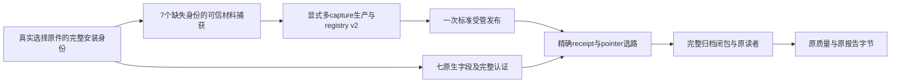

# 历史报告版本留存与精确安装选路设计

状态：46已正式安装3份源码/测试（1生产文件），migration0/restore0、schema0090；标准UI1/Host1构建P，validated SHA75e0be98…。两既有模型资格一次156.687秒published_confirmed，原180秒门内完成、未重拟/自动重试；独立原生只读2.515秒核对两资格及首次confirmed事件version1，明确serving配置已生成。结果协议一次18.016秒登记P，独立0.141秒精确核对protocol/acceptance/48机会并准备独立授权；窗口2026-10-10 UTC00:00–23:00，原28日不变。Ready46_03在2026-10-10 00:00:09.901155 UTC三200/七fresh在线P；首两次warming F保留，连续健康未证。实际PC首小时刷新2/48按时、46等待、unconfirmed0；首UTC00:00双资产14条原生、90秒、独立ACK及按时publication已核P，后续23小时/成熟标签待，不手动回填。45b旧ETH39正文/原字节浏览器附件恢复P仅为历史验收；quality30.641秒性能F。00:00首个自然双资产原生记录、90秒、独立ACK与按时publication已核P；≤0.5秒持锁/成熟评价未证，详见当前一页纸。自动研究恢复、报告R2完整材料闭包/正式确认、全PC及金融效果未过；全产品/全按钮/金融false。46沿用受管完整安装留存gate；45b838Runs/122native/8capture为历史已证集合，其余旧报告未全部实际打开。新构建的精确集合以46覆盖回执为准；原39严格校验不放宽。

## 1. 实际问题和证据范围

44旧ETH39质量GET409/2.484秒；独立只读首因是`research_graph_recipe_v3_selection_changed`，native_changes=[0]。saved recipe b154…未注册，且与当前1d024…不同。原报告仍是已保存的历史报告，不能换用当前recipe重新解释其原件。

| 盘点 | 实际结果 | 能证明什么 |
|---|---|---|
| 正式库选择原件 | 837个Run范围内44条V3选择；schema0090、changes0、HTTP/模型0 | 本次真实选择集合；不等于837份报告全部存在或可读 |
| 选择与留存目录比对 | 34 exact、8 unregistered、2 installation mismatch | 10条选择涉及7个缺失精确安装身份；单捕获39不足 |
| 唯一身份 | 17 exact、6 unregistered、1 mismatch，共24身份 | 相同graph可以有不同安装回执/指针 |
| 静态比对边界 | 只重核release index；archive_sources_revalidated=false | 比对任务完成不等于归档源码闭包或真实读者验收通过 |

真实盘点：[selection-inventory45_01.json](../../../artifacts/market-risk-implementation-20261007/B2/release45/selection-inventory45_01.json)，SHA `aa1c0e23119fed6a9fe0a513b464032d8783b1f4f5fbdc34854e9de849c8647f`。静态比对：DEV `B2/retention-v3-coverage45/inventory-match45_01.json`，SHA `5afe9c9d72ef805009b3186ec019ce16a5bc81790a1520f53294b1ac3d46601e`。

| 缺失精确安装 | 选择数 | 当前结果 |
|---|---:|---|
| 03 | 2 | graph 07f5…已有归档绑定04；receipt/pointer不匹配03 |
| 34 | 2 | graph eb387…未注册 |
| 35 | 1 | graph 85e4…未注册，与36b相同graph但安装引用不同 |
| 36b | 1 | graph 85e4…未注册 |
| 37b | 1 | graph 8e673…未注册，与38相同graph但安装引用不同 |
| 38 | 1 | graph 8e673…未注册 |
| 39 | 2 | graph b154…未注册；单份真实capture已生成，仍待全覆盖组合 |

03/34/35/36b/37b/38/39原身份的完整ref/hash以盘点原件为准，不根据简称补值。首份[capture39-preparation.json](../../../artifacts/market-risk-implementation-20261007/B2/release45/capture39-preparation.json)、首次组合`combined-source-seal45_01.json`和44/45错误原件保留，不用新结果覆盖旧候选或失败。

## 2. 为什么需要同时改生产与消费

现生产registry.v1以graph唯一、directory=graph合并；消费也按graph取首个registration。完整安装回执与已安装指针是原V3选择的一部分：同graph下03/04、35/36b、37b/38不能互相代表。只加39目录或只改运行时，无法让另6个缺失身份得到可信材料与无歧义选路。



## 3. Registry v2与目录合同

顶层仍只有`schema_version`、`registrations`，新版schema为`research-retained-recipe-registry.v2`。每行仍只有原五字段：`directory/index_hash/graph_hash/selector_hash/private_original_orm`，不增加替代原身份的简化字段。

- 所有既有v1/builtin注册及原目录、index、guard保持；v1继续按原合同读取，不能迁名重写旧归档。
- v2按directory唯一，注册行排序固定为`(graph_hash,directory)`；允许同graph的不同安装身份。
- 新V3目录是下述对象严格canonical UTF-8字节的SHA256，**不含结尾LF**。字段排序、紧凑分隔、禁止非有限值；完整ref须严格合法，不裁成仅SHA或仅文件名。

```json
{
  "schema_version": "retained-v3-installation-key.v1",
  "graph_hash": "<完整graph SHA256>",
  "installation_receipt": {"path": "<原Root-relative path>", "sha256": "<原SHA256>"},
  "installed_pointer": {"path": "<原Root-relative path>", "sha256": "<原SHA256>"}
}
```

目录键的无LF编码和registry/其他既有材料的编码分别按各自合同执行，不能全局改canonical导致旧hash失效。index自身完整SHA、manifest、原安装binding、source-map/provenance与reader/runtime资格仍全核。不同目录不得制造两个同时匹配同一精确身份的可用候选。

## 4. Runtime精确选路

`research_graph_history_versions.py`先从同一真实只读会话读取七个SQLite原生字段：`output_id/run_id/role/schema_version/payload_json/payload_hash/created_at`；不让ORM时间转换或刷新改变原值。

1. 同run、role=`graph_recipe_selection`只能有一条；严格原生类型与合法版本，保存时间原文保持。缺失、重复、非法输入不能被“取第一条”掩盖。
2. 核完整payload UTF-8 SHA、严格schema/canonical原字节、payload run与请求run、output身份、recipe版本、manifest完整hash与dependency hash。不能以部分字段或反序列化后的近似对象证明原件完整。
3. V3取完整`installation_receipt`和`installed_pointer`，按graph找到候选，核各候选release index SHA/受管来源、manifest与目录身份；然后按**两个完整ref同时相等**选择。
4. 只能有一个精确匹配。无匹配/歧义/错误index、binding或目录均拒绝；不能替换为当前安装、同graph另一安装或latest。既有v1/V2选择保留自己的有限分派语义。
5. 被选原读者执行前后仍核完整归档源码/schema/运行时/安装/provenance闭包以及物理会话边界；只有原序列化结果离开私有命名空间，不授予旧代码研究执行资格。

原2MiB单资源、32MiB归档和source/math/运行时guard均保持；不裁材料、删除失败/反方/unknown、跳过出口核验或扩大大小门来换兼容成功。该修复不重评旧报告、不提升方向/路径/执行资格，也不解决完整质量读取22–45秒的性能门。

## 5. Producer显式多capture输入

保留现有单capture参数组合；同一显式preparation入口可以接收以下封闭wrapper。用户日常界面不填写这些维护参数，不从latest目录自动发现材料。

```json
{
  "schema_version": "product-retained-v3-capture-set.v1",
  "captures": [
    {
      "preparation": {"path": "artifacts/.../captures/39/preparation.json", "sha256": "<完整SHA256>"},
      "source_root": "artifacts/.../captures/39/source"
    }
  ]
}
```

上例仅表示形状，不是可用配置。outer preparation、其SHA及outer source root显式提供；成员path/source_root均为Root-relative并落在outer source root内，拒绝绝对路径、逃逸、reparse/软链接及自引用。wrapper只有两顶层字段，成员只有`preparation/source_root`，preparation ref只有`path/sha256`；不允许嵌套wrapper。

每个成员分别完整核preparation SHA、原安装身份、capture源码/provenance/index及已有单capture合同；先记录所有成员的精确ref，合并前全核，准备/安装出口再次核原输入。重复成员/安装目录、同directory不同row、逻辑资源同path不同字节及歧义身份拒绝，不能静默跳过成员。所有v1注册原样进入并集，完整相同的已有材料只能按原幂等规则复用，不产生第二个可匹配身份。

set的成员/总材料观察上限单列记录，不能替代或放宽任何单capture的2MiB/32MiB门。失败立即保留精确成员/ref及原错误；不提交缺成员的部分覆盖版本。现有single flag的成功/拒绝语义与显式SHA绑定保持。

## 6. 模块分工和真实材料

表内`application/`指`packages/kernel/decision_hub_kernel/application/`。

| 模块 | 具体工作 | 验收材料 |
|---|---|---|
| `application/research_recipe_archive.py` | 接受/保留v1和v2；新V3安装键目录、完整release index/closure及注册并集 | 同graph不同安装共存；旧v1逐行/逐字节保持；冲突/超限拒绝 |
| `infra/dsh/prepare-product-retention.py` | wrapper解析、成员Root/outer边界、每份完整核验、冲突拒绝、入口/出口再验及覆盖盘点 | 每个capture ref/hash/源根、全覆盖结果、失败原因和零业务写入 |
| `application/research_graph_history_versions.py` | 七原生字段认证、完整ref精确选路、唯一匹配、完整原读者边界 | 原字段/refs篡改、同graph错安装、重复/歧义拒绝；旧协议兼容 |
| `infra/dsh/build-product.ps1`既有入口 | 将显式single/set材料送入标准retention；原受管安装、源码回执和guard保持 | 一次标准UI/Host构建、来源版本/实际安装与Ready原件 |
| Root真实材料准备 | 从已认证旧回执、指针和原source/provenance补齐7身份；封存set及完整原件 | 44条选择全部exact；原39报告及失败记录不改 |
| 文档/PC | 当前版本、有限核验、具体兼容原因、实际原报告/附件截图 | MR15–19/28/31–33状态与回执；用户无需重写旧研究 |

不是复制任意旧目录就得到可信capture。原source/receipt/pointer不可认证仍记录该身份HOLD，不造安装或用当前文件补齐。设计初稿时只有单39capture、首组合不能覆盖；当前45b8capture已在标准构建通过冻结集合精确覆盖，受管原件门未放宽，详见首段；DEV或私控仍不能替代真实材料/部署。

## 7. 有限执行顺序与交付门

| 门 | 做什么 | P或停止条件 |
|---|---|---|
| V01 真实材料 | 一次按盘点44条/24身份补7缺失身份的完整capture，构成显式set | 所有成员完整认证；缺真实来源即HOLD，保留单39与首候选 |
| V02 必要控制 | 仅针对七原生字段、同graph多安装、v1并存、完整ref/目录/index/closure、成员路径/冲突/出口漂移 | 各篡改/歧义/越界/超限拒绝；无新业务写入，不借私测宣称真实成功 |
| V03 全覆盖预检 | 用正式选择原件重盘点并逐条核full release/closure/精确安装 | 原44全部exact，unregistered=0/mismatch=0；所有旧v1/builtin保留。新增选择列入新盘点，不悄悄换分母 |
| V04 一次正式发布 | 必要控制与真实材料门通过后，精确晋升→一次标准build/start | 新receipt/registry版本及源SHA、Ready与schema一致；未通过不沿用44 Ready |
| V05 实际用户结果 | 旧ETH39同Run quality/report/download及PC，兼容旧BTC/其余具名旧读者；另验新Run | HTTP200、原39报告308477B/SHA f3c162…及原review/Gate/unknown一致；没有报告的旧失败不补认成功 |

V05旧ETH完整Run为`run_dbce68caf06e41f799c5a2b5a6d1c8ce`，原报告SHA `f3c1629fd171f4b21e03afcfb6829515325d91cb4c051dfdb1644bff6211c523`。原方向/路径/执行blocked、总用量unknown保持；返回409再快也不算恢复或性能通过。实际quality/download耗时照实记录，后续[报告服务R1–R5](REPORT_SERVING_REDESIGN.md)另验。

## 8. 状态留存与结束条件

每步保存输入/输出SHA、source seal、原件、版本、pass/fail/unknown与首因；44真实失败、45首次HOLD候选和单39capture不覆盖。新增目录/注册只通过受管流程追加，回退到明确旧版本读取时保留新材料及失败；不能拿“回滚”绕过精确身份或改旧Run选择。

本次设计producer/runtime已随45b受管实现并恢复同ETH39真实原件，当前执行按[一页纸](CURRENT_FOCUS.md)接续原八层33项。覆盖gate/同一旧报告P不代替性能、真实模型资格/自然小时/48评价、新Run与全PC；整体产品、全按钮及金融有效性仍未通过。
