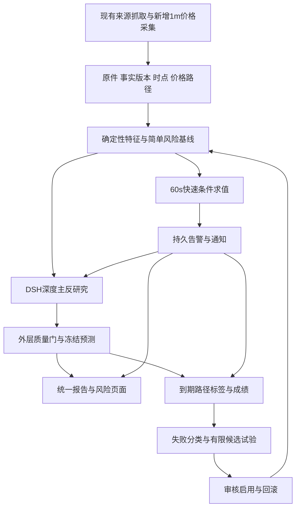

# 分层技术设计与可行性

2026-10-13跨资产审查与最新实施顺序见[多资产核心方案](CROSS_ASSET_CORE_PLAN_2026-10-13.md)：八层能力现状、共享宏观/资产专属边界、日历与目标V2、官方GitHub复用、P0–P5及有限验收。下方历次发布记录保留原文，不作为当前状态。

当前代码、数据库、API、PC动作与逐项执行门的对应见[架构与交付验收](CURRENT_ARCHITECTURE_AND_DELIVERY.md)；最新真实结果以[当前任务](CURRENT_FOCUS.md)为准。


## 当前执行入口

最新实现、实际失败与下一有限动作只看[当前一页纸](CURRENT_FOCUS.md)、[交付状态](CURRENT_DELIVERY_STATUS.md)和[原33项清单](IMPLEMENTATION_CHECKLIST.md)。源码候选、正式安装、具名有限验收和金融效果分别判断。

[机器协议](execution-contract.json)是冻结协议依据，**不是运行完成证据**；原8机器协议键、28日窗口和原验收门保持，真实完成状态由具名回执及当前交付文档说明。

[替换前完整原文](../../../artifacts/market-risk-implementation-20261007/B2/release47/technical-before-current47_03/root/docs/design/market-risk-v1/TECHNICAL_DESIGN.md)逐字节保存此前46阶段状态、首次失败及旧未验证声明；其后历史记录与八层技术设计正文不改，不作为当前版本状态。

## 31及以前的历史发布记录


当前正式31的真实BTC已保存artifact，但Run终态degraded。14证据/10工具、4主链/1反链/30m24h72h及1审查原件可见；六GET首验quality/context各45s超时，download200/26.782s/314402B，详情/过程/效果200。PC随后自然读出质量：事实/上下文complete，五挑战未解决、报告untrusted、用量与费用unknown。下载SHA等于PC可见发布报告hash；这不替代首超时或完整报告资格。24h建议复查早于研究、英文属性/长小数和重复缺口已记录。ETH未提交；完整产品和金融效果未通过。当前步骤只以[一页纸](CURRENT_FOCUS.md)/[机器状态](execution-contract.json)为准。


上一版29b已标准构建/启动，以下为保留的历史真实验收。BTC一次PC请求经自动Host活动核对已准入，真实模型交付12条证据、主反链和30m/24h/72h正文，Run终态degraded，产品标为research_only。六GET首验中quality/context各45s超时，download200/44.125s；模型空闲后单独context200/25.344s，认证覆盖仍不完整。自动30m复查已触发但初始BEGIN IMMEDIATE锁冲突失败；ETH尚未提交。目标active，完整产品及金融效果未通过。


新研究下一步按BTC终态后ETH逐项验；K04独立接线仍未正式。当前步骤见[一页纸](CURRENT_FOCUS.md)/[机器状态](execution-contract.json)。


## 1. 当前基础与设计决定


现有Python/FastAPI、SQLAlchemy/Alembic、LangGraph、DSH、React/Zod和ECharts可以承载首轮方案。使用现有Hub作为业务真相、现有Worker作为调度执行者、DSH作为模型工具会话执行者，不因分层新增一个进程或引入第二套任务平台。


### 已核实的代码对应


| 层 | 当前代码与对象 | 具体增量 |

|---|---|---|

| L1获取 | `SourceIngestionService`、`SourceAcquisitionService`；`source_poll_attempts`、来源回执 | 采集分钟价格路径；来源能力和失败投影；高频取数与深度研究解耦 |

| L2时点 | `FactLineageStore`、`macro_event.py`；`raw_captures`、`parsed_versions`、`fact_versions`、`run_input_refs`、`macro_event_vintages` | 修正宏观日期含义；新增独立价格序列和一致的available/known合同 |

| L3状态/风险 | `daily_strategy.py`、`OKXPublicMarketAdapter`、`AnalyticalObservationService` | 完整路径、滚动状态、确定性计算、独立风险预测/观察合同 |

| L4AI研究 | `agentic_research_graph.py`、`assess_research_loop`函数、`ContextSelectionService`、DSH adapters | 分项质量门、关键挑战处理、保护证据槽、新机制提案 |

| L5监控 | `ReviewScheduleService`、`NotificationDispatcher`、`review_schedules`、`outbox` | 条件求值、监控状态、告警关联、恢复和可见回执 |

| L6产品 | `ResearchQueryService.home`、`ResearchPage.tsx`、`ProductPages.tsx`、现有事实/事件API | 多资产风险DTO、首屏、路径/事件/观点叠加与完整报告 |

| L7评价 | analytical observation/assessment、authenticated evaluator、prospective结构 | 路径/报警协议、指标分母、成对影子观察、负结果结束 |

| L8经验/扩展 | `ExperienceRecord`、research library、context/evolution、market scope | 类型化案例和失败路由、检索评估、版本准入与回滚 |


来源对应详见本轮[风险设计审查](../../../artifacts/value-implementation-design-20261007/risk-evaluation-design.md)、[编排与监控设计审查](../../../artifacts/value-implementation-design-20261007/runtime-monitor-design.md)。这些是有限静态设计，不是运行验收。


### 整体流程





## 2. L1 信息获取：复用采集基础，补完整路径


### 当前事实


`source_ingest.py:88`拥有poll→validate→admission→持久Run→cursor语义；已有record-only与不启动研究的准入记录。因此每分钟数据可入账，毋须每分钟启动完整AI研究。


`OKXPublicMarketAdapter.quote()`返回ticker实际时点；`window()`只取起止两根1m收盘并标estimated。新增完整路径接口，保留旧window返回语义，避免改变既有观察成绩。


### 新增接口提案


```python

class MarketPathPort(Protocol):

    async def candles(self, *, instrument, venue, price_type,

                      start_at, end_at, interval, cursor=None) -> CandlePage: ...

```


`CandlePage`包含provider、scope、bar开闭时间、OHLCV、confirm、provider时间、received_at、next_cursor、raw_capture_refs、adapter_version。只接受有限正数、OHLC一致、closed bar；价格类型为trade/mark/index，不混用。


实现位置提案：`packages/provider_adapters/market/okx_path.py`；端口补于kernel ports中的独立文件。继续使用`CapturingAsyncClient`保留原始回执。按供应商游标方向分页，统一排序与去重，重复页或游标不推进立即终止并报错；失败重试尊重Retry-After，不重拉已有完整范围。


### 默认采集计划与能力清单


| 来源 | 首轮用途与频率 | 首轮能力边界 | 升级方法 |

|---|---|---|---|

| BTC/ETH spot完整1m价格 | 60s取新增closed bars，回补最多最近24h | 单交易场所交易价风险观察；非真实成交或全市场价格保证 | 新适配器采用相同接口；先影子对照再改主来源 |

| 既有衍生品与日线 | 深度研究时获取，独立合约与venue | 已有路由能力；本轮未核实实时可用率 | 显式字段/单位/delay contract与跨所对照 |

| FRED当前序列 | 日级背景，按来源发布节奏 | 当前CSV是当前可见历史；不能伪装历史vintage | 有key时接官方vintage；未知首发分钟则不用作分钟事前特征 |

| 官方新闻/日历 | 复用现有poll与关键事件准入 | 文本、事件及修订账本已有 | 每个parser保持版本、字段空值和原件；加源不改研究流程 |

| intraday macro/expectation | 接通探针后才纳入正式门 | 当前类存在；无endpoint会明确provider_unconfigured，非现成全球实时数据 | 配置许可和delay，经canary后通过原能力路由 |

| 黄金 | 后续单独定义XAU spot或指定期货 | 不借跨资产GC输入宣布黄金研究可用 | 新MarketSpec、日历、源与标签准入 |


OKX官方文档原件及历史candles/closed参数已核：当前history-candles声明最大300/默认100、IP每2秒20请求，after返回早于ts的记录；[API附录05及完整HTML SHA](../../../artifacts/market-risk-implementation-20261007/B2/history-training-api-check21/HISTORY_TRAINING_API_ADDENDUM05.md)保留精确章节。这只确认官方参数，不证明本案90日连续原件已经取得。[官方接口](https://app.okx.com/docs-v5/en/#order-book-trading-market-data-get-candlesticks-history)。此句对应设计初稿；现已取得F1真实路径原件及B1连续槽位，03两资产摘要1440/1440，正式证据见清单。


### 失败和升级


主来源断开时显示stale/unknown；切换来源生成新的basis版本并记录原因。不同USD/USDT、spot/swap、trade/mark的序列不能直接拼接。若需要连续可比序列，先有预登记换算或分段合同。


独立验收：A01–A05。采集版本升级重放已保存raw body；同输入语义不变或有显式新版本，未来特征自动绑定新parser/adapter hash，历史不重写。


## 3. L2 事实、时点与数据增强


### 已存在与具体风险


`FactLineageStore.bind_facts():182–187`以收到/接受时间的最大值保存known_at；查询同时检查known_at、observed_at≤as_of。这项保护必须保留。


审查时旧`FredSeriesResearchAdapter`曾把CSV的observation_date赋给published_at。MR05现已修正当前适配器；03也能以原件认证读取旧FRED作为描述性背景，不改旧记录，将其公开时点/vintage保持未知。观测所属日期不能证明当时可得，也不据此宣称所有旧Run发生泄漏。


### 时间合同提案


每个材料保留：`event_at/observation_period`、`published_at`、`public_time_precision`、`revision_at`、`received_at`、`accepted_at/known_at`、`recorded_at`、`effective_at`。引用已有事实版本；新材料的公开时间与精度可先作为新版本字段存入attributes，正式合同再生成Py/TS类型。


历史公开信息模拟和真实系统前瞻分开：


- **系统前瞻输入**：系统实际known_at≤cutoff，实际收到的版本与原件明确。

- **历史公开信息诊断**：public_available upper bound≤cutoff，版本确为当时公开版本；不能回填伪造系统known_at。

- 日期精度不足的材料不能在同日分钟cutoff中当成已知；只有核实来源时区与发布日界的上界后才允许保守纳入。否则保留日级背景或排除。


FRED/ALFRED官方区分观测值与real-time period，默认查询体现今天所知历史；历史vintage应显式请求。[官方时间语义](https://fred.stlouisfed.org/docs/api/fred/realtime_period.html)、[observations接口](https://fred.stlouisfed.org/docs/api/fred/series_observations.html)。vintage日精度不自动提供秒级公开时点。


### 存储方案提案


- 现有原件/解析/事实/Run输入表继续使用。

- 新增`market_candles`，唯一键`venue,instrument,price_type,interval,open_at,revision_hash`，另有按scope/time查询索引。closed路径保存全部所需bar；修订追加版本。

- `feature_snapshot`首轮保存为不可变归档JSON，evaluation/prediction引用ref/hash，包含每项状态、source版本、cutoff及公共可得/系统可得模式。独立`feature_snapshots`索引表作为后续可选投影，只有重复查询成本或性能门需要时才建；不复制第二份业务真相。

- 数值表采用Decimal可往返序列化或规范十进制字符串；计算接口明确精度，避免NaN/Infinity。

- raw body保留文件archive并以hash关联；数值SQLite适用于首轮小规模，数据量增大前测事务和读延迟再决定独立历史库，不先迁Postgres。


首轮两资产约105万bar/年（每资产525,600），以每资产一个venue/price_type为前提；每加一个独立venue或price_type再增加对应序列。实际数据库/索引/原件大小须测，不能用行数当内存估计。首轮只回补必要历史；留存与冷归档配置化，不能删除已经用于预测或评估的输入原件。


### 具体增强顺序


1. 修当前日期含义；显示观测期、发布时间未知和实际采集时点。

2. 完整closed路径及输入manifest。

3. 宏观level/change与事件actual/consensus/prior分开；无consensus不算surprise。

4. 再增加政策预期、流动性和资金流等独立来源，要求有公开时点及版本。


验收A02–A06。原件、版本及旧Run保持；缺历史vintage的资料可以辅助解释，不能计入严格历史预测成绩。


## 4. L3 市场状态与数值风险


### 实现模块与输入


新增提案：`application/market_features.py`生成feature_snapshot；`decision/path_risk.py`做纯函数；`application/risk_path_observation.py`处理成熟观察。旧daily trend和analytical方向成绩保持。


首轮固定特征：1m log return、30m/24h return、实现波动、成交变化、价差（有bid/ask时）、数据缺口和新事件标记。日/周趋势作为背景；宏观变化使用实际时点可得的序列。每项指标字段记录lookback、min_points、unit、input_refs和status，不让LLM临时选指标重算。


| 特征 | 固定计算提案 | 数据不足/边界 |

|---|---|---|

| log return | `r_i=ln(C_i/C_(i-1))` | 30个收益需31个连续closed close；缺任一段unknown |

| 30m return | `C(t)/C(t−30m)−1`，两端均closed close | 明确两个close时间，不能以24h ticker字段替代 |

| 30m实现波动 | `sqrt(sum(r_i²))`，非年化 | 不当方向指标；窗口/分辨率随版本固定 |

| bid/ask spread | `(ask−bid)/((ask+bid)/2)` | 缺报价、bid>ask或过期unknown；venue固定 |

| 成交变化 | 当前30m总volume/此前24h完整30m区间volume中位数−1 | 单位固定；分母0或缺区间unknown，不用另资产代替 |

| 宏观change | 同来源/序列/单位最新可得值−前一可得值 | 两版本/观察期/公开时点都保留；不是分钟实时变化 |

| surprise | `actual−consensus`，可选训练期标准化 | 缺共识或日期/单位不符unknown；prior不能冒充consensus |


最小风险基线`BASE_EMPIRICAL_V1`为历史完整非重叠24h MAE的经验分位与越界频率，实验平滑`p=(k+0.5)/(n+1)`，n/k和时间范围公开。首个候选`COND_VOL_V1`仅按cutoff前30m实现波动分低/高两状态，分界为训练期中位数，比较各状态MAE分布；每组不足30完整历史窗口则候选unknown。训练/分界冻结，新资料或更复杂模型须另注册，平滑和分组本身不产生calibrated资格。


宏观与资产结构增强有独立候选路线，避免长期只研究分钟噪声；一次只运行其中一个注册试验：


| 候选 | 机制与实际输入 | 具体实现/数据门 | 增量裁决 |

|---|---|---|---|

| `MACRO_STATE_V1` | 美元、实际利率、政策预期变化是否改变24h尾部条件；观测频率按来源 | 固定1/5发布期change与level/quality；先离线正则条件模型或预登记分组，单资产参数独立，输入上限/拟合方法通过F5确定后冻结；没vintage不做严格历史PIT资格 | 相同vol基线+宏观的feature ablation，Q02–04；因果权重不能由相关系数命名 |

| `CROWDING_V1` | 多所funding/OI/basis分歧与流动性是否放大长/短尾部 | 同合约/单位OI变化、资金费率周期换算、基差/深度；多所缺件unknown，trade/mark分开；来源路由逐个准入 | 同cutoff新增结构特征，与宏观/vol既定基线配对；计入数据延迟与维护成本 |

| `EVENT_SURPRISE_V1` | 官方事件预期差和仓位背景是否改变状态 | actual/consensus/prior及首次公开区间、公告前后feature快照；无共识不编surprise。DSH提机制，typed parser与数值模块计特征 | 公告前脆弱性与公告后反应分别评分，正常事件对照，单次暴涨不晋级 |


上表后续拟合细节受真实数据与F5功效结果约束，是有明确输入/裁决的研究候选，当前没有算法已定/效果已证。首轮纯计算与条件基线可直接实现，高级模型要在注册前交付完整参数manifest和可重复训练入口。


### 路径合同提案


`RiskPredictionV1`绑定scope、venue、price_type、cutoff、published_at、anchor_policy/可空anchor_price、horizon、模型版本、feature hash、long/short MAE概率或分位、calibration_status、限制和缺口。无合格模型时概率/区间为null，仍可发布确定的行情变化和监控状态。


`RiskPathObservationV1`保存完整范围、terminal_return、MAE_long、MAE_short、MDD_close、首次穿越区间、missing_ranges、quality、observer_version和raw refs。MDD_close只用有先后顺序的收盘序列，是更细价格路径回撤的下界型观测；同bar无序high/low不能生成单一精确MDD。未来OHLC上下界算法须新版本。price basis必须与预测一致。


新增持久表提案：`risk_predictions`保存不可变prediction/hash，唯一scope/method/cutoff/horizon/target_version；`risk_path_jobs`保存成熟范围、分页checkpoint、next_attempt、lease_owner/generation/expires与状态；`risk_path_observations`按window/price_type/calculator/path_hash固定标签；`risk_evaluation_reports`保存trial/protocol、配对manifest、各指标分母/CI及资格。多方法共享同一认证路径标签。旧analytical表不改字段含义。


### 首尾、缺口与精度


新预测事先声明window_start≥published_at及`anchor_policy=scheduled_bar_open`；实际锚点只能取事前指定window_start对应bar的open，明确`anchor_delay_ms`。首bar缺失则anchor未知，回补只能追加该指定bar回执，不能选后一个可得bar移动起点。原预测中的anchor_price在尚不可得时为null，实际价格追加在不可变AnchorReceipt/RiskPathObservationV1，不能回写预测或把未来open倒灌特征。模型特征cutoff与发布延迟单独显示。若有同期可靠ticker可另用明确ticker锚点，但须声明该bar的OHLC是否覆盖锚点前价格。禁止把包含发布前价格的整分钟high/low纳入发布后MAE。窗口起止和锚点政策在发布时固定，不能择取后来有利的起点。


对初始长仓：`MAE_long=max(0,1-min(low)/P_anchor)`；短仓：`MAE_short=max(0,max(high)/P_anchor-1)`。终点收益单独算。首次穿越只定位到1m区间，不能宣称精确到秒；同bar内多个条件的先后无法确定时标ambiguous。


缺bar时MAE只能是observed_lower_bound，不能标完整通过；回补成熟后可追加新观察版本，旧评分保留原版本。未到期pending，不填写未来标签。


### 模型可行性与递进


V1先实现无需额外科学计算框架的数值特征和经验风险基线。概率资格不足时只做事实变化提醒，数值不伪造。条件分位/动态波动候选放在离线model插件中，必要时引入锁定依赖并生成独立模型manifest；不把拟合放进每次LLM调用。


训练参数与阈值冻结；滚动时间外验证，重叠窗口隔离；每次只有一个主基线和一个候选。高级状态/尾部模型的前提是更简单候选已有可信评估和足够尾部样本。


升级接口：`predict(feature_snapshot, model_manifest)->RiskPredictionV1`；observer接口不变。模型新版本先shadow，审核后改active pointer，历史预测不重算覆盖。验收A07–A10与Q01–Q04。


## 5. L4 AI研究与质量仲裁


### 当前可复用与修改位置


保留DSH模型/工具执行和外层Graph。新增提案`QualityDecisionV1`与`ResearchChallengeV1`，由纯决策函数先判关键挑战与输出资格，再决定继续/部分发布/充分/预算未解决。修改`should_continue_after_round`和`_stop_reason`的检查顺序，统一调用同一decision，避免两处结论分叉。先复用RunRoleOutputRecord保存不可变quality/challenge/inquiry sidecar与result_hash，final投影显式绑定，不先建立另一套研究数据库。


需要逐项分开：事实覆盖、方向资格、路径风险资格、关键挑战处理、上下文完整性、实际monitor状态。方向可发布但风险未知允许partial输出；任何关键挑战未处理都不能写完整sufficient。


每条重要反证记录`challenge_id,severity,blocking_scope,evidence_refs,status,disposition,effect_on_direction,effect_on_tail_risk,effect_on_monitor,reason,reviewer_version`。status统一open/answered/rejected/deferred；answered/rejected都有resolution依据，deferred不等于resolved。disposition表达反证接受、反驳或仍需取证；不能只改文字标签。仲裁写结构化理由和证据，不以代理投票数替代独立证据。


### 上下文具体改法


现有v2选择器按排序后item/excerpt预算截取。新增选择策略提案分为必保输入和可选输入：数值风险快照、最强主链、最强反证、未解决挑战、最新关键事件与适用边界属于必保槽。


必保内容不能容纳时升级已定义研究tier；仍不可容纳则context_incomplete，禁止充分。可选新闻去重、摘录或另工具读取。manifest记录选入/排除原因、原件引用、压缩版本与必保断言。摘要不得改数字、单位、时点、方向及挑战状态。


新机制提案保存`mechanism_id,missing_requirement,expected_decision_effect,source_candidates,approved_route,priority`。只有当前冻结方法明确允许的临时需求类别和合法路线，可以按原合同在声明预算内派生子需求；其他情况持久保存提案，通过新方法合同或合法后续Run取证，不能原地篡改已冻结需求。未知来源先进入待准入状态并出具研究缺口。不能把来源权限放宽为模型任意访问。


### 预算、版本与失败


沿用当前已批准研究tier，先记录实际effective model/profile/budget和tokens，再设计扩容比较；未知配置不能认作low导致漏判。模型超时或预算结束写unresolved，不写sufficient；快速监控继续由数值路径负责。


工作区修改不等于当前安装recipe生效。变更通过现有冻结recipe、schema生成、方法准入及受管发布路径完成；旧Run使用旧version解释，不能用今天新规则重标历史。只验证受影响闭包和必要受管门，复用未改模块证据。验收A11–A14与有限上下文/预算消融Q05。


## 6. L5 持续监控、复查与通知


### 新增持久对象提案


- `risk_monitor_plans`：scope、rule_version、basis_ref、frequency、expires_at、state、next_due、lease_owner/lease_until、last_evaluated、restart_policy。

- `risk_condition_evaluations`：plan/rule/tick、input_hash、truth_state、data_state、value、reason、evaluated_at；唯一plan/rule/tick/version。

- `risk_alerts`：episode_id、trigger区间、observed_at、created_at、severity、basis refs、review_schedule_ref、dedupe_key、站内published_at。

- `risk_alert_delivery_receipts`：alert/channel/outbox关联、send_attempt、sent_at、UI可见/ack、失败与重试；外部未知状态保留未知。


已核实`NotificationDispatcher.dispatch_once():91–139`当前先读pending再取研究artifact，没有dispatch claim；NotificationMessage要求artifact_id，DecisionArtifact还要求研究Run/event/forecast语义。主方案选择**V2 subject兼容迁移**：outbox保留旧artifact字段并改为可空，新增subject_kind/subject_id/payload_ref/hash及claim_owner/expires/state；report旧行按原规则解析，risk_alert经独立NotificationEnvelopeV2解析，约束合法subject组合。领取/CAS与发送分开，旧通知不得因迁移被重发。


local适配器当前JSONL追加完成表示文件写入，不能当用户看见。新版local保留旧字段与增加subject/ref，站内告警列表直接读取持久risk_alert；邮件等按配置与通道真实ack单独验。现有sent_at仅表示发送动作完成，不能当用户已读。


### 条件合同与状态机


条件采用受限DSL，支持已注册指标、比较符、数值阈值、lookback、持续bar数、stale_after、适用scope、severity、cooldown、复查动作及版本，不支持eval执行任意代码。


默认示例为30m滚动绝对收益达到BTC 1.5%/ETH 2.0%，观察最新closed bar；参数是事前冻结的产品试验提案，不是已验证的金融阈值。触发是事实变化提醒，不能计为下跌之前已经预测成功。增加方向性规则按长/短分别定义。


plan状态：active/paused/degraded/expired。truth状态：true/false/unknown/error。unknown记录缺失、陈旧或语义不匹配，不能沿用false显示安全。数据恢复后重新求值；记录采集与监控中断区间，不伪补实时送达。


一次tick处理：租约领取→读取已提交feature→求值→同事务写evaluation/alert/通知subject与outbox或其明确待处理意图→提交→通知dispatcher和复查队列消费。网络/model不得占住数据库事务。


仅在新告警episode或严重度提高时触发深研究。首轮同scope一个未完成复查，30m cooldown；合并必须保留每个触发依据，不能丢掉更严重变化。复用`ReviewScheduleService`持久计划与trigger_hash，不用DSH会话提醒代替业务执行回执。


通知采用至少一次尝试；唯一键抑制站内业务重复，外部通道接收后崩溃存在重复投递窗口，需要channel幂等支持或明确状态，不能承诺端到端exactly-once。刷新可查原告警；重启恢复逾期tick，显示延迟，不声称补发就是事前预警。


### 一条条件怎样跑完链路


以下为合同示例，不是现有配置或实测市场信号：


```json

{

  "schema_version": "risk-condition.v1",

  "condition_id": "btc-spot-move30.v1",

  "scope": {"market": "spot", "instrument": "BTC-USDT", "venue": "okx", "price_type": "trade", "quote_currency": "USDT"},

  "expression": {"op": "gte", "left": {"fn": "abs", "metric": "close_return", "window_seconds": 1800, "unit": "fraction"}, "right": 0.015},

  "evaluation_seconds": 60,

  "stale_after_seconds": 180,

  "enter_confirm_bars": 1,

  "exit_confirm_bars": 2,

  "deep_review_cooldown_seconds": 1800,

  "severity": "elevated",

  "on_trigger": ["local_alert", "deep_review"]

}

```


合成样例起止close为100与98.4，`return=-0.016`，绝对值0.016≥0.015，可信完整30m输入得到true。服务保存evaluation/input_hash、一个episode及alert、V2通知subject；已打开PC页显示“30分钟变化−1.6%，风险变化提醒”，返回display receipt；深研究队列关联同一alert。后续持续true不重复建episode；两次false关闭当前episode；缺bar或过期则unknown、保留原风险。深研究若预算结束，页面仍显示事实提醒及研究未解决。


该样例明确证明的对象是条件计算和链路语义；它不能证明已经提前预测了下跌，也不能从事实条件推出个人清算风险。


### 调度可行性


复用现有RealtimeScheduler/realtime Worker的独立risk_monitor通道，60s计划；取数和求值批量共享到两个scope，禁止把tick串在等待DSH的general research lane中。复查继续经现有业务队列入研究执行，调度所有者唯一，停用重复ownership路径。先通过隔离任务证明在深研究负载下的p95延迟；专用进程仅在独立通道仍未达到门且瓶颈有实证时再决定。SQLite lease+短事务适合首轮并发，但须通过碰撞/重启探针；提交时核验owner+lease_generation+expiry，旧owner不能在重领后落盘。


升级：新rule_version影子求值，不发送正式告警；对照通过后切plan指针。停用保留历史及停止原因；回滚旧规则不自动重发所有旧告警。验收A15–A20、O01–O04。


## 7. L6 报告、交互与数据可视化


### 新API和兼容方案提案


首轮新增独立read endpoint，避免给现有strict Zod对象塞字段：


- `GET /v1/risk/scopes`：真实已准入scope，source与能力状态。

- `GET /v1/risk/scopes/{scope_id}/summary`：方向、路径风险、监控、最新告警、data_as_of、report refs。

- `GET /v1/risk/scopes/{scope_id}/timeline?start&end&cursor`：价格、事件、报告、告警、可见时点及缺口。

- `GET /v1/risk/alerts/{alert_id}`：条件、输入、变化、通知与复查状态。

- `GET /v1/research/runs/{run_id}/risk-analysis`：冻结研究质量与风险分析。

- `POST /v1/risk/alerts/{alert_id}/ack`：显式确认，request_id幂等；现有报告读取标记不冒充告警确认。

- `POST /v1/risk/alerts/{alert_id}/display-receipt`：已打开PC页实际呈现后的轻量回执，幂等，区分显示和用户确认；服务器接收时刻作保守可见时间，客户时钟原值只作诊断。


新增schema `market_risk_view.v1`，生成Py/TS并用Zod校验；scope identity全程含market/instrument/venue/price_type。旧报告API不改语义；新版摘要与详细报告从同一冻结对象投影。


### 页面结构与用户动作


`ProductPages`首页增加资产选择及风险摘要，`ResearchPage`增加风险/反方常显区域；复用ECharts路径图和原事件/事实/图谱组件。具体新增组件提案：`RiskSummary`、`RiskTimeline`、`MonitorStatus`、`EvidenceImpact`。


1. 首页选BTC或ETH，看到当前价格时点、风险/unknown、最强反证、真实监控状态。

2. 点击告警查看哪个条件触发、数据、影响及是否已有复查。

3. 点击完整分析查看主反机制和仲裁，不再先读执行日志。

4. 时间线叠加市场bar、首次公开/系统收到事件、报告发布与实际可见告警；显示中断。

5. 历史记录显示观点变化与结果；低质量样本、pending及未校准直接标注。


已有“研究问题输入”、来源、资料、版本、反馈与执行审计保持入口。默认关注模式自动安排研究；准入或monitor启动失败时显示原因和实际状态，不显示已开始。暂停/恢复关注使用独立命令回执，不扩大为自动交易。


表与图按同一as_of/basis显示；2000点以上降采样只影响图形，告警/极值/缺口单独保留，评估使用完整原路径。图表聚合由服务端固定版本计算，浏览器不重新决定风险级别。站内published_at仅表示列表可用，实际可见以display receipt核实；页面关闭时实际可见未知，不用服务端提交时刻冒称送达。


### 首屏和完整报告合同


首屏必须有方向/未校准、路径风险/未知、最强反方及其影响、实际monitor状态、数据时点、关键变化和报告入口。字段缺失使用明确unknown，禁止生成空泛“风险可控”。技术ID收在审计入口。


详细报告顺序：问题与cutoff→状态变化→事实时序→主反机制→冲突处理→收益/路径情景→条件与实际求值→暴露敏感性→未知→复查与结果。假设、观察与数值模型结果分开，概率来源和校准状态必填。


验收A21–A26、U01–U03。API升级先向后兼容DTO、再投影、再PC验收；schema不通过明确错误，不回退伪造成功。


## 8. L7 评价与模型资格


现有own_action_correct校准及方向观察保持原含义。新增risk/path评价协议，不把现有100样本/时间折门移除或用报警数替代。


发布账本全部入账；方向/Brier/分位数等仅对预登记可评分标签计算，未知/弃权/缺数据参与可用性与覆盖，公开排除原因。全量分母与可评分分母分别显示。


成对比较预先冻结：scope、cutoff、输入版本、预测/报警目标、基线、阈值、成本与最大试验期限。报警/事件配对还必须冻结matching_version、有效窗、direction/threshold、聚类和一对一规则，见指标协议。相同信息量比较方法增量；检验新增来源时另外做feature ablation，不把多给未来材料记为更聪明。


设计中的七个 V1 名称是职责别名，实际合同、版本轴、生成模型及实现入口以[合同映射与 Q05 执行索引](CONTRACT_AND_Q05_EXECUTION_MAP.md)为准。复用现有 forecast/observation、quality decision、challenge、condition、summary、evaluation 合同；ReviewV2 与 sidecar/publication V4 各有独立版本含义。升级修改实际 schema 并生成 Py/TS，显式绑定 schema/hash，不另实现一套别名对象。


历史LLM可能记得后来的行情，历史解释只诊断。严格模型数值比较只使用可得特征；真实事前影子预测不可改写。独立样本按事件/非重叠时段分组，BTC与ETH同一冲击不能当两次独立成功。


工程门和模型门分别见[指标](ACCEPTANCE_AND_METRICS.md)。无增益/证据不足可结束试验，保留基线并输出结论；不能为了等样本不断修改正式方法。


## 9. L8 经验、智能体缺陷与独立扩展


### 经验合同提案


复用`ExperienceRecord`保存lesson、applicable_conditions、evidence/outcome/evaluation refs及available_at；新增类型化`MarketCase`投影：原cutoff、机制、前兆、反证、价格路径、原判断、实际报警时点、失败类别、正常对照及适用/不适用条件。


案例只能按available_at≤新cutoff检索。没有成熟标签的用户意见作为product_feedback，不升级为verified_market_lesson。人工反馈、运行故障与模型错误进入不同队列；原件不可变。


### 当前智能体执行的具体缺陷与约束


| 已观察的执行问题/潜在缺陷 | 约束 | 验收 |

|---|---|---|

| 容易把工具成功、回执和文档量当产品进度 | 每批必须有用户可见结果与命名验收门，文档量不计功能交付 | 批次回执列实际结果、未完成及限制 |

| 长台账中旧active状态、旧下一步干扰新目标 | 当前一页纸最新范围优先，历史按ID读取；暂停状态必保 | 新会话读取后准确复述状态/唯一批次，M01 |

| 摘要遗漏、旧记忆盖过新指令 | 接续保存来源与版本，冲突明确标superseded；关键约束不可省 | 有/无记忆对照及约束测试，M02 |

| 多代理同源偏差、交接丢反证 | 主代理统一仲裁；结构化challenge+原件交接 | 关键反方丢失0，未解决挑战不写充分 |

| 容易事后解释、误用历史知识 | 事前输入封存、历史诊断与前瞻成绩分开 | cutoff越界0，历史故事不计前瞻成功 |

| 遇到未知会重复探测或不断扩大范围 | 每个探针有耗时/尝试上限；未知单列，不另扩工程 | 同一未变条件不重试，M03 |


长上下文本身不保证关键约束被使用，也无法证明它就是此前偏移的唯一原因。OpenAI官方建议评估记忆的提炼、合并和注入，并检查旧记忆是否覆盖当前意图。[官方记忆评估](https://developers.openai.com/cookbook/examples/agents_sdk/context_personalization#memory-evals)。本项目采用同样的可验证思路，不能声称一页纸就完全消除缺陷。


### 各部分如何独立升级


| 扩展对象 | 必须稳定的接口 | 新版本生效步骤 |

|---|---|---|

| 新来源/parser | CandlePage/FactEnvelope+time/quality合同 | saved raw重放→影子质量→source准入→pointer切换 |

| 新特征 | feature_snapshot schema及input manifest | 冻结公式→历史无泄漏→ablation→启用特征版本 |

| 新数值模型 | predict(snapshot,manifest) | 同输入时间外/前瞻比较→审核→active model→回滚 |

| 新研究角色/预算 | challenge/quality/result合同 | 固定争议样例→扩容/角色消融→新recipe批准 |

| 新监控规则 | 受限DSL/evaluation/episode | shadow求值→误报与恢复验证→plan pointer |

| 新通知通道 | dispatch receipt及能力语义 | 通道幂等/失败/未知测试→独立启用；sent不等于read |

| 新UI视图 | 版本DTO+统一basis/as_of | projection→schema→受影响PC场景→发布 |

| 新资产 | MarketSpec+来源/日历/标签 | 单独scope准入→样本/风险协议→开放，原资产成绩不借用 |


## 10. 迁移、性能和回滚


采用增量迁移、新表与可空版本字段，旧记录legacy_unknown；不补造过去监控或发布状态。迁移只在明确实施批次中用数据库副本先演练，验证旧查询/身份/原件；生产备份和现有标准发布门保留。此句为设计初稿；当前已授权实施，0076→0080正式迁移必须先副本/停机/标准发行门。


新增价格任务每60s处理两资产，正常只写新增bar与变化/heartbeat；若保存每分钟每规则evaluation，每规则每年525,600行，必须纳入留存测算。将稳定false状态压缩为具备时间范围/输入manifest的evaluation block仅在覆盖可复核时启用，不能省略unknown和trigger变化。


性能阈值均为提案，需要隔离负载验证：两资产路径纯计算p95≤1s（O01），100计划tick的p95≤5s/p99≤15s（O02），站内状态查询p95≤500ms（O04），新鲜closed bar到实际PC显示回执p95≤120s（O03，页面已打开且可见）。上游断线/迟到单独计，不从成功分母隐藏。默认窗口/索引的复杂度与磁盘行数实测后再决定是否拆库或专用lane。


回滚停新rule/model/recipe pointer，恢复旧稳定版本，保留新表与原件；旧UI/API继续可读。告警发送不可撤销，回滚以新更正记录解释。回滚后未知能力仍显示未知，不把旧趋势结果当新路径风险。


## 11. 当前代码接线补充（2026-10-08）


- 自动研究：risk_research_admission +0080，以初始/定时/真实变化告警/手动请求落库；fixture与不支持scope保存排除回执，不能堵塞真实ETH/BTC队列。

- 历史上下文：market_case_context 在实际原Method/compiled/V3/publication原件验证后登记当前方法；首Run未知、不匹配、历史模式和未来案例不授资格。最多4案例+1回执，仅document/unverified，已冻结Task不重选新材料。

- 组件消费：market_component_bootstrap 只注册安装声明；source_parser/feature/model/research_recipe/monitor_rule 在实际服务的物理writer中选择并落不可变消费audit。消费者再次核对audit原件、输入输出hash与scope/cutoff，伪回执回滚。没有pointer只使用既有基础实现，坏pointer不会静默降级。

- 模型与研究配置：固定数值方法核model/window/features/参数hash，recipe严格等于本次实际安装配置，不能通过登记数据执行任意代码、扩权限或改原研究输入。原V1/V2默认链不变。

- 监控消费audit request包含真实evaluation_id与租约generation；价格采集receipt存来源及特征audit_id/hash；模型job和研究Run输出保存同样原件引用，支持从用户结果反查版本。

- 四类组件原件reader和增强接线已安装，具名控制通过；03实际FRED描述读取通过。真实研究输出、成本和金融消融资格待验，缺事前来源/成熟样本不晋级。


工程自测与PC截图见IMPLEMENTATION_CHECKLIST具名回执；本节记录的是历史03/schema0081安装/Ready阶段，现行正式版本见文件顶部及一页纸。实际DSH完整报告和本批PC必须取得各自新原件，安装/控制通过不等于预测效果。

## 12. 增量实现核对（2026-10-08）


本节纠正工程交叉审查发现的实际缺口；状态仍以清单和正式回执为准。


1. **MR24 V1/V2兼容**：`ports/path_forecast.py`保留旧V1参数完整JSON，旧模型、试验、成绩原件不注入新字段。新V2明确冻结`utc-day-paired-percentile-bootstrap.v2`、95%、种子271828、2000次、配对UTC日整体抽样及nearest-rank区间。`path_score_inference.py`只消费已认证的同期基线/候选与成熟标签；未来、漏配、同日相关资产、未知事件不能扩充分母。`path_shadow_jobs.py`必须显式用该试验保存的参数进行fit。

2. **预测预警与事后匹配**：`forecast_alarm.py`独立角色原件存储事前预测和PC显示链，不复用事实变化告警。固定频率门槛0.2，持多向下/持空向上、2%/5%、精确固定窗口；迟到预测不能生成主分析预警。matching.v1逐scope/方向/门槛/窗口一对一，60秒首次穿越区间采用保守至少300秒提前，1800秒跨资产连通事件聚类；漏预警事件仍在分母。发送、显示、短时可见和整窗覆盖分别核验，未知不算命中。

3. **正式接线**：正常realtime Worker向ledger注入publication、同writer评估和只读原件重算三个callback；API和组件原件reader也注入相同真实评估读取服务。只读GET不创建试验、预警或评估。PC折叠不记显示，连续前台可见后仅报告保守一秒；owner header、body、请求键及父回执hash一致，重试返回原件。

4. **统计边界**：当前28日有限试验不可能达到100独立日要求，完成工程不能宣布预测优势，也不能擅自延长试验或不断新开试验。长期队列/新协议须在事前重新登记，历史原件保留；此项作为后续方案单列，不能把当前28日结果包装成校准概率。

5. **MR28各类资格工程**：安装白名单、实际五消费者和generation/CAS/回滚已有控制。新`component_protocol.py`固定每类可信原件handler合同；source_parser核实际raw/window/单位，feature核公式/PIT及配对消融，monitor_rule核sample/DSL/evaluation/episode/投递与恢复，research_recipe核真实V3发布/反证/保护上下文/实际usage。评估侧车独立原件保存，review以冻结refs重新读取，不相信上报passed。缺真实样本/成本是insufficient；无handler是工程未完成，二者分别记账。

6. **MR30增强来源**：三路线×两资产正常启动登记；接受的FRED输入必须与落库Fact/Evidence/Parsed/native first-known及精确CSV字节一致，不能将观察日期充发布时间。crowding/consensus/vintage缺源给类型化缺口。独立后台通道超时、失败或挂起不能阻塞监控、提醒及案例归档。


新增有限工程证据：B3/ci-inference01/receipt01.json、B2/forecast-alarm-delivery04.md、B3/score-view-v2-source-seal01.json、B3/forecast-alarm-root-ui02.xml、B4/normal-composition-root03.xml。这些回执证明该历史候选控制和03正式安装；不代替现行BTC/ETH真实DSH、完整报告及PC回执。


## MR05 / MR30：BLS访问与月度数据替代的实际缺口（2026-10-08）


BLS RSS/ICS 实际403，采纳0，既有24小时退避；当前替代没有CPI/就业排期、发布值或事前共识，不能称宏观覆盖完整。官方月度PublicAPI单次CPI只读探针200，能提供year/period/value/footnotes，缺精确发布时间、排期、vintage和consensus。其只能作为独立月度描述性来源候选，不能为分钟事前预警补历史PIT。详见[具体适配、数据合同和7项验收门](../../../artifacts/market-risk-implementation-20261007/B2/bls-api-feasibility01/MR05_MR30_BLS_API_FEASIBILITY_APPENDIX.md)。未接CES或晋级任何预测版本；本次先交付真实DSH和已授权MR主线。


## 发布产物清单维护（F14-03，候选未验）


Vite保留旧hash以兼容已打开页面；发布回执须明确本次完整emitted manifest（含lazy imports、CSS、assets）、公有文件及全部Hostlib。磁盘历史文件继续保留并受历史原件认证，不再因目录存在被重复声明为本次产物。旧artifact map含历史文件，预检估算只能作为估算；源与证据已知下界及最终实际全map仍受原2MiB上限。此修复需有限负控和正式新构建，不授研究或金融资格。


## 历史训练初版设计与当时实施补充（历史记录）


[历史observed训练方案21](../../../artifacts/market-risk-implementation-20261007/B2/history-training-plan21/HISTORY_OBSERVED_TRAINING_PLAN21.md)明确现有代码映射、6 DTO/2表/独立任务、R/D/K/C/S/F/P/T时间链、固定90日原件与60日/30+30门及拒绝控制。现在收到的历史数据只授history_observed_at_fit，不授历史PIT或旧试验资格。[API核验附录05](../../../artifacts/market-risk-implementation-20261007/B2/history-training-api-check21/HISTORY_TRAINING_API_ADDENDUM05.md)已验证官方声明最大300/默认100，保留6页/日、1200 attempts和6小时硬截止；实际数据返回cap及90日完整原件尚未核得。100分支仅是需另登记版本的备用预算，不能运行中扩页/延时。真实原件和分组不足不报Ready。保留旧冻结fit及固定期限，未来消费者另行实施。


旧execute原因、发布准备和恢复过程见[设计历史原件](../../../artifacts/market-risk-implementation-20261007/B2/docs-running21b01/before/docs/design/market-risk-v1/TECHNICAL_DESIGN.md)，不作为当前运行状态。


历史21b终态核对 2026-10-09 03:48（北京时间）：[双失败原件](../../../artifacts/market-risk-implementation-20261007/B2/formal-real-dsh21b/status04.json)、[execute首异常](../../../artifacts/market-risk-implementation-20261007/B2/worker-terminal21b-btc-diagnosis/safe-summary02.json)；原始异常未保存exact stack，终态冲突字段后来已核对，见CORE_RECOVERY_PLAN24；当时exact stack仍未知。该历史两Run均无artifact，未执行无效的完整报告六GET验收。PC旧同页脚本在一次reload后已载入21b；同一原请求持续执行，不新增提交。


[实施合同26](IMPLEMENTATION_CONTRACTS26.md)补具体历史采集/训练正式接线、未来消费回执、结构化证据原件DTO/API/权限与实际验收。未实现接口显式proposed，不以长期台账代替可落地合同。


本次31真实验收原件：B2/release31/btc-stage31_05.json、btc-terminal31_01/receipt.json、report-structure31_01.json、profile-preflight31_01.json；PC artifacts/mr-pc31/btc-report06.png及btc-publication07.txt。先做一次有限耗时分段，再修已证首因；原45s/完整原件/权限和时间门保留。


### 31实际质量读取成本与下一项修复


一次实际modeRO/BEGIN质量读取26.565s、threadCPU26.281s，SQL0、HTTP0、模型0、原source/事务门不变。六段排除嵌套后：执行/recipe10.244s、发布/source7.642s、usage6.339s；完整usage6次、verify5次、method/generation各10次，provider input231/row668。它证明本读CPU及重复链，不证明并发45s已修。原件B2/quality-census-cost31/actual02。候选仅复用同物理scope内完整认证的exact材料，每次fresh原件身份/SHA/分母，出口禁memo完整重算；permission/lease/decision不缓存、跨事务/未知marker不复用。先具名正负控、一次正式发布，再真实PC/GET。Host过去24h复查与中文/长精度/重复缺口另按独立门修；不得用降低report/财务门换P。


## 37b历史与小时流程的实际接线

本节说明实现入口，不授金融资格。0083原件保留、0084冻结/计划、0085缺页作业、0086数学模型、0087独立未来记录、0088小时槽均已正式安装。

| 步骤 | 实现入口 | 验收条件 |
|---|---|---|
| 缺页采集/冻结 | `apps/hub_worker/history_dataset_v2_cli.py`、`K/application/history_dataset_v2.py` | 原epoch与固定deadline/预算；实际K、去重closed分钟及首次获知原件 |
| 样本/拟合 | `apps/hub_worker/history_dataset_model_v2_cli.py` | 两scope分别共同有效至少60，高低组各30；保存后新连接读核，未知提交不重放 |
| 独立未来原件 | `K/application/history_dataset_forecast_v2.py` | 当前31条连续closed原件、model grant、观察T；不得回填旧试验 |
| 每小时生产 | `apps/hub_worker/history_hourly_v2.py` | 复用realtime风险通道、一小时一scope终态；无模型/陈旧/缺原件明确blocked |
| 身份/快状态/完整读核 | `apps/hub_api/history_product_bootstrap.py`、`history_product_routes.py`、`history_hourly_routes.py` | 本机专属身份和配置SHA，快GET不生产；完整GET核当前授予模型与原件 |
| PC查看 | `UI/product/HistoryStatusPage.tsx`、`HistoryHourlyStatus.tsx`、`HistoryForecastRecord.tsx` | 先数据/模型/小时状态，再显式原件核验；失效或失败不展示频率 |

精确当前步骤与真实回执见[37集成计划](../../../artifacts/market-risk-implementation-20261007/B2/release37/INTEGRATION_PLAN.md)、[采集完成后固定调用](../../../artifacts/market-risk-implementation-20261007/B2/release37/AFTER_MISSING37.md)。数字风险、DSH研究与原28日试验相互独立，不因某一流程完成授另一流程资格。

## 在线预测的实际瓶颈与整改

[冻结资格与短事务具体方案](CORE_SERVING_REDESIGN.md)依据39真实并发失败制定，归入MR12/23/26，正在实施；不改变原金融验收门。


## MR18 / MR33：ETH自动研究恢复的具体子合同（46当前待实现）

实际阻塞是同一spot Study的scheduled recheck `run_9057bfc965804569a6ca4a3585d9111c`，Run failed/no lease但DSH idle/terminal_at null；旧39已completed，领取门未命中，不能改错门。5组活动metadata末22:36:02至thirdfailure22:38:26相隔143.990秒；完整body/当时续新失败首因尚未知。详见[原生事实](../../../artifacts/market-risk-implementation-20261007/B2/release45/auto-study-host-blocker45_02-FACTS.md)。

实现边界：先精确旧5 receipt/snapshot及其scope config原件验证身份/哈希/census，再仅修已证的fresh inactive首门与claiming准备窗口观测/诊断；复用现有authenticated collector和RiskResearch owner/idempotency新请求，不重写旧failed3或旧Run/Link，不自动第4次，不以当前停机scope改写过去失败。状态投影关联真实blocker Run、原件hash/time、首失败门及可用操作；完整原件、当前scope/epoch/freshness/无租约/完整census均不可省略。

源码入口：`application/dsh_activity.py`、`application/risk_research_admission.py`、`apps/hub_worker/dsh_activity.py`、`apps/hub_worker/market_risk_loops.py`及`UI/product/RiskResearch.tsx`。必要门：复用demand29/DSH activity/API/幂等控制，首次/二次保存退避需求、claiming准备期间真实采集、完整inactive才放行、active/缺失/过期/错scope拒绝、旧失败不变/新请求幂等。真实PC新owner请求与自然新触发分别要有实际Run、真实Host回执、报告及可用质量；只保存请求、metadata/私控通过不当MR18闭环P。性能沿用A20/O05与既有30秒freshness/10秒collector/8秒一次预算，不新增松门。
