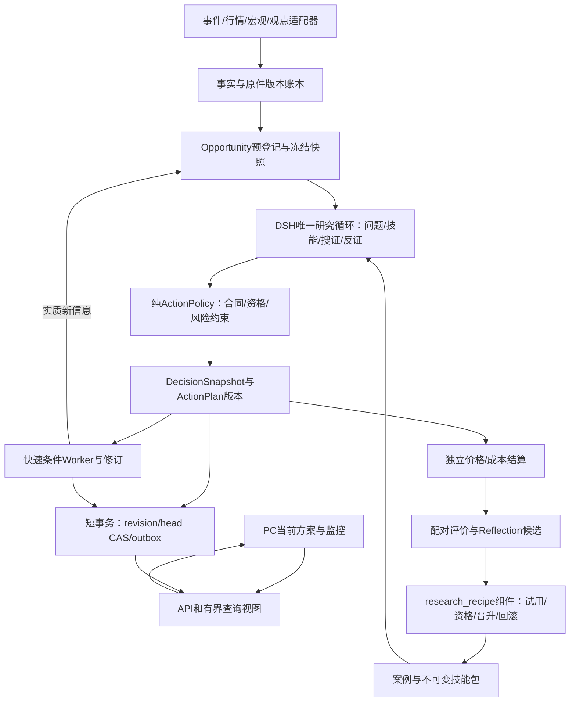

# Decision Hub：可执行产品规格 V1

> 2026-10-17：实施暂停。当前评审和后续推进顺序见[事前决策产品总控](../../decision-product-control-2026-10-17/00_MASTER_CONTROL.md)。本包保留原业务要求、合同与历史执行证据；下文“实施已开始”“下一实施包”等为历史状态，不能据此恢复执行。原MR/G/E/V/I要求及金融协议没有被新总控删除。

日期：2026-10-13。版本：设计规格V1。**业务目标、架构、实现顺序与评价合同在本包统一；实施已开始，实时进度以tasks.json和EXECUTION_LOG.md为准。参考或定向测试通过不代表产品或金融效果通过。** 本包替代上一稿技术部分的模糊约定；此前文档保留业务讨论与历史证据。

## 1. 首次交付的用户结果

**核心意图的强制补充：[VALUE_ALIGNMENT.md](VALUE_ALIGNMENT.md)。** 事前行动、自主根因搜证、真实结果自动生成新技能、下一Run实际消费，以及外部分析帖→核验→行动的12项验收，全部纳入W清单。原27项验收继续保留；当前合成检查不代表这12项生产能力通过。

用户关注BTC/ETH后，系统自行观察已登记事件与市场条件，主动组织研究。PC首页直接给当前建议、适用仓位、期限、触发/退出、主反依据、数据缺口和下一次检查。新信息出现后说明“从什么变为什么、为什么改”；用户能看到结果和下一次研究如何使用经验。完整报告、来源层级、历史事件与资料仍可展开，已有主线不隐藏。

| 任务 | 用户应看到/做到 | 可验收事实 |
|---|---|---|
| 判断现在怎么办 | 空仓/已有多仓分支；建立候选、持有、降低风险、退出或有条件等待 | 对应不可变ActionPlan版本；不把缺概率写成50%，不让7d覆盖24h |
| 知道什么时候改变 | 可求值条件、当前真值/缺件、有效期、复查状态 | 同一条件在Worker持续执行；不是一段无人跟踪的报告文字 |
| 了解为何这么判断 | 主反机制、新信息、宏观/仓位/价格关系，引用原件 | 每个重要主张有依据或明确是假说；新发现影响具体动作 |
| 收到新的建议 | 明确变化原因、原方案与新方案时间 | 服务端发布与页面实际显示分别有回执；过期不继续显示成有效 |
| 核对效果 | 方向、路径风险、操作损益、错过/等待、假设与不足 | 原观点不覆盖、扣费、真实可得报价、全机会分母 |
| 看到系统学到了什么 | 哪个历史案例/技能被本次采用或拒绝、为何适用、效果如何 | 选中/加载/执行/消费均可追踪；反思文字不会自动变成效果合格 |

首个产品档位是**可使用的研究试用**；是否具备统计金融优势单独评价。不承诺只要程序完成就能预测每次3%下跌或18%上涨，也不允许用这一点取消事前行动、机会捕获和效果验证。

## 2. 架构总图



依赖只能沿外层→application→ports/纯decision；Provider SDK不进入领域计算，UI不重算建议，网络/模型不占写事务。快监控、深研究和学习复用现有调度通道；不叠加第二个Agent Loop或每技能进程。具体文件、函数责任、7张行动表、2张技能关系/回执索引表、通知兼容迁移、路由、错误码、锁与版本在架构规格中。

## 3. 文件用途与权威关系

| 文件 | 已写清的内容 | 开发时何时读 |
|---|---|---|
| [EXECUTION_PLAN.md](EXECUTION_PLAN.md) / [EXECUTION_LOG.md](EXECUTION_LOG.md) | 本次目标、阶段边界、操作/首败/变更与下一步 | 每批实施前核范围，结束后记录事实；不从长会话猜进度 |
| [IMPLEMENTATION.md](IMPLEMENTATION.md) | ADR、首轮策略/风险/成本参数、数据探针、W0–W9依赖和结束门、现有/拟建命令 | 选当前工作包；参数和优先级以本文件为准 |
| [ARCHITECTURE.md](ARCHITECTURE.md) | 新旧代码映射、DTO、状态机、表/索引、API、Worker事务与兼容迁移 | 实现对应层，不按个人理解另建结构 |
| [SKILLS_AND_REUSE.md](SKILLS_AND_REUSE.md) | 11层现有工具复用、包目录/manifest、技能桥接、实际加载/消费、workflow、缓存与错误码 | 技能、来源、上下文与学习任务 |
| [EVALUATION.md](EVALUATION.md) | 27项G/E/V验收、分母/费用/迟到/重叠、A28试运行与独立A180确认、评价CLI和回执 | 写测试和判定任何“完成/有效”之前 |
| [tasks.json](tasks.json) | 机器工作包依赖、状态、所需规格/验收引用 | 后续Agent接续入口；已实现状态不靠对话记忆 |
| [TRACEABILITY.md](TRACEABILITY.md) | 原33项需求逐项归属、复用与未完成边界 | 范围调整、验收与结项；防止新计划吞掉旧要求 |
| [VALUE_ALIGNMENT.md](VALUE_ALIGNMENT.md) | 两项用户核心意图、机制/反思/观点合同、12项强制验收 | 任何研究/技能/信息源任务开工与结项前；不能以报告或种子演示代替 |
| [action.schema.json](spec/action.schema.json) / [reference.py](spec/reference.py) | 机器可读动作/条件子合同、纯求值/状态/执行价/费用，以及版本+CAS+outbox参考 | 规格对齐；不是已发布DTO或业务实现 |
| [reference.sql](spec/reference.sql) / [examples.json](spec/examples.json) / [verify.py](spec/verify.py) | 内存SQLite约束、独立期望金样例、可运行核验器 | 立即验证参考语义；不访问产品库或网络 |
| [workflow.schema.json](spec/workflow.schema.json) / [workflow.example.json](spec/workflow.example.json) / [workflow_reference.py](spec/workflow_reference.py) | 7种工作节点、依赖图、输入输出绑定、外部准入、合同负例 | 验证技能编排结构；没有执行生产节点 |

前序[业务主方案](../DECISION_FIRST_PRODUCT_PLAN_2026-10-13.md)、[技能方向附件](../AGENT_LEARNING_AND_INFORMATION_DESIGN_2026-10-13.md)、[跨资产方案](../CROSS_ASSET_CORE_PLAN_2026-10-13.md)保留业务与证据背景；其首验规则、评估口径若与本包冲突，以本包明确的V1决定为准，不能修改已开始的旧协议。类型/运算语义以本包schema+reference子集为准；完整生产DTO必须按架构扩充并走既有codegen，不直接拷贝设计参考上生产。

## 4. 工具怎样复用，怎样拆开

现有`market_path`负责UTC/Decimal/闭合bar与scope；`raw_capture`负责原件存取；`fact_store/lineage`负责来源与时点；`research_context_*`负责冻结输入；`market_case`负责案例；`component_registry`负责方法版本与晋升；risk模块提供租约/求值/通知模式。新增代码按ActionPolicy、ActionPlanService、ActionMonitor、ActionOutcome、SkillPackage/Selection/Use、ExperienceBridge分工。

不新建一个混装HTTP、SQL、模型调用和金融计算的`utils.py`。可复用函数先保持在其现有领域模块，通过ports注入；如果依赖方向不对，提取小型稳定接口而不是复制函数。任何新第三方库先停在Provider或离线评价适配层；本包首交付不需要安装新的大框架。

## 5. 效果怎样判，多久结束

| 层级 | 判定内容 | 时间与输出 |
|---|---|---|
| G：规则正确 | 合同、时点、单位、状态、幂等、报价/费用、技能资格 | 离线立即可跑；参考用例只覆盖其中子集，不能把所有G都自动标过 |
| E：真实功能 | 当前数据→真实DSH→行动→监控/更新→到期结算→下一次学习 | 按W任务闭环交付，真实未触发明确标未触发；不等金融长期观察才交付试用 |
| V：用户价值 | 用户能找到动作/原因/条件/退出；提醒时效；连续组合、避损与错过机会 | PC任务与真实回执；自动脚本不冒充真人理解效果 |
| A28：前瞻描述 | 28日1344个预登记机会，完整记录失败/等待/未成交和成本 | 固定终点出描述性增益、无增益或不足，不延期凑分数 |
| A180：正式效果确认 | 新窗口、冻结策略、时间/事件相关性、净效用、风险、覆盖；70%单独附加门 | 是后续长期证据计划，不让开发Agent持续空等180天；未满足资格可继续使用明确标识的研究试用 |

程序能运行、建议能交付、观察到正收益、证明稳定优势是不同状态。两资产/重叠窗口不当独立样本。晋升按预登记评价，不依据报告长度、模型自评分或胜率一个数。风险降低同时计卖后错过上涨；建仓同时计手续费/回撤；所有等待和失败保留分母。

## 6. 现在能运行的规格及实际结果

```powershell
# cwd = E:/project/study/codex/dsh/decision-hub
& ./.venv/Scripts/python.exe -X utf8 -B docs/design/market-risk-v1/executable-product-v1/spec/verify.py --output artifacts/core-goal-20261011/executable-spec-local-new.json
```

输出文件必须是新路径，首次失败不覆盖。最终[第三次核验原件](../../../../artifacts/core-goal-20261011/executable-spec-20261013-03.json)为**51/51**：34项行动/持久化规则，17项技能workflow合同检查。覆盖未来/过期事实、unknown、非有限概率、scope/单位、连续不同bar、过期优先、后发方案不得用早先报价、同bar歧义、高胜率负EV、手续费、版本不可改、同键重放、CAS冲突、outbox失败原子回滚，以及未知op/越权/依赖环/前向绑定/错误类型等。[第二轮33项原件](../../../../artifacts/core-goal-20261011/executable-spec-20261013-02.json)和[首轮30项原件](../../../../artifacts/core-goal-20261011/executable-spec-20261013-01.json)均保留；合成检查没有运行生产模型。

该参考没有实现LLM研究、真实Provider、身份认证/租约、网络断线、Alembic迁移、完整学习链、前端或统计金融评分。它的用途是使开发前约定可以被机器反驳，不能复制其简化单owner/in-memory存储并声称生产完成。

## 7. 市场扩展和范围保持

黄金、纳指、恒科仍是保留需求，当前未接通完整分析。公共事实/宏观/技能/行动/条件/评价接口先稳定；`InstrumentBinding + Calendar/Horizon + DomainPack + SourceBinding + EvaluationProtocol`按资产独立注册。黄金含实际利率/ETF/COT/央行供需，纳指含盈利/估值/指数成分，恒科含中国政策/盈利与CNH/HKD/南向资金；相同宏观事件允许不同作用方向。

W9逐市场验收完整链，不能只给行情卡片。手机仍不在本次范围。自动真实下单不属于本规格；用户当前需要的是有用、可核、可持续调整的研究操作建议。

## 8. 下一次执行入口

只读本README、tasks.json及当前W任务对应章节。先W0数据能力与协议封存，再W1合同/迁移；W2–W7形成首个真实纵向闭环。范围/参数变更须留下影响项，不能边写边改验收目标。每步结束更新状态、失败、回执和下一项；未通过原因必须具体到数据/合同/运行路径，避免再次以“还需优化”无限循环。
