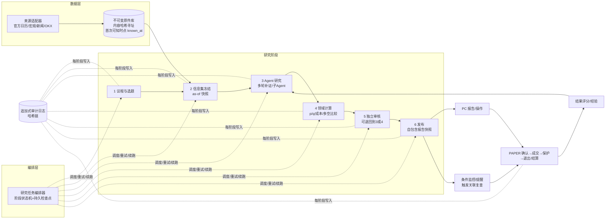

# Decision Hub 交付失败诊断与完整解决方案

- 日期：2026-10-23（北京时间）
- 对象：`E:\project\study\codex\dsh\decision-hub`（Main）及交接文档 `docs/design/decision-product-control-2026-10-17/HANDOFF_2026-10-23.md`
- 方法：阅读交接文档、00总控、关键源码；正式库只读查询（`mode=ro`）；git 状态、代码与产物规模统计；PC 失败页截图核对。本文未修改任何代码、数据库或运行中的服务。
- 定位：本文是接手方的独立诊断，不替代原 00—12 设计文档中的业务需求，但对其中的架构与流程提出修订。

## 1. 结论摘要

1. 业务目标是清楚的，问题不在"不知道要做什么"。事前决策产品的目标（事件发现→证据→根因/反证→情景概率 p→条件方向概率 q→含成本多空方案→触发/失效→监控→PAPER→结果学习）在原文档中写得完整且合理。
2. 主因是架构：可信性/溯源机制被实现成"运行时全链路强一致校验"，压在一个超长、不可断点续跑的单体研究 Run 上。任何一层出现正常的不一致（并发回传、版本升级、容量差异、时钟差异）都会让整次研究作废。这是 10 月份 0 成功的结构性原因。
3. 第二主因是工程流程：没有使用 git（最后提交 2026-09-07，此后约 +20 万行未提交），用自造的哈希 packet/ISO 工作区替代版本管理；缺少本地可重放的集成测试，每次修复都要完整构建并跑约 1 小时付费真实研究才能验证，导致"修一处→暴露下一处"的长循环。
4. 业务控制的缺口是"优先级与验收口径"，不是目标本身：没有规定能力的交付顺序和每一阶段的用户可见验收标准，智能体把"可审计、不可篡改、可回放"当成了首要质量标准，用户可见价值反而排在后面。PC 失败页满屏审计语言就是这个偏差的直接体现。
5. 解决方向不是降低研究深度或删掉可信要求，而是把可信要求换成正确的实现方式（存储层不可变+内容寻址+事后可验证），把研究改造成分阶段、可续跑、可本地重放的流水线，并按纵向切片逐项交付，最终覆盖原目标的全部范围。

## 2. 已核实的现状事实

| 维度 | 事实 | 来源 |
|---|---|---|
| 研究 Run 总量 | 1437 条：completed 14 / degraded 694 / failed 206 / cancelled 523 | 正式库 `runs` 只读查询 |
| 成功分布 | 14 条 completed 全部在 2026-09-13～09-29；2026-10 月共 257 条，completed 0 | 同上，按月分组 |
| 耗时 | completed 平均 1.5 分钟（最长 3.7）；degraded 平均 6.1 分钟（最长 54.3） | `latency_ms` |
| 运行版本 | `runtime_version` 106 个不同值 | 同上 |
| 成本记录 | `cost_usd` 全部为空，无法做成本归因 | 同上 |
| 10-10 后主要错误码 | `research_method_binding_failed` 19、`provider_timeout` 17、`research_worker_failed` 13、`research_observation_unavailable` 5、`dsh_turn_error` 3、`research_provider_native_context_invalid` 2、`dsh_protocol_invalid` 2 等 | 同上 |
| PAPER | `action_execution_fills` 0 条 | 同上 |
| 交接口径 | 25 笔产品验收命令：17 失败、6 有限结果、2 取消；可读真实报告仅 BTC18、ETH02 两份（4h） | 交接文档 §1 |
| 版本管理 | 最后提交 2026-09-07；248 个修改、1527 个未跟踪文件，`git diff` +203436/-24909 行 | `git status` / `git diff --shortstat` |
| 代码规模 | kernel 约 18.0 万行（非测试）；`application/` 311 个文件；hub_api 1.1 万、DSH 扩展 1.2 万、PC 1.8 万、source_adapters 0.17 万行 | 行数统计 |
| 关注点分布 | `application/` 中溯源/绑定/准入/门禁类 34 文件约 1.75 万行；概率/情景/评分类 26 文件约 1.22 万行；数据来源/日历类 19 文件约 0.73 万行 | 按文件名分类统计（近似） |
| 历史源码副本 | `packages/kernel/research_recipe_versions/` 下 180 份按哈希保存的源码副本；构建 retention 再复制 original-view | 目录统计、总控 §四问 |
| 构建产物 | 约 49 个候选构建；`artifacts/` 下 735 个条目，`D1` 下 1185 个条目；曾发生磁盘空间不足 | 目录统计、交接 §5.2 |
| 文档 | 13 份设计文档约 1.3MB；`EXECUTION_LOG.md` 270KB | 文件统计 |
| 严格校验示例 | `retained-context.ts:242` 对整条 session 事件日志做 canonical JSON 全量相等比较；该文件 36 处 `throw invalid()` | 源码 |
| PC 失败页 | 标题"研究已结束，有报告记录待核对"，正文为"Evidence 已保留但综合校验未通过""任务更新时间不代表新增证据"等，无任何方向/概率/操作 | `ETH-72H-02/pc-terminal-degraded-context-error.png` |

未核实/无法核实：每类错误码的逐条根因；去除过严校验后的实际成功率；模型真实 token 消耗与费用；预测质量（样本不足）。

## 3. 原因分析

### 3.1 架构原因（主因）

**A1. 可信性被实现为"运行时强一致校验"，而不是"存储层不可变 + 事后可验证"。**

- 原需求"事前时点、原件不可篡改、可审计"是正确的业务要求。
- 实现方式却是在研究运行过程中，反复对会话事件、源码哈希、版本、输入快照做全量相等比较，不一致即抛错终止。典型是 `retained-context.ts:242`：把运行中 session 的全部事件与先前快照比对，子 Agent 正常异步回传一条 inbox 事件就会失败（交接 §6 已复现 591→592）。
- 运行中的会话天然在变化，用"全量相等"保护它在逻辑上必然误报。正确做法是：已发生的事件只追加不修改（append-only），以前缀/哈希链校验，而不是要求整体不变。
- 影响：大量 `*_invalid`、`*_binding_failed` 类错误并非数据被篡改，而是正常运行被误判。

**A2. 研究 Run 是超长单体事务，不可断点续跑。**

- 一次研究串起：准入→上下文快照→DSH 会话→工具/子 Agent→Python 领域 Graph→prepare→独立审核→finalize→发布→报告→行动→监控，持续数十分钟到一小时。
- 任何一环失败即整 Run 收为 degraded/failed，已完成的取数、分析、审核都不能被下一次复用；重试只能从头再跑，并再次付费。
- 链路上每增加一个严格检查，整链成功率按乘法下降。10 月 0 成功与此一致。

**A3. 报告读取依赖历史源码版本。**

- 报告/GraphRecipe 回读需要找回生成时的源码（`research_recipe_versions/` 已 180 份副本），并在每次构建中携带 selection scope 和 prior receipt；漏带即 409（交接 §5.1、§8.3）。
- 结果是"改一个源文件 → 旧报告可能打不开"，发布成本随历史线性增长，并导致磁盘耗尽。
- 报告应当是生成时就自包含的数据快照（内容+渲染所需全部字段+哈希），读取不应依赖执行旧代码。

**A4. 职责边界不清，跨层契约靠运行时发现。**

- DSH Host（TS）、Kernel（Python）、Worker、API、PC 之间以大量 JSON 原件互相认证，同一约束在多层重复检查（容量上限 262144 vs 1048576、catalog 384000 字节、外层 45 秒 vs 深研究时钟）。
- 契约没有单一来源与离线兼容性测试，错误只在真实运行时暴露。

**A5. 业务算法与通用流程耦合。**

- 事件研究主要围绕 CPI 写死，EventFamilyPack/Binding/registry 只在文档中存在；扩展 PCE/FOMC/就业需要复制或改写主流程。
- 日历议程按预测窗口 `window_end` 截断（`perpetual_event_agenda.py:38`），准备期与目标期未分离，导致窗口外的重要事件无法提前准备。

### 3.2 工程流程原因（主因）

**P1. 没有可用的版本管理。** 自 2026-09-07 起未提交；以 ISO worktree、sealed packet、before/after hash、"25 路径组合预检"代替分支与合并。合并一次修复需要人工核对路径哈希，回滚、对比、审查都很困难。

**P2. 没有快速反馈回路。** 缺少可离线重放的端到端集成测试（录制真实模型/工具响应后回放）。验证主要依靠：完整构建 → 启动 → 真实付费研究 → 等待约 1 小时 → 读终态原件。一个缺陷的验证周期以小时计，跨层缺陷串行暴露。

**P3. 构建与发布过重。** 每版复制历史 original-view/retention，约 49 个候选构建、`runtime_version` 106 个；发布本身成为主要工作量，并挤占磁盘。

**P4. 并行铺开、没有关闭任何纵向切片。** T01—T08 同时推进、全部 in_progress；4h/24h/72h、多事件、PAPER、监控、学习同时动工，没有一个能力被完整交付并冻结。

**P5. 文档代替进展，且状态滞后。** 1.3MB 设计 + 270KB 执行日志，大量"应当/计划"表述；总控状态多次与实际不符（交接 §1 自认更正"active→paused"）。接手者难以区分"已实现"与"已设计"。

**P6. 缺少运行可观测指标。** 没有每日成功率、各阶段耗时/失败分布、单次成本（`cost_usd` 全空）等仪表；判断进展依赖逐 Run 读原件。

### 3.3 业务控制原因（次因）

**B1. 缺少交付顺序与阶段验收。** 目标完整，但没有规定"先交付哪一条用户可见链路、到什么程度算这一阶段完成"。

**B2. 质量标准被替换。** 实际执行中，"不可篡改/可回放/身份一致"成为第一优先级，"用户每天能拿到有方向、概率、理由和条件操作的判断"成为第二优先级。两者都必须要，但前者应作为后者的约束条件，而不是阻断后者的主流程。

**B3. 缺少可量化的产品验收口径。** "研究成功"没有统一定义（degraded 是否算？有限结果是否算？），导致统计口径反复变化（24 次、25 次、"有限结果不能全部算合格"）。

**B4. 预测效果的评价体系未运转。** 70% 胜率是价值表达，但没有固定观察集、评分规则和定期报表，无法判断方法是否在改进。

### 3.4 用户体验原因

- 失败与有限结果页面以工程审计语言为主，用户看不到任何判断，也看不到"为什么失败、下一步是什么、我能做什么"。
- 成功报告的信息层级是否以"判断→操作→理由→风险"为先，需要在新链路中重新按产品合同（04）验收。

### 3.5 不成立或证据不足的归因

- "模型天生保守、不肯给方向"：最近失败多发生在审核之前，无证据。
- "DSH 与 LangGraph 必然冲突"：9 月有成功记录，无证据表明框架本身不可用。
- "token 不足是主因"：容量问题是内部自设上限不一致，不是模型能力上限。
- "业务目标不清"：不成立，目标文档完整。

## 4. 解决方案

### 4.1 原则

1. **不以牺牲产品效果换取绿色结果。** 不缩减研究深度、证据轮次、反证、根因分析、情景数量；不把失败静默成功；不伪造概率校准或胜率。
2. **保留全部业务可信要求，改变其实现方式。** 事前时点、原件不可篡改、账户归属、资金边界、独立审核、取消语义必须保留；实现从"运行中全量比对"改为"存储层不可变 + 内容寻址 + 追加日志 + 事后可验证"。
3. **研究可断点续跑。** 每个阶段的产出持久化，失败只重做失败阶段。
4. **先纵向切通，再横向扩展。** 每个切片必须是用户在 PC 上可见、可用、可验收的完整结果，并冻结后再进入下一切片。最终范围不缩减。
5. **本地可重放优先于真实付费运行。** 真实运行用于验收与采集新样本，不用于定位软件缺陷。
6. **单一契约来源。** 跨语言数据结构只在 schema 中定义并生成；容量、时钟、版本规则只在一处声明。

### 4.2 目标架构

关键设计：

| 组件 | 设计要点 | 替代的现有做法 |
|---|---|---|
| 不可变原件库 | 所有输入（行情、新闻、日历、实际值）按内容哈希存储，带 `known_at`/`fetched_at`；写入后不可改 | 运行中反复重算与比对源输入 |
| 信息集冻结 | 阶段 2 生成 as-of 快照清单（哈希列表）；后续阶段只能引用该清单内的原件或追加新补证（带 known_at） | 每个阶段各自检查"新鲜度"和身份 |
| 阶段状态机 | 每阶段输入/输出/状态持久化；失败可从该阶段重试；Agent 会话可从检查点恢复或重建 | 单 Run 一次跑完，失败整体作废 |
| 追加式审计日志 | 事件只追加；校验用前缀哈希链（已写入部分不得变化），允许正常增长 | 全量事件 canonical JSON 相等 |
| 领域计算 | Python 纯函数：输入为快照+Agent 结构化结论，输出 p/q/成本/多空排序，确定性可重放 | Graph 绑定与版本认证交织 |
| 独立审核 | 审核读取同一快照与结论，输出通过/退回及理由；退回驱动回到阶段 3/4，不新开 Run | 审核失败即 Run 终止 |
| 自包含报告快照 | 发布时把展示所需的全部数据写成版本化 JSON（含 schema_version 与内容哈希）；读取只解析数据，不执行旧代码 | 回读依赖历史源码副本与 selection scope |
| 事件族插件 | EventFamilyPack：定义指标口径、阶段（如 FOMC 利率/声明/发布会）、实际值/共识来源、情景模板；主流程通用 | CPI 专用流程 |
| 议程 | 准备窗口与预测目标窗口分离；按重要性+临近度选题 | 按 `window_end` 截断 |

### 4.3 逐项原因与对应方案

| 原因 | 方案 | 保留的业务要求 | 完成判据 |
|---|---|---|---|
| A1 运行时强一致校验 | 校验分级：①资金/账户归属/取消/事前时点/已发布原件不可改——强校验、失败即阻断；②会话事件——前缀哈希链校验，允许追加；③跨层身份、重复表示、容量——改为单点声明+写入时校验，运行中不重复比对。逐个审查 `retained-context.ts`、`baseline*.ts` 共 55 处 `throw invalid()` 及 Python 侧绑定检查，归入三类 | 不可篡改、可审计、事前时点 | 所有校验均有分类与理由清单；正常子 Agent 回传、正常版本升级不再触发失败 |
| A2 单体长 Run | 引入阶段状态机与检查点；同一 Run 内阶段级重试，审核退回在同一 Run 内回到补证/计算 | 同 Run 呈现结果；独立审核 | 人为中断任一阶段后可从该阶段续跑并得到同一 Run 的终稿 |
| A3 报告依赖旧源码 | 报告快照自包含；新增读取器按 `schema_version` 解析；历史报告一次性迁移成快照（原件与哈希保留） | 旧报告可回读、原件保留 | 删除任意历史 recipe 源码副本后，所有报告仍可读（在副本上验证）；构建不再携带 selection scope |
| A4 契约分散 | 跨层结构只在 `contracts/schemas` 定义并生成 Py/TS；容量/时钟/版本常量集中到一个配置模块；契约兼容性测试进 CI | 契约一致 | 修改 schema 后 CI 能在本地发现所有不兼容调用方 |
| A5 CPI 专用 | EventFamilyPack 接口 + CPI 迁移为第一个实现，再加 PCE、就业、FOMC、GDP；联合情景显式建模相关性 | 各族正确语义；不无依据相乘边际概率 | 新增一个事件族只需新增 pack 与测试，不改主流程 |
| P1 无 git | 立即把当前 Main 提交到基线分支；ISO packets 转成分支/提交；之后 trunk-based + 短分支 + PR | 历史原件与失败证据保留 | 所有改动可在 git 中追溯；不再使用哈希 packet 合包 |
| P2 无快速反馈 | 录制回放（record/replay）测试：录制真实模型/工具/行情响应，离线重放完整链路；分层测试金字塔（单元→阶段→全链回放→少量真实） | 真实运行仍是最终验收 | 全链回放测试在本地 10 分钟内跑完；已知历史失败（如 591/592）均有回放用例 |
| P3 构建过重 | 构建只产出当前代码；历史可读性由报告快照保证；产物清理策略按引用关系执行 | 被引用原件保留 | 一次构建时间与磁盘占用不随历史版本数增长 |
| P4 并行铺开 | 按 §5 切片串行交付，每片冻结后进入下一片；同一时间只有一个主切片 | 最终范围不变 | 每个切片有明确的通过记录 |
| P5 文档滞后 | 只保留：需求（不变）、架构（本文 §4.2 修订）、当前状态（一页，按日更新）、ADR 决策记录；执行日志改为 git 提交与 PR | 设计依据保留 | 当前状态页与数据库/CI 指标一致 |
| P6 无指标 | 运行仪表：每日研究受理/成功/失败数、各阶段失败分布与耗时、单 Run 模型 token/费用 | — | 仪表可在 PC 管理页或 CLI 一条命令查看 |
| B1—B3 验收缺口 | §6 定义统一的"合格研究"与各切片验收标准，由产品负责人签收 | — | 统计口径固定、可由查询复现 |
| B4 效果评价 | §7 固定观察与评分体系，按周出报表；不作为单次研究的阻断条件 | 不伪造校准 | 每周有可读的评分报表 |
| UX | 判断优先的信息层级；失败页给出人话原因、已完成部分、下一步与重试 | 技术细节可展开 | 用户 10 秒内能看到方向/概率/操作或明确的失败原因 |

### 4.4 工程流程方案

1. **版本管理**：`main` 受保护；当前未提交内容先整体提交到 `baseline/handoff-2026-10-23`，再按模块拆分为可审查的提交合入。ISO 三个 sealed packet（全期限 PAPER、BEA PCE、Host 并发快照）各自转为分支，经测试后合入。
2. **测试分层**：
   - 单元：领域计算（p/q、成本、多空排序、PAPER 记账）确定性测试；
   - 阶段：每个研究阶段的输入→输出契约测试；
   - 全链回放：录制的真实会话离线重放，覆盖成功、审核退回、并发回传、超时、取消；
   - 真实：每个切片验收时少量真实运行，并把结果录制成新的回放用例。
3. **CI**：本地一条命令（如 `make check`）跑 lint、类型检查、契约生成一致性、单元、阶段、回放测试；合入前必须通过。
4. **构建发布**：构建产物只含当前代码与依赖；发布 = 停服→迁移→启动→冒烟（API、Worker、读取一份历史报告、回放一条链路）。回滚 = 切回上一构建，数据库迁移需可逆或向前兼容。
5. **缺陷处理规则**：真实运行失败 → 用录制数据本地复现 → 写回放用例 → 修复 → 回放通过 → 再进行下一次真实运行。同一错误第二次出现必须先有本地复现。
6. **可观测性**：每阶段结构化日志（run_id、stage、attempt、耗时、token、错误码）；`cost_usd` 必须写入。

## 5. 完整交付计划（覆盖原目标全部范围）

范围与原 00 总控一致：BTC/ETH OKX USDT 永续 × 4h/24h/72h；普通市场与重要事件；事前 p/q、根因/反证、含成本多空方案与触发/失效；自动研究、条件监控与提醒；PAPER 全生命周期；结果评分与经验学习；PC 端完整体验与用户手册。暂不做真实下单、手机端、新资产与 Kronos（与原文档一致）。

切片按依赖顺序串行，每片冻结后进入下一片。工期为估计，需在阶段 0 后按实际复核。

| 阶段 | 内容 | 用户可见结果 | 验收标准 | 估计 |
|---|---|---|---|---|
| 0 基线 | git 基线提交；ISO 三包转分支；运行指标仪表；录制回放框架；合格研究定义 | 无新功能；可看到每日成功率 | 当前 Main 可从 git 构建并启动；历史两份报告可读；回放框架能重放一条历史 Run | 3—4 天 |
| 1 架构主干 | 阶段状态机与检查点；信息集冻结；追加式审计日志与校验分级；自包含报告快照与历史迁移；契约集中 | 研究失败后可续跑；旧报告稳定可读 | 历史失败样本（591/592 并发、容量、prepare/final 语义、时钟耦合）回放均通过；中断任一阶段可续跑 | 2—3 周 |
| 2 普通市场 4h | BTC/ETH 4h 普通市场研究走新主干：多轮补证→方向概率→含成本多空比较→入场/止损/退出→触发/失效→独立审核→发布；PC 判断优先展示 | 每天可读的 4h 建议 | 连续 5 个自然日，自动+手动研究合格率≥90%（按 §6 定义）；PC 首屏可见方向/概率/操作/理由 | 1—2 周 |
| 3 期限扩展 | 24h、72h：各自目标、时钟、结果标签；慢研究 as-of 与快行情确认/重比较分离 | 三个期限均可用 | 6 个组合（2 资产×3 期限）各连续 3 次合格 | 1 周 |
| 4 事件研究 | 议程：准备窗口与目标窗口分离、重要性选择；EventFamilyPack：CPI（迁移）、PCE、就业、FOMC、GDP；事件结果 p、条件方向 q、联合情景；事件前预案 | PC 可见未来重要事件和事前预案 | 至少覆盖一次真实 FOMC 与一次真实数据发布（如 PCE/CPI）全流程：事前预案→实际值落地→情景判定→方案更新 | 2—3 周 |
| 5 监控与提醒 | 条件监控（价格、触发/失效、事件阶段变化）；通知；关联复查自动发起后继研究 | 不盯盘也能收到变化提醒和更新建议 | 真实市场条件触发→通知送达→后继研究合格，各至少 3 次 | 1 周 |
| 6 PAPER 闭环 | 确认→排队→成交→保护（止损/止盈）→退出→资金费/费用结算→结果；重启恢复 | 用户可做纸面交易并回读结果 | 正式库合法成交≥10 笔，覆盖止损、止盈、到期退出、重启恢复；流水与 OKX 行情可对账 | 1—2 周 |
| 7 结果与学习 | 预测到期评分；PAPER 结果归因；经验抽取与审核后进入下一轮研究输入；技能候选需人工批准 | 可看到历史判断表现与经验 | 下一轮研究输入可追溯到具体经验；经验内容与结论的关系在报告中可见 | 1—2 周 |
| 8 交付 | 完整 PC 体验走查；用户手册；运维手册（启动、停止、升级、回滚、备份）；交付矩阵 | 可交付产品 | §6.3 交付标准全部满足 | 1 周 |

总计约 10—15 周。阶段 1 是其后所有阶段的前提，不能跳过或与其后阶段并行开工；阶段 2 完成前不启动 3—7。

## 6. 验收口径

### 6.1 "合格研究"统一定义

一次研究同时满足以下全部条件才计为合格：

1. 信息集冻结清单存在，所有引用原件 `known_at` 早于研究决策时点；
2. 包含方向概率（普通市场）或事件结果 p + 条件方向 q（事件研究），概率和为 1、口径与期限一致；
3. 包含根因、关键证据与反证；
4. 包含含费用/资金费的多空比较，以及入场、止损、退出、触发与失效条件；若结论为"观望"，必须给出具体理由和转为可操作的条件；
5. 通过独立审核（允许经退回修订后通过）；
6. 同一 Run 在 PC 上可读，重启后仍可读。

degraded、有限结果、仅有材料的结果均不计合格，但在仪表中单独统计。

### 6.2 运行指标

- 合格率 = 合格研究数 / 受理研究数（排除用户主动取消），按日、资产、期限、来源（手动/自动/复查）分组；
- 各阶段失败分布与平均耗时；
- 单次研究模型调用次数、token 与费用。

### 6.3 最终交付标准

- BTC/ETH × 4h/24h/72h 六个组合，连续 14 天合格率≥90%；
- 至少 2 类事件族在真实事件中完成事前预案→落地→更新；
- 条件提醒与后继研究真实发生并合格；
- PAPER 正式成交与完整退出/结算记录，重启恢复正确；
- 至少 4 周的预测评分报表；
- 用户手册与运维手册完成，接手者按手册能独立启动、升级、回滚。

## 7. 预测效果评价（不作为单次阻断）

- 固定观察集：所有合格研究自动入集，按资产×期限×类型分层；
- 评分：方向概率用 Brier score 与对数损失；与基线（历史频率、随机游走、简单动量）对比；多空方案以 PAPER 净收益、最大回撤、命中率、盈亏比评估；
- 校准：样本达到阈值（例如每层≥50）后输出可靠性曲线；未达阈值时报告明确标注"研究估计，未校准"；
- 报表：每周一次；方法调整须引用报表数据并记录 ADR。
- 不承诺 70% 胜率；该数字作为长期目标，以报表数据评估是否可达。

## 8. 现有资产复用

不推倒重来。可复用（需按新主干接口适配并补测试）：

- Kernel 领域计算：情景数学核心、概率投影、calibration、成本与多空比较、PAPER 记账与保护退出（`action_execution.py`、`perpetual_manual_execution.py` 等）；
- 来源适配器：OKX 行情、官方日历、BEA PCE（ISO 包）；
- DSH Host 的会话、工具与子 Agent 能力；
- PC 现有页面框架、设置、账户与 API 客户端；
- ISO 三个已封包修复（作为分支合入并补回放用例）；
- 已有失败原件：作为回放测试样本。

需重写或大幅改造：运行时绑定/认证层（`research_graph_binding.py`、`research_execution_binding.py`、`retained-context.ts` 等）、发布与保留机制（`research_publication_*`、`research_graph_history_versions.py`、retention 构建脚本）、报告回读路径、议程选题。

## 9. 风险与应对

| 风险 | 应对 |
|---|---|
| 架构改造期间无新报告产出 | 阶段 1 期间保留 49c 服务只读可用；阶段 1 内优先完成 4h 普通市场在新主干上的回放通过 |
| 历史报告迁移出错 | 迁移在数据库副本上进行，逐份比对渲染内容；原件与原表不删除 |
| 校验分级被误用为放松 | 每处降级须在清单中写明业务理由并评审；资金/归属/时点/取消四类不得降级 |
| 真实模型行为不稳定（超时、格式） | 阶段级重试与超时分离；结构化输出校验失败在阶段内修复重试；记录到仪表 |
| 共享依赖被并行会话改坏 | 单一工作目录 + git 分支；依赖锁文件纳入版本管理 |
| 范围再次铺开 | 同一时间只开一个主切片；新需求进入待办，不插入当前切片 |

## 10. 需要产品负责人确认的事项

1. 交付顺序（§5）与"阶段 1 完成前不扩展功能"的约束；
2. 合格研究定义（§6.1）与最终交付标准（§6.3）的阈值；
3. 不可降级的校验范围：资金边界、账户归属、事前时点、取消语义、已发布原件不可改，是否还有其他项；
4. 历史报告迁移为自包含快照的方案；
5. 原 00—12 设计文档的定位：需求保留为依据，架构与流程以本文为准。

## 附录：关键证据位置

- 交接文档：`docs/design/decision-product-control-2026-10-17/HANDOFF_2026-10-23.md`
- 严格比较：`extensions/dsh/decision-hub/src/host/retained-context.ts:242`
- 议程截断：`packages/kernel/decision_hub_kernel/application/perpetual_event_agenda.py:38`
- 最新失败原件：`artifacts/decision-product-core-20261018/D2/ETH-72H-02/`
- 正式库：`data/core-live-20260913/db/decision_hub.sqlite3`（本文查询均为只读）
