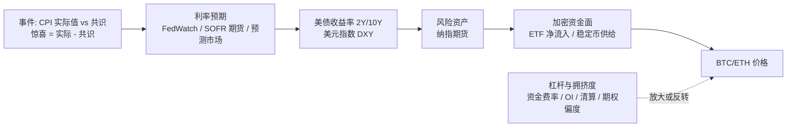

# Decision Hub 产品效果优化与业务拓展建议

- 日期：2026-10-23（北京时间）
- 前置文档：同目录 `DIAGNOSIS_AND_SOLUTION.md`（交付失败诊断与修复方案）。本文讨论修复之后，如何提升"事前根因链预测"的实际效果。
- 依据：代码现状只读检查 + 网络检索（文末列出来源）。本文是建议，未改动代码。

## 1. 结论摘要

现有系统的核心问题是：概率几乎完全来自 LLM 的主观判断（`research_probability_binding.py` 的输入定义为 `authenticated_graph_subjective_probability.v2`，报告标注"主观研究估计，未经校准"），缺少三样东西：

1. **市场隐含的锚点**：市场自己已经给出的事件概率和波动预期（利率期货、预测市场、期权）没有接入，系统无法判断"我的判断和市场共识差多少"，也就无法判断是否存在可交易的优势。
2. **可度量的根因链**：根因链停留在报告文字，没有被建模为"每一环都有数据可测"的结构，事后无法检验哪一环判断对、哪一环错。
3. **足够快的样本积累**：靠实时运行攒样本，几个月也凑不出可校准的数量；没有利用历史事件做时点严格的回放评估。

建议方向：把 LLM 定位为"信息收集、结构化与情景推理"的角色，把概率交给"历史基率 + 市场隐含 + 有界的证据调整"的量化层生成，再用历史回放和实时结果持续校准。这与近期研究的结论一致：语言表达的信心不等于可交易的概率，LLM 更适合作为可审计的信息源，校准、风控和执行由独立模块负责。

## 2. 代码现状（与效果相关的部分）

| 方面 | 现状 | 判断 |
|---|---|---|
| 行情 | OKX K 线；`market_features.py` 有 30m 收益、30m 已实现波动、24h 收益、成交量变化、价差 | 只有短周期特征，没有 24h/72h 期限对应的波动或趋势特征 |
| 衍生品拥挤度 | `market.crypto_derivatives` / `CROWDING_V1`：资金费率、持仓量、基差 | 有基础；清算、多空比、订单簿深度只有零星引用 |
| 宏观 | `official.macro`、BLS CPI、CPI nowcast、官方日历；BEA PCE 在 ISO 未上线 | 只有 CPI 较完整；FOMC、就业、GDP 只到日历层 |
| 跨资产 | `market.cross_asset`（日线） | 粒度为日线，无法支撑 4h 事件窗口的传导判断 |
| 情绪 | Alternative.me 恐惧贪婪指数 | 单一、低频 |
| 新闻 | DSH `web_search` / `web_fetch` 临时检索 | 没有持续的新闻流、没有事件抽取与去重、没有 known_at 归档 |
| 期权 / ETF 资金流 / 稳定币 / 链上 / 预测市场 / 利率期货 | 代码中未发现 | 关键缺口 |
| 概率来源 | LLM 主观估计，经独立审核 | 无基率、无市场锚点、无量化模型参与 |
| 历史基线 | `history_observed_model.py` 有基于 MAE 的历史基线；`calibration.py` 1848 行 | 有框架，但样本不足，未进入主链 |
| 事件研究 | 情景 p / 条件 q 的数学核心已有（ISO），CPI 专用 | 方法正确，缺事件族通用化和数据 |

## 3. 预测方法优化（提升效果的核心）

### 3.1 根因链结构化：把"为什么"变成可测的因果图

当前报告中的根因是文字。建议把每个事件族的传导链定义成固定的因果图，每个节点有可观测的数据和时点：

每次研究按节点输出：当前状态、事前预期、事件后若出现某情景各节点的预期变化方向和幅度。好处：

- 事后可以逐节点核对，判断错在哪一环（数据惊喜判断错？利率传导没发生？被杠杆清算主导？）；
- 经验学习可以落到具体节点（例如"近 3 个月 CPI 惊喜对 BTC 的传导系数明显减弱"），而不是笼统的"本次判断偏乐观"；
- 研究报告首屏可以直接画出这条链和每环状态，用户一眼看懂根因。

有研究用 2019—2026 年 84 次 CPI 发布的小时级数据做事件研究，发现现货 ETF 上线后 ETH 对通胀公告的价格发现方式发生了变化；也有观点认为 BTC 已从被动接受宏观冲击转为提前定价利率决策。这说明传导系数是时变的，必须按节点持续测量，而不是写死在提示词中。

### 3.2 概率生成：基率 → 市场锚点 → 有界调整

建议把概率拆成三层，每层单独记录，报告中可见：

| 层 | 来源 | 作用 |
|---|---|---|
| 基率 | 历史同类情况（同资产、同期限、同事件族、相近波动环境）的方向频率与波动分布 | 防止 LLM 凭叙事给出极端概率 |
| 市场锚点 | 事件结果 p：利率期货/FedWatch、预测市场（Kalshi、Polymarket）、经济学家共识分布；资产波动：期权隐含波动、事件隐含跳动幅度、25-delta 偏度 | 代表市场共识；系统只有在与之有差异且有证据时才有交易意义 |
| 证据调整 | LLM 研究给出相对锚点的调整方向和理由，幅度受上限约束（例如单条证据最多偏离若干个百分点，总偏离受证据强度分级约束） | 让研究的价值体现为"相对共识的增量" |

最终输出同时展示：基率、市场隐含、本系统估计、偏离理由。只有"本系统估计与市场隐含差异显著，且差异理由通过审核"时，才给出方向性多空方案；否则给出以波动/区间为主的方案或条件等待方案（并写明转为可操作的条件）。

### 3.3 多样本聚合

近期针对预测市场任务的研究显示，多模型或多次独立采样的聚合在概率校准上稳定优于单模型。建议：

- 同一信息集下，独立运行 3—5 个研究视角（宏观、拥挤度、技术/流动性、反方），各自给出概率；
- 用中位数或对数几率平均聚合，并记录分歧度；分歧度本身作为置信度信号展示给用户；
- 反方视角必须独立生成，不能只是同一会话里的"请列出反证"。

### 3.4 量化基线模型与 LLM 并行

- 对每个资产×期限，维护一个可复现的量化基线：如以已实现波动、动量、资金费率、基差、OI 变化、期权偏度为特征的逻辑回归或梯度提升模型，以及 GARCH 类波动模型给出的区间概率；
- 基线和 LLM 估计同时入评分集，长期比较；若 LLM 不能稳定优于基线，产品应以基线为主、LLM 提供解释；
- 波动区间（"未来 24h 有 x% 概率在 a—b 之间"）通常比方向更可预测，应作为一等输出，并直接用于止损/止盈设置。

### 3.5 时点严格的历史回放评估

- 用已归档原件（行情、日历、实际值、新闻时间戳）重建历史任意时点的信息集，离线运行研究，按结果评分；
- 需特别防范模型训练数据带来的前视泄漏：模型可能"记得"历史事件结果。缓解方法：优先在模型训练截止日之后的事件上评估；对截止前的事件只评估量化层，或对资产名、日期做脱敏；
- 样本可在数周内积累到数百个，足以做初步校准和方法比较，而不必等数月实时运行；
- 评估需满足近期研究提出的几项结构性检验：时点完整性、真实摩擦（费用、资金费、滑点）、反事实稳健性、概率校准、数值执行正确性、多 Agent 各部分贡献拆分。

### 3.6 校准与评分闭环

- 指标：Brier、对数损失、可靠性曲线、分层（资产/期限/事件族/波动环境）；
- 校准器：样本足够后对 LLM 和聚合概率做 Platt 或保序回归校准，校准器版本化；
- 与市场锚点对比：若系统概率长期不如市场隐含概率，说明研究没有增量，应调整方法而不是放大仓位。

## 4. 数据源扩展（按对效果的预期贡献排序）

| 优先级 | 数据 | 用途 | 可选来源（需核实授权、费用与限频） |
|---|---|---|---|
| P0 | 利率预期：FedWatch、SOFR/联邦基金期货 | FOMC 结果 p 的市场锚点；CPI/PCE/就业惊喜的传导第一环 | CME FedWatch；期货行情 |
| P0 | 预测市场：Kalshi、Polymarket 的宏观合约（利率、CPI 区间、衰退等） | 事件结果 p 的第二锚点；盘中实时更新 | 官方公开 API（直接接入，避免第三方转发） |
| P0 | 期权：BTC/ETH ATM 隐含波动、期限结构、25-delta 风险逆转、事件隐含跳动 | 资产波动区间与尾部方向的市场锚点；事件前定价是否已充分 | Deribit 公共 API；OKX 期权 |
| P0 | 经济数据共识与分布（中位数、区间、分析师数量） | 计算"惊喜"，事件研究的核心输入 | 需选定可授权来源；当前代码 `EVENT_SURPRISE_V1` 已有字段但缺来源 |
| P1 | 现货 ETF 每日净流入（BTC、ETH） | 机构资金面；传导链"加密资金面"节点 | 发行商公开数据、聚合站 |
| P1 | 多交易所衍生品：OI、资金费率、清算、多空比、订单簿深度 | 拥挤度与清算级联风险；当前仅 OKX | Binance、Bybit、OKX 公共 API |
| P1 | 高频跨资产：DXY、2Y/10Y 美债收益率、纳指期货、黄金（小时级） | 事件窗口内的传导确认 | 现有 `market.cross_asset` 升级粒度 |
| P1 | 稳定币供给与交易所流入流出 | 中期流动性 | 链上数据服务 |
| P2 | 结构化新闻流：持续采集、事件抽取、去重、首次发布时间归档 | 突发事件发现（监管、黑客、ETF 审批、大额解锁） | 新闻 API + 本地抽取 |
| P2 | 加密专属日历：代币解锁、升级、期权大额到期、交易所维护 | 加密内生事件 | 公开日历 |
| P2 | 央行官员讲话日程与文本 | FOMC 前后的预期变化 | 美联储官网 |

所有新数据沿用现有原则：首次可知时点（known_at）归档、不可变存储、只用决策时点前可知的数据。

## 5. 架构与技术优化（服务于效果）

1. **特征仓库**：所有数据源统一落为按 known_at 索引的时间序列，研究和回放从同一接口按时点读取。这同时解决实时研究与历史回放的一致性，是 3.5 的前提。
2. **量化层独立于 Agent 层**：概率、成本、仓位、止损计算全部在确定性模块中完成；Agent 只输出结构化证据与情景判断。这样每一层可单独评估、单独替换。
3. **事件族插件化**：每个 EventFamilyPack 包含因果图模板、所需数据、共识来源、情景划分规则、历史基率计算方法。新增事件族不改主流程。
4. **研究分层调度**：常规时段用轻量的"状态更新"（数据刷新+量化层重算+少量 LLM 解读），重大事件前后才启动完整深度研究。可以显著降低成本和失败面，同时提高更新频率。
5. **触发器由量化层驱动**：价格突破、隐含波动跳升、资金费率极值、预测市场概率大幅变化、新闻重大事件等作为监控触发，自动发起关联复查。
6. **模型路由**：信息检索/摘要用低成本模型，情景推理与审核用强模型；多样本聚合时混用不同模型降低同源偏差。

## 6. 业务拓展点

| 拓展 | 内容 | 对用户的价值 |
|---|---|---|
| 事件前预案卡 | 重大事件前 24—72h 自动生成：市场隐含 vs 系统判断、各情景下的操作清单、关键价位 | 用户事前就知道"出现 A 怎么做、出现 B 怎么做" |
| 事件后快速解读 | 数据公布后数分钟内：惊喜方向与幅度、传导链各节点实时状态、预案是否触发 | 把事前预案和事后行动连起来 |
| 波动/区间策略 | 给出区间概率与对应的区间交易、突破跟随方案；有期权数据后可扩展为期权策略建议（研究级） | 方向不明时仍有可执行方案，避免全部输出"等待" |
| 拥挤度与清算风险预警 | 资金费率、OI、清算地图组合成风险分数 | 降低被反向挤压的风险 |
| 市场分歧仪表 | 系统 vs 预测市场 vs 期权隐含的概率对比 | 用户直观看到"优势在哪里" |
| 复盘中心 | 每次判断到期后自动复盘：哪一环判断对/错、经验是否已吸收 | 让学习可见，建立信任 |
| 个人风险画像 | 根据用户设置的权益、最大名义、最大损失推导仓位与杠杆建议 | 建议可直接落地 |
| 周报/月报 | 评分、校准曲线、PAPER 绩效、与基线和市场的比较 | 客观衡量产品是否在进步 |
| 资产扩展（后续） | 黄金、纳指、恒科（原计划 T09）可复用宏观传导链 | 一套方法多资产复用 |

## 7. 建议的落地顺序

与 `DIAGNOSIS_AND_SOLUTION.md` §5 的阶段计划结合：

| 时机 | 内容 |
|---|---|
| 阶段 1（架构主干） | 特征仓库（按 known_at 读取）；量化层与 Agent 层分离；报告快照结构中预留基率/市场锚点/调整三层字段与因果图节点 |
| 阶段 2（4h 普通市场） | 量化基线模型与 LLM 并行；多样本聚合；波动区间输出；多交易所拥挤度 |
| 阶段 3（期限扩展） | 24h/72h 的特征与基线；期权隐含波动作为区间锚点 |
| 阶段 4（事件研究） | 利率期货、预测市场、共识数据接入；因果图模板；事件前预案卡与事件后快速解读 |
| 阶段 5（监控） | 量化层触发器；拥挤度预警 |
| 阶段 7（学习） | 历史回放评估；校准器；按节点的经验；复盘中心与周报 |

其中历史回放评估（3.5）建议在阶段 2 就开始搭建，因为它是判断所有方法优化是否有效的唯一快速手段。

## 8. 需要注意的边界

- 新数据源要确认使用条款、授权和费用；预测市场数据仅作信息参考，不涉及在这些平台交易。
- 任何"胜率"都必须来自时点严格、含成本的评估；短窗口高胜率不能作为部署依据。
- 期权、事件合约相关建议在本阶段只作研究展示，不扩展到真实下单（与原范围一致）。

## 9. 参考来源

- Reported Alpha from LLM Trading Agents Should Not Be Treated as Deployment Evidence：https://arxiv.org/abs/2605.16895
- FinBench：Time-Gated Calibration and Uncertainty Benchmarking for Agentic Financial Forecasting：https://arxiv.org/abs/2607.16229
- A Multi-Agent LLM Framework for Prediction Market Trading（多模型聚合校准）：https://arxiv.org/html/2604.03888v1
- Benchmarking LLM Forecasting and Trading on Live Prediction Market Data（PolyBench）：https://arxiv.org/html/2604.14199v1
- What LLM Trading Agents Actually Do in Production：https://arxiv.org/pdf/2609.05663v1
- CryptoBench：https://arxiv.org/abs/2512.00417
- Do spot ethereum ETFs change macroeconomic price discovery?（84 次 CPI 小时级事件研究）：https://link.springer.com/article/10.1007/s42521-026-00216-0
- Bitcoin Price Decoupling From Fed and ETFs（Binance Research 案例综述）：https://cryptonews.com/news/bitcoin-decoupling-fed-etfs-2026/
- Deribit Crypto Derivatives Analytics Report（25-delta 偏度、ATM 隐含波动）：https://insights.deribit.com/industry/crypto-derivatives-analytics-report-week-21-2026/
- Bitcoin options show downside convexity ahead of FOMC：https://cryptobriefing.com/bitcoin-options-put-skew-fomc-meeting/
- Polymarket API 数据说明：https://www.codex.io/blog/polymarket-api
