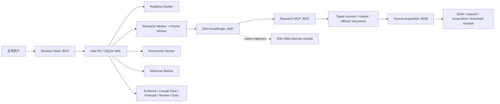

# Decision Hub UI 交接与运行验收

> 面向 UI 设计、前端维护和本地验收。本文以 2026-09-23 在 Windows 工作树上的真实运行结果为准；密钥只列变量名，不记录任何值。

页面级截图、逐步操作和控件说明见配套文档：[DECISION_HUB_UI_PAGE_INTERACTION_SCREENSHOT_HANDOFF_2026-09-23.md](DECISION_HUB_UI_PAGE_INTERACTION_SCREENSHOT_HANDOFF_2026-09-23.md)。

## 1. 交付边界

Decision Desk 是业务用户唯一入口，负责提交研究、查看最新建议、证据、因果链、反方解释、复核记录和分周期行动候选。它展示的是 Hub 的规范化账本，不直接读取 DSH 的聊天记录。

DSH Web 是官方上游的内部研究与轨迹控制台。Hub Research Worker 通过 DSH Host/Plugin 调度研究会话，DSH 保存模型会话和原生轨迹；DSH 页面用于技术人员查看模型实际调用、工具轨迹和会话状态，不拥有交易 Gate、预测账本或发布权限，也不会产生第二份业务结论。UI 设计不应把 DSH 当成普通用户的第二个首页。

Source Acquisition Worker 是独立的信息获取层，负责受允许域名的 HTTP、Playwright DOM、网络响应、截图和下载回执。Research MCP 只暴露经过 capability allowlist 的 typed 能力；Hub 才是 Run、Evidence、Causal Case、Forecast、Review 和 Gate 的唯一账本。

## 2. 启动入口与前置条件

### Windows（当前实际产品入口）

在仓库根目录打开 PowerShell：

```powershell
cd E:\project\study\codex\dsh\decision-hub
pwsh -NoProfile -File .\infra\dsh\run-product.ps1
```

启动器会构建当前 Decision Desk 和 DSH Plugin，清理上一轮受管进程状态，检查端口，然后按依赖顺序启动 API、资料 worker、信息获取 worker、Research MCP、DSH Web、realtime、research（普通与优先 lane）和 historical worker。窗口需要保持运行；停止使用：

```powershell
pwsh -NoProfile -File .\infra\dsh\stop-product.ps1
```

启动成功后以日志打印的 `DECISION_DESK_URL` 为业务入口，当前默认是 `http://127.0.0.1:8047/`。日志同时会打印带一次性 token 的 `DSH_URL` / `DSH_TRAJECTORY_URL`，只给技术人员排查轨迹使用，不把 token 写入文档、配置或截图。

### Unix / Compose

```bash
./infra/dsh/run-product.sh
./infra/dsh/stop-product.sh
```

Shell 启动器默认 API 8000、MCP 8002、DSH 3080；Windows 启动器默认 API 8047、MCP 8037、Source Acquisition 8038、DSH 3097。UI 代码不应硬编码端口，使用同源 API 或 `VITE_API_BASE_URL`。

### 必须安装的本机依赖

| 依赖 | 用途 | 检查方式 |
|---|---|---|
| PowerShell 7 | Windows 启动/停止脚本 | `pwsh --version` |
| Python + uv | Hub API、worker、MCP | `uv --version` |
| Node.js + pnpm | Decision Desk、DSH plugin、Source Acquisition | `node --version`、`pnpm --version` |
| Playwright/Chromium | Source Acquisition 页面读取、下载和截图回执 | `pnpm --dir apps/source_acquisition_worker exec playwright --version` |
| Git | 固定 DSH 上游和插件构建 | `git --version` |
| Docker Desktop | 仅 Compose 路径需要；Windows PowerShell 产品脚本不依赖 Docker | `docker info` |
| 可写磁盘 | SQLite WAL、checkpoint、原始资料、截图/trace、DSH Session | 检查 `data/` |
| 外网访问 | 官方宏观源、交易所公开接口、Yahoo、模型网关 | 启动后检查 `/v1/operations` |

启动器要求 `data/dsh-live/.env` 存在。文件应为 gitignored 的本机配置，不能提交或复制到日志。

## 3. 外部 Key、账号与服务矩阵

### 当前 live 路径必须准备

| 变量/服务 | 必需性 | 作用 | 当前状态 |
|---|---|---|---|
| `OPENAI_API_KEY` | 必需 | DSH/模型网关鉴权；兼容网关也使用此变量 | `data/dsh-live/.env` 已配置（值不展示） |
| `OPENAI_BASE_URL` | 必需 | OpenAI 原生 Responses 兼容网关地址 | 已配置；启动器只注入，不打印 |
| `DECISION_HUB_MODEL` / `DECISION_HUB_DSH_MODEL` | 必需 | 模型名 | 当前为 `gpt-5.5` |
| `DECISION_HUB_LLM_API_MODE` | 必需 | Responses/Chat Completions 协议选择 | 当前为 `responses` |
| `DECISION_HUB_LLM_ENABLED` | 必需 | 文档语义修正、模型能力开关 | live 配置开启 |
| `DECISION_HUB_SEARCH_PROVIDER` | 条件必需 | Search adapter 类型 | 当前 `openai_responses` |
| `DECISION_HUB_SEARCH_MODEL` | 条件必需 | Search adapter 模型 | 当前 `gpt-5.5` |
| `DECISION_HUB_SEARCH_API_KEY` / `DECISION_HUB_SEARCH_BASE_URL` | 使用独立搜索网关时必需 | Search adapter 鉴权和地址 | 未在当前配置中单独配置；复用模型网关时由实现决定 |
| `DECISION_HUB_SEARCH_CANARY_STATUS=passed` | 使用 `web.search` 时必需 | 放行网络搜索 capability | 当前 `not_run`，所以产品默认没有 `web.search` |
| `DEEPSEEK_API_KEY` | 仅官方 DSH DeepSeek provider 路径 | 官方 provider 的原生凭据 | 当前兼容网关路径不要求；不要与 `OPENAI_API_KEY` 混用 |

### 本地服务密钥（启动器自动生成/注入，不是第三方账号）

`DECISION_HUB_DSH_HOST_KEY`、`DECISION_HUB_DSH_CALLBACK_SECRET`、`DECISION_HUB_DSH_CALLBACK_KEY`、`DECISION_HUB_DSH_RESEARCH_TOOL_KEY`、`SOURCE_ACQUISITION_KEY`、`DECISION_HUB_SOURCE_ACQUISITION_KEY` 只用于本机服务间鉴权。Windows 启动器有稳定的本地默认值；更换实例时应显式设置并同步 API、DSH、MCP、Source Acquisition。

### 可选数据源与费用

| 能力 | 默认来源 | Key/费用 |
|---|---|---|
| FOMC/ECB/BOJ/BLS 日历 | 官方网页/日历 | 不需要第三方 Key；需要网络，BLS 可能被反爬返回 403 |
| BTC 现货/永续/盘口 | Gate、HTX、Huobi 等公开接口 | 当前不需要 Key；频率和地域限制仍适用 |
| SPX、DXY、US10Y、VIX | Yahoo Finance public adapter | 当前不需要 Key；属于延迟/聚合数据，不等同交易所实时数据 |
| `web.fetch` / 官方网页 | allowlist 官方域名 | 不需要额外 Key；每条 Evidence 必须有 URL、观察时间和摘要 |
| `web.search` | 当前未放行 | 需先完成 canary，并配置 `DECISION_HUB_SEARCH_*`；Tavily 仅显式启用时需要 `TAVILY_API_KEY` |
| 资料 PDF/图片 | 本地上传、Source Acquisition 下载 | 本地路径不需要 Key；`remote_allowed` 的模型修正需要模型网关 |
| OCR/MinerU | 当前解析链可离线运行 | `MINERU`/OCR 二进制是可选增强，不是启动前置条件 |

## 4. 服务、端口与数据流



| 服务 | Windows 默认端口 | 职责 | 是否用户入口 |
|---|---:|---|---|
| Decision Desk + Hub API | 8047 | SPA、REST/SSE、Run/账本/报告 | 是 |
| Source Acquisition Worker | 8038 | Playwright/HTTP 采集和不可变回执 | 否 |
| Research MCP | 8037 | capability allowlist 的研究工具 | 否 |
| DSH Web | 3097 | 官方 Session/Trajectory 控制台 | 技术排查 |
| realtime worker | 无 HTTP | 来源轮询、日历、outbox、到期复盘 | 否 |
| research worker | 无 HTTP | 领取 Run、执行多轮证据研究、写回报告 | 否 |
| priority research worker | 无 HTTP | 手动高优先级 Run，避免被长任务阻塞 | 否 |
| documents worker | 无 HTTP | 解析、纠错、claim 候选 | 否 |
| historical worker | 无 HTTP | BTC 1h/1d 历史分区刷新 | 否 |

SQLite WAL 和 `data/core-live-20260913/` 是单机运行边界；不支持多主机共享同一 SQLite。

## 5. 当前 UI 信息架构与交互清单

### Decision Desk / Research

1. **顶部状态**：Research worker 在线/不可用、mode、最近 heartbeat；状态未知时必须显示未知，不得显示绿色健康。
2. **获取最新操作建议**：输入可留空；空输入使用固定 BTC/宏观模板。补充关注点只是约束，不是必填 Prompt。
3. **宏观事件日历**：全部、即将发生、历史发布三种范围；前值、预期、实际、意外独立展示；没有历史数据时显示空态，不补造数字。
4. **Research runs**：显示 queued/researching/研究完成/仅研究/失败/取消；每个条目可打开同一 Run 的详情。
5. **用户结果**：最新操作倾向、7 日方向规则基线、30m/24h/72h 行动候选、触发/失效条件、执行权限和免责声明。
6. **证据**：来源身份、authority、quality、观察时间、requirement、URL；点击来源可复核原文。
7. **因果链**：Main chain + Counter chain；每条 link 有确认条件、失效条件、受影响周期和 Evidence 引用。
8. **分析链路**：结构化节点图，显示研究触发、工具调用、Evidence、coverage、复核和执行质量门；不是模型私有逐字思维链。支持全屏、Zoom In、Zoom Out、Fit View、滚轮缩放和拖拽。
9. **技术详情**：专家角色证据包、轮次观点变化、研究计划、工具活动、Evidence、复核、Research trace、自动复查计划、预测复盘、校准准入和 Owner command。
10. **资料研究入口**：上传 PDF/PNG/JPG/WEBP/TXT/MD/HTML；填写标题、市场、标的和 privacy mode；查看原始解析、质量信号、金融语义修正 diff、未决块和 claims；通过质量门后才允许“结合此资料获取最新建议”。

### 当前不在用户导航中的页面

代码中仍保留 Inbox、Operations、Evolution、Assets、Workbench 的页面实现，但当前左侧导航只暴露 Research。它们不是本次用户主流程的隐藏必需步骤。UI 团队应在设计阶段明确：Operations/Evolution 是管理员区域，Inbox/Assets/Workbench 是否合并到 Research 的二级页；不能在没有权限和数据契约的情况下把旧页面重新拼到主入口。

## 6. 状态与错误设计要求

| 状态 | 用户看到什么 | 禁止行为 |
|---|---|---|
| loading | 明确读取哪个资源（worker、calendar、run、trace） | 不显示旧数据冒充最新 |
| queued | 已入账、等待哪个 worker | 不显示“正在分析”或虚假进度 |
| researching | 当前 round、工具数、最近轨迹 | 不把模型中间文本当最终结论 |
| research_only | 有方向性研究解释，但交易 Gate 未授权 | 不渲染成“买入/卖出授权” |
| no_trade | 方向可以存在，执行条件未满足 | 不用“永远等突破”替代当前方向判断 |
| degraded | 哪些来源失败、影响哪些周期 | 不隐藏来源失败或给出虚假概率 |
| failed | error code、origin、是否可重试 | 不吞掉失败，不回退到演示数据 |
| document correction pending | 原文、修正稿、差异和待确认块 | 不静默覆盖原文 |
| source unavailable | 来源名、最近成功、下次轮询 | 不把不可用当作零值 |

## 7. 本次自动化验收记录

日期：2026-09-23（Asia/Shanghai）。使用当前浏览器标签访问真实 localhost 服务；未上传用户文件、未把密钥输入第三方页面。

- 刷新 Decision Desk 后显示 `核心链路 2/2`、`Research worker · online`、`provider` 和 heartbeat；旧标签初始显示“未确认在线”是请求尚未完成，刷新后消失。
- 点击“获取最新操作建议”：空输入提示可直接开始，补充说明可选；入口不会要求用户知道内部关键词。
- 点击“资料研究入口”：展示上传格式、标题/市场/标的字段、版本和质量门说明；发现上传控件是 `<input type=file accept=".pdf,.png,.jpg,.jpeg,.webp,.txt,.md,.html">`。本次没有上传外部文件，上传/解析链已由后端 smoke 覆盖。
- 点击“历史发布”：真实返回 0 项并显示空态；当前数据源只返回未来事件，页面没有伪造过去日历。
- 打开已完成 Run `run_6c34b06c2d864d699085047ad353432b`：报告显示 11 条 Evidence、7 个来源、1 轮、10 次工具调用、主链/反链、10 个专家角色包和 2 次观点记录。
- 实际报告示例：7 日价格规则基线偏多；30m 和 24h 为 `no_trade`；72h 为保守 `long` 候选；DXY、盘口卖方倾斜、负 basis 和宏观预期缺失被明确列为反方或限制。页面同时明确“概率未校准、交易权限未授权”，没有把研究方向伪装为胜率。
- 点击“技术详情”：可见角色证据包、Research trace、预测复盘、校准准入、自动复查计划和 Owner command。
- 点击“全屏查看”：弹出全屏对话框，显示 28 个因果节点、审计摘要、Zoom In/Out/Fit View、Mini Map 和“退出全屏”；退出后回到内嵌图谱。
- 打开 `DSH_URL`：可见官方 DSH 的工作区/会话树、标准模式和新建会话；没有业务报告。这验证了 DSH 前端是内部轨迹控制台，而不是缺失的业务主页。

## 8. 已发现并修复的问题

### 8.1 scheduled recheck 队列无限扩张（已修复）

原实现会把每个已完成 scheduled child 当成新的调度父节点，多个历史根 Run 又同时继续生成计划，造成 Research runs 中大量 queued child、执行中的任务只有 1 个，UI 看起来像“系统一直排队”。

修复位于 `packages/kernel/decision_hub_kernel/application/review_schedule.py`：

- 只允许最新的 terminal root Run 按 `event_type` 持有复查计划；旧 root 和 scheduled child 仍保留为不可变审计记录。
- 已过时且仍在 queue 的子 Run 会被显式标记 `cancelled`，对应计划为 `skipped`，原因写入 `superseded_by_newer_root`。
- 已经拿到执行 lease 的 Run 不被强杀，允许当前 provider 调用正常结束。
- 新测试验证旧 root 不再创建子树，子 Run 结束后也不会递归生成新的复查树。

### 8.2 BEA 官方 RSS 地址过期（已修复）

`https://www.bea.gov/news/rss.xml` 返回 404；官方开发者页面仍指向 `https://apps.bea.gov/rss/rss.xml`。预置已更新到后者。BLS 的官方 RSS/ICS 地址在官方页面仍存在，但当前网络请求返回 403，原因是站点反爬/访问策略而非解析逻辑；这类失败必须显示为 source degraded，不能改写成空数据。后续可将 BLS 采集切换到已允许的 Playwright Source Acquisition 路径。

### 8.3 直接 PDF 下载误报失败（已修复）

Source Acquisition Worker 现在监听 Playwright download 事件，把下载保存为内容寻址 `download` artifact；合同、smoke 和 typecheck 已更新。Crawlee 仍可能打印一次“Download is starting”的导航过渡日志，但最终 receipt 为 succeeded 并包含下载 artifact，不再把 PDF 当成失败页面。

## 9. 当前已知限制与 UI 设计决策

1. `DECISION_HUB_SEARCH_CANARY_STATUS=not_run`，所以当前 live 产品没有 `web.search`；报告中的公开信息来自 `web.fetch`、官方源和 typed market adapter。若要打开搜索，必须先做单独 canary 并记录成本、域名和失败 provenance。
2. 当前报告可以给方向性倾向和行动候选，但概率仍可能是 `uncalibrated`；UI 必须同时显示概率状态和校准凭证，不能把规则倾向渲染成 60% 胜率。
3. 宏观日历的历史 tab 是真实账本查询，不是静态演示；当前返回空时应保留空态和“尚未采集历史发布”的原因。
4. DSH 原生页面的 JSONL/Session 不是业务证据；业务证据必须通过 Hub Evidence、source URL、观察时间和 content hash 复核。
5. `v1/health` 反映来源和失败 Run 的整体健康；即使 API/worker online，BLS 403 或历史失败也可以使状态为 `degraded`。这两个维度必须在 UI 分开显示。
6. UI 交接阶段不应重新实现 Agent loop、调度器、证据账本或 DSH Web；只消费现有 contracts，并把缺失字段反馈到 contracts/Query Views。

## 10. UI 交接验收清单

- [ ] 业务首页只把 Decision Desk 作为主入口，并清楚区分 DSH 技术入口。
- [ ] 画出 Research 的 loading/queued/researching/research_only/no_trade/degraded/failed 全状态。
- [ ] 报告首屏同时展示方向、时间范围、行动候选、依据数量、来源数、概率状态、权限状态。
- [ ] Evidence、main/counter causal chain、review、trace、source URL 可从结果首屏逐级展开。
- [ ] 分析链路默认可读，复杂图谱可全屏，节点点击能定位到 Evidence；不把 JSON 原样作为图形界面。
- [ ] 历史日历和资料库保留真实空态、修正 diff、未决块和原文入口。
- [ ] Operations/Evolution 只向管理员展示，并明确 provider/fake/replay、source degraded、heartbeat 与 job 状态。
- [ ] 所有错误显示 error code/origin/retryability；不使用 mock 数据填充失败页面。
- [ ] UI 不显示 API Key、DSH token、Host secret、Session JSONL 原文。
- [ ] 用本文件第 7 节的真实 Run 和服务状态做一次设计稿验收，不使用虚构截图代替接口联调。
