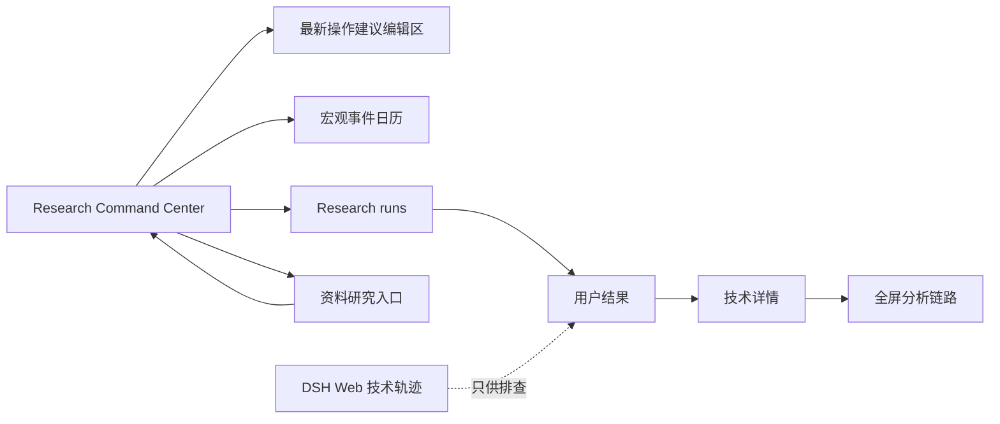
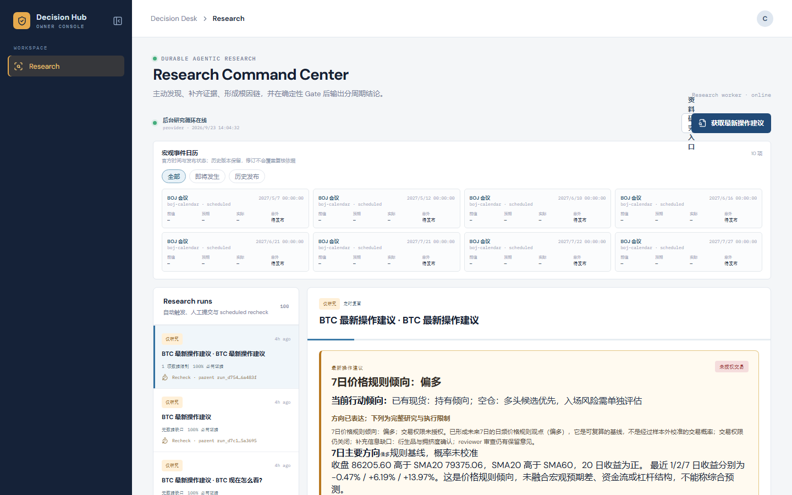
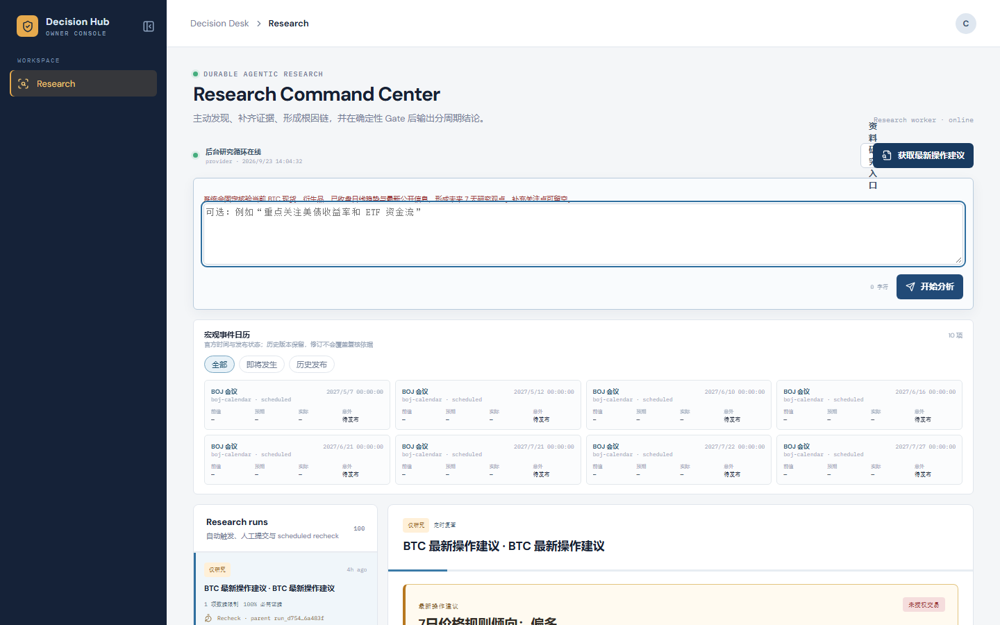
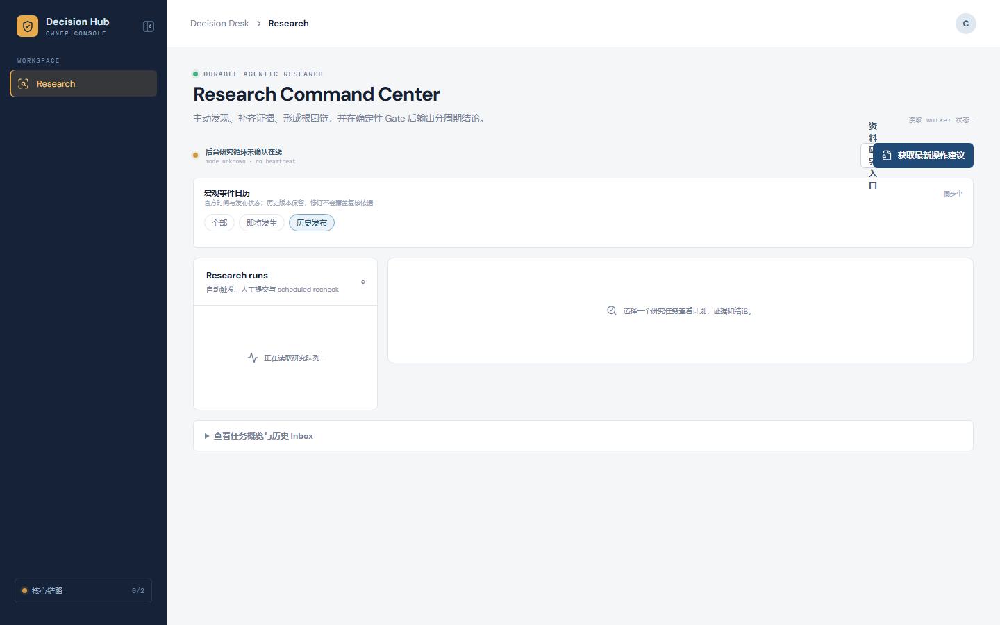
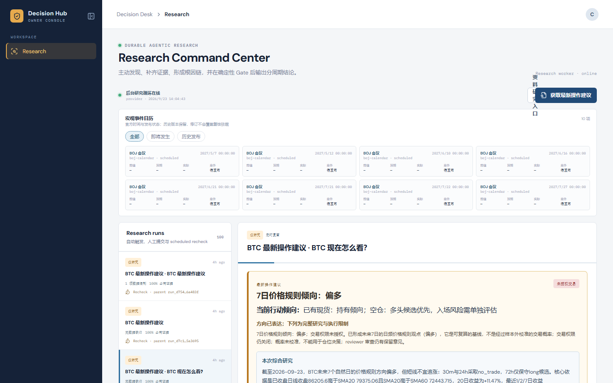
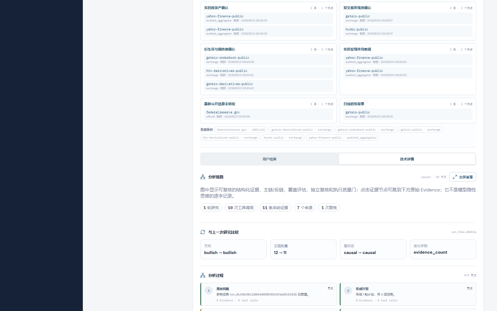
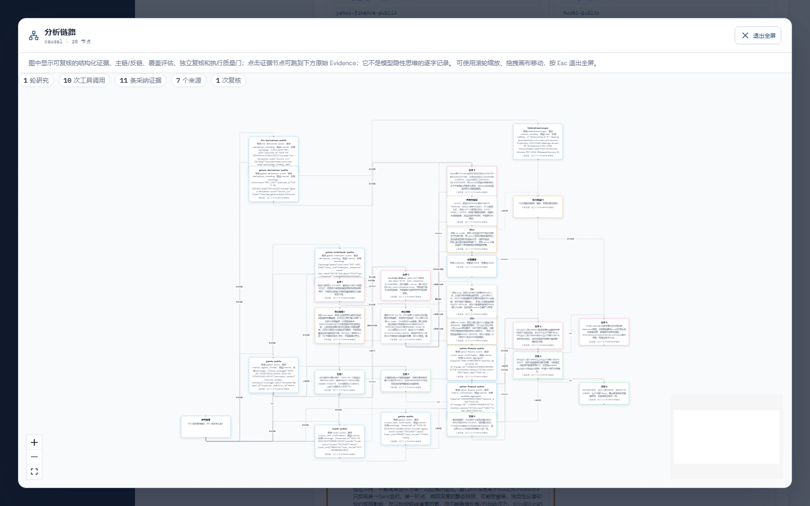
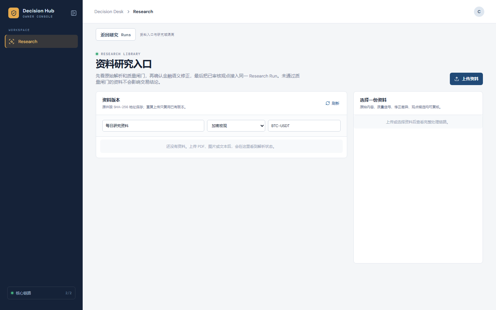
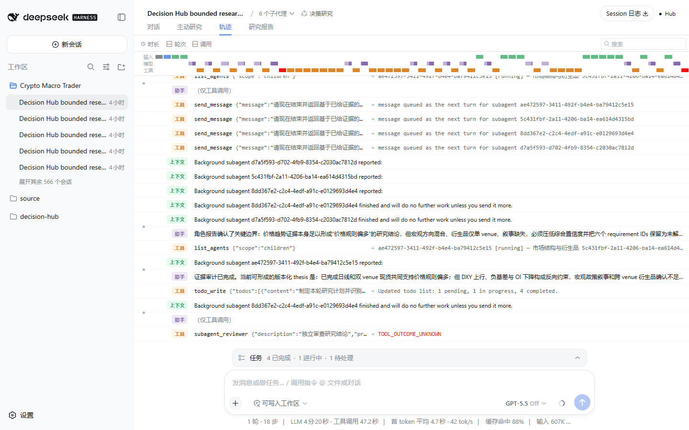

# Decision Hub 页面级使用、交互与截图交接稿

本文是给 UI 设计和前端联调使用的页面稿，不是架构说明。每个页面状态都配有真实运行截图，并说明入口、用户操作、界面反馈、数据含义和异常处理。设计稿应以本文的状态和交互为准，再决定视觉风格、组件尺寸和响应式布局。

截图来源：本地 Decision Hub 实例，2026-09-23，1440 × 900，Windows PowerShell 启动方式。截图只包含本地页面，没有上传用户资料，也没有显示任何 API Key、DSH token 或服务间密钥。

截图可用下面的受控脚本重新生成，图片会写入本文同目录下的 `ui-screenshots/`：

```powershell
pnpm --dir apps/source_acquisition_worker exec node scripts/capture_ui_handoff.mjs
```

脚本通过本地静态预览加载前端 bundle，再把 `/v1/*` 请求代理到当前 Hub API，避免截图首次加载受到 8047 大资源流式传输速度影响；页面交互仍按真实 Decision Desk 和 DSH Web 运行。

## 1. 用户从哪里开始

普通用户只打开 Decision Desk：

```text
http://127.0.0.1:8047/
```

主导航当前只显示 `Research`。Research 页面包含四类工作：

1. 获取最新操作建议。
2. 查看宏观事件日历和历史发布状态。
3. 查看研究任务、方向性结论、证据和根因链。
4. 进入资料研究入口，上传并审核 PDF、图片或文本资料。

DSH Web 是技术人员查看会话、工具调用和轨迹的内部控制台：

```text
http://127.0.0.1:3097/
```

它不承担业务报告、交易 Gate、证据账本或用户操作建议。UI 设计中应把 DSH 作为“技术排查入口”，不能和 Decision Desk 并列成两个业务首页。

## 2. 页面关系和返回路径



页面之间尽量使用同一 Run 的上下文返回，不重新创建任务。报告页的“返回研究 Runs”只返回列表，不会丢失已经生成的报告。

## 3. Research Command Center：研究首页



### 页面用途

这是普通用户的默认首页。用户在这里看到服务是否在线、宏观事件、研究任务列表和当前选中的报告。

### 页面组成

| 区域 | 用途 | 设计要求 |
|---|---|---|
| 左侧导航 | 当前只有 Research | 保留产品标识、入口名称和当前选中态 |
| 顶部状态 | 显示 Research worker、mode、heartbeat | `online`、`unknown`、`degraded` 必须使用不同状态；未知不能显示为绿色健康 |
| 资料研究入口 | 打开资料库页面 | 入口固定、可见，不要藏在设置中 |
| 获取最新操作建议 | 打开研究输入区 | 主要行动按钮，视觉优先级最高 |
| 宏观事件日历 | 查看全部、即将发生、历史发布 | 每张事件卡显示前值、预期、实际、意外和发布时间 |
| Research runs | 查看自动触发、人工提交和 scheduled recheck | 列表项必须显示状态、时间、证据覆盖和父 Run 关系 |
| 报告区 | 显示当前 Run 的用户结果或加载状态 | 首屏加载时显示正在读取哪个资源，不要使用空白大卡片 |

### 用户操作

1. 页面加载后先读取 worker 状态、事件日历和研究 Runs。
2. 点击“获取最新操作建议”进入输入区。
3. 点击日历范围切换数据集。
4. 点击某一条 Research run 打开该 Run 的报告。
5. 在报告区使用“用户结果 / 技术详情”切换视图。

### 页面状态

- `loading`：显示“正在读取 worker / 日历 / Research runs”。
- `online`：显示 heartbeat 和最近更新时间。
- `unknown`：明确显示未确认在线，不能自动降级成 online。
- `degraded`：显示具体来源、影响范围和下次轮询时间。
- `empty`：显示暂无任务或暂无事件的原因，不填充演示数据。

## 4. 获取最新操作建议：输入和提交



### 页面用途

用户不需要理解 agent 关键词，也不需要写完整 Prompt。点击入口后，空输入就会触发固定的 BTC/宏观研究模板。

### 交互流程

1. 点击“获取最新操作建议”。
2. 页面展开说明文字和文本框。
3. 文本框可以留空；也可以补充关注点，例如“重点关注美元指数和 ETF 资金流”。
4. 点击“开始分析”。
5. 页面立即创建一个 Research run，显示 `queued`，随后进入 `researching`。
6. 用户可以留在当前页面，或者点击新出现的 Run 查看进度。

### 交互规则

- 空白输入的真实提交内容由系统补成“获取最新操作建议”。
- 同一时间窗口和同一内容使用幂等键，避免连续点击重复创建任务。
- 文本框右下角显示字数。
- 提交期间按钮显示 loading，禁止重复点击。
- API 失败时显示 error code、是否可重试和保留输入内容。
- 不要求用户填写时间周期、交易所或内部 capability 名称。

### UI 需要覆盖的状态

| 状态 | 用户看到的内容 |
|---|---|
| 初始 | 可选说明、开始分析 |
| submitting | 按钮 loading，输入只读 |
| queued | 已入账，等待 Research worker |
| researching | 当前 round、工具数、最近更新时间 |
| failed | 错误原因、重试按钮、原输入保留 |
| completed | 自动打开对应报告 |

## 5. 宏观事件日历：全部、即将发生、历史发布



### 页面用途

日历为研究提供固定事件上下文。它不是静态装饰：事件有来源、发布时间、前值、预期、实际和意外，发布后的修订不能覆盖旧版本。

### 操作说明

- `全部`：显示当前账本中的所有事件。
- `即将发生`：显示未来事件，帮助用户查看风险窗口。
- `历史发布`：显示已经有实际值或历史版本的事件。
- 点击事件卡可进入详情（后续 UI 可设计侧边抽屉或详情页）。

### 空态要求

截图中的“历史发布”返回 0 项，页面显示真实空态。此时应明确写出“尚未采集历史发布”，不能把未来事件复制到历史区域，也不能把缺失值显示为 0。

### 事件卡字段

```text
事件名称
来源与状态
发布时间
前值 / 预期 / 实际 / 意外
来源链接和观察时间
```

## 6. Research report：用户结果



### 页面用途

报告页把研究账本转换成用户能理解的方向、行动候选和执行限制。它必须让用户先看到结论，再看到证据和限制。

### 首屏内容顺序

1. Run 标题和状态。
2. 最新操作建议。
3. 7 日方向基线。
4. 当前行动候选。
5. 30m / 24h / 72h 分周期候选。
6. 触发条件与失效条件。
7. 概率状态、交易权限和 Gate 状态。
8. 主要依据与反方限制。

### 真实报告示例

本次截图对应的真实 Run 给出：

- 7 日价格规则基线：偏多。
- 30m、24h：`no_trade`。
- 72h：保守 `long` 候选。
- 证据、来源和执行权限单独展示。
- 概率可能是 `uncalibrated`，交易权限未授权。

UI 不应把 `no_trade` 渲染成“系统没有分析”，也不应把“偏多”直接渲染为已授权买入。

### 报告内交互

- 点击 Evidence ID：定位到证据详情和来源链接。
- 点击“技术详情”：打开专家角色、工具调用、复核和校准信息。
- 点击“全屏查看”：打开完整分析链路。
- 滚动到反方和限制：查看哪些事实可能推翻当前方向。
- 点击重新研究：创建新的幂等 Research run，不覆盖旧报告。

## 7. 技术详情：证据、复核和过程摘要



### 页面用途

技术详情供技术人员、研究员和审查人员复核。它展示结构化研究摘要和审计数据，不展示模型私有逐字思维链。

### 需要展示的模块

| 模块 | 说明 |
|---|---|
| 专家角色证据包 | 每个角色观察到的事实、观点和来源 |
| Research trace | 轮次、工具调用和运行状态 |
| Evidence | authority、quality、观察时间、requirement、URL |
| Coverage | 必需证据覆盖率、软缺口、硬缺口 |
| Counter thesis | 反方链和可能推翻条件 |
| Review | 独立复核意见、限制和结论状态 |
| Forecast audit | 预测点、复盘时间和校准状态 |
| Owner command | 重新研究、复核或需要人工处理的动作 |

技术详情的所有模块都应该支持折叠和展开；默认展开结论相关模块，工具原始参数放在二级详情中。

## 8. 分析链路：内嵌与全屏



### 页面用途

分析链路用于说明“结论由哪些证据、覆盖检查、主链和反方链组成”。它是可复核的结构化图谱，不是模型私有思维链。

### 交互

1. 在报告页点击“全屏查看分析链路”。
2. 全屏弹层显示图谱、审计摘要和节点数量。
3. 使用 `+`、`-`、`Fit View` 调整视图。
4. 使用拖拽移动画布，Mini Map 定位远端节点。
5. 点击节点查看 Evidence 摘要、来源和关联的因果 link。
6. 点击“退出全屏”返回报告原位置。

### 节点类型

- 研究触发。
- 研究轮次。
- 工具调用。
- Evidence。
- Coverage 和质量门。
- Main causal chain。
- Counter chain。
- Independent review。
- Forecast 和执行状态。

复杂图谱必须支持节点折叠、分组和定位到证据，不能把后端 JSON 原样放到画板里。

## 9. 资料研究入口：资料上传和审核



### 页面用途

用户可以把 PDF、PNG、JPG、WEBP、TXT、MD、HTML 等资料放入研究资料库。资料需要先解析、质量检查和金融语义修正，再允许接入 Research run。

### 操作流程

1. 在首页点击“资料研究入口”。
2. 点击“上传资料”。
3. 填写资料标题、市场、标的和隐私模式。
4. 上传文件后等待解析。
5. 查看原始解析、表格、图片、质量信号和未决块。
6. 触发大模型语义修正，查看原文和修正稿 diff。
7. 用户确认修正稿；原文始终保留，不能静默覆盖。
8. 通过质量门后，点击“结合此资料获取最新建议”。

### 必须呈现的状态

- 上传中。
- 解析中。
- 解析完成但质量不足。
- 语义修正待确认。
- 修正已确认。
- 资料已连接到 Research run。
- 解析失败，可重试。

## 10. DSH Web：技术轨迹控制台



### 页面用途

DSH 显示 Session、子代理、工具调用、模型消息、时间线和原生研究报告，用于回答：模型实际调用了什么、哪一轮结束、哪些工具失败、为什么进入有界状态。

### 允许的用户动作

- 选择 `Crypto Macro Trader` 工作区。
- 搜索历史 Session。
- 切换“对话 / 主动研究 / 轨迹 / 研究报告”。
- 查看工具调用和时间线。
- 查看子代理状态和失败结果。

### 业务边界

- DSH 不产生第二份用户交易结论。
- DSH 原生 JSONL 和 Session 不能直接当作 Hub Evidence。
- DSH 页面不显示在普通用户主导航中。
- UI 不应要求业务用户理解 DSH 的 Session、workspace 或 capability。

## 11. 全部页面状态规范

| 状态 | 页面表现 | 用户动作 |
|---|---|---|
| loading | 指明正在读取的资源 | 等待或返回列表 |
| queued | 显示已入账和等待的 worker | 查看任务或离开页面 |
| researching | 显示轮次、工具数和最近活动 | 查看技术详情 |
| research_only | 显示研究方向，但明确未授权交易 | 查看证据和限制 |
| no_trade | 显示当前方向与执行缺口 | 查看触发条件和失效条件 |
| degraded | 显示失败来源、影响周期、下次轮询 | 重新研究或等待来源恢复 |
| failed | 显示 error code、origin、retryability | 重试或查看技术详情 |
| document correction pending | 原文、修正稿、diff、待确认块 | 确认或退回修正 |
| empty | 说明为什么没有数据 | 返回、刷新或上传资料 |

## 12. UI 联调接口对照

| 页面动作 | Hub API |
|---|---|
| 读取首页状态 | `GET /v1/decision-desk/summary`、`GET /v1/health` |
| 获取 Research runs | `GET /v1/research/runs` |
| 提交最新建议 | `POST /v1/research/observations` |
| 读取事件日历 | `GET /v1/macro-events?scope=all|upcoming|history` |
| 打开报告 | `GET /v1/research/runs/{id}`、`GET /v1/runs/{id}/view` |
| 打开因果图 | `GET /v1/research/runs/{id}/decision-graph` |
| 技术详情 | `GET /v1/research/runs/{id}/observability`、`GET /v1/research/runs/{id}/inspector` |
| 预测复盘 | `GET /v1/research/runs/{id}/forecast-audit` |
| 资料列表 | `GET /v1/research-library/documents` |
| 上传资料 | `POST /v1/research-library/documents` |
| 查看解析块 | `GET /v1/research-library/versions/{id}/blocks` |
| 查看修正稿 | `GET /v1/research-library/versions/{id}/correction` |

UI 只消费这些 Query View 和 contract，不要直接读取 SQLite、DSH JSONL 或 worker 日志。

## 13. 本次截图和联调发现的异常

1. 无缓存浏览器首次加载 2.2 MB 左右的前端 bundle 较慢，可能暂时显示 worker unknown 或报告 loading。设计稿必须保留 loading/unknown 状态；部署时应继续做静态资源 CDN、压缩和代码分包。
2. BLS 官方 RSS/ICS 入口当前返回 403，日历页面必须显示来源 degraded，不得伪造历史值。
3. 某些 DSH 研究会话会在证据充分但 synthesis 没有生成完整 causal case 时以 `research_only / synthesis_incomplete` 结束。报告页必须显示“研究完成但结论不完整”，不能渲染成完整交易授权。
4. 历史发布为空时是真实空态，不代表前端异常；需要同时展示采集范围和最后成功时间。

## 14. UI 交付验收

- [ ] 设计稿包含首页、输入区、日历三种范围、Research report、技术详情、全屏图谱、资料库和 DSH 技术入口。
- [ ] 每个页面都有 loading、empty、queued、researching、completed、degraded、failed 状态。
- [ ] 报告首屏能同时看到方向、周期、行动候选、证据数、来源数、概率状态和权限状态。
- [ ] Evidence、主链、反方链、复核和来源链接可以逐级打开。
- [ ] 全屏图谱支持缩放、适配、拖拽、Mini Map 和节点到 Evidence 的定位。
- [ ] 资料页展示原文、修正稿、diff、质量门和未决块。
- [ ] DSH 明确标注为技术轨迹控制台，不作为业务首页。
- [ ] UI 不显示 API Key、DSH token、Host secret、Session JSONL 原文。
- [ ] 以上 8 张真实截图和本文件中的操作步骤用于设计评审，不使用虚构数据替代。
