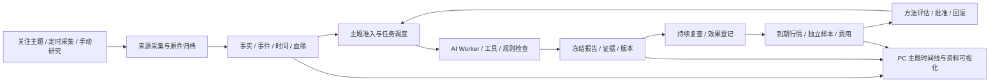

# 全链路整改执行台账

启动日期：2026-09-29。状态：**用户于2026-10-07暂停；目标工具21:53:19确认paused**。原目标覆盖 AR-01～12 / W0～W8，内容未改变；后续方向讨论不恢复实现、自测或发布。下文旧active/进行中均为其标注时点的历史记录。

总设计：[架构整改方案](../product/DECISION_HUB_ARCHITECTURE_REMEDIATION_PLAN_2026-09-29.md)。发现依据：[审查证据](../evaluations/ARCHITECTURE_AUDIT_2026-09-29.md)。本文件是执行进度的唯一入口，不以旧文档的“完成”推定本轮完成。

## 接续工作规则

1. 每次继续先读本文件的“当前接续点”，再检查实际代码/运行状态。不得重新创建平行的总执行清单。
2. 子步骤状态：待办 → 进行中 → 实现待验 → 验证通过；有未通过项就保留失败原因和下一步。
3. 每个完成步骤追加记录：修改、命令/操作、实际结果、证据路径、未完成部分。不能只记录“已修复”。
4. 业务数据迁移先备份和测试副本预演，保留原记录与纠正关系。当前工作区已有大量用户/前序修改，不重置、不清理。
5. 目标完成需所有约定门通过；长期观察、外部数据授权或校准未满足时，写清边界，不能虚构成功结果。

## 工作包总表

| 包 | 对应问题 | 状态 | 完成门 |
|---|---|---|---|
| W0 验收与接续基线 | AR-12 | 进行中 | 同一配置/数据/构建可定位，台账与复现工具可接续 |
| W1 来源、日历与时间 | AR-01/02/03 | 进行中 | 真实源 fixture、插入/修订、时区精度、覆盖、迁移与 UI 一致 |
| W2 运行与队列隔离 | AR-04 | 原核心隔离/活动互斥通过；本轮watcher与Stop RPC修复实跑通过，冷子资源见证未完 | 单 Worker 故障不关闭报告，任务可恢复且无重复发布；旧A5原因未证 |
| W3 主题身份与主动触发 | AR-05/06 | 自然定时复查已保存真实报告；本轮head0069只读pending0/completed0，没有自然临阻恢复正控，保留待验 | 不以scheduled_recheck替代discovery recovery；不制造paidRun/改时钟/重放旧ignored来源作为证明 |
| W4 数据血缘与 PIT 复用 | AR-07 | 核心验收通过；旧归档缺失明示 | 原文可追溯、跨任务复用保留版本、无未来信息泄漏 |
| W5 观点、发布与评估分层 | AR-08 | 默认/自动三AI及独立7d原件核验通过，D10受控完整多轮联合通过；195缺件明示；真实Provider组合/完整政策未完 | 观点单独冻结评估，质量/交易门不放宽，窗口口径一致 |
| W6 数据与主题可视化 | AR-09 | 进行中 | 六类真实数据视图、旧深链、筛选刷新、完整用户路径 |
| W7 交付、反馈与经验 | AR-10/11 | 实施中；版本反馈和一次真实定时复查PC闭环通过 | 送达/已读分开，版本反馈、经验审核、文档实际处理模式 |
| W8 黄金宏观试点与总验收 | AR-11/12 | 实施中；真实黄金数据未准入 | 新市场契约与隔离、真实数据准入、完整回归与局限记录 |

## 当前接续点

### 最新接续入口（2026-10-07 暂停；预测价值方向讨论）

用户要求详细技术可行性、实现与验收方案，后续设计入口已补至[市场风险V1](../design/market-risk-v1/README.md)。按需读取8层设计、指标与批次；[当前一页纸](../design/market-risk-v1/CURRENT_FOCUS.md)记录新方案的范围/暂停/下一项，原台账作历史证据，旧AR/W执行顺序不自动恢复。所有新批次、探针和测试均未开始。

用户反馈约五天工程投入未产生可见预测增益，要求暂停原目标、讨论全球宏观/仓位/历史经验/智能体记忆及范围。本轮目标工具已返回paused；normal51发布、文档503探针与原候选整改停止，正式仍normal50/schema0071。已验成果保留，全功能交付未完成。

Root282暂停前：后端演进准入诊断3文件候选受控3P，封签稳定；Ruff3处E501未修，未写正式源/构建/部署/迁移/重载。前端3组件候选受控4P仍未发布。正常反馈与补充的Root281 PC8项可复用，但不证明市场判断正确。证据 `artifacts/pc-feedback-plan-diagnostic281/execution01/receipt01.json` 与 `artifacts/pc-confirmed-records-candidate01/execution02/vitest-report02.json`。

讨论记录：[预测价值与产品方向草案](../product/DECISION_HUB_PREDICTIVE_VALUE_DIRECTION_REVIEW_2026-10-07.md)。只读发现今天08:40后无新研究结果；22:04公开BTC/ETH滚动24小时分别−3.58%/−5.37%；最新观点偏多/未校准，并有美元利率逆风，24h尚未成熟；该Run的复查计划/子Run均0，具体未登记原因未知。正式成对试验、配对样本/标签、校准凭据均0，工程通过不能冒称预测提升。原件 `artifacts/predictive-direction-review-20261007/read-snapshot01.json`、`read-reports01.json`、`read-latest-case01.json`、`read-review01.json`；时间和口径以对应原件为准。

**当前动作是讨论目标和范围。候选新目标尚未创建，原目标未完成，不自动沿旧A→B→C→D继续。** 用户确定方向及恢复/重定目标后，从本断点及原封签核对当前状态再执行，不重造并行总清单。

后续详细讨论已记录：[产品价值根因与新方案](../product/DECISION_HUB_VALUE_ROOT_CAUSE_AND_NEW_PRODUCT_PLAN_2026-10-07.md)。两代理审查DSH/LangGraph职责、收口优先级、风险合同与报告呈现，Root有限只读冻结Run和公开日线。确认方向观察不等于路径风险、文字条件不等于自动求值、覆盖不等于预测正确；静态发现方向快捷收口可能先于未解决挑战，具体Run因果尚未证明。近期候选案例为ETH 8月19日UTC约+17.46%，北京时间8月20日约+11.51%，并用Coinbase独立核对；公告的事件日期与公开日期区分，未倒推事前必能预测。新方案提出快速监控、深度研究、受控方法验证三条线路与分层合同，旧目标保持暂停，新目标未创建；产品源写入、模型研究调用、实现测试、构建、迁移、重启、发布均0。证据保存在 `artifacts/value-root-cause-review-20261007/`；文档已按交叉审查澄清杠杆情景与不同评估分母。

### 最新接续入口（2026-10-07 21:39；Root281；正式仍为 normal50/schema0071）

| 范围 | 已完成 / 真实状态 | 确定待办与验收门 |
|---|---|---|
| 总交付 | 原目标 active；PC 优先，手机排除。有限 BTC/宏观研究可用，整个项目尚未稳定全功能交付 | 沿用 AR-01～12/W0～W8 和 A/B/C/D，不以局部测试或在线心跳关闭总目标 |
| 本批正式反馈 | 原 B 报告保存一次反馈和一次补充；两笔意见各绑定原版本与冻结评估；刷新/Study返回显示同一最新意见，原意见/原ACK/依据不变。PC8项，console=[] | 反馈保存不表示市场判断正确；完成后不再重写同一反馈作为验收 |
| 本批原业务数据 | 92主题/1277Run/663报告版本/2原效果请求，四表原行SHA在补充返回快照全部不变；新增反馈2笔/评估绑定2笔 | 没有新研究或新效果申请；脚本仅RO和GET。自然演进处理另列真实模型调用 |
| 新发现的后台阻塞 | 两笔反馈自然登记4个演进job、10次规划角色调用；1 operational_followup结束且无候选，1候选等待独立输入，2 research_plan_invalid失败 | 外层任务schema缺空字段/唯一性约束；图门更严格且拒绝子因未保存。旧失败不能猜因；最小候选统一校验、按原call/result_hash追加安全准入诊断，正式仍未修 |
| 当前页面精简候选 | 三组件仅artifact候选，Root有限控制4P；第一次3P/1F来自测试DTO生产ID与计数不一致，v2修fixture后4P，原失败保留 | 未写正式源、未构建发布、未计PC通过。保留恢复/错误按钮和主要限制；下一批与必要核心改动合并一次发布 |
| A剩余确定缺口 | 普通反馈/补充本步关闭；文档正常审核、Run/Evolution响应未知恢复已有隔离PC证据 | 文档候选接受/恢复“已提交但回执未知→离页刷新→按原键确认”的浏览器实操仍缺；先命名隔离库精确503探针，不故障注入正式库 |
| 后续唯一顺序 | A核心操作收口；B关键来源/事件时间六视图；C剩5规则/可信费用/方法配对评测批准加载回滚及装配债；D黄金准入 | 罕见自然异常、100有效样本/观察期单列条件等待，不能用重复启动或构建替代；完整Provider/native drain与全资产恢复仍开放 |

本轮证据 `artifacts/pc-core-actions281/receipt01.json`、`browser-steps01.json`、`supplement-return01.json`、`evolution-trace01.json`、`planning-diagnostics01.json`；三呈现候选 `artifacts/pc-confirmed-records-candidate01/execution02/vitest-report02.json`。Root280及更早条目是阶段快照，现有已验未改路径复用。

### 最新接续入口（2026-10-07 21:12；Root280；以下旧“最新”条目为阶段快照）

| 范围 | 当前真实状态 | 下一步 / 边界 |
|---|---|---|
| 原目标与交付 | 原目标 active；PC 优先，手机排除；正式 normal50/schema0071 | 全 AR/W 未完成；内部 BTC/宏观研究可用，稳定全功能交付未签收 |
| 本批用户功能 | 主题最新报告优先；当前任务/下一步按真实字段；历史/最近任务/审计折叠；分类搜索横排；长标题限行、已知中文投影；无报告动作区分 | 首屏阅读入口约1347→269px。原报告/证据/前版/效果与分页入口保留；未映射英文原文、相似主题和旧回执说明仍需收口 |
| 正式发布 | 3源变更，2043源/3594产物；一次标准UI构建含type，33.992秒；候选type另1；Host/迁移/新模型0 | 首次因2条自然来源租约在Stop前失败；原证据保留，租约自然释放后显式retry02通过。单UI改动牵动全局发布的债仍在 |
| 本批实证 | 3受控React/client节点；正式PC17项，console=[]；正式2GET/3检查；92主题/663版本/1277Run/2原请求全部行SHA不变 | 正常启动/7服务心跳/4HTTP及PC后监督者+10角色精确身份通过。只证明本批受影响路径，不代表全PC异常矩阵 |
| 复用与未完 | normal47主线7/恢复3、normal48路由8、normal49分类API28/PC13复用；14规则9执行器接线 | W3自然阻断恢复、关键来源/时间六视图、5规则、可信费用/成熟评估、完整Provider、真实方法演进/回滚、黄金未完 |
| 下一批唯一在制 | A：按现有PC矩阵关闭剩余核心操作/异常缺口，降低旧完成回执及效果解释的阅读负担 | 收口后B来源/六视图，再C规则费用演进/装配边界，最后D黄金。没有新输入的罕见异常/成熟样本单列观察，不重复构建 |

实际命令、原失败、修复、备份和限制见末尾阶段追加。旧PID/bundle不作当前启动依据。

- **最新 W6.4d 本步 PC 验证通过**：旧账本文本提交先保存固定请求键、同键回执恢复、成功定位原 Run；资料解析/整理失败建立新版本，旧失败/原件/源时间保留，候选接受/拒绝落库。真实浏览器发现并修复深链丢版本、切资料被旧响应拉回、抽屉状态落后、未检查显示0%及整理原因英文。运行审计两类下钻多级返回保留账本筛选。125 前端联合/36 追加专项（有重叠）、12 文本后端/19 资料后端、类型/Ruff/最终构建7.03秒通过。仅API35312→29984和资料33836→25428重载，另8原身份未变；正式6表旧行SHA与330cf原报告10类字段未变。两隔离浏览器服务仅用于故障/规则流程，不作为真实研究成功。CIM降级发现/保存身份/根退出竞态8专项及真实探针树停止通过，旧启动器内存未热加载；资料复用CLI全新目录实际启动与405隔离通过、已停止。证据`W6/pc-observation-recovery/acceptance.json`和`W6/pc-document-recovery/browser-checks.json`。**PC剩余：其余页面/异常分支矩阵、旧抽屉与流程少量未知技术代码。** 手机暂停，总目标active。

- **W7.4g（HM-02）局部验证通过**：评分只重算原accepted时效，不提升candidate/stale/rejected/conflicted；v2评分绑定登记资产、旧v1不可重标。43旧comparison只读盘点4份/8案例/16候选受到提升；三库与原文件SHA未变。Replay审计接原registry实际deny gate、真实Kernel Evidence/Fact同事务准入，四冻结集实际hard mean均5/18、accepted Fact=0，源授权和历史可得时点缺口保留，离线audit明确不能晋级/部署。60联合/Pyright/Ruff通过，无模型或正式比较。总方案13.6与`W7/hm02-replay-admission/REPORT.md`可接续；HM-03～07完整政策/方法身份/隔离配对/加载回滚仍未完成。

- **最新 W6.4c 本步 PC 验证通过**：技术摘要使用真实引用与已知中文字段，原始 JSON/英文和精确数值仍可展开；终态流程显示8/8步已结束、5步有限制。图谱新增100%清晰阅读/全貌和可访问节点按钮，实际证据下钻/同节点返回通过。404/临时读取失败不再静默换Run；DSH四页与完整报告返回链通过，26条工具记录不冒称取证。首条真实long/24h观察已成熟且未命中，页面如实显示-0.04%，1方向样本仍不展示总体命中率。132前端联合通过、28项DSH补修通过（重叠）、7评测入口、类型/Ruff/构建通过，10服务原身份未变、无人工写库或新研究提交。证据`W6/pc-technical-readability/acceptance.json`。**下一步PC：旧Inbox文本提交幂等与回执丢失恢复、真实文档接受/拒绝/失败恢复、少量技术参考类型及其余状态；后台先完成HM-02评分准入、完整政策/方法身份与隔离对照，再真实部署回滚。** 手机暂停，总目标active。

- **W7.4f（HM-01）对照入口局部修复通过**：`dsh-web-graph`现在创建实际Web适配器且product_graph=true，不误入SDK；7项真实CLI构造选择测试通过。总方案第13节新增HM-01～07精确断链、代码证据及实施门。评分仍可能把未采纳材料升级、发布与评分政策尚未完整消费、隔离API/MCP/Host仍待贯通；本轮没有执行模型对照或改变正式门阈值，不能将此入口修复当作Harness验收通过。

- **最新W6.4b本步PC验证通过**：图谱普通/全屏采纳统计13→10、来源9→6，候选材料仍保留。反方角色从实际已采纳引用关联10条跨领域证据，保留对应要求缺口；空证据不称充分。31后端/44前端/Ruff、build6.56秒通过；正式API+PC/返回技术页、console=[]通过，原报告10类字段逐项相同。08:44发现原启动器及10进程全不存在/8047无监听，单次ensure_product恢复，10新身份有效；2d5c原Run接续至08:45:57受限报告、1结果，无重复人工提交，退出原因未确认。证据W6/pc-evidence-counts/acceptance.json。下一步继续技术详情可读性/整体图字号与PC完整矩阵，及完整Harness方法发布评测、来源时间/费用/黄金完成门。手机暂停，总目标active。

- **最新 W7.4e 本步验证通过（PC）**：完整任务先冻结、单轮要求单独保存；120 后端/65 前端/schema/Ruff通过。核验原始初始检查点后追加恢复82任务凭据、追加81条v4评估，重复均0，8表原行SHA不变。真实PC一次默认研究330cf于08:21:46→08:27:13完成受限报告；完整6项先保存，约62毫秒后提交5项单轮请求，最终6项/补充75%/叙事缺口一致。13材料/10采纳/11取证/5协作/1复核，1次网页404保留，不称全调用成功。仅API和双研究Worker重载，其余7进程不变，10身份有效。证据W7/task-basis/acceptance.json。**下一步W6.4b：PC技术图把candidate计入采纳（13对10）和来源（9对6），技术摘要原始英文/JSON仍需整改；后续完整方法部署评测、来源/费用/黄金完成门保留。** 手机暂停，总目标active。


- **W7.4e问题起点（现已按下方记录修正）：首次DSH请求已被`requirements_for_round`筛成单轮可执行要求，不能当作完整任务要求。** 正式40679e报告有market_narrative缺口、补充覆盖75%，保存执行请求却只有5项、不含该要求。W7.4b/c的82Run口径一致仅证明投影一致，**不证明失败任务全局覆盖已正确**。需冻结完整base request（预算/要求/研究模式/时间/方法），与轮次请求分开；核验既有凭据可恢复范围，无法证明的旧任务保持未知；审计并追加纠正受影响价值快照，原评估保留。证据W7/query-configuration/full-vs-round-requirements.json。PC已去掉“0项未就绪”的误导汇总，改为执行请求记录范围。

- 最新 W7.4d（预算/配置显示专项通过）：历史预算读取首次保存执行请求，Pack版本/质量门声明读取校验过的冻结凭据；缺失字段null/未记录，未保存工具版本/来源注册表不再借用当前配置。预算未知不显示进度比例；运行profile与角色配置分开。刷新评估工具终态按真实RunStatus纠正。64后端/62前端/schema/Ruff/build7.31秒通过；82Run只读核对、8表SHA未变；3类API均200，PC已保存/未知两类通过，console=[]。API33064→10912→34304，另9进程未动、10身份有效；无新人工研究/迁移/评估回填。证据W7/query-configuration/acceptance.json。总目标active，手机暂停；完整方法部署/评测、PC矩阵、来源/费用/黄金仍未完成。

- 最新 W7.4c 本步通过（PC）：列表/详情/DSH业务状态/可观测性改用首次保存请求和原PIT，未知不显示0缺口/0%；展示轮次保留材料与调用，执行契约仍严格。修复storage/source_registry错误来源造成的业务状态HTTP500；PC实测新增失败页材料入口，查看不重试、返回保留筛选，角色未知不再显示无职责缺口。55后端/59前端/schema/Ruff通过，最终build6.52秒。82正式Run投影一致；8表旧行SHA相同；仅API27740→33064，另9进程不变、10身份有效。证据W7/query-coverage/acceptance.json。**接续优先：历史预算/运行版本引用仍读取当前Pack、技术详情原始JSON/英文和完整PC矩阵；继续完整方法发布评估及部署回滚、来源/费用/黄金完成门。** 手机暂停，总目标active。

- 最新 W7.4b 本步范围通过（PC）：失败任务价值评估改用首次保存请求的实际要求与 PIT；缺失/无法校验为未知，旧数值不冒充可靠覆盖。55 后端、36 PC 专项、schema/Ruff/build6.78秒通过。副本/正式均追加82条（75请求、6旧格式无法核验、1报告），原81条不变，重跑新增0；82Run/1结果/1制品/1报告版本/102角色/93提示逐行SHA不变。真实PC三类页面/返回列表/中文不交易不计分/console=[]通过。API27740/研究35596/用户研究36188恢复，另7进程不变、10身份有效。证据W7/value-basis/acceptance.json。**下一步优先修复 query_views/research/service.py 的 _requirements_for_run/_fallback_coverage/observability 仍以当前Pack和观测时间重算旧失败/进行中任务的显示口径，保持与本步价值快照一致；再继续完整发布/评估规则及方法部署回滚。**全PC矩阵、来源/费用/黄金等未完成；手机暂停，总目标active。

- 最新W7.4a本步通过：修复Pack准则/角色文件未进入DSH提示的断链。新Run冻结真实内容与渲染SHA，首次/修补提示消费，同Run保留原内容且提示漂移拒绝。PC一次默认研究40679e69于06:41:27→06:46:24保存仅研究报告；14证据/10取证/5子研究/1复核/36Host尝试0失败。真实Host逐字提示、8项方法、7项模型及7会话工具目录通过；75后端+1归档专项、3PC测试/build6.61秒通过。原56方法/Pack行SHA不变，仅API9188/研究21508/用户研究19868重载，另7进程不变。证据W7/pack-instructions/acceptance.json。下一步继续完整外层流程/发布与评估规则的实际绑定、完整Harness候选的评测和审核部署/回滚；其余PC异常矩阵及BLS真实可用渠道仍未完成。手机暂停，总目标active。

- 最新W1.4b本步验证通过（PC）：401/403分类及24小时持久退避已部署。真实BLS日历06:28:27、发布06:29:49计划请求均403，下一次均为10/2同一时间；保持degraded，未宣称来源恢复。58来源后端、最终14PC测试与build6.86秒通过；正式PC刷新/分页/原文/返回及console无错误，370条旧回执hash不变。仅API19624/实时11900重载，另8进程不变。证据W1/source-access/acceptance.json。下一步仍需官方来源合法可用通道、完整方法部署/配对评测及其余PC异常矩阵；手机暂停，总目标active。

- 最新W6.4a：PC首页→市场→日历、资料详情/原文分页/返回、管理→数据更新/失败筛选/覆盖/返回实际核验。修复日历选择一类或空搜索后丢失其他类别：新增完整账本类别查询、刷新/清除筛选、失败提示；新增按钮样式补齐。修复失败作业0分区仍显示已校验及原始connecterror露出，原清单仍可查看。12后端、34前端首轮，最终46专项通过（重叠不相加）；最终构建6.58秒/index-D5IQ9h4E.js507.07KB，500KB警告保留。只重载API35372→948，其余9进程未动、10身份有效，无迁移/新人工研究/上传/审核。证据W6/pc-calendar-filters/acceptance.json。**下一步优先核查首页2个来源需检查的当前原因及恢复路径，补PC异常矩阵；继续来源语义/真实方法部署评测/费用/黄金准入，不能把此6条路径视为全部PC完成。**手机暂停，总目标active。

- 最新W1.4a收口：内容发布时间解析、非市场时效准入与PC说明已正式部署。PC仅一次更新产生6ceabf23959d870e55b3cc3dd7a18555，05:49:38→05:56:03保存仅研究报告；10市场accepted，Fed声明09/16T18:00Z为stale、日历及情绪API缺可信发布时间为candidate。31Host尝试0错误、9Gateway、5子研究、1复核；PC自动显示结果，明确最新公开信息未核验。旧网页时间说明、新过时材料入口、档案、保存原文、关闭返回及最终报告实测通过，console=[]。93后端+22流程，204前端全套通过；最终文案后30专项通过/build6.36秒，证据W1/publication-time/acceptance.json。9表旧行保留，候选14/演进15未变，五服务受管重载后10身份有效。接续优先PC完整按钮/故障恢复矩阵、来源可读性与时间时区说明；同时保留原文到分区语义重演、真实候选成对评测/完整方法部署、费用/黄金准入等完成门。下次复查计划06:05，先观察已有任务避免重复提交。手机暂停，总目标active。

- 最新W7.3a：0063冻结上下文已部署，正式恢复406baac2任务5次真实调用全部成功，候选9f8fb919已保存并等待独立材料。574项输入逐条保留：492取消不作方法失败、82问题运行汇总9组；原失败任务不改写。38后端、12PC专项通过；83原表迁移数据不变，重复恢复命令核对5张表全部行不变。PC终态/调用/输入记录已验，console无error。**新确认的优先问题：runtime类型候选提出Host预检、Provider冷却、暂停Worker等操作，但当前CandidateConfigurationRuntime只追加提示词，不能执行这些操作；需要建立可执行变更准入与运行问题分流，不能把材料补齐等同于候选可用。**证据W7/frozen-context/acceptance.json。真实评测、完整方法部署和剩余PC仍未完成；总目标active，手机暂停。

- 最新W7.2z：逐角色规划调用诊断与覆盖失败retryable传播已实现并部署0062；35后端+追加7专项（重叠）、10PC通过，82原表迁移hash不变、10服务在线。真实Provider副本重放捕获反向复核引用越界，图内补做成功，6次调用含失败均落库。**发现关键后续问题：原定时任务574个run引用均未解析为实际运行上下文，约3.3万字符占位输入**。正式原任务仍失败1次、12候选等待，未改写旧历史；PC旧诊断空态已验，真实调用在副本验证，非正式恢复成功。下一步修正运行引用解析/冻结/有界分批与候选来源，再做正式有审计恢复；真实材料/前瞻与完整部署等总目标仍待做。证据W7/planning-diagnostics/acceptance.json，手机暂停。

- 最新W7.2y：已修正历史回放的共享正确性标签与方向收益，观望不计方向成绩；新评分版本进入阶段绑定，旧v1/v2结果保留但禁止新晋级。67后端专项、194 PC组件测试通过；部署仅恢复API/演进进程，另8服务不变，9张业务表全部行hash不变。PC刷新/报告往返/任务展开收起通过，截图发现的无样式按钮已修正。真实评测仍0，12候选等待独立材料、1定时规划失败；下一步真实材料准入、配对有效集合和前瞻衔接、定时规划持久诊断。证据W7/market-scoring/acceptance.json。总目标active，手机暂停。

- 最新W7.2x：阶段凭据/复用/部分投影恢复已实现，44后端、11PC、Ruff及构建通过；0061副本及正式迁移核对81张原表数据完全不变，10个受管服务恢复、PC候选和失败入口正常。**真实评测阶段仍未验通**：默认材料重复，正式阶段凭据/实验均0，不能用隔离合成测试替代。13演进任务已结束本轮执行：12候选waiting_inputs、1定时扫描research_coverage_missing失败，13方法版本含基线、0审核决定。证据W7/stage-recovery/acceptance.json。下一步真实历史材料准入与前瞻试验衔接，修正离线标签按每个方法的预测重算，以及定时规划失败的持久诊断；完整正式部署/回滚、Provider身份、剩余PC与黄金仍待做。总目标active，手机暂停。

- 最新W7.2w本步通过：演进Worker纳入正常受管启动；正式2条反馈均自动生成真实候选并停在waiting_inputs，0未登记反馈、0评分/审核决定。新增候选持久化后的材料等待/同候选恢复，旧重复fixture不再使规划前直接失败，但仍不能进入评测。真实探测找到并修复严格输出schema的400错误（存储可选范围与模型必填分离）。40后端/20PC、schema/Ruff/构建通过；真实进程9728→35320恢复，2反馈候选hash/attempt/指针不变，另9服务身份不变。PC任务优先级/默认5项、展开收起/拒绝取消/未评测禁止启用通过。最终记录5等待/1运行/7排队，后台仍自动处理已登记任务；总目标active，手机暂停。证据W7/evolution-waiting/acceptance.json。**下一步真实历史材料准入与前瞻阶段分离/恢复、候选内容可读、正式方法部署消费及回滚**；不是所有演进任务或全部PC完成。

- 最新W7.2v本步通过（PC）：候选/提案/实验显式执行范围，方向综合与完整研究比较隔离；未知/Harness不能晋级或回滚方向指针，旧payload/hash不回填。0060副本预演、停机备份及正式迁移通过，1172 Run/1513角色记录/578研究结果/589制品与报告版本原字段逐表不变。相关后端76、最终范围/前瞻39、HTTP7及Harness1项（有重叠）；PC12项、schema/Ruff/构建通过。真实PC演进→288415报告→演进往返通过，13证据/9网关/33归档尝试保留。证据W7/execution-scope/acceptance.json。**下一步演进Worker受管启动与实际独立输入准入，再完成正式方法部署消费/回滚**：当前2反馈未转任务、候选/实验均0，默认三阶段材料重复，不能把空页验收当生成链完成。完整Provider、费用、长期样本、黄金及其余PC异常矩阵仍待处理；总目标active，手机暂停。

- 最新W7.2u本步通过（PC）：新研究pending→DSH预留即保存真实版本，运行中投影从该Run身份读取，旧fake.v1不回写、不推断Fake执行；Host归档工具尝试/嵌套结果与失败分类纳入v3追加核验并在PC展示。旧f573实际43尝试/11取证/2参数失败（网关9）；0ed为33/9/0。新288415b3由PC单次“更新公开证据”于02:30:09→02:34:55保存报告，运行中DB/API已为真实dsh-web版本；13证据/9取证/5子研究/1复核、归档33结果齐全0错误、各1Run/关联/报告/版本。55后端+最终嵌套格式3项（重叠）、35PC、schema检查通过；最终PC index-BkBnfJjL.js503.06KB警告保留。仅受管恢复API/实时/两研究Worker，其他5服务未动。证据W7/host-attempts/acceptance.json。**下一步完整方法/Provider部署消费与回滚、演进Worker、其余PC按钮/异常矩阵与英文术语**；真实费用、成熟前瞻样本、黄金来源准入仍未完成，总目标active，手机暂停。

- 最新W7.2t本步通过：实际适配器生成逐路由symbols/必填/数量/历史数据集字段，来源登记与能力/路由域名取交集，文档工具暴露真实evidence_ref/content_ref。插件846585…，PC真实0ed411于02:00:58→02:05:25完成，9取证/13证据/5子研究/1复核，归档33个全部工具结果齐全且0错误；7会话目录新增参数与范围门、模型/时间/方法检查通过，各1Run/关联/报告/版本。此次9次取证全在主会话，不能将5子研究数量说成子角色实际取证，也不能将不同模型轨迹的38→0当受控改善率。42后端/123Host/24专项（重叠）通过。终态后仅MCP12160→1336加载源域名交集修正，其余8服务身份不变，当前受限目录hash与全部真实请求完全一致。证据W7/query-input-catalog/acceptance.json。**接续优先Host执行前拒绝统计、运行中fake.v1默认值、完整方法/Provider部署消费与回滚**；演进Worker/其余PC矩阵及来源可用性仍未完成，手机暂停。

- 最新W6.3ag本步通过：PC证据返回复用产品路径规则，关闭后同Run报告的返回研究仍保留并可点回；修正本轮摘要contracts/proxy_kind/crowding_signal/liquidation等显示，折叠原始解释补主链原句及引用，原文不改。29项研究页回归/构建通过，实际3f72报告往返与原句核验通过，前端index-pRj0VDdD.js，后端未重启。证据W6/pc-report-return/acceptance.json。**下一步优先补取证路由参数与错误指导，解决W7.2s保留的38次其他失败**；Host前置拒绝计数、运行中fake.v1默认值、完整方法部署等仍未完成。手机暂停。

- 最新W7.2s时间绑定本步通过：最终插件e53ba…，PC真实3f72eb86于01:37:14发起、01:41:55结束；61次主/5子取证全部持久时间匹配，0次PIT截止错误，模型7项/目录7会话/方法7项通过；43证据/5子研究/1复核、各1Run/关联/报告/版本。首版f573执行器仍要求已隐藏时间参数导致2次拒绝，负向证据保留；修正注册验证后第二版通过。后端141通过1可选SDK跳过、专项10（重叠）、Host122/类型/构建通过。**仍非完整可交付**：新Run保留38次其他失败，需优先补工具路由symbols和来源/requirement指导并核验，不放宽限制；PC统计漏Host执行前拒绝、证据关闭丢back、生成原始英文字段等接续修复。运行中observability版本曾误显fake.v1，终态为真实dsh-web-0.1.2-alpha.2+e53ba…，默认值也需修正。证据W7/live-tool-time/acceptance.json。完整方法部署/Provider、演进Worker及PC其余矩阵保留；总目标active，手机暂停。

### 当前优先级与唯一接续入口（2026-09-30更新）

- 最新W6.3ae：修复应用内迁移关闭宿主日志的问题，部署pending/finished有界诊断；据真实慢日志修复收件箱全历史组装和已保存研究重复fallback。正式各100条返回逐字段不变，HTTP收件箱2.560→0.115秒、研究列表0.811→0.229秒。37查询/11响应与日志/22前端回归通过；PC任务历史中文、失败原因入口、筛选返回/重置/返回研究通过，API25076，其余服务身份保持。证据W6/pc-api-diagnostics/acceptance.json。单Run12秒间歇超时仍未唯一归因，保留观察；下一步继续W7完整方法部署、能力目录与Run权限一致性以及PC遗漏矩阵。手机暂停。

- 最新W7.2p已完成所列模型绑定门：主研究实际提交参数先落库核验，再执行模型；漂移/损坏/不可达以可审计原因终止。真实手动b57与自动复查d22均完成，每Run各1报告/1版本/1绑定；两份模型审计4项和方法审计7项全true。最终Host112、模型后端20、PC179项通过；PC模型记录与报告往返通过。证据W7/model-dispatch-binding/acceptance.json。完整Provider端点/子角色/部署消费仍未闭环。
- 新发现必须接续：23:28 PC曾显示连接异常，同时/health200、单Run接口12秒ReadTimeout；未重启自行恢复，随后四接口78～109ms。错误提示已修正，不能误称服务未启动；根因尚未定位，不将自行恢复记为修复。优先采集API请求耗时、线程/连接池与SQLite等待证据，和W6.3o历史间歇超时一起排查。自动复查另有1次official.macro越权拒绝，保留记录并复核能力目录与冻结Run权限的呈现一致性。

- 最新W6.3ac：PC空输入真实研究a1ce完成；在采集期间中断持有Worker，守护拉起新进程并恢复同DSH会话，最终1任务/1报告/1版本、13证据9调用，method审计7项true。修复取消/无报告入口、缓存进度误导与取消原因。56前端/17后端回归及构建通过；证据W6/pc-live-task/acceptance.json。下一步优先W7正式方法部署消费与Provider实际身份，不能只继续页面修饰。
- W6.3ab已收口：PC主题暂停→刷新→恢复→刷新，正式库两条操作回执，原主题恢复active且0任务/0计划；修复范围读取错误提示、保存刷新期间重复操作、主题登记时间。37前端/8后端回归与构建通过，证据W6/pc-study-tracking/acceptance.json。下一步继续真实任务进度/中断恢复及完整方法部署；手机暂停。
- 最新W7.2o已完成本步：正式0059迁移保留653条历史会话；新真实f4a4ce研究保存600000ms，终态后DSH33284→36188恢复仍600000/durable_link，五项回执一致、1Run/1Session/1Artifact/1版本。后端45/Host99通过，PC读回原报告与控制台通过。W6.3ad同步修正部分术语和提交页能力文案，26前端通过，index-C3gdQQXP.js。完整方法部署与其余PC矩阵继续待办；证据W7/model-step-budget/acceptance.json。
- 用户明确要求：先完成PC；手机布局、触控与移动端验收暂停，不计入本轮PC完成门。总目标继续进行，不因此把尚未完成的PC事项标为通过。
- 上一步W6.3aa已验收：研究效果完整维度分组下钻、窗口/状态筛选、原始观察读回、冻结依据/报告往返。正式16组100条逐组计数一致，29项前端与11项后端回归通过；证据`data/product-local/remediation/W6/pc-result-cohorts/acceptance.json`。详细证据与限制见本文件末尾对应记录。
- W6.3y指标筛选、W6.3z主题活动与失败入口也已收口；下方旧条目的“实现待验”只代表当时状态，不是当前待办。保留过程记录供审计，后续执行以本段和各步骤最终收口为准。
- PC剩余验收：其余页面按钮及异常分支、全矩阵遗漏核对；主题暂停/恢复已由W6.3ab核验，任务真实进度与单Worker中断恢复已由W6.3ac核验；逐项核对后端数据与浏览器操作，不以端口可用代替通过。
- 当前后台接续：W7完整正式研究方法身份与部署消费。当前方法凭据只覆盖已记录范围；Host实际Provider/模型/配置、完整流程/预设内容、候选审核→部署→新Run→回滚仍未闭环，不能显示或声称“已正式生效”。在途Run不能静默切换方法。
- 持续保留：真实费用/Token缺口、成熟方向样本与长期观察、黄金数据准入、BLS来源403及历史覆盖；分别记录处理结果，不用模拟数据替代正式业务凭据。
- 最近一次已验配置：API14812、DSH17760、研究Worker24532、前端index-Ds_aJ6Qq.js；这是W6.3ac时的记录。开始新的部署或故障操作前必须重新核验进程身份和在途任务。

### 前序接续快照（保留历史；不覆盖上方当前入口）

- 当前 W6.3y（实现待验）：上轮W6.3x为实际进展。本轮指标页正式20809条只有单一指标筛选，新增按实际PIT记录生成的品种/类别/来源选项；与已有研究scope过滤分开，服务端筛选后分页/越界恢复。补有效截止时间验证、当前筛选刷新、空结果说明及市场/研究/管理返回入口。后端7、前端33通过，部署和PC实测待完成。

- 最新 W6.3x：正式PC图谱中文搜索/筛选、节点/证据/刷新/返回上层入口通过；截图复查额外修复内嵌图谱0高度→430px，小图自动适应且不被缩略图遮挡。报告完整记录分5个独立展开区，技术视图仍可完整访问。初轮前端153、最终关联31（重叠）通过，最终index-lSO70lNe.js/6.84秒；证据W6/pc-graph-navigation/acceptance.json。下一步继续指标异常分支、研究流程与后台完整方法/用量门，不将本步当全PC通过。手机暂停，总目标active。

- 最新 W6.3w：PC来源轮询刷新/缓存错误明示、双研究通道、市场返回；日历中文显示名称搜索、筛选→事件→刷新→关闭→市场完整返回已修复并实测。正式搜索“美联储”0→10项；BLS两个来源仍403，原始拒绝正文可审计。后端7、前端40及缓存补验5（重叠）通过，最终index-DdgtBMUn.js。证据W6/pc-source-calendar/acceptance.json。继续指标/图谱/其余PC矩阵及完整费用、正式方法部署；手机暂停。

- 最新 W6.3v：首页遗漏自动复查报告的根因已修复，完整账本查询最新已保存报告及活跃总数，明确时间口径；正式首页→最新自动报告→返回首页、市场→事件档案刷新→关闭返回通过。后端16、前端54及补验27（有重叠）通过；最终构建index-KD7b6Y0A.js，首页改为已保存结论预览/折叠研究问题，阅读按钮在720高PC首屏内。证据W6/pc-home-latest/acceptance.json。继续PC来源/指标/图谱等剩余矩阵与费用/完整方法部署；手机暂停。

- 最新 W7.2m/n：请求包已在Run执行前固定并绑定方法，真实Run 7项审计通过；网关已补Run权限/模式/请求身份/Pack校验，并使用该Run冻结证据要求，41项相关回归通过。真实原Run保留1次工具失败，新修复仅MCP重载。自动复查run_6d7c9c53cf7d40739b16dd6025cbd3d5于12:03 UTC启动、12:07:58结束；9调用13证据无工具失败，7项方法绑定核验true，结果已保存且仍为research_only；真实费用仍未知。
- 最新 W6.3u：PC报告摘要技术字段已转为可读中文，原始解释仍可展开；24项相关前端回归与构建通过，正式PC截图已核对。手机继续暂停；主线总矩阵、真实费用与完整正式方法部署仍是未完成项。

- W7.2m已通过所列验收：研究请求包内容固定与DSH方法凭据关联。已修复pack.yaml每任务重读而证据规则进程缓存导致混用的实际问题；同Run恢复使用已保存的预算/规则/能力范围，权限撤销或live/replay变化拒绝，旧提交不补造。此步只覆盖请求装配包，不代表完整Graph/Host Provider/方法部署已完成。手机暂停。

- 当前 W6.3t：归集任务状态筛选/分页/错误原因/研究详情往返已实现并完成正式PC核心操作，最终样式截图和证据索引已保存。真实查询757会话版本、214部分记录、20等待归档、超10分钟积压0；这是归集状态，不是费用对账完成。手机暂停。

- 最新补充 W7.2l / W6.3s：实际能力目录已送入主角色与4个委派角色的模型工具定义；新真实研究10次调用、16条采纳证据、9来源，无工具失败，Hub仍为仅研究。PC网页归档原文内嵌阅读、完整摘录、类别文案和引用→报告→演进页往返已修复并实测；总矩阵和完整方法部署仍待完成。手机暂停。

- 当前步骤：**按用户最新指示优先完成 PC；手机验收暂停。W6 PC资料正文接入、原件/引用往返、收件箱已读/反馈/主题往返已完成所列修复和验收；资料初始排除清单的新版真实运行按W6.3k通过21候选/11输入/10排除实证，一键更新与连续复查已按W6.2z真实验收；旧账本时间/口径/详情按W6.3d通过；全量旧规则/研究分页与历史详情按W6.3e通过；运行审计全角色/来源状态、缓存失败边界及PC往返按W6.3f通过；首屏按页加载及图谱Worker按W6.3g通过；按需用量核验专用落库/PC历史回看按W6.3h通过；后台自动归集/历史会话恢复/PC状态按W6.3i通过，逐调用分类/重试明细/PC分页按W6.3j完成所列验收，历史队列分批补齐；资料输入21/11/10真实分区按W6.3k通过；资料全宽阅读/研究入口前置/审计折叠按W6.3l完成所列验收；事实品种口径/跨页返回/后验回执按W6.3m通过，已有4条中性观察真实完成；W6.3n收件箱越界分页修复及主题/报告/已读往返通过，W6.3o同步IO阻塞事件循环已复现修复并部署，36次真实并发读取通过，历史超时唯一根因仍未确认；W6.3p请求有界等待/提交重试编号/空资料拒绝已部署；W6.3q同标签页刷新恢复已部署，135项前端通过，隔离真实API丢失响应后两次请求同键且仅一条任务；W6.3r归集供需不匹配已修复，超10分钟积压507→0、到期队列已清，管理页全站可视化/136项前端通过；完整费用与数据缺口仍未闭合。**
- 最新补充 W7.2k：已复现并修复同会话重复抓取同摘录的归档身份冲突；编号绑定原件/采集回执，重读和同请求重试保持幂等，拒绝篡改检查保留。53项相关回归、18项血缘/官方/Replay回归及两次真实Fed HTTP抓取落库通过；正式API/MCP/研究Worker已加载。另4次失败确认为DSH子角色缺少正确字段/域名说明；已按W7.2l接入实际能力契约，真实工具定义一致性通过，子角色自行采集仍未在本次Run中发生。手机暂停，PC优先。
- 最新补充 W7.2j：正式 DSH 执行前方法凭据已接入、漂移/损坏拒绝及只读核验通过；真实 Run `run_52e447aed19048b6abf541e6476f95a2` 完成14次工具调用并保存研究报告，PC方法凭据→报告→返回通过。已证实正式研究不消费演进指针，界面已准确明示；完整方法定义/Provider配置绑定/受管部署仍待实现。真实报告保留5次失败（2域名拒绝、2路由不匹配、1证据身份冲突），下一步核查实际参数和代码，不把报告完成当作零异常。手机暂停，PC优先。
- W7前序证据：W7.2g真实两臂配对/共同行情归档；W7.2h晋级缺凭据拒绝；W7.2i现有评估账本投影及PC可读性。均保留原记录。独立历史样本、方向比较与完整DSH方法的一致性、概率评分定义和门内原始凭据验证仍待推进。
- 紧接步骤：继续 W6 PC 剩余交互总验收矩阵、实际费用对账及自动归集积压观察；资料/报告信息分层已按W6.3l完成本步；管理数据作业/演进状态已按W6.2w验证；新版资料预算排除实证已按W6.3k完成，旧报告不改；手机验收延期；W8 黄金专属 Provider/Pack/后验；核验 W5 后续到期观察（已有4条中性观察完成；当前首个待到期方向样本为2026-10-01 08:14:40 +08，原01:26门不再代表首个实际完成观察）；补 W6 完整模型 usage/费用（实际工具耗时已由新报告验证）；依黄金 ADR 完成 W8 黄金专属数据、研究规则和后验准入（品种/能力隔离已实现）；W7 的真实候选已执行，shadow 数据门未通过。BLS 403 仍未通过。
- 正式数据库：`data/core-live-20260913/db/decision_hub.sqlite3`；产品：8047；DSH：3097。不要读取上层同名 0 字节 DB。
- 现状审查快照是 2026-09-29 20:41:15 +08:00；不得当作整改后的状态。
- W3/W4、W5.1/W7.1 核心链路已通过；W5.2/W7.2 真实前瞻、W6 完整性与窄屏、W8 黄金专属数据及准入仍未完成，不得在局部通过时标记总目标完成。

## PC交互验收矩阵（持续在本台账更新）

本表记录已经实测的范围，不把历史局部通过视为当前全量认证。手机按用户要求暂停。

| 主线 | 最近证据 | 已验证范围 | 剩余门 |
|---|---|---|---|
| 今日研究 / 市场 | W6.3v/w | 最新自动报告、完整账本、报告往返、市场事件档案；来源入口及完整日历中文搜索/筛选/返回 | 研究创建沿既有真实证据；其他整体交付门保留 |
| 事件档案 | W6.3m及W1 | 日期精度、来源时区、版本、空观察窗口、研究关联 | BLS外部访问仍失败 |
| 来源与采集审计 | W6.3f/w | 双研究通道、来源/服务分层、失败原文、第二页刷新、返回市场、缓存读取失败明示 | BLS 403未解除；来源完整性仍需按W1核验 |
| 指标与依据 | W6.3m | 衍生品/现货及场所、PIT、曲线分页、原始来源、报告往返及刷新 | 总矩阵异常分支复核 |
| 主题与版本 | W6.3n / AssetPages回归 | 8版本变化、主题→报告→主题→原收件箱，嵌套深链保持 | 跟踪异常沿用既有回归证据 |
| 研究创建 / 复查 / 重试 | W6.2z / W6.3k | 真实DSH、幂等、公开证据复查、资料单次授权 | W6.3q同标签页刷新恢复、手动重试同任务通过；关闭标签页/跨浏览器恢复不在本步范围 |
| 报告 / 引用 / 图谱 | W6.3g/k/l/m/x | 24节点真实报告中文搜索/筛选/列表/节点/证据/刷新/退出与Esc返回、缩放；内嵌0高度修复；5个记录区独立展开及完整技术视图 | 记录正文仍保留模型原文；其他主线与整体交付门保留 |
| 资料 | W6.3k/l | 21候选/11输入/10排除、审核授权、770段翻页、前置入口 | W6.3p空文件拒绝及上传失败恢复通过；真实解析能力边界保留 |
| 研究效果 | W6.3m | 方法分组、冻结依据、真实中性观察、重试原始回执、完整返回 | 方向前瞻样本尚未成熟 |
| 收件箱 / 已读 / 反馈 | W6.3n / Root47 / W7/pc-feedback-runtime-20261003 | 越界筛选、读/未读落库及报告往返；新版本反馈保存/当时评估及18类完整冻结依据/刷新/报告返回；正式binding1、原报告七表SHA同 | 本步非全PC验收；其余写入/异常矩阵保留，历史超时唯一根因仍未确认 |
| 管理 / 数据作业 / 旧账本 | W6.2w / W6.3e/f / W7.2g | 分页、覆盖、旧详情、全角色状态；成对预测/行情状态及技术凭据；路由按需加载 | 正式演进未部署；隔离真实配对标签已通过本步核验；晋级门未通过 |
| 用量与成本 | W6.3h/i/j/r | 历史核验、自动归集、逐调用分类/重试、PC分页；新任务优先/历史退避、全站进度，超期507→0 | 实账/价格/完整费用；最新214部分记录、20等待归档；W6.3t按状态定位/分页/返回已通过，原始缺口仍待补齐 |
| 黄金研究 | W8 / W6.3m | 阻断理由和品种隔离可见 | 专属数据、Pack和真实后验未准入 |

## 子步骤清单

- [x] W0.1 建立目标、总执行台账及现状证据入口。
- [x] W0.2 保存起始代码/配置身份与工作区状态；定义分步证据目录。
- [x] W1.1 真实 Fed/BOJ/ECB HTML 解析；主表、缩写、多日会议、纪要排除等回归。
- [x] W1.2 HTML/ICS 按内容版本同步，支持较早日期插入、原条目修订、批量续扫和旧游标兼容。
- [x] W1.3 日期精度、来源时区、aware API、Vintage 和 Watch 语义及前端日期显示（本地验证，正式部署见 W1.5）。
- [x] W1.4 来源 HTTP/解析/覆盖分离及原始失败证据（BLS 实时接入仍未通过，见记录）。
- [x] W1.5 测试副本纠正、迁移/恢复、正式日历与浏览器验收（BLS 自动接入的独立外部失败仍保留）。
- [x] W2.1 运行状态与有效配置接口；守护、角色隔离及故障恢复（跨会话持续观察保留）。
- [x] W2.2 调度通道、时限、心跳；故障注入与恢复自测。
- [x] W3.1 Study/Occurrence/ReportRevision 身份与旧记录映射。
- [x] W3.2 准入决定留存、范围化复查、自动来源触发验收。
- [x] W4.1 采集血缘、事实版本、PIT 检索与复用引用。
- [x] W4.2 旧数据兼容、索引和真实引用核查。
- [x] W5.1 冻结观点与发布/执行状态分离（真实新报告通过，后验门归 W5.2）。
- [ ] W5.2 方法/窗口后验评估、复核凭据、基线与校准边界。
- [ ] W6.1 来源覆盖、事件档案、事实浏览器。
- [ ] W6.2 主题版本变化、运行成本与研究效果；用户流程自动化。
- [x] W7.1 产品收件箱、已读、轻反馈、资料处理模式（正式回执/反馈；跟踪控制在正式副本验收）。
- [ ] W7.2 经验候选、评测/审核关系与权限回归。
- [ ] W8.1 黄金品种/市场契约和专属数据/标签；真实可用能力准入。
- [ ] W8.2 全链路回归、前后端浏览器自测、文档与交付状态收口。

## 执行记录（按时间追加）

### 2026-09-29 · W0.1 · 验证通过

- 修改：创建本台账；建立持续目标，明确范围、步骤和验收门。
- 依据：读取现有架构方案、真实代码和审查快照。开始时无活动目标，已成功创建新目标，状态 active。
- 结果：有唯一接续点与逐项清单；上轮 39 项测试及缺陷复现保留为基线，不算本轮修复验收。
- 未完成：W0.2 和全部实施步骤；下一步 W1.1。

### 2026-09-29 · W0.2 · 验证通过

- 修改/记录：`data/product-local/remediation/W0/` 保存初始 dirty 工作区清单、Git 基线、启动时间和关键代码/启动器 SHA-256。配置清单明确是启动声明，不冒充进程有效配置（W2.1 待做）。
- 结果：原有改动未清理；后续证据按 `remediation/W1` 等目录保存。本机绝对路径、DB 和端口均明确。

### 2026-09-29 · W1.1 · 验证通过（解析单元，尚未部署）

- 修改：`html_calendar.py` 按站点解析 Fed 主表、BOJ 首列会议日期、ECB 货币政策会议结束日；支持月份缩写与跨月会议；结构缺失明确报解析失败。
- 原始证据：`fixtures/sources/official-calendar-2026-09-29/` 三份原始官方 HTML 和 SHA-256 manifest；Fed/BOJ 复用上轮存档，ECB 当次实时获取，未人工改写 HTML。
- 命令：`python -m pytest tests/sources/test_official_calendar_semantics.py tests/sources/test_official_feeds.py -q`；`python -m ruff check` 两个变更 Python 文件。
- 结果：**17 passed in 0.46s；Ruff 通过**。2026 Fed 8 个正确会议结束日、BOJ 8 个正确结束日；ECB 2026-10-29/12-17 正确，排除 Day 1 和非货币政策会议。
- 调整记录：首轮测试假设 ECB 全部都是 Day 2，真实页面有 2028-10-11 单日会议；依据原文修正测试，保留合法单日事件。首轮格式检查发现长行，已修正后通过。
- 证据：`data/product-local/remediation/W1/parser-tests.txt`。
- 未完成：游标、时区/日期精度、线上旧数据纠正和部署仍待后续步骤；当前单元通过不代表正式日历已修复。下一步 W1.2。

### 2026-09-29 · W1.2 · 验证通过（连接器单元，尚未部署）

- 修改：HTML/ICS 共用 `calendar-v2` 每条内容版本游标；只有本批发出的版本才推进，支持较早日期插入、同 UID 修订、实例重启续扫；旧日期游标进行一次有界重扫，沿用入库幂等。修订携带原内容 SHA-256 引用；损坏、跨来源游标和冲突 UID 明确失败。
- 修改：官方日历 manifest 升级 v2；HTML 连接器能力只声明实际 HTTP 抓取，移除未实现的浏览器/视觉回退声明。
- 命令：`.venv/Scripts/python.exe -m pytest tests/sources -q`；Ruff format/check 五个本步修改文件。
- 结果：**45 passed in 4.69s；Ruff 通过**。新增测试覆盖插入、时间修订、batch=1、连接器重建、旧游标迁移、无变化不重复、坏游标与 UID 冲突；RSS 既有水位/启动行为回归通过。
- 未完成：HTML 改日期后的业务身份关联、历史错误记录纠正、撤销与 Watch 重排仍由 W1.3/W1.5/W3 处理；本步不声称删除网页条目即代表取消，也不声称历史内容回滚可追加完整业务版本。下一步 W1.3。

### 2026-09-29 · W1.3 · 验证通过（迁移/业务单元/前端，尚未正式迁移）

- 修改：新增 `scheduled_date / time_precision / source_timezone`；精确时间 API 输出 UTC offset，日期精度的 API `scheduled_at=null`，不对外虚构午夜。官方 HTML 为日期；ICS 保留 TZID/DST，浮动时间无来源时区则拒收。
- 修改：Vintage 冻结每版计划时间与精度；改期/取消保留旧样本并停止旧等待任务。日期型事件只落日历，不创建按午夜执行的 Run/Watch；同一来源当天按来源时区归类。前端首页、市场、日历、详情统一日期语义，修正 BOJ“会议纪要”的错误名称并补央行/CPI 等标签。
- 迁移：`0044_calendar_time_precision` 仅加字段。旧数据标为 unknown，不用当前事件状态补写过去 Vintage；迁移/降级均验证保留原 hash 和记录。
- 命令/结果：来源、宏观账本、实时链路、迁移回归 **58 passed / 13.72s**；新增迁移与 canonical 契约检查 **3 passed / 7.43s**；前端 **52 passed / 10 files**；生产构建和 Ruff 通过。构建仍提示 JS 包较大（2.37 MB，gzip 683 KB），纳入 W6 性能工作。
- 场景：日期型落库无 Run/Watch → 公布确切时间 → DST 后改期 → 取消；4 版历史各保留原计划，2 个过期 Watch 和旧自动任务均取消。
- 契约：补齐原先缺少的宏观模型 canonical schema、TextEnvelope macro_event 引用及生成 manifest；保留内部旧 datetime 列仅供兼容排序，时间语义以 precision/date 为准。
- 未完成：正式库尚未迁移，线上旧事件纠正/原文覆盖/截图属于 W1.4/W1.5；运行包目前不可据此标为整体可交付。下一步 W1.4。

### 2026-09-29 · W1.4 · 诊断实现验证通过；BLS 在线接入未通过

- 修改：每次轮询追加持久内容快照：HTTP 状态、原文哈希、parser 版本、解析有效性、解析总数、未来条目数与日期范围；新增数为 0 与未来覆盖为 0 分开。新迁移 `0045_source_content_snapshot` 不改旧轮询记录。
- 修改：来源页不再用绿色“正常”概括完整度；单独显示请求失败、收到页面但解析失败、未来覆盖异常，以及无新内容但仍有有效覆盖。
- 测试：来源/宏观账本/实时链路/迁移 **60 passed / 13.10s**；前端 **52 passed**。新测试经过 403 → HTTP 200 结构错误 → 有历史无未来 → 新未来事件 → 无变更五个状态，并重新创建服务读取持久快照。
- 实际网络：2026-09-29 21:55 +08，BLS ICS、RSS 和日历页均返回 **403 / Access Denied**，ECB **200 / 106396 bytes**。响应正文、URL、时间、哈希保存在 `data/product-local/remediation/W1/network/manifest.json` 及同目录 `.body`。拒绝页明确涉及自动抓取使用政策；未用代理轮换或伪造成功替代。
- 官方时间说明：[BLS 日历](https://www.bls.gov/schedule/) 明确使用美国东部时间；ICS TZID/DST 按契约处理。官方页面的远程可读性不等于本机进程已恢复。
- 浏览器限制：21:59 后 CUA 创建 BLS 页超时，重新读取浏览器清单也报告连接失败（不是项目按钮报错）。真实 UI 截图验收仍待连接恢复，不以 React 测试替代。
- 下一步：迁移/纠正副本预演及正式发布；继续保存 BLS 未通过状态，后续接入要经合规的官方数据通道或正常浏览器能力验证。

### 2026-09-29 · W1.5a · 正式库副本迁移/纠正/恢复预演通过

- 修改：`0046_calendar_corrections` 新增不可变纠正回执与原事件撤回引用；不把 parser 错误称为官方取消。新增 `tools.ops.correct_official_calendars`，默认预览，应用需新备份，校验原始 HTML hash 后才能写。每个来源的观测、版本、纠正、旧等待采样停止在同一事务提交。
- 测试：原始记录保留、幂等重放、注入回执落库失败后全部回滚；宏观账本及迁移共 **11 passed / 7.70s**。
- 命令：正式库 SQLite backup 到 `remediation/W1/rehearsal.sqlite3`；运行 `python -m tools.ops.correct_official_calendars --database …rehearsal.sqlite3 --apply --backup …rehearsal-before.sqlite3 --output …rehearsal-correction.json`；用现有 restore 工具恢复副本并检查 integrity。
- 结果：9 条错误记录撤回（Fed 1、BOJ 8），39 条未来事件核实（Fed 10 / ECB 19 / BOJ 10）；10 条原 Vintage ID/hash 全部保留。宏观记录 10→48、版本 10→49；任务 1115、报告 537、证据 6619、事实 19566、Watch 10、样本 80 数量均保留；错误待采样变为 0。重放无新增，恢复回原 schema/计数且 integrity 通过。
- 证据：`data/product-local/remediation/W1/rehearsal-correction.json`、`rehearsal-proof.json` 及备份/恢复副本。
- 尚未完成：正式库切换、实时轮询、真实浏览器交互。继续 W1.5b。

### 2026-09-29 · W1.5b · 正式迁移、API 与浏览器通过；外部 BLS 仍未通过

- 正式库切换：停止受管进程，SQLite backup 保存 `live-before.sqlite3`，迁移到 0046 并应用纠正；`live-correction.json` 保留原始回执和计数。重启 Desk / API / DSH / MCP / 采集 / 各 Worker 后，实际 readiness 和心跳通过。
- 真实联调：Fed/ECB/BOJ 官方轮询均成功；BLS 请求得到业务失败 `source_unavailable`，来源详情明确显示 HTTP 403。日期型事件 API `scheduled_at=null`，不产生 Run；UTC offset 与日期精度正确。证据 `live-api-check.json`。
- 浏览器实际操作：进入日历详情、键盘打开事件、关闭、筛选及刷新、来源详情；未见控制台错误。截图 `market-live.png / event-live.png / source-fed-live.png / source-bls-live.png`，DOM `browser-check.txt`。
- 自测发现并纠正：W1.1 曾将 ECB 2028-10-11 误判为单日会议。检查相邻原文发现 10-12 明确为 Day 2，故属于同一次两日会议。ECB parser 升级 v2.1，仅合并紧邻明确 Day 2 的前日；真正未配对单日会议仍保留。保留上述历史错误判断以便审计，本条为更正依据。
- 纠正复测：解析 + 纠正测试 **12 passed / 1.18s**，包含日期精度已知且有旧回执的修复、事务失败回滚、重放幂等和单日保留。副本与正式库均先备份到 `*-before-ecb-day2.sqlite3` 再执行；新增一个撤回回执，旧事件深链仍可查看，旧版本未删除。`live-ecb-day2.json / rehearsal-ecb-day2.json` 保存结果。
- 当前有效覆盖 **38 条（Fed 10 / ECB 18 / BOJ 10）**；正式 API 复查通过，证据 `live-api-day2-check.json`。浏览器 ECB 筛选刷新后 18 项，10-12 存在且 10-11 不在主列表，DOM `ecb-day2-browser-check.txt`。新版总览截图 `market-live-corrected.png`；补拍完整 ECB 长页时浏览器截图接口失败，未把该次截图计作通过。
- 遗留：BLS 自动接入仍 403；详情中英文族名、技术 ID、筛选后选项收缩等明确放入 W6。两次停止均发现采集进程 wrapper marker 不匹配，旧启动器通过连带退出才清理它，纳入 W2。
- 下一步：W2.1 有效配置与进程独立恢复；W1 外部源异常继续跟踪，不能据本步宣布全链路可交付。

### 2026-09-29 · W2.1a · 进程恢复实现与隔离预演通过；正式故障注入待验

- 修改：受管角色按独立指数退避恢复；连续五次失败后冷却五分钟，健康五分钟重置预算。单角色退出不再进入全产品停止路径。仅 PID + 创建时间匹配的进程及已记录子进程可停止，防止 PID 复用误杀及孤儿 wrapper。
- 修改：独占 supervisor 锁防重复启动，stop.request 区分主动停机；进程身份和重试状态原子保存。每次启动/重启有独立日志文件，保留旧日志；启动参数和密钥仅留内存，不写进程状态。
- 测试：`pytest tests/dsh_native/test_product_launcher.py -q` **9 passed / 3 skipped**（3 个 POSIX 启动器场景按平台跳过）。其中真实 Windows 子进程预演验证身份不符不杀、Worker 独立恢复、API 进程不变、退避及重试预算。首次预演发现 PowerShell 把 ISO UTC 转成本地 DateTime 使重试推迟八小时，已统一 UTC 并复测通过。
- 下一步：正式运行故障注入和重启验证；有效配置、启动阶段降级、调度并发/超时、三类状态备份仍未通过，W2.1 总项不能勾选。

### 2026-09-29 · W2.1b / W2.2a · 正式独立恢复通过；配置与通道实现待正式升级

- 正式故障注入：`powershell.exe -File tools/ops/probe_live_product_recovery.ps1` 于 22:36 +08 停止实时 Worker；旧 PID 14364 → 30288、重启次数 1。API PID 4516 保持，期间每次报告列表读取均 HTTP 200；新 Worker 发布新启动时间和在线心跳。证据 `data/product-local/remediation/W2/live-recovery.json`。此前 legacy marker 停止失败保留状态，确认旧进程自然退出后重试成功，未误杀其他进程。
- 运行快照：新增 0047，每个服务实例/启动时间保存独立配置、哈希、PID 与记录时间；只允许公开运行字段，不序列化环境或密钥。API `GET /v1/operations/runtime-configurations` 返回真实进程写入的记录。重启更新 heartbeat started_at，历史配置不覆盖；实际构造的采样器覆盖环境声明。文档纠正明确 deterministic，事件窗口开关在启动器显式启用。
- 通道：常驻实时 Worker 的来源、窗口、baseline Run、到期评估、投递分别循环；来源并发最多 3、单次轮询 45 秒、采样 20 秒、baseline 180 秒。实时心跳独立于任务完成。单次验收模式保留提交后投递顺序；首轮回归发现并修复同 tick 通知提前读取的问题。
- 轮询恢复：新增 0048 来源租约，API 手动轮询与 Worker 不能同时推进同一游标。超时/取消留失败记录；新 owner 回收中断 attempt，旧 owner 的迟到结果不能覆盖新游标。
- 已有验证：调度/来源/Worker/实时链路 **75 passed**；配置/运维/迁移/启动器 **35 passed、3 平台跳过**；加入租约后来源/调度/实时链路 **65 passed**。新增配置保密、实际采样开关、阻塞源不阻塞窗口/投递/心跳、取消结束 attempt、租约占用/过期/迟到写入测试。
- 未完成：0047/0048 尚未正式迁移；最新 lease 专项正在运行。需要多状态一致备份/恢复预演、正式升级后的配置接口/故障复测；W2 总项仍进行中。

### 2026-09-29 · W2.1c · 多状态备份/恢复与正式迁移通过

- 新工具：`python -m tools.ops.product_assets snapshot/restore`。先确认产品端口已停；保存 Hub 数据库/原始文件/分区/checkpoint 与 DSH sessions/storages，逐文件 SHA-256；恢复只允许新目录且先验证全部哈希，拒绝路径逃逸、损坏及覆盖已有恢复目录。模型凭据、`.env` 和仓库构建保留为明确恢复前提，不宣称备份内包含凭据。
- 预演发现：首次正式备份因 Windows 长路径失败，未产出完成 manifest；失败目录 `assets-before` 保留。增加 Windows 扩展路径后，`assets-before-v2` 成功保存 **6209 文件**；恢复到 `restore-proof` 后全部哈希及 SQLite integrity 通过。真实恢复包含数据库、两类 checkpoint 和 DSH 会话文件；迁移前主要业务计数相同。
- 正式迁移：先在恢复副本执行 0047/0048，再升级正式库；原 Run 1115、Artifact 537、Evidence 6619、Fact 19566、MacroEvent 48、Vintage 49、Watch 10、Sample 80 全部保留，新增结构不回填虚构配置。证据 `W2/migration-restore-check.json` 及完整 manifest。
- 测试：租约/配置/迁移专项 **13 passed**；文件恢复/损坏/路径逃逸/不可覆盖 **1 passed**。新停止流程正式停止成功，没有遗留 marker 警告。当前正在重启正式产品以验证配置接口和新常驻通道。
- 后续：恢复文件引用到新根路径的运行演练、DSH 既有 Run 深链核查仍需补证；baseline 已运行但无旧租约的兼容恢复也需处理。W2 未整体完成。

### 2026-09-29 · W2.2b · 正式配置接口通过；baseline 恢复与单次发布回归通过

- 正式启动成功，运行配置接口读取到 API、实时、普通研究、优先研究和文档五类进程写入的快照；实际事件采样器启用、文档纠正模式 deterministic、plugin build hash 均存在，未输出密钥字段。证据 `W2/live-runtime-configurations.json`。
- 新 baseline 执行增加有界 Run 租约，实时调度会找回过期运行；发布事务按 Run 的唯一发布位置和租约 owner 比较后才写 Artifact/Forecast/Outbox，迟到旧 owner 的发布或失败回写不能污染新 owner。分析执行 deadline 仍 180 秒，调度外层隔离为 210 秒，避免提前覆盖内部错误处理。当前正式库未发现任何 running Run，因此没有批量猜测旧任务归属。
- 测试：checkpoint、调度、实时 E2E、研究 Worker 共 **42 passed**；新增 baseline kill/reclaim/旧 owner 拒绝发布/恢复一次/重复不发布与文件恢复合计 **5 passed**。既有独立进程恢复工具通过：Artifact/Evidence/Outbox 各 1，第二 Worker 无任务（隔离回放库，未当作真实市场研究成功）。
- 恢复关联核查：621 个 DSH session link 中，605 个在当前 DSH_HOME 备份内。16 个不在当前目录；继续搜索旧数据目录，定位其中 9 个实际存放在 `data/dsh-live-recovery/sessions`。工具新增 `--extra-dsh-home` 以保留旧 Home 的会话关系；这些旧会话尚未加入新正式备份，不把 605/621 说成完整恢复。Artifact → Run 孤儿为 0。证据 `restored-link-audit.json / legacy-session-paths.json`。
- 下一步：完成 legacy session 补充备份、正式新执行器与深链复验；历史数据任务中断恢复/独立心跳、运行配置可视化、真实故障复测仍需继续。W3～W8 尚未实施。

### 2026-09-29 · W2.1d / W2.2c · 核心验收通过，接续 W3

- 历史与资料队列：历史 DataJob 有执行期限、过期恢复、attempt 防止旧执行覆盖；正式 4 条遗留 running 作业标记 `data_job_interrupted`，记录的是发现中断时间，不冒充实际故障时间。资料解析也能恢复过期 parsing，唯一 owner 防迟到回写，后台解析期间持续心跳。历史 Worker 新增常驻心跳和真实配置快照。
- 全资产恢复：补充旧 DSH Home 后 `assets-final/manifest.json` 保存 **6270 文件**，恢复到 `restore-final/` 的哈希与 SQLite integrity 全部通过。**529 个有报告的 DSH 会话关联全部可找到**，Artifact→Run 孤儿 0。另 7 个失败/取消、无报告的历史 session 原文件仍未找到，未补造。异地目录恢复证明文件完整；运行恢复契约仍要求原根目录和原凭据，未宣称可跨根无配置迁移。
- 实际运行：最新 `live-final-recovery.json` 再次停止实时 Worker，独立恢复成功，期间 API PID 不变且报告读取全为 200；`live-final-state.json` 留存恢复、配置和会话计数。API、文档、实时、普通研究、优先研究、历史六类服务有真实配置与心跳；DSH readiness 通过。来源 BLS 403 属独立未通过项。
- 浏览器：重新加载正式 Desk 后读取真实 `run_402d8a117b1a4049bcfd1de168842f8c` 报告，点击“阅读结论与依据”及“证据 13”，成功打开对应 Fed 原文证据。证据 `W2/report-browser.txt`、`W2/report-live.png`。原浏览器旧 bundle 不认识新增历史角色曾误报 API 离线，刷新解决；W6 要改善版本升级/局部契约失败表现。长报告重复限制、英文状态、过时复查时间、证据弹窗背后展开 100 项任务列表等保留在 W6。
- 测试：调度、历史、运维、来源、迁移、checkpoint、实时 E2E、研究/资料、启动器回归 **191 passed、3 个平台跳过**；canonical 契约生成检查和 Ruff 通过。独立研究恢复回放证明单次提交，未冒充新一轮真实市场研究。
- 最后发现：手动轮询进程退出后，若下次定时轮询在六小时后，过期 attempt 会长留 running。新增先按租约原子回收再判断 next_poll_at；专项 **4 passed**，包括迟到游标不覆盖和未来计划不提前抓取。此小补丁将在下一轮统一发布复验。
- 可复用操作：[本地运行与恢复手册](../operations/LOCAL_PRODUCT_RECOVERY.md)。持续运行跨会话观察及运行配置可视化纳入总验收；W3～W8 尚未完成，不能标记整体可交付。

### 2026-09-29 · W3.1a / W3.2a · 实现与迁移副本通过，正式部署待验

- 实现：0049 新增 Occurrence、Study、ReportRevision、AdmissionDecision 及关联。Run 归入范围明确的主题；报告版本与发布事务同写；原 event/run 深链保持。历史无明确范围为 legacy_unknown，HTML 日期键为 provisional，不猜会议批次。[身份 ADR](../decisions/ADR-20260929-study-identity.md) 记录长期语义和边界。
- 调度：同一主题最新根报告授权复查，不再全局按 event_type 互相取代；日期型/撤回/取消日历不作为精确时刻触发，失效事实限定主题。自动准入保留标题规则、命中词、忽略/合并/滚动预算原因，与 Run 事务一致。
- 自测发现：同 UID 先改文案再改时刻时，最后一个 Observation 无 Watch，原实现只撤销它会遗漏更早版本的等待计划。修复为按 Occurrence 的全部关联版本停止等待，旧样本/版本保留。专项已覆盖文案修订不重复、改期取消旧计划、跨市场范围不同及不可变版本。
- 测试：来源/调度/研究准入与复查 **71 passed**；新身份、日历、窗口、迁移专项 **25 passed**。旧“同类只能一个根”的测试更新为显式同主题归并及不同主题共存，未降低质量/交易门。更广的 Worker/发布/API 回归进行中。
- 副本：`tools.ops.backfill_studies --rehearsal` 在 W3/rehearsal.sqlite3 升到 0049，投影两次一致：**62 Study、130 Occurrence、131 Event 关联、538 ReportRevision**；原报告/预测/证据/事实/结果/观测/版本/Watch/样本完整行哈希一致，integrity 通过。原正式库较 W2 多了 1 份报告，沿用此次实时快照而不强行恢复旧计数。证据 `W3/rehearsal.json`。
- 尚未完成：正式备份/迁移、实时来源自动触发与 API/界面验收。新主题与准入只读接口已实现，主题页面入口留在 W6；W3 总项不勾选。

### 2026-09-30 · W3.1b / W3.2b · 正式迁移、真实自动研究与浏览器通过

- 正式库停机备份 `W3/live-before.sqlite3` 后迁移至 0049；投影两次幂等，62 Study / 130 Occurrence / 131 Event 关联 / 538 ReportRevision。原表完整行哈希不变。证据 `live-migration.json`；最新默认暂停逻辑再次在全新副本验证，证据 `rehearsal-final.json`。
- 新 API 的分页、主题时间线、Run 旧深链通过。浏览器保留旧报告，并从首页进入真实新报告。证据 `live-api.json`、`old-report-live.png`、`source-report-browser.txt`、`source-report-live.png`。
- 真实来源链路：Fed 官方公告受控补扫 → Discovery 准入 → DSH 真实运行 → 报告，Run `run_e7a7f24c93f74da6ba26adc38f612a45`，Artifact `art_248d0259a9f34e7f9e1cbeda7262b3a1`；18 Evidence / 53 Fact / 1 Revision / 1 Outbox。状态 degraded（研究受限），error=null。重复补扫 duplicate=1，没有重复发布，实时游标未回退。证据 `live-source-chain.json`。这是历史公告补读的在线执行证据，不是前瞻预测或校准成功。
- 纠正记录：最初回填把 61 个范围不明的旧主题设为 active，引入 6 个自动复查。已备份 `live-before-legacy-pause.sqlite3`，将未显式跟踪的 legacy_unknown 改为 paused；5 个等待任务撤销，1 个已运行任务正常结束为受限报告。事后取消返回 rejected，未覆盖成品。证据 `legacy-pause-correction.json`、`legacy-running-cancel.json`。代码默认暂停且复查只接纳显式 active Study；手动一次性重试不自动开启跟踪，子 Run 继承 Study。新增测试防止回填覆盖用户显式跟踪。
- 测试命令：pytest study_identity / study_api / review_schedule / event_watch / macro_event_ledger / macro_event_window_full_chain / discovery_policy / research_api / research_observability / research_worker / worker_processes / realtime_source_flow / sources / scheduler / migrations。**170 passed / 32.37s**（2 个既有 SQLite 弃用告警）；`W3/final-regression.txt`。canonical 契约检查通过。
- 发布收尾：确认无 running/queued 后受管停止，数据/日志保留；默认 PowerShell 执行策略阻止脚本，改用仅本次进程的 ExecutionPolicy 参数执行仓库停止器成功，未改变系统策略。最新服务启动中，成功后再勾选 W3。
- 遗留：HTML 事件键仍为 provisional；旧范围未知、采集缺失均保留事实。研究页面技术英文/重复限制/7d 规则与综合研究主次问题仍在 W5/W6，不能据此宣布整体可交付。

### 2026-09-30 · W3 发布收尾 / W4.1 开始

- 最新补丁正式重启 readiness 通过，工具返回 launched and ready；W3 核心项勾选。
- W4 决策先写入 `docs/decisions/ADR-20260930-fact-lineage.md`：保留旧 Run 数据、晚到修订 PIT、原文缺失明示、审核能力内精确 30 秒复用。实现与验收尚未完成。

### 2026-09-30 · W4.1a / W4.2a · 实现与副本迁移通过，正式验收待做

- 新增 0050：RawCapture、ParsedVersion、FactVersion、RunInputRef 与有界复用记录。保留原 Run 的 Evidence/Fact；来源轮询及研究公开 HTTP 数据保存原始响应体、时间/状态/哈希，失败响应也留存。URL 认证信息和非白名单查询参数不进入元数据。
- 跨 Run 复用位于已审核 Gateway 内，仅精确范围/字段/查询/事件/配置匹配的公开数值能力，最多 30 秒。保留原观察时间、独立来源与采用版本；授权变化、过期、跨市场、原文损坏均不能直接命中。原文件损坏后只有重新抓到同一 SHA 的真实字节才能修复，并保留损坏副本。派生事实、文档、搜索、未知范围及 replay 不进入缓存。
- 新 API：`/v1/facts/versions` 支持 aware as_of / 市场 / 品种 / 字段 / 来源 / 分页；详情回到原始采集和使用 Run。原文响应固定 text/plain + nosniff + CSP，不执行外部 HTML。
- 测试：事实/持久 Gateway/能力门/来源/调度/迁移 **130 passed / 19.16s**；补充跨 Run、晚到修订、授权、过期、损坏重抓、并发上下文、API 校验专项 **5 passed / 2.04s**。canonical 生成与检查通过。首次回归命令用了不存在的 test_market_adapter 路径，未执行测试，已改为实际测试目录重新运行，没有把该次计作通过。
- 副本：`python -m tools.ops.backfill_fact_lineage --rehearsal …`。新备份后升至 0050；19,697 Fact → 19,697 Version / 19,697 RunInputRef，4,427 ParsedVersion；二次幂等，旧九类业务表完整行哈希不变，SQLite integrity 通过。证据 `W4/rehearsal.json` 与 before/current DB。
- 兼容边界：旧原文引用标记 reference_only，未找到原始响应标记 legacy_unarchived；不伪造历史 RawCapture。新读取视图已实现，用户页面在 W6；尚未正式部署或完成真实 HTTP → DSH → 报告新血缘验证。

### 2026-09-30 · W4.2b · 正式迁移通过，真实运行验收中

- 广回归首轮 369 passed / 1 failed：HTX 瞬时连接重试测试还在替换旧 httpx.AsyncClient，导致 example.test 意外走真实网络。更新测试注入点为新的显式 CapturingAsyncClient 后，重试/血缘专项 9 passed；相同完整目录复跑 **370 passed / 39.70s**，证据 `W4/research-regression.txt`。没有降低重试、PIT 或授权断言。
- 确认无运行/排队研究后停止受管产品，备份 `W4/live-before.sqlite3`，正式迁移至 0050；19,697 事实/版本/引用、4,427 解析版本，二次幂等、原九类表完整哈希一致。证据 `W4/live-migration.json`。正式重启与新实时研究正在验收。

### 2026-09-30 · W4.1b · 真实报告链路完成；历史分区入口补齐

- 新真实 DSH 复查 Run `run_44751a5560c8fa698b47540cb5768dc5` 已产出报告 `art_9f7803535e3a48dc9a7d3ea306dbc94c`，状态研究受限，failure=null。保留 no_actionable_path 与证据覆盖缺口，没有放宽质量或交易门。
- 发现数值事实还包括已有历史分区输入，不应该只显示“没有 HTTP 原文”。新增绑定原 Evidence 的 `/facts/versions/{id}/input`，验证原覆盖清单和分区 SHA，支持文档/事件窗口存档。实查该 Run 的历史清单含 3 个分区，第一个 31 行，校验通过；证据 `W4/live-partition-proof.json`。它们是既有解析输入，不标成刚抓到的 HTTP 响应。
- 补测历史输入/血缘/API：**49 passed / 7.55s**；前端 TypeScript 与生产构建通过，2.38 MB JS 的拆分工作仍归 W6。
- 网络诊断：本地验收脚本默认环境代理曾令 localhost 返回 502，改成 trust_env=False 后 API 正常；无 Owner 的命令被 403 拒绝，补正式 Owner/幂等头后成功入队，未绕过鉴权。Fed feed 一次真实 404 已归档，之后相同 URL/配置轮询恢复 200，游标保持；`W4/network/manifest.json`、`live-source-recheck.json` 保留证据。[官方 RSS 目录](https://www.federalreserve.gov/feeds/feeds.htm) 仍指向当前 endpoint，无需猜测更换地址。
- 新输入 API 发布收尾重启中；真实截图、最终血缘计数与 API 原文回读待核验，W4 总项仍不勾选。

### 2026-09-30 · W4.1c / W4.2c · 核心验收通过，接续 W5

- 新入口部署后真实全量校验通过：Run `run_44751a5560c8fa698b47540cb5768dc5` 的 **41 Fact / 41 RunInputRef、16 份 HTTP 响应、1 组历史归档输入** 都可从 API 回读并验证 SHA；missing=0，Artifact / ReportRevision / Outbox 各 1。18 条 Evidence 仍有新鲜度/语义限制，不将血缘完整等同于研究充分。证据 `W4/live-chain.json`。
- 复用验证工具沉淀为 `python -m tools.ops.verify_fact_lineage --database … --run-id … --output …`。首次临时校验误按 outbox.run_id 查询而失败，已改为 artifact_id 关联并把完整校验保存为工具；原文/API检查重新运行通过。
- 浏览器：首页指定任务 → 阅读结论与依据，完整新报告可读，在线状态和限制显示正确。`W4/report-browser.txt`、`report-live.png`。另外首页看到新 Fed Barr 讲话由常驻来源自动发现并研究，说明无需用户填写 prompt 的真实入口仍工作；该任务当时进行中，未提前算成功。
- 新发现：模型正文写“截至 2026-09-29T17:00:12Z”，而报告实际 16:35 完成，明显把执行 deadline 当已知证据时间。纳入 W5：可信数据 as_of 与执行期限分离，新观点资格必须检查该边界；不改写旧报告掩盖问题。
- 通过边界：实时 HTTP 输入与已归档分区追溯、PIT 晚到修订隔离、跨 Run 保守复用测试、旧记录不变和真实报告已通过；历史缺失原始响应仍明确 legacy_unarchived。六类用户可视化尚待 W6，整体可交付目标未完成。


### 2026-09-30 · W5.1a / W5.2a · 分层冻结与到期观察实现待验

- ADR：`ADR-20260930-analytical-outlooks.md` 固定观点/发布/执行权限、前瞻与回填、30m/24h/72h/7d 独立口径。0051 新表尚未正式部署。发布事务冻结原判断，发布门与独立复核、校准凭据规则保持；原 20 项发布/校准/快照/主题兼容测试通过。
- 冻结资格：保存结果哈希、原始载荷、可信接收截至时间和版本引用；未来“截至”声明、过期判断、未定位引用、晚到版本、模型完成时间晚于冻结等明确排除。日线规则保留 7d 与 unavailable，不接受 JSON 自称 calibrated。新增 9 项冻结专项通过（包含回填排除）。
- 到期观察：独立调度通道、2 分钟租约、25 秒请求期限、取消/失联回收、旧 owner 写入拒绝、指数退避与逐次 attempt。neutral 只留市场变化；分钟 close 标签为 estimated，方向基准不宣称可执行交易收益。新只读分页 API / canonical 契约实现中。
- 价格核查：按 [OKX 官方文档](https://app.okx.com/docs-v5/en) 确认 after 为较早开盘时间、confirm=1 才闭合。修复原 close 冒称 vwap 和请求时刻代替实际时刻；已闭合价格须在请求边界后一分钟内。失败原始 HTTP 响应同样归档，可按观察 attempt 追溯。
- 当前结果：首批冻结/原行情与旧到期测试 17 passed；观察/行情/调度/升级组合 31 passed。新接口与完整迁移回归正在执行；未在正式库写入前瞻记录，W5 不能勾选。契约命令首次缺少 generate 子命令，未执行，补全后生成成功。


### 2026-09-30 · W5.1b / W5.2b · 副本迁移及真实行情核验通过

- 回归：研究、调度、行情、迁移、核心发布、研究 Worker、DSH profile 与实时 E2E **443 passed / 1 skipped / 49.11s**；跳过为 Python deepseek_harness SDK 可选导入，正式产品仍使用已配置的独立 DSH Web runtime。2 个既有 SQLite datetime adapter 弃用告警。新接口分页/时间校验/错误/分组专项已包含；canonical 与 Ruff 通过。证据 `W5/regression.txt`。
- 副本：`tools.ops.backfill_analytical_outlooks --rehearsal` 在独立备份升 0051；**546 PublicationDecision、1890 历史观点、0 前瞻观点**。回填两次幂等，原九类业务表加 Outcome / FactVersion / RunInputRef / RawCapture 的全部行哈希不变；integrity 通过。回填不重新认证旧校准/复核，也不写未来标签。证据 `W5/rehearsal.json`。
- 实际外网：OKX 两个实时 HTTP 历史窗口读取成功，实际 close 分别 16:35 / 17:05 UTC，与请求时刻不同；全部为 estimated / close_1m。原始两份响应和元数据在 `W5/raw/`、`W5/live-market-window.json`。这是供应商时间/价格验证，不冒充观点命中验证。
- 接续：确认正式无运行/排队研究后再受管停止、备份迁移、重启；随后验证新报告观点冻结和旧报告读取。W5 尚未正式验收，W6～W8 待实施。


### 2026-09-30 · W5 正式迁移 / W6 首批页面接入中

- 正式 0051 迁移完成，`W5/live-before.sqlite3` 保留升级前库；546 个发布投影与 1890 个历史观点，全部历史观点排除前瞻，原 13 类表哈希一致、二次幂等。`W5/live-migration.json`。受管重启返回 launched and ready；新观点、分组、发布接口实际 HTTP 200，`W5/live-api.json`。
- 新真实研究 `run_239f0c704bcf8f28e3c9d1551497ae5a` 已入队并通过 DSH 执行，当前仍在取证；`W5/live-start.json`。不把运行中计作新报告验收通过。
- W6 并行可独立推进部分：研究效果页已连接新读模型，真实浏览器看到 1890 条历史观点及 137 个独立分组，前瞻无数据时明确空态；新“指标与依据”“研究主题”页面实现中。后端同语义指标过滤补丁尚待当前任务结束后发布。
- 页面规则：筛选/分页/选中项进入 URL；历史范围未知、原文缺失明确说明；数值曲线只连同来源/品种/单位/窗口的版本，不能混画不同指标；技术字段放到可展开审计。JS 2.40 MB 的包体告警仍待分包。完整浏览器、前端回归、六类视图与报告主次调整尚未通过，W6 不勾选。

### 2026-09-30 · W5.1c / W6.2a · 真实观点冻结通过，页面回归修复

- 真实 DSH Run `run_239f0c704bcf8f28e3c9d1551497ae5a` 在 17:26:04 UTC 完成，状态 research_only、error=null；16 Evidence / 45 Fact，Artifact / Revision / Outbox 各 1。证据 `W5/live-freeze.json`、`live-progress.json`。未重复发布或伪造成功。
- AI 30m 未形成方向，明确排除；24h 中性、72h 偏多与独立日线 7d 分别冻结。执行权限保持 false。最早符合资格的真实观察于 2026-10-01 01:26 +08 到期，当前仍等待，不提前写结果。日线固定参数审核与同语义事实筛选补测 25 passed。
- W6 首批真实页面：研究效果、指标与依据、主题版本变化；列表/详情/分组分页和筛选保留深链。数值图只显示相同语义、截止时间前的版本，保留修订和历史归档缺失。
- 报告调整：AI 综合判断及 30m/24h/72h 条件进入主内容；7d 日线折叠为独立参考；来源标识数不冒充独立来源，过期复查计划明确提示。自测发现无有效窗口时重新评估条件被删，已补回。
- 前端首轮 46/52 通过、6 项失败：5 项为旧文案/结构断言，1 项为上述真实功能回退；修复时保留证据链接、失败、运行中不得复用结论等断言。新增 5 项分页/深链/错误重试/原报告版本/同语义图验证后 **57 passed / 5.15s**。随后 TypeScript 发现测试夹具少了 canonical 的 as_of/事实字段，已补齐，构建复核中。
- 报告按需加载：初始 JS 从约 2.40 MB 降至 706.57 KB（gzip 169.60 KB），报告图谱模块仍 1.69 MB；保留加载错误恢复入口，尚不称全部性能问题解决。
- 发布：只读检查正式 Run 无排队/运行任务后受管停止、重启，返回 launched and ready；最新后端过滤/参数门生效。第一次只读检查误用不存在的 research_runs 表，未改动 DB；改用 runs 验证后才执行重启。
- 余项：真实浏览器截图/筛选/错误与移动端；W6 来源覆盖、事件档案、运行成本/历史数据覆盖尚未补齐，W7/W8 未实施。不得把本条作为整体交付完成。

### 2026-09-30 · W6.1b / W6.2b · 来源、运行与历史覆盖投影部署

- 新增按 UTC 日聚合的来源 14 天采集热图，失败/无新增/无记录不同；成功请求不宣称内容完整。可按轮询回执读取精确关联的原始 HTTP 文件，历史缺失仍明确提示。
- 历史数据作业可展开冻结覆盖清单；服务端验证所有引用分区 SHA，损坏返回 409，不拿当前文件替换旧输入。实际进程配置按 service_id + instance_id 匹配心跳，旧配置不能显示为当前运行。
- 报告增加调用耗时瀑布图，并行调用共享时间轴；未知费用不当零，不把工具费用冒充完整账单。模型原文里的字段/证据 ID 曾占据首屏，真实截图发现后改成结构化窗口摘要 + 有引用的推论，完整原文保持可展开。
- 测试：后端新增聚合时界、精确采集上下文、历史分区损坏拒绝等 3 项，连同观点/血缘 **19 passed / 6.15s**；前端新增当前实例防串配置、来源热图和按需原文、并发时间线/未知费用，**60 passed / 5.47s**。前端构建通过；canonical 通过；格式检查初次报长行，format 后 Ruff 全部通过。
- 正式发布：确认 Run 无排队/执行后受管重启，launched and ready。新增可复用命令 `python -m tools.ops.verify_asset_views --run-id … --output …`，正式运行成功，`W6/live-api.json` 保存八类实际接口结果；本地请求显式禁用系统代理。
- 浏览器已走通真实报告 → 四窗口观察 → 冻结事实版本 → 同口径历史图；共 19,877 事实版本可查询，当前选择图只展示最近 100 个匹配版本，明确截断。截图 `report-live.png`、`outlooks-live.png`、`facts-live.png`。原始字符串数值过长在截图中再次发现，已增加显示格式化，原值仍留审计，待刷新验收。
- 尚未完成：完整事件/主题联动、跟踪控制、来源热图与数据覆盖 UI、移动端实测；W7/W8 待推进。浏览器第一次按含空格的完整行文案定位失败，换成语义行/按钮成功；这是自动化定位问题，未当产品功能通过或失败。

### 2026-09-30 · W6 浏览器问题修正 / W3 来源策略追加整改

- 主题页真实截图发现：旧 ReportRevision.change 比较的是发布门摘要，多份报告都写“没有可继续执行的补证路径”，不能用它代表 AI 判断未变。新增独立方向对照，按方法族、方法版本、品种和窗口匹配；方法变更、缺前版、缺本版明确区分，不把缺失写成方向延续。原摘要/Revision 未覆盖。另加入 latest_report_at，按真实最新报告排序，避免把主题登记时间称作最近报告更新。
- 正式配置核查发现自动来源额外运行 baseline.v1，而 realtime 的旧观察 runtime 为 fake。这与真实 DSH 研究通道并存，会产生用户误认为 AI 成果的兼容报告。生产 Pack 升级 discovery-policy.v3、include_legacy_baseline=false：高影响事件只准入 research.v1，其余保留明确 ignored 决定；兼容基线可在显式测试/旧入口启用，旧报告不删除。
- 精确日历事件的 Watch 与是否启动分析解耦。首轮回归 **94 passed / 2 failed**：取消事件不应创建第三个 Watch，已增加取消排除；旧 R0 E2E 明确注入兼容策略，保留原链路回归。完整复跑中，正式尚未部署此追加变更。
- 新研究观点对照、事实数值显示、runtime 命名完善已实现；W6 仍不勾选，需正式部署和浏览器复核。

### 2026-09-30 · W3 来源策略正式部署 / W7.1 开始

- 上条补验：来源、旧兼容 E2E 与日历回归 **96 passed / 12.91s**；补充 record-only 时间精度及资产接口 **7 passed / 2.05s**。保存 `W6/discovery-regression.txt`。前端生产构建通过，初始包 723.44 KB / gzip 173.55 KB，报告模块独立按需加载。
- 正式受管重启返回 launched and ready；`verify_asset_views` 八类只读检查通过，保存 `W6/live-api-final.json`。受控 Fed 轮询后 baseline 数量未增长，运行配置明确 legacy_analysis_enabled=false；最新报告有四组方向对照。保存 `W6/source-policy-live.json`。该轮询没有证明一个新事件完整走通 v3，不冒称新自动报告验收。
- W7.1 先写 ADR-20260930-delivery-feedback：版本已读与本地写出分开，反馈绑定报告版本，追踪命令可审计且与调度互斥。0052 两张新表代码已创建，正式数据库仍为 0051；需实现、测试、副本迁移后发布。
- 本次接续读取目标工具返回 blocked，但现有代码和服务允许继续独立实现；未另建重复目标、未宣布完成。真实前瞻观察仍按冻结时间等待，不改时钟补标签。

### 2026-09-30 · W7.1a · 版本回执与追踪实现、迁移预演

- 产品收件箱按不可变报告版本显示本地写出、外部适配器发送、用户显式已读；没有任何回执时不推测。AI 报告进入日常收件箱，旧兼容分析继续在旧业务账本。已读可恢复未读，查看页面不自动标记。
- 轻反馈以 report_revision 定位，带 Owner 和幂等请求；价值评估沿该版本对应 Run 读取反馈，其他版本不串标；负反馈候选上下文保留 Study / Run / Artifact / 前版身份，不自动晋级。
- Study 暂停与自动准入共享 SQLite 写事务锁；排队自动研究取消、未执行计划跳过，人工任务与正在执行的任务保留。开启要求已明确且已开通的 BTC 范围；预期状态不一致返回 409。恢复不重放已跳过计划。
- 首批后端新专项 7/8 通过，失败是夹具把 research_only 当作已投递；改为显式插入测试投递回执后 **48 项组合回归通过**。前端新增测试首次漏 jsdom 配置，3 项未执行；补配置后全量 **63 passed / 5.59s**，`W7/frontend-regression.txt`。构建通过，但不代替新增交互验收。
- `migrate_product_receipts` 在新副本升至 0052；原 **72 张表** 全部行哈希一致，二次升级幂等，integrity 通过；两张新表均 0 行，不回填历史已读。证据 `W7/rehearsal.json` 与升级前后副本。正式库仍 0051，待广回归收尾后部署。
- 格式检查发现导入排序、长行和测试 lambda 捕获变量，已修正；canonical 检查通过。W7.2 的真实演进运行时/评测晋级尚未完成，不能把反馈落库称为自主学习成功。

### 2026-09-30 · W7.1b 正式部署与回执 / W6 事件档案

- 后端 research / scheduler / migrations / operations / sources / realtime E2E **408 passed / 47.61s**；前端 63 项通过。正式无排队/运行研究后受管停止，0052 升级两次，72 张旧表哈希不变；`W7/live-before.sqlite3`、`live-migration.json`。受管启动 readiness 通过。
- 正式只读接口核对：最新真实报告有本地写出时间，read_at=null；缺 Owner 返回 403。`W7/live-inbox.json`。浏览器“标记已读→恢复未读”成功并恢复原状态，审计保留两次操作。`W7/receipt-read.png`、`live-browser-writes.json`。
- 浏览器保存一条明确注明“自动验收”的 needs_review 反馈，指出当前报告独立复核与覆盖限制；绑定 revision_5ce3d07e6f93d36b2b52c796877d675a2b05cba0。它不是方向正确标签或长期用户效果数据。未触发 fake 演进或自动晋级。
- 验收发现刷新后反馈表单不显示已保存状态，补了按 Owner/Revision 回读最新反馈、恢复后不重复显示空表单；新增回归后前端 **64 passed / 5.17s**，后端资产/版本反馈 **14 passed / 3.49s**。该追加补丁正在部署。
- W6 新增事件档案：同一 Occurrence 的发布版本、计划/观察/登记时刻、窗口目标/接收/缺失状态、关联 Run/Study 分页与深链；同名独立事件不能串线。日期精度不显示虚构时分，实际值 0 保留。测试首次误期望重复的同时间 Watch 有两组窗口，核查原去重规则后改为断言只有一组，未削弱身份隔离断言。
- 资料页改为“资料整理建议”，已存 deterministic 版本明确规则规范化；候选提取提示规则匹配与人工核对。主题页标题改为真实方向变化，避免发布摘要未变与方向改变同时作为主结论。


### 2026-09-30 · W7.1c / W6.1c · 正式回读与独立控制验收

- 上条追加补丁已部署。正式浏览器刷新后仍显示“已反馈：需要核查”，原报告保持未读；证据 `W7/feedback-reloaded.png`。发现收件箱 URL 的 run 参数未传入查询，已修复并增加专项；不能把原先未过滤的列表截图称为精确 Run 筛选通过。
- 暂停/恢复在正式库隔离副本通过真实浏览器：2 条待执行计划变为 skipped；恢复不重放。正式库仍 active、原 2 条计划仍 planned、没有新增正式跟踪命令。证据 `W7/tracking-paused-copy.png`、`tracking-copy-proof.json`；临时 8067 API 已按进程身份核验后停止。
- 正式事件档案实际显示 2026-10-28 Fed 的日期精度、来源观察/系统登记、1 个版本，无虚构时分或采样。页面遗留英文枚举/原始标识已改为中文主标题与折叠核对；日历历史深链与分页回归保留。
- 正式历史作业“核验已保存的数据覆盖”成功：2160 条小时记录、3 个分区，SHA 校验通过；截图 `W6/data-coverage-live.png`。热图日格改为带说明的状态展示，避免点击日格却只进入来源最新记录；来源名称仍可导航。
- 前端 66 passed / 5.15s，构建正在复核。两项旧日历测试依赖内部 ID 或中文未知事件回退，已保留中文名称并改为检测实际行；分页/精确事件 ID 断言不变。
- 窄屏工具限制：CUA viewport.set(390×844) 返回后，实际 DOM 与截图仍为 1265px；已复核两次并 reset。**没有把该截图记为移动端通过**；窄屏验收仍待可生效的受支持浏览器尺寸控制。

### 2026-09-30 · W7.2a · 真实 Provider 候选执行与数据身份纠正

- 发现旧 FixtureEvaluationPlanFactory 按目录名把 shadow 夹具标为 prospective。改为一律 fixture；EvaluationRunner 的 `shadow_requires_prospective_source` 门保持不变。2 项旧测试原先期待 3 个成功评测，现明确验证离线两阶段完成、shadow 失败、正式指针不变；演进组合 65 passed / 16.53s。
- 默认演进 Worker 禁止 LLM_DISABLED 时隐式 fake；显式注入的测试运行时仍可用于回归。演进执行中持续更新服务心跳，退出后停止心跳任务。规划/专项检查/候选汇总使用各自输出结构，避免所有角色被迫生成 CandidateProposal 后靠默认任务继续。
- 新增可复用 `tools.ops.probe_evolution_live`：正式库只读快照、新隔离输出目录、指定反馈身份核验、真实 Provider、零自动重试、最多 30 调用、240 秒总限时；不打印凭据，不请求晋级。
- 真实执行证据 `W7/evolution-live-01/proof.json`：16 次真实 langgraph-native 调用，无 Provider 调用错误；从版本反馈生成 candidate_373884e9686d88903cd69f1d，完成 replay / holdout 各一组基线与候选评测，shadow 明确失败 `shadow_requires_prospective_source`，active pointer 不变。全部候选/评测/原始文件位于隔离副本，正式反馈未消费、正式演进进程仍未启用。
- 此次不再归因于“本机没有 SDK”。DSH 研究通道和已配置模型可用；**尚未具备的是合格的真实前瞻评测集**。每个离线分组只有 1 个样本，不满足晋级门，不能称策略学习有效。W7.2 总体验收仍未勾选。
- 接续：取消/超时子任务清理补测、正式最新 UI 深链/成本截图、W8 专属市场契约；W5 首个真实到期仍为 2026-10-01 01:26 +08，不提前写标签。


### 2026-09-30 · W7.2b / W6.2c · 发布与再次浏览器检查

- 模型操作和租约续期增加 finally 清理，取消或总时限到达后不遗留后台调用/续租。角色结构、越界引用拒绝、取消清理专项连同 Worker/Executor **18 passed / 8.73s**；格式检查通过。演进整体最终 **67 passed / 17.71s**，见 `W7/evolution-final.txt`。
- 正式 Run 无排队/执行后受管重启，返回 launched and ready；八类读模型验证再次通过，`W7/live-assets-after-deploy.json`。正式浏览器精确 Run 筛选为 **共 1 项**，刷新仍显示保存的版本反馈，证据 `W7/inbox-filter-final.png`。
- 成本页面实测发现新问题：2 轮累积快照共 55 条，但仅 42 个独立调用 ID；多数起止同为快照登记时刻，却显示 0.0 秒。新增调用去重、优先终态、无可靠区间不画时间条/不显示零耗时，并区分内部编排调用与采纳证据工具数。旧记录保留，未伪造历史耗时。修复前证据 `W6/cost-live.png`。
- 前端追加成本去重/零时间专项后 **67 passed / 5.42s**；构建通过，初始 741.84 KB、报告模块 1695.57 KB，包体告警仍保留。服务 HTTP index 已实际引用新构建 `index-8ZJWMFb6.js`。
- 黄金 W8.1 完成前置设计文档 `docs/decisions/ADR-20260930-gold-market-admission.md`：默认 XAU/USD 现货研究、LBMA benchmark 独立身份、专属数据/时间/许可/后验契约及代码验收顺序。核对 LBMA/ICE 官方来源；没有接入授权或伪造价格。**W8 代码和真实准入仍未完成**。
- 工具目标仍为 blocked；本轮已经利用可执行部分继续推进，未重建重复目标、未标整体完成。尚需：W5.2 到期观察，W7.2 真前瞻评测集，W6 窄屏与剩余路径，W8 专属市场注册/数据/标签及 W8.2 总验收。BLS 403、旧材料缺失、9 月 15 日旧方向价值结论均未被本轮局部通过覆盖。


### 2026-09-30 · W6.2d · 成本展示正式复核

- 刷新正式报告后按调用 ID 显示 42 条执行记录，工具费用缺失 32/42；全部 42 条原始起止均相同，明确“没有可靠起止区间”，不再画零耗时时间条或显示 0.0 秒。截图 `W6/cost-final.png`；原始审计数据没有修改。
- 该结果证明展示口径修复，**不证明完整模型费用和真实工具耗时已补齐**。后续需要在 DSH 事件接收端保存实际开始/结束事件观测与供应商 usage，不能从历史快照反推；此项保留为 W6 成本完整性余项。


### 2026-09-30 · W6.1d · 原始采集可读性修复

- 正式事件详情最终复核：中文事件/来源名称、日期精度、版本/观察/关联研究空态正确，`W6/event-archive-final.png`。
- 正式来源指定轮询 03:13:26–03:13:28 成功反查 `raw_6f477d5f5e6a4b7fab224261d988304a`，HTTP 200/88,361 bytes；哈希与响应头保存在 `W6/source-capture-http.json`。内置浏览器直接导航该纯文本端点被客户端阻止，未把直接打开算通过。
- 新增页面内纯文本预览：按 capture_id 懒加载、10 秒超时、请求失败可重试；最多显示前 12,000 字并提示截断，不执行来源 HTML/脚本，保留完整原文地址。预览不是重新抓取来源，仍读取已保存的同一次响应。新增转义与截断测试；真实预览待下条记录。


### 2026-09-30 · W6.1e · 原文预览正式通过与接续边界

- 正式浏览器对同一 03:13:26 轮询点击“查看采集文件 → 查看原始响应 1”，页面实际显示已保存 BEA RSS 正文、纯文本提示和截断说明。`W6/source-readback-final.png`；没有重新访问外部来源，也没有执行来源脚本。直接新页仍受内置浏览器限制，但页面内核对已可用。
- 最终前端 **68 passed / 5.25s**、生产构建通过；演进/候选相关 **67 passed / 17.71s**，广后端回归此前 **408 passed**。分别对应各自测试范围，不相加宣称全项目所有场景通过。证据 `W7/frontend-final.txt`、`build-final.txt`、`evolution-final.txt`、`regression.txt`。
- 正式前后端/研究服务保持在线。留下精确报告版本的收件箱；总台账已在编辑器请求打开，保存唯一接续点。原工作区与历史数据保留，无提交/重置/清理。
- **总目标未完成**：W5.2/W7.2 真实前瞻数据尚未成熟；W6 窄屏未验证、真实工具耗时/完整 usage 尚需采集；W8 黄金市场注册/Provider/后验实现及总验收待完成。BLS 403 与历史档案缺失仍按事实展示。当前不能宣称全部功能可交付。


### 2026-09-30 · W8.1a · 市场准入契约与隔离代码

- 上一目标轮为实际进展（已发布代码、正式浏览器证据），本轮继续独立可执行项；未将未来观察等待视为整体无法推进。
- 新增 canonical `research_market` 契约与后端只读 `/v1/product/research-scopes`：BTC 的既有准入、黄金 XAU/USD 的品种/报价单位/时区/日历/Pack/数据与后验缺口显式返回。黄金尚未开通，不从别名推断期货/ETF/代币化黄金为现货。
- 修复架构缺口：Run 创建现在对 research.v1 校验 Study 范围和窗口；执行工厂再次校验 Study 与实际 Pack，避免手工/旧队列误用 BTC 规则研究黄金。幂等键不能跨 Study 复用；父子任务不能串 Study。BTC 日线现货参考与永续身份仍分开。
- 后验冻结及采样复用范围规则；未开通黄金的异常记录在调用行情供应商前拒绝。复查发现/计划退休识别未准入范围，停止产生无效的自动任务。
- 前端跟踪控制从同一后端目录读取准入；市场页展示具体开通条件，黄金没有伪装成可执行的按钮。服务状态/来源覆盖仍独立展示，目录开放不冒充每次运行成功。
- 新增市场 API/精确品种/准入/旧队列/幂等/窗口专项 7 passed；联同暂停/研究主题/后验隔离 29 passed / 6.60s。首轮广回归 364 passed / 1 failed：旧测试只改 legacy_unknown 的 status 为 active 就期望 3 条复查，与本轮准入规则冲突；已改为仍不准入并保留原任务数，未放宽后端。
- canonical 检查通过；格式检查发现生成器注册路径行过长，format 修正后复核。前后端广回归和正式部署待下一条记录；没有写正式黄金 Study、价格或结果。


### 2026-09-30 · W8.1b · 范围隔离正式验收

- 增加断点恢复前再次检查 Study / Pack / 窗口；专门的 ResearchScopeError 保留机器可审计的拒绝原因，不能被通用执行失败覆盖。旧未知范围主题即使直接改 active 也不能启动复查。
- 后端研究、Worker、调度、来源、迁移组合 **430 passed / 54.46s**（2 条既有 SQLite datetime 警告）；最终范围与实时 E2E **11 passed / 4.74s**。前端 **70 passed / 5.12s**，构建通过（报告模块体积告警保留），canonical 检查通过。证据 `W8/regression.txt`、`frontend.txt`、`build.txt`。
- 正式库只读核验：5 个明确 BTC 活跃主题、61 个未知范围暂停主题；发布前无 admitted/running。受管重启返回 launched and ready。`GET /v1/product/research-scopes` 返回 BTC 开通 / 黄金未开通，`W8/live-scopes.json`；八类资产读模型检查通过，`W8/live-assets.json`。
- 浏览器最初保留旧构建，刷新后读取已发布目录；市场页中文展示黄金五个具体缺口，没有假开通按钮，API/研究进程 2/2 在线。截图 `W8/market-scopes-live.png`。没有新增黄金 Study 或伪造价格/后验。
- W8.1 的范围隔离子门通过；专属 Provider、日历/数据权利、黄金 Pack 和后验尚未实现并验证，整体 W8.1 继续未勾选。

### 2026-09-30 · W6.2e · 实际耗时根因与可复用核验

- 根因：DSH Web 原始事件使用 `event.time` 毫秒 epoch；event_mapper 只解析 ISO 文本，整轮事件退化为相同接收时刻。新增毫秒解析；布尔、溢出、NaN 和非法值继续使用合法 ISO/接收时刻，不抛异常或猜测时长。
- 命令：运行 `tests/runtime/test_dsh_session_archive.py`、`test_dsh_research_runtime.py`、`test_dsh_web_runtime_recovery.py`；**89 passed / 1 skipped / 1.05s**（跳过可选 SDK import，实际运行通道为已配置 DSH Web）。Ruff 通过，`W6/time-mapping-final.txt`。
- 真实原档核验：Run run_239f0c704bcf8f28e3c9d1551497ae5a 的 2148 个归档事件映射 204 条 Trace、182 个不同时间；42 次工具调用均配对出正时长。`W6/time-mapping-verified.json` 保存原档 SHA-256、正式库只读 Session 关联、逐调用起止及异常计数。未修改历史报告或正式库。
- 新增 `tools.ops.verify_dsh_timing` 可重复核验，输出文件拒绝覆盖；不输出模型输入或凭据。初次假设 Web 归档嵌入 canonical request 不成立，工具明确失败且未写证明；修正为原档 Session header 与正式库 session link 双重核对，随后通过。不能仅信任命令行输入的 Run ID。
- 时间戳修复受管发布中。此证据证明原档映射，不等于历史页面已回填；完整模型 usage/费用仍未取得可靠聚合，不以 0 或猜测价格补齐。下一步复核受管 readiness；新正式报告才能验证新时长从执行到 UI 全程落库。


### 2026-09-30 · W6.1f · 指标归档入口与完整分页

- 继续发现同类缺口：指标详情仍把原文直接开新页，受内置浏览器限制；关联研究只截取前 20 个且没有翻页。复用安全纯文本 CaptureReadback；历史指标 100 条一页与关联研究 20 条一页均可继续查看，history_offset / refs_offset / version / as_of 保存在 URL，切换版本重置子分页。曲线明确只画当前页，不跨页连线。
- 前端 **71 passed / 5.32s**。生产构建首次因新测试 querySelectorAll 的 Element 类型缺 click 报错，改为 HTMLButtonElement 后构建通过；不把测试通过等同编译通过。初始包 745.68 KB / gzip 179.64 KB，报告包 1695.97 KB / gzip 520.72 KB；包体告警仍保留。
- 正式浏览器：近 5 日收益筛选 1024 项，07:47:21 新 VIX 指标回看 12 个同口径版本，已保存 HTTP 原文在页面内显示；随后翻到 21–40 条，刷新保留 field / offset / as_of。`W6/fact-readback-live.png`、`fact-page-refresh.png`。版本/引用二级分页通过专项测试；本条不冒称正式实例已出现超过 20 引用并实测。

### 2026-09-30 · W6.2f · 新正式研究与耗时全链路通过

- 时间戳补丁受管启动返回 launched and ready。通过真实浏览器“研究 → 发起一次研究 → 留空 → 开始分析”提交唯一新 Run：`run_aaa15b5d839a4d0b9b409cc54dce6450`；约 07:46:10 至 07:51:03 执行完成。没有重试提交或切换假运行时。
- 自动进度显示从取证转为“研究结果已保存”，打开真实报告。结果 research_only、error_code=null；13 条证据、1 轮、1 份复核、9 次证据工具调用，保存 Artifact `art_03bc7105e96d468891389b980940d8fc`。受限结果不称交易放行；30m 未形成方向、24h 中性、72h 偏多为待评估研究观点。
- 含内部编排共 **25 个独立调用，25 个均有正时长**；最短 2ms，复核 18.444s；正式成本面板显示 0 条缺可靠区间。小于 100ms 显示“不足 0.1 秒”，不四舍五入成 0.0 秒。原始旧报告没有改写。完整词元/估算模型费用仍为 null，工具费用缺失 16/25，未补造成零。
- `W6/new-research-result.json` 为最终 API，`new-research-proof.json` 为关键指标，`new-research-cost-live.png` 为正式 UI 截图。八类资产验证针对这个新 Run 再次通过，`new-research-assets.json`。收件箱精确查询 total=1，Revision `revision_b187279566be04a15ade1da3d83049c2ebcafd36` 于 07:51:11 本地写出、read_at=null；`new-research-delivery.json`，读取不标为已读。
- 本次同时暴露构建发布问题：运行期间重建会清理旧 hash chunk，原标签页第一次打开报告显示资源未载入；显式重新载入后恢复。Vite build 设置保留既有 hash 资源，下一次重建验证原 4 个资源均 HTTP 200 且 SHA 不变，`W6/assets-retention-proof.json`。保留资源到停机维护时清理，未删除工作区或历史资源；这不是完整原子部署方案。
- 下一步：DataJobs 的 URL 筛选与分页、窄屏、完整 usage/费用；W5.2 到期实测、W7.2 真实前瞻集、W8 黄金专属能力继续未完成。本轮属于真实实现进展，目标保持 active；没有因为完成一份报告就勾选 W6/W8 或宣称项目全部可交付。


### 2026-09-30 · W6.2g · 用户报告最终展示复核

- 新报告主摘要仍出现 `long/已有现货`。展示层仅对方向语境中的 long/short 转中文，保留原模型文本与审计；没有全局替换 long-term/short-term 等普通时间表达。正式刷新后摘要显示“偏多/已有现货”，`W6/new-research-report-live.png`。
- 最终 tsc + Vite 通过 / 7.30s；当前初始包 745.81 KB（gzip 179.72 KB），报告包 1695.97 KB（gzip 520.72 KB）。相关变更 `git diff --check` 通过。正式前后端保持在线，浏览器停在这次真实研究的用户报告。


### 2026-09-30 · W6.1h · 全量历史作业筛选与窄屏接续

- 上轮有代码、真实报告与截图进展，本轮继续未完成项。发现 DataJobs 前端仅加载最近 500 条再本地筛选，较早记录不可达。后端现支持 offset / status / 精确 dataset / created_before，保持原数组响应兼容，以 X-Total-Count 返回筛选后总数；JSON 数据集按完整字符串匹配，通配符不放大范围。
- 前端改为每页 20 条，数据集下拉采用中文名称，状态/数据集/页码/收录截止/展开作业写入 URL。记录总数读取失败不显示 0 或“没有失败”，缺分页头明确提示。created_before 固定收录范围，状态仍为当前状态，不宣称历史状态回放。
- 历史服务/API **32 passed / 4.44s**；新增 503 条夹具证明第 501 条之后可筛选、稳定分页、完整数据集匹配、时区验证。前端 **74 passed / 5.41s**，新增服务端分页、刷新参数、展开记录、筛选重置与失败态测试。首次构建发现新夹具漏 schema_version，补齐后 tsc 通过。
- Ruff 在 main.py 发现 14 条既有导入/长行问题，主要为其他旧路由；本步新 service/test 格式已规范，未进行无关全文件格式重写，不把全文件 Ruff 声称通过。
- 窄屏工具获得有效控制：先设置 viewport，再创建新标签页，截图宽 390、DOM 内容宽 375（滚动条占位），首页/真实报告无整页横向溢出；旧标签页 override 不生效的记录仍保留。`W6/narrow-home.png`、`narrow-report.png` 是改导航前证据。发现图标侧栏在手机占宽且无可见名称，已实现小于 600px 的具名底部导航，待发布后实测。
- 正式库 202 条 DataJob（99 completed / 103 failed），未创建验收作业。08:00 两项自动复查正在正常执行，首项已完成、第二项正在取证；不为发布终止研究。暂以独立构建目录产出，待队列空闲后受管发布、实际 API 与桌面/窄屏浏览器验收。


### 2026-09-30 · W6.1i / W2 接续 · 正式发布、在途恢复与复用工具

- 新增 `tools.ops.preview_product_copy`：正式库 SQLite 只读 backup 到全新目录，暂存前端 + 新 API 在 127.0.0.1:8067 验收，不启动采集/研究 Worker；`create_app(frontend_dir=...)` 支持明确构建目录。副本保留在 `W6/data-jobs-preview/`，预览服务已按 PID+启动时间身份核验停止，未删除证据。副本模式不能用来证明正式 Worker 健康。
- 副本真实 202 条作业中 103 条 failed；后端 offset=100 返回剩余 3 条，`W6/data-jobs-preview-proof.json`。浏览器确认失败筛选 → 翻页 → 刷新恢复；切换到美国两年期收益率得到真实空筛选，页码重置。
- 正式队列持续收到自动复查，未采用整体停机。验证受管 supervisor 与 API 进程身份后，仅停止 hub-api 角色，由 supervisor 自动恢复，保留 DSH/研究 Worker。正式新分页接口返回同样 103/3；`W6/data-jobs-live-proof.json`。重启时的 Run `run_e29b6092c0d747538fc951353e0e7950` 继续运行，并于 08:14:40 保存 `art_38bd8ccde911406f8df15b570589ccd7`、error_code=null（研究受限，未宣称交易放行）；`rolling-api-proof.json`。
- 前端先上传已构建 hash 资源，再切换 index，旧资源保留；切换前 index 备份 `W6/index-before-data-jobs.html`。没有删除旧文件或全局停止进程。正式浏览器 status=failed、offset=20、展开 job=datajob_5d095ad12f094627bea8ff7e4f01c343 后刷新保留全部条件及展开项。`W6/data-jobs-desktop-live.png`、`data-jobs-mobile-live.png`。
- 数据失败说明将 connecterror/timeout/访问拒绝/限流映射为中文，原错误字符串在“技术记录”保留。首页/进度复用已识别的 Fed/Barr 中文标题。追加展示回归 **25 passed / 4.53s**；此前完整前端 74 passed、历史后端 32 passed，互不相加冒充独立总数。

### 2026-09-30 · W6.2h · 实际手机布局缺陷与修复

- 窄屏验收现可执行，但每个标签页都必须核对实际 DOM 宽度；新标签页不保证继承前一标签页的尺寸。已验证 390px（含滚动条内容宽 375）以及 320px（内容宽 305）。
- 小于 600px 改为具名底部导航，报告使用完整页面宽度，底部留出安全区；桌面保持左侧导航。发现旧 body min-width:320 使最窄屏被滚动条裁掉 15px，已取消该断点的固定最小宽度，复核 scrollWidth=clientWidth=305。`W6/report-mobile-320-live.png`。
- 指标六列表在 320px 只剩截断字，属于功能可点击但数据不可读。手机改为带字段标签的双列卡片，保留桌面表格；数值/单位/观察时间/已知时间/档案/来源均可读。真实来源按钮能展开指定版本和 17 个同口径历史版本；`W6/facts-mobile-320-live.png`。
- 最终 tsc 通过，Vite 暂存构建通过 / 7.32s；初始 747.27 KB / gzip 180.15 KB，报告 1695.97 KB / gzip 520.72 KB，包体告警未解决。最终 API 两项专项 **2 passed / 3.70s**。工具/service/test Ruff 通过；diff 检查发现 Windows 写入将 4 个原 LF 跟踪文件转为 CRLF，按各自 HEAD 换行格式还原后 diff --check 通过，未还原业务改动。
- 已重置尺寸并关闭临时标签页，正式用户报告继续保留。这里只通过首页→报告、数据历史和指标相关窄屏路径，来源/事件/主题/结果等全页面矩阵仍需验收，W6 不勾选完成。
- 实际数据库再次核验最早 eligible 仍为 2026-10-01 01:26:04 +08 的 24h 中性观点；新报告没有产生已到期可评估 30m 样本。W5/W7 的真实观察不提前补标签。W8 黄金专属数据/Pack/后验仍未开通。


### W6.2i — 报告按需加载图谱（2026-09-30 08:29 +08，实现通过，浏览器验收进行中）
- 问题：ResearchPage 静态引用 ReactFlow/ELK，闭合的研究过程 details 内仍挂载图谱，普通结论页也加载和计算大型图谱。
- 修改：抽出 DecisionGraphCanvas 异步模块；研究过程展开才挂载，图谱深链和技术页直接展开；切换报告重置展开状态。模块加载失败局部提示并可重试，不覆盖报告。图谱原有布局、全屏、节点、证据能力保留。
- 验证：`pnpm --dir apps/decision-desk test --run src/research/ResearchPage.test.tsx` 12 passed（新增展开/换报告/深链/技术页状态测试）；`pnpm --dir apps/decision-desk exec tsc -b` 通过。
- 构建：`vite build --outDir ../../data/product-local/remediation/W6/desk-graph-build` 通过；ResearchPage 1695.97 KB/gzip520.72 → 80.73 KB/gzip24.38；图谱独立1615.15 KB/gzip496.24按需加载。初始主包747.11 KB仍需后续拆分，不能宣称全部性能问题解决。
- 发布：只复制新静态 assets 后切换 index，保留旧哈希；前一index备份 `W6/index-before-lazy-graph.html`，未重启API/DSH/Workers。浏览器报告、图谱和剩余手机路径正在验收，结果下条追加。


### 执行范围调整（2026-09-30，用户明确指示）
- 用户要求“手机验收先不要处理，先把pc完成”。立即停止手机视口与交互验收，恢复默认 PC 视口，关闭临时手机测试标签。总整改目标继续，未将总目标暂停或完成。
- 手机阶段已发现、尚未处理的项目移入后续待办：事件抽屉层级低于底部导航；结果六列表格在窄屏难以阅读；主题展开后的滚动定位；来源轮询表仍需完整窄屏检查。均不得计为验收通过。
- 期间观察到的英文来源标题与图谱技术字段展示、跨栏目保留旧滚动位置也需在 PC 核对。后续本轮以 PC 功能闭环为先。

### W6.2j — PC 图谱节点深链修复（已发布，继续实际验收）
- 浏览器发现点击节点会到 graph-node 路由，但地址缺失 node 参数，整页重新挂载后检查器丢失。根因 researchRouteHref 未序列化 nodeId；已补齐并新增编码/上下文回归测试。
- 图谱节点固定可见高度与 ELK 布局高度一致，摘要三行，全文在检查器保留；允许缩小至完整图谱。
- `ResearchPage.test.tsx` 13 passed；前端全量 77 passed（12文件，5.79秒）；TypeScript 构建通过。
- 正式浏览器已确认点击后地址有 node=trigger，检查器显示“研究触发 / BTC 最新操作建议”；刷新仍恢复同一节点。截图 `W6/graph-node-restored-live.png`。旧无node地址失效现象保留为问题证据，不计作通过。
- 图谱模块加载失败的重试 UI 已实现；尚未进行真实断网故障注入。PC 证据跳转与返回路径继续验收。


### W6.2k — PC 图谱、节点、证据返回闭环（2026-09-30 08:42 +08，验证通过）
- 第二处真实交互缺陷：退出全屏后地址仍停在 graph-node，刷新重新打开图谱；连续选节点还会把 back 参数逐层嵌套。修复为节点返回固定同 Run 的 graph，退出全屏明确返回同 Run 的 report；证据关闭仍返回准确的节点地址。
- 新增连续20次选节点的地址有界性测试和证据回程断言；`ResearchPage.test.tsx` 14 passed（最终展示修改后重跑仍通过）；TypeScript 构建通过。前端全量77 passed是在该新增路由测试之前的结果，不混称78全量已运行。
- PC 表现：节点类型/状态/证据入口汉化；来源节点先显示已保存证据数量与核对入口，完整原始摘要、属性与ID保留在“原始节点记录”；不改原始研究数据。节点文本高度与布局一致，完整文本仍可在检查器读取。
- 正式8047使用真实 Run `run_aaa15b5d839a4d0b9b409cc54dce6450`，浏览器依次验证：普通报告无图谱挂载 → 展开 → 全屏 → 列表/搜索 → 来源节点 → 地址带node → 刷新同节点 → 证据1打开huobi-public与正确观测时间 → 关闭证据回到原节点 → 退出全屏回report → 刷新不再打开图谱。原始JSON仍可展开核对。
- 证据：`W6/pc-graph-node-verified.png`、`W6/pc-graph-acceptance.json`。健康接口与正式前端均200。只发布静态文件，未停后台研究进程。
- 最终产物：ResearchPage-C3eU46uJ.js 81.90KB/gzip24.90；图谱独立1615.22KB/gzip496.23；主包747.13KB。仅证明普通报告不挂载大型图谱与构建拆分，不把工具调用耗时当用户冷开速度，不声称已完成网络性能基准。
- 本轮相关文件 `git diff --check -- ...` 通过。全仓检查另报 contracts/schemas/research_fact.schema.yaml 等本轮未修改文件的CRLF尾空白，未批量改写其他并行工作，不能声称全仓检查通过。
- 接续：PC 来源/日历/主题/结果/交付的定位与返回完整验收，继续模型usage/费用和主包优化；图谱加载失败故障注入尚未做。手机待办暂停。W5真实到期、W7前瞻shadow、W8黄金专属准入与BLS403仍未通过，目标保持进行中。


### W6.2l — PC 详情定位（2026-09-30 08:46 +08，实现通过，正式验收中）
- PC 正式页复现：点击结果列表最后一条“查看判断”，详情已经读取但面板顶部在视口上方 -492.5px，用户看不到新增内容，容易误认为按钮失效。
- 修改：共用 useDetailFocus，接入结果、主题、指标及显式选择的来源轮询记录。选中或进入新的主题版本分页后滚动到面板并接收键盘焦点；收起返回仍存在的原按钮；后台轮询刷新不重复抢焦点。
- `useDetailFocus.test.tsx` + AssetPages + SourceAuditPage 共20 passed；TypeScript构建通过；静态构建通过。新增测试覆盖打开、刷新时继续输入、收起返回与深链初始焦点。
- 只发布前端静态资源，index备份 `W6/index-before-pc-detail-focus.html`，后台任务不重启。实际PC点击/刷新/返回结果待下一条记录。


### W6.2m — PC 冻结依据、异步详情和导航（2026-09-30，实现完成，最终复测中）
- PC结果→依据缺陷：原链接只带version，历史曲线截止时间落在当前时刻。现传入该观点 window_start_at（判断冻结时刻），明确默认回看当时已知资料；依据页新增返回原结果的链接，保留outlook、run、method、offset等完整上下文。原始事实版本仍按ID读取。
- 真实往返：`outlook_e1dcf453704b531e2321ab241639f0f842eece60` → `fv_045cb3e2d5dcb0a31d51c728059b4af4af57e2187657164c`；截止显示2026-09-30 08:14，源观察08:10:02，原始Gate响应08:10:01仍可纯文本读取；返回同一outlook成功。截图`W6/pc-frozen-fact-live.png`。
- 详情复测：结果打开顶部20.48px；收起焦点回到原“查看判断”。主题482份报告，第9–16条(revisions=8)刷新恢复、面板顶部20.48px，截图`W6/pc-study-page-restored.png`。
- 来源首轮定位仍被异步表格高度改变挤走，因此增加ready条件等待当前查询加载完成；错误响应也会定位到可操作错误区域；后台刷新不再次抢焦点。实际美联储日历记录切换后top20.44px；403的BLS仍明确失败，未改成成功。截图`W6/pc-source-focus-live.png`。
- PC长页面主导航原top=-1375px，整组按钮滚出屏幕。添加仅>=961px的sticky导航与独立纵向溢出，切换栏目先回页首。正式复测nav top112/bottom314，长表末尾仍可操作，切换市场h1 top118px。
- 事件档案PC检查：2026-10-28美联储事件只有日期精度，无伪造发布值、采样窗或关联研究；刷新同事件正常。发现由市场进入事件后关闭会回日历而非市场，App补自动保存event入口back，待最终复测。
- 前端全量82 passed（13文件，5.63秒），之后PC导航修改定向29 passed；构建通过。最终TypeScript与事件返回继续核验，不提前标记整个PC验收完成。


### W6.2n — 本轮 PC 资产链路最终验证（2026-09-30 08:57 +08，通过所列路径）
- 最终TypeScript构建通过；本轮相关文件diff检查通过；全仓其它已有CRLF问题沿用上条边界。前端测试全量82通过，导航修改后相关29通过。
- 发布index-CHeUJVuz.js / index-C5T6ZiL3.css，保留旧哈希资源；未变更正式DB、研究任务或进程。正式health200。
- 事件进入地址含 `event=macro_e19a3c15d3211ddc6bad4e4dc1299370&back=%23%2Fmarket`；关闭后回 `#/market` 与“市场与事件”标题。事件日期精度、无发布值状态及归档版本未被改写。
- 来源链：美联储日历→轮询记录→采集文件→原始响应成功，保存的HTML共165455字，纯文本预览12000字明确截断。最新轮询“本次无新内容”、57解析项、10未来事件均如实显示；旧未归档记录明确无成功回执。
- 导航：PC长表滚动时nav top112/bottom314处于视口，切换市场h1 top118；默认桌面视口，未执行手机测试。截图`W6/pc-source-navigation-verified.png`；完整记录`W6/pc-assets-acceptance.json`。最后浏览器错误日志返回空数组，仅证明该次读取未报告错误，不代替全功能覆盖。
- 本轮已验证并修复的是PC来源/事件/主题/结果/依据的上述路径。其余PC资料上传/解析/关联研究、交付反馈与技术管理链路需继续对照当前实现验收；费用完整性、W5到期、W7前瞻shadow、W8黄金专属准入、BLS403仍未完成。总目标保持进行中。


### W6.2o — PC 真实资料上传发现并修复三处缺陷（2026-09-30 09:12 +08，发布验收中）
- 手机验收继续暂停。本轮从已归档的美联储官方日历原始响应提取正文，经 PC 文件选择器实际上传；非价格/预测 fixture。来源、抓取版本与哈希保存于 W6/pc-library/input-provenance.json；正式资料版本 docver_8306a22bcee146f0aa49ce7d06db43c9，后台解析770段。
- 真实缺陷：后台parsed但UI长期显示0段；读取发生于解析前，完成后未重查。改为有解析回执后读取，并按回执标识刷新；长资料25段分页，切换版本回第一页，未完成不显示假0；后台状态更新自动替换当前阶段地址，不增加返回历史。
- 代码核查缺陷：block:1/10/100按字符串排序；修复为页码与数字序号排序。提取候选原先把修正全文按行zip到块，遇多行修正会错配引用；现依据已审计block_id和原文匹配应用修改，未记录修正的块保留原文，历史原件和修正文件不改写。
- 代码核查缺陷：候选提取前先写ready，异常留下假成功。改为候选提取成功后，在同一事务写候选、accepted_at和ready；失败保持待复核，可重试，已完成重复确认返回同一版本。
- 后端 library_pipeline + document_readback 11 passed/4.41秒（含30段自然排序、多行修正块身份、原件不变、提取失败不成功与重试）。Ruff通过；前端全量83 passed/14文件/5.25秒（新增770段解析完成自动加载、分页与切换版本测试）。tsc和最终构建/正式浏览器结果以下一条为准。
- 上传档案标题首行出现替代字符，需核对原文件字节及整理提示；尚未确认整理或提交关联研究。不把解析通过等同完整资料链路通过。


### W6.2p — PC 正式资料处理通过，研究上下文缺口实际发现（2026-09-30 09:15 +08）
- tsc通过，Vite构建通过/7.34秒；发布 index-BwUNmyuM.js。仅API安全重启，supervisor身份验证通过，进程重启前记录 pc-library/processes-before-api-reload.json；健康200，DSH和研究Workers未停止。
- 正式8047浏览器同版本显示770段，1–25与26–50分页可用，首块顺序1/2/3正确，阶段地址自动恢复document-review。UI请求整理→待复核→确认→ready成功。整理回执changes=[]、unresolved=[]，未产生观点候选；空候选说明已改为真实状态。
- 原始文件及API下载SHA均74e1afc5095adeb243a90cca546f15648362fc51193d3534515df5f5d72757d9。文件与解析块均无U+FFFD，标题破折号正确；先前命令输出乱码不属于资料损坏，已排除。
- UI仅提交一次真实任务 run_5a83ae7f5ef14b1aa2f3d6f55dd3f1a1，DSH实际执行；pc-library/research-context.json证实selected模式关联正确版本，截图research-started-live.png证实实际收集证据。最终完成仍待核验。
- 新发现重要未通过项：ResearchRequestFactory._library_candidates仅投影AnalystClaimRecord；0候选资料没有正文候选，因此“选择资料”不能证明正文被研究使用。报告旧文案却宣称已作为辅助证据使用，已改为选择记录与实际引用分开说明，待发布。需补完整正文/定位/隐私策略与上下文预算投影及实际运行验证；不能在本轮标为资料→研究全链路通过。现有样本不是方向性研报，不应伪造观点以绕过问题。
- 后续PC优先：修复上述正文接入与报告引用可追溯性，再完成交付反馈/管理路径。手机仍暂停；总目标继续。


### W6.2q — PC 资料阅读布局复测及接续记录（2026-09-30）
- PC截图发现资料列表占大栏、正文约320px窄栏并横向截断。仅桌面断点调整为窄列表/宽阅读区，正文13px、段落自动换行、操作区换行；正式默认PC截图 pc-library/pc-reading-layout-fixed.png 验证正文可读，原770段及分页保留。未开展手机验收。
- 最终前端发布 index-DX06z04j.js / index-D-lfLdLi.css；资料关联真实性文案已发布。定向ResearchPage14通过、tsc通过；最后CSS构建7.41秒通过，相关文件diff检查通过；前端全量83通过为该文案及CSS调整前的结果。
- 资料链本轮证据 pc-library/acceptance.json，独立保留 parsed-before-ui-fix / blocks-after-api-fix / correction-before-accept / research-context；实际新研究仍按原任务执行，不重复提交、不重启Worker。最终结果以Run真实完成为准，不提前判定通过。
- 下一步首先跟进 run_5a83ae7f5ef14b1aa2f3d6f55dd3f1a1 的最终状态；随后修复 _library_candidates 只投影观点候选而遗漏正文的问题。需覆盖ready状态/范围/原件时间与页块定位/上下文预算/隐私授权边界，并新增0候选官方日历回归；不得通过捏造观点候选或放宽Gate完成验收。现有资料隐私模式local_only的PRD边界也需在设计正文传递前明确落实。再继续PC交付反馈与管理操作。

- 接续实际完成：09:17:50该Run到research_only/done，artifact=art_3217fe5117c14ab987b90f2e3fa76e62，13证据、9工具调用；浏览器显示“研究结果已保存”及限制提示。research-completed.json保留最终响应。该任务不再等待执行，后续重点为正文投影缺口及修复后的新运行验证。


### W6.2r — 资料正文、授权和原子入队（2026-09-30，实现待正式验收）
- 上轮属于实际进展：修复解析/阅读并通过真实任务定位0候选正文缺失；本轮继续该缺口，手机暂停。
- ResearchRequestFactory加入已审核正文片段：按自然段序、页块locator和字符偏移切分，片段≤4000字；保留原文件hash与published/observed/received原始时间，不把上传或审核时间当作来源发布时间。声明为unverified辅助材料，不纳入新采集证据质量门。
- 增加每Run的allow_remote_library_content（默认false）；本地资料须明确勾选本次允许传给已配置AI服务，服务端和Worker双检查。旧资料/旧Run不追授权限。候选观点同样受约束，拒绝未授权的原有隐性传递。
- API原先先创建Run再写scope，存在Worker抢跑/非法请求留下Run/重试覆盖上下文。现在Admission与Run与scope同事务；scope按完整请求hash冻结，不允许改写；独立context POST仅允许对已有选择做一致性重试。
- 0053新增scope授权、请求hash和输入回执JSON。实际选入上下文的文本及片段hash、原件hash、页块定位另行保存，报告可逐片段展开，不把“选择”说成“引用”。不把资料塞进已核验市场证据来绕过Gate。
- 第一批后端45 passed（库流水线、迁移、研究Worker、核心、上下文，17.20秒）；前端84 passed/14文件/5.14秒，tsc通过。之后加入输入回执回读，最终测试仍在进行。迁移尚未应用正式库，正式运行尚未验证；不得先计通过。


### W6.2s — 0053正式升级与正文首次真实输入（2026-09-30，任务执行中）
- 最终后端45 passed/17.29秒，tsc通过，canonical schemas检查通过，针对修改文件Ruff通过。正式0053仅增加scope列；tools/ops/migrate_library_context.py先SQLite一致备份、副本升级与重复升级，再正式升级，旧2条scope原字段一致且新增授权false/输入空，无追溯捏造。回执与可恢复备份 pc-library/context-migration-0053/。
- 发布时检测run_b88b911f3b30452db419b53c9fb4e4f5由主研究进程运行，未中断它；只先更新API与空闲priority worker。该旧Run在09:33:53真实终止为degraded后确认主进程无活跃Run，再由supervisor替换主worker。DSH3097始终未停止。
- API启动间隙旧浏览器页刷新遇连接拒绝；恢复health200后同浏览器新标签正常。属于更新窗口，未改代理或降级为假数据。正式新构建index-Cb1nRUxd.js。
- PC已实测未勾授权按钮disabled，勾选本次公开Fed日历资料授权后enabled，仅点一次提交run_477018bcc75048e1bbe77ac66d504df3。API读取scope授权true、context_inputs=11，全部excerpt_hash一致，长度3146–3579字；context-after-body-fix.json保存实际正文、原件hash、定位。旧同资料Run正文为0，本次已进入真实请求，最终报告仍待核验。
- 顺带补前端创建研究的失败重试键：相同资料/范围/授权/问题复用同一idempotency key，参数改变或重新进入才产生新请求；待回归和发布。

- 前端创建重试最终定向30 passed（含勾选授权前不可提交、失败后同key重试）。tsc曾发现crypto.randomUUID默认参数推断为UUID模板而调用传string，已明确requestId:string并复测通过。最终静态构建8.16秒通过，发布index-DXe7b6Wr.js；已更新ADR-20260930-library-context-inputs及LOCAL_PRODUCT_RECOVERY，记录升级工具与输入/引用边界。


### W6.2t — 正文真实运行完成及二次筛选审计修复（2026-09-30）
- 新Run run_477018bcc75048e1bbe77ac66d504df3真实完成research_only/done，无failure；art_54e6dea2db844488ab64a1112b7623b0，13条新采集证据、9次工具调用、1次复核。11份正文输入回执均与最终manifest.effective_inputs匹配。body-run-completed.json与body-context-completed.json保存结果。
- PC核对过程中发现运行中manifest尚未出结果时，页面片段已有11条却显示0；现按已保存输入回执回退显示，已有回归。资料引用原先只查询市场证据列表会报不可用；已增加Run内输入回执的引用详情，明确辅助材料身份，保留原件链接及hash/定位审计，不计为市场证据。
- 正式PC已展开输入片段1并点击“打开片段档案”，显示同一Fed资料原文及页块定位；尚需完成返回路径与最终截图。技术定位将在默认阅读视图转换为页/段标注，精确模型输入另保留可展开核对。
- 严格比对又发现：21个可选片段，实际选入11个、10个被预算排除，但编排层二次select_context遗失初始排除清单，最终excluded_inputs错误为空。已让轮次筛选继承上游排除项，后续真正选入才移除；34项库/上下文/编排回归通过。旧Run不改写，此修复需更新空闲研究Worker后在后续真实任务检查，不声称旧报告已完整记录排除数。


### W6.2u — PC 引用往返与 Worker 更新（2026-09-30，09:54左右完成）
- 继续执行用户优先级：手机验收暂停，PC优先。新增资料阶段自动恢复时保留受支持的内部返回地址；之前原件详情把证据返回地址覆盖为资料列表，现能回到同Run同片段。
- 默认资料片段阅读显示中文页/段定位；精确输入原文与hash/locator仍可展开核对。引用抽屉明确“辅助资料输入”，不冒充已核验市场证据。
- 定向前端27项通过（DesignStatePage12、ResearchPage15），tsc通过，Vite7.77秒通过。正式发布index-u8BiurbA.js / ResearchPage-wxEhnfoo.js。包大小751.63KB尚未处理。
- 正式8047浏览器：11片段计数；片段档案→原件已审核版本→返回同一evidence地址→关闭回到同一Run报告均通过，错误日志为空。截图pc-library/body-input-citation-live.png。英文为官方原件原文，界面定位已中文化。
- 重载前查询无活跃Run/租约，并验证supervisor及Worker进程身份。主Worker20332→28748，priority20868→15672；仅两研究Worker更新，DSH3056和API13372保留。继承上游排除清单的代码已运行，Ruff通过，34项上下文/库/编排回归再次通过（5.94秒）；新真实任务的排除数仍待验，旧Run结果不回写。
- 下一步：PC报告收件箱、阅读标记、版本反馈、主题返回与管理操作实测；总目标仍active。W5到期观察、W7前瞻样本、W8黄金准入及BLS来源限制保留未完成。


### W6.2v — PC 报告收件箱、版本反馈与连续返回（2026-09-30）
- 正式页面从“研究→报告收件箱与反馈”进入最新真实报告：标记已读→未读过滤排除→恢复未读，均显示正确。数据库/API最终read_at=null，恢复验收前状态，过程回执保留。
- 提交一次“需要核查”反馈，具体记录本版21候选/11输入/10排除清单遗漏的真实问题，并明确属于自动验收。revision_bb4a0aa593787e368d6de79ae66136088ba83a33、feedback_fd5be24c19a7435b315c3efb；数据库仅1条对应反馈，刷新后仍可读。证据pc-delivery/version-feedback-receipt.json，不伪造用户好评或方向有效性。
- 新发现返回断点：收件箱→报告、收件箱→主题和主题→历史报告没有保留返回上下文；报告页也不显示原列表返回。现保留筛选/页码/版本上下文并增加中文返回入口，技术页切换保持来源，证据下钻后仍能回到原报告再回原列表。仅允许已知站内返回类型。
- 正式PC实测：收件箱→同Run报告→市场证据→关闭→返回收件箱；收件箱→正确主题→同版本报告→返回相同主题URL→返回收件箱，均通过。未执行主题暂停/恢复，避免改变真实正在持续跟踪的安排；已有正式副本验收仍归W7.1。
- 定向前端38 passed（Delivery6、AssetPages16、ResearchPage16），tsc通过；7.80秒构建后验证导航。随后截图发现checkbox继承min-width:180px，已缩回16px；反馈提示改为“按报告版本保存供复核参考”，避免暗示提交即触发研究。最终构建7.47秒通过，发布index-CN8gNaV9.js / index-tq5ZPGCK.css。最后两项为样式/文案变更，未重复业务测试。
- pc-delivery/version-feedback-live.png保存反馈页面；浏览器error日志为空，最后样式发布后的视觉复测另追加。未开展手机测试。总目标继续active，不能把这些PC路径通过等同全项目交付。
- 紧接：管理/审计与数据作业交互；完整模型usage费用与首屏包体；后续新版真实研究核对排除清单。BLS403、W5到期样本、W7前瞻门和W8黄金数据准入仍未通过。

- W6.2v最终视觉复测：正式PC复选框实测16×16px，已保存反馈刷新可读；version-feedback-live.png已替换为最终完整页头截图。手机未操作。


### W6.2w — PC 管理、数据覆盖与演进状态（2026-09-30）
- 上轮属于实际进展：资料/收件箱往返修复、数据库反馈及浏览器证明。本轮继续PC，不进行手机测试。
- 从管理入口实测数据作业：204项总记录；最新datajob_805d86e31ec842e0a9b1d63ae0bf5a67已完成，冻结覆盖核验为2160行/3分区，2026-07-02 10:00至2026-09-30 09:00（界面本地时间）。失败筛选103项，下一页21–40；status和截止时间保留。API返回与浏览器一致，pc-management/data-job-acceptance.json及data-coverage-live.png保存。
- 演进页面初始空态写“尚无可执行输入”，实际正式库有反馈但无已登记演进任务；正式演进Worker未启用。W7真实候选实验在隔离副本，不能据此声称正式库有候选。已补进程在线/离线/未知分别显示，空队列不推断无反馈；增加返回管理、刷新记录；主要审核入口、状态与阶段中文化，保留既有审核后端约束。
- 正式/v1/evolution/overview候选0、jobs0，operations演进offline，证据evolution-state.json。浏览器刷新显示准确边界，evolution-status-live.png保存。未为让界面变绿而启动消费正式反馈的演进进程；正式自动演进及合格前瞻数据仍未通过，不计整体交付。
- 定向10项通过；首次tsc发现状态枚举没有unknown（API使用stale），已按stale/缺失/查询失败显示未确认并复测。最终完整90项/14文件/5.12秒通过，tsc通过。

### W6.2x — 去除首屏未使用校验器（2026-09-30）
- 首屏静态包753.33KB含生成文件中未引用的Zod构造器。改tools/contract_codegen/generate_ts.mjs，把每个独立构造表达式包装为可消除的纯函数调用；仅构建移除未用导出，已引用接口保留原有完整验证。修改生成器并重生成，未手改生成结果或禁用schema校验。
- canonical schemas检查通过；上述完整前端90项包含API契约、设计路由矩阵及真实业务组件，tsc通过。最终构建7.17秒，通过后发布index-JwlgSHcL.js（628.48KB，gzip174.71KB），相较同轮753.33KB/gzip182.12KB减小约16.6%原始体积/4.1%gzip。绝非等比例加载时长提升，尚无网络性能基准；仍有500KB告警。前后字节/哈希保存bundle-comparison.json。
- 正式8047刷新后演进页、管理返回、作业清单及覆盖接口校验正常，无浏览器error。API/DSH/Workers未重启，旧hash资源保留给已打开页面。
- 后续仍需首屏进一步按页面拆分、完整模型usage/费用和PC旧业务账本细节。最新10:00定时子Run run_4cc8aa0c6bb24b2db2af2762cadeda57已终止，未选入父Run资料（scope不存在）；单次隐私同意不应自动继承，但后续问题文案/报告需明确资料不随复查传递，此边界待进一步处理。不能用此无资料子Run证明排除清单修复。


### W6.2y — PC复查资料边界、真实执行与按钮反馈（2026-09-30）
- 按用户要求继续PC优先，手机验收不开展。识别到定时复查沿用父任务问题文本但不继承单次资料授权；原行为保护隐私，但页面与模型缺少明确边界。
- Worker构建上下文时将父任务已选、本次未选资料记入 excluded_inputs，原因 parent_library_not_selected_for_this_run；DSH研究提示明确不得声称已读上次资料，并在报告说明限制。不复制原文、授权或scope，不回写旧报告。
- PC报告根据父/子实际选择记录显示“本次复查未重新使用上次选择的N份资料”，提供上次报告及重新选择资料入口；research_only终态允许复查，与后端degraded持久状态一致。
- 34项资料/上下文/编排测试、87项DSH runtime测试通过（1项跳过）；初次前端17项通过，tsc与构建通过。仅在无活跃Run/租约且进程身份匹配后更新两研究Worker；API与DSH未重启。
- 正式PC点击一次“立即复查”，生成 run_301a856f04d9310f3cc10001c1b8ed38，父run_477018bcc75048e1bbe77ac66d504df3。10:20:09开始，10:25:21完成research_only/done，failure=null，9次采集工具调用，artifact=art_76f7c0edad814f6fb2d5642131b536de。正式返回保存在 pc-library/recheck-live-progress.json（文件名沿用轮询，内容已是终态）。最终manifest确实含1条资料未选择排除项，无library正文输入；证明隐私边界和上游排除继承，不能代替21片段预算排除场景的真实验收。
- 实测发现复查命令成功后停留父报告、原因框清空，容易误认为按钮无效。修复命令响应target_run_id驱动新任务路由，同时保留返回父报告；创建研究同样同步路由，避免旧hash覆盖selectedId。增加成功提示；rejected保留输入并明确提示；相同run/操作/理由失败重试复用request_id，防止响应丢失后重复创建。
- 新增组件集成测试覆盖响应中断后同key重试、成功跳转子任务及双URL身份一致、拒绝留在父任务且理由保留。第一次测试选择器误用input，已按真实textarea修正；最终ResearchPage19项通过。最终发布及PC结果截图待下项追加。
- 当前排除追溯只读取直接父scope；子任务再次复查的祖先资料边界需进一步审查。完整模型费用仍未知、PC技术区遗留英文仍待治理；W5成熟数据、W7正式前瞻样本、W8黄金准入、BLS403均未宣称解决。总目标保持active。

- W6.2y最终发布：tsc通过，Vite7.84秒通过；index-Ch8Cuob9.js / ResearchPage-NpixHmSK.js，保留旧hash资源。浏览器打开真实子报告显示13条证据/8来源/1复核、复查资料范围声明；原报告返回与浏览器后退回到子报告均通过，console error为空。截图pc-library/recheck-completed-live.png。
- 子报告causal_case已明确写出被排除资料未在本轮使用，完成模型输出边界核对。复查按钮自动跳转与响应丢失后的幂等重试以19项组件测试验证；此次真实命令发生在修复发布前，发布后没有为了截图再重复创建任务，不能把手动打开子报告说成发布后按钮端到端重测。
- 下一步继续PC：命令发布后完整自动跳转闭环、祖先资料边界传播、技术页默认文案和任务记录、完整usage来源。手机仍暂停。尚未达到整体可交付状态。


### W6.2z — PC一键更新闭环与连续复查追溯（2026-09-30）
- 上一轮属于进展：真实复查报告、导航修复及执行证据已保存。本轮按PC优先继续，手机未验。
- 连续复查发现直接父任务无资料scope时，最初资料未带入说明丢失。Worker向前查找最近一次明确scope，遇已存在scope即停止、循环身份保护；只产生排除引用，不继承正文或授权。前端结合最终manifest的排除项显示历史资料边界；支持直接父scope为空的孙任务。
- 新增报告普通视图“更新公开证据”，无需填写问题；使用可审计默认理由，保留旧版并进入新任务。运行中显示停止、失败显示重试；技术详情原有细粒度操作保留并中文命名。20项ResearchPage测试通过，tsc与构建通过，发布index-Cv5dzHLw.js / ResearchPage-VckeP1FZ.js。
- 34项资料/上下文/编排测试通过（5.91秒）；首条pytest命令误写测试文件位置，未执行任何测试，随后修正为tests/orchestration/test_agentic_research_graph.py并通过。Ruff首次发现新增断言长行，格式修正后通过。
- 无活跃任务、身份匹配后研究Worker重载为15472/33920；API和DSH保留。正式PC从run_301a...点击一次更新，立即跳到run_4c47e08fc9bc509c1e9b25181da335cd，显示成功提示和返回父报告入口。数据库仅1条accepted命令，证据one-click-command-receipt.json。
- 新Run最终research_only/done，artifact=art_b00c474449304c3397d7293a2f78e211；直接父任务scope为空，但最终manifest仍保留docver_8306a22bcee146f0aa49ce7d06db43c9未选择排除项，无资料正文输入。完整终态保存pc-library/recheck-grandchild-live.json，证明发布后按钮/后台/排除追溯闭环。
- 新发现3次web.fetch失败：子Agent 7edb833b-b8d3-48d4-b9e6-bbf86bde15e8在02:37:36Z发请求，却用02:35:58Z同时作observed_at/cutoff_at，PIT拒绝正确。主任务仍完成13条证据报告，不能把部分工具拒绝说成全成功。补live_request_after_cutoff原因码，委派提示带确切canonical截止时间且不得复制旧观测时间；页面解释时间校验拒绝，移除指向不存在“上方待核对材料”的文案。
- 此后103项网关/DSH runtime/usage审计测试通过、1项跳过；Ruff通过。PIT约束不放宽；提示修订减少模型误参，不声称能消除所有模型错误。请求均完成后更新MCP与两研究Worker，状态及最终前端发布另追加。

### W6.3a — 完整费用来源核验与复用工具（2026-09-30）
- 查实DSH压缩原始日志assistant/message.data.usage存在；旧适配器“SDK无可信聚合”注释过宽，已更正为跨代/重试/子Agent尚未对账。没有把已记录但未接入的问题归因为模型环境不存在。
- 新只读tools/ops/audit_dsh_usage.py通过正式DB关联找到会话，校验归档身份/hash，仅输出用量元数据。失败/缺失边界、重复message、错误usage、重试均不能标完整；streaming与最终message不双算。4项针对性测试通过。
- run_301a...主会话19个模型步骤/19条有效最终usage，共595068词元；5次subagent及1次reviewer相关调用仍需独立会话对账，压缩调用及价格也未完整。total_run_tokens/estimated_cost_usd保持null，不回填历史报告。证据pc-management/dsh-usage-audit.json；已加入LOCAL_PRODUCT_RECOVERY复用命令和PIT排查。
- 完整模型用量持久化与产品可视化仍未完成，本审计是可复用诊断证据，不冒充费用功能交付。


### W6.3b — 完成报告不得遗漏子Agent失败调用（2026-09-30）
- 发布后截图检查发现terminal报告run.failure=null，最终rounds中失败调用0，但运行中及持久trace有3次PIT失败。不是截图工具问题：ResearchQueryService完成后直接使用result.rounds，忽略未包含在主会话结果中的子Agent持久调用。
- 读模型按真实tool_call_id把trace投影中缺失的调用/结果合入展示轮次，已有调用不重复；保留已冻结结果、计划、结论与证据，不改ResearchResult内容或hash。页面可信度区显式显示失败调用数及时间校验说明，报告生成不把工具失败清零。
- 新增完整提交后的查询测试，验证失败及cause_code可见、每调用仅1次、冻结payload字节不变。首次测试漏填ErrorProvenance.deadline_ms，补齐契约后26项API/可观测性测试通过（8.72秒），Ruff通过。前端20项、tsc通过；7.43秒构建发布index-D7-Y9F2B.js / ResearchPage-D0VLU1gR.js。
- API更新前确认无活跃Run/租约并核实进程身份，只重载API；其他进程保留。正式结果hash已保存audit-result-hash-before.txt，待重启后对照查询、失败数及PC截图。不能以冻结结果的工具列表代替全部持久执行轨迹。

- W6.3b正式验收：/v1/research/runs/run_4c47... HTTP200，仍research_only，展示24条且24个唯一调用身份，3条PIT失败可见；ResearchResult payload_hash与更新前一致。completed-call-audit-proof.json保存对账。PC普通报告的可信度区域显示“本次保留3次失败调用”，一键更新入口可用，截图one-click-update-live.png；未重复提交新任务。
- 当前运行MCP18352、主Worker33708、priority2492身份匹配且running，DSH3056保持。API单独重载完成并200；阶段性错误文案、连续资料追溯与持久失败记录已验证。W5到期、W7前瞻、W8黄金、BLS及完整费用仍未通过；总目标继续active，手机验收暂停。


### W6.3c — PC关联模型会话用量可视化（2026-09-30）
- 上轮已完成真实按钮闭环及失败审计恢复，本轮继续PC。将用量审计的纯计算抽到packages/query_views/usage_accounting.py，CLI继续复用；新增research_usage只读投影与/v1/research/runs/{run_id}/usage。
- 先根据Hub的dsh_session_links定位确切主会话，再仅在同工作区按parentSession递归关联子会话；不向页面返回对话、工具参数、模型推理或文件系统路径。档案身份/hash、模型步骤和最终usage条目逐会话展示；派生会话创建之前的复制上下文不重复计数。限定解压64MiB、首行64KiB；缓存键包含文件大小/修改时间，用户按需核对，页面轮询不反复扫描档案。
- 契约新增research_usage_session/view并由canonical生成Python/TS，前端沿用生成schema验证。总运行词元/费用仍强制null；逐会话记录齐全仅代表该会话结束步骤，不能据此宣称完整账单。正文既有报表不回写，未引入业务DB迁移。DSH_HOME由启动器显式传递，当前默认data/dsh-live映射与真实环境一致。
- PC耗时与成本加入“核对各会话用量”，按需读取并显示主研究/协作研究、步骤、有效记录、词元与状态；技术身份/hash折叠。未知/缺失用量显示未知；失败可重试；切换Run立即清掉上次结果并忽略迟到响应。
- 6项后端测试通过（含真实多段压缩格式、主/子/孙归属、排除无关会话、去除继承历史、缺usage/缺日志/404、不泄露正文），37项前端测试通过，tsc、canonical check与Ruff通过。首次Ruff仅import排序问题已修正。
- 首次真实投影读成0步骤，发现限长zstd.read只读第一帧，明确read_across_frames=True后再测。正式run_4c47...投影0.66秒：7会话，主19步640288词元；协作2/3/3/4/3/1步分别19020/30174/28367/36483/29131/8488。model-usage-projection.json保存完整元数据，不包含正文。各会话结束步骤记录齐全；完整总量/价格/所有辅助模型调用对账仍未通过。
- 7.28秒构建发布index-DLj4Wca-.js / ResearchPage-DUGxG57f.js。无活跃Run后验证supervisor/API身份仅重载API，DSH与Worker保留；正式HTTP及浏览器点击截图待追加。手机未验，总目标active。

- W6.3c正式HTTP与PC验收：8047用量接口200、首读0.78秒，7会话/主640288与只读原始核验一致，总量/费用为null；model-usage-http.json保存。浏览器从普通报告切技术详情→核对各会话用量，显示全部7行、核对时间及非完整账单说明，model-usage-live.png保存；该入口不启动研究、不读取无关会话正文。
- 尚未完成：完整所有模型调用分类、失败请求计费、服务商价格/实账匹配、费用预算闭环和用量快照专用业务库持久化；当前读模型从DSH持久日志核对，报告的历史total_tokens字段不改。当前步骤由“完全看不到已记录用量”推进到“可核对主/协作会话”，不标完整费用功能或总体交付完成。


### W6.3d — PC旧业务账本口径、时间与操作整改（2026-09-30）
- 上轮真实模型会话可视化属于进展；本轮继续PC，手机验收暂停。正式浏览器从管理进入旧账本，复现最新完成记录显示8小时前、全历史1677预测标成近30天、12标签/1677全部预测被展示为1%完成/99%待补、长摘要和技术ID铺满表格；旧“Open operations”只切React局部状态，不更新URL。
- 后端根因：SQLite读取的Run时间无时区，浏览器按本地解析。get_run_view/latest_runs与Inspector调用/步骤/评估/截止时间在读边界补UTC，不改持久时间与报告hash。latest_runs原来读取全部Artifact，改为只查本页关联ID。summary.published_count_30d原为全历史完成Run数，现只计30天内publish/degraded报告；forecast_count/outcome_count仍明确全历史记录数，界面不再计算缺乏到期资格分母的完成率。
- 新LegacyLedgerPage按需载入，中文指标、两行摘要、明确可键盘操作的详情按钮、准确本地更新时间；失败/取消/等待/完成分别显示。发起研究进入研究输入页，提交事件文本保留原准入流程；来源未知不显示正常，失败可重试，后台入口统一路由导航。移除旧账本对演进/备忘录的无关轮询，保留演进审核页自己的查询。
- 详情标签中文化，增加打开本次研究报告及返回账本；原报告/证据/调用/版本数据保留。正式PC已验证Enter打开run_4c47...详情→同Run研究报告→返回账本→运行审计，路径和实际地址一致。未提交新的事件或研究。
- 首次验证2个新增后端测试和既有API共9 passed；40项前端passed，tsc通过，7.22秒构建发布index-uXwmesz5.js。前后正式API快照ledger-before.json/ledger-after.json：最新updated_at从2026-09-30T02:39:19.704981补为Z，浏览器正确显示10:39:19；30天发布14与只读SQL一致，预测1677/标签12保持不变。截图pc-management/ledger-live.png保存并视觉检查。仅在无活跃Run且supervisor/API进程身份匹配后重载API，研究Worker及DSH保持。
- 在详情实测继续发现：DSH研究因旧calls表为空被推断为fixed_graph、没有模型调用。新增canonical编排模式dsh_native/unknown，依据真实dsh_session_links归属；无DSH关联且research.v1缺调用时不推断固定流程。页面说明旧账本范围，明确完整协作/调用/用量需进入研究报告技术详情；空旧表不等于未执行模型。
- 第二轮18项后端/API/runtime安全测试通过（6.30秒），41项前端通过（2.43秒），canonical检查和Ruff通过。首次Ruff发现新增长行及db.py四处既有长行，逐行换行修正，无全文件格式化。新增DSH身份测试及原生会话UI边界测试。最终生成/类型检查/构建及发布后的DSH模式正式核验待追加。
- 未完成：原账本仍为最近20条，全部旧规则任务的分页检索缺口需补；Operations技术页还有英文/枚举；完整模型费用、初始21片段预算排除的新版真实运行、W5成熟样本、W7前瞻样本、W8黄金准入、BLS403仍未通过。总目标active。

- W6.3d最终发布与正式验收：tsc通过，构建7.24秒，index-D1uS5nXP.js 621.39KB/gzip173.21KB，账本独立块5.33KB。再次核对无活跃Run并验证进程身份后仅重载API，DSH与研究Worker未停止。正式Inspector HTTP200、mode=dsh_native、旧calls=0，ledger-dsh-identity.json保存；浏览器明确显示旧表为空不代表未调用模型，并提供研究报告入口。
- 最终PC交互：详情关闭；提交事件文本弹窗空输入禁用提交→取消；发起研究→真实compose页→浏览器后退返回Inbox，均通过，未创建额外任务。最终ledger-live.png已替换为新版截图，ledger-detail-live.png保存详情；控制台error为空。整体仍未达交付，手机未操作。


### W6.3e — PC全量规则/研究执行账本与历史返回（2026-09-30）
- 上轮W6.3d为已验证进展，本轮处理其明确剩余项：旧规则任务只能看最近20条，研究专用列表不包含baseline。手机验收继续暂停。
- 新GET /v1/decision-desk/runs复用既有RunView契约，返回X-Total-Count/X-Has-More；支持全类型、research.v1、baseline.v1及其他版本，按执行状态、摘要/任务编号/事件编号/异常原因检索。服务器排序created_at+run_id确保同时间唯一顺序；created_before必须带时区，限制单页1–100、关键词200字符，转义LIKE通配符；旧无报告/失败任务通过外连接仍可见。
- 共用_ledger_run_view用于单条/最近列表/历史分页，统一UTC与状态投影。只读查询不改历史Run、Artifact或冻结结果。创建时间上界限制新增任务挤动历史页；状态为读取时实际值，未声称冻结所有业务状态。
- PC账本保留全历史概况，新加类型/状态/关键词、总数和分页、查看最新记录；列表接口错误独立重试，不以summary最近20条代替全量查询。筛选/页码/创建截止时间和所选record写入URL；详情直接刷新、关闭返回原筛选页、进入报告后原路返回均有明确身份。非研究规则记录不显示不存在的研究报告入口。
- 后端12项通过（6.05秒）：227条混合记录跨100条页完整且无重复；插入新任务不挤动既有页；规则失败筛选102、其他版本、字面百分号搜索、空尾页、非法参数、时区、摘要归属及既有API回归。24项前端通过（1.95秒），包含实际App加载带record深链/关闭恢复筛选分页，以及HTTP请求与总数契约。Ruff通过；首次新增Query写法触发B008及两处长行，已改Annotated/局部换行后复测。
- 当前类型检查/构建及正式发布验收继续，不能仅凭上述测试宣称线上全量历史已通过。总体目标active。

- W6.3e正式发布：类型检查通过，7.57秒构建发布index-B0gMkuXK.js及LegacyLedgerPage-DTY9C7uL.js；无活跃Run且进程身份匹配后仅重载API。真实接口按100条分页12次，1142个Run ID与只读SQLite created_at/run_id排序逐条相同，零遗漏/重复；21 baseline与1121 research全覆盖。截止时间、页计数与ID序列SHA256保存ledger-history-acceptance.json。
- PC正式实测规则分析筛选→第2页（共21，21–21）→run_126480...历史取消任务→刷新仍恢复相同record→关闭回到原offset=20/kind/before；搜索该ID自动回第一页，刷新保留关键词与筛选。原历史fake.v1执行器如实保留，不作为当前真实研究成功凭据。截图ledger-history-live.png保存。
- 视觉检查发现来源区两个文字按钮挤在一行、搜索按钮未与输入底边对齐；已改为独立按钮行和底部对齐，仅布局调整，最后构建/截图另追加。未提交业务写入，手机未验。下一步仍为PC技术区术语、完整用量费用及总体遗留门。

- W6.3e最终视觉发布：7.59秒构建发布index-Bo0M39XP.js / LegacyLedgerPage-CRXiTmM1.js / index-D_YLqXYA.css；仅前端资源替换，未再次重启API/DSH/Worker。浏览器AI研究+执行失败筛选显示历史81项，清除筛选及规则第二页均正常；最终ledger-history-live.png已替换，控制台error为空。81项是跨版本历史失败记录，不用于宣称当前模型不可用或推算SLA。
- 本步全量旧规则/研究分页、筛选、深链详情恢复已完成所列正式验收；总体仍未完成。后续：PC Operations技术页面英文/枚举和真实功能审查、模型完整费用/专用持久用量、真实新资料输入预算排除；W5到期前瞻、W7样本、W8黄金准入和BLS访问问题保持未通过。


### W6.3f — PC运行审计与真实状态边界（2026-09-30）
- 上轮全量账本正式核对为进展。本轮检查Operations，旧页仅显示API/主研究2个进程，用户优先研究、采集、资料、行情及演进状态不可见；8来源enabled被突出但未区分实际成功；演进文案固定“当前范围未启用”；React Query失败保留旧data时页面可继续绿色。首页也拿旧兼容入口runtime.mode描述研究执行。
- 运行审计改为全部已登记进程，来源启用与最近请求成功分开，配置/在线探测/每次DSH研究分开；经验待审核数与真实演进心跳分别展示。工作台能力目录为空不再等同研究工具不存在。默认中文角色与状态，实例/游标/权限/模式等审计属性折叠保留；增加刷新、返回来源账本、管理、研究任务、演进及指定来源采集记录入口。
- API expected services补齐用户研究通道、资料处理与行情更新；即使从未上报也明确offline，后续原心跳记录仍按服务身份读取。研究状态摘要明确需API/自动通道/用户通道3项，缺任一或stale不能显示完整在线；首页与顶栏共用同一判断，读取失败/初始读取时不显示旧绿色状态。进程在线不代表DSH/工具/来源全部执行成功。
- 正式API只读当前7进程中6在线、演进离线，8来源启用且6最近成功，BLS两源仍降级；该状态为本轮实时读取，不能以启用或端口替代业务验收。来源与事件调度心跳mode=fake是兼容声明，其实际配置中旧分析已关闭；页面默认按角色说明职责，具体模式核对跳转到已有按实例匹配的实际配置页，不把整个采集链称为测试替身。
- 测试：operations API3 passed /5.90秒，包含新增角色缺心跳不伪造在线；全前端104 passed /16文件/5.37秒，覆盖缺用户通道、stale、已启用但失败的来源、缓存data+查询失败不显示绿色、指定来源导航、刷新以及既有页面矩阵/报告/资料/反馈等。tsc与Ruff通过。仅追加与本轮折叠结构匹配的局部样式，构建/正式浏览器验收继续。

- W6.3f追加修复：来源审计也存在React Query失败保留旧绿色data的问题。仅使用读取成功的当前进程/健康数据；失败不显示虚假在线，也不把查询失败说成来源未登记。独立的历史成功轮询仍按日期保留。新增缓存在线→刷新失败回归，105项前端/16文件通过（5.64秒），类型检查通过。
- 发布：7.82秒构建，index-CnhJTM_-.js 626.24KB/gzip174.62KB，CSS index-Cc6p9LZw.css；仅更新前端资源，原hash资源保留。后台expected services修改已在无活跃Run且supervisor/API身份核对后单独重载API；本次前端补丁未再重启任何服务。正式HTTP200，构建身份与7进程/8来源实际状态保存pc-management/operations-acceptance.json。
- PC交互：账本进入运行审计→刷新运行状态→美国劳工统计局日历“核对采集记录”，正确选中bls-calendar并显示逐次HTTP403、开始/完成时间和采集文件入口；浏览器后退→返回业务账本，保留kind=baseline/offset=20/before，仍显示21–21/共21项。控制台error为空，未新建研究或改写业务记录。operations-live.png与operations-source-live.png已保存并检查布局。
- 本步正式快照：API/自动研究/用户研究3/3在线，全部进程6/7，演进无心跳离线；8来源启用且6最近请求成功，BLS日历/发布连续失败404/406（这是次数，不是HTTP状态）。配置供应商与未验证兼容入口探测分开，不用旧入口模式判断真实DSH执行。
- 下一步：PC首屏模块拆分、完整模型费用/专用持久用量及资料初始预算排除真实运行证明。主包与图谱块超500KB警告仍保留。W5未到期、W7前瞻样本、W8黄金和BLS访问未通过。手机验收按用户要求暂停，总目标active，不以此步局部通过标整体交付。


### W6.3g — PC按页加载与图谱排版隔离（2026-09-30）
- 上轮W6.3f修复/真实截图属于有效进展；继续PC，手机验收暂停。检查App发现来源、资料/日历状态、事实、主题、结果、数据作业和收件箱全部静态导入首屏。将这些页面改为按路由加载，统一页面加载/失败边界，失败时左侧导航可用，换页面后边界恢复；保留原深链、参数和业务行为。
- 初次按页构建主包从626241字节减至495058字节。没有通过调高warning阈值掩盖包体。图谱原1.615MB包含ELK布局代码，另行改为库原生浏览器Worker；每次布局独立生命周期，成功、失败、取消和15秒超时都释放Worker，页面卸载不写回旧布局。失败时保留全部节点并明确提示网格回退。
- 首次Worker实现错误地在外层Worker中实例化elk.bundled，其内部按环境注册self.onmessage与包装层冲突；真实PC27节点虽保留但进入网格回退，明确未通过。查本地elkjs README/API与worker源码后改成elk-api + elk-worker.min.js?worker原生接口，继续正式复验，不以Mock测试通过代替真实布局。
- 111项前端/18文件通过（5.71秒），后续原生Worker修正与首页读取状态7项定向通过（1.72秒）。首次按页测试3项因断言先于动态加载完成失败，改为等待实际标题；全量回归暴露资料面板旧30ms定时假设，改为限时等待真实770段标题，不修改业务结果。类型检查通过。
- 首屏浏览器还发现查询未完成即显示“目前没有进行中的研究”和“没有下一项发布”，已区分读取中、失败、真实空列表，补2项loading/failed回归。真实部署与最终包体/截图待追加，不能提前标交付。

- W6.3g最终发布：原生ELK Worker真实27节点排版成功，aria-busy=false，无网格回退；来源证据筛选10/27（保留上下游锚点）→全部27恢复，中文“放大图谱”令比例0.226562→0.271874，截图graph-worker-live.png保存。8个按页入口逐一真实打开，标题对应且没有页面载入错误，控制台error为空；证据pc-route-loading-acceptance.json。此为本轮加载/布局回归，不冒充所有业务验收。
- 最后16项定向（App/加载边界/Worker生命周期/首页状态）通过1.84秒，类型检查通过；最终7.68秒构建发布index-lCT_0fMK.js。首屏静态依赖闭包495406字节，相比626241减少20.89%；图谱页面块187493字节，ELK引擎仍单独1415521字节，在图谱打开时下载执行，没有消除总图谱下载成本。正式Worker资源HTTP200、JavaScript MIME及字节一致，pc-bundle-acceptance.json保存，不以包体减小推断未测的网络/FCP指标。
- 全程只更新前端资源并保留旧hash文件，未重启API/研究Worker/DSH，未创建任务或改业务库。截图全览仍属密集图谱，逐节点阅读需缩放/筛选/列表；未宣称图谱所有交互体验已最佳。整体目标active，手机未处理；下一步完整模型用量专用落库/成本边界、资料初始预算排除新版真实证明，W5/W7/W8/BLS原遗留门保持。


### W6.3h — PC用量核验落库与历史回看（2026-09-30）
- 上轮PC加载与布局已通过正式验收；本轮处理明确遗留：用量仅临时扫描DSH日志，业务库未保存核验版本。新增0054 research_usage_snapshots独立只追加表，每次核验保留Run、记录时间、观测时间、会话代次、核算规则版本、核验payload哈希和各归档哈希；只保存白名单用量元数据，不保存对话/推理/凭据/文件系统路径，不回写冻结报告。
- 新POST /v1/research/runs/{run_id}/usage-snapshots以request_id派生Run内唯一身份；断线/并发相同命令返回同一已提交记录。新GET提供20项分页历史，读取已保存内容时验证哈希；新核验日志不可用也保存本次缺失状态，旧成功核验保留可回看，缺失费用仍为null。旧GET /usage只读兼容保留。会话归属在扫描前后校验，变化时拒绝保存并可重试。
- PC技术详情进入时只读数据库最新核验；“核对并保存用量”才扫描归档并落库。失败保留同一命令身份重试；当前记录时间/非实时状态明确，历史分页与选择、技术核验凭据可见，切换Run清空结果且忽略迟到响应。
- 14项后端/迁移/原始用量测试通过（9.66秒），包含重复请求、归档变化新版本、删除测试归档后旧记录仍可读、新API实例恢复、分页/无效参数、哈希篡改拒绝、日志正文不返回。23项前端通过（2.42秒），包含自动恢复不扫描、断线重试同一身份、跨Run迟到隔离与研究报告回归。首次新增测试因fixture目录已存在失败，补exist_ok后通过；Ruff、canonical生成检查及tsc通过。
- 正式迁移：tools.ops.migrate_usage_ledger先SQLite在线备份，副本0053→0054和重复执行，再应用正式库；548份研究报告payload内容和已存hash保持，SQLite完整性通过。证据usage-ledger-upgrade-20260930/receipt.json及before.sqlite3，正式head=0054_research_usage_snapshots。无活跃Run且supervisor/API身份匹配后单独重载API，DSH/Worker保持运行。
- 6.75秒构建发布index-uy7EbQ_g.js / ResearchPage-DPxSrAit.js，旧hash资源保留。正式HTTP保存run_4c47...7个会话，主640288词元，相同request_id重试响应完全一致，核验hash与SQLite一致，usage-ledger-http.json保存。PC截图、刷新与历史选择继续验收。
- 边界：当前为显式按需核验的持久账本，尚未接入每个研究终态的自动归集；所有模型调用/压缩/重试/实际供应商账单与费用仍未对齐，完整总量和费用为null。不得把专用落库称为完整费用闭环，总目标active，手机未验。

- W6.3h正式PC验收：打开真实run_4c47...技术详情自动读取已存7会话；点“核对并保存用量”新增第2次核验；选择12:15:15旧记录正确恢复该版本，刷新后自动显示最新12:16:30版本且历史仍2条。SQL逐条hash一致，刷新未重复新增；usage-ledger-browser-proof.json和usage-ledger-live.png保存，浏览器error为空。
- 截图中旧文案“记录的词元用量：未记录”易与下方已知用量混淆，改为“报告冻结时的总词元字段：未记录完整总量，后续会话用量见已保存核验”，不改旧报告字段。最后19项相关前端通过（2.19秒）、tsc通过，6.81秒发布index-CKntGglT.js / ResearchPage-DZNJxMIS.js。仅前端更新，未再次重启任何进程。
- 后续必须继续：研究终态/重试代次自动归集，逐模型调用的输入/输出/缓存/压缩分类与缺口账本、供应商价格及实账匹配；当前只保存会话汇总核验，不能声称已逐调用完整落库或总账完成。W5到期、W7样本、W8黄金、BLS访问和新版资料预算排除实证仍未通过；手机暂停。


### W6.3i — PC后台用量自动归集（2026-09-30，本步验收通过）
- 用户再次确认手机验收暂停，优先完成PC；本轮不开展手机测试。当前补齐上轮显式核验后的自动归集缺口，不把已有局部通过计为整体交付。
- 新0055 usage_collection_jobs持久队列，从当前及历史已登记会话代次发现任务；独立研究Worker后台循环，双Worker租约互斥、归档迟到重试、异常退避、进程重启恢复。只在用量内容变化时追加核验，保留请求身份以覆盖保存成功但确认前崩溃，不回写冻结报告。
- 新只读归集状态接口和PC折叠明细，显示会话版本、归集状态、最近/下次核对、异常码；刷新已保存记录不发起扫描。当前仍是会话汇总，不是逐调用/供应商完整账单。
- 后端26项（归集、原始投影、迁移、Worker）已通过14.61秒；前端首轮3项失败来自beforeEach返回spy被误当清理函数，改为显式void后19项通过2.31秒。新增恢复已存核验同时读取自动状态、不自动POST断言。Ruff通过；正式迁移/后台进程部署/PC截图继续，尚未验收。

- 正式迁移0054→0055：usage-collector-upgrade-20260930/receipt.json记录备份、副本迁移、重复迁移和正式迁移，548份冻结报告与2份既有核验全部保持。确认无活跃Run/租约及supervisor/3个目标身份匹配后，只重载API、普通与优先级研究Worker；DSH和其他服务保持运行。三者恢复running，PC显示API/研究3/3。
- 后台实证：两个真实Worker自动发现并消费持久任务，选定run_4c47...于12:36:04自动保存第3份核验，7会话、主640288词元，与已有归档一致；此轮未点显式保存、未创建研究或发起模型调用。12:37:44快照34 captured/14 partial/293 pending，50份核验内容hash全部通过，历史队列仍在补齐，不宣称所有历史已归集。
- PC正式验收：刷新加载自动版本；展开状态显示已保存和最近/计划检查时间；选择12:15:15旧核验正确切换，点“刷新已保存记录”恢复12:36:04自动版本，数据库仍3条，未因页面读取重复保存。控制台error为空；usage-collector-http.json、usage-collector-browser-proof.json、usage-collector-live.png保存并目视检查。说明计划时间可能因排队延后，并显式显示当前核验会话版本，避免历史补录版本被误认为当前业务状态。
- 最终验证：26项后端复跑通过15.83秒；补HTTP状态/UTC/敏感内部字段不暴露/404后4项归集测试通过4.13秒；19项前端通过2.31秒，最后文案3项通过1.40秒；Ruff、canonical、tsc通过。最终6.67秒构建发布index-CjHKGaPB.js / ResearchPage-BdvDgEuv.js，旧hash资源保留；正式页面版本已重载。再次对照备份，548报告和2旧核验内容/hash保持。
- 复用文档：LOCAL_PRODUCT_RECOVERY补迁移、常驻循环、租约、退避、积压、接口、PC操作与故障定位；windows-product-live-acceptance在旧含手机脚本前注明本轮仅PC，避免误运行移动矩阵。
- 本步边界：归集是会话汇总，不是完整费用闭环；逐调用输入/输出/缓存/压缩/重试、价格与供应商账单仍需处理。队列会继续补齐历史，未报告全量完成。W5到期（10月1日01:26+08）、W7前瞻样本、W8黄金、BLS访问和新版资料预算排除实证继续保留未通过。总目标active；手机暂停。


### W6.3j — PC逐调用用量分类与可见缺口（2026-09-30，本步所列验收通过）
- 上轮为有效进展；继续PC，手机暂停。正式0055队列12:40快照67 captured/21 partial/523 pending，无retry_wait、无活跃研究；后台补齐历史中。
- 读取当前DSH源码TokenUsage、token-meter/usage-projection、compaction和llm-retry协议：普通输入不含缓存；流式与最终用量属同次调用，最终替换流式；retry-started才开启新尝试；compaction/summary含独立模型与usage，prune是无模型裁剪，不能计为模型用量。真实run_4c47日志request/context提供codexai/gpt-5.5路由，19次主步骤。
- 实施计划：白名单逐调用元数据、输入/输出/缓存/推理分类、压缩与重试尝试，随新核验持久保存；PC按会话分页查看，缺失值保留未知。旧核验只读兼容并保持原始hash，核算规则新版本，不回填旧报告。供应商实账/价格暂无可信契约，不根据路由名称猜金额。

- 回归发现并修复：新增逐调用时间在采集端为+00:00，契约保存后为Z，导致不变归档被判断变化、重复保存。fingerprint改为先按契约规范化；覆盖该路径的重启/不变内容测试恢复通过。另修复初版TSX缺括号、Ruff格式错误，均未作为通过发布。
- 实现：新核验随sessions[].calls追加逐调用元数据，v2核算版本；旧核验响应不补默认calls字段，逐条API内容与原版本相同、原始hash保持。上游没有totalTokens时保留合法分类字段，不虚构总量。只读CLI复用有界解压/出生时间过滤/同一投影，避免审计工具口径分叉。
- 后端初轮17通过/1失败（时间规范化重复写入），修复后18通过4.71秒，补缺失总量分类后19通过3.80秒；前端5项通过1.42秒，tsc和canonical检查通过、Ruff通过。正式新规则在无活跃研究且受管身份匹配后重载API/两个研究Worker；没有重启DSH或其他服务。样式截图发现新会话select沿用浏览器默认小控件，补产品一致的边框、36px高度与表头字号，最终构建待复验。
- 实际数据：run_4c47...35次调用（主19，协作2/3/3/4/3/1），主首调用普通输入9666/输出20/缓存读5632/总15318，缓存写和推理未提供显示未知；选择协作研究1能看到开始10:37:30、用量10:37:57和两次调用。用户显式保存入口12:51:59生成第4条真实归档核验；先确认旧版无明细提示，不把它当空调用列表。
- 后台自动v2也已落库：12:52快照25份v2，包含真实重试第二次尝试；run_543fe...主29调用真实下一页21–29/29，切协作研究5回到1–7/7，显示1次缺失最终记录、总量未知，未被过滤掉。截图/最终证据继续保存。

- 最终发布index-DCnkT99z.js（499.58KB）/ResearchPage-NoZgq2o3.js（99.66KB）/index-BxLa0OHH.css，9.86秒构建，旧资源保留。21项相关前端回归通过2.89秒。缺失total但分类字段合法的修复已再次安全重载API/两个研究Worker；正式schema保持0055，无数据库迁移。
- 真实重试PC验收run_1dbb...协作研究4：4个步骤对应5次尝试；第2轮步骤1首次失败，流式usage原文记录0，但缺最终确认/实账明确标记；第二次尝试独立显示11014词元及最终依据，不能把首次显示0理解为实际费用为零。截图usage-calls-retry-live.png，浏览器error为空。返回当前run_4c47...并保存最终样式截图usage-calls-live.png；最终页面保留。
- 13:00正式证据usage-calls-acceptance.json：548旧报告、226基线核验原始payload/hash保持，3条旧核验HTTP响应不变；363份核验hash全部通过，131份为v2；队列203 captured/152 partial/393 pending，无retry_wait，历史仍未补齐。只读CLI真实主会话19调用通过，usage-calls-cli.json保存。完整性对照首版脚本误在每条报告比较时重复全量读取，主动中断该只读校验进程，改为一次读取后1.37秒完成，没有中断业务服务或写业务记录。
- 本步不是完整账单闭环：实际压缩调用样本本轮未观察到，只有与本地固定DSH源码协议一致的fixture覆盖；真实重试/未结束记录和普通35调用已验证。供应商真实价格/账单、未留归档的调用与跨代去重仍不能推断，完整费用保持null。下一步优先补PC资料初始预算排除新版真实证明；W5/W7/W8/BLS原门继续保留，手机暂停，总目标active。


### W6.3k — PC资料预算排除真实链路复验（2026-09-30，所列真实验收通过）
- 上轮逐调用分类为有效进展；本轮继续先PC，手机暂停。重新读取原W6.2t排除丢失问题、当前select_context继承逻辑、正式库与浏览器资料状态。
- PC从资料列表选择已审核公开Fed会议日历docver_8306a22bcee146f0aa49ce7d06db43c9，未重复上传或改旧报告。未勾选授权时提交disabled，勾选本次公开资料授权后只点一次创建，13:03:12进入run_0b54782af2ca4a2ebd0fef4c3561f42e。
- 已确认真实Run=researching、round1；scope授权true、选择同版本、已持久11条输入回执。body-budget-context.json/body-budget-progress.json和body-budget-started-live.png保存。最终报告与10条预算排除尚待终态核验，不提前判通过。运行期间不重启研究Worker/DSH。

- 13:06:11真实完成research_only/done、runtime=dsh，Artifact art_8bfd184ca7f848e2a4717f1c7e2e0beb，12条采纳证据、9次工具调用、1次复核，最终failure=null。采集中出现1次web.fetch research_document_not_found/http_404，已保留在报告可信度提示与技术轨迹；不把有结果写成所有工具成功。
- 新tools.ops.verify_library_context只读正式DB+本机GET：21候选、11实际输入、初始和最终10预算排除；选入/排除互斥且并集完整，输入正文hash/原件hash/locator一致，DSH第1代真实持久提示中11段正文与输入回执逐字相同。冻结报告hash=25303fd52c97f84e48e35a4cc5ef4ec85b225b8f278bcbdebd0cb66beafe9b0c，API manifest与冻结结果一致。body-budget-acceptance.json与body-budget-completed.json保存。
- PC：队列页自动变“结果已保存”，阅读新报告真实显示11输入+10排除，展开正文→片段档案（辅助资料身份）→原件审核→刷新仍有返回同片段链接→关闭详情回同报告。body-budget-completed-live.png已保存并目视检查。途中浏览器定位器传入工具不支持的level选项而匹配两个标题，改用准确标题名后完成；不是产品功能失败。
- 新发现并修复默认窗口口径：libraryResearchRequest原来默认“未来7天”/7d，AI合同实际只支持30m/24h/72h；新请求改为三个窗口且horizon=72h，入口增加说明，旧Run标题与冻结数据不修改。26项相关前端通过2.45秒、tsc通过，7.13秒构建发布index-B5OQmqVK.js/ResearchLibraryPanel-B2ktxLte.js。只更新前端，没有重启API、Worker或DSH，也未为文案修正重复发起模型研究。
- 正式浏览器重载后窗口说明可见，授权未勾选时创建按钮disabled；library-window-hint-live.png保存。13项资料/上下文后端回归通过4.51秒；新只读工具首轮Ruff有4行超长，修复后通过并正式复跑通过。核对548份之前报告payload/hash保持，同幂等键只1条Run。
- 本步通过的是资料真实输入/预算排除/引用往返和默认窗口一致性，不代表所有PC功能交付。资料页深处双列布局留白、报告中的输入审计密度仍可优化；继续PC交互完整性。模型费用实账、W5到期、W7前瞻样本、W8黄金与BLS访问原遗留门未通过；手机暂停，总目标active。


### W6.3l — PC资料阅读与审计信息分层（2026-09-30，本步所列验收通过）
- 继续PC，手机暂停。正式报告11条输入审计占用默认阅读空间；资料短列表/长详情并排导致深处留白，研究提交在770段原文之后，版本ID和观点英文枚举直接露出。
- 改为全宽资料阅读、可展开资料切换列表、研究入口前置；原件/审核/逐段翻页保持，版本凭据与输入片段按需展开，观点枚举中文化，质量问题保留明细。下一步类型检查、相关交互回归和正式PC浏览器截图。

- 正式PC发现返回链接容器重复48px底部留白，压缩后1265×713窗口可看到资料标题、原件、版本凭据和前置研究按钮；修复切换资料时观点接口尚在加载却先显示“未识别出观点”的假空态。中文化的是产品状态枚举，存档原文及已存标题保持，不改资料内容。
- 26项资料/报告回归通过2.76秒；加入页面路由回归后40项通过2.68秒；最终加载提示变更后2项资料集成通过1.67秒；tsc通过，6.80秒构建发布index-C7nAYk6A.js / ResearchLibraryPanel-I3k1z6i_.js / ResearchPage-BwWtcfOq.js / index-zOPE1nql.css。只发布前端，未迁移数据库或重载后台进程，保留旧hash资源。
- 正式PC：报告默认保留11输入/10排除摘要，逐条片段默认折叠，展开后11条可访问；片段1→档案→原件审核→刷新保留返回路径→同片段→关闭返回同Run报告。资料版本凭据可展开，原件链接保留；770段原文1–25→26–50→1–25，切至既有fixture再切回Fed正常，已拒绝候选显示中文状态。前置授权false→true→false控制按钮，未实际再次提交研究。控制台error为空。
- pc-reading-acceptance.json、pc-reading-layout-live.png、pc-report-audit-collapsed-live.png保存并目视检查。浏览器曾使用精确文字定位包含计数子节点的summary导致无匹配，改为匹配完整可见前缀后完成；首次测量定位超时未更改产品状态。返回证据的即刻isVisible早于异步渲染，后续关闭按钮完成确认已返回，未当作产品失败。
- 本步不等于PC整体交付。继续完成剩余PC交互矩阵、模型完整费用/供应商实账、自动归集积压核对；W5真实到期、W7前瞻样本、W8黄金与BLS访问仍保留原未通过门。手机暂停，总目标active。


### W6.3m — PC数据口径及跨页往返验收（2026-09-30，本步所列验收通过）
- 上轮W6.3l为有效进展；继续PC完整主流程，手机暂停。本轮实际打开今日研究、市场事件/事件档案、管理、事实库。首页3/3研究在线、2来源待检查，事件保留日期精度/来源时区；演进离线明示，不把这些读取成功计成整体通过。
- 正式事实库20,390项，8,638项crypto.derivatives。发现HTX资金费率BTC-USDT被instrumentName单凭别名误标BTC现货；Gate BTC_USDT直接显示技术别名。API确认metric_family=crypto.derivatives及htx.public-linear-swap.v1，后端事实分类正确，前端丢失分类上下文。单位contracts/yield_percent也未翻译。
- 复现事实资金费率筛选→指定版本→关联研究后，报告无返回指标入口且URL没有back，筛选/分页返回路径丢失。代码中研究效果详情同类缺口；单次研究切换全部范围保留旧详情也需清空。
- 实施：事实展示采用已存指标分类+品种+交易场所，未知类型不猜现货；合约张数/收益率单位本地化；小非零比率保留有效数字避免显示0。事实/效果/报告互跳携带原筛选深链。冻结数据不重写。下一步回归和正式浏览器验证。

- 39项资产/报告/路由回归通过2.99秒；增加后验回执只读测试后17项资产回归通过2.39秒，tsc通过。最终构建7.05秒，正式发布index-DUcKiA2y.js / FactsPage-DWz8Xtl5.js / ResultsPage-DfR7RClk.js / ResearchPage-SQcAFxu5.js；旧hash保留。未重启后台、未迁移DB、未新建研究。
- PC真实复验：资金费率HTX/Gate清晰区分，关联报告返回同一指标版本/field/as_of；曲线第101–200/481页经报告往返、刷新保持；报告→后续观察→详情→报告→返回同outlook，观察→依据1→返回同outlook；单次切全部清除旧outlook。浏览器error为空。pc-assets-acceptance.json及fact-market-and-history-live.png保存。
- 发现真实30m中性观察已在13:36:11到期，13:36:21首采market_window_missing，13:37:21自动第2次成功。修复历史失败仍显示“稍后重试”的误导；后验尝试现在可按需打开各自原始响应，并保留原失败回执。正式浏览器读取两端行情，outcome-archive-live.png保存；补齐完整原文链接产品样式及异常码分隔。
- 新只读tools.ops.verify_observation_archive支持已完成OKX close_1m观察：SQLite mode=ro、query_only，只GET本机；独立核对原始响应SHA-256、instId、1m、after边界、已收盘标志、实际采样/接收时间、价格和API/DB计算结果。对本次outlook_9d115...通过：83278.1（13:07）→83439.7（13:37），0.1940486154%，neutral方向收益和命中均null，质量estimated。不是可执行交易盈亏，不是方向预测验证。首次Ruff一行超长修复后通过，工具正式复跑通过；证据observation-archive-proof.json。
- 13:45正式账本：前瞻long pending29，neutral completed4/pending16，no_trade excluded11；首个待到期方向样本2026-10-01 00:14:40.907012 UTC（08:14:40+08）。因此原日志“首个到期10月1日01:26”不能再用来声称此前没有真实到期观察。完整W5方向样本门仍未通过。
- 用量自动队列同期515 captured/213 partial/2 pending/20 waiting_archive，历史多数已处理但缺失归档/部分记录仍存在；不可称实账已完成。新增本台账PC矩阵，区分本轮真实验证、先前证据与仍待总回归范围。下一步依矩阵完成主题/交付/异常操作的PC总回归、核对归档缺口及费用，不再重复已完成的资料美化。手机暂停，总目标active。


### W6.3n — PC收件箱分页与交付交互（2026-09-30，本步所列交互通过，稳定性待查）
- 用户要求PC优先，手机暂停。旧构建正式复现 `#/delivery?unread=1&offset=999999`：列表为空却显示“共550项 · 1000000–550”。代码也存在未读末页标记后total缩减但offset未调整的问题。
- 修复DeliveryPage：列表成功读取、刷新结束后才纠正超出范围的页码，保留run/unread筛选；纠正期间显示“正在回到有效页”，不展示无效分页或假空态。读取失败保留重试入口。未重启后台、未迁移DB，保留旧hash构建。
- 新增回归：13项末页标记后缩至12项回第一页且保留筛选；旧深链回最后有效页；失败标记重试复用幂等请求。`pnpm --dir apps/decision-desk exec vitest run src/product/DeliveryPage.test.tsx src/product/AssetPages.test.tsx`：26项通过/2.40秒；`tsc -b`通过；vite build通过/7.33秒。部署index-DvuX4Qqj.js及DeliveryPage-_E7HlE1P.js。
- 正式PC复验旧深链自动修正为offset540，展示541–550共10条且未读筛选保持。单Run筛选→打开报告→返回仍未读→标记已读→未读筛选空态→关闭未读筛选→恢复未读完成；GET回执read_at=2026-09-30T05:55:51.762914Z，随后恢复null。没有新增研究或伪造业务反馈。
- 收件箱→主题8个版本→首版报告→返回主题，hash完整相等（根URL的run_id随报告改变，不是主题筛选丢失）；再返回原单Run收件箱→显示全部报告通过。既有09:55:57“需要核查”反馈可展开且内容保持。浏览器error为空。首轮全URL对比假差异已排除，不记为产品缺陷。
- 正式DB只读核对revision_ab4a1c78e9776b4f22b9c6ddf8ef454f5a4faf05和art_8bfd184ca7f848e2a4717f1c7e2e0beb前后完整行SHA256一致，读/未读命令未改报告内容；既有版本反馈API相等。
- 新发现：末尾核验GET /v1/product/reports两次ReadTimeout（5秒、20秒），随后/health与limit1均200，原limit12请求200/0.078秒，API近期stderr无Error。未重启掩盖故障，原因尚未定位，列入PC稳定性待查，不宣称所有前后端请求正常。
- 证据目录：data/product-local/remediation/W6/pc-delivery/；含修复前后obsolete-page截图、最终pc-delivery-live.png、saved-feedback-live.png、reports-before/api-after/read-receipt/immutable-before/immutable-after及pc-delivery-acceptance.json。原报告未变、已读状态已恢复；手机未测试。
- 下一步先定位接口间歇超时，再完成PC总矩阵剩余异常分支与费用缺口。W5方向前瞻、W7晋级、W8黄金、BLS和完整账单仍保留既有未通过门，总目标active。


### W6.3o — PC API响应隔离与可复用诊断（2026-09-30，本步所列验收通过）
- 上轮W6.3n有具体修复/证据，为有效进展。继续PC，手机暂停。正式六接口并发基线均200，0.031–0.203秒，没有复现上轮超时；因此不把本轮发现当作历史故障的唯一根因。
- 审查发现main.py大量async路由直接同步查询数据库/读取文件。隔离测试让报告get等待2秒，报告详情与SSE初查两例均失败：健康和收件箱跟随等待。修复后在被阻塞查询释放之前，两接口已200，证实事件循环阻塞问题及修复有效。
- 将77个同步处理路由改为普通def，由FastAPI有界线程池执行；保留真正异步操作。SSE初查/trace轮询/状态读取和上传落库显式run_in_threadpool。没有改变业务返回协议、权限、幂等规则、报告内容或市场准入。
- 新增SlowRequestLoggingMiddleware：超过1秒非SSE请求记录method/路由模板/status/duration，不记录原始query、请求正文和标识值。新增只读tools.ops.probe_api_responsiveness：本机限制、有界并发/轮数/超时、失败非零退出码、保存UTC和逐请求耗时。复用方式已写LOCAL_PRODUCT_RECOVERY.md。
- 初次日志测试因Alembic导入禁用既有uvicorn logger而未捕获，测试显式还原Uvicorn实际启动时的logger enabled条件；测试通过。未把该测试设置计为产品修复。新工具/中间件/测试Ruff通过。
- 主回归46项通过/14.51秒（responsiveness、operations_api、research_api、product_delivery、library_pipeline、workbench_api、api_flow）；补充31项通过/9.79秒（history_list_api、document_readback、durable_research_gateway、data_job_api等，含重叠项，不加总为独立77项）。最终增加SSE实际轮询阻塞测试后4项通过/4.40秒。
- 发布前正式DB确认无queued/running/researching或lease占用Run；核对supervisor/API PID与started_ticks，只重载hub-api，守护恢复PID32736（restart14），Worker未重启。未迁移DB、未创建研究、未重新打前端包。
- 部署后探针18次全200，首轮含启动排队最慢1.813秒；稳定后另一组18次全200，最慢0.266秒。客户端启动排队不等于ASGI内部处理耗时，当前没有slow_http_request记录，日志行为以隔离测试证明，不伪造正式慢记录。PC重载收件箱550项、刷新、首页3/3在线正常，浏览器error为空。
- 证据：data/product-local/remediation/W6/pc-api-responsiveness/{baseline,deployed-probe,warm-probe,acceptance}.json、slow-request-log.txt、pc-home-after-api-fix.png。新代码保留有界线程池，未宣称数据库锁/池饱和/CPU问题全部解决；历史5秒/20秒两次超时唯一根因仍待发生时的诊断记录。
- 下一步继续PC总矩阵中的研究异常操作、上传异常及管理入口核验，再处理完整费用与归档缺口；不重复已完成的收件箱和资料美化。W5方向成熟、W7晋级、W8黄金/BLS原未通过门保持。总目标active。


### W6.3p — PC操作异常、超时恢复和提交幂等（2026-09-30，本步所列验收通过）
- 上轮W6.3o有后台修复和真实并发证据，为有效进展。继续PC；手机暂停。本轮检查资料上传、研究创建及失败任务页，发现通用fetch没有截止时间，未完成请求可能持续锁住按钮；上传直接露出原始英文错误；空文件可进入原件/版本层；失败页每点一次重试生成新UUID，创建研究的15分钟键也可能在超时重试时跨窗变化。
- API读取和命令增加30秒截止，FormData上传120秒；覆盖响应头后仍卡住的JSON正文读取，转发调用方取消并清理计时器。请求超时/网络中断显示中文“结果未确认”，不自动重复写请求。Headers合并同时保留Accept与幂等头，分页接口的总数头不丢失。
- PC创建入口和旧研究入口在同一关注点失败重试时复用请求编号，成功才清理；失败任务页对同一原Run复用重试编号。不改变服务端权限或放宽可重试状态。页面重载后的操作身份恢复未在本步实现，明确保留后续核验，不能声称任意跨会话重试均已覆盖。
- 空文件前端即时拒绝且可重新选择；服务层在原件写入/版本入库之前拒绝document_empty_file。上传错误默认中文处理建议，原始错误按需展开；未收到确认不跳转成成功。旧已存资料保持。
- 定向前端52项通过/3.02秒；覆盖未返回响应、正文卡住、主动取消、上传较长截止、跨15分钟固定编号、失败页重试复用、创建失败按钮恢复和空文件/网络失败。全量前端21文件128项通过/6.79秒；tsc -b通过。后端library_pipeline 11项通过/4.94秒，包含空文件不写原件、不增版本及HTTP400；后端改动文件Ruff通过。
- 构建7.05秒通过，发布index-C4Z_4xcO.js、ResearchLibraryPanel-CECrq94s.js、DesignStatePage-CRgl3MT2.js、ResearchPage-DGyRzkhi.js。首包500.56KB/gzip139.81KB触发Vite500KB提醒，保留性能收口项，不虚报无警告。保留旧hash资源。
- 发布前无活动/持有lease的Run，核对受管进程身份后仅重载API，PID34752/restart15；两个研究Worker保持20716/5284，不迁移DB、不新建模型研究。正式空文件POST400/document_empty_file，前后documents=2、versions=2一致，证据empty-upload-api-proof.json。
- 浏览器旧tab在API重载间隙刷新遇到连接拒绝，错误页data URL令工具后续导航/关闭也被策略拒绝；读取故障文档后在同一IAB新开tab14，服务正常加载。未绕过安全警告或更换浏览器控制工具。后续应先确认ready再刷新，避免把发布间隙当成业务失败。旧tab13清理受工具限制未成功，后续不要重复向其发命令。
- 正式PC文件选择器选择empty-upload.txt：清晰显示“所选文件没有内容”，上传按钮恢复，资料仍2份。已保存并目视检查empty-upload-live.png。管理→来源与运行状态→返回管理→数据更新记录（208项）可读取；实际配置显示API、两研究通道、资料和行情进程在线，演进仍离线；新tab console error为空。正常上传/真实研究成功沿用W6.3k证据，本步未为测试重复污染资料或启动研究。
- 证据目录data/product-local/remediation/W6/pc-error-flows，包含empty-upload-api-proof.json、empty-upload-live.png、acceptance.json。下一步补页面重载后的未确认请求身份恢复，收口PC主要流程验收，再处理实际费用及自动归集缺口。W5方向样本、W7晋级/演进、W8黄金与BLS仍按原门保留，总目标active。


### W6.3q — PC刷新后的未确认提交恢复（2026-09-30，本步所列验收通过）
- 继续PC，手机暂停。W6.3p同页useRef在刷新后丢失，可能把未确认提交作为新请求；本步把研究提交、原Run命令、资料研究的未确认凭据保存在当前标签页sessionStorage，按API配置/owner/命令类别与精确意图区分。请求发出前先持久保存，收到确认后仅清理本笔。存储不可用/损坏时显示中文并停止发送；不自动重放，不按15分钟或日期换键。
- 创建页刷新恢复最近未确认关注点，显示原请求提示及任务记录入口；成功后再次进入是空表单。不同意图单独保留。旧研究入口也接入同一规则；失败任务页刷新后重试同一原Run使用同一凭据。资料正文不存入提交日志，单次远端授权复选框不随刷新恢复，必须重新显式勾选后才可重试；不继承历史授权。
- 43项定向前端通过/3.13秒；全量22文件135项通过/5.71秒，tsc通过。覆盖模块重载、组件卸载重建、确认清理、变更意图、存储满/损坏、清理失败保留旧键，以及资料重载后授权恢复为false。构建7.10秒，首包500.56KB/gzip139.82KB仍有500KB提示，未当作性能项已收口。
- 新可复用tools.ops.serve_submission_recovery_probe：只绑定本机端口，输出必须为remediation下全新目录，拒绝复用已有库；使用真实create_app及SQLite准入，禁用来源、不启动研究Worker、不调用模型、不转发正式请求；仅放行研究创建写操作。首笔API已202落库后延迟返回，等待手动重试或90秒；页面有“隔离故障验收”标记。Ruff通过。
- 真实浏览器隔离验收：14:33:07开始提交并在未确认时刷新，关注点和提示恢复，没有自动二次提交；14:33:40手动继续，两次请求同research-submit:115dc88c…编号、均202，独立库只一条run_80f4fe92273249afb794c88f31042591（admitted）。页面显示同任务排队；再进创建页关注点清空、待确认提示消失。没有伪造报告/模型执行成功，隔离Worker离线属测试设计。两张截图已保存目视检查，控制台error为空。
- 发布index-BVBpTI6n.js、DesignStatePage-BmzQWjwq.js、ResearchLibraryPanel-FoglPfEq.js、ResearchPage-kIC32H42.js，保留旧hash资源。仅部署前端；未重载正式API/Worker/DSH，未迁移正式DB。先health/ready200再刷新正式tab14；首页→快照研究入口正常，正式创建页没有隔离草稿，3/3 API与研究进程在线、控制台error为空，formal-compose-live.png已保存。运行状态六服务在线、演进仍offline，未把3/3当成所有服务正常。
- 正式库只读核对验收题目的Run为0；隔离工具进程已停止、8057端口关闭，隔离标签关闭。首次只读核对误用了不存在的text_envelopes表而失败，查真实ObservationRecord后改用observations成功；没有执行写库或删数据操作。
- 证据：data/product-local/remediation/W6/pc-submit-recovery/，含isolated-api/submissions.json、独立数据库、isolation-proof.json、formal-proof.json、restored-request-isolated.png、recovered-single-task-isolated.png、formal-compose-live.png与acceptance.json。复用命令和恢复边界写入LOCAL_PRODUCT_RECOVERY.md。
- 范围：凭据保存在同一标签页会话，关闭标签页、清除浏览器数据、换浏览器/终端不保证恢复；这类情况先查任务记录。旧研究页自由填写的命令理由未增加草稿恢复，同一理由重新输入可复用凭据。本步是刷新与请求确认边界验收，真实DSH完整研究沿用W6.3k，不重复创建正式测试任务。
- 下一步按PC矩阵收口剩余入口/异常分支，核对自动归集缺口与完整费用；W5方向前瞻、W7演进/晋级、W8黄金和BLS仍未通过。手机暂停，总目标active，未宣称整体可交付。


### W6.3r — PC用量归集积压与检查节奏（2026-09-30，本步调度/可视化及积压消化通过）
- 上轮W6.3q为有效进展。继续PC，手机暂停。14:39只读核对750个会话版本：517 captured、213 partial、20 waiting_archive，507项已超计划时间10分钟。原双Worker每30秒各处理4项，理论上限16项/分钟（未计实际处理耗时）；517项每10分钟及213项每2分钟循环检查，单这两类就约158项/分钟，长期供需不匹配。
- 实施：未检查过的任务优先，其次活跃研究；每4个名额保留1个给最早到期任务，避免历史永久饥饿。每轮最多16项、发起下个任务前检查20秒预算，仍使用原租约互斥和可恢复请求编号。活跃研究30秒间隔；结束后内容变化120秒再次核对；未变化以最后不可变凭据的时间计算退避（记录年龄的一半，120秒至6小时），缺归档保留原有上限1小时重试。重启不重置内容年龄，不把partial改成captured。
- 23项后端回归通过/4.54秒（usage_collection、usage_view、usage_calls、dsh_usage_audit）；覆盖新任务优先/历史保底/有界批次、重启后退避、内容更新后恢复短间隔、部分记录仍部分、旧凭据不变。首次Ruff发现测试import多一空行，修复后通过。5项相关前端通过/1.51秒，tsc通过。
- 正式无活跃Run及lease，保存550份报告、983份用量凭据的内容/hash基线，核对supervisor身份后仅重载两个研究Worker：PID33076与27408、restart9。API/DSH未重启、数据库未迁移。14:45自动调度已写更长检查间隔；超10分钟积压495，14:47下降至451，仍在消化，未宣称清空。
- 20个waiting_archive经逐一只读核对，指定DSH会话目录全部不存在，没有另一种可读日志文件可补录；尚不能还原历史模型用量，不用零填补。213项partial主要是最终用量/调用结束缺失、真实重试待核对等问题，改调度不等于这些缺口解决。
- 新只读tools.ops.audit_usage_queue输出队列状态、到期/超时数量、实际周期、缺口统计，并逐条校验存量用量凭据SHA-256；全983份当前通过。新增PC归集节奏说明；发布index-xKT1U7sp.js / ResearchPage-Bce7qTHM.js，7.82秒构建，500KB提醒保持。浏览器初次仅改hash仍用旧模块，正式reload后验证新说明；原6会话核验仍13:52:02，实际检查14:45:02/计划15:11:32可见，未新增核验，控制台error为空。
- 证据暂存data/product-local/remediation/W6/pc-usage-closure，继续观察受管Worker消化积压并完成旧内容核验后收口。已异步询问实际模型路由的计价依据；当前仅有用量/路由，不能据此计算真实账单，其他工作继续。

- 补全管理可视化：新增GET /v1/operations/usage-collection，只做SQL聚合，返回会话版本/研究数、各状态、到期/超10分钟/处理中、最近实际检查和最早到期；不扫描归档、不暴露内部会话或租约。PC管理新增“用量归集进度”，30秒自动刷新并支持手动刷新，读取失败标记上次快照，空队列不显示费用为零。
- 新增接口/CLI口径回归后9项归集测试通过/5.05秒；前端全量23文件136项通过/7.94秒，含刷新失败保留且明确标注旧数据。新增聚合模块Ruff一行超长修复后通过，tsc通过。最终构建8.51秒，发布index-Bba5pBkY.js / ResearchPage-CEK0m39e.js，首包503.46KB/gzip140.70KB（保留500KB性能提醒）。
- 在再次确认无活动Run与租约、API/supervisor身份匹配后仅重载API以加载只读聚合接口，两个研究Worker继续处理。正式聚合HTTP200/0.0156秒；前后端136项通过不等于费用对账已完成。正式浏览器管理页显示642次研究/750版本、517已保存/213部分/20待归档，14:55超时279，自动刷新14:58变190，手动刷新14:59变177；控制台error为空。
- 后台加速期间只读并发探针18请求全200，最慢0.375秒；复核550份报告/983份旧用量凭据内容与hash全部保持，核验总数仍983，没有因反复扫描创建重复核验。drain-observations.json在有界观察正式Worker的积压下降，最终结果待追加；尚未清空时不报告完成。

- 最终正式观察：14:39超10分钟507→14:54的309→14:59的177→15:04的11→15:05:09的0（当时尚有14项到期）；15:05:25到期/超10分钟/处理中均0，15:05:39观察脚本再次确认到期0并正常退出。全部由常驻Worker自动处理，没有手工改next_check_at或删队列制造清空。15:05:41正式PC管理页手动刷新仍0，usage-queue-drained-live.png已保存并目视检查，控制台error为空。
- 最终只读审核：750会话版本仍517 captured/213 partial/20 waiting_archive；983份核验SHA-256全部通过，550旧报告与983旧凭据保持，核验总数983，无重复落库。queue-final.json、drain-observations.json、immutable-after.json、acceptance.json收口保存；API PID34700/restart16，普通/优先级Worker33076/27408均restart9，DSH PID3056/restart0，PID创建时间逐一匹配。
- 文档已更新LOCAL_PRODUCT_RECOVERY.md：替换旧4项/2分钟/10分钟调度说明，新增诊断CLI、全站接口、PC操作、只读口径及缺日志处理。缺日志的20项有部分为原先取消、认证/主机不可用等失败；不能据此证明其模型调用费用为零。20目录缺失的证据另存missing-archives.json。
- 本步收口的是调度积压和PC可见性，不是模型总账完成。已询问实际codexai/gpt-5.5收费方式或价格/账单文档，尚未收到信息；继续其他可实施项。完整费用、按状态定位待核对任务、长期容量边界仍需收口，W5方向样本成熟、W7演进/晋级、W8黄金/BLS未通过，手机保持暂停，总目标active。


### W7.2c — PC 演进条件可见性与评测样本纠偏（2026-09-30，本步验证完成）

- 手机验收继续暂停。本步审查发现：默认 launcher 未启动演进 Worker；默认评测三阶段文件使用相同 Powell 文本、时间和结果，仅 fixture/source/split 标识不同。W7.2a 的真实 Provider 调用有效，但 replay/holdout 执行完成不能证明独立验证，旧证据保留并以本条纠正结论。
- 同时发现 aggregate.v1 将同一材料的多个 horizon 当作多个样本，事件类型样本数也被放大。正在增加跨阶段/阶段内文本重复阻断、模型调用前检查、aggregate.v2 材料计数，并禁止旧 v1 结果用于新的晋级审核。
- 新增只读准备情况接口与 PC 面板：正式反馈/未登记反馈/任务/方法版本分别计数，显示配置样本和真实前瞻接入缺口；不消费反馈、不启动模型或切换正式策略。
- 尚待：回归、正式接口发布及 PC 截图验收、证据/运维文档收口。测试样例的独立文本仅用于临时目录的回归；不替换仓库原夹具，不作为真实评测证据。总目标 active。

- 实现完成：FixtureEvaluationPlanFactory 在执行器调用模型前核验，直接 build 也不能绕过；按 NFKC/大小写/空白标准化文本识别跨阶段与阶段内重复，改 fixture/source/split 标识不产生新样本。EvaluationRunner 独立调用也检查阶段内重复。该检查只排除相同文本，不声称已证明不同措辞的事件相互独立。
- aggregate.v2 的 sample_count、event_family_counts 改为有有效评估的材料数量；一份材料的3个窗口只计1份，零评估失败不计样本。新增晋级门拒绝已知按窗口膨胀的 aggregate.v1（基线与候选均检查），旧结果保留，需重新执行方能进入新晋级审核。
- 只读 GET /v1/evolution/readiness 返回正式反馈2、可改进反馈2、尚未登记反馈2、任务0、方法版本0；默认三个阶段各1份材料，1组跨阶段重复；prospective_collector_available=false。接口10ms/200；页面原有进程心跳仍显示演进离线，未把只读核对当成运行成功。
- 回归：演进目录+EvaluationRunner **69 passed /20.54s**；PC前端全量 **24 files /137 passed /6.60s**；tsc及本步Python Ruff通过。新增测试覆盖改名/改来源/空白重复、坏文件、正式接口只读、模型调用前失败、反馈转任务后的数量、历史v1禁止晋级、同材料多窗口不放大样本、刷新失败保留旧数据且明确非当前状态。中间测试曾因测试文件路径替换范围、scorer版本断言、缺必填证据、异常类型断言失败，均修正；未降低业务门。
- 发布 index-C-gO5kC0.js（507.31KB/gzip142.04KB，Vite500KB告警保留），旧hash资源保留。按PID创建时间核验后仅重载API，后台监督恢复ready200后刷新tab14。PC实际点击准备情况刷新（读取时间推进）、返回管理/重新进入、刷新演进记录均通过；console error为空。evolution-live.png已保存并目视核对。
- 正式 workbench_feedback/evolution_jobs/candidate_versions/experiment_results/active_pointers 全行哈希前后一致；6个核心进程在线，演进仍离线；本步0模型调用、无新正式候选/实验/晋级、无DB迁移。证据 data/product-local/remediation/W7/pc-evolution-readiness/{before.json,fixture-audit.json,live-api.json,acceptance.json,backend-tests.txt,frontend-tests.txt,build.txt,evolution-live.png}。
- 可复用检查：`.venv/Scripts/python.exe -m tools.ops.audit_evolution_inputs --output data/product-local/remediation/W7/pc-evolution-readiness/fixture-audit.json`。当前退出1和evaluation_cross_split_overlap是准确失败，不是检查工具异常。运维复用说明追加到LOCAL_PRODUCT_RECOVERY.md。
- 仍未完成：正式受控演进执行/恢复、真实独立历史数据与前瞻采集适配器。仅等待30天并不能补齐未接入的适配器；不得再把W7剩余项只写成“等样本成熟”。后续先完善数据身份/切分与前瞻采集，再接受控执行和审核；PC仍优先，手机暂停。实际费用、W5方向样本、W8黄金和BLS仍未通过，总目标active。


### W7.2d — 真实观点/行情观察接入评测输入（2026-09-30，本步验证完成）

- 上轮W7.2c为实际进展。本轮核对现存AnalyticalOutlook/Observation：底层真实采集已具备，4条已完成观察来自同一课题、同一方法的中性观点。未接通的是候选比较评测，不应把“候选评测无前瞻接入”说成系统完全没有前瞻数据。
- 实现prospective_observations适配器：从已冻结观点读取，按课题/品种/方法/窗口选最早符合条件的一条，选择规则不查看结果；保留重复、排除、未到期及失败明细。此选择规则本轮才固定，不伪称旧实验已预注册；输出仅observational_only，不直接晋级。
- 导出将输入、标签分离；输入核对报告版本/事实版本/采纳时间，标签按保存的OKX分钟收盘原始HTTP归档校验哈希、时间、价格、方向。未来/中性不造命中率；不回放LLM并把事后输出冒充前瞻。目录要求新建，案例与manifest有内容哈希，可独立校验读取。
- 新增只读GET /v1/evolution/observation-inputs及PC演进面板连接研究观点入口。9项专项测试已通过/3.98秒；待正式真实归档导出、前后端回归、发布/截图与文档收口。手机暂停，总目标active。

- 正式只读导出验证：60条前瞻观点，49条满足选择前提，13条入选、36条同课题/方法/品种/窗口重复、11条排除，涉及4个课题。账本4条completed按规则保留1条（中性），12条pending，方向已完成0。不因较晚样本成功而跳过较早待观察样本；不同方法/品种不能合并。同一课题不同窗口仍相关，13不能当成13个独立事件。
- 入选已完成outlook_e6337de660252afe0973172901a816e9d297aa7a，使用其成功第2次采样保存的原始响应，83312.0→83460.6，市场变化0.1783656616%，close_1m/estimated。中性direction_correct与directional_return_pct均null，未伪造方向成功或交易利润。12个未来标签仍null。最早所选观察窗口到期2026-10-01 01:26:04+08（包含中性观察）；方向门仍按先前2026-10-01 08:14:40+08核对，不混淆。
- 导出读取SQLite URI mode=ro并显式BEGIN，跨选择/血缘/标签保持同一WAL读快照。案例附原始响应正文与SHA，离开原存储仍能校验；案例/manifest哈希校验和新目录防覆盖有效。最终可读包live-dataset-verified：13案例、1标签原始凭据通过、0无效案例，manifest SHA 357d5204dc399a002e6487b42fc53ba739fc48addf3db65e17fdc37a14100405。早期live-dataset-01/final保留为开发阶段证据，最终交付以verified为准。
- 最终后端专项/相关回归 **34 passed /8.33s**，包含选择不依赖结果、重名跨品种/方法隔离、前瞻/回填区分、迟到采纳引用拒绝、行情改写/损坏/未来标签拒绝、可移植归档及哈希防覆盖。前端相关 **3 files/14 passed/1.87s**，增加真实观察数字、方向与中性分离、旧快照失败提示、跳转回调；tsc与本步Python Ruff通过。
- 正式接口HTTP200/21ms，发布index-DHHfMny1.js（510.09KB/gzip142.76KB，500KB告警保留），构建7.40秒，旧hash保留；仅受管API重载，无DB迁移/Worker重载。PC实测发现跳转后无返回入口，补传back hash并补Evolution返回文案；重测演进→研究效果→返回演进、刷新均通过。截图prospective-live.png已保存并目视检查，console error为空。
- 正式analytical_outlooks/analytical_observations/publication_decisions/active_pointers/workbench_feedback在发布验收前后全行哈希一致。6核心进程在线、演进离线。本步0外部HTTP、0模型调用、0正式候选/晋级。证据data/product-local/remediation/W7/pc-prospective-inputs，acceptance.json收口。
- 剩余W7必须继续：①不可变候选recipe哈希绑定模型/配置/方法；②在未来输入到达前预先登记基线、候选、事件选择和截止规则；③同一时点冻结输入、两方法执行及各自标签配对；④将真实比较读入晋级审核并验证恢复。当前只有observational_only资料适配器，method_version并未绑定候选recipe，历史选择规则也未预注册；不能把这一步当作候选shadow完成。独立历史样本、100样本/30天门、正式演进与晋级仍未通过。PC/费用/W5/W8/BLS继续按原目标，手机暂停。


### W7.2e — 候选运行定义冻结与前瞻登记（2026-09-30，登记基础验证完成）

- 手机验收按用户要求暂停，优先完成 PC。发现候选运行版本原来仅绑定可变提案，未绑定底层模型、提示词与执行限制；本轮冻结提案、计算配置哈希并在调用前检测漂移。
- 新增 prospective_trials 服务与0056增量迁移，固定服务端登记时间、基线/候选制品和运行定义、未来窗口、选择/评分规则。登记不执行模型，不晋级；尚未接上未来输入配对 Worker，不能把登记成功当成 shadow 完成。
- 正在进行隔离回归、0055升级保留验证与正式库备份演练，之后记录实际结果和剩余项。总目标 active。


- 实现：候选提案深拷贝冻结，candidate-config.v2 身份绑定底层 runtime recipe（模型、模式、提示词、响应 schema、token/重试/预算与端点哈希）；调用前检测变更。密钥不进入 recipe；含凭据/查询串的端点不允许作为可核对的真实运行登记。Fake/Replay 及仅有 runtime_id 的适配器也不能登记。
- 服务登记：保存服务端 registered_at、原始 request、两方法制品和 recipe 哈希；登记必须早于开始时间，窗口至少30天。请求号幂等、冲突拒绝，候选文件路径/内容/领域/父版本均校验；执行前再次核对窗口与绑定。新增 CLI 默认只读；--register 只登记已有版本，无模型调用、无自动晋级。CLI 读与登记均用隔离测试验证。
- 最终相关回归 **97 passed /55.10s**（test_prospective_trials、LangGraph runtime、evolution目录、迁移升级路径），本步Ruff通过。涵盖外部修改提案/返回配置不能改变运行、模型/模式/端点/token/提示词身份差异、配置漂移模型调用前阻断、凭据不落定义、禁用/Fake拒绝、倒填/未来/到期窗口拒绝、文件损坏/存储定义损坏拒绝、持久化重开、幂等冲突、只读CLI及登记CLI、正式指针不变。测试注入agent仅验证契约，不当成真实Provider执行证据。
- 正式迁移：先SQLite backup为before-0056.sqlite3，再复制rehearsal-0056.sqlite3演练0055→0056；76张原表逐行内容哈希保持，新增表0行，integrity_check=ok。确认无活动Run/租约，supervisor身份匹配后正式升级；candidate_versions/active_pointers/workbench_feedback/experiment_results/analytical_outlooks/analytical_observations/publication_decisions全行哈希保持。新正式trial仍0；ready与真实观察接口HTTP200。
- 本步无需API/Worker/DSH重启或前端重建。当前API PID5172/restart18，DSH3056/restart0保持。PC演进页“刷新准备情况”实际更新至16:01:46，控制台error=[]；原60观点/4完成、规则所选13/1完成/12等待保持。截图pc-after-migration.png已目视检查，未发现本步造成布局/接口错误。原前端510.09KB构建告警保持。
- 证据统一data/product-local/remediation/W7/pc-prospective-registration，含backend-final.txt、migration-rehearsal.json、migration-live.json、formal-trials.json、acceptance.json及截图。LOCAL_PRODUCT_RECOVERY.md新增只读/登记命令、请求格式、错误恢复和能力边界。0外部HTTP/模型调用，0正式候选/登记/指针切换；存量报告与观点未改写。
- 明确剩余：本步完成的是预登记基础服务及运行配置核对，**尚未接入可信未来输入接收、同一输入双方法执行、超时/失败/恢复凭据与配对评分**；不能把服务存在或测试通过写成正式shadow完成。后续先接成对执行/恢复，再核对样本门与负责人审核；独立历史样本、费用、W5成熟方向观察、W8黄金/BLS仍未通过。PC继续优先，手机保持暂停，总目标active。


### W7.2f — 前瞻成对执行与中断恢复（2026-09-30，执行基础与PC状态验证完成）

- 上轮为实际进展。本轮实现从数据库确定性选择登记后首次课题输入，冻结已采纳事实（不传原方法预测或行情结果）；两种方法共用截止时间，观察窗口从截止时间后开始。登记新增输入/窗口规则，未显式登记这些规则的旧定义不能静默使用新规则。
- 新增0057 prospective_pairs/prospective_arms与独立prospective Worker：原子取样、逐臂CAS认领、结果哈希、失败/迟到/结果未知状态；进程中断后只允许尚未开始的调用恢复，已发出的未知调用不自动重发。
- 首批10项隔离执行测试通过/14.91秒；正在补正式只读可视化、相关回归及迁移/PC验收。尚无正式候选和登记，未伪造真实Provider成功；成对标签评分和晋级尚未接通。手机暂停，总目标active。


- 成对执行实现收口：从数据库按源记录时间/ID选择登记窗口内首次课题，不接受调用方指定输入ID/接收时间；trial/study唯一约束与事务串行化防并发重复和容量越界。先冻结事实版本/血缘/输入哈希，再逐臂原子认领；两方法相同输入与截止，候选追加冻结指令。原方法方向/概率/标签不进入请求；事实的已知/观测/保存/采纳时间须不晚于源截止，跨市场/品种拒绝。
- 截止/恢复：原子认领成功后仅执行一次，结果身份、引用、概率格式和配置再次校验；结果正文/哈希、开始/结束和错误分别落库。两份输出均保存叫predictions_saved，不叫评估通过。首次无效/过期样本留作排除，计入接收上限；失败另一臂仍可保留成功。重启仅执行pending，running在共同截止后成为unknown；取消/超时不推断零成本；过期或旧owner不能覆写终态。新增独立--role prospective轮询与心跳，需指定真实预登记trial并核对配方，默认launcher未擅自启动无登记进程。
- 专项首批10项通过后，补取消、容量、读接口、CLI、Worker入口和结果损坏检查；综合相关回归 **103 passed /72.68s**。最终检查发现非有限事实JSON可能导致取样循环报错，已改为保留source_input_invalid排除记录并继续；修复后成对执行专项 **16 passed /24.77s**（与103项有重叠，不累加）。本步Ruff通过。测试为隔离数据库/注入模型，不作为真实Provider成对调用证据。
- PC读模型显示已预登记、两份预测保存、等待、未完整返回、排除数；不暴露ID/字段或把它算成命中率。原反馈与观点观察保留。前端相关 **2文件/18 passed/2.26s**，tsc通过；构建6.44秒，index-Cv2uEYhY.js为511.55KB/gzip143.16KB，500KB提醒保持。原hash资源保留。
- 升级：SQLite backup与副本0056→0057演练，77张原表逐行哈希保持、integrity_check=ok；正式升级后候选/策略指针/反馈/实验/观点/标签/发布/登记8类表全行哈希保持。正式trial/pair/arm均0，没有放入测试候选或配对。API/supervisor身份核验后仅重载API加载读模型，ready200后再刷新PC；DSH与研究Worker未重启。
- PC真实验收：新成对比较区显示0登记/0保存/0等待/0未完整，旧观察60/4与规则所选13/1/12保持；手动刷新读时推进16:23:54，console error=[]。paired-pc-live.png已保存并目视检查，前后端一致。升级与页面验收前后上述8类正式表内容仍保持。
- 证据data/product-local/remediation/W7/pc-paired-execution/{backend-final.txt,pairs-final.txt,frontend-final.txt,build.txt,migration-rehearsal.json,migration-live.json,live-api.json,immutable-final.json,acceptance.json,paired-pc-live.png}；LOCAL_PRODUCT_RECOVERY.md补齐启动、时间/选择口径、中断恢复、只读分页CLI和现有限制。
- 本步0外部HTTP/模型调用，0正式候选/登记/策略切换。**仍未完成真实Provider双方法调用与常驻受管部署、成对行情原始归档/评分、PC逐条凭据页与晋级结果适配器**。不能以单元测试或PC计数上线替代这些验收。下一步打通真实前瞻输入和到期评分，再接晋级；独立历史样本、100样本/30天门、实际费用、W5方向观察及W8黄金/BLS仍未通过。手机暂停，总目标active。


### W7.2g — 真实前瞻输入验收与共同行情标签（2026-09-30，本步PC与真实配对标签验证完成）

- 上轮为实际进展，本轮以真实Provider验收推进。新工具probe_prospective_live先在正式库只读副本登记，精确复制登记后新观点/事实/引用/原始HTTP元数据，保持所有源时间和内容；最多执行两次模型调用，不修改正式策略。
- paired-live-01于08:31:16UTC后开始，正常研究入口创建run_763d1bed7be945d69cf2d63488b59be9，08:36:48完成（degraded，30m为no_trade、24h/72h eligible）。首次30m输入按v1规则被source_outlook_excluded排除，0比较模型调用。保留失败证据，没有改时间或换horizon挑成功结果。
- 发现取样不应依赖原方法是否给方向。新增显式input_rule first-recorded-facts-with-abstention.v2，仅允许“no_directional_hypothesis”这一种原方法弃权原因进入事实校验；任何时间/数据错误仍拒绝。v1定义保持原行为，已补两项回归。paired-live-02新登记08:40:24UTC，随后创建新的run_24e6d31f0ee84f68a04a54a37c5191ae，正在等待真实新输入。
- 新增0058标签/采样尝试账本，共同市场窗口核对归档HTTP SHA/价格/确认收盘/时间，按冻结方向分别评分。中性/弃权/未知调用不转成命中或零收益，分钟收盘只作为estimated基准。失败/中断独立尝试、租约隔离与重试；不修改原预测。
- 首轮测试暴露SQLAlchemy内存同步比较SQLite无时区时间与UTC时间异常，已改为数据库条件CAS、不做内存条件同步。标签与原观察相关19项通过/15.31秒。正在进行配对真实调用、评分调度、只读展示、迁移与PC证据收口；尚不报告完整通过。手机暂停，总目标active。

- paired-live-02真实调用已完成：trial_cb53c04d03558f7b7f9ea6eb07a1f87b于08:40:19UTC登记、08:40:24开始；新Run在08:45:48保存30m中性eligible观点。pair_39bbde8679cc53b02559d09579036847于08:45:49冻结同一输入，基线27.268秒给long，候选32.805秒给no_trade，分别14178/14837 tokens；真实gpt-5.5/langgraph-native，两臂均早于08:48:48共同截止，成本仍未知。原来源研究也是真实DSH执行；两者运行方法不同，不将该比较等同于正式DSH方法效果证明。
- 输入哈希516fa30f66dd5f23ffa5241b79f6fe7e3e2b57ad39ce8ab3738fdcb091617d05；两份预测结果哈希与运行配置写入proof.json。新源观点本次是neutral/eligible，所以实盘02证明真实未来输入配对成功；v2允许原方法弃权的分支由隔离回归证明，未混淆证据。
- 共同观察窗口08:48:48–09:18:48UTC，最早采样09:19:48UTC（17:19:48+08）。真实公共行情采样进程已启动，17:11仍pending/attempt0；严格等到期，不提前补标签。旧v1排除记录和新v2配对分别保留在paired-live-01/02，未替换旧实验。
- 综合相关后端126项通过/92.44秒，覆盖成对执行/登记/标签/原观察/演进/迁移；追加关联防错后标签专项12项通过/22.04秒（与126项重叠，不累加）。新增读标签核对输入哈希、登记定义和两臂结果哈希；测试覆盖即使重算标签自身哈希也不能改绑。只读CLI新增100组分页。Ruff通过。
- 0057→0058副本演练79张原表保持、integrity_check=ok；正式确认无活动Run后升级，10类业务表升级前后保持。真实配对副本升级也保留原预测。注意正式两次人工研究及其后17:00自动复核正常产生新报告/观点；表增长不能解释成迁移改写，也不能宣称整轮正式库没有变化。
- PC新增逐条比较和技术凭据抽屉，懒读取、中文方向/时长、等待到期采样、分页与刷新。正式入口无登记显示准确空态；8057只读验收副本展示真实两臂，黄色横幅明确正式研究用8047，HTTP写请求403。副本历史Worker心跳不当作正式离线诊断。相关前端19项通过/2.71秒，tsc通过；展开技术凭据后刷新也会更新凭据，失败快照明确提示。
- 发现首包518.52KB持续超出构建阈值，将运行审计和演进核验改为路由按需加载；最终index-Dt4mAZJv.js为491.49KB/gzip137.48KB，构建6.25秒且500KB提醒消除，旧hash资源保留。相关路由/审计/面板16项通过/1.81秒。正式浏览器演进→管理→来源、运行审计→演进、研究列表→16:45真实报告均正常，控制台无error。仅API受管重载；DSH和研究Worker保持。
- 运维复用章节已追加至LOCAL_PRODUCT_RECOVERY.md，记录输入规则版本、0058迁移、采样/重试/租约、只读和显式采样命令、PC/API、验收副本边界。等待真实到期行情核验后追加最终证据；正式受管比较部署、晋级适配、独立历史数据和100样本/30天门仍未完成。手机暂停，总目标active。

- 补充复用修正：probe_prospective_live原先失败也自然退出0，现仅两份预测成功、恰好两次调用且指针保持才退出0；其他返回1。没有为验证退出码重新调用真实模型，旧01/02以保留proof内容为业务结论。只读标签CLI在真实副本读取pending/attempt0成功；运维文档新增完整复现顺序和命令。

- 发布后9类不变表哈希保持；analytical_observations变化来自正常到期采样：新源报告30m中性观点在17:15:52第一次请求收到OKX confirm=0，记录market_window_missing；17:16:53第二次confirm=1自动完成。两次HTTP均200，原始正文/哈希留存，未手动修改状态。正式前瞻72条、账本完成5条，选择后17条中2中性已完成、15等待、0重试、0方向完成。成对窗口独立，不能将这个较早完成的中性标签替代成对标签。source-label-capture-diagnosis.json、formal-observations-after.json保存证据。

- 最终真实标签：17:19:50.865开始、17:19:51.459首次采样提交完成，原进程正常退出；两份OKX confirm=1行情HTTP归档通过正文SHA和文件比对，entry为08:49:00UTC/83120.0，exit为09:19:00UTC/83284.2，共同市场变化+0.1975457170%。基线long本窗口方向一致，候选no_trade的命中/方向收益均null，paired_correctness_delta=null、promotion_eligible=false。标签hash为9f74d8a36697f064f7ccc3d387ad405e486de740a374c8ec38d281c41b137fcd。没有用单条结果声称候选有效或计算交易盈亏。
- 完整复核：冻结输入和两臂原始对象与模型结束时proof逐项相同，两个内嵌行情正文与磁盘归档一致。completed-receipt.json、real-label-verified.json和acceptance.json保存结果；正式trial/pair/arm仍0，验收副本1登记/1配对/1完成标签/0等待/0重试。正式两次源研究和17:00自动复核仍通过原系统管理。
- 最终PC验收：明细显示“行情已核验”、+0.1975%、基线本窗口一致和候选未计算命中；刷新已展开技术凭据返回同一已校验标签hash，刷新准备情况显示完成1/等待0/重试0。paired-completed-pc.png、formal-empty-pc.png、formal-report-pc.png保存，已目视核对，console error=[]。API PID33308/restart20，DSH3056/restart0，两个研究Worker33076/27408仍restart9；只读审阅服务8057保留。
- 本步完成真实前瞻输入→同一输入双方法调用→等待共同窗口→原始行情归档→评分→PC凭据这一隔离验收闭环。正式默认演进/受管部署、晋级输入适配、独立历史数据、100有效样本/30天门仍未完成，实际费用与W5方向/W8黄金/BLS/PC总矩阵继续处理。手机保持暂停，总目标active。下一步先收口正式比较部署与晋级输入身份/样本门，不重复执行这两次已成功模型调用。


### W7.2h — 晋级审核证据缺口与PC解释（2026-09-30，本步审核门与PC验证完成）

- 上轮真实配对为实际进展。本轮接续检查晋级适配边界，发现基线cost_usd=None会直接放过费用门；基线样本/安全/类型覆盖与候选未对称核对，任意非v1评分版本可被接受；持久化数据集被改写或坏JSON时可能通过部分检查或返回异常。先修复已有门，再接真实配对适配，未用单组结果晋级。
- 新增15个反例先运行，全部不满足期望（包括原来错误放行、已有拒绝原因不准确、异常500）。修复后要求费用双方已知/有限/非负，基线和候选都满足100样本、执行边界和响应时间；评分器双方相同且仅接受已实现aggregate.v2，旧v1保留但不能新晋级。数据集重新校验已保存schema/hash/唯一输入/有时区窗口，基线结果必须唯一。
- 样本数还需双方相同且不超过登记材料数；事件类型数量不得超样本数，双方均核对覆盖。只验证计数一致不证明同一事件或来源独立，真实配对身份适配仍待实现。正例回归夹具原先声明1份输入却填100样本，已改为隔离测试的100个输入标识和100条类型计数；不是新增真实评测数据。
- 23项专项/资产回归先通过；补费用边界和重复基线后演进相关82项通过/20.96秒。PC审核条件改中文标题与补齐说明，技术字段折叠；9项相关前端通过，tsc通过。首次构建494.13KB无500KB提醒，后续正核对实验卡片旧口径说明和完整浏览器交互。
- 从W7.2a真实模型实验库复制只读审核验收副本，通过create_all补齐当时读取所需的新表，保留74张原表原列内容、integrity_check=ok；原库未修改。此操作不等于Alembic升级，W7.2i复查版本戳仍为0052，原先写成0052→0058升级不准确，现已更正。8058服务显式允许唯一查询型POST promotion-reviews，研究提交及所有版本决定仍403。首次实际审核HTTP200/eligible=false，旧v1、数量、费用未知、概率误差和缺少前瞻阶段被准确阻断；正式受管部署和配对晋级适配尚未完成。手机暂停，总目标active。

- 最终回归：演进目录82项通过/20.96秒；增加无效候选耗时保护后门禁专项22项通过/3.05秒（与82重叠）。前端全量26文件139项通过/7.89秒；浏览器发现旧样本摘要与0.0秒误导后修复，相关9项复测通过/1.60秒，tsc及Ruff通过。PC字号8/9px和省略说明的问题经截图复现后改为12/13px换行；仅PC断点调整，手机未验收。
- 发布index-xUy2TGYD.js，495.82KB/gzip139.92KB，构建6.17秒，无500KB提醒，旧hash资源保留；正式库无迁移。核对无活动Run、进程PID/创建时间后受管API重载，DSH与研究Worker未重启。正式ready200，12类业务表发布前后逐行哈希保持，无新模型调用和策略决定。
- 真实副本复核：原W7.2a两阶段结果保持aggregate.v1/3窗口旧计数/费用null；新审核HTTP200/eligible=false，失败原因准确保留，未知费用不会误报成已知超预算。直接调用后端decide也抛promotion_gate_failed，原指针保持、未落晋级决定。HTTP只读保护独立核验：版本决定及相似非白名单路径403。
- PC实际操作：打开审核、填写理由、勾选确认后“确认启用”仍disabled；技术抽屉读取同一eligible=false结果，取消关闭弹窗正常；正式演进页reload正常、console error=[]。review-readable-pc.png和blocked-confirm-pc.png目视核对。acceptance.json、real-review.json、real-gate-enforcement.json、formal-before/after.json、review-copy-migration.json保留全部证据；LOCAL_PRODUCT_RECOVERY.md补齐原因/复用/边界。
- 本步纠正已有晋级门和审核体验，没有把旧真实模型调用等同于独立验证，也没有重写旧结果。样本计数相同尚不能证明具体输入相同；清单完整不等于原始执行凭据完整或事件独立。下一步须把真实配对原始凭据绑定到晋级读取、核对正式DSH与比较基线运行身份，并完成受管部署；独立历史数据、100样本/30天、实际费用、PC总矩阵、W5方向/W8黄金/BLS仍未通过。手机暂停，总目标active。


### W7.2i — 真实配对投影到现有评估账本（2026-09-30，进行中）

- 手机验收继续暂停，PC优先。本轮实现只读一致性快照：所有已入选配对、排除、弃权、未到期与采样尝试均保留，读取过程不触发模型或网络。输入事实/解析/原始HTTP时间与哈希核对，已完成标签从原始行情重新计算，不能靠重算标签自身哈希改变结论。
- 方向评分与概率评分保持注册时语义：当前trial未登记Brier定义，因此概率误差仍null，新评分器不进入现有晋级白名单。共同比较样本仅双方均成功给方向且行情核验完成，保存快照不代表30天观察已结束。
- 实际paired-live-02第一轮验证：20冻结事实、10份关联输入归档、2份行情正文和重算标签一致，1条配对、0双方方向可比样本。已导出receipt.json，暂未改正式策略；正在独立副本落评估账本及PC核验。
- 第一批后端测试31通过、2失败：两项损坏归档测试正确被底层raw_capture_archive_corrupt拒绝，测试误期望archive_hash_mismatch；已修正期望，未降低校验。最终相关回归与PC证据待追加。


- W7.2i最终收口：新增prospective_assets与默认只读project_prospective_assets CLI。在同一SQLite读事务复用各服务读取，校验候选制品/recipe、输入范围/窗口/事实/原始归档、成功行情尝试和重算评分；快照内容哈希绑定全体配对，不因读取时间变化产生新实验。双方可比较覆盖率写入evidence_coverage（共同方向样本/全部配对），该值不是解析语义正确率或原始归档覆盖率；原文关联仍不能证明事件独立或解析语义。
- 既有评估账本投影完成：只写独立pc-paired-assets/review.sqlite3的evaluation_datasets、experiments、experiment_results；候选和策略指针保持。中断保留running，重跑同一快照幂等补齐，两份结果完整才标快照completed；未到期trial不标为结束。原始paired-live-02业务表保持，只有正在运行的8057预览服务更新service_heartbeats；不宣称整个源库逐字节不变。
- 真实结果：snapshot SHA 87d29599ee68b9e56dd985439d10cb4a0cb53746b93adeb3643823b31ddca1e9；实验paired_eval_87d29599ee68b9e56dd985439d10cb4a。20事实/10份输入原始捕获、2份行情核验；基线long、候选no_trade仍保持，所以两边共同样本都是0，方向准确率和Brier均null，费用null。不是双方法胜负证明；试验方向评分器未加入晋级白名单。重复CLI退出0、实验/两结果无重复；后端review eligible=false。
- 回归：标签/原观察/新适配/晋级门相关55通过/41.32秒；增加候选漂移与投影中断恢复后适配专项12通过/20.24秒（与55重叠，不累加）。前端相关3文件10通过/1.86秒，tsc和Ruff通过。最初两项失败为底层归档损坏错误码期望不一致，已据实际错误修正。
- PC截图发现评估卡片仍9px小字且空队列占半屏，修正PC断点为整行布局、13px指标和明确快照/弃权/费用口径；技术JSON默认折叠。最终index-CrOJOB0E.js496.55KB/gzip140.25KB，构建7.34秒，无500KB告警，旧hash资源保留。正式API直接读取dist，未重启API/DSH/Worker、无DB迁移。
- 实际PC验收：8059真实配对评估卡片/技术抽屉/审核阻断/取消通过，confirm disabled、console error=[]；审核查询允许，其余写请求403。正式8047刷新成功，API与研究3/3在线，演进仍离线，正式trial/pair/candidate/result/pointer/decision仍0。正式观察账本已完成6条是既有采样继续运行，不是本轮造样本。截图paired-ledger-pc.png、receipt/projection/promotion-review/copy-proof/live-services/live-cli-final/acceptance及测试记录统一保存在W7/pc-paired-assets。
- 文档纠错：复查W7.2h旧审核副本版本戳仍0052；此前create_all补表并非Alembic升级，已更正该条升级描述，并保存migration-status-correction.json。原列保持证据仍有效。本轮真实配对副本和正式库版本均0058，未复用错误升级结论。
- 本步0新模型调用/外部行情请求、0正式候选或策略决定。正式受管比较部署、与正式DSH基线身份一致、门内凭据校验和概率评分定义仍未完成；不可仅将方向评分器加入白名单。独立历史样本/事件类别、100样本/30天、实际费用、PC总矩阵、W5方向/W8黄金/BLS继续按目标推进。手机暂停，总目标active。下一步先收口正式运行链路与基线身份，然后继续PC全矩阵，不能将本轮快照投影当作全项目可交付。


### W7.2j — 正式研究方法身份与恢复校验（2026-09-30，进行中）

- 上轮为实际进展。本轮代码核对确认：active_pointers仅被演进评估读取，DurableResearchWorker/正式DSH没有消费该候选，原页面“已启用研究方法”会误导为已部署。先改为“演进账本当前版本”，明确部署消费尚未完成；不是将比较基线改名为正式DSH。
- 复用既有run_role_outputs建立执行前方法凭据，不另建队列或迁移：绑定Run请求、Host构建身份、已加载提示规则哈希、研究范围/角色/能力/预算。DSH提交前保存，重试/后续轮校验同一方法；代码漂移/凭据损坏在再次提交模型前阻断。旧Session没有执行前凭据时不补造；服务商配置和演进指针消费明确false，当前凭据不是完整可晋级运行recipe。
- 首批运行测试26通过1失败：新测试误将Web适配器runtime_id写成dsh-web，实际共用dsh且profile_ref为decision-research.web.v1；修正测试为真实接口身份。最终回归、真实执行前落库验收与PC截图待补。手机继续暂停，总目标active。

- W7.2j本步收口：新增research_method服务，复用run_role_outputs记录执行前方法；提示模块/上下文模块哈希在进程加载时固定，恢复时不能以新磁盘内容冒充旧进程。就绪查询明确显示完整性/部署未接入；旧Session没有凭据时不补造。新增只读audit_research_method命令，验证请求、Host、先于接收时间、各代Prompt和结果profile；退出0只表示提交凭据通过，须另看result_saved及run_status。
- 回归发现并修复一项真实边界：第一轮广测65通过/2失败/3跳过，原因是task_policy_ref随选中证据和缺口正常变化，被错误当作固定方法。改用上下文规则代码哈希，保持每轮选择回执在Prompt；工具余量同样不作为方法漂移。最终相关后端68通过/3跳过/16.65秒；方法专项后补只读审计测试后7通过/1.64秒（与广测重叠，不累加）；前端相关10通过，报告链接最终9通过/2.44秒；tsc/Ruff通过。
- 正式执行前确认无在途/持有租约Run，按PID与启动时间核验后仅重启API及两研究Worker，监督进程自动恢复。API20912/restart23，Worker33820和12612/restart10；DSH3056/restart0保持。无数据库迁移。构建index-CuhESFjc.js496.85KB/gzip140.34KB，7.17秒，无500KB警告。
- 一次真实手动研究（幂等键w7-method-binding-20260930-01）：run_52e447aed19048b6abf541e6476f95a2，2026-09-30T10:20:39.168415Z保存方法，10:20:39.267Z被DSH接收，10:26:16.232Z完成。运行中已只读取证，非结果后补。方法hash da44cdf148100b7871c15922e5c1a86b0c225143daf02f3f99afac25f860b1b8；最终审计5项true，result_saved=true。正式candidate/pointer/trial/pair/promotion仍全0。
- DSH结果completed，14工具调用、13条采纳证据、8来源、1轮/1复核；Hub degraded，发布research_only，六项已列发布门通过，执行限制保留。用量/费用仍未知，不填写0。报告保留5次失败：market.cross_asset两次research_domain_denied（requested_domain_not_allowlisted）；derivatives/crowding各一次provider_route_unavailable；web.fetch一次research_evidence_identity_conflict。已保存完整错误来源，后续必须查实际请求与身份生成，不把它们一概归为环境限制。取证时误查不存在payload_json列，已用真实schema的error_provenance_json重取，未改业务数据。
- PC正式8047：执行凭据完整性/count1、技术详情展开/折叠、查看这次研究→正确新Run报告→返回演进页通过，console error=[]；截图目视可读。全部证据位于data/product-local/remediation/W7/pc-research-method，acceptance.json索引测试、审计及截图。只证明本步范围，不是全项目交付结论。
- ADR-20260930-research-method-activation.md记录正式执行与方向比较的实际差异和目标部署链；整改方案/决策索引/运行手册同步。完整Provider配置、外层流程/Pack身份、正式候选部署/回滚、W6总矩阵与费用、W5方向成熟、W8黄金/BLS仍待推进。目标active，手机暂停。


### W7.2k — 重复抓取的原件身份冲突（2026-09-30；所列修复验证通过）

- W7.2j真实Run中5次失败的实际参数已从主/子Session归档读取，按Session头与parentSession关系核对，不仅搜索主Session。原先只查主Session未命中，已纠正为树内5条实际请求，保存W7/pc-research-method/failed-call-arguments.json及子归档SHA。
- 其中4次失败为真实请求不合契约：两个cross_asset请求用了finance.yahoo.com及change_5_session/return_5_session等字段；两个derivatives/crowding请求把venue/symbol/observed_at/source_url等结果属性作为fields，并用了basis_rate。主角色采用正确参数成功，但委派角色没有同等能力提示。现有域名/路由拒绝正确；后续应由真实Pack/适配器能力契约提供子角色可见说明与纠正信息，不能静默改参数或扩域，更不能把BTC说明强套给黄金。此项尚未修复。
- 第5次web.fetch为实现缺陷：原编号仅绑定Session和摘录hash，同内容第二次抓取的原件档案包含新received_at，content_ref不同；相同evidence_id因此被不可变校验拒绝。先加入真实Gateway链路回归，修改前1失败（research_evidence_identity_conflict）已留证。
- 修复research_evidence_instance_id：有原件或采集回执时按v2绑定content_ref/acquisition_receipt_id；没有二者维持旧算法。HTTP/官方/浏览器抓取、原件重读、跨Run归档复用、Replay重新绑定同步传递身份；原件重读保留浏览器采集回执。旧数据不改、不回填、无迁移。
- 回归验证：两次同文不同抓取回执能同时落库；同一原件重读仍指原证据；同工具调用重试返回已保存结果，不再联网；伪造原编号换档案仍拒绝。文档/浏览器/快照/Gateway/原生Replay合计53通过/8.43秒；事实血缘/官方事实/Replay另18通过/2.36秒；Ruff通过。修复脚本一度将部分文件行尾改为CRLF，已归一回LF，未保留无关全文件行尾差异。
- 真实外部验证：隔离probe库，两次实际HTTP抓取公开Fed monetary20260916a.htm，均200；完整原文与摘录相同、归档回执和证据实例不同、两条均保存、原始body SHA读取通过。7项检查全true。不是完整研究报告验收，也没有新模型调用或修改正式Run。脚本live_probe.py、live-probe.json、两个归档及HTTP原文均保存在W7/pc-document-identity。
- 正式加载前只读核对无在途/租约Run，核验监督进程及各PID启动时间，只重载API、research-mcp和两研究Worker。API4024/restart24，MCP37504/restart2，研究Worker19340/37164/restart11；DSH3056/restart0保持。health/ready和v1/health均200；W7.2j原报告的方法只读核验仍5项true。未把此局部凭据解释为完整适配器方法绑定。
- PC刷新及最新凭据→报告往返通过。正常调度已于18:37创建run_289c64fad6864577bf9d01af93c5b9d1，18:41:27完成，parent为W7.2j原Run；9次工具调用、13采纳证据、8来源，trace无错误，Hub仍degraded/仅研究。该次在本修复加载前结束，不能归功于本修复。页面现在2份方法凭据/80观点是正常新增，不是原始验收count1/76被改写。
- 验收索引W7/pc-document-identity/acceptance.json，包含复现、回归、HTTP实证、服务加载、旧凭据与PC截图。下一步先解决子角色能力契约，再继续完整正式方法部署/评分/PC全矩阵。所有未完成门继续保留，总目标active，手机暂停。


### W7.2l — 子角色可见的真实能力目录（2026-09-30，进行中）

- 上轮为实际进展。本步确认DSH子角色的fields/allowed_domains只有字符串数组说明，主角色Profile内示例没有传给它们；不增加硬编码BTC参数表。新增由当前MCP实际注册适配器与已启用/审核通过的manifest、route生成的只读catalog。字段取适配器supported_fields，按路由分别列出域名/模式/event-window标志；未声明字段为null，不能解释为任意字段可用。
- 新增同研究桥接密钥保护的GET catalog（不执行Provider/模型、不改库）。DSH每次注册研究工具先从同服务读取目录，验证结构/内容哈希，再将目录和参数说明加入工具定义；主/子角色共用。缺失/损坏目录拒绝注册该工具，不猜参数。此处不是Host完整就绪证明，也不代替Run授权/实际数据可用性。
- 初步Python2项、插件11项通过；随后后端目录/MCP/组合/路由42项通过/5.07秒，插件全95项通过/1.05秒。tsc发现两处既有测试直接访问unknown字段，改用等价toMatchObject断言后通过；未放宽运行契约。新增query-catalog.ts纳入插件构建身份输入。
- 因受管启动器在启动时固定插件hash，本轮需统一启动新构建，不能只覆盖工具文件再让Worker沿旧hash运行。无在途Run确认已保存before-deployment.json，受管stop完成，ensure_product启动会话11406进行中；不得因等待超时重复启动。证据目录W7/pc-capability-catalog。手机暂停，目标active。

- W7.2l本步收口：受管启动会话11406已退出0且ready，新插件hash 7e7e62788ae97d5d8221e3c0c0b80407a4602eedd6dac47f8117e3af97dbea9a；目录8能力，hash a9383f1dca3ca154ce2324debbab3d1cc6d2e0e6cc19ebfc4f7e5ff6a28aa116。增加工具注册失败拒绝的测试后插件全96通过，后端42通过，tsc/Ruff通过。
- 真实研究run_b8fd0c9984a24f5bb3e907c4dbffb781，10:56:37～11:02:32 UTC，DSH completed、Hub degraded/research_only；10调用、16采纳证据、9来源、1轮/1复核；无工具失败，Provider尝试未记录失败。费用/完整usage仍未知。执行前凭据5项true且结果已保存，正式演进部署和Provider完整绑定仍false。
- 读取实际Session JSONL request/header.tools验证：根会话及4个委派会话均包含与live目录完全相同的工具定义；受限复核角色未配研究工具。子角色此次只复核已有事实，实际能力调用为0，不能宣称已验证子角色采集成功。根归档finish_reason=aborted是synthesis接受后Host主动结束，对应结果completed；其中一个子角色亦被中断，原状态保留。
- 证据索引W7/pc-capability-catalog/acceptance.json；实际模型定义、目录、方法运行中/终态、报告及尝试记录均留存。并发只读探针ready/report为0.078/0.140秒，仅证明该时刻，不消除历史超时未明原因。继续完整方法部署、W6总矩阵与费用/W5/W8，目标active。

### W6.3s — PC引用原文阅读与完整返回（2026-09-30；所列范围通过）

- 真实PC验收发现：公开网页证据只给截断摘录及外部网站，无法查看归档正文；已采纳的market_narrative被显示成“最新公开信息未核验”；演进→报告→引用后父返回路径丢失。分别新增已保存原文读取、修正类别文案、补入Evolution安全返回路由，保留实际缺口标签。
- 新API按run_id/evidence_id核对归属后读取内容地址原件，校验正文SHA及parser_ref；错Run/未存原文404，损坏409，错误为中文JSON详情，正文text/plain/nosniff/private,no-store。不重新访问当前网站，不改库、不补造旧原件。
- 抽屉新增按需内嵌阅读/收起、等待/失败重试及完整摘录展开；沿用共享客户端超时和取消。初版外开链接在IAB没有可观察新标签，未记成功，改为同页阅读后真实验收。原文保持原语言，完整性不代表事实正确，也不等于完整原始HTML或网页截图。
- 验证过程曾遇Ruff导入顺序、测试回调container可空的TS18047，均修正；首次读取在API加载前返回404，重载后验证200。后端关联16通过、错误响应补验1通过（重叠）；前端关联30通过；最终tsc+vite构建通过7.72秒，index-Mp74EhKE.js497.04KB。先前失败不覆盖为成功。
- 最后仅按PID/启动时间核验后重载API，普通自动复查run_a51a9f7549a344febc55c76f42e6ed80当时在执行；DSH及研究Worker未停止。真实原文API200/1055字符，SHA33cffb0ee528c94c755037c93d18ea8e5b18bbeafb8e7499233c19f7bf76d43e；错误归属404/中文detail。无数据库迁移。
- PC8047刷新新构建：原文展开显示全文至Implementation Note，收起有效；完整摘录保留末尾，关闭抽屉回正确报告且back=#/Evolution，再点“返回演进与审核”到该页，console error=[]。自动化最初用region/button定位div/summary失败，改按实际AX/label定位完成；属于验收定位问题，未当产品错误。截图目视可读。
- 证据索引data/product-local/remediation/W6/pc-web-original/acceptance.json，截图inline-original-pc.png、return-evolution-pc.png；旧evidence-drawer-pc.png是初版外开链接，只保留过程，不作最终证明。该步不表示全PC矩阵完成，手机暂停，目标active。
- 当前观察更新：19:22 PC演进页显示88条观点、7条已完成观察、按既有去重口径保留25条/7课题；这是页面落库数量，不是独立样本数或行情完整性核验，不能沿用旧4条作为当前总数。

- W6.3s加载后健康复核：health/ready与v1/health均200；API重载期间的正常自动复查run_a51a9f7549a344febc55c76f42e6ed80已于11:21:50 UTC结束，degraded、error_code=null、租约释放。此查询未审计其全部工具调用，不能据此称零工具失败。证据final-health.json。


### W6.3t — PC用量缺口定位与任务往返（2026-09-30；所列范围通过）

- 上轮为实际进展。读取最新台账和代码确认归集页只有全站数字，无法由记录不完整/等待归档定位任务；本步补真实SQL分页投影与状态筛选，不在读接口扫描模型归档、不发起模型或归集、不新增业务表。
- GET /v1/operations/usage-collection/jobs支持all/pending/captured/partial/waiting_archive/retry_wait/overdue/checking；时间语义与汇总一致，过期租约不算正在核对。限定limit1～100/offset非负，按创建时间及编号稳定排序；筛选后越界页回到最后有效页，空结果offset0。失去关联研究时保留任务但不给失效链接，不返回会话路径/租约所有者/密钥。
- 管理页增加归集明细入口、中文筛选/状态说明、检查时间/计划/次数、折叠技术原因及研究编号；每行是会话版本，不混称独立研究。报告技术页保留management父路由；返回保留状态与页码。刷新失败保留上次结果并明确过期，空结果不表示费用为零。
- 后端tests/research/test_usage_collection.py：10通过/4.26秒（新增筛选/分页/边界/隐私/只读/无关联记录）；前端UsageQueuePanel/ProductPages/ResearchPage：26通过/2.72秒。Ruff首次导入顺序失败后修正，最终通过。首构建index501.79KB触发500KB提示，改为管理页按需加载UsageQueuePanel，首包495.42KB，未提高告警阈值；最终样式构建继续取证。
- 只重载经PID/启动时间校验的API，DSH及Workers保持运行，无迁移。浏览器旧标签在重载瞬间连接拒绝并停留错误页，API恢复200后旧句柄导航仍失败；按浏览器故障流程开同浏览器新验收标签20恢复，未重复重启服务或归因Docker。
- 正式API六筛选都200，单次0.004～0.011秒；757会话版本/649研究，partial214、waiting_archive20、retry_wait/overdue/checking为0。明细与汇总分开读取，显示各自时间，后台实时变化可能导致数量变化，不保证跨页冻结快照。
- PC实际：管理→查看归集任务→等待日志归档20条→第二页11～20→首行run_803867f366c74e0dbf3c39d34515c15e技术详情→展开两代归集状态，均明确usage_archive_unavailable→返回管理，waiting_archive和offset10保留。该历史研究原有8次失败调用仍显示；没有通过导航改写报告或补造日志。切换超10分钟积压为空，再切partial214条，均正确回第一页。
- 截图复核发现新筛选为原生无样式控件、链接默认紫色，已补统一控件/链接样式；最终重载截图及日志待写下条。证据data/product-local/remediation/W6/pc-usage-navigation。完整模型账单、历史日志缺口、正式方法部署、全PC矩阵和W5/W8仍未完成，目标active，手机暂停。

- W6.3t最终收口：样式构建tsc+vite通过7.17秒，index-H2Kv9-uU.js495.42KB，无500KB提示；App路由回归另8通过。正式PC刷新仍保留partial筛选；实际滚动后截图确认筛选器/链接样式和表格可读，console error=[]。acceptance.json记录API/测试/浏览器证据，不把旧错误页或首版无样式截图作为交付。下一步继续真实费用/日志缺口、完整方法部署及PC主线矩阵。


### W7.2m — 固定研究请求包并绑定执行方法（2026-09-30，进行中）

- 上轮为实际进展。核对正式DSH与演进ADR后发现实际混用缺陷：ResearchRequestFactory的fact_pack在进程初始化时加载，pack.yaml却在每次validate_scope重读，文件变更可能混入新预算/旧证据规则。目标部署链仍未完成，先修复这个前提。
- Factory一次加载并校验manifest和实际source_manifest；新Run在原run_role_outputs中保存不可变research_request_pack，绑定解析后的完整预算/证据规则/运行模式/允许能力。同进程继续使用已加载版本，新进程新Run使用新版本，已有Run恢复从原凭据解析；不回读磁盘冒充旧版本。能力撤销或live/replay变更有明确错误码，不静默扩大权限或切换模式。
- DSH方法凭据在提交前绑定request_pack_hash；只读audit增加内容一致/先于方法凭据时间两项核验。演进页单独显示研究包完整性，仍明确完整流程、Provider配置及正式部署未接入。已有DSH提交/已有方法凭据缺Pack的旧Run不补记；恢复checkpoint只验证已有包，不新造旧包。
- 首轮相关后端33通过/11.71秒；后补撤销/模式变化和audit损坏边界继续回归，构建会话29324进行中。初次Ruff长行已修正待最终检查。证据W7/pc-pack-binding。无数据库迁移，不删除旧记录，不调整演进指针。真实新Run、PC状态和旧记录保留待验，总目标active。

- W7.2m最终本地回归33通过/11.90秒；前端EvolutionReadinessPanel 1通过，tsc+vite通过7.27秒，index-DZWlo6qO.js495.49KB，Ruff通过。只重载API17300及研究Worker37488/33812，DSH17760保持；before-deployment.json确认当时无在途/租约Run。
- 唯一新真实研究幂等键w7-request-pack-20260930-01，run_1291c93ed00947b493788a0a7f9ef6f9，已202排队后执行。Pack于11:47:26.518386 UTC保存，definition_hash 9b8f8936021a8e3021e2340c22d10d1bba86ebdfceea0766f798f2ecc3862b4e。运行中审计提交4项及Pack绑定/时间2项true，result_saved=false；这不是事后补记。旧W7.2l Run的Pack仍None。
- 正式PC演进页显示预算/证据规则/能力范围已固定，并明确完整流程/服务商配置/正式部署未接入；此时方法凭据总数6（后台正常调度可能增加），不把总数变化当重复提交。观察句柄9244仍跟踪同一个Run，每20秒读库；不得因等待耗时重发研究。终态和PC截图待补。


- W7.2m本步收口：真实Run于11:51:44 UTC结束，DSH completed、数据库degraded、面向用户投影research_only；7项方法审计全部true，结果已保存。12次调用、5个子角色、16条采纳证据、8来源、1轮/1复核。完整tokens/费用仍未知；保留1次official.macro失败，不记为全调用成功。观察会话9244已退出0。
- PC方法凭据→本次真实报告→返回演进与审核通过，报告明确保留1次失败调用；report-final-pc.png已目视核验。前端补验verified/invalid/not_recorded三状态共3通过。证据索引W7/pc-pack-binding/acceptance.json。截图同时发现默认摘要仍有book_imbalance/proxy等术语，转W6.3u整改，不以截图可打开代替体验完成。

### W7.2n — 正式工具网关核对Run权限与冻结规则（2026-09-30；局部修复）

- W7.2m真实失败追到子会话原始请求：official.macro配macro_transmission，Fed域名，live模式。该能力在全局目录可见，但不在本Run冻结能力清单；原网关仅核对全局能力，随后被适配器参数校验拒绝，provider_attempts=[]，没有该次Provider网络尝试。根归档无匹配，按parentSession找到子归档；失败证据failed-official-call.json原样保留。
- Durable网关在预留调用/执行适配器之前核对方法凭据完整性、request_hash与DSH link、Pack绑定哈希，以及Run允许能力和执行模式。拒绝写入原调用审计，返回research_capability_not_allowed_for_run或research_method_receipt_invalid。全局权限/域名校验继续生效，不以提示词承担权限约束。
- 同时修复MCP进程证据要求从当前文件解析的版本漂移：存在冻结Pack时按其中source_manifest和Run事件族生成要求，旧Run无凭据仍走既有规则，明确不能认证其历史Run权限。此处不等于全部Host配置/工具实现已固定。
- 最终Pack/Gateway/方法绑定回归41通过/7.76秒；补测运行模式不匹配、请求身份不匹配、缺Pack、绑定错Hash、损坏Pack都在adapter.call_count=0时拒绝，合法绑定通过；旧无凭据及正常调用回归保留。Ruff首轮两处测试长行失败后修正，最终通过。gateway-final.txt位于W7/pc-pack-binding。
- 加载前只读确认无queued/pending/running Run，核验supervisor与MCP PID/创建时间，仅重载research-mcp：13920→13600、restart_count=1；DSH17760及Workers保持。health/ready、v1/health均200。加载证据W7/pc-run-capability-scope。没有回写W7.2m失败或伪造新的零失败真实研究，模型是否主动避免越权调用仍需后续真实运行观察。
- 手机验收继续暂停。完整正式方法部署、真实费用/历史日志、W6 PC主线总矩阵、W5有效方向观察/W8黄金仍未完成，总目标active。


### W6.3u — PC报告摘要术语可读性（2026-09-30；所列范围通过）

- W7.2m截图发现book_imbalance、proxy、Fear and Greed、Greed直接出现在默认判断摘要。共享展示层补买卖盘失衡度、代理指标、恐惧与贪婪指数、贪婪区间，并补funding_rate/open_interest完整字段；数值、来源品牌、判断语义保留。原始模型解释仍在明确标识的折叠区，不修改报告库或证据原件。
- ResearchPage22项及ProductPages2项共24通过/2.77秒；tsc+vite构建通过7.19秒，index-CvyqZ3EF.js495.74KB。沿用emptyOutDir=false保留旧标签页所需hash资源，API/DSH/Workers无须重启。
- PC在原run_1291c93ed00947b493788a0a7f9ef6f9上重新加载正式构建，默认摘要出现中文词与原数值；展开“完整研究解释与原始措辞”仍显示原bullish/SMA20/neutral等文本，console error=[]。report-readable-pc.png已目视可读。此处仅修复已观察到的术语，不声称所有未知模型英文都能自动准确翻译。
- 再次点击演进页“查看这次研究”时正确进入后台新自动复查Run，而非原验收报告；随后按已知原报告地址核验同一份历史数据。自动复查观察单独记W7.2n，不手工重发研究。证据W6/pc-report-language/acceptance.json，总目标active，手机暂停。


- W7.2n真实后续收口：正常调度的run_6d7c9c53cf7d40739b16dd6025cbd3d5（parent为W7.2m Run）12:03:05～12:07:58 UTC完成；数据库degraded、API research_only，9调用、13证据，无tool_failed。7项方法绑定核验true，结果已保存。此次发生在MCP13600加载之后，证明正常允许调用与自动复查仍可推进；没有越权请求，不能代替拒绝路径回归或保证以后模型都不越权。真实tokens/费用仍null，证据W7/pc-run-capability-scope/automatic-followup-summary.json和automatic-followup-method.json。

### W6.3v — PC首页自动报告可见性与事件往返（2026-09-30；所列范围通过）

- 上轮为实际进展。本轮实测发现自动复查20:07已保存而首页仍展示19:51人工报告；根因是首页主动过滤scheduled_recheck，同时从默认前100条任务推断最新报告。修复为专用只读GET /v1/research/home，从完整research.v1账本选最新已保存报告（按Artifact.created_at及稳定编号排序），另取最新任务、最多3条活跃任务和真实活跃总数。必须实际关联同Run的Artifact，缺失/错属/旧baseline不当研究报告。
- 首页优先最近已保存报告，显示报告保存时间与人工/自动/定时来源；在途任务独立显示，超过3条明确总数与截断。没有报告时保留任务状态、失败入口；指定home?run=旧任务仍按原链接，不被最新报告覆盖。已结束无Artifact不再称“报告已保存”，停止/拒绝分别说明。最新报告读失败保留错误提示，不能显示无任务作为成功空状态。
- 发现并补齐首页→报告返回上下文，保留指定Run参数。事件详情“返回研究工作台”现按真实back显示“返回市场与事件”等；关闭详情原有安全返回逻辑保留。市场列表改“先展示12项”，不把读取总数误认为屏上显示数。
- 后端首轮1失败/3通过：测试首条Run状态更新自动刷新updated_at，导致最新任务期望错误，已显式固定测试时间；最终历史列表/研究API 16通过/10.33秒。Ruff新查询/测试长行修正后通过；main.py全文件检查暴露既有导入/长行问题，未批量格式化共享文件，也不声称全仓Lint通过。
- 前端页面/客户端/路由/事件资产54通过/2.68秒；补报告返回与无Artifact边界后ProductPages/ResearchPage27通过/2.68秒（与前述重叠，不累加为独立总数）。构建结果及最后PC截图待追加。数据源不改，无迁移。
- 加载前无在途/租约Run，核验PID+创建时间，仅重载API17300→36532、restart5；DSH17760及研究Worker保持。ready200，真实homeAPI200/47.5ms，最新报告正确为run_6d7c9c53cf7d40739b16dd6025cbd3d5、保存12:07:58 UTC、活跃0。只证明该次响应时延。
- PC新构建：市场→2026-10-28 Fed事件档案，计划仅日期/来源时区/来源观察/系统登记可见，无观察窗口和无关联研究明示；刷新档案成功，关闭回market。首页显示“最近已保存的研究·定时复核·20:07”，阅读结论进入正确最新Run。最后新增返回首页入口正在复验，完整PC矩阵其余项继续保留。


- W6.3v最终收口：补验27项通过，最后构建7.92秒/index-BhNSc6VE.js497.20KB；无首包500KB告警。PC重载后，首页20:07定时复核→正确最新报告，出现“返回今日研究”→回home，console error=[]。最终home-latest-final-pc.png、report-return-home-pc.png及事件档案截图已保存；首页/事件截图目视可读。API/报告原始结果未被UI修改，验收索引acceptance.json。
- 这一步只收口当前首页/市场事件往返范围。来源入口、全部日历筛选、其他PC交互矩阵仍需继续串验；真实费用、正式演进部署、方向样本成熟、黄金准入和BLS访问仍未完成。目标active，手机暂停。


- W6.3v截图复审追加：首版虽路由/数据正确，完整研究指令被当成34px标题，占5行且按钮被挤出720px首屏；已继续修正而非交付该版截图。home接口补真实Artifact.headline，首页改简短24px标题、最多3行结论预览和折叠的完整研究问题；条件与失效说明保留在原报告，没有重新生成结论或写库。指定旧Run仍按指定任务读取。
- 针对此调整后端4通过/6.52秒、前端17通过/1.60秒（均与前述有重叠）；最后构建index-KD7b6Y0A.js497.69KB/8.04秒，查询/测试Ruff通过。API再按PID身份重载36532→5256、restart6，DSH17760保持；真实home200且headline来自已保存报告。没有重启研究任务。
- 最终PC截图home-latest-final-pc.png已替换为实际最终版：阅读按钮top627.08/bottom663.08，窗口高度720；已展开/收起完整研究问题并确认原指令保留，结论预览的“long研究候选”已按原方向转中文。console error=[]。旧home-latest-pc.png仅保留初版过程，不作最终布局证明。acceptance.json已更新构建/进程/测试/截图信息。


### W6.3w — PC来源刷新、中文日历搜索与完整返回（2026-09-30；所列范围通过）

- 上轮为实际进展。本轮按首页→管理→来源核对异常：BLS日历及数据发布均为403；点BLS日历、展开采集文件及原始响应，真实保存正文为Access Denied，读回1325字节并保存SHA。API读回200是读取已保存失败正文，不代表原始来源HTTP成功。没有绕过限制、清除失败或伪造数据。
- 来源页修复：轮询记录增加手动刷新、读取时间、刷新期间禁用按钮；读取失败保留旧行并明确过期，允许重试。运行状态分别展示自动研究与用户研究通道，不能只用自动通道代表两者。市场/管理入口传递back，来源热力图选择、来源列表及分页都保留；未知返回目标回管理。
- PC发现完整日历输入“美联储”0项而列表有该事件，根因后端只搜索内部英文标识。新增contracts/presentation/calendar-labels.json，前端显示与后端搜索共用；保留原始family/source/编号匹配，中文名称按包含匹配，不新增未采集事件、不修改时间。Docker前端构建阶段补COPY该资源，Python运行阶段沿已有COPY全仓；本步未重建Docker镜像。
- 修复市场→完整日历的back，筛选/搜索/分页→事件详情的返回地址包含外层市场与当前过滤条件；详情关闭/Escape沿既有安全hash恢复。中文搜索API200、10项fomc，PC同值。日期精度与来源时区规则不变。
- 后端history_list_api/calendar_time_precision 7通过/7.08秒，含中文匹配在分页前生效、无匹配空结果。初次Ruff发现导入空行/测试长行，修正后所改两Python文件检查通过。前端SourceAudit/ProductPages/DesignState/AssetPages40通过/2.96秒；追加保留缓存失败→刷新获取新失败记录测试，SourceAudit5通过/1.49秒（重叠）。
- 前端最终构建index-DdgtBMUn.js497.80KB/7.69秒。核验supervisor与API进程PID/创建时间，只重载API5256→32976、restart7；DSH17760及研究Workers保持，无迁移。源文件与原报告未回写。服务加载摘要保存在loaded-processes.json。
- PC路径：市场→来源→BLS日历→第二页(offset20)→刷新→返回市场；来源和back全程保留。市场→完整日历→搜索美联储→即将发生→事件族fomc→10月28日事件→浏览器刷新→关闭，回相同搜索/事件族/时间范围且仍可返回市场；历史发布当前0项如实显示。此空结果不是历史数据已完整采集的证明。
- 截图复审发现状态标记受通用grid规则影响排成两行，已将status-pill排除并保持紧凑单行；最终calendar-filter-return-pc.png已目视核验。来源刷新和拒绝正文截图、只读API及哈希证据均入acceptance.json，console error=[]。
- 尚未完成：BLS外部访问、完整来源历史覆盖、其他PC矩阵、真实模型费用、完整正式方法部署、成熟方向观察与黄金准入。总目标active，手机继续暂停。


### W6.3x — PC图谱搜索、刷新返回及报告记录分层（2026-09-30；所列范围通过）

- 上轮仅核对台账并复述状态，没有新增实现/验收，归为无进展。本轮重新读取正式PC，沿首页→最新报告→研究过程→图谱复现实际问题后继续修改，没有停留于状态复述。
- 复现：节点详情标“受限”，中文搜索却0/24；点击节点会重建不带首页的report返回路径；搜索/类型/列表状态仅存组件内，刷新丢失；空结果仍显示空画布。图谱列表原字号8～11px；展开研究过程时同时铺出费用/英文原件/全部审计记录。
- 修复：图谱搜索使用真实显示词与原始标识；查询/类型/视图写入当前深链，筛选更新使用replace，不为每次键入增加浏览器历史；节点始终返回一层同Run graph，保留report的外层入口，不形成节点嵌套链。错Run或非法父地址退回本Run报告。关节点清选中态；空结果显示说明并可清除；全屏时停止渲染隐藏画布，点击节点不再滚动背后证据列表。列表字号提升为12～14px。
- 报告补5个独立展开区：运行步骤与用量费用、评估/校准/自动复查、完整证据、主反论据、完整复核；用户视图默认折叠，技术视图默认展开。保留主结论、限制、引用和全部原件；未重新解释模型原文或修改业务数据。
- 前端首轮命令pnpm --dir apps/decision-desk test -- ...实际跑完整套件，153项通过/8.96秒，不能当成仅3文件测试。首轮tsc发现GraphView空对象推断与测试fixture类型不全，修正后构建通过index-BZ8LCtyW.js/7.10秒。后续记录分层编辑首次工作目录不正确，Python未执行，随后在项目根重做；该次30测试只证明图谱修复。分层真正落盘后pnpm exec vitest run三文件31通过/3.01秒（与153重叠）。
- 正式PC8047使用run_6d7c9c53cf7d40739b16dd6025cbd3d5：受限+执行质量门得到1/24，列表→execution-gate→刷新保留查询/类型/列表/选中，关联证据1→关闭回原节点，关闭节点回同筛选列表。无匹配查询0/24明确提示，清除恢复24。放大0.22973→0.275676，缩小回0.22973，适应0.246622；退出全屏回原报告且返回首页链接仍在。截图graph-node-reloaded-pc.png已目视核对。
- 当前记录分层最终构建句柄98561待确认，最终截图/证据索引待追加。仅前端变化，不重启API/DSH/Workers，无迁移、不新发研究。证据目录data/product-local/remediation/W6/pc-graph-navigation。
- 本步不代表完整PC验收或总目标完成；费用/原始日志缺口、完整方法部署、成熟方向样本、黄金准入、BLS403仍保留。手机暂停。


- W6.3x最终收口：记录分层构建通过后截图发现内嵌图谱高度为0（907px宽），原容器只带column类，缺已存在430px的canvas类。补回后正式DOM实测430px，24节点投影来自实际API200/37条边。此问题未被原全屏截图证明，已继续修正。
- 筛选反向约束2节点时，原全图缩放未自动适应且缩略图遮挡节点，另有inference英文连线；按节点集合变化重新适应，8节点以内不显示缩略图，fact/inference/scenario显示中文。最终无手动适应操作即scale1、2节点、0缩略图，截图inline-graph-filtered-pc.png已替换并目视核验；保留原边数据。
- 最终tsc+vite通过6.84秒，index-lSO70lNe.js497.80KB，ResearchPage-70GO044t.js104.62KB；build-verified.txt权威。费用/完整证据/主反论据/复核/评估5区分别实际展开、核对既有内容后收起；切技术视图5区均展开，切用户视图均收起。Esc退出图谱仍回带back=home的报告。原始英文保留在完整记录中，不宣称模型全文已准确翻译。
- 仅一次DOM选择器读取超时，改读当前DOM量测成功，无重启；最终console errors=[]，ready及v1/health均200。截图/actual-graph.json/browser-final.json/构建/测试/文件SHA索引已保存在acceptance.json。前序失败构建与工作目录错误保留记录，不覆盖为通过。
- 总目标保持active。下一步继续PC指标异常分支与后台方法/用量完整性；W5成熟样本、W8黄金与BLS外部接入仍未完成，手机暂停。


### W6.3y — PC指标查询维度、时点与异常恢复（2026-09-30；实现待验）

- 上轮W6.3x已有代码/真实PC验收，分类为进展。本轮读台账和代码，正式从研究→指标看到20809项，只有指标名筛选，页头错误归为资料，入口没有back；同口径历史已有原件/引用能力，继续保留。
- 新只读/v1/facts/options：同一已知/观察截止下，从SQLite JSON字段投影实际fields/sources/instrument+metric_family维度，SQL DISTINCT，不由当前20条拼接、不新增业务表。/versions新增fact_instrument和metric_family并保持instrument原有研究scope语义；过滤在总数和分页之前，越界offset落最后有效页，空集归0。
- PC增加品种/指标类别/来源筛选，URL保留全部条件及父入口；已知截止使用带时区时间，非法/无时区链接不查询、不默换最新。新增固定截止刷新、明确空结果、回最新清掉旧详情、服务端offset恢复；详情历史与引用分页使用实际有效offset。市场补入口，研究/管理入口补back，页头归市场与事件。
- 后端test_fact_lineage7通过/2.26秒，覆盖PIT维度不泄漏、原始品种与scope分离、同品种现货/衍生品分离、联合过滤、越界/空集及API时区422。前端AssetPages/ProductPages/App33通过/2.68秒，覆盖联合条件/返回、非法时间无请求、失败与空结果区分和重读同截止。Ruff首轮2处长行和测试导入空行失败，已修正待复查。
- 证据data/product-local/remediation/W6/pc-fact-filters。正式API与前端尚待加载/实测，不能由单元测试宣布交付。手机暂停，总目标active。


- W6.3y最终收口：Ruff所改三Python文件通过；最终前端33通过/2.68秒（与前述重叠），tsc+vite通过6.59秒，index-C4f2pE64.js498.34KB。按正式选项补国债利率/美元/股票/波动率中文类别，FRED序列中文名称；BTC同名但不同原始代码的选项保留代码区别，不合并报价身份。
- 部署前正式库无在途research.v1任务，核验身份仅重载API32976→31028、restart8；DSH17760、MCP13600和研究Workers保持，无迁移、不新发研究。实际/v1/facts/options首次200/0.179秒（仅该次观察）；真实14个品种类别组合、30指标、12来源。
- PC市场→指标入口→US10Y/国债利率+指标水平+yahoo-finance-public：541项，下一页offset20；详情5.255收益率、真实采集响应^TNX可读。相同口径历史519项，第二页101–200，曲线真实数值范围4.926～4.976；报告往返并刷新，facts hash中父市场/品种/类别/来源/指标/截止/页码/详情/历史页码完全保留。顶层旧run_id随所看报告变化，不把整URL逐字相等作为返回判据。
- 固定截止刷新保持条件；切Binance来源得到0项并明确空状态，清除恢复。2026-01-01截止下API所有筛选维度空、指标0；页面可提交该历史时间。无效时间深链明确报错，回最新恢复；offset999999自动回540并显示541–541，返回市场正确。console errors=[]，PC1280×720截图已目视无横向溢出，所有截图和API证据入acceptance.json。
- 验收过程限制保留：getByLabel精确匹配指标超时，换可访问角色后成功；datetime-local自动fill失败，改用当前已知路由的历史截止深链并点击“查看当时的数据”验提交，不能宣称原生日期键盘输入已全验。首次证据摘要脚本对HTML误用dict.get失败，但API文件已保存；/ready返回SPA HTML，已纠正检查/health/ready JSON status=ready，不能将前者200当健康证明。
- 本轮仅上述PC范围通过。错误读取分支由回归测试验证，没有在正式服务伪造失败；BLS403、完整来源历史、其他PC矩阵、真实费用、正式方法部署、成熟方向样本及黄金准入仍未完成。继续总目标active；手机验收暂停。下一步PC其余任务/主题/效果与系统恢复交互，逐项沿台账闭环。


### W6.3z — PC主题准入、执行与报告衔接（2026-09-30；实现待验）

- 上轮W6.3y为有效进展。本轮从正式研究→主题复现：73个主题，最新Fed主题允许自动复查却0报告，页面没有任何解释。只读正式库确认study_e60d0b9feb34d8be92fdaa8aa732c71ab137762c的research.v1准入ignored/no_high_impact_title_match，0Run；不能把主题active当任务正在执行。
- 主题时间线增加规范契约activity：仅本Study的research.v1，完整任务/活跃计数、最近6次、同Run实际Artifact绑定、planned复查数量/最早登记时间、最近research准入（排除baseline）。原有报告版本保持。列表/版本越界offset恢复；无记录明确空状态。PC补完整原始标题、真实执行说明与失败/进度/报告深链、父研究返回；允许自动复查文案与实际任务分开。
- 规范schema修改后已运行codegen。后端study_api/study_identity7通过4.42秒，覆盖8任务只展示最近6且活跃数包含较早任务、错Run Artifact不冒充报告、baseline计划/准入排除与越界分页。前端AssetPages/ProductPages27通过2.70秒。Ruff首轮格式问题修正后通过；契约check和构建尚待结果。正式PC未加载前不宣布通过。
- 手机暂停，总目标active。证据data/product-local/remediation/W6/pc-study-activity。


- W6.3z最终收口：规范契约check通过。首轮构建因测试准入fixture缺6字段失败，补全真实契约字段后通过，未用unknown绕过。最终追加失败/进度返回修复后40前端通过2.68秒；中文失败说明追加13通过1.69秒（均重叠）。最终构建index-CTI8e5rm.js499.17KB/6.20秒，tsc通过。
- 部署前正式库无admitted/running研究任务，身份核验后仅重载API31028→33872/restart9；DSH17760及MCP/Workers保持，无迁移/新发研究。正式e60d主题activity返回0任务、0计划、ignored/no_high_impact_title_match，与原库一致；原始标题及准入JSON可展开读回。
- PC查“分别由宏观”：b4c75主题实际4任务/4报告，0在途、2planned，最早2026-10-01 07:48:05+08。页面明确计划时间不等于已经执行。最新任务→已保存报告→返回主题→刷新，完整hash恢复。最近任务仅6条且展示总数，不宣称完整执行历史都在同屏。
- PC查Jefferson主题，实际1次AI研究失败且无其报告，失败原因provider_timeout；该主题另有历史版本，不用其余Artifact冒充这个AI任务成功。发现旧失败页/进度页丢back，一并修复父地址及重试子任务传递。实测失败原因→返回主题保留查询与父研究；未点击重试，不为验收新发历史研究。默认超时说明中文，原始错误与英文记录折叠保留。没有当前在途任务，不能宣称本轮完成真实进度状态转换。
- PC新增父研究入口、搜索空结果、刷新、列表offset999和版本revisions999同时恢复0均通过；console errors=[]。截图复查发现准入提示被product-notice横排，修正为纵向；ignored-topic-pc.png/active-topic-pc.png/failed-task-return-pc.png均目视可读。API/契约/测试/构建/文件SHA和浏览器证据入acceptance.json。
- 总目标active，手机暂停。本轮未操作主题暂停/恢复，没有重建来源数据；标题仍保留官方原文，未把人工翻译冒充来源。尚待其余PC任务/效果/跟踪动作验收、完整正式方法部署、真实费用、成熟方向样本、黄金准入与BLS访问。下一步优先检查效果页面的研究观点/样本分母/原报告衔接，以及后台方法身份缺口。


### W6.3aa — PC研究效果分组与样本追溯（2026-09-30；实现待验）

- 上轮W6.3z为有效进展。本轮正式研究→效果看到100条前瞻记录，但分组无明细入口、无窗口/观察状态筛选，后验尝试超一页无入口。列表和组接口支持的过滤维度不一致，无法核对同一批样本。
- 两接口统一支持方法版本/市场/品种/窗口/状态/研究材料质量/方向/行情质量，unlabelled明确SQL NULL，过滤先于分页；越界列表/分组/尝试页码恢复。PC补窗口/状态、完整分组下钻及清除、保留研究父入口/报告/依据/尝试页码。原始采样window可读，未生成新行情。
- 分组方向统计改显式限定prospective+eligible+long/short+completed+布尔有效标签；防止历史/排除/补采/中性残留标签进入分母和均值，保留所有原始记录。30条只是描述性比例展示门，不是独立样本/校准/策略晋级证明。回归用合成脏状态，不声称正式库发现这些脏数据。
- 后端analytical_outlooks11通过4.27秒；覆盖33条混合记录只30条入方向分母、20/30比例、1主题不能冒充独立样本、完整组下钻同总数、NULL质量、越界/空集及422。Ruff首轮格式问题记录后修正，前端与构建待收口。手机暂停、总目标active。证据W6/pc-result-cohorts。


- W6.3aa最终收口：前端首轮28通过/1失败，新测试缺trigger/invalidation导致渲染失败，补齐fixture；首构建测试DOM泛型缺失，改HTMLButtonElement后通过。最终前端29通过2.75秒；后端追加23次采集尝试越界恢复后11通过4.13秒（与首轮重叠），Ruff三文件通过。最后构建index-B8k5n72d.js499.21KB/6.42秒。未改规范返回契约，不需生成新schema。
- 部署前无admitted/running研究任务；按PID与创建时间仅重载API33872→31972/restart10，DSH17760和Workers保持，无迁移、新研究或后验重写。正式16个前瞻分组逐个以完整维度请求明细，全部计数一致，合计100条；证据actual-groups.json，不把当前页合计冒充全量。
- PC观察窗口30m+已观察筛出11条；固定方法版本中性组下钻4条/1组，与4/4分母对应。实际outlook_cad46ac51b983eec66c64d0ea1d00bce0e1e509f：冻结20:07:58、到期20:37:58+08，保存entry83769.3/exit84595.4，复算0.986160801%与存值一致，显示+0.99%且行情估算；中性不计方向命中。原始响应可读，20个冻结事实引用保留。
- 实测效果→依据（as_of冻结时间）→返回→对应报告→返回→浏览器刷新，完整筛选/选中hash保留。清分组保留窗口和进度；72h+已观察0记录和0组明确显示；旧回填137组首屏12组均“不纳入前瞻命中率”，不再误称积累更多历史样本就能计算前瞻率。父研究入口、刷新、列表/分组offset999恢复0通过。
- 正式尝试最多2次，没有伪造多页采集；多页23次仅回归验证，API正式单条offset999回0。真正的方向观察最早待到期仍为2026-10-01 00:14:40.907012 UTC（08:14+08），未提前算成熟率。纯文本精确匹配历史标签一次超时，DOM证实内容存在，改cell完整可访问名称核验12项。
- 最终3张PC截图已目视检查，console errors=[]，/health/ready JSON ready。证据、过程失败、接口读回、截图和SHA索引入W6/pc-result-cohorts/acceptance.json。总目标active，手机暂停；W7完整方法部署/真实费用、W5成熟样本、W8黄金、BLS与其余PC矩阵继续保留未完成。下一步转后台方法身份/部署边界，避免只推进页面整改。


### W0接续入口校正与PC优先级确认（2026-09-30）

- 本轮核对台账发现顶部仍保留W6.3y“实现待验”，与末尾W6.3y/z/aa收口冲突；新增明确的当前入口，保留历史快照，避免后续重复执行或漏掉待办。
- 手机验收暂停；PC功能、真实联调、错误分支与恢复仍需继续完成。未修改业务代码、数据库或运行进程，未新增研究任务，未宣称本轮新增浏览器验收通过。
- 只读复核Host公开服务发现：默认模型选择只能描述未来Agent默认值；Provider目录是路由元数据；preset读取返回当前磁盘内容，既有Session可保持已挂载预设。因此它们不能单独证明特定Run实际执行配置。结论补入方法生效ADR，部署回执仍保持未完成。
- 文档自检：当前入口唯一、PC优先级明确、W6.3aa证据文件存在、W7部署未完成边界明确；不以文档自检替代业务验收。下一步继续正式方法部署与剩余PC矩阵，总目标active。


### W6.3ab — PC主题暂停与恢复（2026-09-30；实现待验）

- 发现范围目录读取失败与市场未准入混淆；保存回执后未等主题刷新就释放按钮，可能重复提交旧状态。改为区分加载/读取失败/确实未准入，增加重试入口；成功回执先更新对应主题与各列表缓存，再等待刷新；忙碌期间禁止二次操作。
- 解释暂停只停止自动排队任务，保留手动和执行中任务；恢复不重放跳过计划，也不立即触发研究。成功提示仅在当前主题状态与回执一致时显示，避免旧成功覆盖最新状态。
- DeliveryPage与AssetPages35项前端通过2.72秒；product_delivery8项后端通过2.27秒，涵盖幂等、竞态、手动/执行中任务保留和恢复不重放。首构建发现旧宽类型StudyView与规范类型不兼容及不存在的StudyListView导出，已改从API返回类型和规范StudyTimelineView推导；再次构建与PC实测待完成。
- 正式选用e60d主题，操作前0任务/0计划/0报告且active，保存before.json；不对已有复查计划的主题试暂停。证据W6/pc-study-tracking。未重启DSH、未创建研究，手机暂停。


- W6.3ab最终收口：第二/第三构建暴露状态回执宽字符串与对象返回类型拓宽，补真实回执状态/主题身份校验并显式返回规范类型；没有用类型断言绕过。错误主题或未知状态回执不会更新缓存。过程构建失败日志保留。
- 最终前端37项通过2.66秒，后端8项通过2.27秒；最终tsc+Vite通过，index-CMYxflql.js499.21KB/6.43秒。静态文件由现有API直接提供，本轮无进程重启或迁移。
- 正式PC在无任务/无计划的e60d主题点击暂停：14:00:29.497701 UTC（22:00:29+08）保存paused，0自动排队任务取消/0计划跳过；浏览器刷新仍paused。再点击恢复，保存active；再次刷新确认允许自动复查，原主题状态已恢复。正式数据库product_commands恰好两条审计，API确认仍0任务/0计划/0报告，没有把恢复当成自动生成研究。
- 额外发现无报告主题把updated_at显示为主题登记，暂停会误改“登记时间”；修正为created_at，PC最终核验仍显示21:01:14，操作更新时间单独保留在后端。
- 最终浏览器加载index-CMYxflql.js，console errors=[]；暂停/恢复/最终3截图已留存，恢复图已目视核对。证据before/paused/resumed.json、pause/final-audit.json、测试/构建日志和文件SHA索引在W6/pc-study-tracking/acceptance.json。
- 验收边界：正式主题无在途或排队任务，取消排队、保留手动/执行中、并发暂停、恢复不重放由后端回归证明；本轮没有伪造正式在途状态。慢刷新、目录失败与非法回执由组件测试验证，未人为破坏正式服务。手机暂停，总目标active；完整任务进度/恢复、正式方法部署、费用、成熟样本、黄金与来源阻塞继续待办。


### W6.3ac — PC默认研究与真实Worker中断恢复（2026-09-30；实现待验）

- 由PC空输入“开始分析”创建真实run_a1cecf03ecac4602b43136e22ee617d3，开始前无在途研究。22:05:45登记；已进入采集后刷新页面，仍为原任务，无重复提交。
- 通过正式Run租约确认持有者local-product-research；按PID和started_ticks核验仅中断research-worker37488，守护自动拉起24532。API31972、DSH17760保持原进程。任务等待原租约过期后接管，22:12:16保存结果；DSH completed，API research_only/库degraded，13证据9工具调用，30m中性/24h中性/72h偏多，不授予交易权限。
- DB核验该event仅1Run、1DSH link、1Artifact、1report_revision；DSH session/request_hash与中断前一致，generation=1。方法审计7项true；Provider完整身份/候选部署仍false，真实tokens/费用仍未知。没有把这次成功恢复等同于完整部署验收。
- 修复：首页/研究列表/主题任务按真实状态与报告存在性选择入口，取消→原因，结束无报告→任务进度；保留来源页。进度接口失败不再用缓存宣称仍在执行，增加刷新进度和完整更新日期。恢复页减少Run术语并明确不自动继承历史资料授权，增加状态刷新。
- 正式取消任务499d实测发现旧工具failure优先遮住最终停止原因；后台还把全部取消都称为owner取消。已按落库error_code区分用户停止/替代复查/过期清理/主题暂停/未知，保留早先工具错误到原始记录。
- 第一轮前端53通过2失败，均旧文案定位未跟随修改；修正后55通过，追加取消最终原因回归与最终构建待收口。后端research_api17通过8.13秒。证据W6/pc-live-task，手机暂停。


- W6.3ac最终收口：追加回归发现原始失败详情被前端新分支遗漏，恢复stop_reason和先前failure两者可读；再次测试56通过5.19秒。后端17通过8.13秒，Ruff修复新增测试长行后通过；最终tsc+Vite构建index-Ds_aJ6Qq.js499.82KB/7.07秒。过程失败日志保留，不以早轮通过替代最终结果。
- 在真实研究终态后确认无在途任务，按PID/创建时间仅重载API31972→14812以加载取消原因修复；DSH17760、恢复后的研究Worker24532保持。正式API分别读回用户停止、被新研究替代、过期队列清理三种已有取消原因，均与库error_code一致；主题暂停和未知原因分支由后端回归覆盖。
- PC读取真实取消499d：最终停止原因“用户主动停止”，先前research_pit_violation仍在原始任务记录，不再冒充最终停止原因；刷新状态、返回主题通过，没有重试旧任务。随后从主题最近任务打开a1ce报告并返回，再打开仍指向同一实际报告，back保留；最终console errors=[]，浏览器加载index-Ds_aJ6Qq.js。
- 恢复后的研究实际DSH Session dsh_3331965e48a6024d21b315540387cf47b27553333be243f51856800e25a000eb，request_hash29949667a10b3b217a619da94e51bd7f3bf1c2b92d633200fcb6aba55c36389c，generation1。9调用13证据、1轮复核、1Artifact/版本；method七项一致。窗口方向来自已保存报告，尚未到期，不是命中率或交易授权；真实费用和token仍null。复查计划22:35为系统正常计划，不为验收提前触发。
- 首次final-report-pc.png仅截到加载态；改等研究判断区域出现，最终final-report-loaded-pc.png已目视核对；完整过程轮询、方法核验、进程身份、单份产物核对、取消原因读回、测试/构建和截图文件SHA写入W6/pc-live-task/acceptance.json。shell显示部分中文编码失真，API原文unicode及浏览器中文正常，未据终端显示误改业务原文。
- 总目标active，手机暂停。单Worker恢复不等于DSH/API全部故障组合都通过；网络失败和终态无报告入口本轮为回归验证。下一步转W7完整方法/Provider配置确认及部署消费，保留费用/成熟方向样本/黄金/BLS和PC总矩阵未完项。

- 截图继续发现模型解释中venue/mark/index/orderbook_imbalance等英文术语，尚待展示层补齐，不据本轮功能通过宣称PC文案完全完成；原始模型措辞继续保留。


### W7.2o — Host重启执行时限持久化（2026-09-30；部署待验）

- PC优先，手机验收继续暂停。检查正式方法身份时发现：提交允许600000ms，Host重启恢复却固定150000ms，可能让原本合法研究过早失败。先修复可复现的运行配置丢失；完整Provider身份与候选部署仍待后续。
- 新增0059_dsh_model_step_budget，DSH link保存首次接收的model_step_timeout_ms；同Run重试/后续generation预算变化拒绝。历史NULL不从当前默认补造。Host恢复读取落库值；旧记录使用原150000ms兼容值并标记legacy_default。
- Host状态回执增加实际model_step_timeout_ms及来源submission/durable_link/legacy_default，缺字段的旧Host仍解析为null；仅证明该执行参数，不证明Provider或完整方法身份。
- 会话/迁移22项、runtime/method23项通过；Host完整99项通过（最终1.30秒），含1000/600000/历史NULL的假时钟边界恢复、无重复prompt。规范生成通过，最终check/build另行记录。
- 正式迁移前无admitted/running研究；新工具tools/ops/migrate_dsh_model_budget.py完成SQLite备份、演练、重复演练和正式升级。653条DSH记录旧字段逐值一致，历史预算全NULL，integrity通过；receipt及两份备份在W7/model-step-budget/migration，旧字段SHA289b3e7cd6b3abe8622b662e85491036e6b9a6978a7c91c25c0b140d063c963b。
- 22:35系统正常复查run_1978574cf4184026a0c79e9ee98de2e1已运行，部署等待其结束。当前在内存的旧API/Worker/Host尚未加载新实现，不将已生成bundle当正式运行成功；不打断该正常研究。下一步完成协调部署、真实新预算落库与Host重启读回、PC页面检查、证据索引。
- Ruff首轮发现迁移测试已有4处长行，已仅拆分字符串，待复查。所有步骤持续记录；总目标active。


### W6.3ad — PC真实截图中的术语与能力文案（2026-09-30；展示待验）

- 在W7真实研究等待期间处理W6.3ac已记录的问题：报告中的venue/orderbook_imbalance/mark低于index展示为交易平台/买卖盘失衡度/标记价格低于指数价格，原始解释不改；mark/index仅处理明确的价格关系，避免全局改动普通英语含义。
- 提交页将7日与30m/24h/72h改为可读时间；删除暗示本次必定做概率校准的文案，明确反方依据、数据缺口、适用限制与后续方向观察。此处只有展示修正，不修改任何已保存研究或效果统计。手机暂停。


- W7.2o部署中间回执：22:35正常复查197857于22:40:31保存结果后，再查无在途研究，调用stop-product.ps1并以隐藏窗口run-product.ps1协调重载。API18208、DSH33284、研究Worker37028/31596、MCP29916、守护37152；/health/ready JSON ready。Host旧会话恢复回执五项通过，明确legacy_default150000；升级前旧Host缺新增字段的失败回执也保留，未误判通过。
- PC随后空输入仅提交一次真实f4a4ce研究。数据库与Host双方回执600000ms、来源submission、同Run/Session/generation全一致，已留new-submission.json；等待真实报告后再做DSH单进程重启核验。operations中API/发现/双研究/资料/历史Worker在线，演进Worker仍offline；不宣称全后台能力就绪。
- W6.3ad最终前端26项通过4.82秒，构建通过6.59秒；出现主包500KB提示，未通过调高告警阈值掩盖。PC实测旧报告相关术语转中文，完整研究原始thesis仍可展开；提交页不再声称具备概率校准。未再次点击开始分析，没有增加额外研究。首次submission-copy-pc.png截到加载态，最终有效submission-copy-loaded-pc.png与report-language-pc.png已目视核对。报告仍有Fed/bp等缩写及英文品牌，PC全文案矩阵没有完成，不能据本条宣布全部中文化。


### W7.2o最终收口（2026-09-30）

- 真实默认研究run_f4a4ce38f0b44a2b9fd495319842a963于22:43:09发起、22:49:38结束，API research_only/DB degraded/DSH completed。13证据、10调用、1复核；真实Token/费用null。存在1个唯一web.fetch HTTP404（research_document_not_found），两个层级分别发出失败事件，不虚报为2次独立失败，也不宣称所有调用成功；研究继续保存受限报告。
- 新提交与落库预算600000，来源submission。完成后再次确认无在途任务，PID+started_ticks核验仅停止DSH33284；守护恢复36188/restart1，API18208、研究37028/31596保持。真实Host回执来源durable_link、预算600000，同Run/Session/generation核对全部通过；request_hash、结果状态、唯一Artifact art_90b99fa448ab4c27bb28c5d4c136153e保持。数据库前后对象逐值一致，1event Run/1link/1Artifact/1revision。
- 正式方法七项检查通过，完整Provider身份与候选正式部署仍false。该次只验证终态后Host恢复已保存预算，不宣称模型调用中途重启、剩余计时恢复或所有故障组合已验。
- 最终后端45项/21.12秒、Host99项/1.30秒，规范check、Ruff及插件构建通过；文案补丁后前端26项/4.82秒，tsc+Vite6.59秒，index-C3gdQQXP.js500.05KB（主包体积告警保留）。PC刷新原任务→结果已保存→阅读原报告，13证据10调用，console errors=[]；截图有效、目视可读，证据SHA索引acceptance.json。
- 迁移/核验工具、LOCAL_PRODUCT_RECOVERY和方法ADR均更新。新报告继续出现crowding_signal/elevated/priced in/Fed/bp等模型措辞，已记录为PC展示待办；应结合结构化展示和生成约束处理，不将有限替换当完整中文化。总目标active，手机继续暂停。
- 接续：W7真实Provider/模型/挂载配置身份及候选部署→新Run→回滚；演进Workeroffline须按该链路补齐；PC全按钮/异常矩阵、真实费用、成熟方向样本、黄金和BLS403分别保持未完成。


### W7.2p — 主研究模型提交参数落库与漂移拒绝（2026-09-30；部署待验）

- 上轮W7.2o为有效进展。本轮核对固定DSH上游公开llm/stream与prepareCall：主研究请求在准备后持有解析后的Provider路由、模型、推理强度、温度、输出上限及停止序列。默认模型配置读取不能替代该次提交事实；公开钩子仍不证明实际服务端点/密钥或模型权重。
- 新规范dsh-model-dispatch-binding.v1；在公开llm/stream瀑布中对Hub拥有的主会话先向Hub鉴权回调并等待落库/核对，之后才next委派流。run_role_outputs新增research_model_dispatch用途（复用既有唯一约束，无迁移）。核对Run/Session/请求/代数/Host构建及执行前方法凭据；同Run后续轮次参数变化拒绝，保留原凭据；旧任务无方法凭据不补造，结束任务不接受新模型派发。
- 只保存主研究conversation参数，停止序列只保存哈希；不保存提示、消息、端点或密钥。辅助压缩/标题、子研究会话不在此绑定范围，不声称完整Provider配置已核验，也不改变候选部署状态。同Run主模型参数已固定，不能静默随当前默认切换。
- 首轮后端23项/6.06秒、Host106项/1.06秒通过。新增持久库重新打开、后续合法generation保持原配置测试后正在最终回归；Ruff新服务/测试通过，main.py原有长行仍保留，导入仅做排序；规范check/两端构建待收口。实际在用进程尚未加载新Hook，真实生效待验。
- 证据W7/model-dispatch-binding。PC优先，手机暂停，总目标active。后续仍须完整方法定义与部署消费，不能把本步当W7全部完成。


### W7.2p — 最终部署、真实运行与PC核验（2026-09-30）

1. **实现补齐**：公开llm/stream先读取正式Run关联，再校验并落库模型提交参数，拿到一致回执才调用next。同Run的主模型/路由/推理强度/温度/输出上限/停止序列改变拒绝。后续合法generation仍核验当前关联，保留首次绑定。HTTP回执错配、凭据损坏、身份错配、已终态、缺方法凭据和Hub不可达均拒绝，不调用模型；不记录消息、端点或密钥。未修改固定DSH上游。
2. **错误贯通**：发现直接抛出中间件错误会被DSH投影成UNKNOWN，改用公开finish/error结构，8个安全错误码贯通Host结果、Hub和PC中文解释；不捕获下游模型流的正常异常。未知远端错误不透传原始正文。公开钩子只覆盖Hub主conversation，辅助标题/压缩、子研究、实际端点/密钥代数/服务端模型及完整方法部署仍不在证明范围。
3. **第一次部署/真实手动研究**：无在途Run后协调启动，初版构建5de798cdb0818bd9299d55f8f4f26380a38a8f5f814e26bee343e90fd19549b9。PC空输入一次提交run_b57cda7c34794cf9b98ef664f800946f，23:06:16～23:10:18完成；13证据/9调用/1复核/0工具失败，API research_only，真实用量/费用null。1报告/1版本/1绑定。主模型codexai/gpt-5.5、推理off、输出上限8192，归档request/header与落库四项一致，执行前方法七项核验通过。
4. **最终Host部署**：补结构化错误后再次查无在途任务，协调重载。最终插件a4ceea59f558658ed5eee8babd24c882e8cfc062e2429f12abe5ff95898d7f75，API19256、DSH6304、研究11688/36708、MCP7492、守护17056，进程身份回执见processes-after.json；Host ready/version_compatible通过。未迁移DB，仍0059。后续运行期间没有停进程。
5. **最终版本真实自动复查**：run_d22f5c851bb449c181f66ab132546f20由已有定时计划于23:22:01启动，父任务b57，23:26:58保存结果。16证据/12调用/1复核，API research_only/DB degraded；1个official.macro调用被research_capability_not_allowed_for_run拒绝，未执行，原记录见followup-failures.json。该事件共2个Run是原任务与定时子任务，各自1报告/1版本/1模型绑定，非重复提交。自动任务运行于最终Host构建，主模型参数与归档四项通过，执行前方法七项通过；真实Token/费用仍null。
6. **PC验收**：真实进行中页面明确“研究中/结论生成中”，完成后显示综合判断；最终构建刷新后报告→返回演进→展开主研究模型记录→查看这次研究，准确返回d22与上层入口。技术模型名收在展开区，推理off显示关闭，并明确服务路由不证明底层端点。截图followup-report-pc.png与followup-model-binding-pc.png；控制台没有捕获error。手机未操作。
7. **异常没有掩盖**：23:28页面曾显示服务未知和详情读取失败，/health200、/v1/runs/d22有12秒ReadTimeout。未重启即自行恢复；随后健康、operations、Run、research详情4接口200/78～109ms。尝试“重新连接”时按钮已经因自动恢复消失，因此不把该点击算通过。transient-timeout.json明确resolved=false/root_cause_confirmed=false。修正App提示为暂时无法获取状态、可能超时/连接中断、自动重试，移除未经证实的“请启动项目”判断；文字修正不等于超时根因修复。
8. **回归**：后端模型/方法/会话37项9.37秒（backend-final.txt）；最终专门模型、同Runreadview、归档工具20项5.04秒（dispatch-audit-tests.txt），有重叠不可相加。最终Host112项1.45秒，PC局部20项2.56秒；随后文案修正调用pnpm test -- src/App.test.tsx实际跑全前端，179项6.24秒通过（以日志为准，不写成只测App）。规范check、新服务/查询/测试/审计工具Ruff、插件build通过；最终tsc+Vite6.44秒，index-ClXqL63Q.js500.77KB，500KB提示保留。main.py原有长行不在本步Ruff全文件通过声明内。
9. **可复用沉淀**：新增tools.ops.audit_model_dispatch，只读DB与本地归档，输出参数身份和哈希，不输出提示；ADR、LOCAL_PRODUCT_RECOVERY、插件README已写入边界/恢复/核验。acceptance.json索引含文件SHA。真实运行验证正向；配置漂移/故障通过隔离后端和Host用例验证，没有在真实调用中途更改用户Provider密钥或默认模型。
10. **接续**：先定位本轮API短暂超时，复核模型能力目录与单Run权限；继续W7完整方法定义/Provider与子角色身份、正式候选审核→部署消费→新Run→回滚，以及演进Worker离线。PC全按钮/异常矩阵、模型生成英文和过长数值、真实费用、成熟方向样本、黄金准入、BLS403仍待办；本轮不宣布全部PC可交付。总目标active，手机暂停。


### W6.3ae — PC短暂超时诊断与列表查询成本（2026-09-30；实现待验）

- 上轮W7.2p为有效进展。本轮继续PC，不做手机。发现嵌入式Alembic初始化调用fileConfig默认禁用现存日志器，导致慢请求证据丢失。已让应用内迁移保留宿主日志设置，独立CLI迁移不再禁用已有日志器；原始URL访问日志关闭，保留安全的路由模板日志。
- 新增一次pending/一次finished的有界慢请求诊断，记录随机请求关联号、UTC时间、首字节/总耗时、线程池占用与等待、DB连接占用和执行中SQL数量/最久时间，不记SQL、参数、请求正文/原始URL。正常已建立SSE不误报长连接，建立SSE响应前的等待仍记录。隔离SQLite写等待、SQL失败后清理、迁移重复初始化、SSE、原有事件循环隔离共11项通过6.04秒；Ruff通过。阈值零旧测试首次失败是尚未返回SSE头时的pending，明确修正断言并补真实长SSE不记录测试，保留首轮失败日志。
- 正式无在途研究后只重载API19256→37100，其余服务保持。ready200，18次只读探针全200/max0.25秒；不把短样本当长期稳定。新日志已捕获真实研究收件箱1.3～2.2秒及研究列表1.3～1.7秒；采样时线程池1～3/40、无等待，SQL瞬时耗时低，尚不能解释上轮单Run12秒超时。
- 顺着真实慢请求发现research.inbox先读全部Run并逐条查询，再截断100。正式100条复测2.560秒；列表100条0.811秒。当前修改为数据库先选合并排序所需各前N条、仅组装有界项；已有成功结果的Run列表直接用冻结coverage/stop reason，仅取最后trace用于阶段摘要，完整审计仍读取全历史。正在校验顺序、1000条隐藏历史成本不增长、正式返回逐字段不变与真实PC回归。
- 证据data/product-local/remediation/W6/pc-api-diagnostics。后续记录最终测试/部署/截图；12秒间歇超时唯一根因、official.macro权限目录一致性、W7完整方法部署等仍未完成。


### W6.3ae — 最终收口与新增PC任务历史修复（2026-09-30）

1. **查询成本修复**：Run和无研究Run的watch先分别有界读取，按原updated_at/event_id及同事件Run的原稳定顺序合并，取最终前N后才组装；有旧研究Run的近期watch不会因旧Run不在本页而冒充未研究事件。非research.v1基线不抑制独立watch。初轮扩容测试15→18查询未通过，进一步把组装移到合并截断之后，加入1000条不可见历史的最终查询数不增长；不以放宽性能断言消除失败。
2. **结果保持**：有已保存成功结果、无Run终态错误时，列表只读最后trace形成阶段/最新动作，coverage和stop reason直接用冻结结果；其他失败/无结果路径继续完整fallback。详情和审计仍读全trace，测试40条历史事件仍可读，错误与证据记录未删改。正式100条收件箱、100条研究列表，优化前后全部业务字段相等；query-only0.140/0.227秒，最终真实HTTP0.115/0.229秒，对应原2.560/0.811秒（单次样本，不保证固定延迟）。
3. **最终API部署**：再次确认无admitted/running任务，PID+started_ticks核验仅停止API37100，守护恢复25076/restart2。DSH、MCP、8类受管记录中的其他进程全部与本轮初始身份一致，未重启模型/研究Worker；ready200。最终只读18请求全部200/max0.125秒；此前诊断部署18请求也通过，两个阶段各18，不拿短探针当长期稳定证明。
4. **PC真实缺陷补修**：打开“研究→完整任务记录”发现manual/scheduled_recheck直接露出、返回研究工作台实际去首页、失败行“查看”仍进入报告页。触发方式改为用户提交/自动发现/定时复查/历史兼容；保留来源back经过筛选、分页、报告/失败详情与重置；标题和查看统一使用researchTaskScene，失败/取消进入原因页、进行中进入进度页。首页与研究入口分别保留各自父页面。
5. **PC操作证据**：最终index-BP9cmNft.js上，完整任务页中文读取→失败筛选→真实run_c5cd…42b42f的“查看”→原因与恢复页→返回任务记录仍保留failed筛选→重置→返回研究主页面，通过。历史原任务未重试，没有新增研究、取消或覆盖结果；重试创建流程沿既有独立证据，未在本步重复触发。API重载短暂失联时新中文提示正确出现，服务恢复后自动恢复3/3；未把“重新连接”按钮因自动恢复消失算点击通过。截图task-history-pc.png/failed-task-pc.png已目视核对，控制台error=[]。
6. **命令/结果**：pytest tests/operations/test_api_responsiveness.py tests/operations/test_operations_api.py -q：11项/6.04秒。pytest tests/research/test_research_list_cost.py tests/research/test_history_list_api.py tests/research/test_research_api.py tests/research/test_research_observability.py -q：37项/13.20秒。pnpm --dir apps/decision-desk exec vitest run src/DesignStatePage.test.tsx src/product/ProductPages.test.tsx：22项/1.91秒。tsc+Vite6.38秒，主包500.85KB告警仍保留。新诊断/查询/迁移env/对应测试Ruff通过，不声明main.py/db.py所有历史长行清零。
7. **记录与边界**：LOCAL_PRODUCT_RECOVERY更新日志被迁移禁用的原因、各指标解释、查询修复及复现命令；本目录acceptance.json含SHA索引。日志只包含安全路由模板、随机关联ID和数值；不记录SQL正文/参数、请求query/正文/授权头。已解决的是日志丢失和实际列表成本，不声称它们是上轮单Run12秒超时的唯一原因。official.macro权限目录只完成只读检查：Run冻结权限确不含该能力，插件注册目录包含全局能力并有“仅用Run允许范围”说明；如何按单Run收敛给模型的目录仍待实现，不放宽网关权限。
8. **接续**：继续完整方法定义、Provider及子角色身份、候选审核→正式部署→新Run→回滚与演进Worker，补PC其余按钮/错误矩阵。保留瞬时超时观察、真实费用、成熟方向样本、黄金准入、BLS403。PC优先/手机暂停；总目标仍active。


### W7.2q — 按任务冻结权限收敛模型工具目录（2026-10-01；实现待验）

- 上轮W6.3ae为有效进展。核对d22的official.macro失败：冻结method允许7类能力，不含official.macro；插件原注册目录却展示整个网关目录，仅文字提醒遵守Run范围。网关拒绝正确，本步调整模型可见目录，不放宽权限。
- 新增带research_session_id的鉴权只读catalog读取，校验Run/方法哈希、request、Host构建和Pack凭据，只返回冻结权限与当前网关可用范围/执行模式交集，输出scope身份与新目录哈希。未知/损坏身份拒绝；旧无method会话返回legacy_unbound和空目录，不补造权限。GET不调用模型或provider、不写账本。
- 工具注册使用可信ctx.agent与已存在的父Session链解析根会话；确认Hub在Host创建Session前已保存method和link，因此无需延迟到模型调用。主角色注册的定义由受限子角色继承；显式挂载子角色同样沿可信父链查询，不接收模型自报Session。scoped目录的capability_id参数收敛为实际枚举；旧空目录不注册研究工具。无agent的兼容注册保持全局目录，正式agent挂载需由归档验证确实带scope。
- 初轮后端fixture沿用基线Run而触发research.v1校验，已修正fixture；随后发现View没有直接plugin_build_hash，改读upstream_identity.plugin_build_hash。最终6项后端/15项插件局部通过；待最终回归、部署、真实归档工具定义/PC核对。证据W7/run-scoped-catalog。完整方法部署与Provider/子模型身份仍未完成，手机暂停。


### W7.2q — 两次真实负向验收与生命周期修正（2026-10-01；仍待最终验证）

- 第一版a14fd6…在真实run_f374c0d60f9648b98c4565e53a38ef0a中失败：共享preset挂载没有ctx.agent，根及子研究归档仍是全局目录。报告00:06:45正常保存（13证据/9调用），目录验收不通过；first-run-catalog-audit.json含6个会话，只输出身份/目录检查，不泄露提示。
- 第二版986da8…改成agent/pre-step按实际agent注册，真实run_a7edc6b4bcd94af0b7db22a023b3b05c于00:12:00单次提交。early归档显示首轮仍是generic、下一轮才受限，审计明确false。只看后续轮次会误判，因此该版不通过；运行未被重启打断。
- 查固定上游agent-loop/src/agent.ts：preStep先systemPrompt.assemble、后agent/pre-step，故前一步的工具快照已经固定。再次修正到公开system-prompt/assemble瀑布，await next后仅替换原来已可见的研究工具schema，第一次模型请求即包含受限目录；executor仍用原受限继承注册，不给复核角色添加工具；诊断预览无agent不查权限。每个agent用WeakMap缓存，子角色沿可信parentSession解析根Session。
- 115项插件测试00:15:55通过，新增用例直接断言第一份assembly/不同Run隔离/子角色根身份/过滤角色不恢复工具/旧无绑定和HTTP错误阻止assembly。新审计CLI的11项通过，包含错误身份、未受限目录、哈希篡改、枚举错配、多轮中一轮失败不能被后续成功覆盖；Ruff通过。最终部署与正向真实运行尚未完成，不把单测通过当上线验收。

- 第三版583110…已协调部署：第二个任务00:17:14终态后查无admitted/running，保留数据与日志后统一重载；守护35032，API31392、DSH4896、MCP36724、双研究17668/16152。00:19:26 PC单次提交run_30784167dcee4d9a96f0175bf86dcbc0；真实Host关联构建与本地一致。首轮归档scope/hash/能力/枚举四项true，最终报告及子角色仍待核验。
- 新审计补充跨归档分组的后代关系、出生前复制上下文不计作子角色实际请求测试；发现头部读取错误则整体验收失败，不漏扫后假通过。最终审计/目录19项3.74秒通过、Ruff通过。PC截图另发现进度长标题直接取80字截断文本（末尾“判”），新研究页返回工作台链接实际去home；记录为后续PC信息层级/返回来源修复，未算本轮通过。


### W7.2q — 最终真实通过与收口（2026-10-01）

1. **最终实现**：鉴权catalog使用冻结Run的能力/模式与当前适配器范围取交集；校验方法、请求、Host构建及Pack身份，返回scope+哈希。共享preset只注册通用executor；公开system-prompt/assemble等待下游组装后替换已可见研究工具schema，每个实际agent单独缓存，子角色通过可信父Session取根目录。第一次调用即受限，复核过滤不被覆盖。网关执行鉴权不放宽，固定上游未修改。
2. **真实验收**：run_30784167dcee4d9a96f0175bf86dcbc0于00:19:26发起、00:25:57结束；插件58311096209acc88dda035ed984e505328bfe93725c806cb123dd40fe929ade6，关联dsh_ea49…81e6ac。API research_only / DB degraded，表示研究报告有适用/交易权限限制；14证据、10调用、5子研究、1复核、0工具失败。真实tokens/cost仍null。DB各1Run、1Session关联、1Artifact、1report_revision；无重复发布。
3. **归档证明**：final-catalog-audit检查7会话，主+5子研究的实际工具定义全部scope/hash/允许能力模式/枚举一致；复核会话0研究工具，未被额外授权。首轮early也通过；不存在只验证最后一轮的问题。目录审计不证明子研究模型身份或底层Provider配置。final-model-audit四项true，final-method-audit七项true；deployment_connected/provider_configuration_attested继续false。
4. **负向证据保留**：第一版f374实际6会话/6目录定义全局，第二版a7ed实际7会话/12目录定义首轮generic随后才受限，均审计false；报告本身正常保存也不算目录功能通过。先后定位共享preset没有ctx.agent、pre-step晚于assembly两处真实生命周期问题，改到正式组装入口才通过。两次Run/日志/检查均保留，不删除或回填。观察期间无重启在途任务。
5. **回归与构建**：后端catalog/MCP/durable gateway42项8.45秒；最终插件115项0.987秒、Vite插件构建0.450秒通过。审计工具与catalog19项3.74秒通过，其中包含跨归档分组后代、复制的出生前上下文排除、首轮失败不被后续掩盖、哈希/枚举/身份失败；与42项有重叠，不相加宣称61。相关Python Ruff通过。未改PC前端构建，仍沿W6.3ae index-BP9cmNft.js；未声明本轮全仓回归。
6. **PC操作**：一次提交→真实采集计数→结果已保存→阅读研究报告→综合判断引用ev_e3a…→证据侧栏→关闭回同Run报告，通过；来源摘要与原文入口可见，未点外部来源页。截图research-progress-pc.png/final-report-pc.png已目视核对，控制台error=[]。未做手机。页面长指令大标题截断、compose返回home及生成Fed/bp等仍列PC待办，不能以本次链路通过宣称完整UX交付。
7. **沉淀**：新增只读tools.ops.audit_dsh_catalog，扫描受限数量归档头定位后代，仅输出目录/身份/哈希，不输出提示或正文。根无定义、任一相关定义不合格或目录头读取错误均失败；原复核无工具不伪造。README、方法ADR和LOCAL_PRODUCT_RECOVERY解释首次组装时序与复用命令。acceptance.json记录证据及SHA；零工具错误仅代表本次Run，不保证未来外部源可达。
8. **接续**：PC长标题/返回来源与其余按钮/异常矩阵；正式完整方法身份/Provider及子模型绑定、候选审核→部署消费→新Run→回滚、演进Worker；继续观察单Run12秒超时根因。真实费用、成熟方向样本、黄金数据准入、BLS403分别保留。总目标active，手机暂停。


### W6.3af — PC研究关注点/返回链路与真实恢复缺陷（2026-10-01；实现待验）

- 上轮W7.2q为有效进展。本轮沿PC截图问题追代码，确认实际截断点是_event_title中note[:60]（上轮文字“80字”为目测估计，现以代码纠正）；完整原文仍在Observation，未丢库。新增可选research_focus详情字段（null为不可用/不适用，空串为默认模板），返回完整已存关注点；列表标题有界并明确省略。PC进度/报告与列表统一短标题，关注点独立按需展开，原始记录不改。
- 今日研究/研究入口向compose传back；compose返回与提交成功进入queued保留白名单父路径。修正进度请求错误提示，不能未经诊断就称服务未启动。后端25项12.02秒、PC36项4.77秒、tsc+Vite6.32秒通过；首轮新增导航测试错误使用不存在aria-label而失败，改按真实返回链接文本定位后通过，失败日志保留。index-Dug3_Mis.js501.86KB，体积警告保留。
- 真实重载发现API恢复失败：原31392停止后守护连续5次启动退出，最终cooldown；错误为RuntimeMode.runtime_version空字符串。定位启动器临时环境恢复：在当前PowerShell/.NET中SetEnvironmentVariable(key, null)经绑定留下空值；DSH启动后泄漏空SOURCE_VERSION，API首次启动早于DSH所以成功，单独恢复继承空值后失败。独立无敏感变量复现previousWasNull=true/presentAfterOldRestore=true，不能归咎Docker或前端。
- 修复：缺失环境变量用Remove-Item Env精确删除；common显式固定SOURCE_VERSION，API对空白版本安全返回dsh-web-live（仅未确认版本标识，非伪造精确版本）。新增执行实际Start-ProductProcess函数的无敏感子进程测试，确认第一个子进程有临时值、第二个没有继承；API空串/空白/正常版本就绪测试，合计7项6.37秒通过。
- 修复守护需重启旧进程才能加载函数；已查0在途Run，统一停止并隐藏启动新守护37020，数据/日志保留。等待完整就绪及再次仅API恢复验收，再做PC截图与真实focus全文比对。证据W6/pc-research-context。总目标active/手机暂停；不能在此宣布完整PC或W7部署完成。


### W6.3af — 最终PC与单API恢复验收（2026-10-01）

1. **页面与完整输入**：前端标题最多36个Unicode字符，省略明确；报告/进度的“查看研究关注点”展开完整原文，保留换行并限制展开区高度。进度标题22px。失败重试优先取完整focus；首页有界值准确标为“任务标题”。详情契约新增可选research_focus，不迁移或改写原Observation，不拿截断标题冒充完整输入。
2. **返回路径**：真实PC研究→发起→返回研究、今日研究→发起→返回今日研究通过；同一Run进度→阅读报告→返回研究通过。提交成功回调保留白名单back由隔离前端测试验证，本轮没有再提交真实模型任务，不把读旧报告称为新研究全流程。
3. **原始数据比对**：run_30784167dcee4d9a96f0175bf86dcbc0的74字关注点与原Observation逐字一致，SHA256为4a8c1e1177da326e6d71563eb542d866195db9651adf5aff8c5e7036e9da8e1c；仍各1Run/1Artifact/1report_revision。before-recovery与after-recovery保留只读核验。
4. **启动失败过程保留**：旧守护API5次恢复失败，RuntimeMode版本为空；隔离变量复现PowerShell空值恢复留下空环境键。首次修复守护37020又因common与DSH字典重复SOURCE_VERSION退出（deployment.stderr.log）；删除重复项后守护34008成功。并非Docker故障。旧守护不会自动加载新函数，正式统一重载前已确认0在途Run。
5. **真正的故障恢复**：最终API36244、DSH27284、MCP10076等9项正常。只按PID与started_ticks停止API，守护恢复为12756、restart_count=1，另外8项身份完全不变，精确版本仍0.1.2-alpha.2、完整focus SHA不变；after-recovery六项检查全true。此问题与此前单Run12秒间歇超时不同，后者未关闭。
6. **截图发现并修正回归**：首次进度根类research-progress撞到旧3px进度条样式，内容塌陷；progress-focus-final-pc.png是失败过程证据，不能当最终图。改为research-task-page重新构建，progress-focus-verified-pc.png和report-focus-pc.png为有效通过截图，已目视复查完整布局。控制台error=[]。
7. **测试与构建**：研究后端25项12.02秒；恢复测试7项6.68秒；前端全量181项6.23秒、后续相关18项4.74秒（包含重叠，不相加）；最后类名修复经真实截图核验。契约检查通过，相关Python Ruff通过，不声称全仓Ruff通过。最终tsc+Vite6.39秒，index-Cc6jvAfi.js501.89KB，500KB警告仍存在。首次测试选择器错误、Ruff长行和中间失败日志均保留。
8. **接续与边界**：LOCAL_PRODUCT_RECOVERY记录环境恢复根因及复用命令，acceptance.json索引本步证据SHA。继续完整正式方法部署/Provider与子角色身份、演进Worker、PC剩余按钮及异常矩阵；真实费用、长期成熟样本、黄金准入/BLS拒绝保留未完成。手机暂停，本步通过不代表总项目已可交付。


### W7.2r — 子研究/复核模型参数绑定（2026-10-01；进行中）

- 上轮W6.3af为有效进展。本步补主会话以外的conversation参数缺口：通过Host公开agents注册表及可信parentSession解析根Run，在实际llm/stream派发前保存每个子会话的参数与父子关系。复用Run角色账本，不迁移/回填历史记录，未确认Provider底层端点的标记仍false。
- 验收门：子会话首次派发前落库、同会话参数漂移拒绝、父链缺失/跨Run/损坏拒绝；不同子会话可有不同模型，恢复保持已绑定参数；归档审计需核对全部真实后代请求，排除出生前复制的上下文。正式部署和真实Run尚未执行，不提前标为通过。手机暂停。

- W7.2r实现待验：新增可选execution_session_id/parent_session_id，主会话旧凭据兼容，子会话以独立角色哈希键保存；父绑定必须先存在于同Run，身份/构建/请求不符拒绝。同子会话参数固定，不强制不同角色用同一模型。Host使用公开agents与session.header父链，错误在next前阻止；辅助压缩/标题仍不在此范围。归档审计增加--include-descendants，核验后代实际请求并排除出生前复制记录，缺归档/缺绑定/漂移均失败。PC显示协作模型记录但不将数量冒充全归档审计。
- 后端52项9.56秒、Host121项和PC面板3项通过；契约与构建通过，插件677e22a51233392edc1264b7ae6f0f2a9bb76e676b602044b1295e0ebed3ae59，前端index-BeLkPE4m.js。首次后端命令引用错误测试路径导致0执行（已保留），纠正为tests/operations/test_dsh_catalog_audit.py后通过；Ruff格式问题已修复。01:03附近确认0在途Run后按受管身份停止旧服务并隐藏启动守护13612。当前等待同一守护完成启动；没有因首次连接失败再次重启。


### W7.2r — 真实子会话模型绑定完成与新时间缺陷（2026-10-01）

1. **代码与身份**：canonical schema增加execution_session_id/parent_session_id默认null；主记录兼容且不重写历史，子会话独立哈希角色键。公开Host agents与可信父链确定根Run，首次conversation流委派前保存参数。父记录必须在同Run且请求/构建一致；同一子会话后续参数变更拒绝，不强制不同角色使用同模型。辅助压缩/标题和底层Provider端点仍未认证，无上游修改或数据库迁移。
2. **审计闭环**：audit_model_dispatch增加--include-descendants；与工具目录审计复用跨分组的有界归档头扫描，递归寻找后代，校验每个实际请求和父关系，排除出生前复制的上下文。任一相关缺绑定/缺归档/参数漂移/无法读取均不通过。旧307841根绑定通过但后代核验false，legacy-negative-audit保留，不补造旧记录。
3. **正式部署与真实任务**：确认无执行中Run后停旧受管进程；隐藏守护13612从01:02:38启动，首次检查仍未就绪，继续确认同一存活进程，未重新启动。01:03:35就绪，实际Host构建677e22a51233392edc1264b7ae6f0f2a9bb76e676b602044b1295e0ebed3ae59。PC在01:03:56单次提交run_0d75036d4b774bccac641a6688542f99，真实模型完成并保存报告，没有中途重启。
4. **最终结果**：API research_only/DB degraded；13证据、20调用、5子研究、1复核，真实token/cost仍null。模型共1主+6协作记录；final-model-audit七项true，final-catalog-audit七会话passed，final-method-audit七项true。final-database-proof各1Run/1Session关联/1Artifact/1report_revision，无重复发布。此范围不等于完整Provider配置或演进部署，相关标志继续false。
5. **新发现必须优先接续**：11次取证失败，全部origin=pit/cause=live_request_after_cutoff。归档实际17:06:05开始的子请求填写cutoff=17:05:30、17:06:22请求填写17:06:00；真实DSH截止17:33:57.501022，任务并未过期。profile已经文字要求委派时传精确截止，实际模型仍将观察时间代入，说明靠提示不能保证。tool-error-traces与pit-call-times保存调用ID/时间/能力等最小证据；不改旧失败，不将审计通过称为业务零失败。下一步把live执行时间/截止从模型参数移到可信工具执行层，保留replay及历史窗口语义和网关PIT校验，独立回归再真实验证。
6. **PC验收**：研究→填写关注点→单次提交→真实采集；管理与审计→演进工作台→刷新准备情况→展开协作记录；查看这次研究准确打开同Run，运行中自动更新为终态报告，返回演进工作台后展示6会话。最终截图child-models-verified-pc.png表头和6行完整，final-report-pc.png报告正常，控制台error=[]。早期4会话和一张表头在视口外的截图保留过程；一次Playwright按button定位原生summary失败，重新读DOM按可见文本完成，非产品按钮不可用。
7. **回归**：后端52项9.56秒（含13项新/扩展场景）、插件121项1.52秒、PC面板3项2.22秒通过；契约及相关Ruff通过。前端tsc+Vite6.27秒，index-BeLkPE4m.js502.12KB，500KB警告仍在；插件构建596ms。首次测试路径不存在0执行与Ruff格式问题保留并纠正；一次只读DB计数误用report_revisions.run_id，改为真实source_run_id后取得最终证据，没有数据库写入。
8. **文档与接续**：方法ADR和恢复手册补子会话边界、异常解释与审计命令；acceptance.json记录证据SHA。优先修复本次发现的live时间参数，再继续正式方法/Provider端点及密钥代次/完整配置、候选部署消费与回滚、演进Worker；PC其余按钮、真实费用、成熟观察样本、黄金准入/BLS问题继续保留。手机暂停，总目标active。


### W7.2s — 受管live取证时间绑定（2026-10-01；进行中）

- 上轮W7.2r为有效进展，本步修复真实0d75036d中11次模型填写过期cutoff。新增在线调用意图契约，不接受mode/round/observed/cutoff/deadline；由可信执行层读取冻结Run模式、代次、deadline，首次调用时刻落库，重复调用沿用以保持幂等。不放宽现有网关PIT/证据完成时间检查，显式回放及历史窗口仍按原契约。模型在线工具目录移除执行时间参数。
- 验收门：同调用重试不变化/不重复执行、内容篡改拒绝、缺方法/回放误用/真正截止/跨Run或终态拒绝；后端HTTP鉴权与契约，Host首轮及子角色目录验证；正式新Run、归档、PC报告与失败记录核对。当前未实现验收，不提前标为通过。

- W7.2s实现待验：增加research-capability-invocation.v1及鉴权/invoke-live；请求不包含执行时间/模式/代次，由冻结live方法+Session link提供，首次调用issued_at和意图哈希保存为research_tool_time账本；重试沿用同一时间，变更内容/记录损坏拒绝。原/execute和MCP显式查询保留，历史/回放窗口不改。Host通过可信scope选择入口，主及子首轮schema移除时间字段，即使模型额外生成过期值也不会发送到受管入口。
- 后端141通过1跳过/7.84秒；新增专项审计合计10通过（与141有重叠）；Host122通过1.02秒，类型检查和构建通过，构建a6ddf6bf1b8332ad0a33c2f6abdbfd143902ac47b26afcae38462f16a15c13c5；PC构建BeLkPE4m/6.42秒。首次Python/TS公共导出遗漏和TS类型错误均在部署前发现并修正，失败输出保留。旧0d75036d审计model_time_fields_removed/calls_bound=false，证明未补造历史记录。
- 等待真实自动复查bca686结束（13证据/9调用、research_only）后，重新确认0在途Run，受管停止旧进程并隐藏启动35408。等待同一守护就绪及新真实研究，不能把目前单测和构建当终态验收。手机暂停。

- W7.2s首次真实验收未通过：01:27:13 PC单次发起f5732196，模型schema虽已移除时间字段，首两次调用仍被DSH注册执行器要求round/mode/observed_at/cutoff_at而拒绝。之后模型自行补字段，服务器绑定生效；early审计calls_bound/all_receipts_linked=false，不能用后续成功掩盖。定位公开tools/schema.ts的defineTool执行前验证；修复共享注册的四字段改为可选，最终live模型schema仍移除，replay展示及canonical验证仍必需。新增真实注册executor无时间字段执行测试，原测试含多余字段未覆盖此层。当前Run继续执行，待终态后再重载，失败归档保留。

- 第一版f573最终13证据/9网关调用/5子研究/1复核，报告正常保存但11个DSH研究调用有2个在执行器参数校验失败，时间审计最终仍false；first-run-validation-errors.json保存精确缺少四字段错误。另发现展示口径缺口：报告网关调用/失败数不含这2个Host执行前拒绝，需要在PC统计中区分DSH尝试与网关执行，作为后续整改项，不能称0失败。
- 初次将required设为false被上游ParameterSchemaSpec拒绝（仅支持true或缺省），相关4测试/类型检查失败已保留；改为移除required属性后122测试/943ms、类型与构建通过，最终e53ba8285a96b3af9486cdcd065b94618713e61eca3658025ea01a51cf5ffb28。该修复只让共享executor接受managed字段缺省，replay模型schema和canonical校验仍严格。f573结束后查0在途，隐藏重载守护33092，等最终真实新Run。

- 最终版本e53ba于01:34:05完整就绪，PC于01:37:14单次提交run_3f72eb86b78e437e96c889e5158cfceb。early时间审计35次调用/6个实际执行会话全部四项true，已覆盖真正子角色取证；不是仅复制主研究证据。Run仍执行，最终审计待终态。
- 本轮另发现独立参数指导缺口：query-catalog只列能力/域名/fields，没有逐路由symbols白名单或来源与requirement关系。实际多次将DGS2/WALCL/QQQ等不支持symbol交给market.cross_asset，触发research_macro_series_denied；query-selection-early.json保留最小输入证据，源限制与不存在文档等错误也保留。应补契约化参数目录与可恢复错误指导，不能放宽来源/品种限制或将拒绝算成功。运行中observability还曾返回runtime_version=fake.v1，需后续追查pending阶段默认值，不能据此误称当前真实DSH为Fake。这些不属于本步时间绑定通过的范围。


### W7.2s — 真实时间绑定验收与PC新问题（2026-10-01）

1. **正式修复范围**：在线意图契约不接受执行时间、模式或代次；可信Host从冻结目录选入口，Hub从根Session读取真实deadline和generation，首次服务器issued_at与意图哈希持久化，同调用重试固定。DSH共享注册executor允许四时间字段缺省，实际live模型schema移除字段；replay模型及canonical仍严格。原配额、来源授权、幂等、真实完成时间PIT继续生效，不修改上游或历史记录。
2. **两次真实验收**：首版a6ddf6的f573首两次被defineTool注册校验拒绝，之后模型补字段才到网关；11真实尝试只有9时间记录，终态审计false，保留全部证据。修正required属性后最终e53ba部署，01:34:05同守护完整就绪。PC单次3f72eb86于01:37:14创建、01:41:55结束；没有中途重启。旧自动任务bca和首版f573均等终态、查0在途后才重载。
3. **最终正向证明**：61实际研究调用分布主+5子研究，61条时间记录逐条哈希/身份/截止/issued检查通过；所有模型工具schema不暴露执行时间。final-time-audit四项true；final-model-audit七项true；final-catalog-audit七会话通过；final-method-audit七项true。43证据、5子研究、1复核；DB degraded/API research_only、各1Run/Session关联/Artifact/report_revision，无重复发布。tokens/cost仍null；Provider完整配置及部署闭环仍false。
4. **业务异常不能隐藏**：共38次失败：source_requirement_denied 6、browser_source_not_supported 1、macro_series_denied 10、source_unknown 5、document_not_found 3、symbols_required 4、capability_timeout 6、search_provider_failed 3。0次旧PIT截止错误只证明时间修复，不等于取证零失败。目录缺逐路由symbols白名单与来源/requirement关系；实际QQQ/WALCL等越出当前Yahoo适配器范围，需补参数发现和纠错指导。不得扩大来源授权、伪造文档或把失败改成功。
5. **PC实际操作**：研究→填写关注点→单次开始→进度→运行中报告自动更新为终态→首条综合依据→同证据侧栏→关闭同Run报告。截图research-progress-pc.png/final-report-pc.png已目视核对，console error=[]。新发现证据链接未带原back，关闭后“返回研究”丢失；生成摘要仍暴露contracts/crowding_signal/proxy_kind/liquidation，记录下一步修复。未点击更新按钮重复创建Run，未打开外部来源。
6. **测试与失败过程**：后端141通过1跳过7.84秒，跳过仅可选deepseek_harness SDK import，真实验收用DSH Web。专项10通过2.32秒含重叠，不与141相加；最终Host122/943ms，tsc无错误，构建e53ba；PC构建BeLkPE4m/6.42秒且500KB警告保留。初期公共导出缺失、类型错误和required:false四测试失败均保留，修复后才部署。未宣称全仓回归。
7. **文档与接续**：运行手册和ADR补正式结论及defineTool生命周期教训，acceptance.json索引SHA。优先补路由参数可发现性/可恢复错误、PC统计口径与证据返回/用户措辞。运行中版本fake.v1为独立默认值缺陷，终态真实dsh-web版本已确认，不应误诊SDK或Docker。之后完整方法/Provider部署与回滚、演进Worker、其余PC矩阵、真实费用/长期样本/黄金准入继续；总目标active，手机暂停。


### W6.3ag — PC证据返回与报告术语（2026-10-01；实现待验）

- 上轮W7.2s为有效进展。本轮复查真实3f72页面，证据跳转独立返回名单缺research，导致report原back被丢弃。改复用assetBackLabel可返回页规则，并保留同Run完整父路径；抽屉内第二证据复用同父路径，避免递归堆叠，跨Run不带原上下文。
- 用户摘要补代理指标类型/拥挤度指标/张合约/强平等真实外露术语；原始输出不改库。新回归首轮发现“完整研究解释与原始措辞”仅显示thesis、未含主链原句，已补同一折叠区展示完整主链原句及引用。29项研究页回归2.66秒通过；首次28通过1失败保留。等待构建和实际PC往返、原句展开核验。手机暂停。


### W6.3ag — 最终PC验收（2026-10-01）

1. **修复根因**：证据返回校验重复维护一份产品路径，遗漏research。现复用assetBackLabel加研究专用深链；同Run证据保存完整报告路径，抽屉内另点证据复用同父路径，跨Run不带旧返回。研究/市场/来源筛选/演进等回归覆盖，未开放外部返回跳转。
2. **可读解释与原文**：本轮实际出现contracts、proxy_kind、crowding_signal、liquidation及Fed/bp补中文呈现，数字、限制和模型原文不改写。“展开完整研究解释与原始措辞”原来只有thesis，新回归发现缺主链原句；已补主链全文及引用。原始资料摘录和技术页仍保留原始字段，本步不声称所有模型英文均已翻译。
3. **验证**：pnpm --dir apps/decision-desk test src/research/ResearchPage.test.tsx：29项2.66秒通过；首轮28通过1失败暴露原句缺口，tests.txt保留。pnpm --dir apps/decision-desk build：类型检查与Vite6.24秒通过；index-pRj0VDdD.js502.31KB，500KB警告保留，实际HTTP首页已引用新构建。未做无关全仓测试。
4. **真实PC**：沿研究列表打开已保存3f72报告→首条综合依据证据侧栏→关闭同Run报告→返回研究成功；摘要中文/数值目视核对，展开仍有185332 contracts原句；折叠后截图report-verified-pc.png已核对、console error=[]。只读API确认原句仍含contracts且SHA保存pc-proof.json，61调用/43证据未改。未创建新任务、重启后端或触及手机验收。
5. **接续**：取证目录缺逐路由symbols及来源/requirement关系仍是主要可靠性缺陷，W7.2s38次失败未关闭；Host执行前拒绝统计与fake.v1运行中占位需要修复；完整方法/Provider部署与回滚、演进Worker、其余PC矩阵继续，目标active。


### W7.2t — 取证参数与来源用途目录（2026-10-01；实现待验）

- 上轮W6.3ag为有效进展。本轮补W7.2s 38次失败中参数可发现性缺口：各实际适配器公布symbols/必填/数量/历史数据集字段；Yahoo和FRED从当前允许配置生成，Gate/HTX/crowding复用真正解析别名，未知能力保持null。原执行校验不放宽。来源目录直接从当前登记表生成获批域名、路径和requirement别名；浏览器日历范围与执行共用声明，web.fetch仍沿自身HTTP策略。
- Host严格读取新增可选目录字段，首轮/子角色都有同样信息；补document.readback的evidence_ref/content_ref参数，说明必须已有同会话保留原文，不能编造引用。历史symbol_fields明确数据集与字段组合，不冒充存储覆盖。目录完整性哈希包含新增内容；旧目录兼容，权限仍按冻结Run筛选。
- 后端41项4.86秒；插件最终123项1.01秒、tsc通过、构建434ms，目录样本13330字节。首次Ruff6处格式/导入问题已修正，最终相关Ruff通过。无数据库迁移/上游改动；下一步0在途后受管重载并真实PC任务核验，不把测试通过算真实可靠性通过。手机暂停。

- W7.2t正式部署：01:59:45重新确认0在途Run后受管停止并隐藏启动守护30288，02:00:27实际Host就绪且插件846585ab0463b10fbfbcbc2ee8aa6eb1c1241a0c04eaab4a5220c6f74ed825f8匹配。PC02:00:58按与3f72相同关注点单次发起run_0ed41173505f414185717b2897cf7ac6，early 3调用4证据0失败，首会话新增目录门通过。新增audit_dsh_catalog --require-query-inputs，旧/部分目录任一轮失败不能被后续覆盖；专项22项3.90秒通过（与41后端项有重叠）。等待同一Run终态，不中途重启。

- W7.2t追加边界修复：静态检查发现official.macro的来源元数据含该capability域名范围之外的登记项，执行层仍会拒绝，但目录指导不应越界。新增源域名与capability/route两层范围的交集（子域名保留精确交集），42后端项5.31秒通过；归档门也检查来源域名不能超范围，专项24项3.82秒。新Run冻结能力并不含official.macro，因此本次7会话实际目录未受该缺陷影响，新严格审计仍通过。
- 0ed411于02:05:25终态后查0在途，仅按PID+started_ticks停止MCP12160，同守护自动恢复1336；另外8个服务身份完全不变。实际鉴权GET全局目录已全部在有效域名范围内；当前同Run受限目录hash=3b0add7e…a2863，与7会话全部历史模型目录完全一致，mcp-recovery-proof.json记录四项。未重跑或伪造原会话，未重启API/DSH/Worker。


### W7.2t — 最终真实取证目录验收（2026-10-01）

1. **实现**：目录读取适配器当前symbols/必填/上限与历史symbol_fields，未知为null；行情别名与真实解析表共用，不扩品种。来源读取现有获批策略和用途别名，并与能力及路由域名逐层取交集，保留最窄子域。浏览器目录与执行共用官方日历路径。Host首轮及子角色均传新增信息；document.readback正式提供evidence_ref/content_ref，仍验证同会话、同用途及保留原文。PIT/权限/配额/旧数据未放宽或回填。
2. **部署与运行**：0在途后隐藏启动30288，02:00:27就绪；插件846585ab0463b10fbfbcbc2ee8aa6eb1c1241a0c04eaab4a5220c6f74ed825f8。PC按与3f72相同关注点一次提交0ed41173505f414185717b2897cf7ac6，02:00:58开始、02:05:25保存报告。API research_only/DB degraded：13证据、9取证、5子研究、1复核，0网关失败，1Run/1Session关联/1Artifact/1report_revision。真实tokens/cost仍null。
3. **实际归档**：全部7会话目录的身份/哈希/权限/枚举/新增输入及来源域名门通过；模型7项、方法7项、时间4项通过。进一步按实际tool/result.message.content[*].isError关联33个工具调用（9research、7skill、5todo、5subagent、1reviewer、1synthesis、5report），全部有结果、0错误，补足只看网关漏前置拒绝的问题。9次取证全部主会话；子会话收到正确目录但本次复用了主证据，不宣称子角色实际取证。旧3f72新增目录门false保留。
4. **域名修正与恢复**：静态目录检查发现official.macro曾显示自身范围外的来源，执行校验仍拒绝。追加交集及负向测试后，因0ed冻结权限不含该能力，其7会话原目录已符合最终边界。终态、0在途后按受管身份仅停止MCP12160，守护恢复1336；另外8项进程身份完全不变。真实鉴权全局目录全部源在范围内，同Run新目录hash=3b0add7e661883ca1f8da81eb40909e97985ff5002145e2a11e84f323d3a2863与全部归档完全相同，未靠重跑覆盖旧记录。
5. **测试证据**：最终后端42项5.31秒；Host123项1.01秒、tsc通过、构建434ms；审计与目录专项24项3.82秒，和42重叠不相加。相关Ruff通过，首次格式/导入问题保留。未改PC构建（pRj0VDdD），未做全仓回归或手机测试。新--require-query-inputs门检查任一轮缺元数据/源范围越界均失败，旧工具默认审计兼容；目录门仅证明传递与范围，不证明模型使用每个能力。
6. **PC与局限**：研究单次提交→进度终态→阅读报告→情绪证据侧栏→关闭同Run报告并保留返回研究通过；final-report-pc.png已目视核对，console error=[]。本次仍出现spot/derivatives和来源级别原始值，继续列PC展示债；此次无失败不证明外部源长期可靠，更不是38→0受控性能实验。BLS/黄金准入、成本、成熟前瞻样本未获新证明。
7. **接续**：运行手册与方法ADR记录目录语义及可复用审计命令，acceptance.json含文件SHA。下一步处理Host执行前拒绝的产品统计、运行中fake.v1默认值；完整Provider/方法部署消费与回滚、演进Worker及PC剩余矩阵继续。总目标active，手机暂停。


### W7.2u — PC运行身份与Host工具尝试统计（2026-10-01；实现待验）

- 按用户要求仅做PC，手机暂停。确认research.v1创建时继承fake.v1、终态才写实际版本。新任务标pending；DSH预留会话时持久化已核验Host版本，运行中只读视图从该Run已有可信绑定读取版本，损坏/缺失返回unknown，不用当前进程版本猜历史。旧结果与原记录不重写。
- 原网关工具计数未包含DSH参数校验前拒绝。新增有界归档元数据投影，以各会话callId匹配嵌套tool/result.isError，排除出生前复制事件；保留失败/未确认、缺失/冲突，禁止输出参数、正文、错误原文。兼容旧核验新增可选字段，v3核验继续追加落库。PC分别展示网关执行与已读取Host尝试，明确有重叠且日志可能不完整。
- 首轮后端28通过/5.95秒。PC首轮33通过2失败均为旧统计文案断言，已调整为明确网关口径；Ruff三处换行问题已格式化。待真实旧f573与新0ed归档、API及PC验收，不能提前称完成。

- 真实PC复查额外纠错：round.tool_invocations已合并Host trace，所以旧失败提示并非纯网关记录，不能改称“网关失败”。已改为“研究过程保留调用失败”，与新增完整Host归档口径分别解释。实际f573为43工具尝试/11取证/2参数校验失败，0ed为33/9/0；第一次归档分类未兼容嵌套text数组，虽未漏失败但分类为generic，已按真实格式修复并回归。


### W7.2u — 最终真实PC、运行身份与持久核验验收（2026-10-01）

1. **版本根因及修正**：RunService对research.v1显式pending，DSH新预留事务记录已核验Host source_version+plugin hash；运行中observability使用该Run的持久DSH身份，结构损坏或hash不一致显示unknown，终态继续原结果版本。旧fake.v1未改库；真实Fake终态结果也未冒充DSH。相关测试验证提交前即持久化、历史只读投影与缺身份失败状态。
2. **调用范围及落库**：新增有界Host归档工具元数据，按会话内callId关联嵌套result.content.isError，过滤出生前复制记录；text数组和字符串错误格式均识别，缺结果/冲突不算成功。不返回参数、正文或原始错误。Schema可选新增tool_attempts/tool_issues，旧核验hash不改变，新v3核验自动追加入库。实际旧f573自动生成v3记录，PC技术详情恢复显示43尝试/2失败。当前关联范围不是完整生命周期证明，费用与总词元仍null。
3. **负向和正向历史数据**：f573为7会话、43所有工具尝试、11研究取证、2参数校验失败、0未确认，网关只有9执行。0ed为7会话、33/9/0，全部有结果。初版只识别字符串错误，真实错误为text数组，导致失败数正确但分类generic；修复后API明确2参数校验失败，旧projection-summary与最终live-summary均保留。PC原研究过程失败来自合并round/trace，不能误称纯网关失败；首次真实截图纠正该文案，原失败不抹除。
4. **部署与真实新Run**：确认0在途后仅按PID+started_ticks停止API37436、实时35300、研究31028/11532；原守护自动恢复29840、11320、29856/29448，另5服务身份不变。02:30:09 PC单次点击旧报告“更新公开证据”，创建288415b3，无需再手填研究问题；运行中DB/API一致dsh-web-0.1.2-alpha.2+846585ab0463，finished_at仍null，证明未等终态才修正版本。未中断或重复提交任务。
5. **最终结果**：02:34:55终态API research_only、13证据、9取证、5子研究、1复核，7会话33工具尝试全部有结果/0失败；各1Run/DSH关联/Artifact/report_revision。9取证在主会话，协作会话复用材料，本步不另声称验证子取证。运行中曾读取到1待确认，后续真实结果到达归零，未强制当成功；PC自动更新本次AI判断、仍保留原报告返回入口。tokens/cost为null，未冒充可交易或已校准。
6. **PC与测试**：旧失败提示、会话表展开/折叠/刷新、v3历史核验恢复、新研究进度→自动报告均实际操作。截图发现展开段落未统一字体，复用来源折叠样式并补12px说明，最终截图已目视核对；console error=[]。后端55通过11.82秒，补真实嵌套格式专项3通过2.71秒（重叠，不相加）；PC35通过2.59秒，首轮33通过2旧文案断言失败保存。Ruff/check_codegen通过，最终构建6.51秒，index-BkBnfJjL.js503.06KB、500KB警告未消除。未宣称全仓测试，未做手机验收。
7. **证据与接续**：本步所有证据位于data/product-local/remediation/W7/host-attempts，acceptance.json含SHA索引；运行手册、方法ADR已补口径和复现命令。总目标保持active，当前关闭运行中假版本与Host尝试统计缺口；完整Provider/方法部署消费与回滚、演进Worker、其余PC异常矩阵、生成术语及历史单Run读取超时、真实费用、长期样本、黄金准入继续待处理。


### W7.2v — 演进候选与评估的执行范围（2026-10-01；实现待验）

- 上轮W7.2u为有效进展。本轮追查正式方法部署断点：active_pointers只供单次方向综合比较消费，DSH正式研究不消费；旧候选/实验只有type/runtime名称，没有显式执行范围。落实ADR第一项前置边界，新增nullable execution_scope到候选、提案、实验；0060迁移不推断历史、不改旧payload/hash。
- 当前演进规划产物明确directional_synthesis，ResearchHarness比较明确research_harness。混合实验、制品/登记范围不一致、Harness进入单次Agent或前瞻比较均拒绝；方向指针审核/回滚不接受Harness或未知范围，旧账本和结果继续可读。新前瞻快照将范围纳入内容hash，旧快照不回填。PC显示适用范围、保留历史入口，未完成正式部署继续明确。
- 现有后端76通过44.91秒，PC9通过1.69秒；新增负向测试首次公共导出引用错误已修正，后续范围与迁移测试进行中。下一步副本迁移、正式备份/受管恢复、API与PC核验；尚未宣称完整方法部署已完成。手机暂停。


### W7.2v — 执行范围、迁移与PC验收收口（2026-10-01）

1. **边界实现**：候选、提案、实验新增可空 execution_scope；新增方向规划明确 directional_synthesis，ResearchHarness比较明确 research_harness。混合实验、制品与登记不一致、Harness进入单次方向模型/前瞻比较均在派发前拒绝。晋级审核和决定均校验范围；未知/Harness即便评分通过也不能更新方向指针，拒绝候选操作仍可用。历史缺省字段序列化不新增null，原配方与绑定hash不变；新前瞻快照把范围纳入hash，旧快照仍未知。
2. **接口与PC**：候选同ID改范围返回409，实验语义冲突422、真正不存在404，避免未捕获500。PC显示单次方向综合/完整研究流程/未标注适用范围；未知/Harness停用晋级与回滚入口但保留记录和拒绝操作。方向指针标为“方向综合账本当前版本/账本已选用”，明确正式DSH尚未消费该指针。没有声称完整方法部署完成。
3. **测试**：后端首轮76通过44.91秒（生命周期、晋级、执行器、前瞻、Harness比较、运行契约和迁移）；新增范围/前瞻/成对比较55通过68.43秒，快照hash调整后相关39通过47.25秒；最终HTTP范围模块7通过4.86秒、Harness记录1通过2.81秒。各轮重叠，不相加。新增负向覆盖未知范围、错范围、旧非空库迁移两次、零模型派发、HTTP冲突。初次导出引用错误和Ruff格式问题已修正，日志保留。PC最终App/ExperimentCards/PromotionReviewPanel共12通过1.63秒；构建6.55秒，index-GKFz7lHZ.js504.21KB，500KB警告保留。codegen检查和相关Ruff通过，未声称全仓或手机回归。
4. **迁移与恢复**：先SQLite快照副本预演0059→0060，确认0在途后通过受管脚本停机，再保存stopped-pre-0060.sqlite3并迁移正式库。integrity_check=ok；候选/实验/指针/决定/前瞻试验均0，不能证明有数据业务闭环。另核对1172 Run、1513角色记录、578研究结果、589制品、589报告版本所有原列hash不变；非空历史候选不改写由隔离迁移测试补证。隐藏启动守护18160；9个受管服务身份与started_ticks保存在processes-final.json，API就绪200。首轮误测/v1/evolution返回404，已核对真实/v1/evolution/overview为200；错误测试URL如实保留，未当产品故障。
5. **真实PC**：最终构建刷新演进页、查看这次研究→288415报告→返回演进与审核，往返通过；报告仍13证据、9网关取证、33归档工具尝试/0失败。截图evolution-pc.png与report-pc.png已目视检查，控制台error=[]。未创建测试候选/新研究或切换正式版本。候选空列表只验证空态；有数据按钮边界来自组件/API测试，不能冒称已完成真实候选生成和部署验收。
6. **确认的下一步**：run-product.ps1没有演进服务，composition仍默认读取三阶段重复的Powell样例；2条改进反馈未转任务，演进Worker离线。先设计真实输入准入和受管启动/恢复，验证实际反馈→任务→候选，不复制改名制造独立样本。完整Provider端点/凭据代次、实际预设/工具/流程/Pack内容身份及部署/回滚继续未完成。报告引用另核对了保留原文：声明正文有2026-09-16日期，但published_at仍null、fresh按采集时间；需继续处理内容发布时间与采集新鲜度的区分，不能仅凭“最新声明”文案或模型常识断言内容陈旧。
7. **记录**：证据目录data/product-local/remediation/W7/execution-scope，acceptance.json列文件SHA与明确限制；大体积数据库备份仅本地保存。运行手册、ADR追加语义和复现命令。总目标保持active，手机验收暂停。


### W7.2w — 演进候选与材料等待（2026-10-01；实现待验）

- 上轮W7.2v为有效进展。本轮确认正常启动遗漏演进Worker，以及重复默认评测材料在规划前直接把反馈任务置失败。新增waiting_inputs：先真实规划并持久候选，材料不合格时不进入评测；释放租约，不消耗后续轮询尝试，重启保留同一候选。配置材料验证通过后仅恢复同研究范围的等待任务；回放仍不能冒充真实前瞻。
- 首轮相关后端36通过12.06秒；PC19通过1.80秒，构建暴露Operations测试数据缺新增计数字段，已补。首次恢复测试错误地期待历史样例通过前瞻门，实际shadow_requires_prospective_source仍拒绝，已修正断言并保留边界；两段历史评测后第三段失败属于下一步输入管道限制，不声称评测全链通过。
- 两次真实Provider隔离探测：前3次规划/复核成功，候选合成400 invalid_json_schema，未改正式库。根因CandidateProposal存储兼容的可选范围字段不满足Provider严格schema；新增专用DirectionalCandidateProposal全部必填，存储兼容不变。7专项通过3.93秒，第三次真实探测执行中。启动脚本已加入独立受管演进进程，正式部署仍待探测结果与0在途核验。


### W7.2w — 正式反馈生成、受管恢复与PC验收收口（2026-10-01）

1. **执行行为**：新增waiting_inputs与计数；规划不依赖评估数据，因此先以冻结反馈/事实生成并持久候选，随后校验材料。默认重复内容使其明确等待，释放租约、没有finished_at/成绩/审核，不重复轮询规划或消耗attempt。进程重建沿用同一候选；材料验证通过，仅唤醒同domain_pack等待任务。旧任务状态/历史数据不回填，无新增数据库迁移。
2. **真实Provider根因**：先后provider-probe、provider-diagnostic两个隔离数据库探测均在第4次候选合成失败；前3次规划/复核成功。新增不含请求/正文的诊断，定位HTTP400、invalid_json_schema、text.format.schema。存储CandidateProposal可省略execution_scope兼容历史，严格模型schema要求全字段必填。新增DirectionalCandidateProposal限定directional_synthesis且全部必填；生成后仍按持久契约校验。provider-fixed第3次探测4调用全成功，候选落库waiting_inputs，指针不变；不以隔离库代替正式库验收。
3. **测试**：最终40后端14.98秒，涵盖等待、跨轮询、重建、同候选恢复、租约/规划、Operations和真实PowerShell子进程环境恢复；7专项3.93秒有重叠。恢复测试明确用合成材料且没有用于正式库：去重后前两阶段completed，第三段仍因shadow_requires_prospective_source失败，证明目录名不能冒充前瞻；这项尚未完成的输入管道必须继续处理。相关Ruff与codegen检查通过。PC初19项通过后tsc发现新增计数测试数据未补，已修正；加入长列表交互后20项1.71秒通过。最终构建6.21秒，index-CTYDphQe.js504.33KB、500KB警告保留。
4. **正常启动**：探测通过且正式0在途后受管停止，保存pre-start.sqlite3（integrity ok，演进任务/候选均0），隐藏启动守护36156。启动脚本加入第10个独立演进服务，复用现有模型配置，以45秒请求超时、2500输出预算、Provider库不做隐式重试；任务重试仍由工作流记录。正式后台自动登记13任务：2反馈、9失败模式、1评测批次、1定时扫描。没有手工插入演示候选或放宽评测门。
5. **正式结果**：2反馈任务0dc0b4d0和a2272170分别于03:18:18/03:19:00生成03d4ea66与fcff9b51候选，execution_scope均directional_synthesis，artifact SHA与登记hash一致，各attempt1，状态waiting_inputs。0未登记反馈；正式实验0、决定0。release基线自动初始化为方向账本generation1，不等于正式DSH方法被替换。最后快照5等待/1运行/7排队，其他失败/评测触发仍由已确认在线进程执行；不宣称13项全部处理完。
6. **受管恢复**：在DB无running演进任务的空闲边界，按PID+started_ticks停止9728；同守护恢复35320、restart_count1、Provider模式在线。两反馈job/candidate/hash/attempt完整不变，指针不变，另外9项服务PID均保持。进程和recovery-proof.json记录实际身份；不是读超时后重启。历史288415报告HTTP200，正常研究继续可用。
7. **真实PC**：刷新显示演进在线、反馈未登记0、有实际候选。新队列优先执行/待处理项，默认5项，其余可展开/收起；任务ID/租约/错误码放在技术记录。真实候选启用按钮禁用，拒绝弹窗可打开，未填理由时确认禁用，取消后决定仍0。截图发现等待说明和details字体不一致，统一字号后final-pc.png已目视核对，console error=[]。手机未测试。
8. **仍未完成**：默认三个评测阶段仍重复，真实独立历史材料配置/内容冻结、前瞻数据集与历史样例分开恢复、完整方法/Provider部署与回滚、候选变化与反馈关联的可读详情仍待做。waiting_inputs解除后，历史样例shadow还会触发真实前瞻门；不可删除此门凑通过。当前PC待材料说明只承诺继续评估，不代表全部阶段可完成；需完善阶段级恢复避免已完成回放重复。失败模式中历史取消/被新任务替代也被汇总，触发是否有改进价值需后续分类，不把所有候选都当有效方法。费用、内容发布时间、长期方向样本、黄金准入等总目标事项保持待处理。
9. **证据**：data/product-local/remediation/W7/evolution-waiting；acceptance.json索引副本、真实探测、测试、恢复、PC截图与最后快照；启动原始日志保留本地，不在交付中展开认证链接。运行手册与方法ADR同步，下一步接真实材料/前瞻状态机和候选用户可读内容，目标active。


### W7.2x — 评测阶段凭据与前瞻等待（2026-10-01；实现待验）

- 上轮W7.2w为有效进展。本轮检查发现恢复会重新进入已经完成的历史阶段；独立历史样例仍被提交给shadow执行器后报错。新增0061 evaluation_stage_receipts，模型执行前冻结数据集/实验/配方/Provider配置摘要/策略版本；完成后先封存全套结果及原始报告hash，再投影结果表。中断恢复核验输入与模型配方、数据库结果和文件，已完成阶段不再调用模型；封存后尚未完整投影的结果可从凭据补回，损坏或配置变化失败关闭。
- 历史shadow样例在派发前转为waiting_inputs/shadow、prospective_evaluation_required，保留历史阶段成绩，不登记伪前瞻实验。普通材料轮询不自动唤醒此状态；后续真实前瞻接入单独完成。PC区分没有评测成绩与已有历史成绩等待前瞻。
- 首轮阶段/输入/执行器12通过8.09秒；增加封存后部分投影恢复及迁移后22通过19.38秒。相关最终回归、迁移预演与部署进行中。正式仍无独立评测/前瞻试验，不生成成绩冒充真实验证。


### W7.2x — 阶段恢复实现、0061迁移与PC部署记录（2026-10-01）

1. **阶段身份与封存**：新增evaluation_stage_receipts。每个实验第一次执行前冻结数据集与实验、完整运行配方、Provider配置摘要、策略版本；校验路径集合和当前文件hash。完成后将两臂全部结果和原始报告文件hash封存于数据库，再投影原有结果表。重启先校验绑定、结果表和原始文件；配置漂移、结果/文件/凭据损坏拒绝复用。封存后结果表漏写可由同一凭据补回，不重新调用模型、不覆盖不同结果。无历史回填，不把旧实验补造为已记录执行身份。
2. **阶段推进**：每阶段完成即持久任务experiment_refs/result_refs；后续阶段失败重试跳过已核验完成阶段。历史fixture到shadow边界提前进入waiting_inputs/shadow并保存prospective_evaluation_required，不再发起历史shadow实验。普通历史材料复检不唤醒真实前瞻等待；真实前瞻试验衔接仍需下一步实现。默认重复三阶段材料继续使当前正式候选等待，未绕过独立性检查。
3. **验证**：最终44后端25.65秒，含中断后不重复回放、封存后部分结果投影恢复、原始报告/运行版本/完成hash篡改拒绝、候选与租约、0061迁移；初轮12和22项与44重叠不相加。合成测试仅在临时库中：先回放完成、独立样本中断、恢复独立样本，最后等待真实前瞻，runner调用次序replay/holdout/holdout，shadow没有被调用。相关Ruff通过。PC11项1.53秒验证两类等待文案，最终构建6.57秒，index-KyQyXSg0.js504.33KB，500KB警告保留。未做全仓或手机测试。
4. **迁移**：正式快照副本0060→0061预演，81原表数据hash完全不变、integrity ok、新表0。确认研究/演进均0运行中后受管停止，保存stopped-pre-0061.sqlite3，再正式迁移；再次对81张原表逐行哈希完全一致，新表0、schema0061、integrity ok。隐藏启动守护5612，10项受管身份见processes-final.json，7类业务心跳全在线、报告288415接口200。启动日志本地保留但不在对话展开认证链接。
5. **正式业务状态**：前一轮自动队列现为12 waiting_inputs、1 failed，没有排队/运行/重试。13方法版本含release基线；实验0、阶段凭据0、审核决定0，未制造历史成绩。失败的evolution_job_b84fe7c0b1ff150fd24809ca为scheduled、plan、research_coverage_missing、attempt1，无候选；保留existing-failures.json和PC技术记录，需补足规划调用持久诊断并解决，不能误称全部任务成功。
6. **材料盘点**：outcomes共13且quality estimated，其中7条来自fake.v1、6条来自三种真实DSH构建；不能直接将13条当正式独立验证样本。真实前瞻trial仍0；analytical_observations有20 completed/estimated、126 pending和1913 excluded，数量不代表独立样本。另静态发现ReplayFixture把同一个direction_correct标签传给每个候选，未依据每个候选的方向重新计算；在接入真实标签前必须整改，不能把共享标签当公平比较。此次没有转换或修改这些原始数据。
7. **PC**：演进在线、12候选等待、完整13任务展开→定时扫描失败技术记录→收起均操作核对；旧报告继续可读。PC区分“没有成绩等待材料”与“已保存历史阶段等待真实前瞻”；后者仅组件测试验证，正式库无此案例，不冒称浏览器验证。final-pc.png已目视核对、console error=[]。历史候选和失败记录迁移后保留。
8. **接续与限制**：本步代码/隔离恢复/迁移通过，真实材料准入、历史评分正确性和前瞻试验衔接仍未完成。优先统一评测输入身份与标签来源，排除Fake/未来信息/相关重复样本，依据各预测重新评分；解决定时任务覆盖失败的可观测原因。随后候选可读说明、正式完整方法/Provider部署与回滚、费用/来源时间/长期样本/黄金及剩余PC；目标active，手机暂停。


### W7.2y — 历史评测按候选方向评分（2026-10-01；实现待验）

- 上轮 W7.2x 补齐证据索引，为有效进展。本轮确认共享 direction_correct 会令相反预测拿到同一标签，且回放直接将市场涨跌当方法收益。新增显式 return_basis=market，未知口径在调用模型前拒绝；共同市场涨跌按 long/short 分别转换，neutral/no_trade 不写方向成绩、不计有效样本，零涨跌不计方向命中。手续费与滑点仅扣有方向的理论收益，不代表真实成交。
- 旧正确性字段仍可读但不参与新评分；四份内置合成样例标明市场口径，仍重复、仍不能用于正式独立评测。新原始报告逐窗口记录预测/概率/市场涨跌/方向涨跌/成本/排除原因；aggregate.v3 与阶段绑定 v2 固定评分规则，旧 v1/v2 结果保留但不能晋级。正式库未修改或回填。
- 正在验证相反预测、零涨跌、观望、非法标签调用前拒绝、评分规则变化禁止复用，以及旧成绩晋级拒绝。真实材料准入、前瞻衔接和定时扫描失败仍未解决，不声称全链完成；手机暂停。


### W7.2y — 评分修正、受管部署与PC核验收口（2026-10-01）

1. **评分修正**：新回放必须显式市场收益口径；未知口径、重复窗口、非有限数和负成本在调用模型前拒绝。原 direction_correct 可读但不决定新成绩。看多/看空根据共同市场涨跌分别计算，零涨跌双方都不算方向命中；neutral/no_trade 不生成方向 evaluation/Brier/收益/样本。新报告逐窗口保留预测、概率、市场涨跌、方向收益、成本和排除理由。旧 OutcomeService 公共接口及原数据未改写。理论收益不是成交盈亏，相关窗口之和不是投资组合收益。
2. **版本与恢复**：aggregate.v3 / replay.direction.v2 写入阶段绑定v2；规则变化拒绝原阶段复用，完成结果版本必须一致。旧 aggregate.v1/v2 成绩可读不可新晋级；PC v2 明示共享标签需重评。四份内置合成样例仅标明market语义，重复材料门仍拒绝，未制造正式独立样本。旧文件未知口径需核对原始凭据后在新实验运行，不能批量回填或改旧评分版本。
3. **测试与命令**：运行手册新增完整复现命令。本步首轮35项9.76秒；最终 replay、runner、stage_recovery、asset_lifecycle、evolution_executor、input_readiness、prospective_assets、prospective_labels 共67项50.95秒，覆盖相反预测、零涨跌、弃权、非法材料零调用、旧评分不可晋级、版本变更不恢复，前后两轮重叠不相加。Ruff首轮两处超长签名已格式化并通过。PC pnpm test -- 参数未按预期筛选，实际29文件194项全部通过6.61秒，如实按输出计数；未因意外扩大测试再重复运行。
4. **部署与数据**：确认正式研究及演进0在途后，仅按PID+started_ticks停止API33920、演进35928；现有守护5612恢复16916/8864，各restart_count1，另8服务身份不变。7类业务心跳在线，Operations/演进概览/旧288415报告均200。部署前后9张业务表逐行hash完全一致，含13 outcome、13 evaluation、13候选、13任务、1指针；实验/阶段凭据/审核决定仍0。没有数据库迁移、没有新候选或假成绩。
5. **PC实际检查**：刷新演进→查看这次研究→旧288415报告→返回演进，完整13任务展开/失败保留/收起通过，console error=[]。截图发现展开按钮使用不存在的secondary-button，改用现有button secondary并加边距；方向账本技术折叠统一12px。最终截图已目视核对，旧默认按钮截图保留。自动读取按钮计算样式两次超时，实际UI仍正常；直接截图确认样式，没有据此重启服务。最终构建6.85秒，index-DoijoB8Y.js504.60KB，500KB警告保留。旧评分警告无正式实验案例，只由组件验证，不冒称真实数据浏览器验证。
6. **尚未完成**：正式仍12 waiting_inputs、1 scheduled/plan/research_coverage_missing失败。真实材料原文与行情准入、按同一有效预测集合配对比较、概率校准和成熟前瞻、定时规划失败持久诊断、候选可读说明、完整方法/Provider部署回滚和剩余PC仍待做。本步是评分语义修复，不能替代实际模型/真实独立数据/长期窗口验收。手机暂停，目标active。
7. **证据与接续**：data/product-local/remediation/W7/market-scoring 包含测试、部署前后数据hash、进程身份、接口核验、截图与acceptance.json SHA清单。运行手册与方法ADR已同步。下一步优先补规划失败各角色调用的持久安全诊断，再按核验后的真实材料接入评测与前瞻，不反复制造同类候选或把合成样例当真实结果。


### W7.2z — 规划调用诊断与覆盖失败重试（2026-10-01；实现待验）

- 上轮评分/PC部署为有效进展。旧定时任务在独立正式库副本用真实 Provider 重放，4调用成功、候选进入waiting_inputs，不能反推旧失败原因。首个探测因探测策略max_attempts与既有任务不一致，0调用失败；修正副本策略后重放通过。正式失败记录未改写。
- 确认Supervisor覆盖失败吞掉原角色错误及retryable。新增0062逐角色调用诊断表：派发前记录开始、输入hash/长度/证据数/截止时间，返回后记录状态与结果hash；异常只保存白名单错误分类/HTTP状态，不保存正文、配置或密钥。进程中断保留未返回状态。任务ID与attempt关联，多角色并发分别记录，新增只读查询接口。覆盖失败依据最后一次缺失角色的错误传播retryable和单一原因，永久错误不自动重试。
- 下一步专项测试、0062副本迁移与真实Provider带诊断重放，再部署及PC查看。尚未宣称旧故障已查清或演进全链完成；手机暂停。


### W7.2z — 调用诊断、0062迁移与PC核验收口（2026-10-01）

1. **实现**：evolution_planning_calls按call_id独立保存job/attempt/角色、开始/结束/截止、输入hash/长度/引用数、结果hash。模型派发前即落库，失败只记白名单错误/HTTP状态，不记正文/URL/配置/密钥。取消单列，未写终态的running不推断成功。Supervisor在一次缺失角色补做仍失败后，按最后失败的全部缺失角色判断retryable，并在唯一原因时传播cause；保留覆盖门、任务最大次数与退避。只读接口404/空态/最多200条边界已测。
2. **真实Provider**：新增--job-id隔离探测，不改正式库。第一次initial-probe因旧探测max_attempts=1与既有任务3不一致，在0调用时ValueError；修复策略兼容后provider-probe4调用成功waiting_inputs。audited-probe6调用：supervisor、data_quality、market_transmission成功；counter_thesis先candidate_evidence_out_of_scope失败，再补做成功；synthesis成功，候选等待材料。6条持久记录保留失败和成功，不用后者覆盖前者。原任务旧失败原因无法恢复，不能宣称已定位当时的Provider故障。
3. **新的实证问题**：原scheduled输入574条全为run:引用，EvolutionContextService不解析该类型，只构造referenced fact占位；真实请求33452字符、574引用，综合时42797字符。与引用越界风险相关，但没有受控实验能断定这是旧失败唯一原因。下一步必须读取冻结运行事实、明确缺失和取消类别、按业务边界分批控制上下文，并保留每条输入处理状态；不得简单截断后宣称全574已处理，或仅增加token/重试。
4. **测试**：首轮33通过20.15秒；补HTTP读回和永久失败后最终35通过22.59秒。追加同job两次attempt恢复测试，诊断模块7通过3.80秒，与35重叠不相加：两次角色超时保留，job进入retry_wait，第二任务尝试成功后waiting_inputs，旧调用逐条不变。Ruff初长行/导入问题已修正并通过。PC初9通过1失败是旧测试盲选首个button，新增懒加载按钮后选错；改为选择任务展开控件，最终10通过1.34秒。构建6.58秒index-ZpyecLOm.js504.60KB，500KB警告保留。未跑全仓或手机。
5. **迁移与启动**：正式SQLite快照预演0061→0062，82张原表全行hash不变、integrity ok、新调用表0。确认0在途后受管停止，保存stopped-pre-0062.sqlite3，正式迁移再次核对82表完全一致。隐藏守护31204；首次观测进程清单尚未生成，但守护PID+启动时间确认存活，未因观察间隔重启。后续10服务身份均核验，7业务心跳online、报告288415接口200，记录于processes-final.json/final-proof.json。
6. **PC实际核验**：刷新构建、展开13任务、定时扫描技术记录→读取规划调用→刷新成功。旧任务返回[]并说明无法追溯，不误称没有调用；不存在任务接口404。final-pc.png已目视核对，console error=[]。有记录失败/成功状态由真实副本API数据、组件与后端测试验证，正式库仍0诊断，未将副本结果当正式页面验收。
7. **状态与接续**：正式仍12waiting_inputs、1failed，原failed/attempt1/research_coverage_missing原样保留。没有直接重置正式旧失败、插入演示候选或写成绩。运行手册补重放命令、查询语义、界面入口、已知上下文缺陷。证据W7/planning-diagnostics，acceptance.json排除原始启动日志并列文件SHA。下一步优先实际运行上下文与可追溯恢复，然后真实历史/前瞻数据、正式方法部署回滚、候选可读说明与剩余PC；目标active，手机暂停。


### W7.3a — 真实运行上下文冻结与恢复（2026-10-01；实现待验）

- 上轮调用诊断为有效进展。本轮只读核对574 run输入：492 cancelled（清理255、被新任务替代228、用户取消9），82 failed/degraded；历史runtime_version全部fake.v1属于已知旧默认值，不能据此认定真实Fake执行或证明Provider身份。
- 新0063上下文快照逐条记录真实运行状态/错误/版本/时间及取消、缺失、未准入处置；同错误和版本的运行只向模型发送统计摘要与代表引用，全部成员保留在快照，不当独立预测样本。基线、来源快照、完整输入绑定和预算准入一次冻结，重试不重查新数据；旧候选不补造冻结身份。未知引用不再变成referenced fact，未核验旧评估不当方法成绩。
- 超过32摘要/20000输入字符时明确拒绝，不静默截断；无已核验可用依据时不调模型，快照保留原因。恢复采用新的context-recovery任务关联原失败，旧任务不重置，登记幂等。正在专项测试及真实副本验证，尚未正式恢复。手机暂停。


### W7.3a — 上下文冻结、正式恢复与PC验收收口（2026-10-01）

1. **输入与恢复**：0063新增上下文快照，冻结基线、完整输入绑定、来源事实及每条处置、摘要和准入结果。取消不作方法失败；旧未核验评估不作成绩；旧候选不补造历史快照。超过32摘要或初始20000字符明确拒绝；没有可用依据时零模型调用完成，并明确不等于原问题解决。自动拆分超限任务尚未实现。恢复命令建立关联新任务，原失败保留；重试沿用同一快照。
2. **测试**：首轮20通过1失败，原诊断测试只引用不存在的反馈，修正为实际落库反馈后通过。最终38后端24.34秒，覆盖冻结/来源变化/重复与缺失引用/预算/损坏/旧候选拒绝回填/零调用/幂等/HTTP/迁移；前轮35与最终重叠不相加。PC三个文件12项1.52秒，Ruff通过；构建6.65秒、index-CVYreEXO.js504.60KB，500KB警告保留。未做手机或全仓测试。
3. **副本与部署**：真实Provider副本恢复5调用全成功，候选等待材料；副本结果不代替正式验收。SQLite副本预演与正式停机备份后0062→0063均integrity ok，83原表逐行hash不变。隐藏守护10312，10受管进程身份核验、7类业务心跳在线，旧288415报告HTTP200。启动原始日志仅本地保留。
4. **正式恢复**：使用tools.ops.recover_evolution_context --database data/core-live-20260913/db/decision_hub.sqlite3 --job-id evolution_job_b84fe7c0b1ff150fd24809ca --enqueue。新任务evolution_job_406baac2c53074ec7457b08d于04:26:33登记，04:26:38冻结，04:27:44保存candidate_9f8fb919ec30ec00d25e839e。574原始输入、492取消、82问题运行、9组/9代表引用；完整成员可追溯，不当82独立预测样本。上下文SHA为562869944ebdd783ab0d75097aa74f912a89aeecf46f156c6c773fd054c545b8。5调用全部成功，输入字符4472/5584/5607/5292/21731；最后合成追加角色输出，20000初始输入门不约束整个合成请求。
5. **数据与幂等**：新任务waiting_inputs/candidate/attempt1，原因evaluation_cross_split_overlap；候选文件hash匹配、引用属于冻结代表集，基线未变。正式14任务为13等待/1原失败，14方法含基线，实验/审核决定0。8张业务表原有行与停机备份完全一致，允许新增恢复任务/候选。再次执行同一恢复命令返回同一任务；任务14、候选14、指针1、快照1、调用5，5表全部行不变，未再调用模型。
6. **PC核验**：刷新演进记录→恢复任务技术记录→读取输入核查→读取规划调用，页面显示候选已保存/等待材料、574/9/492/82统计与冻结时间、5次调用已返回。final-pc.png已目视检查，console error=[]。启用仍禁用，无评测成绩、无自动发布；原失败记录保留。仅验本步骤相关路径，不冒称完整PC矩阵通过。
7. **新增实证缺口**：本次candidate_type=runtime、execution_scope=directional_synthesis，实际建议Host预检、Provider冷却/重试、Worker暂停与执行身份校验。packages/runtime_adapters/candidate_runtime.py的CandidateConfigurationRuntime.execute只把summary/changes附加到AgentRequest.instructions，无法执行上述运维操作。规划返回和候选落库成功不等于可执行方法生成成功。现有独立材料门暂阻后续，但不能依赖缺材料长期阻止错误范围候选；下一步建立类型化可执行变更、运行问题分流/无候选结果及历史候选兼容准入，并在PC说明具体改动和不可执行原因。不能通过放宽材料门或修改旧hash掩盖问题。
8. **接续**：上述范围缺口优先，其后真实材料/行情准入、成对评测与前瞻、正式DSH方法部署回滚、来源时间/费用/黄金及完整PC矩阵。总目标active，手机暂停。证据data/product-local/remediation/W7/frozen-context/acceptance.json逐文件SHA，数据库副本与启动日志本地保留，不纳入普通交付清单。


### W7.3b — 候选执行能力与运行问题分流（2026-10-01；实现待验）

- 上轮正式恢复为有效进展。当前运行类候选仅变成提示词的缺陷已由源码与真实候选交叉确认。本轮新增闭合execution_rules契约，仅编译固定方向规则；summary/changes保留作为说明，不执行。旧缺少规则的候选与runtime/provider_policy候选拒绝进入方向包装、前瞻注册、晋级/回滚；原记录与hash不回填。
- 规划输出新增候选/运行问题跟进/无候选三种结论；0064拟保存完整结论、hash和冻结上下文关联，恢复复用。PC增加中文执行条件/实际规则、原始建议折叠与规划结论入口。正在专项验证，未部署；真实方法收益、运行建议代码实施、独立材料和完整PC仍未完成。手机暂停。


### W7.3b — 执行能力准入、真实分流与PC验收收口（2026-10-01）

1. **实现边界**：新增可空execution_rules兼容读取旧制品，不回填旧JSON/hash。四类闭合规则编译成固定指令，candidate-config.v3不再把summary/changes作为指令；runtime/provider_policy、未知范围、缺少或非法规则在模型派发前拒绝。方向候选的注册仍可保留历史记录，但实际包装、前瞻注册/执行复核、晋级与回滚重新检查制品hash/类型/版本/范围/规则；即使成绩齐全，旧缺规则候选也不能启用。规则仅影响方向提示，不能实现Host/Provider/Worker运行控制，也不保证预测改善。
2. **结论与恢复**：模型严格输出candidate/operational_followup/no_candidate，运行故障无须强行生成方向候选。0064表保存完整结论、引用、hash及上下文hash，重试核验并沿用；损坏拒绝、不重新调用模型覆盖。后两种结果完成本次规划，无候选/无评测；不表示实际故障已修好。v3恢复单独关联旧failed任务，v2与v3各自幂等，原failed和原v2候选保留。
3. **测试与修正**：第一组首轮61通过2失败：新增范围需补齐合成测试候选登记，制品损坏错误变为统一hash错误；修正测试数据/断言后，含新准入/非候选/晋级/前瞻/迁移共81通过50.84秒。追加恢复首轮25通过、3失败6错误，根因旧FakeEvolution fixture不提供执行规则；明确升级离线fixture为fake-evolution.v2并填真实支持规则，最终34通过10.47秒。两组存在重叠，不相加；未以Fake结果代替正式结果。新测试证明自由文本里的重试/停Worker建议不会发给模型、无规则/运行类型零派发、分流持久与恢复零新增调用、有通过成绩仍拒绝旧候选。相关Ruff与codegen通过。
4. **真实Provider验证**：副本原失败任务重放4调用全成功，completed且candidate=null、operational_followup、基线不变；严格结构化输出实际可用。正式新增evolution_job_50aefeb2ff3ad082ec2afeb8于04:50:49登记，04:51:51完成，attempt1，5调用全成功，结论同为operational_followup，9项冻结依据。正式15任务、14方法含基线、1新处理结论，实验/审核决定0。支持规则的新方向候选的真实评测仍未验通，不用此分流测试替代。
5. **迁移和部署**：工具tools.ops.migrate_evolution_decisions先复制预演0063→0064，84原表全行hash不变；0在途后受管停机并保存pre-0064-live.sqlite3，正式迁移同样84表不变、integrity ok、新表0。隐藏守护14824；首次processes.json尚未生成时核验守护PID/started_ticks存活，未重复启动。最终10受管进程身份均通过。旧288415报告HTTP200。启动认证日志仅本地保存，不在交付展开。
6. **数据保留与重复恢复**：再次执行--revision v3 --enqueue返回同一completed任务；11张相关表全部行不变，模型调用仍5。与迁移前备份比对10张相关旧表的每条记录均保留，包括14旧任务、14候选、原5调用、v2快照、基线及原结果；新v3数据另加，不覆盖旧历史。13个历史候选逐一通过只读执行条件API核对均不可执行，不批量拒绝或改状态。
7. **PC**：候选“查看改动与执行条件”显示中文能力限制、实际规则与依据数，原始英文建议折叠。正式完成任务可从卡片直接读取处理结论，无需先展开技术记录；实测发现模型reason夹英文错误码/属性，改为中文处理说明并折叠原始分析，来源仍可追溯。截图又发现标题贴在按钮后和默认字号过大，追加样式分行/间距/13px；最终截图重新核对。5个文件24PC测试1.91秒通过，最终构建6.15秒、index-TQMSL0cY.js506.86KB；500KB包警告仍保留。console error=[]。本轮未验全部PC，也未验手机。
8. **未完成与接续**：本步修复“描述被冒充成可执行运行变更”的边界与展示，不实现模型提出的所有运维建议。旧任务历史错误不能由新结论推断已修复。仍需真实独立材料/行情准入、基于相同有效预测集合评测、成熟前瞻与概率/费用、支持规则真实候选生成、完整研究方法实际部署回滚、内容发布时间、黄金准入与完整PC交互矩阵。执行台账、运行手册及ADR同步；目标active。


### W7.3c — 真实研究输入准入与行情标签分层（2026-10-01；实现待验）

- 上轮W7.3b为有效进展。本轮正式只读导出59条选中观点，旧导出12行情标签verified、invalid=0；复用严格输入核查发现40条缺采集原文凭据、7条时间/范围不符、12条输入通过。12已核验标签中有1条研究输入缺凭据，不能把行情有效等同整条研究材料可用。
- 正在提取共同输入凭据验证，提前至前瞻成对预测准入与每次模型派发前；导出v2分别记录input/label状态与计数，原行不回填。PC增加按需核查入口展示真实分母和问题类别，不将中性观点当方向样本。尚未部署，未声称真实评测闭环通过。


### W7.3c — 原文准入、双证据导出与PC核验收口（2026-10-01）

1. **发现与实证**：旧只读导出59条，12行情verified且invalid=0；严格原文核查发现40缺采集凭据、7事实时间或范围错误。12行情通过中1条缺输入，故只有11条两项通过，均中性；不是11个独立方向样本。保留旧导出与新版证据，不改历史事实、采集记录或评分。
2. **实现**：共同输入核查提取至input_receipts，在成对准入、每组模型派发前及结果快照复核。检查事实/解析/采集/发布决定时间、范围、2xx请求、原文实际SHA；准入封存凭据加入input_json/hash。派发时变化拒绝且记录失败，不调用模型。Worker/隔离探测显式传data_roots，无原文不通过。没有schema迁移。
3. **导出与API**：v2分别保存input/label状态、各项计数、两项均通过/方向/中性数量，研究原文base64随包保存；缺输入仍保留有效行情标签。重新hash外层清单也不能掩盖原文内容损坏。兼容v1完整性读取，不倒推原文有效性。新只读API返回安全分类和数量，PC按需触发、不自动调用模型、不补历史数据。正式final-export为59条/47invalid，export退出1符合设计；--verify返回完整性通过，hash=8ce1f091e6a9178d87f85e59c784f1d4dbc199b4723724436c8c251b0d5c08b7，不等于业务材料全部有效。较早after-export不含最终base64，不作为最终离线包，使用final-export。
4. **测试**：首轮45通过8失败，原因旧测试事实范围未知、候选提示断言仍v2；修正合成fixture，让原文先于预测真实封存，并更新v3断言。第二轮prospective_observations/pairs/labels/assets共64通过76.47秒，包含10种准入前/后缺失、迟到、HTTP失败、损坏、范围错误的零模型调用。最终追加导出原文篡改验证，observations13通过5.28秒，与前组重叠不相加。Ruff通过。PC首轮1通过3失败为旧中文文案断言，更新后2文件4通过1.36秒；验证12/12/11分母、中性不计方向、中文问题与失败保留旧状态。构建6.44秒，index-BW-iB9uS.js506.86KB，500KB警告保留。
5. **部署与保存**：正式runs/evolution_jobs均0running，核对守护14824与API29908的PID/started_ticks，仅停API，现有守护恢复28676/restart_count1；另9进程身份未变，10身份均有效。11相关业务表部署前后逐行hash完全相同，旧288415报告HTTP200，新API实际返回上述59条分母和47问题。没有新增候选/评测/审核决定。
6. **PC实测**：刷新演进页→核查原文与行情→再次核查，按钮加载态、真实数量和中文问题可读，控制台error=[]。final-pc.png保存并目视核对。仅覆盖本步路径，故障刷新由组件测试验证，不假称浏览器故障注入。未验手机。
7. **未完成**：核查通过仅证明记录关联、时间与文件完整性，不证明解析语义、内容发布时间、方法完整绑定、独立窗口或预测效果。历史缺原文不能补造；需追踪采集/解析如何未留凭据并对新研究修复。真实支持规则候选与前瞻成对流程、成熟观察期、概率/费用、正式DSH方法部署回滚、黄金准入及完整PC矩阵继续待办。运行手册与ADR同步，目标active。


### W7.3d — 历史行情原始凭据接续（2026-10-01；实现待验）

- 上轮有效进展。本轮只读逐版本检查47条：180个唯一事实版本全部来自data.historical/gateio-public的20次日线摘要，历史HTTP未归档而非解析后丢文件。共有423个问题引用（观点间重复），不是423个独立问题。7条daily_rule的范围报错另有校验混淆：FactVersion.scope_instrument是父课题永续范围，观点预测品种是现货；改为核对父课题范围和实际payload.instrument，不能直接等同两者。仍缺旧原文，47条不变，历史记录不回写。
- 历史Runner逐job/attempt/dataset建立原始捕获上下文，Gate/OKX/FRED走捕获HTTP客户端，覆盖清单可选raw_capture_ids绑定原凭据。历史研究读取先校验原文hash、归属job/dataset与截止时间，在当前gateway批次引用原记录，不伪造重新采集时间。旧分区可查看，新研究缺原文明确要求刷新。旧契约兼容可空字段，无数据库迁移。
- 26项初测、追加范围与血缘后48项通过（重叠），正在实际部署及新研究验证。正式新数据任务datajob_de8571047abb458098c0c736d57c5231采集90天日线完成，另建幂等键original-daily-v1:2026-09-30，保留旧历史；尚未声称该新材料已被真实研究采用。手机暂停。


### W7.3d — 历史原文链路、新研究及PC回读验收收口（2026-10-01）

1. **根因**：47条观点涉及180唯一版本（20次日线摘要、9字段），全部data.historical/gateio-public；423个问题引用含重复。旧历史加载器只保存标准化分区而没有HTTP响应。7条原“范围或时间”实际是日线现货目标与永续父课题混同，不是这7条存在时间越界；校验改为父课题归属+daily-trend-v0.1实际payload品种各自匹配。旧47条仍缺原始采集凭据，不能补造、不能改旧观点。
2. **实现**：历史Runner按job/attempt/dataset创建CaptureBatch，Gate/OKX/FRED使用捕获HTTP；覆盖清单可空raw_capture_ids兼容旧数据。新研究通过Gateway读取时核对原文SHA、2xx、采集上下文job/dataset、完成和记录时间不晚于截止；继承原记录进入ParsedVersion，不重新插入采集凭据。归档缺失/损坏/迟到/串任务拒绝，返回historical_original_archive_unavailable。此变更没有数据库迁移；直接离线adapter测试没有采集上下文，不能作为正式Gateway准入证据。
3. **真实数据刷新**：新增可复用tools.ops.refresh_daily_provenance；正式datajob_de8571047abb458098c0c736d57c5231于05:22:02→05:22:03完成90天/3分区，原始响应raw_77cb862886a9432da560261dc7018c74共8816字节，SHA88061f8f26d5e470e865f23ddf2aa82004ec8af0635de815eb3f6902d5f005f1。重复同命令created=false，同completed/attempt1，不重跑、不改旧任务。旧历史分区未回写。
4. **部署**：确认runs/evolution_jobs/data_jobs均0running，核对PID+started_ticks后，仅API28676/MCP388/历史9188由原守护恢复10620/35684/1200；之后新研究终态后为新原文查询路由再恢复API33932。10身份最终均有效，其他7服务未动。升级时首页短暂状态未知，自动恢复；试点“重新连接”时按钮已经消失，定位无匹配，不据此重启或宣称点击成功。此时个别首页数据仍保留暂不可用，下一次PC异常矩阵应补核对恢复范围。
5. **真实研究**：PC今日研究→发起一次BTC快照→留空→开始分析，仅提交一次run_eda6d2dd4459432ea324b58c92730842，05:24:01登记、05:29:27终态；数据库degraded、产品research_only，13证据/9Gateway取证/5子研究/1复核。历史证据ev_3f291b8a7869275247034e748d4ec20f解析状态captured，沿用05:22:03原采集时间。4观点的研究输入全部核验通过（3AI+1日线），行情均pending，0成熟样本；这只是本次新Run输入核验，不改变历史全局最早样本选择或冒称独立评测通过。12张表全部旧行在部署后/新研究取证时保留，允许新增事实及采集；原288415报告仍200。
6. **PC修复与实测**：来源清单原本直跳外站，类别露出official/exchange/audited_aggregator；改为中文类别和站内证据档案，外站链接保留在档案。日线摘要不再默认平铺calculation_version等属性，显示90根日线/日期/末日收盘，完整JSON仍可展开。实测又发现档案只看content_ref误报没有原文；新增按run+evidence查原采集记录API，跨Run404、关联缺记录409，UI按需查找、读取失败不能当缺失。最终来源→日线档案→查找原始响应→回读8816字→关闭回同一报告通过，原文纯文本受CSP/nosniff保护。original-pc.png/final-pc.png已目视检查，最终console error=[]。原文读取入口新增JSX闭合错误在构建发现并修正；没有以失败构建作为交付。
7. **测试**：历史首轮26通过4.01秒；范围/血缘合并48通过6.97秒；网关与DataJob API32通过6.95秒；新增证据回读8通过2.62秒，以上有重叠不相加。codegen/Ruff通过。PC初次来源修改29通过；回读首轮JSX编译失败0测试、修正后29通过1失败为旧“原文缺失”断言；更新为“先核查、失败不等于缺失”，最终30通过2.63秒。最后摘要文案经过构建和真实PC目视核对，未额外跑重复全套测试。最终构建6.30秒，index-y5yoCejd.js506.98KB，500KB警告保留。
8. **未完成**：原始HTTP到标准化分区的解析语义重演尚未实现；本步是原文归属/时间/hash连通，不证明计算完全正确。当前Fed内容仍把抓取时刻当新鲜依据，页面公开材料组仍显示“最新公开信息未核验”，需修正内容发布时间语义。来源名称/技术页还有英文，完整PC异常和按钮矩阵、首页重载恢复、真实候选/成对评测、正式方法部署回滚、成本/校准与黄金准入继续待办。运行手册/ADR同步，手机暂停，总目标active。


### W1.4a — 内容发布时间与证据时效（2026-10-01；实现待正式部署）

- 上轮W7.3d为有效进展。正式归档HTML显示Fed声明.article__time=September 16, 2026，For release at 2:00 p.m. EDT；原_fetch_document不提取发布时间，accept_candidates又用observed_at兜底，导致旧声明被当作新采集即新鲜。
- 提取显式带时区的发布时间元数据，冲突、仅日期、无时区、modified、HTTP头日期均不推断发布时间；Fed新闻稿仅在明确域名/路径、唯一文章日期及唯一EDT/EST发布时间时组合。文档解析器升级v2+publication-time.v1。非market材料缺发布时间改为unknown/candidate，已过时保持stale；市场观测和事件baseline仍走原已审计规则，旧行不回填。
- 真实HTTP隔离探测：Fed09/16声明解析2026-09-16T18:00Z、落库stale；FOMC日历无明确发布时间，落库unknown/candidate。原文、hash、采集时间分别保存，正式数据库未写。93后端+22流程测试通过，30PC通过；当前自动复查84589c80仍在运行，待终态后重载相关服务，不中断它。PC旧报告准备改为未核验发布时间、区分读取与发布，并保留不满足当前时效的背景材料入口。手机暂停。


### W1.4a — 正式部署与研究验收中（2026-10-01）

- 自动复查84589c80于05:46:49终态degraded后，核对runs/evolution_jobs/data_jobs均无running，在线只读备份pre-deploy.sqlite3；PID+started_ticks确认后重载API、documents、MCP、research及priority五服务，原守护恢复。当前API35372、文档33220、MCP36380、研究28452、优先研究36756，另五服务身份未变，10身份有效。没有数据库迁移。
- PC从旧报告eda6d2dd点击一次“更新公开证据”，05:49:38创建6ceabf23959d870e55b3cc3dd7a18555；无重复提交。已落库13证据，10市场accepted；声明ev_86a758880a892333e69e355a8584205c解析为2026-09-16T18:00Z/stale，日历unknown/candidate，情绪API未提供可信发布时间同样candidate。正式HTTP详情200；研究仍在综合复核，不将取证通过当报告完成。
- 已点击旧来源档案、新未计入有效证据的材料、新声明档案和保存原文入口。发布时间与读取时间分列，旧网页提示未核验；新声明超时效且完整原文可读。目视又发现stale徽标泛化为“待复核”，修正为“材料已过时”；市场列表改“观测于”，无publication的市场证据说明按观测时间核对。30专项再次通过，最后构建6.36秒/index-Bimct8L9.js，500KB警告保留。此前全前端34文件204通过8.72秒；最后文案调整后未重复全套，覆盖专项和浏览器。
- 9张相关业务表全部旧行保留；候选14/演进任务15不变。手机暂停，当前步骤待真实研究终态和最终PC截图收口。


### W1.4a — 真实研究与PC验收收口（2026-10-01）

1. **正式链路**：run_6ceabf23959d870e55b3cc3dd7a18555于05:49:38→05:56:03完成，DB degraded/error_code空，产品research_only。13材料中的10市场证据accepted；Fed声明stale，Fed日历与情绪API为unknown/candidate。9次Gateway、5子研究、1复核，PC已读31次Host工具尝试0失败。公开信息缺口明确保留，未将受限报告冒称全部材料完整。
2. **PC最终操作**：旧报告→一次更新→新Run自动进入→来源清单→未采纳材料→过时声明档案→已保存原文→关闭回同Run→自动显示最终报告。新旧发布时间、读取时间分别核对；浏览器本地时区把18:00Z显示为次日02:00，与EDT原文不矛盾，但当前界面未标明时区，后续PC可读性需补。报告30分钟未形成方向、24小时中性、72小时偏多；本步骤只核验链路与材料状态，不证明这些判断有效。
3. **验证证据**：93项后端6.54秒、22流程3.46秒、34文件204前端8.72秒；最终徽标和市场时间文案后30专项2.83秒。构建6.36秒/index-Bimct8L9.js506.98KB，包大小警告保留。真实HTTP隔离探测及正式Run都验证旧声明stale、日历unknown。legacy-pc/final-pc/report-pc截图均已目视；控制台error=[]。所有日志、PC路径与SHA清单在W1/publication-time/acceptance.json；备份数据库仅本地，不进入普通交付清单。
4. **历史保留**：最终9表全部旧行仍在，研究证据7371→7384、结果581→582、观点2071→2075；候选14和演进任务15未变。旧报告仍HTTP200。本步骤没有回填旧内容hash、旧发布时间或旧审核，也没有启用候选或改评分。
5. **边界和后续**：只支持显式带时区publication元数据及限定Fed新闻稿组合，不覆盖JSON-LD/RSS/所有网站/日期精度；情绪API时间尚需来源级结构化解析，不能永远依赖网页未知时间兜底。原文到事实语义重演、最新消息源发现、完整PC按钮与故障矩阵、真实方向评测/方法部署、费用校准与黄金准入仍未完成。手机暂停，总目标继续active。


### W6.4a — PC主路径核查与日历筛选（2026-10-01；实现待验）

- 上轮W1.4a为有效进展。本轮真实PC：首页监控/最近报告正常，市场页38个未来官方事件，历史为空；进入完整日历后选择美联储，选项缩为全部/美联储，无法直接切换ECB/BOJ。根因eventFamilies从当前结果页构造；搜索空页同样丢选项。
- 新增只读事件类别查询，独立于搜索/范围/分页，从未失效账本记录取distinct；PC保留当前深链类别、显示类别读取失败，并增加刷新/清除筛选和明确空态。没有改事件/研究记录或补造历史发布。本轮继续PC，手机暂停；该步骤尚未部署。

- W6.4a追加实测问题：数据更新页225作业/103旧失败，展开09/23 17:00失败作业，0分区仍写“归档分区已校验”，缺口connecterror露出。正在将零分区与实际核验分开，已知缺口中文解释、原始清单保留。日历截图另发现新按钮贴边和说明字号不一致，正在补齐间距与字号。


### W6.4a — 日历筛选与覆盖误导修复、PC路径验收收口（2026-10-01）

1. **筛选修复**：GET /v1/macro-events/families只读返回未失效账本的全部distinct类别，不受当前分页、搜索或时间范围影响；声明在动态ID路由前。PC类别保持稳定顺序和当前深链值，刷新并行重读列表/类别，清除筛选保留父页面并回到第一页；类别读取失败明确提示不完整，旧选择仍保留。正式接口200返回boj_mpm/ecb_policy/fomc，与数据库10/18/10共38记录一致。没有硬编码未来市场列表，也没有通过只读第一页伪装完整选项。
2. **真实PC路径**：首页监控/最近报告→市场→完整日历；选择FOMC10项后直接ECB18项，3类别始终可选；输入无匹配搜索得到0项、清除恢复38项；打开10/28美联储档案、刷新、关闭回列表，保留唯一日期版本，不伪造精确采样。资料2条可见，真实FOMC归档770段，1–25→26–50→1–25及返回列表通过，未勾选传送授权时研究按钮禁用。本轮未重复上传/提交研究/审核资料。
3. **覆盖修复**：管理→数据更新225记录，筛选103旧失败，09/23 17:00失败作业0分区；原页面错误写已核验归档且展示connecterror。现明确没有分区无法证明覆盖，已知缺口中文化；未知缺口提示展开核对，原始JSON完整保留。刷新页面保留原作业，打开覆盖得到正确提示，返回管理成功。不能把历史失败记录说成当前服务仍失败；本轮没有删除或重跑103记录。
4. **测试与构建**：后端history_list_api/calendar_time_precision/calendar_correction共12通过7.16秒；首轮DesignStatePage/DesignRouteMatrix/client共34通过1.91秒。补覆盖修复后46专项通过2.79秒，含空结果仍能切换、失效记录排除、50条以外类别、失败后刷新、零分区说明。第一次覆盖测试fixture不完整导致TS2352构建失败，改为符合真实CoverageManifest全部必填字段和真实dataset枚举；最终构建通过6.58秒，index-D5IQ9h4E.js507.07KB，500KB警告保留。Ruff修正新增测试长行及import排序；macro_event.py和history_list_api.py通过，main.py其他区域仍有17条E501/B008问题，未声称全项目lint通过。
5. **部署与证据**：部署前无running，仅核对并停止原API35372由既有守护恢复948；其他9进程PID不变，10身份有效。无schema迁移，无本轮业务命令。最终日历刷新/选项顺序、覆盖截图均目视核对，控制台error=[]。证据data/product-local/remediation/W6/pc-calendar-filters，pc-checks.json记录6路径及边界，acceptance.json逐文件SHA。
6. **仍未完成**：完整PC按钮、网络故障注入、首页两处来源异常及恢复、全部英文提示清理等继续待办；本轮仅组件测试模拟类别接口失败，未在真实浏览器断网。原文语义重演/时间时区说明、完整DSH方法部署与真实评测、费用校准及黄金准入继续保留；手机暂停，总目标active。


## W1.4b 来源访问拒绝分类与持久退避（2026-10-01，PC）

状态：本步实现与正式PC验收通过；BLS来源仍不可用。手机未处理。

- 发现：BLS日历/数据发布均HTTP403，最近从未成功，连续失败478/480；旧source_unavailable错误和15分钟上限重试不能区分网站访问限制与本地服务问题。06:13:17日历原文在PC可读，明确Access Denied及自动获取政策；HTTP原文归档读取正常不算官方源正常。
- 修改：401/403/429类型独立；类型化失败不再依赖错误文本猜测。401/403失败next_poll_at落库至少24小时，其余退避保持；重启保留计划，后续真实成功恢复原频率且保留失败回执。没有迁移或旧业务记录改写。
- PC：来源详细页显示中文原因、恢复指导、受限时下次计划，错误原码保持折叠；旧HTTP403回执可读但不覆盖当前健康。刷新同时读取轮询/健康/运行状态，不执行外部采集；运行审计来源行补中文异常与下次计划。新增提示使用有间距的黄色样式。
- 测试：tests/sources全套58项通过（8.19秒，覆盖重启后的到期前跳过、到期成功恢复、旧回执不变、401/403/429/503差异）；PC来源/运行页最终14项通过（1.54秒，含旧历史与当前健康分离、错误后刷新及已恢复健康不能被滞后的运行快照覆盖）。Ruff本步4个Python文件通过；最终前端build6.86秒，index-wBTDibH2.js507.19KB，500KB警告保留。
- 部署：来源轮询无active owner时仅受管realtime36784→11900加载；既有研究0b186c2c终态、running=0后API948→19624加载。另8个进程PID/started_ticks未改，10身份均验证有效。没有人工触发BLS请求，也未触发新模型研究。
- PC操作：系统状态→BLS日历→分页第2页→第1页；查看采集文件→查看原始响应为内联纯文本（首次自动化误按dialog查找超时，改按实际内联区域核验，非产品故障）；刷新、回管理、来源入口往返；刷新后真实06:28:27失败为source_access_denied，下次10/2 06:28:27，403和0采纳保留。
- 验收边界：本步修的是错误分类、重试频率和解释，BLS真实访问尚未恢复；不宣称日历、CPI/就业覆盖完整。公开BLS API只提供历史时间序列，未接入、未在本机新探测。完整方法部署/配对评测、费用校准、黄金准入、剩余PC故障矩阵仍未完成，总目标active。
- 证据：data/product-local/remediation/W1/source-access下测试/构建日志、前后状态/进程、原回执hash、PC截图与acceptance.json；可复现操作已追加LOCAL_PRODUCT_RECOVERY.md的W1.4b。

W1.4b最终核验：发布源06:29:49同样记录source_access_denied、下次10/2 06:29:49，PC两个来源均实测；370条部署前轮询记录逐行SHA相同（状态历史保留），另8进程身份未变。新构建页面重载/刷新后console=[]。没有正式环境403→200成功恢复证据，成功恢复和进程重启保留计划在隔离持久数据库测试验证，不能标为BLS真实恢复。


## W7.4a 研究包准则与角色目标实际进入DSH提示（2026-10-01，PC）

状态：本步实现、测试、真实研究和PC路径验证通过；完整方法部署总门仍未通过。

### 发现与实现

1. Factory/Runtime/Pack核对确认：doctrine/causal-chain.md与profiles三份角色配置未被正式Web提示读取，role_profile_ref还固定为crypto_macro.manager.v1；文件引用不证明实际执行。
2. 新Factory启动时有界加载准则和角色文件，检查Pack根内路径、64KB单文件/256KB总文本/32角色、唯一manager，保存规范化UTF-8内容/SHA及RoleProfile字段。evidence_policy_ref按manifest解析，主角色ref来自固定manager。
3. 新Run的research_policy随Pack冻结；同进程不混读新文件，同Run恢复沿用原Pack，新进程+新Run采用新文件。旧Pack缺字段不回填，无数据库迁移。
4. DSH正式及综合修补提示写入独立规则段，包含准则文本与角色目标/检查项/工具路由交集；方法固定实际段SHA和renderer加载时代码SHA。已有提示不匹配在Host调用前拒绝，不扩大网关授权或覆盖发布门。
5. PC区分未记录/已准备/提示核验通过/不匹配。audit_research_method新增规则段核验；新增只读audit_pack_instructions核对根Host归档逐字收到的提示及随后模型活动，输出摘要与SHA，不导出正文/密钥。

### 测试与修正

- `pytest tests/research/test_pack_instructions.py tests/research/test_pack_binding.py tests/dsh_native/test_research_method_binding.py tests/dsh_native/test_dsh_web_runtime.py tests/evolution/test_research_worker.py tests/orchestration/test_agentic_research_graph.py -q`：75通过，14.79秒。覆盖文件变化/恢复、缺文件/越界/重复/大小、能力不扩张、提交前落库、提示篡改拒绝和流程兼容。
- `pytest tests/dsh_native/test_pack_prompt_audit.py -q`：1通过，0.66秒。工具结果包含相同字符串不算Host收到，模型活动须在收到后；不同提示不通过。
- `pnpm --dir apps/decision-desk exec vitest run src/product/EvolutionReadinessPanel.test.tsx`：3通过，1.36秒，验证新状态/失败刷新/同Run导航；build6.61秒，index-RLCUFPnM.js507.27KB，500KB警告保留。
- 本步8个Python文件Ruff通过；初版新增行长告警已修正，不宣称全仓lint通过。业务计数首次只读查询误用report_revisions.run_id，按真实source_run_id修正，无数据写入。

### 正式部署与真实PC验收

- 无running研究时按PID+started_ticks仅恢复API19624→9188、自动研究28452→21508、用户研究36756→19868；其他7进程身份不变，10个身份有效。未改DSH上游和Provider。
- PC今日研究→发起一次BTC快照研究→空输入→开始分析，仅一次提交run_40679e69a82e4d0abde559c5411cebea。06:41:27创建、06:46:24结束；DB degraded、产品research_only，failure=null。14材料/10取证/5子研究/1复核，Host36尝试0失败。公开信息缺口保留，未产生交易授权。
- 方法8项true、主及后代模型7项true、工具目录7会话通过；根Host逐字匹配1份提示且随后模型活动；result_saved=true。provider_configuration_attested/deployment_connected仍false。
- 原56条方法与Pack记录逐行SHA不变；Run/Result/Artifact/ReportRevision/DSH Link/Prompt各1。没有重复研究提交或重复报告。
- PC进行中→管理→演进→刷新准备情况→查看这次研究→同一报告，自动更新终态、1复核和受限原因可见，console=[]。API重载时短暂显示连接未知，恢复后自行恢复；手机未验。

### 接续与证据

- 本步是准则/角色目标进入实际提示，不是Evolution候选部署；Host收到/调用不等于遵守所有准则或各子角色逐字继承，也不证明效果提高。
- gate/evaluation引用与实际发布/评分执行绑定、完整外层流程、Provider底层身份、完整Harness候选评测及审核→部署→在途固定→回滚继续待办。真实方向独立材料/长期样本、费用、黄金准入、BLS渠道和其余PC故障路径未完成，总目标active。
- 截图另见bid depth/ask depth及页头装饰英文，继续保留可读性整改，不宣称全页面中文化。
- 证据目录data/product-local/remediation/W7/pack-instructions：测试/构建/进程/历史保留/业务计数/真实审计/PC截图与acceptance.json。ADR和LOCAL_PRODUCT_RECOVERY.md已补充边界与复用命令。


## W7.4b — 失败任务价值评估固定依据与 PC 可读性（2026-10-01）

### 发现与范围

- `ResearchValueEvaluationService` 对无最终报告任务，从当前磁盘 Pack 与当前事件类别重新取要求；旧任务评估会漂移。v2 仅计材料条数，同数量的材料修订不会改变评估版本。
- 本步修正持久化“研究价值评估”与对应 PC 面板。查询视图其他 fallback 仍存在相同问题，已提升到当前接续点；没有宣称全链路绑定完成。

### 实现

1. 将既有 DSH 请求 hash 算法提取到 kernel 共享函数，提交端和核验端使用相同算法；计算内容保持原样，未改动 Host/Provider。
2. 仅解析首次已保存提示中的独立控制请求行；用类型契约、Run/Event、generation、请求 SHA、确定性 Session/Request ID 和落库时间核对。后续轮次和资料正文不能替代首次要求。无法核验不读取当前 Pack 补造。
3. 无最终报告时按请求中的实际 evidence requirements 评估保留证据/事实。Replay 使用原 PIT，live 截止不超过原 PIT、deadline 和终态评估时刻。已有最终报告沿用其 final_coverage，不捏造 PIT。
4. v3 指纹增加依据、材料内容与评估边界；补 coverage_basis/ref/cutoff，未知比例为 null。旧 schema 记录可读且保持原字节，旧未记依据的数值在新 PC 面板不显示为可靠覆盖。Python/TS 从 canonical schema 生成。
5. 新增 `tools.ops.refresh_research_values`：默认只读计划，`--apply` 只追加终态任务评估，拒绝运行中任务，旧 payload SHA 核对，重复执行复用。没有运行模型、发布预测或修改研究结果。
6. PC 增加中文依据与信息截止说明；研究价值、费用类别、缺失原因转中文。中性/不交易明确不计方向成绩，避免“方向待复核”的误导；未知费用仍未知。

### 自测与部署

- 后端：`.venv/Scripts/python.exe -m pytest tests/research/test_research_value.py tests/dsh_native/test_dsh_web_runtime.py tests/dsh_native/test_research_method_binding.py tests/evolution/test_research_worker.py -q` → **55 passed / 13.84秒**。
- PC：`pnpm --filter decision-desk exec vitest run src/research/ResearchValueBasis.test.tsx src/research/ResearchPage.test.tsx` → **36 passed / 3.77秒**。
- `tools.contract_codegen check`、6个改动 Python 文件 Ruff 通过；最终 PC 构建 **6.78秒**，`index-mL4LHrXx.js` 507.50KB；500KB警告保留。
- 首轮 PC 测试新文件漏 jsdom：5失败/208通过；修正环境后专项通过。初轮 Ruff 行宽/unused 已修正。未将失败覆盖为成功证据。
- 07:00 自动复查 `run_2f3348864e424086b6b9e5179f4b3fd1` 已自然终态，确认 running=0 后才按 PID+started_ticks 重载 API 与双研究 Worker。新 PID 27740/35596/36188；其余7个身份不变，全部10个有效。
- 正式库 SQLite 一致性副本保存为 `before-value-refresh.sqlite3`，随后在**此副本**预演追加（该文件是预演副本，不再是未修改备份）。正式执行同样追加82条，原81条评估payload不变；第二次执行新增0。
- 75个无报告失败任务的首次控制请求能校验；6个旧提示**没有当前格式的独立控制请求行**，因此保持无法核验。此分类不证明历史数据被篡改，原始提示保留。
- 指定82任务的6类业务表原行逐字hash一致：82 runs、1 research_result、1 artifact、1 report_revision、102 role_outputs、93 prompts；不改写失败状态。
- 三个 `/v1/research/runs/{id}/value-evaluation` 真实HTTP200：40679e报告 saved_result/1.0；359e3a失败 saved_request/0.0；b117d6旧请求 invalid/null。首次验收脚本误用 `/api/...` 命中了SPA HTML，改为源码实际 `/v1/...` 后验证；该次200未被计为API通过。
- 正式PC分别展开过程→评估，核对依据、百分比与截止；失败任务返回“全部研究任务”正常，最终报告不交易不计成绩中文显示，控制台error为空。未额外提交研究/复查、未点击重试、未移动端验收。

### 证据与未完成项

- `data/product-local/remediation/W7/value-basis/acceptance.json` 汇总文件SHA、测试与范围；含副本/正式/重复执行回执、HTTP输出、三种PC截图、原行保留与进程比较。
- `packages/query_views/research/service.py` 的 `_requirements_for_run`、`_fallback_coverage` 和 observability 在无结果分支仍使用当前 Pack / trace 时间，任务列表、缺口与就绪性需单独接入冻结依据；当前面板的修复不代表这些投影已修复。
- Pack horizon gates/rubric 与硬编码发布/评估逻辑的消费关系仍待处理；本步不把 YAML 文件存在等同于生效，未放宽质量/校准/晋级门。
- 完整方法部署/配对评测/回滚、全PC异常矩阵、BLS合法可用渠道、完整费用、成熟样本和黄金准入继续待完成。手机暂停，总目标保持 active。


## W7.4c — 查询覆盖依据与失败材料入口（2026-10-01，PC专项通过）

### 问题与修改

1. W7.4b只纠正价值快照；查询层仍可能以当前Pack重算旧Run。本步统一使用首次冻结请求、原证据要求与截止时刻；已有结果使用已保存覆盖，旧格式缺失或无法校验则null。旧格式“invalid”表示当前校验器无法核验，不作为篡改事实。
2. 展示DTO新增ResearchRoundView允许coverage=null，执行ResearchRound仍拒绝空覆盖；保留原轮次、取证、证据和轨迹。未知时不推断角色充分、不显示0%或0缺口。
3. 正式Run 973827892e9744c7a438fff505ff1e1f的DSH业务状态因storage来源枚举遗漏返回500；补齐storage/source_registry，部署后200，原错误不改写。
4. 浏览器实测发现失败页仅重试，无已保留材料入口。标题改为“查看未完成的研究”，新增只读材料/调用记录入口，使用校验后的返回路径，保留筛选条件；未点击重试或制造新Run。
5. 技术详情实测又发现角色footer空数组显示“无职责缺口”，已改未知态“职责缺口未核验”，角色状态显示“覆盖未核验”。原始历史轨迹中的数字仍保留其历史意义，不删改。

### 执行与证据

- 后端：`.venv/Scripts/python.exe -m pytest tests/research/test_query_coverage_basis.py tests/research/test_research_api.py tests/research/test_research_observability.py tests/research/test_research_list_cost.py tests/research/test_decision_graph.py tests/research/test_research_value.py -q` → **55 passed / 17.58秒**。覆盖真实冻结请求与当前Pack分歧、live/replay未来证据和deadline、丢失/损坏要求、原材料保留、来源枚举。
- 前端：`pnpm --filter decision-desk exec vitest run src/research/ResearchPage.test.tsx src/research/ResearchValueBasis.test.tsx src/DesignStatePage.test.tsx` → **59 passed / 3.02秒**。包含failed/cancelled只读导航不重试、返回筛选保留与角色未知。
- codegen check、Ruff通过；`pnpm --filter decision-desk build` → **6.52秒 / index-DkrO5mRI.js 508.03KB**。500KB警告保留。中间遗漏Python展示类型别名、旧测试缺冻结请求/调用计数、前端测试类型导入及fixture字段导致失败，均修复；失败日志保留，未降低生产约束。
- 正式库只读核对82 Run，列表/详情/业务状态/价值依据一致：75保存请求、6旧格式无法核验、1保存结果。3个代表Run的detail/observability/business接口均200；见api-acceptance.json，不将接口测试冒充三类PC全路径完成。
- 当前PC实测：failed过滤列表→查看→失败页新材料按钮→报告未知提示（11证据、7网关取证）→技术详情9角色未知→返回原过滤列表，console error=[]。截图failed-material-entry-pc、unknown-report-pc、unknown-technical-pc、return-filter-pc；手机未测。
- 8表Run范围SHA前后相同：runs82/results1/evidence391/facts1125/trace_events2133/role_outputs102/session_prompts93/value_evaluations163。序列化口径为每行json.dumps(ensure_ascii=False,default=str)，排序字符串，再json.dumps(ensure_ascii=False)后SHA256。首次复核采用不同序列化导致不匹配，统一口径后全部相同，没有数据库修补操作。
- 在途研究为0后仅受管重载API27740→33064；另外9进程身份未变，最终10个PID+started_ticks均有效。无数据库迁移、手工研究、重试或历史记录覆盖。
- 总证据：`data/product-local/remediation/W7/query-coverage/acceptance.json`，测试、API、进程、行SHA、截图分别留存。

### 遗留与接续

- 本步是PC专项，不代表所有按钮、所有状态或项目可交付。技术详情仍有英文、原始JSON摘要；历史预算与observability运行版本仍部分依赖当前Pack，需要冻结来源及用户可读投影。
- 完整方法发布/评估规则绑定、Harness候选真实独立评测及审核部署/回滚仍未完成。BLS真实来源可用性、完整费用对账、成熟前瞻样本及黄金真实数据准入仍未完成。
- `refresh_research_values.py`终态白名单含published但实际完成状态为completed，当前failed范围未受影响，后续应修复并补全终态专项。
- 继续PC优先，手机验收暂停；总目标保持active。


## W7.4d — 历史预算与版本来源（2026-10-01，PC专项完成；发现W7.4e）

### 改动与边界

- query层移除从当前Pack装载历史预算/版本/角色/质量门/来源注册表的fallback。首次保存执行请求提供该请求的budget与role；完整Pack凭据经行hash、definition hash、schema、Run身份、提交前时序及domain引用核验后提供声明版本/质量门引用。缺失、损坏、晚到、scope不匹配分开标识；不补写旧凭据。
- 展示契约budget/profile/版本字段允许null，执行契约不改。新增budget_basis、pack_basis、request_basis、pack_receipt_ref、unverified_fields。工具版本及来源注册表从未完整冻结，保持空/未知，不将允许工具ID充当执行版本；这部分完整版本冻结仍待做。
- 已有结果runtime profile是执行适配器的profile，不等于Domain Pack角色；配置区域角色只取保存请求。报告运行时/版本仍取原结果或Host凭据。
- Inbox已有Run引用改查保存配置；尚未提交的watch不冒充已有执行配置。PC新增可展开“本次配置的保存范围”，提醒声明质量门引用不证明规则执行。未知预算保留已发生次数，不显示当前预算分母或比例。轮次比例只在技术详情显示，避免冒充研究完成进度。
- 刷新评估工具使用实际Run终态completed/degraded/failed/cancelled；移除错误的published/rejected表述，4种终态追加与幂等专项通过。正式库本步未执行刷新。

### 验证和部署

- `.venv/Scripts/python.exe -m pytest tests/research/test_query_configuration.py tests/research/test_query_coverage_basis.py tests/research/test_research_observability.py tests/research/test_research_api.py tests/research/test_research_list_cost.py tests/research/test_decision_graph.py tests/research/test_research_value.py -q`：64 passed，13.80秒。新增当前Pack变更不影响原版本/预算、请求预算覆盖Pack默认、损坏/缺失/晚到/domain不匹配、Inbox及未知字段。
- `pnpm --filter decision-desk exec vitest run src/research/ResearchPage.test.tsx src/research/ResearchValueBasis.test.tsx src/DesignStatePage.test.tsx`：62 passed，3.07秒。schema check、5文件Ruff通过（首轮仅测试文件超长行，已修复）。最终构建7.31秒，index-CWHUaDyV.js508.53KB，保留chunk警告。
- 可复用只读脚本：从repo root设置PYTHONPATH后运行`.venv/Scripts/python.exe data/product-local/remediation/W7/query-configuration/verify.py before|after`；输出文件必须是新文件，已有证据不能覆盖。82任务中76个保存请求预算、6旧格式无法核验；1个保存Pack、81个缺完整Pack。8表所选历史行SHA相同。before/after不比较新自动任务行，也不声称全库静止。
- 正式40679e（完整Pack）、b117d6（旧请求无法核验）、359e3a（只有请求）各detail/observability HTTP200，最终与直接查询投影相同。PC真实点击未知失败页材料→技术详情、已保存报告配置展开，验证预算与原字段/缺失说明；最终截图和console=[]见pc.json。
- 07:48:05自动复查6fb03f43ee264570a83803993eb59862运行中，等待其07:51:52正常degraded结束，确认无running再仅重载API。修正runtime-profile/role混淆后再次受管重载API；另9进程不变，10个身份有效。无人工研究/重试/数据库迁移/评估回填。

### 新证据推翻旧完成假设，W7.4e待做

PC显示报告补充覆盖75%，却有“0项要求未就绪”。定位`agentic_research_graph.py`执行前将base_request.evidence_requirements经requirements_for_round过滤，再保存DSH请求；40679e的执行请求5项，完整报告额外有market_narrative stale缺口。预算也属于首次执行请求预算，不能泛称完整基础任务预算。已将PC汇总改为“执行请求保留5项要求；完整缺口见报告”，保留报告原结论。

**W7.4b/c覆盖整改不能因此判为全局完成。** 下一步优先设计并落地完整base request冻结/身份与原始时间凭据，明确task-vs-round范围；对旧失败Run按真实保留能力审核全局评估，无完整原要求不能用子集推断全覆盖；追加纠正而不改写旧评估。随后继续完整方法发布评估、部署回滚与其余PC/来源/费用/黄金完成门。手机继续暂停。


## 2026-10-01 W7.4e：完整任务要求与单轮请求分层 — 本步验证通过

### 实现与数据纠正

- `ResearchTaskService` 在执行图入口前保存完整ResearchSessionRequest及哈希/身份/原时间；同Run不可换要求或延长截止时间，执行后禁止补造。Factory复用原任务；resume与真实checkpoint比对，旧检查点按原输入恢复但不伪造执行前凭据。
- 单轮DSH请求继续用于单轮执行及首次预算显示。全局覆盖/就绪度以完整任务或原报告为准；仅有单轮输入时显示未知。value版本v4，原评估保留。
- 原始检查点实际仍存在。新增`tools.ops.recover_research_tasks`，默认只读，核验最早无parent input/-1及首个规范化子状态、Run/Event/Snapshot、时间和哈希后才可追加。导入时间使用真实当前时间，独立保留原记录时间和原文件/检查点来源。
- 副本先演练、再正式追加82份完整任务恢复凭据；81失败任务追加v4评估。6项原未知硬覆盖恢复可核验、9项补充比例发生纠正；82范围逐行原数据保持不变。恢复/评估各重跑新增0。
- `before-apply.sqlite3`为未修改的正式操作前一致性备份。`rehearsal.sqlite3`已被预演修改，含初期未知评估，仅作实验凭据，不能作为原库回滚备份。正式库没有追加该批中间未知结果。

### 自测与真实验收

```powershell
.venv/Scripts/python.exe -m pytest tests/research/test_task_request_basis.py tests/research/test_query_coverage_basis.py tests/research/test_query_configuration.py tests/research/test_research_value.py tests/research/test_research_observability.py tests/research/test_pack_binding.py tests/evolution/test_research_worker.py tests/orchestration/test_agentic_research_graph.py tests/research/test_research_api.py tests/research/test_research_list_cost.py tests/evals/test_research_runtime.py -q
pnpm --dir apps/decision-desk exec vitest run src/research/ResearchPage.test.tsx src/research/ResearchValueBasis.test.tsx src/DesignStatePage.test.tsx
pnpm --dir apps/decision-desk build
```

- 最终120后端通过28.30秒，65前端通过3.41秒，契约生成检查与10文件Ruff通过；构建7.37秒，index-iEXaC8Fi.js 508.81KB，500KB警告保留。中间失败及修正日志保留，不与最终测试相加。
- 正式81失败任务要求集合=覆盖项∪缺口=readiness集合；旧行8表SHA不变。40679e原报告6项/75%，359e恢复9项/33%，b117恢复9项/14.29%；3类接口均200。PC已核对原报告与检查点来源、完整要求与缺口。
- PC首页→默认空输入→开始分析，仅提交一次`run_330cfcb3288a4edeac3d718db26493d6`。08:21:46开始，08:27:13终态degraded（前端仅研究），无Run错误。完整6项先于单轮5项保存约62毫秒。最终hard100%/soft75%、market_narrative缺口，readiness完整6项，与value v4一致。
- 13保留材料、10采纳、37 typed facts、11次取证、5次协作、1复核。工具核对37次尝试，1次web.fetch HTTP404 / research_document_not_found，后续document/browser回读成功但不补造叙事充分性。进度自动变为结果已保存，阅读报告/技术详情可用，console=[]。截图与DOM保存在证据目录。
- 08:00自动任务先正常完成后才重载API/双研究Worker；新人工任务执行期间不重启。最终10进程身份核验通过，仅这3个身份与部署前不同，其余7个不变。

### 遗留与下一步

真实PC新增W6.4b：图谱摘要把候选材料计入“采纳证据”，实际13保留/10采纳，来源9保留/6采纳。反方角色0证据却列有引用的反链，需要单独核对角色投影。技术详情仍露原始英文/JSON、步骤仅3/8完成措辞不清；研究观点与执行预测的复盘入口应继续区分。上述不影响本步完整任务凭据验收，不能因此声称整个PC交付完成。完整Harness方法部署/配对评测、来源时间及BLS授权可用通道、费用对账、黄金数据准入继续保留。

证据：`data/product-local/remediation/W7/task-basis/acceptance.json`，对应ADR-20261001-full-task-and-round-request。手机验收暂停，总目标保持active。


## 2026-10-01 W6.4b：图谱采纳统计与反方引用 — 本步PC验证通过

- 真实330cf报告13条材料中仅10条accepted，旧图谱过滤包含candidate导致显示13采纳/9来源。改为只统计accepted及其source_id；普通与全屏共用口径，候选材料仍在完整材料记录保留。
- 反方投影原只按counter_thesis requirement标签查证据，忽略反链对宏观/行情材料的实际引用。现在合并反链引用且已accepted的现存证据，不纳入未知ID或候选引用；引用要求的开放缺口也映射到角色。空材料结论不再说无缺口即充分。

```powershell
.venv/Scripts/python.exe -m pytest tests/research/test_role_packets.py tests/research/test_query_coverage_basis.py tests/research/test_research_api.py -q
pnpm --dir apps/decision-desk exec vitest run src/research/ResearchPage.test.tsx src/research/ResearchValueBasis.test.tsx
.venv/Scripts/python.exe -m ruff check packages/query_views/research/role_packets.py tests/research/test_role_packets.py
pnpm --dir apps/decision-desk build
```

31后端通过9.38秒、44前端通过2.96秒，Ruff通过；第一次tsc发现新增测试container空值类型错误，已改后构建6.56秒通过，index-CbGgCSXt.js 508.81KB警告仍在。正式330cf API反方引用10条，原run/evidence/rounds/causal/reviews/horizons/trace/action/snapshots十类字段与前保存JSON一致。PC普通/全屏均10采纳/6来源，退出返回技术页，console无error。截图显示全图fit缩放仍导致节点字号小，留在下一步可读性整改，不能把统计修复等同全部图谱体验完成。

### 现场运行中断与恢复

08:44浏览器连接拒绝后实际核对：原启动器14824及10个受管身份全部不存在，8047未监听。状态文件仍running不能当作进程存活。未能确认退出原因，不能归因Docker、Provider或代码崩溃。保存exited-processes/exited-supervisor后只调用一次ensure_product；没有因单次观察超时重复启动。启动器重建当前构建并正常启动10服务，最终各PID+started_ticks均有效。

原自动研究2d5c于08:30创建、旧最后心跳08:33；恢复后同Run于08:45:57保存受限报告art_99984220c1eb42a89b13b6e872ec83d2、research_results仅1条。没有新人工提交或修改原状态。当前自动调度继续运行，后续操作需重新确认活跃Run及进程身份。正常恢复命令、凭据与schema沿用既有runbook，不新增平行启动方式。

证据`data/product-local/remediation/W6/pc-evidence-counts/acceptance.json`、graph-pc.png、api-after.json、recovered-run-detail.json；下一步技术详情英文字段/原始JSON、完整方法实际部署和评测、来源/费用/黄金准入仍未完成。手机暂停。


## 2026-10-01 W6.4c：PC技术可读性、任务身份、DSH与真实方向复盘 — 本步验证通过

### 实现

- `technicalPresentation.ts`按实际保存的数值字段生成中文摘要，跳过URL/hash/provider等元数据；未知或截断JSON明确没有可解释摘要，不从截断角色claims拼造数据。极小非零费率保留科学计数，超出JS数值范围的非零字符串保留原值；精确原始数值可展开。角色卡片按实际evidence_refs定位材料，分别计采纳、待核对/未采纳、未定位引用；原结论和claims保留在默认关闭的原始记录。
- 流程完成措辞区分已结束、有限制和失败。330cf实际8步均结束，其中5步有限制，仍保持仅研究与公开信息缺口；没有把受限步骤改成成功。复核、计划、轨迹、错误和已知能力用中文摘要，未知自由文本保留原文，不生成不存在的中文结论。主报告mark/index等已知行情字段中文显示。
- 图谱使用来源/要求短标题、实际保存数值和已知中文状态；英文自由文本提示尚无中文摘要，原节点label/summary/status/type/ID与搜索继续保留。新增“查看全貌/清晰阅读/比例”，阅读模式以综合判断为中心100%；节点标题15px/摘要13px，原生按钮支持访问和下钻。全貌仍会缩小所有节点，不能说全图所有字都同时可读。
- 删除详情error自动选择首屏其他Run的effect与“已不在账本”错误宣告。404/临时超时保持指定Run、原返回路径，提供同Run重新读取；旧测试要求自动替换的断言改为保留身份，并新增6项路由错误测试。
- DSH四页展示公开运行摘要、已知事件/阶段/状态中文及默认关闭原始JSON；原生报告→Hub报告携带完整DSH back，四个DSH返回标签登记。指定任务读取不依赖当前任务首屏成功。
- 真实验收发现DSH主动研究把26条工具记录称取证，实际网关取证为9次，记录中含内部skill/待办/协作。改为“26条工具调用记录”，默认任务按实际requirement_id显示中文；任意英文目标/问题仍保留于原始记录。没有用26替代9的业务口径。
- 研究效果详情增加“方向核对”，只显示已保存completed且非null的direction_correct；中性/no_trade不计命中，历史回填/排除不纳入前瞻，未完成或未知不推断命中。

### 测试、构建与中间问题

从仓库根目录进入`apps/decision-desk`，使用已安装本地CLI：

```powershell
node node_modules/vitest/vitest.mjs run src/research/ResearchPage.test.tsx src/research/ResearchValueBasis.test.tsx src/research/ResearchPageRouteIdentity.test.tsx src/research/technicalPresentation.test.ts src/research/graphPresentation.test.ts src/research/DecisionGraphCanvas.test.tsx src/DesignStatePage.test.tsx src/product/AssetPages.test.tsx
node node_modules/vite/bin/vite.js build
```

类型检查从仓库根目录执行`node apps/decision-desk/node_modules/typescript/bin/tsc -b apps/decision-desk`，检查完成后构建。最终联合8文件132项通过3.86秒；DSH现场补修在同28项里补断言，28通过2.88秒，不能与132重复相加。类型检查通过。最终构建6.82秒，index-RmckmYG9.js509.04KB，500KB警告保留。图谱代理另有布局专项5项通过，未加到联合132中。

- 首次`pnpm exec vitest`未识别本地命令，使用已经安装的node/本地vitest入口后正常运行，没有安装依赖或重启服务。首次tsc发现新增测试材料缺4个归档字段，补齐null后通过；中间日志保留。首次普通diff-check把CRLF判为尾随空白，以仅本条命令识别cr-at-eol后通过，没有改Git配置或批量重写已有文件。
- 浏览器首次按节点可见文本定位，实际按钮有独立中文aria-label；核对可访问名称后成功点击，不算节点功能故障。一次DSH切页截图处于读取中，保留该证据，最终ready截图另存，不能用加载截图作通过依据。
- 只读API脚本首次根目录parents索引错1层，修正为5后通过。可复用：`.venv/Scripts/python.exe data/product-local/remediation/W6/pc-technical-readability/verify_api.py --output data/product-local/remediation/W6/new-pc-audit`，输出必须新目录；脚本原目录证据不能覆盖。

### 真实PC验收与数据核对

- 330cf保留13材料/10采纳，反方引用10条；终态8/8、5有限制。角色卡片正文为中文数值摘要，展开可读原始截断claim/英文/JSON，关闭后恢复摘要。API原run/evidence/rounds/causal/reviews/horizons/trace/action/双snapshot十类字段与W7.4e原保存JSON逐项相同。
- 全屏图28节点/10采纳/6来源；清晰阅读100%、全貌18%。综合判断原生按钮→thesis节点→实际日线证据（90根/末日收盘83616.5）→同节点→图→原技术页通过，原记录默认关闭。截图graph-reading/graph-overview/roles-pc。
- 不存在`run_pc_missing_20261001`的report深链显示404原因，重读仍是同ID，不出现其他报告；返回目标为任务记录。真实超时没有在生产注入，6项隔离测试覆盖三个报告路由×404/临时超时及同Run重读。
- 首条真实方向样本`outlook_e1dcf453704b531e2321ab241639f0f842eece60`对应e29b Run，prospective/AI综合/long/24h，2026-10-01 00:15:47.705847Z已完成。市场与方向变化均-0.03832518923062578%，direction_correct=false；PC显示-0.04%/行情估算/未命中。原始OKX一分钟收盘entry83496→exit83464读取成功，首次缺窗口失败与第二次成功均保留。
- 当前筛选24h已观察有7条，偏多分组有效方向样本1，只显示样本不足；其他中性分组不计算命中。开始核对时全窗口31完成记录=30中性+1方向；该统计是当时快照，调度仍继续。**前序“真实方向尚无成熟记录”的描述已过时；已有1条不代表100样本/30天校准门满足。** 29个冻结事实版本入口、原截止时间、指标版本图、返回筛选观察、对应报告往返通过。
- 技术页→DSH技术轨迹/对话摘要/主动研究/原生报告，均同e29b Run；原生报告→Hub报告→原DSH页→原technical父链，仍保留原results筛选。最终主动研究5条中文要求/26条工具记录，原始英文计划展开可读。最终截图dsh-research-final-ready-pc与DOM，四页截图分别保留。
- 原10进程PID+started_ticks均有效且未重启：API35312、文档33836、来源32996、MCP21176、DSH28764、实时27384、研究18756、优先9512、历史256、演进18468。只读API核对时无running Run；业务调度持续，不将本步限定读取当全库静止。没有人工写正式库、模型调用或新增人工研究；console检查点=[]。

证据总入口`data/product-local/remediation/W6/pc-technical-readability/acceptance.json`；API原字段比对见api-checks.json，原报告/观察响应、进程身份、测试/构建日志、截图与DOM同目录。

### 继续PC的未完成门

旧Inbox“提交事件文本”每次产生新幂等键，回执丢失恢复/成功导航尚未闭环；此前只有空弹窗取消证据。真实文档候选接受、拒绝、整理/解析失败恢复与其余页面状态仍需实际PC核验。技术详情少量参考类型（如round/run）及其他未知代码仍需继续整理；原始审计入口保留。完整方法评分准入/固定政策/隔离对照/部署回滚，BLS真实访问、原始发布时间覆盖、费用对账、成熟方向样本、黄金真实数据准入均未完成。W6总包仍进行中，手机暂停，总目标active。

## 2026-10-01 W7.4f（HM-01）：真实对照入口选择 — 局部验证通过

- 修正`run_runtime_comparison.py`只接受dsh-web导致dsh-web-graph落入SDK的分支。Graph选项现在真实创建CaseScopedDshWebResearchRuntime且product_graph=true；Web模式SDK构造0次。SDK选项仍有独立测试覆盖，不启动模型/工具进程，不写业务资产。
- `.venv/Scripts/python.exe -m pytest tests/evals/test_research_comparison_runtime_selection.py tests/evals/test_research_comparison_cli.py -q -p no:cacheprovider --basetemp data/product-local/remediation/W7/harness-entry/pytest-final-root`：7 passed，1.79秒。Ruff通过。前置Temp权限/缺父目录与B009错误已修正并在总方案13.5保留，不能当真实业务执行失败。
- 总方案第13节记录HM-01～07：未采纳材料可被评分升级（纯内存四类0→1复现）、窗口签名不同、gate/rubric未真实消费、完整方法身份、部署消费、隔离API/MCP/Host未贯通。正式报告提交当前不直接调用该评分，不能推断既有正式结论已损坏；新Harness评分可信性仍受阻。
- 下一步先修HM-02准入与旧成绩只读盘点，再冻结/消费按event与snapshot作用域的发布/评分政策，保持Kernel原0.65底线，贯通隔离真实成对对照，最后审核→实际加载确认→新Run→回滚。没有真实付费对照、没有变正式阈值/部署指针，完整Harness门仍未完成。

证据：总方案13节、新tests/evals/test_research_comparison_runtime_selection.py，测试日志`W6/pc-technical-readability/harness-entry-tests.log`。唯一执行台账沿用本文件。

## 2026-10-01 W6.4d：PC提交回执、资料失败恢复与完整返回链 — 本步验证通过

### 实现及真实发现

- 旧`/v1/observations`在同一SQLite事务保存事件、Run和ProductCommand回执。重复同键同内容返回原回执；键冲突回滚，不能留下孤立事件；内容去重只定位同策略分析，不误返回该事件的研究Run。保留旧Run键兼容，有界调度仍可领取已受理任务。
- PC文本弹窗在派发前持久保存本次请求键与规范化文本；等待时禁止关闭/修改/重复提交，空白不可提交。超时明确尚未确认，刷新可恢复原文本和同键，由用户再次确认；不自动派发、不伪造成功。只有收到校验通过的回执才清凭据，成功打开实际回执Run并保留原账本筛选。
- 文档 recover 校验归档字节/hash，只允许失败且当前最新版；新增关联received版本，保留旧失败行和原件发布时间/观测/接收时间。实际解析回执以其内容hash存储，避免同原件多版本共用旧解析结果。接受/拒绝候选通过同事务命令回执保存owner/目标/意图，重复同键可确认，冲突及终态改写拒绝。
- 浏览器实测发现`#/library?version=`被丢弃；兼容version/version_id。未解析占位质量不再显示0%，改“尚未检查”。规则原因显示“格式与空白规范化”，原code可展开。旧缓存及旧组件的迟到整理回执曾把用户跳回原资料，完整App回归真实复现后使用固定命令version、当前目标及mounted护栏修复。
- 资料列表、版本、原文、整理、候选读取失败均有局部重读提示，不能把错误当空内容。原上传、网页导入、请求/确认整理、context POST及资料研究POST复用既有Owner标识契约，客户端同步。**Owner header是本机产品已有请求标识，不是账户认证或多用户授权。** context原冻结不可变、资料隐私同意与研究固定键仍保留。
- 账本抽屉以实际详情状态优先，新增刷新，执行中持续刷新，终态停止轮询。真实fake provider/fixture模型明确测试输出、不可用于交易；不能凭旧runtime_version默认fake.v1推断实际执行过Fake。旧预测概率保留并注明未记录校准，未验证胜率。
- 失败研究无制品时按钮为“查看已留存材料与恢复入口”，同Run打开研究过程与材料；不会重试或换Run。技术页标题、周期、结束节点使用中文。运行审计→采集记录/研究执行记录保持完整父级返回链与原账本筛选。

### 自动化、构建与中间错误

在`apps/decision-desk`执行本地Node CLI，输出均保留于证据目录：

```powershell
node node_modules/vitest/vitest.mjs run src/App.test.tsx src/AppLedgerRefresh.test.tsx src/api/client.test.ts src/product/ObservationSubmitDialog.test.tsx src/product/LegacyLedgerPage.test.tsx src/OperationsPage.test.tsx src/OperationsNavigation.test.tsx src/research/pendingRequests.test.ts src/research/ResearchLibraryPanel.test.tsx src/research/ResearchLibraryRecovery.test.tsx src/research/ResearchLibraryAppRoutes.test.tsx src/research/ResearchPage.test.tsx src/research/ResearchPageRouteIdentity.test.tsx src/research/graphPresentation.test.ts
node node_modules/vitest/vitest.mjs run src/api/client.test.ts src/research/libraryApi.test.ts src/research/ResearchLibraryPanel.test.tsx src/research/ResearchLibraryRecovery.test.tsx src/research/ResearchLibraryAppRoutes.test.tsx
```

根目录：

```powershell
.venv/Scripts/python.exe -m pytest tests/e2e/test_observation_receipts.py tests/e2e/test_api_flow.py --basetemp data/product-local/remediation/W6/pc-observation-recovery/pytest-final2 -p no:cacheprovider -q
# 测试进程先设置DECISION_HUB_DATA_DIR为证据目录内独立路径、LLM_ENABLED=0
.venv/Scripts/python.exe -m pytest tests/research/test_library_recovery_commands.py tests/research/test_library_pipeline.py -q -p no:cacheprovider --basetemp data/product-local/remediation/W6/pc-document-recovery/pytest-root-final3
node apps/decision-desk/node_modules/typescript/bin/tsc -b apps/decision-desk
```

类型检查完成后，在前端目录执行`node node_modules/vite/bin/vite.js build`。结果：125联合通过6.34秒；Owner追加后的36专项通过3.84秒（与125有重叠，不相加）；文本12后端通过8.63秒，资料最终19后端通过7.56秒。相关新后端Ruff/diff通过。最终tsc exit0，构建7.03秒、`index-DTKMYGqK.js`520.62KB，500KB警告保留。

- 第一次pytest因默认Temp目录WinError5出现12项setup error；改仓库内新basetemp/no cache后通过，未靠重启服务处理。第一次React Query onSuccess传入多参导致两项集成断言失败，改明确一参回调；首次tsc的React测试全局类型与evaluation fixture缺direction_correct已修正。初始构建不作为最终类型/部署门。
- 资料完整App的迟到accept响应测试曾失败并揭露卸载后回跳，修复后通过；日志保留。浏览器waitFor内部约3秒提前返回时，重新读取当前DOM确认实际状态后继续，没有把观察超时当服务失败。
- 只改变hash路由不会加载新JS；最后显式reload验最终bundle。最初读取探针表名model_calls/runtime_calls不存在，核对真实`run_calls`后完成只读统计，未写库。一次rg参数误写`-Tail`只导致文本检索失败，不是产品异常。

### 实际PC与数据证据

1. **文本响应丢失**：8059实际API、独立SQLite，首次受理202后延迟返回。弹窗等待/请求超时→刷新→恢复文本；刷新后submissions仍1条，无自动重放。人工重试第二次仍同`observation-submit:c025f3eb-baae-4670-9811-777208ce9164`，定位`run_cade9ed4bc304213b5ff1258cea45dfd`并保留kind/offset/before。最终events1/observations1/runs1/commands1/artifacts0/run_calls0。执行被明确禁止，Run为`pc_probe_execution_disabled`失败；该probe证明回执恢复，不证明模型成功。
2. **实际资料Worker**：8071独立SQLite、真实文本parser/规则整理/DocumentPipelineWorker；种子明确非市场建议。一次注入解析失败与一次整理失败，经真实process_next保存failed；恢复原adapter后浏览器重新处理→新版本解析→请求整理→确认→ready。新版本分别258e/f490，原3种子版本逐字段不变，源时间和原件字节SHA一致，新解析回执独立。实际接受偏多候选/拒绝偏空候选，刷新后持久保留；原失败↔最新处理版本往返不新增版本。最终versions5/commands4（2恢复+2审核）/runs0/artifacts0/run_calls0。规则整理不是AI理解或事实核验；用于AI研究仍需每次明确授权，按钮默认禁用。
3. **正式旧记录**：ae046真实fixture provider的58%原概率/估算标签保留并解释限制。359e无制品失败仍可查看已有材料，返回原`kind=research/status=failed/offset=20/before`与record；关闭后Operations→BLS采集记录→Operations→全部研究记录→Operations→原账本保持筛选。实际BLS两来源仍拒绝访问、有下次计划，未把来源问题藏为服务恢复。
4. **正式部署**：预先核验无admitted/running Run、无parsing/correcting文档；6表原行SHA全部相同。只停止验证过的API与资料PID+ticks，由既有supervisor恢复：API35312→29984、文档33836→25428。4秒检查处于retry_wait保留记录；约30秒内最终10身份有效，另8原身份未变。新API OpenAPI确认4条资料命令Owner header，ready200。正式2文档/2版本/771块/2整理/1候选/8命令未增加或改变，330cf原报告10类字段与原保存JSON一致，方向样本原未命中数值不变。没有正式迁移、人工新研究或资料写操作；后台调度仍运行，不能声称全库静止。
5. **最后页面**：正式330cf报告可读、API与研究3/3，实际脚本`index-DTKMYGqK.js`；10采纳/6来源、仍保留公开信息缺口与1工具失败。三tab最终console error/warn均空。正式报告tab保留给用户；隔离tab/进程验收后关闭，不误作常驻产品。

### 本轮另发现的进程工具问题

探针收尾前尝试用CIM再次核对CommandLine被当前权限拒绝；guard阻止了该次停止，没有误杀或反复重启。只读Get-Process.Parent/StartTime可用，8059的35520确属38308，8071的34424为同已保存身份。六个原正式子进程PID+ticks均不存在，**本次实际没有正式旧子进程残留**。但helper在CIM不可用时可能丢弃已记录children，已列独立修复与真实探针树停止验收；最终结果见后续补充记录，不能仅凭root有效断言所有子进程健康。

证据：`W6/pc-observation-recovery`的browser-checks/navigation-checks/console-final/deploy-*-data/deploy-*-processes/api-after/deployed-api-contract及PNG、测试日志；`W6/pc-document-recovery`的README/seed/browser-checks及PNG。使用独立新basetemp/output，旧证据保留。

### 未完成范围

本步骤不代表所有PC按钮/异常矩阵完成。旧账本抽屉和少量流程原因仍有技术code，需要按已知字段继续中文摘要并保留原审计；OCR/模型资料整理未由本规则probe验收。账户级身份、多用户授权及旧资料研究幂等按owner隔离不在本步Owner标识范围。完整方法政策/身份/配对/部署回滚、来源合法通道/历史可得凭据、真实费用、成熟样本和黄金准入继续按总目标处理。手机验收暂停，总目标active。

## 2026-10-01 W7.4g（HM-02）：评分准入与真实Replay审计 — 局部验证通过

- scorer只重算原accepted历史时效，可降级，未采纳/过时/拒绝/冲突不升级；非市场缺publication/search/PIT非法不能通过。事实未采纳不借父证据升级。评分独立版本admission.v2、资产登记前重算及逐文件核对；旧v1记录不能静默改名。
- 43原comparison只读盘点：4份/8案例/16 raw candidate发生原升级，旧hard1/3→新0；quality_success仍false、结论retain_baseline。三库candidate/experiment/result/promotion/pointer/job及43文件SHA保留，正式14候选/0实验/0成绩/0晋级/1pointer/15job不因本次修复变动。另两项原保存结论与全评分器差异非HM-02影响，不覆写。
- 修评分后旧Replay audit四条高覆盖断言真实失败为0，保留red-tests。后续让原registry require(evidence)实际拒绝未知域/未批准/typed-only源，再真实Gateway/同事务Kernel Evidence与Fact准入、冻结cutoff、独立内存DB，拒绝在default DATA_DIR建库。事实失败回滚证据。
- 四套原冻结dataset实际hard mean均5/18（27.78%），raw facts96/96/93/90而accepted Fact均0；来源拒绝18/18/17/16，未以新注册许可/更改素材恢复旧数字。原政策hash、dataset loader/hash/PIT验证保持。新的audit.v2明确historical availability/policy未attested，只是fixture声明时点，不可晋级或部署。
- 35前置、25审计专项、最终60联合11.15秒，有重叠不相加；定点Pyright0 errors/warnings、Ruff/diff通过。首次新增测试类型和E501已修正。0模型调用/0费用/无正式comparison写入/无演进服务重载。

复用命令、精确案例差异与局限见`data/product-local/remediation/W7/hm02-admission/REPORT.md`和`W7/hm02-replay-admission/REPORT.md`、final-tests.txt、preservation.json；总方案13.6同步实际进度。下一步HM-03～07：统一且冻结发布/评分窗口与政策、完整方法身份、隔离真实配对、审核→实际加载→新Run→回滚；当前后台方法完整主门仍未完成。

## 2026-10-01 W0补充：PC验收工具复用与权限受限进程收尾 — 验证通过

- `infra/dsh/product-processes.ps1`：CIM拒绝时使用PowerShell7 Parent/StartTime库存；合并保存且精确PID+ticks匹配的children，每层父身份与创建时间护栏保持，PID复用拒绝。停止发现过程中根退出仍合并已保存子进程；停止失败返回存活身份。没有按同名python枚举杀进程。
- mock专项7项覆盖CIM拒绝、无Parent保存child、孙进程/orphan、复用root/child、停止失败、根退出竞态；加已有stopper静态用例，8 passed4.05秒、PowerShell AST/diff通过。复用：`.venv/Scripts/python.exe -m pytest tests/operations/test_product_process_ownership.py tests/dsh_native/test_product_launcher.py -q -p no:cacheprovider --basetemp artifacts/new-process-ownership/pytest --tb=short -k "managed_tree or windows_product_stopper_prevents_supervisor_respawn"`。
- root最终Ruff发现新进程测试12条格式问题（I001×1/E501×11）；只整理导入、PowerShell字符串长行及Python参数，修正中剩1条E501后最终通过。格式修正后同gate再验8 passed/11 deselected/3.72秒；原失败、修正与命令保存在`artifacts/pc-process-ownership-20261001-race/ruff-repair-result-20261001.json`，原日志未覆盖。root两工具+该测试Ruff最终All checks passed，见`W6/pc-observation-recovery/tool-ruff-final.log`；没有因格式修正重启服务。
- 真实8059发现38308的5060/35520两层子进程，各创建时间核实；StopTree后均不存在。8071原34424身份核实并停止，两端口无监听；78252执行会话正常exit0。49192为其他工具会话，主工具查询返回Unknown process id，没有用这个ID杀进程。正式10root保持有效且同部署后身份。原启动器13172未重启，**没有声称新helper在其内存热加载**；今后新恢复工具调用/受控启动加载新脚本。
- `tools/ops/serve_document_recovery_probe.py`从本次临时脚本整理为复用CLI：--output必填且只能remediation下全新目录，--port有界、--frontend可选；guard先于API/环境/DB，全部资料/checkpoint/acquisition隔离，LLM/采集/行情关闭，无正式proxy。真实文本parser/规则整理/Worker，parse与correction各注入一次明确故障并恢复真实adapter；非资料写入405，页面/seed标明隔离/非市场建议。
- agent只做AST/guard/旧目录拒绝/Ruff验证后，主执行者实际启动全新`pc-document-recovery/reusable-probe-01`：3资料/3版本，parse failed/correction failed/ready ready，runs0/run_calls0/artifacts0；数据库实际落在该新目录。非资料observations POST实际405。身份4260及40928/31840子进程核实后完整停止，survivors=[]；不保留临时服务。此启动验证不能代替先前两条完整浏览器恢复流程，二者证据分别保存。
- 两个复用工具及脚本不执行模型、不改正式数据；新资料工具限制了研究写入口，因此按钮用于流程审核，不可在该probe发起真正AI研究。其作用和真实研究验收分开说明，用户无需靠未保存上下文重复搭临时环境。

证据：`W6/pc-observation-recovery/probe-discovered-children.json`、probe-stop-checks/old-child-identity-checks；`W6/pc-document-recovery/reusable-probe-01`的startup/write-isolation/stop检查及完整README。操作手册LOCAL_PRODUCT_RECOVERY同步两种PC复现命令与权限降级边界。手机暂停，总目标active，下一步继续其余PC矩阵和完整方法主门。

## 2026-10-01 W6.4e：PC剩余覆盖、旧账本可读性与低质量资料 — 本步验证通过

- 用户范围保持PC优先，手机验收暂停。复用原PC矩阵重新区分实际点击/写回执/截图、组件测试、未实现和能力受限，索引保存在`W6/pc-matrix-audit/coverage-audit.md`，没有创建第二个总执行台账。1066个按钮快照不等于1066个实际点击；反馈正常保存的原W6证据继续有效。
- 发现扫描PDF空文本仍被`[Page n]`标记误当可读正文：纯内存原parser复现88.9%并质量通过。已开始修复实际正文计量、前端质量路由/动作、后端整理/新context准入，历史冻结scope/报告不改；真正PC上传仍待实施后验收。
- 审计详情按实际后端原因解释取证模式不支持、指标字段不符、服务路由缺失等；未知code显示尚无中文说明，原字段闭合保存；终态没有stop_reason显示结束原因未记录。旧抽屉步骤/角色/时间线/检查原因同步中文摘要，不能凭默认fake.v1推断测试执行，极小数值、未知费用与真实0保持区别。
- 根代理54专项第一次53通过/1失败：角色卡新增独立来源原始记录，旧测试只找首个details误定位；改按原结论内容定位并额外确认来源原字段闭合，最终54通过3.16秒。日志`W6/pc-process-reasons/reasons-first-tests.log`及reasons-fixed-tests.log保留。联合类型/构建/浏览器门尚未完成。
- 新复用CLI `tools/ops/create_document_quality_fixtures.py`实际生成PNG、1页与2页仅图像PDF及可读TXT；pypdf对两份PDF提取长度分别[0]和[0,0]，SHA保存在`W6/pc-document-quality/fixtures-01/manifest.json`，不是伪造OCR输入。Ruff通过。隔离工具会使用全新数据库，禁止模型研究和正式代理。
- 正式前置只读：10root身份有效且与上轮相同；6表原行SHA不变，无admitted/running Run或parsing/correcting资料；现有两份ready文档quality均ready_for_correction，没有发现既有ready+blocked资料。本轮此刻未重启正式服务/未提交正式数据，后续动作另记。
- 另两项PC风险待隔离实证：版本反馈提交丢响应后离页可能丢失请求键；候选拒绝已成功但响应丢失后新键重试可能误报未执行。报告导出尚无实现按钮/合同，合格完整方法部署回滚仍未通过；不能把这些记为已完成。HM03/04本轮只读方案另存，不扩大PC修复范围。总目标active。

### 完成、联合gate与新增复核

- PDF按实际抽取正文建块，空页不建假正文；全部空正文blocked且ocr_required，保留原件/真实page_count；部分页无正文needs_review、真实页号/定位保留，既有0.8阈值未更改。Panel隐藏blocked整理/确认/研究，stage进入document-quality；后端request/accept/新context及异步候选提交前质量复核防绕过，missing/pending旧记录兼容，旧冻结scope/报告不改。
- 只读复核另发现ToolActivity只有嵌套error时才显示原因，合法顶层error_code+error=null被遗漏；极小正费用被toFixed(4)显示成0且原值未保留。修复后优先嵌套code、回退顶层，缺重试凭据不假许可，完整调用JSON默认关闭。共享moneyAmount区分null、真实0、极小非零；报告总费用/词元和调用费用原值可审计。未知值不生成假解释。
- 实际359e历史任务再发现DSH剩余时限原因；核对web_runtime.py条件（remaining<=poll interval）后标“任务剩余时间不足以确认 DSH 已就绪”，不错误断言当前DSH离线或任务已绝对过期。orchestration为任务编排层，真实活动task_policy.created/agentic.failed/completed有中文名，原码/原版本/时间保留。
- 15文件联合141 passed/5.43秒（final-joint-tests.log）；费用/顶层错误/路由追加7文件54 passed/4.97秒；最后真实原因样本追加5文件48 passed/4.06秒，均有重叠，不相加。资料后端root26 passed/6.27秒，独立workspace basetemp。最终tsc exit0，最后build7.19秒、index-WxgNK_o7.js 526.79KB，500KB警告保留。相关Ruff/diff通过。
- DesignRouteMatrix此前真实失败已核实为旧提示文案断言：实际已有role=alert的“资料列表暂时不可用”和重读按钮。测试改为核对该真实alert/按钮，7专项通过1.91秒；不为了测试改产品提示。旧red与修复日志均保存。费用新增测试初次错选空waterfall span已改选择器，记录在cost-panel-result.json；根代理新增顶层error/完整精确JSON回归通过。

### 实际PC、后端和数据

1. 8071新pc-upload-01独立API/SQLite/实际Pypdf+ImagePlaceholder/规则Worker，明确隔离横幅。实际filechooser上传1页PDF594486、2页PDFa13305、PNG7d0a99；均自动document-quality，正文0%，不能整理/研究。PDF0正文块且页数1/2；PNG留1个confidence0图片占位。GET原件200、SHA与manifest一致；整理真实409 document_quality_blocked（此前预期400已按实际合同更正），拒绝前后扫描版本/整理/候选不变。非资料研究写入口405，研究/制品/run_calls/reservations/planning_calls均0。
2. 可读TXT eba4df实际上传→2原文段→请求规则整理→review→人工确认→ready，刷新仍ready。候选0有中文解释；未勾本次AI授权，研究disabled。最终7资料/7版本/2整理/2原seed候选，3seed投影逐字段不变。此probe不启用OCR/模型/来源，不代理正式库，不代表AI执行或语义校正验通。
3. 首次CUA上传调用异常4280.37秒；真实created→parse receipt completed仅0.017529秒。后两样本分别0.010782/0.0072秒。工具阻塞与产品解析耗时分别留在probe-evidence，不把工具返回延迟归咎API；后续操作设5/10秒及20秒工具上限正常完成。一次错误探测/v1/ready得到404，正确/health/ready200，未据此重启。一次SQL误用不存在updated_at仅只读失败，核对真实字段后使用receipt完成时间。加载中的截图单独保留readable-reload-loading.png，加载完成后另存最终截图，未将加载态当通过。
4. 正式部署前重验无active Run/资料；PID+ticks核实后只停止API29984与docs25428，剩余均空，由既有supervisor恢复40464/41656；10root有效、另8身份未变。最后正式ready200，UI3/3、script实际index-WxgNK_o7.js。正式6表原行SHA不变，2资料/2版本/771块/2整理/1候选/8命令不增加；330cf原报告10类字段、原direction_correct=false和-0.03832518923062578%未改。未迁移正式DB/人工提交研究/新增正式资料。
5. 正式359e抽屉：服务超时中文、DSH执行方式，不因旧fake.v1误报测试；活动名/来源中文、原记录闭合。实际展开任务原JSON，保存原Run/versions/cutoff/hash；刷新有效，技术返回保持kind/research/status/offset/before/record，关闭仅清record。技术页12调用错误中文、来源名称可读、无PC横向溢出，原始记录默认关闭。一次错找“返回账本列表”link只造成无匹配，读取实际“返回业务账本”后完整返回；没有改产品正确导航来迁就测试。

证据：`W6/pc-process-reasons`联合/追加测试、final-tsc-sample/final-build-sample、deploy-*、api-after、technical/drawer/navigation JSON及正式截图；`W6/pc-legacy-readability`局部与费用审查；`W6/pc-document-quality`implementation-checks、browser-checks、PNG、fixtures、probe-evidence/verify_probe.py、pc-upload-01/verify-root-final。扫描覆盖表更新为实际通过，其余待验不改绿。

### 后续PC门与后台主门

PC继续处理反馈/候选拒绝的回执丢失、上传超大/损坏/响应丢失与真实文本PDF等剩余分支。OCR、模型资料整理、原始发布时间/BLS合法通道、真实费用、成熟方向样本、黄金准入及完整方法部署回滚继续未完成。HM03/04只读方案完成，5组实际helper差异、43文件152报告、85条窗口判定对规范签名敏感，原15代码/政策和43比较SHA不变；方案在`W7/hm03-policy-audit/REPORT.md`，没有将投影重算成官方成绩或启用新政策。W6总包/总目标active，手机暂停。

### 本步收尾

隔离tab6关闭，probe根19804/started_ticks及两层子11160/25512精确核对后停止，remaining=[]，初始启动会话exit0，8071无监听。正式最后10root均有效/运行，6表原行仍不变；正式tab3恢复330cf报告、3/3并保留用户查看。正式与隔离console warn/error均[]，最终截图formal-report-final.png。LOCAL_PRODUCT_RECOVERY加入样本/启动/只读复核CLI、正确ready/receipt字段及工具延迟区分；没有留下临时服务。本步验收汇总`W6/pc-process-reasons/acceptance.json`，手机仍暂停、总目标仍active。

## 2026-10-01 W6.4f：PC反馈与演进审核的未确认回执 — 本步验证通过

- 用户再次确认PC先完成，手机验收保持暂停；本轮不把W6或总目标标完成。复用现有反馈正常保存证据，本步针对提交落库但响应失败、离页/重载恢复、同键核对、错误目标回执及会话存储失败。
- 三路并行：版本反馈、EvolutionPanel审核回执、隔离真实API/SQLite验收工具。共享pending journal新增report-feedback/evolution-decision，严格读取错误可展示，不静默抹掉未确认请求；根代理负责共享代码、联合gate、实际CUA和正式部署/收尾。
- 已核对两个application都有request_id同内容幂等，不需要迁移反馈或decision表。版本反馈回执包含完整原意图；演进精确GET回执接口正在实施，不能用已变的候选状态或当前generation替换原请求，也不能把响应丢失说成操作未执行。promote/rollback实际完整方法部署门仍未通过。
- 根共享首轮9测试通过；新增精确GET客户端专项后2文件11 passed/1.24秒，shared-first-tests.log；一次apply_patch因CRLF上下文未匹配而未修改，改为精确文本变换并保留CRLF。没有请求发送或正式数据改动。
- formal-before.json：6表原行SHA均与W6.4e最后基线相同，2资料/2版本/771块/2整理/1候选/8命令，无admitted/running或parsing/correcting。此刻尚未部署/未向正式库提交。
- 隔离故障设计为真实application提交200落库后第一次HTTP503 pc_probe_response_withheld_after_commit，仅模拟成功响应无法确认；不是声称真实TCP断线。不运行模型/Worker/正式proxy；只允许该seed报告feedback和seed候选reject，其他写操作405。实际启动与PC点击仍待完成。

证据目录data/product-local/remediation/W6/pc-write-receipts；后续逐步追加实际结果、首次失败、复现与清理命令。总目标active。

### W6.4f 完成与真实PC新增发现

1. 反馈发送前固定revision/owner/verdict/notes/request_id，严格核对完整回执；同tab离页/重载恢复、锁原内容、不自动POST。latest_feedback没有request_id不能替代原回执。缓存仅更新匹配revision；迟到旧目标响应不污染新表单。显式retry:false与同周期双击防护。初次31测试30通过/1失败发现存储失败时FormData草稿丢失，已先保存受控草稿；最后35通过，含本轮CUA实际发现英文码默认闭合原记录的两条回归。
2. 演进精确GET /v1/evolution/{domain_pack_ref}/decisions/{request_id}，原合同结构/同键POST404冲突不改，无迁移；冻结完整原意图，GET匹配request/domain/candidate/owner/action/reason/refs/generation后才清理，不以当前指针替换历史决定。网络/未知失败保留；白名单明确事务拒绝保存附属凭据，用户核对两次无成功回执才能明确关闭。清理失败不虚报关闭或取消已确认成功。
3. 真实PC又发现reject-only、pointer0仍有enabled回滚图标；只读代码为historicalTargets纳入所有decisions。修成只取promote/rollback且需pointer，最终实际无拒绝/回滚按钮，25组件+1App=26通过2.23秒含5种历史资格对照。已验证reject同步更新准确candidate/decision缓存，其他候选/pointer不改，快速离页回到仍在刷新页面也不会再发新key。root App集成2通过2.72秒，default mutation.retry2仍1次POST；与agent回归有重叠，不相加。
4. 初期pnpm透传意外跑全前端52文件359 tests均通过17.8秒（在最后可读性/回滚修正前）；最终局部反馈35、演进26、共享12、root App2通过。后端演进最终5通过4.82秒、既有反馈幂等/原报告不改1通过。后端首次父目录缺失、第二次候选SHA重复、第三次缺真实candidate文件先被门拦截，均修测试前置不降低门；main.py既有16个Ruff问题在本次新GET外，未声称全文件通过。root首次tsc新增未导出ReportDeliveryPage及衍生implicitany，改Awaited实际API类型；最终types exit0/build7.07秒，index-BvomqTs9.js535.76KB，500KB警告保留。相关Ruff/scoped diff通过；新只读核对脚本UP017已修UTC。

### W6.4f 实际浏览器、数据和正式服务

- 8072全新browser-probe-01：真实API/application/SQLite，合成控制报告标明非AI，无模型/Worker/正式代理；first feedback及reject真实commit200后各一次明确503，非TCP断线实测。实际反馈→离管理页→浏览器返回→锁原内容（列表另有已保存反馈）→显式同键确认；实际拒绝→未确认→最终构建重载→恢复原理由/原generation0→查看原决定→重试先GET200确认；拒绝POST仅1笔。
- 七阶段/final readonly CLI均通过，HTTP0、mode=ro/query_only；前后POST次数与全部原表SHA对照证明离页/重载不自动写。最终1反馈/1决定/candidate rejected/pointer0；1控制Run/1artifact/1revision/1study/3forecasts/0outbox不变，run_calls/reservations/planning0。CLI证明数据，不代替CUA；browser-checks.json及PNG保存真实操作。
- 初次反馈alert裸显pc_probe_response_withheld_after_commit，保存before-readability证据后修默认中文/关闭原错误。8073独立browser-error-readability-01实际再提交first503：原始记录open=false，visibleTechnicalCode=false且原文完整；实际展开/关闭、重载原内容、无自动POST、手动同键确认通过。该额外probe只验反馈，1反馈/0决定，不冒充全部演进通过。三个浏览器console warn/error均[]；预期503另保留requests审计。
- 正式前置无active Run/资料，原6资料表与新增5写表原行SHA同基线；仅按PID+ticks停止API40464，remaining=[]，supervisor恢复25620，另9根同身份，10根有效运行。正式ready200、精准GET不存在请求实际404 promotion_decision_not_found；未迁移/新增正式资料、反馈、审核或研究。正式3/3，真实脚本index-BvomqTs9.js，body1265=viewport1265，无横向溢出。
- 正式6表2资料/2版本/771块/2整理/1候选/8命令；新增5表反馈2/审核0/候选14/pointer1/report revisions602，原行SHA全部不变。330cf原报告10类字段及原direction_correct=false/market_return_pct=-0.03832518923062578未改。原正式报告tab3保留。
- 精确核对停止probe根22932(ticks639264283963361021)及39564/40292、根40536(ticks639264294229416741)及38920/36952，remaining=[]、root失效、8072/8073无监听，启动会话36825/40085 exit0；tab7/8关闭，证据不删。没有按进程名称批量停止。

证据W6/pc-write-receipts/README.md、acceptance.json、各专项/七阶段/正式SHA/部署/截图/cleanup；操作手册加入复用入口。总目标active，W6总PC包仍未完成，手机暂停。

### 下一步PC上传门

独立只读审查 W6/pc-upload-audit/REPORT.md：当前没有文件大小上限（120000ms是超时，不是容量）；API全量file.read，原件先写后DB，原hash无unique且无事务串行并发保护；received/parsing初始not_parsed被误称质量不通过/OCR，upload迟到onSuccess可抢导航。纯内存实际2页文字PDF1072字节可提取，9字节伪PDF/64字节截断均PdfStreamError；损坏原件先落received，处理异常后failed，不能称上传前拒绝。旧文档probe tick未捕获异常，需记录单次失败并继续后续解析，不能因probe退出误判产品能力。这些尚未实际PC验通/修复；20MiB只为方案建议，不假称现有上限。继续按PC优先处理，OCR/导出/完整方法政策身份及实际部署回滚、原发布时间/BLS/费用/成熟样本/黄金门仍未完成。


## 2026-10-01 W6.4g：PC上传容量、并发与未确认回执 — 代码已更新，PC部分验收（未完成）

- 手机验收继续暂停；延续既有目标，优先PC。只读审查发现的上传缺口开始实施，后台、前端、隔离工具三路分别负责，根代理负责合同、真实PC及正式保全。
- 本轮确定默认单文件20MiB（20971520字节），不是此前已有配置；真实文件大小在UI/API/application分别校验。multipart预解析落临时文件属于独立边界，不把route读取限制夸大为全请求资源上限。
- 新上传回执固定完整原意图、内容SHA、文件名/大小、owner和request key；离页恢复只查询，显式重试才发送。原件内容哈希不增加unique约束，保留同原件恢复新版本能力；不同metadata不得静默返回旧档案。合同与实现待三路核对。
- formal-before-data.json/正式写状态只读核对：原6资料表与5反馈/方法表所有行SHA均同W6.4f，资料2/版本2/块771/整理2/候选1/命令8、反馈2/审核0/方法候选14/pointer1/revisions602；无活动Run或资料解析。尚未向正式库提交/部署。

证据统一 data/product-local/remediation/W6/pc-upload-recovery；每阶段失败、修复、实测、清理继续追加。本步未完成，总目标active。


### W6.4g 实现、首次失败与联合gate

1. 新canonical DocumentUploadPolicy/Intent/Receipt及Python/TS导出：20MiB=20971520真实文件上限，multipart总请求额外64KiB；实际chunk计数不信Content-Length，route只读最多L+1、application二次验证。root body guard的HTTPException保留真实413，已实测FastAPI解析器而非仅helper；Starlette现版本异常时关闭spool。全canonical check通过。原schema/DTO保留，未迁移正式库。
2. 新POST /v1/research-library/uploads只durable接收，Worker异步解析；精确GET /uploads/{request_id}返回完整原意图+冻结version，缺/错owner/其他command均404。BEGIN IMMEDIATE串行完整intent去重，新key各有receipt、相同intent只1版本；不同metadata另存档案不静默忽略。旧档案没有完整意图时不能仅按hash推定用途；旧POST兼容返回version、内部legacy intent审计。原hash不unique，不破坏合法恢复新版本。
3. 前端发送前freeze文件名/真实大小/SHA/完整metadata/owner/key，仅意图入本tab journal不存bytes、不autoPOST；预检失败中文“未发送上传”，未知结果锁原字段、英文码闭合原错误。返回可GET确认，显式重选全匹配文件后GET先行，只有确切404才能同键POST。上传与receipt GET竞态实测修复：GET已确认后迟到POST503不再误报未知；迟到callback不抢资料/路由。received/parsing不因not_parsed误报OCR失败。
4. 复核又发现未解析Quality summary仍叫“处理失败记录”、成功banner把旧received称“当前状态”并把ready说仍需审核；已改summary、核对时状态、ready/failed/archived说明，显式打开fresh GET+identity/hash校验与mounted/版本/hash守卫。最终该补充30通过；原66通过保留，范围重叠不相加。最后types exit0/build8.07s，index-DGOihRPW.js539.93KB，500KB包警告保留。
5. 根发现正式documents主循环也会被坏PDF异常终止，不仅是probe。现失败tick记录错误类并继续，once失败exit1，CancelledError不捕获；真实9字节坏PDFfailed保留原件后下一TXT actual parsed的生产helper测试通过，heartbeat失败代码记录、成功再清。before-claim/heartbeat错误不推定某资料已标failed；当前launcher interval1适用，外部自设idle>50秒心跳误离线边界仍记录。
6. 最终后台联合63 passed/13.54s（新upload32+既有pipeline/recovery19+root guards12）；root12包含真实FastAPI stream与生产loop真实DB/parser，不是模型成功。root新4文件Pyright首查12个新test缺注解/合法私有测试import问题，补注解后0；Ruff对应新范围通过。既有3模块静态41项、wholemain既有lint残项未声称清零。backend原50联合及单独坏PDF1与本63有重叠。
7. Tool实际TestClient4 passed/15.61s，迟到1/5.67s、不同SHA双故障1/6.69s；fixtures-02真2页PDF1153字节抽取66/75字，9/64字节坏PDF真实PdfStreamError，L−1/L/L+1=20971519/520/521。fixtures-01每行1MiB超过block contract，修64KiB/321块后保留旧设计证据。backend首次默认Temp权限28setup、深路径4failed24pass、短路径父目录缺失28setup已改新短workspace基底，不把Windows长路径兼容说已解决。其他新fixture/schema和ReactQuery计数/settle首失败均留对应log。

### W6.4g 实际PC与审批边界

- 8074全新browser-probe-01、真实API/SQLite/文档Worker，研究/模型/来源/行情关闭；empty与L+1真实PC预检中文未发送，before/empty/resume-plus-one快照0资料/0回执/0POST。第一CUAempty工具调用779.416秒但无HTTP；下一chooser382ms、set105ms，分别记录工具延时不冒充产品耗时。中断后临时tab9已被UI清理，复核同root41620/ticks仍有效ready200，未因此重启；新tab12继续。
- 真2页PDF实际1 POST：202原回执提交后预期HTTP503，非TCP断线；version docver_8d600a4313bd4302a82bf39b9a78dddf、资料/版本/receipt各1、received。界面未知结果中文、原error/details闭合、原intent锁定，1份已存档可见；已实际离管理页。原key document-upload:b79440a4-97d7-4023-85ae-defe10864f5b。非证据GET在commit前404；readonly verifier的GET200带evidence_only，不能计作浏览器恢复。
- 返回back被浏览器安全审批拒绝访问8074，原因user declined。用户随后明确答“允许继续 PC 浏览器验收”；同一back重试仍被saved user permission setting拒绝。已请求解除保存的阻止设置，未换浏览器/端口/原始协议绕行。返回/重载后的原receipt GET200、received/parsing完整detail、坏→新好PDF、L−1/L、迟到导航/显式原文件重试等实际PC仍未验证；工具/单测通过不能代替它们。两处补充文案/fresh-open修复也未有8074最终截图。

### W6.4g 正式更新与清理

- 正式部署前无active Run/资料，11表所有原行SHA不变。精确PID+ticks仅停止API25620/docs41656；helper返回存活entry列表，初次shell误用.remaining所以空管道保存null，后重新核对根身份失效且正确新进程接管。首10秒观察retry_wait/ready连接拒绝是守护检测与等待，未重复启动；下一次same supervision恢复API43304(ticks639264338811594865)/docs20824(639264338812908969)，另8根同身份。10根有效运行、ready200。
- 正式GET政策20MiB、新精确不存在回执404 document_upload_receipt_not_found；HTTP仅GET，未上传/审核/研究或迁移。服务实际asset index-DGOihRPW.js SHA同构建。CUA原330cf报告正式重载：3/3，bodyWidth/clientWidth1265，inner1280无溢出、console warn/error[]；首次加载截图单独loading，最终已wait在线再拍并自己查看，不把加载态当通过。正式URL/报告留用户看。
- final资料6表仍2/2/771/2/1/8；反馈2/审核0/方法候选14/pointer1/revisions602的5表原行SHA不变。330cf原10类字段、direction_correct=false、market_return_pct=-0.03832518923062578未改。
- 临时tab12用close正常关闭；probe根41620及3500/36828逐身份停止，remaining=[]/root与child均失效，启动会话9143 exit0；成功查询全部Listen表8074监听0。TCP connect_ex10035只说明未建连接，不单独作为无监听证据；forced stop后worker-status最后alive=true是旧快照，实际进程身份/监听证明已停，未改文件伪造优雅shutdown。所有证据保留。

证据W6/pc-upload-recovery/README.md、acceptance.json、backend/frontend/probe报告、各gate、browser-checks/PNG、正式SHA/API/identity及cleanup。LOCAL_PRODUCT_RECOVERY更新默认容量、请求回执与稳定Worker、权限拒绝和复用规则。总目标active，W6.4g实际PC未完成，手机暂停。下一步先解除保存访问阻止后，用全新guard输出目录恢复本步剩余PC证明（不覆盖旧probe），随后按原PC矩阵继续取消/重试及资源故障；OCR/导出/完整方法政策身份与实际部署回滚、发布时间/BLS/费用/成熟样本/黄金门仍未完成。

## 2026-10-01 W6.4h：PC取消与重试命令的完整回执、竞态和租约 — 开始实施（未完成）

- 手机保持暂停；继续原目标。W6.4g上传PC剩余分支仍因8074保存的浏览器拒绝设置未验，用户文本允许已记录，未换入口绕行。本步处理独立的研究命令缺口，不把命令验收替代上传验收。
- 三路只读审查发现：rejected同键重放变already_applied导致UI假成功；API未保存Owner；前端未经request/run/action核对就清journal，跨入口/理由未恢复原请求，迟到成功可抢导航；cancel与commit并发及旧Worker失去租约后发布/标failed存在缺口。这些当前是源码证据，实际新PC操作尚未开始。
- 实施拆分：root负责canonical完整ResearchRunCommandReceipt、精确GET客户端、联合gate/PC/正式保全；backend负责同事务ResearchCommand+ProductCommand冻结Owner/意图/原结果、精确GET及BEGIN IMMEDIATE串行取消、提交租约与失权失败保护；frontend负责跨入口锁原请求、只GET恢复、同键显式重试与迟到守卫；tool负责fresh独立API/SQLite/真实DurableWorker+明确受控失败runtime，不伪造AI成功。
- 新GET固定owner/source_run/request/完整command(reason)/原result；POST原Result兼容，accepted重放可already_applied，rejected仍rejected。历史无Owner的命令不推定归属、不补写历史；仅新增ProductCommand，无DB迁移。Owner为现有请求身份一致性，不宣称账户认证。
- 本步验收门：拒绝重放、不同Owner/理由/key冲突、并发cancel/commit、旧lease提交/失败不能覆盖winner；两PC入口响应丢失后恢复/无autoPOST/迟到不抢路由；保留资料scope不继承与重新授权规则。实际取消DSH付费执行与预算释放需核对真实SDK能力后另记，不能把Run取消推定成本停止。
- 初次root搜索用了不存在的pages/路径和单文件codegen路径；无源/数据修改，rg后按实际research/、src/与tools/contract_codegen包继续。证据统一W6/pc-run-command-recovery；每步追加真实结果、失败与遗留，未完成不标通过。

### W6.4h 共享合同与执行取消补充

- root canonical新增完整command receipt，聚焦生成agentic_research.py+r2TS并补models.py alias/各导出；初次helper parents多一层ModuleNotFoundError、遗漏models alias致agent收集失败、直接shell未带contracts import路径失败已修，全部不算产品红测。全canonical check实际通过；API GET仅404+research_command_receipt_not_found返回null，其他错误不能放行POST；共享journal支持用网络原key持久完整intent。2文件22通过/1.30s含9client+13journal，旧键/存储拒绝保留。
- 正式只读before：原11表同上轮全部SHA不变，无active Run/资料。仍未部署本步、未向正式库写命令/资料/研究。
- root独立查web cancel只覆盖wait，submit未知/repair时缺桥接；现execute跟踪本次实际initial或repair generation，任何合作取消均尝试exact deterministic Host cancel，最多5秒，最后重新抛原CancelledError；readiness尚未submit不发远端cancel。控制Host+真实durable link6专项通过/6.40s（含真5秒hung cancel有界返回），随后原runtime/recovery联合28通过/7.98s。这些为本地合同测试，不是实际付费Host停止证明。
- runtime scoped Ruff首次2个新test长行已修；whole2文件Pyright仍2个原Pack definition get类型错误（新流程无新增错误），未声称全模块类型清零。后台真4红已复现，前一收集/测试前置错参数均保留不同log，不当成真4红。继续实施/前端/隔离PC门。

### W6.4h 命令、前端与独立取消复核 — 部分完成，实际PC/后台部署未完成

1. 后台完整回执同事务保存ProductCommand与原ResearchCommand、Owner/原Run/完整command hash/首次结果。BEGIN IMMEDIATE确保cancel与commit写序正确；accepted重放仍兼容already_applied，rejected仍rejected；历史无Owner的行明确legacy未知，不补授权。精确GET全字段和child派生ID完整性校验，不认领其他Owner/Run/kind。后台最终29专项9.59s；先前真实4红4.93s保留。提交带原lease_owner，fail_if_owned及已有Artifact分支避免失权Worker覆盖新owner/报告/cost/runtime；局部lease_lost不是新增持久Run状态。
2. 前端两个入口共用full-intent journal与useRunCommand，原key直接作存储key；原理由/Owner/Run锁定，返回只GET，确切业务404才允许显式同键POST。响应完整绑定后才清凭据；清理失败保留confirmed+cleanupPending；迟到回调不抢当前Run/route，显式打开child前fresh完整GET。只读回执不自动打开新研究，历史资料授权不继承。helper/hook/page91通过；根共享22与真实App跨入口1合为7文件114通过/5.30s（frontend-joint-tests.log），范围重叠不相加。初次mock引用别名/legacy TS字段收窄已修，最终tsc exit0、build exit0/7.78s，index-DVFrqD_8.js541.43KB，500KB警告保留。
3. 独立architecture_gate复核指出root最初取消wrapper仍会在旧Worker外部停机时取消新owner共用会话；Host cancelled响应还未核run/session/generation。新真4红实际复现/1.36s：1旧owner停机误cancel、3错误身份误确认link。修复为只有读到持久Run.status==cancelled才桥接Host cancel，查库失败不授权；返回三字段全相同才投影。真实claim→reclaim、两个runtime同submission，旧外部shutdown零Host cancel，新runtime继续取自身会话结果。控制Host无可信证据，不把其degraded映射改成成功。历史已completed的link不重写cancelled。
4. runtime补trace和repair_status合作取消门，连原readiness/submit/status/repair_submit、Host失败/挂起、reclaim和错误身份，12通过/7.00s（runtime-boundaries-green-04.log）。中间patch条件误匹配分支、原link状态错误断言、NameError均保留独立失败日志；原身份不匹配用例改为精确前后link相等，未放宽实际取消条件。最后后台/runtime7文件119通过/30.27s（backend-runtime-joint-fixed.log），替代较早113联合口径；第一次联合写了不存在scheduler路径，no tests ran，按rg定位真实runtime recovery路径后再跑。runtime两文件Ruff通过，Pyright仍2原Pack动态definition类型错误；后台限定类型0、Worker13原项保留，不宣称全项目静态清零。
5. **修正上一节“最多5秒”表述**：asyncio.timeout只约束协作Host await；get_run_record/links.complete同步DB投影仍可能受SQLite busy_timeout5000和QueuePool checkout30s等待，不是整个cleanup硬5秒。RCI03未完成；独立复核已给专用短等待连接、原子generation/terminal投影、限并发异步runner与终态reconcile的下一块设计。to_thread超时不能声称实际线程已停止，不能靠Host挂起测试证明锁竞争门。RC06网关terminal→reservation原子准入和late cutoff仍未实施；已发生调用/合法材料/费用保留，不伪造费用停止。
6. 隔离工具serve_research_command_probe/verify使用fresh独立API/SQLite/真实DurableWorker、RequestFactory和LangGraph，只有runtime端口明确等待/受控失败；真实合成TXT整理ready和A本次授权入context，childB无继承scope/正文。实际工具smoke2通过/7.00s；cancel真实200事务后预期HTTP503、retry真实child已建且原200保持pending，这是可控HTTP故障，不是TCP断线。不执行模型/DSH/搜索/正式proxy，不产AI报告。全部12stage及模型0/资料scope/原hash校验见probe/README.md；late_commit_verified=false，不把受控失败当迟到报告commit通过。
7. 用户明确“允许继续 PC 浏览器验收”已收到。原8074保存的浏览器阻止仍未解除，本8075不是上传恢复绕行。8075启动命令被自动审批在CreateProcess前拒绝，只返回blocked by policy、无详细理由；已把对应工具放行请求保留，未换shell/启动方式/正式服务来规避。实际只读全Listen查询成功：8075监听0、browser-probe-01目录不存在，启动未执行、实际8075浏览器操作0。证据startup-policy-checkpoint.json。不能把单测/TestClient作为本步PC主按钮验收。
8. 正式只读诊断首轮默认httpx继承Internet代理，health/缺失新路由502空body，JSON解析失败；root一度猜测SPA HTML兜底，随后更正为待定位，未据猜测改源。明确获授权正式8047 loopback直连trust_env=False后health200 JSON，缺失新route404 JSON api_route_not_found（不是research_command_receipt_not_found）。独立agent源核对已有/v1兜底/asset优先与原回归，真实隔离create_app+TestClient6个GET边界及原1测试通过，无red、main.py SHA不变、未改产品代码；main15原lint残项保留。两份502/直连JSON、api-fallback报告保留。以后本机诊断不应继承外网代理，也不把代理502说DSH离线。
9. 正式后台未重启、新精确GET未部署；前端构建目录已被正式静态服务读取。当前是前后端版本未整体更新，客户端route404不能放行POST，不能将新bundle已加载算整套发布成功。正式新tab5只读原330cf报告，加载完成再截图：3/3在线、index-DVFrqD_8.js、body/client1265/inner1280、无横溢、console warn/error[]，formal-report-checkpoint.jpg与formal-browser-active-readonly.json。旧tab隐藏width0/full-page无有效尺寸的两次截图失败只记录工具状态，不当页面样式异常；未重新提交研究/命令/资料。新截图仍有英文装饰和历史标题“最新操作建议”时效歧义，列下一轮阅读改进，未冒称本步已修。
10. 正式22表保全：命令/Run/结果/Artifact/scope/input/role/DSH/calls/reservations的11表，及资料/反馈/审核/pointer/revisions的另11表，所有原行SHA不变；schema SHA不变，activeRun为空。Run1185、research_commands17、Artifact602；资料2/版本2/块771/整理2/claim1/ProductCommand8，反馈2/审核0/候选14/pointer1/revisions602。只读mode=ro/query_only，未迁移/改历史Owner/重写报告。详细formal-checkpoint-command-state与direct-readonly JSON。

本步证据索引W6/pc-run-command-recovery/README.md、acceptance.json、独立review、frontend/backend/probe报告、所有首次失败/最后gate和正式截图。LOCAL_PRODUCT_RECOVERY与PC覆盖索引更新。下一步待对应工具实际放行后做fresh8075真实按钮12阶段，再按版本一致性门受控更新后台、复验原数据与正式页面；原8074剩余上传PC门独立保留。RCI03/RC06与OCR/来源发布时间/BLS/费用/成熟样本/黄金/完整方法部署回滚继续未完成。手机暂停，W6及总目标active，未宣称可交付。

本次检查点收尾：仅关闭根代理旧重复报告tab2，保留新正式报告tab5给用户查看，其他用户tab未操作；browser-checkpoint-cleanup.json保存实际返回。未启动任何新长期服务/8075probe，原正式服务未重启。runtime/test及两个只读helper最后限定Ruff全通过；acceptance与索引只是当前证据状态，不把12阶段的false待验项变绿。总目标继续active。

## 2026-10-01 W6.4i：取消后调用原子准入、终态投影恢复与历史报告阅读 — 实施中

- 上轮属于进展：取消身份/旧owner边界已实际修复，119联合与真实只读新bundle报告证据已留。手机仍暂停；8074保存访问拒绝、8075启动自动审批拒绝没有新的放行证据，本轮不重试或换命令规避，PC按钮缺口继续未完成。
- 继续原AR04/L08运行恢复、AR07/L11事实血缘及AR08/09阅读语义门；未缩小总目标。三路并行：architecture_gate独占DSH短等待投影/原子complete/冻结prompt完整性与cancelled恢复；gateway_atomicity独占reservation原子准入及在途材料审计；pc_readability独占历史报告中文阅读层。root负责研究主进程维护接线、联合gate/只读PC/数据保全和总台账。
- RCI03不是只加to_thread：专用短等待连接绕开共享QueuePool30s/SQLite5000ms；同一write boundary复用complete全部身份/终态/seq/hash/时间规则；有界线程保留真实完成语义；缺冻结身份旧记录不补造。恢复只能读取Host/同已取消Run重发原代次cancel，不新建Run/submit/repair/模型。原prompt尚无完整正文hash旁证，新prompt将在同事务追加已有RunRoleOutput完整性回执；旧缺旁证明确受限，无迁移/历史补写。
- RC06真实3红已复现：cancel-first仍启动adapter；两种已在途result保留材料/费用却无取消cutoff审计并新增reuse pool。首轮fixture strategy/hash前置错误单独保存，有效红测是gateway/red-reproduced.txt。正在以Run+link+reservation同BEGIN IMMEDIATE准入、原子result/material/reservation/trace修复；成功调用不是失败，不给tool_completed塞假error，单独cancellation_cutoff note保留具体取消凭据/时间或unknown，不删除已发生合法材料。
- root主进程接独立general-lane maintenance，长期研究tick等待时也可核对旧cancelled会话；priority lane不重复扫描，once只一tick，无可选接口的replay/SDK维持原行为。shutdown先取消/gather维护与usage再close runtime；维护异常只记错误类，不泄漏Host原文、不改Run失败状态。首轮6生命周期门通过/3.68s（maintenance-first.log），含真实composition空库once/general/priority、执行tick held期间maintenance可运行及无孤儿任务。控制端口不调用模型；真实终态恢复业务门等agent实现后联合检验。
- 阅读端已55/55三文件专项通过；后端仅source_id=decision-desk-latest-advice提供非null focus，此明确模板标志才中和“最新操作建议”，用户自定义标题原文不猜改。历史报告说明保存时间、更新证据仍保留；新SVG装饰无英文、原PNG/品牌不改，成功晚到审计仍succeeded与真实费用、完整原事件默认闭合。当前尚未联合types/build/新实际PC截图，不能算已上线。证据readability/REPORT.md。

证据目录data/product-local/remediation/W6/pc-cancellation-atomicity；所有首次失败、代码范围、实际门、部署状态及下一步继续追加。总目标active，实际付费Host停止/费用与PC主按钮继续独立待验。

### W6.4i 联合前端、维护生命周期与浏览器现状

- 前端源冻结后，联合8文件121 passed/6.54s（frontend-joint.log）；初次命令把journal路径写成product目录，Vitest未报错但未运行该文件，随后按真实research路径单独13 passed/1.17s（journal-tests.log）。两组无重叠，但不是一次9文件联合，不误记。最终tsc exit0、build exit0/6.68s，主包index-Baj4SUUw.js541.55KB，500KB警告保留。没有新PC截图证明该bundle已加载。
- root维护生命周期最终6 passed/3.97s（maintenance-final.log）；新helper/test限定Pyright 0、helper/main/test限定Ruff通过。短等待投影与真实冻结恢复仍等独立门，不以控制端口生命周期测试替代。
- 用户明确允许继续PC验收；只读浏览器库存核实正式tab5标题为“This page crashed”，当前是data:崩溃错误页，原目标为8047/330cf报告。前一DOM操作被协议安全策略拒绝，未reload/导航/换tab/换浏览器绕过；当前只做metadata核对，不能把旧截图当本轮图。已请求用户手动“重新加载”使其回到允许的HTTP页面。上传8074保存拒绝与8075启动blocked by policy仍是独立未解除项，没有重复启动或重试被拒访问。
- 正式11研究/命令/DSH表mode=ro/query_only核对：全部原行SHA及schema与W6.4h相同，Run1185、commands17、results591、artifacts602、scopes9、input_refs22006、role_outputs1862、links683/prompts794、run_calls33/reservations6346；active=[]。证据formal-command-state.json。没有正式写请求、迁移或后台部署。
- gateway二审明确调用准入线性化点为reservation commit：取消先commit时零新adapter；已准入调用仍可能晚于取消进入adapter并产生成本，不能承诺物理瞬停或费用归零。材料/result/cost/晚到note同事务专项53 passed/8.81s，原17条Pyright错误保留；另发现跨实例append_trace_once在写锁前查ref会重复note，正补真实并发红测与修复后再冻结。

### W6.4i 二审新发现与补充实施

- trace去重真实红2 fail+1 pass：两个独立service/engine在写锁前都查无相同ref，然后写入不同timestamp hash的两条trace；另有reference_type命名空间误判。已将完整(run_id,event_type,reference_type,reference_id)核对移至BEGIN IMMEDIATE，回读最早原记录，原seq/hash及历史重复不删；普通append保持hash语义。gateway/observability/研究费用列表联合59 passed/9.04s，Ruff/diff通过；Pyright仍原17条。证据gateway/trace-dedup，源冻结后等待root联合runtime门。
- root发现恢复新代码仍混用完整Task与首次筛选执行请求：真实graph在调用runtime前修改task_policy_ref/context_manifest/evidence_requirements及剩余预算，现行research_request_hash包含这些。直接runtime fixture将同一request冻结两次会掩盖正常graph无法恢复。只读正式683links：598缺完整Task，其余85条Task原payload/full-request hash有效，但85/85完整Task identity与首次DSH round identity不同；仅为事实诊断，不是85条新损坏或恢复成功。formal-task-round-identities.json及task-round-diagnostic.log保存计数/4样本摘要，HTTP0/模型0/写0。
- 修正方案实施中：分别冻结完整Task与真实每代执行请求，利用现有RunRoleOutput新内部dsh_execution_request:{generation}凭据，同prompt及prompt integrity原子保存，建立原Task digest、实际request全文digest、link原request_hash与prompt全文的关联。验证首轮及后代各自身份/原method/预算/时间，不删除hash检查，不改graph过滤算法或用当前Pack填旧记录。旧无旁证limited；真实DurableResearchWorker/LangGraph/controlHost取消再恢复红测先行。
- root只读辅助脚本首次直接运行缺repo import根，ModuleNotFoundError而未读写库；明确sys.path repo root后运行成功、限定Ruff通过。一次误读不存在PC_ACCEPTANCE_MATRIX路径，后按rg找到已有pc-matrix-audit/coverage-audit.md；没有另建总矩阵或把探索错误算产品故障。
- 另11资料/反馈/方法表全部原行SHA不变（formal-library-api.json）；8047直连health200，精确新command GET仍404 api_route_not_found，非查无回执，前后端新合同尚未整套部署。新复用capture_formal_readonly.py输出必须fresh，mode=ro/query_only、仅8047两项获授权GET，pc_proof=false，不代替受阻PC。

### W6.4i 源冻结与联合首轮（未通过）

- RCI03最终源冻结8文件SHA保存projection/release-sha256.json。新增41门passed/8.38s（2真实SQLite锁竞争、39恢复），包括真实Worker/graph首轮过滤身份取消后恢复、generation2剩余预算、旧missing执行凭据不补造、三项proof真实INSERT后共同rollback、status held期间method/prompt/deadline/budget/执行上下文合法重签漂移，以及gen2首轮prompt在cancel前/最终投影时漂移拒绝。first_prompt_hash及首轮/当前完整执行请求hash均进入Binding equality；Ruff8文件通过，排除web_runtime后5源+2新tests Pyright0，web_runtime原2 Pack definition错误保留。
- root同13文件联合首轮实际7 failed、206 passed/44.44s（backend-joint-final.log）。7项均为tests/runtime/test_dsh_web_runtime_recovery.py旧_Links强转服务替身缺database，新DshCancellationProjector构造即AttributeError，尚未运行原传输逻辑。这不是通过；正补真实隔离SQLite/service依赖和关闭资源，保留原重试/超时/非重试/取消断言，不加生产无DB宽松fallback、不skip。
- root隔离probe兼容2 passed/6.00s（probe-compat.log），没有启动8075或浏览器。root owned diff check通过；新增runtime/worker README说明已实现源码与正在运行版本不同。第一次README patch上下文误转义未匹配、未修改，随后使用实际上下文成功，不影响源冻结。
- 正式崩溃tab5只做metadata markHandoff留给用户手动恢复，没有读取data页面或重新导航。当前仍无W6.4i新截图；手机暂停、正式后台未更新、PC未验保持false。

### W6.4i 传输fixture修正与14文件联合第二轮（仍未通过）

- 7旧传输用例改成真实workspace文件SQLite/Run/DshSessionLinkService，recording complete先执行真实事务再记调用，保持原重试/时限/认证/取消断言；Runtime与Host finally await close，实际connect/close事件证明7fixture连接剩余0。专项7 passed/1.22s，该test Ruff/Pyright0，产品8文件原SHA仍匹配。证据transport-fixture/REPORT.md、test-before.py、最小patch与cleanup-records.json；原7fail联合日志保留。
- root第二轮加入公共DshSessionLinkService回归共14文件，实际1 failed、225 passed/45.42s（backend-joint-green.log，文件名中的green不代表实际通过）。gen2首轮prompt合法重签held-status用例期望binding_changed，实际projection await .25s耗尽返回wait_elapsed。正核真实线程最终validator拒绝/原link全部列不变与无cancel，修测试同步；不加长生产等待、不接受泛化pending或删保护断言。该轮仍未验收通过。
- 收尾只读正式22表及schemaSHA再确认均与前置相同，active=[]；formal-command-state-final.json、formal-library-api-final.json，ready200且新精确GET仍api_route_not_found。当前8074/8075监听0、8075 fresh目录不存在（probe-state-final.json），本轮未启动服务、后台未部署。不能用代码门或空端口替代PC流程。

### W6.4i 最终联合通过，实际PC及部署继续未完成

1. 仅修held later status cancelled分支测试的同步：受控暂停真实completion线程，保持生产250ms等待，先明确得到wait_elapsed/pending；释放后await真实concurrent future done，要求原BEGIN IMMEDIATE+binding validator实际执行，捕获非主线程ValueError recovery_binding_changed及invalid结果。全部Link数据库列严格同before、Host只有status无cancel、confirmed=0；running分支原保护保留。专项2 passed/1.26s、该test Ruff/Pyright0。独立gateway二审只读通过，没有将泛化pending算成功或改生产预算。
2. 同14文件第三轮最终226 passed/45.24s（backend-joint-verified.log），fresh data/test-runs/cancel-joint-1001-03/tmp。前两轮7 failed/206 passed及1 failed/225 passed日志原样保留，不改成绿。41恢复专项、7传输fixture及6维护专项与最终226重叠，不相加；前端独立8文件121+正确journal13=134，types/build通过且541.55KB构建警告保留。
3. 原projection/release-sha256.json作为历史记录，新release-sha256-observer.json只标观察器测试新SHA；root-release-final.json实核8文件全匹配observer，6产品源及另一测试同原release，生产源未在最终联合期间改变。新增acceptance.json与README完整索引实际门、失败与复用命令，不替代唯一台账。
4. 正式22表/schema原SHA未变、active=[]，获授权只读ready200、新command GET仍api_route_not_found。后台仍旧版本，本轮没有部署、正式写请求或迁移；front dist生成不代表整套合同上线。正式报告页崩溃原因未知，data:页面协议策略、8074保存访问拒绝、8075启动自动审批blocked by policy仍无实际解除证据。用户文字允许PC已记录，等待此前工具放行与手动恢复HTTP请求；本轮PC操作/截图/取消重试主按钮验通均不记通过。

本轮RCI03/RC06和历史阅读的对应源码门已通过，W6/总目标仍active；手机暂停。下一步在实际工具允许后完成fresh隔离上传剩余门和8075十二阶段PC，再受控更新后台、核对精确回执路由和新bundle实际截图及正式数据保全。真实付费Host/费用停止、全资源故障、OCR/导出订阅、来源发布时间/BLS、成熟样本、完整方法部署回滚与黄金准入继续未完成，不宣布全项目可交付。

收尾核验：acceptance.json已成功解析，所引用17项证据文件全部存在，backend=226、PC command=false、deployed=false；最终限定docs/test diff check exit0（document-diff-final.log）。只请求在Codex打开本轮README，工具返回queued，未声称浏览器已恢复或文件面板已展示。未新增服务、未改变工具保存权限、未使用替代入口绕行。

## 2026-10-01 W7.4h：质量门声明路径的核验状态 — 对应源码门通过，完整政策未启用

- 上一目标轮属进展：RCI03/RC06与阅读修复完成226后台联合、134前端独立门及证据冻结；实际PC和正式部署仍未完成。本轮继续原全链路目标，不重试已拒origin/启动方式，手机仍暂停。
- 当前源码核对发现saved_configuration将非空gate_policy_ref排除出unverified_fields；该路径只来自冻结manifest，尚未加载/消费完整gate/rubric，不能据此证明规则执行。前端已有声明边界，修查询机器字段，原引用/Pack/预算与全部历史字段不重写。
- 真实Factory/冻结Task/Query用例先红1 failed/3.11s（W7/policy-declaration-state/red.log），加上今日Pack变化控制后，修为gate_policy_ref始终待核验；配置+覆盖依据联合13 passed/4.56s（green.log），对应Ruff/diff通过。只改configuration.py和原query测试，正式DB/服务/模型/PC动作0；没有把本步称为完整政策执行完成。
- 再核HM03最小反例：三窗口其它内容完全相同，只排列同一组refs，当前Graph/scorer仍判不同，Commit仍无最终时间/签名复验。真实helper复现由gateway_atomicity只读执行，不能据此推断正式已经错误发布。W7/hm03-policy-audit完整冻结/checker/原decision cutoff/新scorer版本设计仍有效，尚待实施；0.65底线、旧成绩、指针均不变。
- 初期查找沿用不正确的文件名及递归证据扫描碰到旧Windows临时目录权限，已按rg定位实际文件；未删除旧证据或修改权限。一次HTML全文匹配误带设计包内base64图，未据此改代码，后续限定源文件/短输出。这些为检查准备问题，不计产品故障。

证据W7/policy-declaration-state/README.md；本步无正式部署/新PC图。完整方法、其余PC、来源/成本/黄金门依原总目标继续。

## 2026-10-01 W6.4j：首次提交迟到响应与接收结构 — 开始实施，PC待验

- PC优先的当前实际缺口：ResearchPage、ComposeStatePage和旧ObservationSubmitDialog成功回调没有完整mounted/路由/请求守卫；App弹窗在跨页面时仍挂载，迟到响应可以抢回原结果。已有取消/重试、上传/整理守卫没有覆盖这三处，旧同key回执PC证据也没有证明提交等待中换页/换Run。
- submitResearch与submitResearchWithLibrary只有TypeScript返回声明，没有parse实际202；坏结构可能先清pending再导航undefined。后端两路真实response_model均为research-run-queued.v1，status_url=/v1/runs/{run_id}；旧observation为三个字段，同路径关系。backend-contract.json记录源合同，0调用/写/启动；没有request_id/fullintent字段，不能把结构校验声称服务端原意图绑定。
- pc_readability独占三入口/App及共享journal/hook/tests；gateway_atomicity独占client/API测试；root只修一个资料研究旧mock为真实schema/status_url并负责最终联合/台账。architecture_gate只读反方复核，要求离页不抢导航但可手动找到已接收Run，确认缓存写成功才清原pending、异常中文默认原记录关闭。
- 设计包明确分享/导出/订阅当时无合同，不造假接口。当前总PRD未规定报告导出格式，报告版本Markdown下载为后续可实施候选；OCR/Layout/问题清单导出与ICS订阅仍待独立合同和实际验收。本轮先修上述正在用的提交主线，不将报告下载候选当已实现。

证据data/product-local/remediation/W6/pc-submission-navigation；先真实组件/API红测，修复后限定联合和types/build，所有首次失败保留。实际PC必须等待工具放行，不能用TestClient替代；手机暂停，总目标active。

实施补充：root核对第四入口ResearchLibraryPanel.startResearch仍直接window.hash到queued、没有已有整理/恢复的mounted/activeVersion护栏，已纳入同共享提交恢复范围；资料同意与冻结selection归属不变。新README在实现阶段记录四入口完整行为、先保存接收记录再清pending、A→B→A epoch、内存出口和storage失败、真实PC待验路径；不是新的总台账。报告Markdown/ICS候选只读方案见review/EXPORT_AND_CALENDAR_READONLY.md，未实施。

### W6.4j 实际红测与新增后台缺口

- API故障红测40 failed/5 passed：坏202进入success确认回调，非证明返回JSON全是undefined；客户端两个研究入口接已有canonical strict queued schema，观察/研究均核status_url精确对应自身Run。最终专项72 passed/4files/1.71s、限定API types通过；初次全TSC仍3处旧UI mock缺schema已交UI补，不称整前端通过。六file SHA及原dirty语义patch保留api/REPORT.md，仍不证明缺request_id/fullintent的外部回执绑定。
- 真实App三项red均失败（ui/red-app.log）：Compose响应晚到抢management→queued；事件弹窗晚到抢回Inbox并丢筛选；Research同组件A→B→A被旧Run响应抢走。正在共享journal/epoch/token修复四入口，先持久接收记录再严查原pending清理，存储失败有本tab内存出口，不把queued当完成。手动async提交不是mutation，测试全局retry=2也须一次用户动作一POST；仍待最终专项/源freeze。
- architecture真实三个隔离TestClient诊断：同key改text实际500/ASGI run_idempotency_scope_mismatch，Event+1/Observation+1/Run+0；改language、source_type各202回原Run，未核原意图。证据review/intake-atomicity/results.json/REPORT.md。首次socket禁止器误拦Windows AnyIO自管道，500空body且未到API；修限定HTTP transport禁止器后fresh-02才取得真实产品红，首次日志保留。模型0/无service/真实HTTP origin/正式写0，TestClient不是PC。
- 已授权architecture实施新research_submission helper、main研究观察route小范围及专用真实API测试：完整原ObservationCreate hash/服务kind/原queued receipt同BEGIN IMMEDIATE，原normalize及queue共享session，冲突409且rollback孤立输入。旧无receipt key明确legacy绑定不足，不从今日归一化补造，原Run读路径保留。外部POST合同保持queued，内部固定service Owner不代表账户认证；资料研究独立上下文事务未换入口。完成需真实并发、损坏/身份漂移、归一化更新重放、旧key和强制rollback门，当前尚未完成。

### W6.4j 联合与独立反方复核（最终门未收束）

- UI首次9文件109通过；中间19 passed/4 failed保留：双击在busy检查前增加token会废止第一次合法回调，StrictMode cleanup改变epoch使显式打开失效，两项真实缺陷已修；另两项fixture使用非canonical资料版本ID，修fixture且未放宽schema。初次TSC五项仅新增测试注解/never错误已修，UI限定最终types通过。
- Root按真实路径联合19文件214 passed/5.11s，frontend-root-joint-01.log；这是第一份冻结后的范围门，不将单独109/72重复累加，也不是实际PC。独立gateway随后发现同key pending被重签换payload时虽不清原pending，却仍缓存回执供手动打开，未满足漂移拒绝认领；正在区分明确身份冲突与一般存储故障，新增回归后须重新冻结和最终联合，214不冒称最终修复已覆盖。
- 后台三项真实API red-01=3 failed/5.66s，首次green-01=3 passed/4.61s；已实现完整raw输入/hash/原queued回执同事务，继续27项以上必要并发/损坏/旧键/rollback门。反方要求不能仅核Event/Observation存在：须冻结同事务实际准入快照并重放核对。原Admission按正文全局去重仍可能复用原source/language旧行；内部receipt区分normalized声明与真实admitted快照，不补造旧元数据、不改变全局去重政策，最终门仍待收束。
- 本轮仅只读浏览器库存：正式tab5仍“This page crashed”且实际data:错误页，未读取/操作该页或换入口恢复；8074保存拒绝、8075CreateProcess拒绝没有实际工具解除证据。文字授权已收到，不重复请求同一授权。当前新增真实PC操作/截图为0，手机暂停。

### W6.4j 最终收束：对应源码门通过，实际PC/正式部署未完成

1. 后台新44项核原raw完整意图、同key并发唯一准入、原queued重放不调今日normalizer/不替换Run状态、损坏receipt/错Run/实际Observation12字段及Event3字段漂移、旧无receipt仍可读、真实scope/receipt INSERT失败8表完整rollback。原3真红3 fail/5.66s保留；3/27/57阶段绿不相加。Root最终8文件107 passed/27.65s，backend-root-joint-01.log，fresh data/test-runs/submission-joint-1001-01/tmp，主模块默认data dir也隔离且LLM关闭。普通正文去重继续保真实旧source/language，声明normalized与admitted快照分开，没有补造旧行。固定service Owner不是认证，外部queued合同未添加fullintent。
2. 独立gateway实际helper发现并修三条本地绑定缺口：重签pending仍有volatile打开、已清pending后另Run遮原receipt、reader用volatile静默遮持久同键异值；另matching同原回执误冲突已修为回读首time/origin、不写首record。明确冲突只留双方默认closed审计，不清/覆盖原记录，不投影accepted/open；普通storage未知保原独立派发的same-tab出口。每条实际反例和组件红保留，reader-component-red为目标筛选1 failed/14 skipped，不冒称整集红绿。
3. canonical min1允许空白Run/Event，API新增6实际pending/noack坏202真红6 failed/45 passed→78专项，local journal另4非空白门；仅校验trim后非空，不规范化raw、不强加UUID或修改canonical。三种后台永久409专属中文且停止同表单无效重发；原任务可能已存在、原凭据保留、仅已有#/runs手动核对，不能声称找到准确旧Run。3组件真实client+控制HTTP409一fetch门通过，不将控制Response算正式服务器PC。
4. UI最终4文件36 passed/2.55s；root最后19文件232 passed/6.32s（frontend-root-joint-final.log），含原四入口/App/Design/Research/route/Library/client/pending与新binding门。旧Root214、UI109/26/30/34及API72/78与最终232重叠，不相加。最终whole前端tsc exit0（tsc-root-final.log）。构建exit0/6.16s，输出全新本步build-out，index-DcWzw7FL.js553.07kB、500kB warning保留；本次未覆盖正式dist、未启动/重启服务或部署，没有新bundle实际页面加载证明。
5. 最终独立helper内存bundle5 assert实际通过，UI16+API6全hash匹配；root verify_release.py不import app、不访问DB/网络，API6+UI16+backend3=25冻结文件全匹配，另保存root声明政策2文件/25构建文件/正式dist index SHA，root-release-final.json。后台两新文件Ruff/Pyright0、API限定types/diff0、root辅助Ruff0；wholemain/全仓旧静态残项未称清零。最初109完整UI hash manifest曾被通用覆盖，未恢复；15项真实旧工具输出明确partial，最终独立版本全核，不为旧版本猜补hash。原红/首types错误/旧green日志全部保留。
6. 本轮正式22表mode=ro/query_only原行及schemaSHA全部同前轮；Run1185、commands17、artifacts602，资料2/版本2/块771/ProductCommands8、feedback2/pointer1/revisions602。admitted/running查询为空；ready200、新commandGET仍404 api_route_not_found而非receipt_not_found。formal-command-state.json、formal-library-api.json保存；无正式POST/迁移/历史重写，后台仍旧版本。只读全Listen查询成功filter8074/8075为0、8075 browser-probe-01仍不存在；不是实际业务验收。
7. 用户明确文字允许PC已记录；当前库存报告tab5仍data崩溃页，metadata handoff保留，未操作该协议页或换入口/启动方式绕行。8074保存访问拒绝、8075自动审批CreateProcess拒绝仍无新的工具解除证据。新增真实PC点击/截图0，四入口迟到/存储故障/永久409、原上传剩余门及取消重试12阶段全部待验；没有用232/107/TestClient代替。

最终可复用前端命令（cwd apps/decision-desk）：

```text
node node_modules/vitest/vitest.mjs run src/AppSubmissionNavigation.test.tsx src/research/useSubmission.test.tsx src/research/submissionReceipts.test.ts src/research/LibrarySubmissionNavigation.test.tsx src/App.test.tsx src/AppLedgerRefresh.test.tsx src/DesignStatePage.test.tsx src/DesignRouteMatrix.test.tsx src/research/ResearchPage.test.tsx src/research/ResearchPageRouteIdentity.test.tsx src/product/ObservationSubmitDialog.test.tsx src/research/ResearchLibraryPanel.test.tsx src/research/ResearchLibraryAppRoutes.test.tsx src/research/libraryRequest.test.ts src/api/client.test.ts src/api/submissionReceipt.test.ts src/api/requestTimeout.test.ts src/research/libraryApi.test.ts src/research/pendingRequests.test.ts
```

最终后台8路径/fresh目录、types/隔离build与hash复用见W6/pc-submission-navigation/README.md；acceptance.json分列源码/PC/部署/可交付状态，各子报告保留每次发现/失败/修复。LOCAL_PRODUCT_RECOVERY与原PC覆盖索引已追加。总目标active，手机暂停。下一步待对应工具实际放行与手动恢复HTTP，完成fresh隔离PC上述门，再按版本一致性/数据保全受控更新前后端；外部完整原回执/资料服务意图、真实Provider/费用、资源故障、OCR/导出、发布时间/BLS、完整方法政策及黄金准入依原总目标继续，未宣布全项目可交付。

### W6.4j 18:48—18:54：同一正式HTTP页恢复，实际只读PC补证

- 此前data崩溃页观察与0操作检查点保留。随后只读tab库存返回HTTP8047但仍有旧crashed标题；同一tab5实际DOM/evaluate明确Decision Hub、HTTP报告、旧index-Baj4SUUw.js。未reload/goto/新tab/换browser或origin恢复。库存旧标题不能覆盖真实DOM证据。
- 实际截图formal-report-readable.jpg及JSON：原已保存研究可读，保存时点/原更新时间明确，原措辞和技术details全closed，无横向溢出（body/client1265px、inner1280），warn/error console为空。这补上一阅读slice的真实PC观察，不是本步index-DcWzw7FL.js加载或首次提交证明。
- 实际3次只读导航：运行链路需检查→管理，查看来源与服务→来源，返回管理与审计→管理；End滚动1次。formal-source-readable.json、formal-runtime-offline.jpg/json记录API与资料在线，而来源、双研究、行情及演进离线，页面1/3，最新研究/发现心跳16:31。无POST/submit/upload/cancel/retry/model。
- 新2张截图、3次导航已索引acceptance.json；变更前JSON另存acceptance-before-http-recovery.json，原30refs验证保留，新37refs全部存在见document-validation-http-recovery.json。四入口首次提交PC、上传剩余门、12命令阶段仍false；8074保存访问与8075启动拒绝仍无新的解除证据，本轮没有绕行。

## 2026-10-01 W6.4k：正式运行组离线与资源故障恢复 — 开始，尚未恢复

19:03核查进行中。PC实际离线先与OS/PID+started_ticks、真实heartbeat配置实例、原日志及系统事件互证，不将ready200或旧processes.json的running当全部服务在线。

- 18:54 OS验证监督13172和登记受管root全部不存在，API/docs保存children仍活且身份匹配；实际3097/8037/8038无监听、8047仍监听。状态文件最后16:31:44后未更新，不能据其running证明alive。以实际配置instance+started_at核对双研究的新旧代，不只按固定instance_id匹配历史配置。
- 两研究16:31:52/53真实OperationalError disk I/O error；launcher原日志Write-ProductJson临时文件写失败为“系统资源不足”。System Resource-Exhaustion-Detector Event2004分别16:24:41与16:31:52，后者system commit约50.03GB/limit50.16GB，确有内存/虚拟内存耗尽。当前磁盘空闲和内存恢复不能反推历史正常；每个无日志role的具体退出动作仍未知，不把SDK未配置或Docker当本次原因。
- source机制：run-product.ps1运行loop写状态失败会逃入外层catch/finally全组停止；它是故障放大机制，不等于所有进程日志都证实同一exit原因。gateway限定修运行期checkpoint退避/暂停新spawn/保留活角色，并审查出生身份持久失败不能遗留未知child；主动停机及未识别代码错误继续严格。
- startup helper另有两项真缺陷：ready漏检查小时行情和演进，固定acceptance-launcher.log以w覆写会抹旧故障。pc_readability限定修7类角色和fresh每次启动日志，真实mock红绿不调用正式stop/start/network/model。

证据W6/pc-runtime-availability；architecture只读诊断，gateway监督边界，pc_readability启动门，root负责复核与保全/实际恢复。未启动或终止服务、未迁移/正式写请求、未变更权限或替代已拒probe。修复和真实启动验收结果按发生顺序追加；手机暂停、总目标active、全项目未可交付。

### W6.4k 19:10—19:18：恢复前保全、启动门与资源变化

- architecture诊断冻结DIAGNOSIS.md/evidence-sha256-01.json；实际ro/query_only integrity_check ok、schema0064，Run1185全部既有终态、active(admitted/dispatched/running)=0/研究租约0。其他作业运行/租约和poll expiry为0。旧DSH link14running/46admitted、其中9个cancelledRun对应非终态link，只是旧投影，不表示物理Host费用已停。
- root online SQLite一致backup384569344 bytes/完整性ok，安全processes/supervisor快照和旧launcherlog SHA留before-recovery-01/manifest.json。原数据和归档原位保留，未冒称DSH及归档全量备份；重启前正式22表全部原行/schemaSHA再次等同W6.4j，active=[]、ready200/newcommandGET仍api_route_not_found，证据formal-command-before-recovery/formal-library-before-recovery。
- startup-helper两源冻结17 passed/0.71s/Ruff0；首9fail7pass和首次11 E501保留。7canonical角色必须online，DSH/acquisition/MCP原门保留，每次独立UTC+UUID日志exclusive x、旧日志不覆；managed有效且degraded继续保护原服务。architecture独立读源/17门及2SHA全匹配，没有实际启停/网络测试。
- root资源采样首次GlobalMemoryStatusEx 19:16约2.6GB；随即按微软官方字段复核该pagefile数值可能受进程限制，使用GetPerformanceInfo真正系统19:18commit34.53GB/limit37.17GB/available2.639GB/peak50.16GB，证据resources-before-recovery-system-02.json。两份原采样都保留，未改OS设置，不推断limit改变的人为原因。已async请求用户释放暂不用程序或指定可清理实例；Python32496仅知仍同生命期/3.6GB，无工作归属，不直接停。
- 监督修复的源门/二审继续推进；正式组在低资源余量下尚未恢复，新版API/bundle和PC业务闭环仍未验收。源码检查和故障测试不等于正式服务可用。尚未发起新的付费研究、未重试已拒probe、手机暂停。

### W6.4k 独立二审继续补出生边界，19:39实际PC刷新

- 监督首版11mock门、18含旧ownership联合通过后，architecture独立source review发现P1：Start-Process成功后，环境恢复或StartTime读取在provisional登记前抛异常，会被角色局部失败处理；未知新生身份未跟踪，后续角色还可能继续spawn。INDEPENDENT_REVIEW-01.md保留首3SHA及该缺口，首freeze不冒称最终闭合。gateway已保首源/manifest并补postspawn实际mock红/绿，最终新freeze/二审仍待收束。
- 资源源码只读复核给3项后续候选：全验收capture_output驻留及超时子树；后台ORM全量候选读入/资料线程超时并不结束实际执行；Probe审计列表和总生命期未限额。REVIEW.md精确列现有close/gather/租约fence/64MiB展开等保护，未将候选归因为本次耗尽、未归属未知PID，未实现或跑新测试。优先正常PC恢复，不同时扩新功能。
- 19:35实际GetPerformanceInfo仍system available2.715GB/limit37.17GB；用户释放资源或指定进程的回复尚未到，不以等待时间作答案。正式组尚未重启，没有停未知程序或变更系统设置。
- 19:39同一8047管理页实际点击“刷新运行配置”1次并读取DOM；API/资料新心跳仍在线，其他5角色仍16:31离线，页面1/3，warn/error console空。formal-runtime-refresh-pc.json/jpg保存真实当前截图并已视看，只读按钮实操，不是恢复、首次提交或新bundle验收。保留同tab handoff，用户原tabs未关闭。

### W6.4k 最终限定源码门及第一次恢复预检失败

1. 出生登记P1补两条真实反例：环境恢复异常、StartTime读取异常均先红（postspawn-red-01.log：2 failed/11 deselected）；未知出生身份最终清理静默结束再真红（shutdown-red-01.log：1 failed/13 deselected）。修复后新的14项与既有7项ownership联合21 passed/12.96s；格式收尾14 passed/8.83s。登记在Start-Process返回后、身份读取与环境恢复前，未知身份保留私有Process对象并暂停所有新spawn；关停仍无法确认时明确product_process_cleanup_unconfirmed，不按裸PID猜停。内存内跟踪不能保证监督者被外部强杀或OOM后的未知孤儿清理。
2. root最终4文件联合39 passed/14.85s（root-joint-01.log），fresh data/test-runs/runtime-joint-1001-01/tmp，隔离导入数据且模型关闭。39包含14持久化、7ownership、1真实短命子进程环境检查、17启动门；之前14/21/17与此重叠不相加。限定Ruff/类型/差异门通过；PS5仅两源Parser通过，原PS5行为测试执行策略拒绝保留，14行为门实际运行在PS7，不冒称PS5行为已验证。
3. architecture INDEPENDENT_REVIEW-02.md只读确认首P1关闭，原review01/首freeze/所有失败保留。root-source-freeze-final.json核对最终5runtime源全匹配；之前25提交源、2政策源、25隔离build资产及正式dist index均不变。这里只证明源门通过，正式监督/API尚未加载新版，整套合同及PC流程未验收。
4. 19:50资源采样resources-final-system-04.json的system available为7,063,580,672 bytes；这是瞬时回升。正常受管恢复01于约19:55在6GiB操作余量guard处退出1（formal-recovery-01.log），发生在DB连接、import ensure_product与服务启停之前。该guard是本步操作余量，不是实测全组峰值或稳定证明；这不是工具审批拒绝，也没有放宽阈值重跑。原wrapper当时尚未落盘guard时数值，因此只知低于6GiB，不能猜补精确值；preflight-01/result-01文件没有生成。
5. 19:57 GetPerformanceInfo再次实测available=2,169,868,288 bytes、commit=34,997,612,544、limit=37,167,480,832（resources-after-preflight-rejection-05.json）。没有停止未知Python/应用或修改虚拟内存设置。用户资源问题尚未回复，不以等待时间作答案；PC授权已收到且保持有效。20:03又读到7,026,913,280 bytes（resources-resume-system-06.json），仍不当恢复通过。
6. 原wrapper保存为restore_formal_runtime-attempt-01.py。当前辅助脚本改为fresh attempt编号，连续3次间隔10秒系统采样均满足原6GiB余量再做DB只读active门和正常ensure_product；低资源先保存真实预检JSON，启动失败单独留结果，旧日志不覆盖。辅助脚本不运行完整验收main、不替代8074/8075独立故障矩阵。后续实际执行和PC观察须另外追加。

手机暂停、总目标active。正式API/资料当前可读，5角色离线与DSH/MCP/采集缺席未解决；不能宣布全项目或PC可交付。

### W6.4k 20:14—20:24：恢复02预检失败、资源归属及只读PC补验

- 独立RECOVERY_CLOSING_REVIEW-01.md确认当前wrapper实际backup exists/bytes/流式SHA门及当下同ro事务的7表状态/6类owner租约/source poll租约门闭合。源审不代替执行；并发新入口未冻结、系统峰值预算未测，仍明确false。部分source/manifest/SQL异常只留stderr的辅助留证边界保留。
- fresh恢复02实际exit1：20:14:58 system commit=34,780,672,000、limit=37,167,480,832、available=2,386,808,832 bytes，第一样本即低于6GiB。formal-recovery-preflight-02.json与formal-recovery-02.log保留实际数值，preflight_passed/database_queried/ensure_product_invoked均false；没有运行第二/第三样本、没有启动或停止服务，launch-result-02不存在。没有降低阈值或改OS设置。
- 20:16只读OS前12占用进程与祖先模块路径进一步确认：5368/UTCticks639264531576367742私有提交4,527,566,848 bytes，32496/UTCticks639264156218753133私有提交3,614,552,064 bytes，两者exe均来自meeting-copilot/source/artifacts/python，父启动环境均asr_runtime/.venv-funasr。合计约8.14GB；这是当前两个语音识别环境进程的归属证据，不是所有commit波动的完整归因，也不能反推历史42556的归属。resource-processes-resume-02.json首采样started_ticks为local ticks，随后resource-process-chains-03.json补明确UTC，不将二者混用。未读取命令行/env，未停止其它项目。
- 核当前核心代码会话“https://github.com/luguochang/decision-hub 先把我这个仓库克隆下来继续开发…”近期两轮，没有找到当前两大ASR进程绑定；不把其它会话指令当本会话授权，不给其它会话发消息。已向用户async请求两项目运行优先级：允许按meeting-copilot既有流程暂停语音识别后端后继续DSH，或保留语音识别。PC访问授权继续有效；此问题只为其它项目的停机授权，目前尚未回复。
- 20:18实际同一8047管理页新DOM仍API/资料在线、另外5角色离线、1/3，旧index-Baj4SUUw.js。保存formal-runtime-resume-pc.json/jpg；没有reload、部署或新Run。随后成功6次只读点击+1次状态筛选：数据更新入口→完成记录详情→覆盖核验→失败筛选→失败详情→失败覆盖核验→返回管理。完成记录236总数，最新冻结覆盖2160行/4分区，起止07/03 16:00—10/01 15:00；失败筛选103项，0行/0分区、起止未记录、中文“无法连接数据来源”。两类原始JSON默认折叠，console warn/error为空，DOM无横向溢出；formal-data-coverage-pc与formal-data-failed-coverage-pc各JSON/jpg保存。共新增3张截图、7成功动作；W6.4k先前刷新1次/截图1张另保留，不与W6.4j三个导航混算。
- 一次Playwright按AX button文本定位summary无匹配，未触发产品操作；只读DOM核实实际summary后按已观察的summary文本成功点击。保留自动化定位失败事实，不冒称产品按钮不可用。两个初始rg准备路径错误未改变产品/ACL，随后按实际文件定位。

当前只读数据路径有真实PC证据，首次提交、资料剩余门、取消/重试故障矩阵与完整运行恢复仍未通过。手机暂停、总目标active；后续源/运行/PC各阶段继续独立记账。

收尾补充：gateway只读ASR_PAUSE_READONLY_PLAN.md发现其它项目正常停止入口实为整backend，影响录音/导入导出；没有ASR-only运维卸载，暂停录音仍保session/model，单停ASR可补生。Windows停机返回不能承诺ASR子进程全退或8.14GB释放；具体data-dir/原实例/活动任务仍待核。已async补充准确整后端影响，请用户以新范围选择，未停其它项目、未代结束会议/触发AI、未给其它会话传消息。acceptance.json当前源39通过、恢复/整体PC/deployed/可交付false；document-validation-final.json实核42 refs全部存在、5runtime源匹配、3实际PC DOM与bundle/console/溢出及覆盖断言通过，产品IO0。首次辅助README patch因不完整anchor未应用，随后按完整行成功，未丢原内容。

最终辅助3文件Ruff exit0（root-artifact-ruff-final.log），限定运行源/既有operations测试/台账与runbook的git diff --check exit0（document-diff-final.log）；该diff不覆盖未跟踪源，新源以原专门门/freeze、JSON与本步Ruff分别核。没有重复扩大测试、覆盖原证据或启动额外服务。用户项目优先级选择尚未回复，目标仍active，不将等待或余量波动当停机许可。


## 2026-10-01 W7 HM03：统一研究窗口契约 — 三入口实施中

- 继续整体目标，手机暂停。W6 20:34:16 的实际 GetPerformanceInfo 新证据
  resources-continuation-system-07.json：system commit available 2273099776 bytes，
  不够恢复 wrapper 6GiB 操作余量；未盲重试第三次、未停其它项目。该余量不是峰值稳定证明。
- HM03 分工：pc_readability 纯共享规则、root Graph、gateway_atomicity v3 评分和
  旧输出保护、architecture_gate 最终发布；pc_readability 再独立复核 Commit。
  在现有完整任务/Pack 冻结上修入口不一致，不把路径声明冒充 HM04 已执行。
- root 修改前真实 Graph + SQLite 三业务门 2 failed/1 passed/1.31s：引用顺序与重复
  伪装窗口区别、空白 trigger 均误 completed；真正时间区别的合法对照已通过。
  修改后共享规则同门 3 passed，整 Graph 文件 24 passed/3.17s；专项重叠不相加。
  空 horizons bounded 材料仍可留证，当前业务 cutoff/历史 PIT 仍按原语义。
- 两文件 Ruff exit0、产品源 Pyright 0/0；整旧 test 文件另外4 errors 原日志保留，
  未改区域 private imports/两 created_at str，不称全测试静态清零。
  本步前后差异、源/测试/日志 SHA 和 fresh 实际命令见 W7/hm03-graph/REPORT.md
  与 release-sha256-final.json；正式服务/数据库/模型动作0、实际PC新增动作0。
- 共享规则26专项通过、旧 Graph AST 三真实反例 red 保留；不把纯规则/Graph 门
  与待收束 Commit/评分、全方法冻结/发布/部署、整个产品 PC 验收合并为完成。
  下一步限定联合与独立复核，随后 HM04；总目标仍 active。


### W7 HM03 21:01—21:06：正式PC资料只读补证与资源

- 原8047/tab5真实六点击：资料/官方已存详情/下一页/返回列表/既有fixture详情/管理。
  770段1–25→26–50同version；另一1段分页disabled、已拒绝观点明确，未勾研究发送同意。
  两native截图、3DOM JSON保存W7/hm03-pc-readonly，技术details closed、无溢出、console空；
  未发布或重写原文/原观点。英文档案标题/原文按保存内容保留，不能据此自动算i18n坏。
- 实际仍旧Bajbundle，API/docs在线，来源/双研究/行情/演进5离线，页面1/3；
  fullPC/newcode deployed/全产品可交付false。该slice不替代首次提交、上传、取消/重试门。
- 21:06 GetPerformanceInfo新resources-continuation-system-08.json：systemtotal34910420992、
  limit38248550400、available3338129408 bytes，仍小于6GiB；不推断limit变化人为原因。
  未第三次restore、未停其它项目、未改OS设置；精确另一项目整后端优先级问题仍无用户答复。
- 相同正式origin无goto/reload/新tab恢复，不绕8074/8075旧拒绝；正式POST/服务启停/模型0，
  已回management markHandoff，手机暂停。acceptance.json分开只读slice与全PC结果。


### W7 HM03 final03 三入口根联合收束：源码213通过，整体PC未通过

1. 最终真实root联合15文件213 passed/42.91s（wrapper47.907s），fresh
   data/test-runs/hm03-root-union-1001-01/tmp/import-data、两个LLM关闭。
   纯26/Graph24/评分59/Commit104为该一次联合分组；初99/36/38与其它早期门不相加。
2. 最终四产品源+七owned test Ruff0，四源+三新增test Pyright0，tracked diffcheck0；
   整旧Graph4/comparison2/API19静态失败各自原日志保留，不称全仓0。
   四根门前后11SHA不变，与四负责人最新freeze匹配；细节W7/hm03-three-entry/REPORT.md。
3. Commit新增同Tx review/calibration/Task+Snapshot复验、trigger两真实recipe/UTC原body与
   Task输入绑定、callerbool不能mint校准；0.66 Gate拒绝却方向Forecast真红已修，typed30m
   重新KernelGate，final非publish时Forecast no_trade/0.5但rawOutlook保原假设。
   caller同版本两audit行真红2修为唯一真实判定，其他audit原行保留；最终commit
   e2ffc66308470b85cef748dd068bcf4c770ce4bf59795918cd74204e2d0f0aa2。
   final01/final02/final03与13项Commit真反例逐次保留，中间fixture/producer/static失败不抹。
4. Graph独审、root评分独审、Commit REVIEW-03-FINAL均核actualSHA；capacity中断不计通过，
   重启同agent后实际完成。架构first evidence03含正在写stdout的freeze日志hash被早读，
   原manifest保留，verified03重新核30已结束artifacts，明示一项stream correction。
   root首次finalize默认GBK读UTF8独审在写文档前exit1，事后错误说明保留；显式UTF8修后重跑，
   不是产品红或213门失败。
5. score默认horizon.v3+显式v2，时间区别不证明causal，membership不叫precision。
   旧43JSON不改、原v2资产状态/identity仍可读、sameID冲突不覆；晋级白名单未扩。
   0.65主候选、其它全窗口政策/Method/registry/rubric仍HM04未证明；research允许=false保持。
6. 22:13:07新资源09 systemtotal35569188864/limit37740359680/available2171170816，
   不足6GiB操作余量，未第三次restore/停其它项目/改OS。PC新增六只读点击/两截图已前记，
   旧Baj/newcode deployed/fullPC/全产品可交付false；手机暂停。
7. HM04具体schema/生成/冻结/三态checker/oldv1恢复方案已落hm04-implementation-plan。
   真实Factory→原Task→Method/Prompt→旧Gateway红6fail/1pass/3.05s：Watch/historical/snapshot
   scope被当前Event覆盖，corrupt/错Run Task与已删除要求仍adapter1/cost0.01。
   red首parser漏F前缀其余行，all-observations从原log补齐7条，原JSON不覆；首Ruff5保留，
   新test Ruff/type0。根联合后已开放Gateway单源修复，未称此prep或部分修等于完整HM04。

本回合progress，所有以上门仅对应明确源码/PC只读范围；总目标active。接续Gateway原scope、
完整v2policy/method/checker/MCP、正式运行恢复/新bundle全PC和其余W0～W8/黄金准入，
既有功能与旧材料保留。验收JSON分别列source/部署/PC/全产品结果，未缩小目标。

补充口径：HM04红门的adapter为受控本地fixture，0.01是其返回的模拟cost，验证产品调用/持久核算路径，不是实际供应商账单或收费调用；Provider请求0。最终验收32证据refs+5根artifact SHA及11限定源码SHA实核全部一致，document-validation-final.json保存；不存在全仓/正式部署/全PC通过结论。


### 2026-10-02 W7：Gateway final02与PC账本/材料实操收束

- 先前目标回合是progress：实际源码修复/213源码联合/6PC只读动作及真实截图改变下一行动；
  当前继续同一完整AR01–12/W0–W8目标，手机暂停，未结束或缩小为本slice。
- Gateway原Task scope红6fail/1pass，在途漂移3真红；首65保留。独审发现scope+cancel
  假evidence_accepted再真红1，修后专项1passed，final02四文件66passed/11.74s。
  原Task hash/Run/member准入、最终Tx再读，rawFact1/模拟cost0.01/completed保留，
  Evidence/Fact/reuse0；scope denied保存verifiedcancel原id/time，旧validscope晚取消body不改。
  Ruff0/newtest types0，Gateway同8旧types不称全清；源码两SHA/冻结copy/证据实核。
  实现W7/hm04-task-scope/gateway/REPORT.md、独审REVIEW-02-FINAL.md；完整Method/policy/checker
  与scope-reservation原子接线未完成，未部署正式服务，不把completedraw当材料采纳。
- HM03补正：root/Graph helper正确关闭通用LLM，但DOCUMENT_LLM_ENABLED误拼写，不能说
  两真实配置显式关闭。真实documentbuilder要求通用+DOCUMENT_CORRECTION均1，通用0禁模型；
  15file实际controlled/fake/replay/SQLite/仅构造不execute路径未见派发。旧213结果/11SHA不变，
  原封存REPORT/manifest字节保留；新hm03-env-flag-audit记录，不以metadata false当抓包计数。
- 同一8047/tab5又真实16动作（13click/2select/1fill），3native截图/12DOM JSON在
  W7/hm04-pc-ledger：1,185账本→81failed→原detail→已留材料→图谱filter/list/node/close
  →返回原failed+record→Run搜索1项两页disabled→清除→21–40→同cutoff1–20→管理。
  旧研究原time/未记费用/材料保留、失败仍明确；warn/error空，无横向溢出，未提交/重试/取消。
  图谱关闭后gate/list变all/map真UX问题已记录，当前source先复现再修，不混旧bundle与新源。
  本16不与先前6或W6各段动作相加宣称全PC通过。
- 8074按人的PC授权同址一次重试仍被saved browser permission block；页未打开，无绕路。
  已请求解除地址保存禁止项，目前未答复；不是再次请求同一授权。原8075启动拒绝仍未解决。
- 00:31（实际UTC16:31）资源10 available1,709,060,096 bytes，仍低6GiB正常恢复操作余量；
  未盲重试restore03/停其它项目/改OS。整meeting后端暂停选择仍无授权回复。
  实际旧Baj/API+资料在线、另外5角色离线，新部署/fullPC/全产品false。
- 下一步已分工HM04-A纯canonical/compiler（不开生产）与当前source图谱上下文精准门，
  后续完整绑定/运行/PC/其余W0–W8/黄金准入仍留在原目标，不能以有限门标complete。

本步源码事实补正：HM04原只读方案§4.3说Db.save_role_output覆盖旧payload，实际已有
同Run/role直接return旧ID、并不更新，但缺内容/schema/hash比较。Db当前SHA与原44基线
相同，系原读取判断错误而非并发改源；原封存方案保持，新的
W7/hm04-receipt-boundary/SOURCE_FACT_CORRECTION.md纠正。后续新checker回执仍需
immutable compare-or-insert，避免未核旧ID被当新检查成功；未凭此补正文档宣称实现或SQL门通过。


### 2026-10-02 W7 HM04：A合同/编译、D存储及两处PC源码修复

1. HM04-A 新闭合合同28定义/14规则、单次有界资源读取和纯编译器完成 prepared 阶段。
   FINAL01 最后两文件专项合计66 passed/2.08s；7 owned Ruff/Pyright0，generate/check/
   compatibility05实际0，16同样本Zod与非any窄类型门0。完整66为最后总数，不叠加中途门。
   18当前源码与source-final-01 copies逐件SHA匹配，61旧源/212完整TS块/190原public AST未改。
   A报告/release及85已结束artifact SHA见hm04-policy-compiler。独审REVIEW-A-FINAL-01。
   初bool/coercion、重复集合、aggregate资源、timezone offset红与生成日期pattern TypeError/
   TS wrapper collection失败均保留并分类；修后合法datetime和跨端拒绝一致。
   compiler code identity是实际8源指纹，不证明完整部署镜像；checker registry仅metadata。
   supported=[]/14 unavailable/allowed_execution=false，不等于发布政策实际消费。
2. HM04-D新回执存储helper使用typed重新校验/完整输入身份、短role完整hash复核、
   immutable同内容回读/冲突拒绝。仅调用方SQLite Session add/flush，不内部commit；
   in_transaction无法辨识BEGIN模式，调用方必须先BEGIN IMMEDIATE读取原输入。
   旧helper真实内容冲突1failed保留；原Db未改。新helper独审发现ORM identity-map缓存：
   reused Session强ref跨commit后另一连接改Run或receipt，新事务3门均DID NOT RAISE，
   真实3failed/21deselect/1.10s；原source-before-stale-fix保存。四处认证reads强制
   populate_existing从当前SQL复读，green02 3passed/21deselect0.99s。
3. D最终root联合behavior-integration-final-03：90passed/4.24s（A66+storage24），
   wrapper5.407s，11输入SHA前后相同。constructed bool=1 serializer warning后被拒绝属预期。
   最后两owned Ruff0/Pyright0。green01误用系统Python313无pytest，仅工具失败，原日志保留，
   后用repo .venv；初Pyright8类型错修后证据各留，不抹中间阶段。source-final01两源、37
   已结束artifacts、acceptance-final01由stdlib write-once封存，详hm04-receipt-boundary。
   实际SQL Artifact/Outbox共回滚不代表Commit接线；fixtures全NA/false，仅验证声明存储，
   没原Task/Method/Snapshot producer身份/执行证明，production callsites=0，完整D仍未完成。
4. PC图谱关闭丢筛选/list真组件红修复。hm04-graph-context FINAL01两源freeze，
   3file48passed/6.98s（37原ResearchPage+5新context+6RouteIdentity），保存原fixture失败/
   A TS语法collection失败；新增refresh为新React+QueryClient+cacheclear，Esc/证据返回/
   切Run与错Runparent门有实际组件覆盖。该门当时r2是较早A字节，旧type门不外推最终A。
5. 旧正式PC又实际5点击：管理→演进→首历史候选条件→管理→任务历史→管理；
   六DOM/三nativeJPG在hm04-pc-evolution并新封存12artifacts。演进离线、原候选无可执行
   规则、启用disabled、配对0/正式Method未消费明确，没点击审核/拒绝/生成。218观察/
   64所选/7主题等账本视图不等于100独立前瞻样本或盈利证明。任务历史1164与账本1185
   不同查询口径，不直接算丢失；真实“证据覆盖100%/1缺口”语义不清。
6. coverage独立两源修复：标“必需证据覆盖”、按真实importance分必需/补充缺口；
   未核basis不显示旧100%或默认0，不改比例/准入/原导航。组件首红7failed28skipped，
   中间3新test导航预期错误保留；最后DesignStatePage整文件35passed/2.23s，完整前端
   tsc --noEmit实际exit0/session75191已wait结束，观察r2 179bbb2f...=A最终字节。
   source-final01和REPORT在hm04-coverage-wording。未build/部署/修后新PC验收。
7. 01:32资源11 GetPerformanceInfo available1,651,597,312 bytes<6GiB操作余量，
   实际旧Baj/API+资料2在线/来源、双研究、行情、演进5离线。三截图DOM无横向溢出/
   三console warn/error空，不是网络/后台完整健康证明。未restore03/停其它项目/改OS。
   8074人的授权已收到，但同址一次重试仍saved permission block；待解除保存禁止项，
   不换地址/浏览器/工具绕过；8075旧创建拒绝亦未解。meeting整后端暂停选择仍未答复。
8. hm04-full-method-prep仅readonly37实际refs，无测试计数。确认Pack.freeze→Task.freeze
   原为两个提交；fullTask/link/actualfirst/generation/payload五类hash须区别，原Event-only
   首family未独立保存，不能从现在Event补证。B新增v2来源/typed bundle/Method/Prompt
   与每次RPC前+最终Tx校验继续实施。root选择首v2仅原Study齐三窗，不从Pack补用户scope。
   pc_readability获准真实B01原Factory异常门/合法对照；architecture只调查B独立canonical
   与旧definition消费者ABI，未改正式Pack指针/0.65/黄金权限或将prepared升为pass。

本步限源码与旧正式PC只读观察：部署=false/fullPC=false/全产品可交付=false，手机暂停。
总AR01–12/W0–W8目标active，B完整方法、C reservation/source/MCP身份、D实际checker与
Commit同Tx消费、E评分/成对完整方法/审核实际加载回滚、正常全进程和新PC均继续未完成。
不把单个可运行阶段当成整体目标完成；下一步骤及结果继续写入本唯一台账。

补充本阶段真实接续：HM04-B01两门已结束，1failed/1passed/3.13s，18输入SHA前后一致，
无fixture/collection失败。实际原Factory Snapshot.freeze注入边界和失败后SQL都见
Pack1/Task0/compiled拟定role0，证明半份Pack已提交；合法原对照snapshot1/Pack1/Task0，
不是完整bundle成功。首红/观测/新test副本与源freeze在hm04-full-method-b01，尚未修。
root确认B1独立closed canonical/旧definition ABI及保守Study三窗，architecture先编写新文件，
共享codegen/导出须等本阶段验证窗口；gateway先做同Session真实来源/三行原子接线方案，
pc提供Library/Watch/Snapshot/scope同Session seams，未自行改红或正式旧Pack指针。

02:04:08资源12 actual systemtotal36,078,284,800/limit37,740,359,680/
available1,662,074,880 bytes，仍不足6GiB操作余量。Node已结束并未释放到所需余量；
不盲恢复/降guard/stop其它项目，不把物理空闲11GB误当system commit可用。
A18源、D2源及37artifact/90门11inputs已独审核符，A和D分别REVIEW-A-FINAL-01与
D_STORAGE_READ_ONLY_02_FINAL。独审仅读取原完成门，没有重复pytest或服务/正式库动作。

本阶段root stdlib document-validation-final-01实际实核207文件/0 mismatch，位置
W7/hm04-stage-final-01；A18 current/copies/85证据、D37/11联合inputs、两处UI4源与最终
r2、PC12、B01输入/观测及文档在当时全部匹配。后续B有意改共享注册/生成时是新stage，
不把历史验证当当前mirror；本追加前两主文档exact bytes另保存在docs-at-validation-01。

02:20—02:21同一正式8047页再次只读DOM与native fullpage截图，interaction=0，无新click/
POST/refresh/reload。management-status-0220.json/jpg保存在hm04-stage-final-01（封存207
之后新增补证，不回写旧manifest）：API/资料2在线，来源/双研究/行情/演进5离线，仍旧
index-Baj4SUUw.js，无横向溢出。用量归集794计划过期/最近检查仍10-1 16:29，是进程离线
下旧队列停滞事实，不从页面此数字推出全部账单缺失或金额。截图与DOM间页面正常30秒
轮询，观测/截图不冒称跨API同一数据库事务。手机暂停，总目标active。

### 2026-10-02 W7 HM04：完整输入 bundle 与调用前原件核对

1. 人的“允许继续 PC 浏览器验收”已记录；本轮继续PC范围，手机暂停。8074之前同址
   授权后一次重试仍被 saved permission block，尚无保存禁止项解除的新证据；未重复绕路。
   meeting整后端暂停选择仍未答复，未操作其它项目。本轮无需再次申请同一PC授权。
2. B1新canonical共16闭合定义：原Run/Watch/Event/Study/trigger/资料许可来源、
   typed Pack/完整Task/compiled及资料摘录和original_file_hash分别保存，哈希语义分开。
   `hm04-binding-contracts` FINAL01 13源封存；B59+A66最后联合125passed/3.20s，
   53样本Python/canonical/Zod一致。两个Zod map约束遗漏真反例和构造实例bool=1绕过
   真红已修；生成/check/限定类型静态与旧61/212/190、A240/203/11身份比较通过。
   A旧共享生成SHA是历史阶段，不冒称仍是新B当前镜像；源码/失败细节见该REPORT。
3. B1 Factory显式 `prepared_policy_refs` 入口在一份SQLite BEGIN IMMEDIATE中读取原来源、
   建trigger、绑定资料/父排除/scope输入并真实flush Pack/Task/compiled三行。helper不另
   begin/commit/delete；已有完整V2回原件，当前Study身份/资料许可变化拒绝，部分/混合V2
   公开Task/Pack读取也拒绝。已有V1保兼容不补V2证明，default仍None；正式Pack指针未改。
   **原B01默认路径半份Pack首红仍未关闭**，新显式V2阶段不能冒称已部署或替代默认链。
4. B1首两门分别4failed/5.33s、3failed1passed/5.30s：实际versioned evidence pack ref
   比较错和datetime未先JSON投影阻断构造。未到注入的例不能称回滚失败；第二门真正
   Snapshot插入后全回滚已过。独审再发现新入口仍先走旧无界loader，已将prepared
   constructor独立走有界raw读取/重复key拒绝/canonical预校，旧default初始化不改。
5. B1 gate03实际26passed/27.06s；prebundle Snapshot gate04真正3failed1passed/6.90s：
   后移cutoff、同改snapshot主键/Run、semantic evidence ID重签均被接受且落三行。
   只在新reader补已有Snapshot两ID recipe、body.cutoff与row一致、原semantic ID，
   原Snapshot/Commit recipe保持。最终gate05 **34passed/30.23s**（含4真实manifest文件
   边界），19输入前后SHA相同、34SQL观测留存；后仅test类型修正有stdlib AST等价证明。
   五产品源最后Ruff/Pyright0，必要旧Pack/Task/Factory/Snapshot邻接19passed/5.94s、
   13inputs稳定；两个门分开不相加。普通diff的CRLF失败及识别Windows换行的限定门0
   均保留，没改Git设置。5源/26证据封存在hm04-full-method-b1-integration，test最终
   source和类型等价在hm04-full-method-b1-tests；实际命令/首败/副本皆不回写旧阶段。
6. root B02实际原Task/原execution漂移门：首2failed1passed/1.43s，改签隐藏要求或删
   Task后重发同filtered请求，均额外readiness/submit/status/result各1；新增删execution
   真红1failed9passed/3.18s，同样额外四RPC。修改前原件SHA封存后，正常运行时先于
   readiness、每RPC尝试和直接调用复读Task/first execution原hash；缺原件新调用=0，
   不猜或补签。ContextVar隔离两个Run；已有双线程短DB通道支持一致BEGIN读，库不可用
   不创建替代库。Host已返回时保留真实远端result_ref/hash，挡语义结果和trace await后返回。
7. root独审预算候选真正复现1failed12passed/3.10s：实际有效SQL读的交付被受控延迟
   到截止之后仍readiness1。校验await后复读UTC预算，修后13passed/2.91s、Host0。
   新并发/trace初fixture问题分别为正确Admission去重、正确结构错误早于trace seam，
   不计产品行为失败；失败日志均留。最后5files **89passed/21.18s**、21inputs稳定，
   其后test只Protocol未用参数名修正（AST等价），最后13专项重核当前bytes；不相加。
   三源Ruff/Pyright02实际0；3源码/58证据在hm04-full-method-b02 FINAL01，独审
   RUNTIME_REVIEW-FINAL-01实核全部0 mismatch。专项门无真实Provider调用、服务启停或正式库写操作。
8. B1及B02均有限边界。持久MethodV2必须绑定三receipt行ID/schema/payload hash/共同
   时间的bundle digest，才能涵盖位于fullrequest外的Source/library_inputs；全凭据协同
   改签不能由v1临时锚证明。V2旧Runtime明确research_method_v2_not_connected，
   新renderer/每代execution/Prompt同Tx/正常及取消恢复/最终语义Tx待接线。现有Library
   selector无PIT过滤为独审源码发现：原始资料时间必须在B2/D实际送入上下文前核对，
   缺来源/时间显式NA或拒绝，不能用今天补历史。该项尚无行为门，不称已发布绕过或已修。
9. 03:12:17资源13 available **1,605,427,200 bytes**、limit37,740,359,680、
   total36,134,932,480，仍低6GiB操作余量；物理空闲约10.9GB不能代替commit余量。
   无restore03/降guard/OS设置/其它项目停止。03:26—03:27再次仅观察原已允许的正式
   8047页，interaction=0，无reload/POST；API/资料2在线，来源/双研究/行情/演进5离线，
   仍index-Baj4SUUw.js，无横向溢出；DOM与nativeJPG在hm04-stage-final-02。
   用量794计划延后、最近实际检查仍10-1 16:29，是队列停滞，不推出全部费用缺失。
   DOM/截图间自然30秒轮询，不冒称同一事务。8074隔离写验收未由本页替代。

本步将实现/真实首败/修复/类型与字节阶段/原始证据/遗留/下一步分别保留。B完整Method、
C原子reservation和source/MCP实际身份、D真实checker/三态及Commit同Tx、E新policy评测
与成对完整方法/实际加载确认和回滚、正常全服务/DSH/MCP/来源和新PC写闭环继续未完成。
整体AR01–12/W0–W8目标active，正式部署=false/fullPC=false/全产品可交付=false，手机暂停。

### 2026-10-02 W7 HM04：阶段验核结束，开始实际执行接线和资料时间门

1. `hm04-stage-final-02/document-validation-final-01.json` 于03:35:50实际核对162份
   源码、证据、独审与文档，0 mismatch；三主文档当时exact bytes保存在
   `docs-at-validation-01`。此后追加台账或B2有意改变共享生成源是新阶段，不回写该162份
   历史manifest，也不将历史文档副本当作当前源码镜像。
2. B2先明确hash语义：公开Method的request_hash仍是首轮reduced link身份；政策binding
   的first_execution_request_hash是实际首轮FULL canonical请求。每代generation与
   source request.current_round分别保存，真实synthesis repair允许gen2/round1。
   三原始receipt行ID/schema/payload SHA/共同时间另组成bundle digest；格式校验不代替
   同Session读真实行、同事务producer或真实checker执行。
3. 三个agent继续分工：architecture仅新canonical/生成与精准跨端门；gateway只读消费者
   与原子写方案，当前未获产品写入切片；pc真实Library时间反例与最小修复。root单独新增
   V2纯renderer，保旧renderer/profile源hash，先验证原始冻结文字和prepared状态投影。
4. Library门01实际2failed4passed/7.17s，22inputs前后SHA相同、6份真实SQL观察：
   prepared与legacy的replay在实际Snapshot先冻结后，再真实上传/解析/校正/接纳资料，
   received晚于原PIT但Task仍包含该资料。Version时钟没有手改，published保持null。
   before-PIT两个replay与trigger后实际已摄取的两个live对照通过。此为上下文选择问题；
   未伪造研究结果或证明Commit发布绕过，既有Commit的received cutoff保护仍需保留。
5. 时间约定：replay/明确历史as-of使用冻结PIT；live不能把trigger cutoff冒充最后边界，
   实际选择时已摄取的资料可进入本次研究。原published缺失保持未知，不拿内部created_at
   补外部发布时间；observed/received保留原摄取时刻。校正/接纳/claim的派生时间另记，
   后来生成观点不能自动当作历史已知。晚到材料需要留下排除回执，不删除原资料凑覆盖。

本追加开始B2及Library PIT新阶段，不覆盖B1/B02封存结果。所有服务恢复、新bundle部署、
8074浏览器写验收与完整PC仍未通过；手机暂停，整体目标active。

#### HM04新阶段实际进展（04:00后）

- 04:00:14实际资源14：system_commit_available=1,670,045,696 bytes，
  total36,070,313,984/limit37,740,359,680，物理free10,953,572,352；低于6GiB门。
  只读采样没有HTTP/模型/服务操作，无restore03或其它项目停机。
- Library新增Graph首红：2failed1passed3deselected/6.41s、13inputs stable。受控
  Runtime只捕获实际请求后抛pc_context_capture_stop，不返回研究结果；两个晚到input/
  candidate实际进入Runtime，budget引用合法对照通过。3源prebytes保存后修received
  cutoff，两Factory/Graph都传真实时点，Graph只减temporal-ineligible refs。首绿18passed/
  14.23s、14inputs稳定；原B1/context/Graph必要旧邻接及静态仍在跑，不预写最终。
- 新renderer01实际1failed10passed/14.80s、27inputs stable：原Pack角色共用一个文件，
  测试填225000字节但剩159464的assert先失败，未到输出大小seam，不称产品红。
  修夹具为真实临时三原文件及合法role refs，Factory建原三row，不在库里改签；02实际
  11passed/14.83s、wrapper16.563s、27inputs stable。Ruff01新test长行失败保留，
  只拆括号换行后Ruff02通过、完整AST等价（除源码位置）实核true；未重复该11门。
- 独审发现 mutable Sequence多次迭代窗口，root实际新red：1failed11deselected/5.21s、
  wrapper7.031s、27inputs stable。前3次web.search、第四次web.fetch，Task无fetch但
  实际投影带fetch。仅prompt错误，不推出Gateway物理工具授权绕过。source-at-red保留。
  修为单次islice129有界immutable快照；所有核验和投影复用该快照，增无限迭代拒绝门。
- renderer mutable-green01实际13passed/19.58s、wrapper21.484s，但Factory source在
  pc合法PIT新阶段修改，wrapper明确source_unchanged=false。原结果留存，**不作为稳定源
  验收绿，也不称产品红**；已协调三源冻结后用fresh final01重新精准核对。
- B2 canonical草稿首门2failed64passed：新Host overlay额外要求package_versions非空，
  与旧合法Host空map不兼容；另实读发现flat request_pack_hash缺失ABI。失败/draft另保存，
  在新B2合同中修shape，旧A/B叶和Host旧validator不改。真实消费者同Session身份与
  Prompt sidecar/Host V1投影仍后续接线，不因DTO增加即称持久化完成。

这些结果全部分阶段保留。新默认路径、真实checker、完整Method与最终事务、正常DSH/MCP
和来源、完整PC写验收仍未完成；手机暂停，目标active。

#### HM04三个源码阶段封存与04:38 PC实况

1. Library received-cutoff FINAL01已封6源/测试及exact copies：18专项通过、61必要旧邻接
   通过，最终Ruff/Pyright0。三条fixture注释与实际行为门测试完整AST（含annotations）等价，
   未重复18/61；首红2/4及Graph2/1均保留。独审正在完成。此阶段只解决received时间门。
   Factory初次live选择的真实now已经保存在manifest.created_at，replay保存原PIT；Graph
   每轮实际selection_clock与min后的eligibility cutoff仍是局部变量，未进入typed manifest/
   fingerprint，timepolicy来源也未显式保存。不能将该缺口泛称所有选择时点均未落库。
2. 独立V2 renderer FINAL01封2源/198证据/5保护源：当前最终13passed/16.47s、27输入稳定，
   Ruff04/Pyright02均0；Gateway独审exact bytes通过。严格B→A Resource桥有实际运行期
   校验，发生在11门之后，因此最终13门已重新核当前源码。纯renderer未接Runtime，
   单次有界能力快照不证明Gateway物理授权、SQL原件或完整Host正文来自规范profile。
3. B2 canonical FINAL01封13源/160证据：最后152passed/2.46s包含新68及必要旧邻接，
   60同样本Python/canonical/Zod一致，Ruff/Pyright0；54旧leaf、256旧TS blocks/旧body、
   35旧manifest hash和public AST保留。newMethod flat request_pack_hash明确纳入hash。
   generator非法dict键类型真实Pyright首败修在仅新B2输入适配，不手改generated或忽略类型。
   消费者尚未由这些shape门证明；Gateway已获3产品入口/新模块与专门测试的原子准备切片。
4. B2只读独审新增source-derived缺口：Python/canonical prompt maxLength262144按码点，
   新Zod z.string().max按UTF16 code units；131073个🧪长度可分歧。当前60样本未覆盖此
   边界，尚无新行为门，不伪写为已修或授权提升。由原canonical owner另阶段精准红/修，
   保留FINAL01历史封存，不重写旧256blocks。B2独审与Library独审仍待最终报告。
5. 04:38:00现有已允许8047正式管理页实际只读DOM/原生JPG保存到
   `hm04-stage-final-03/management-status-0438.json/jpg`：API/资料2在线、其它5离线，
   bundle仍index-Baj4SUUw.js；1265px宽无横向溢出。794归集到期项仍全部延后，最近
   实际检查仍10-1 16:29:36。interaction=0，无reload/POST，不代替8074隔离写验收。
   截图与DOM为顺序观察，页面自然轮询，不冒称同事务。未重试保存禁止的8074或盲启服务。
6. root第一次源码定位误用packages/orchestration/dsh路径，rg报不存在；随后以真实
   packages/runtime_adapters/dsh_runtime定位成功。这是工具定位失误，非产品门失败。

下一步：新B2长度边界修复、同Session原始行身份及Method/Link/Prompt/actual/integrity
同Tx producer、Runtime/取消恢复/最终语义事务消费、Graph实际选择时点入库及派生时间门。
04:00资源14仍是本阶段最近实际系统样本，不能把04:38页面时间冒充新的资源采样。
人的PC许可继续有效，8074保存禁止项和其它项目停机选择仍待外部处理；不再次索取同一PC
授权。正式部署=false、fullPC=false、全产品可交付=false，手机暂停，整体目标active。

#### 04:44后续边界与接线排程

- Library独审FINAL01已封，实际6源/copies/18与61门产品bytes/最终静态/全部测试AST含
  annotations一致；34读件前后稳定，不重跑测试。有限received guard无剩余源码阻断，
  Graph实际逐轮选择时间持久缺口与Factory区别见独审，不宣称派生时间或发布通过。
- B2独审FINAL01已封，13current/copies、160artifacts、旧54/256/35及public AST实际
  核符，无Node/DB/新行为门；唯一P2 Unicode分歧为source-derived。新Unicode阶段已
  授权原canonical owner：先真实同样本红，再只新B2长度codepoint适配、保旧blocks，
  新阶段独立输出，不覆盖FINAL01。已取得协调Node窗口，root没有运行Node。
- 新原子prepare首合法门真实1passed/7.25s、wrapper8.922s、33inputs稳定：实际Factory
  三原row后一次BEGIN IMMEDIATE写5件/Run runtime_version并strict读回，三种hash
  不相同。无Host/模型或服务；中途flush故障、gen2/retry及未知/晚到ref门仍在实施。
  root源码审查指出新helper不能把evidence_refs等同budgeted input IDs；已有Graph保
  时点合法但预算排除的已采集引用。owner已开始actual Graph capture正例和同Session
  原Task/真实同Run Evidence验证，不删合法refs或照等号收严。首红待实际分类，不预写结论。
- 04:44:12资源15实际available **1,647,943,680 bytes**、total36,092,416,000 /
  limit37,740,359,680、物理free10,967,891,968，仍不足6GiB，服务/HTTP/model操作0。
  不是新恢复尝试，没有restore03或其它项目停止。该值取代04:00作为最新实际采样。
- root下一2源Runtime计划写入 `hm04-runtime-v2-integration/PLAN-01.md`。先等待当前
  producer小阶段封存，再保存两源新baseline和接线；sharedruntime_version并发、锚从
  尚未准备推进至实际Method/current generation、正文规范生成、每RPC与repair明确列门。
  当前旧Runtime V2 unsupported是已记录功能缺口，不能算既有合法Runtime的修前产品红。
  取消恢复/Gateway和最终语义事务仍须后续明确消费者切片，不随此2源计划一并宣称完成。

source-level审查、真实行为门、已封修复和运行验收分别记录；完整服务/DSH/MCP、默认
新路径、新PC写闭环仍未通过，手机暂停，整体目标active。

#### B2 Unicode实修及Graph接线真实首败

- Unicode `hm04-execution-unicode-boundary` 首同样本：Python/canonical14passed/1.37s；
  Zod-red01实际exit1/0.453s，6合法astral被拒、8负/ASCII对照一致。现已只新B2
  parserOverride按原canonical min/max做有界码点计数，不构造巨大Array；旧256blocks
  和canonical/Python字节保留。generate01/新14Zodgreen/原60Zod/strict typedTS/check
  及新test静态均实际exit0，最终封存仍在做。一次166相邻（新14+原152）在root收束
  消息前已经结束；保存该实际日志，不计两份新增门，也不再重复152。Node窗口已释放。
- 新producer实际Graph合法引用首红：`behavior-graph-refs-red-01` 1failed、1deselected /
  6.13s；改同Session ref来源认证后 `graph-refs-green-01` 仍1failed/6.13s，保首记录。
  第二真实差异为Graph将原preferred capability ladder合法收窄为当前可用route，而新
  helper整段requirement等值误拒。修复只允许原preferred/fallback授权route的收窄，
  原语义其它字段不放宽；replay特殊route须原replay/原允许cap，live无例外。
  root实读 `graph-refs-green-02.log` 为1passed、1deselected/6.73s；完整未知/晚到ref、
  flush故障、gen2/retry门仍待执行，当前一个Graph正例绿不写成完整producer验收。
- 根代理已完成原3主文档各阶段追加；新的document snapshot仅保存这3个当时字节及
  已封报告/独审/PC/资源，核对独审seal。不重跑产品门、不将历史13源manifest当现在
新generator源码镜像，不把正在实施的两阶段预写为完成。

#### Unicode FINAL01封存、原子准备16门及资料时间方案

1. Unicode FINAL01已封5源码/100证据，现有产品源实际仅generator TS与R2的新9blocks
   改动；14sameinput首Python/canonical、6Zod误拒首红及修后14一致均留证。原60Zod、
   typedTS/check、新test静态通过；只一次166相邻/2.52s，未重复/重计。旧54叶、256
   blocks/完整body、canonical/Python/ABI/manifest字节保持，FINAL13旧copies未覆盖。
   当前独立只读审查另开新目录，不重跑这些门。
2. 新原子准备scope/flush/gen阶段实际16passed、wrapper43.016s、33before=after。
   actualGraph预算引用正例、unknown/late/semantic bodyhash三拒绝对照通过；5个首代/
   4个第二代flush故障在真正SQL已写后抛，整事务/Run版本回滚，B1三row原字节保留。
   normal gen2/round2、repair gen2/round1、samegenretry保首Method/FULL/ceiling/time
   通过。两连接、partial历史、stale Session、外置rowtime锚和静态/必要旧邻接尚待完成，
   不先封完整producer或正常Runtime。root两Runtime源码继续保持原字节。
3. PC代理资料时间方案已封 `hm04-context-time-audit-plan/REPORT.md`、16exact source
   copies和read/plan seal；kernel producer副本显式live draft，不算其独审。除Graph
   clock/effective cutoff未落库，还确认readiness前失败/早取消可能没有本轮完整投影；
   checkpoint只保存channel state，不能保存未返回的Python局部变量。
   提案：Runtime await前不可变selection receipt，prepare Tx中另写generation link；
   repair复用原selection，真正重选才新attempt，旧历史unknown不補签。普通save_role_output
   只返旧ID不compare body，不能用作新不可变writer。合同字段/真实来源及owned clock
   还在方案审查，此提案尚未实现或跑行为门，不关闭关键时间全量落库验收。
4. 根代理document-snapshot-01实际核27件、0 mismatch，并保存当时三主文档exact
   copies；只文档/已封证据/独审seal/PC与资源，未重复产品源门。该snapshot在本段追加
   之前，不能把其docs copies称为之后当前文档镜像。

全服务恢复、真实DSH/MCP、默认路径、新bundle和PC写闭环仍未完成；目标active，手机暂停。

#### 原子准备 FINAL01 与独审新增输入来源阻断

- owner已封4owned/349artifacts：helper/Method/DSH服务及新test，当前30passed/77.82s、
  wrapper79.672s、33inputs稳定；必要旧Link+Method21passed/7.39s、40inputs稳定；
  Ruff02/Pyright02四源0，14保护源不变。首静态45失败含旧Method注解/optional Run
  及新typed调用，日志/hash保留但没有首静态独立source copy，此限制如实写REPORT。
  旧Method五函数运行表达式AST不变、新注解使完整AST不同；DSH原十函数完整AST不变。
  没用Any/cast遮DTO错；Any仅原JSON值。refs semantic hash不含时间、当前code drift
  下V2历史public get failclosed，原payload不重签，四旧private读取与Runtime仍待接线。
- pc对FINAL01独审发现**source-derived input-origin阻断**：`_assert_actual_scope`
  核input IDs/ref来源但未把input对象对原Task/同Run SQL投影逐字段比较。合法原ID仅改
  `content_hash=f*64`，原refs/Manifest/submit/policy prefix都可原样（reduced recipe
  排除input_evidence），actual FULL/Method自签自洽并复用同谓词读回。未知/晚到refs
  三控制没有覆盖此结构化对象漂移；wholeprompt来源是不同限制。尚无新行为红。
- Gateway获新 `hm04-execution-input-origin` 切片：保存前身/真实合法对照，再实际原Task
  与同Run input漂移首红，最小核metadata/kind/authority/source/time/content_hash及
  精确selector excerpt。不修改原Task/Graph/正式DB，不用任意短文本当安全投影。
  保原FINAL01，pc继续按旧冻结源审，不将新阶段改动误称旧证据损坏。新修尚未通过。
- root Runtime PLAN01补充expected初始bundle锚复核与borrowed prepare必须同真实
  BEGIN IMMEDIATE，不用两个事务leave replacement窗口；超时线程可随后commit，
  未确认原件不推进锚/RPC。两Runtime源继续原字节，先解决来源阻断再接线。
- Unicode新独审已封5源/5copy/100证据、187读件前后一致，67前件只有generator/R2
  变化；旧54/256/body/canonical/Python/ABI/manifest及FINAL13保原，原6红/14绿和
  必要门日志逐项核符，无该有限shape剩余阻断；未重跑产品门或把producer记全绿。
- context time ABI方案已封，仍未实施。root指出草稿complete_task_request/complete_
  execution_request两个新kind与既有FULL语义重复、易误读为含scope/library的整行；
  后续必须沿canonical_research_session_request.v1，整行/self/witness另用独立明确kind。
  原方案报告保持历史，owner用新supplement纠正后才能生成任何新canonical。

阶段门是有限真实结果，独审发现继续修；30+21不证明结构化input来源已完整约束或
Runtime已接线。正常全服务/真实Provider及完整PC仍未通过，手机暂停，目标active。

#### 输入来源真实首红与当前50门

- Gateway新stage先核40源码与相邻FINAL01 seal，保存before与首红exact copies；helper
  首红仍为原FINAL01 e4f11085…c5c1e4。原Task和实际sameRun SQL各9字段漂移：excerpt、
  content_hash、kind、authority、source_id、source_url、published/observed/received。
  caller FULL与Method自洽、public reduced不变，原非法对象实际写成五件，非仅DTO构造。
- owner实跑red01为18failed/3passed/29deselected、51.31s（wrapper53.188s）、40SHA稳定。
  root实际读首红日志核符18失败；三个正例是真selector两种投影及actualGraph预算引用，
  不将控制Host/主动capture-stop写成模型成功。原失败完整留证。
- 最小修复仅helper与专用test：source DTO所有非excerpt字段精确比较，时间为aware值；
  excerpt只原文字节或build_task_policy/select_context实际算法输出，不授权任意substring。
  first producer与generation reader共用guard，原Task/Graph/selector算法不改。
- green01 actual22passed/28deselected、36.51s（wrapper38.312s）/40stable；当前唯一
  behavior-current-01为50passed/102.96s（wrapper104.906s）/40stable，root实读log核符。
  两owned Ruff01/Pyright01真实exit0，协调短Node窗口已释放；不重复原30或旧21回归。
  新stage封存/独审尚在进行，未把此50计成原FINAL01新增通过数量。
- aware datetime源值相等不是独立含时whole-row witness，未闭合accepted_at、Graph选择
  clock或协同改签；同源DTO来源约束与选择时间落库分开记。root两个Runtime源仍原字节，
  原postreadiness与prepare同Tx/有界DB/并发版本计划继续等待该具体阻断审查结束。

全服务和PC写闭环没有新运行证据，手机暂停，整体目标active。

#### 输入来源新封存、时间ABI补充与恢复条件复查

- input-origin owner实际封2源/186artifacts，helper f5172b96…b4938bab、test7c2c685a…4450f48；
  原349证据、另38源与14protected逐字节保持。pc独审实际确认578读取前后稳定，旧红
  18真五件落库、修后18 origin_invalid且事务回滚、最终50SQL观测；first/generation/next
  共用原件guard，未见该限定输入来源边界剩余阻断。新独审报告正封，不把它扩作完整时间
  witness、Prompt正文来源或Runtime验收。root实读owner REPORT与原red/current日志核符。
- 时间ABI新SUPPLEMENT-01与supplement seal已封，原REPORT/plan-seal字节保持；新请求
  FULL统一canonical_research_session_request.v1。原B1历史kind字面complete_task_request.v1
  与计算仅request的事实保持，不回填新kind或把request SHA说成含scope/library整行身份。
- 05:42:37资源16 actual system total36,303,380,480 / limit37,740,359,680，available
  1,436,979,200 bytes、physicalfree10,643,357,696、load68%、process458。仍低6GiB，
  服务/HTTP/model动作0，无restore03，未停其它项目。保存禁止项没有新外部状态变化。
- Runtime PLAN01窄扩第三源公开typed write lane：原read已有BEGIN，不能nested IMMEDIATE；
  原two-slot/线程/session仍保，expected anchor+borrow prepare同写Tx。另列source-derived
  repair gen2/round1后normalround2冲突和共享runtime_version跨身份风险，真实待门另留。
  durable repair额度按已验历史turn_kind同Tx占用，重启retry不重给，原Kernel helper冻结。
  两Runtime及projector产品源仍未改，PLAN02/架构plan review进行。
- 台账顶部新增唯一最新接续摘要，下面旧“最新”条目明确作为历史，避免按过期PID/bundle
  恢复。root第一次patch误以不完整长行作context而验证失败、没有写入；随后仅准确标题
  context修正成功。这是文档工具问题，不计产品行为失败或门通过。

全服务、实际Provider和完整PC写闭环尚未通过，手机暂停，目标active。

#### 输入来源独审闭合与Runtime实施授权

pc新独审已封 `hm04-execution-input-origin-independent-review/REVIEW-FINAL01.md`，SHA
e72ed893a4720846d2f7e7956a3d1be4713bdeb8457bbd0162ea1e9c08f7ee74；实际两源/186新证据/
349旧证据与578读取稳定，另标准库核18原红均真五件及caller FULL、绿拒绝均raw回滚。
仅关闭原输入DTO来源阻断，time witness/wholePrompt/Runtime/PC不计通过。

root据此授权Gateway Runtime三源有限阶段：web_runtime、research_runtime_binding与
projector公开write lane，新增精准测试与fresh证据；先封PLAN02/baseline，再实际新V2合法
功能门与两个原合法路径风险首红。Kernel helper/Graph/profile/默认Pack/DB/schema冻结。
每步真实结果随后追加，未预写实现完成；pc并行只读梳理四旧consumer/取消恢复/最终写事务。

#### 05:55～05:58实际PC导航与新增首页口径问题

- root在已有获准8047 tab按真实AX操作管理→今日研究→阅读原报告→返回今日研究，共3导航。
  首次report loading后实际读取成功，run4669；没有业务写/submit/upload/cancel/retry或
  reload，不作为8074隔离写验收替代。原生三JPG、匹配JSON及可取得的console error/warn=[]
  保存在hm04-stage-final-03，详 `PC-NAVIGATION-0555.md`；tab已markHandoff。
- 实际管理仍2up/5down、794归集项延后，三页旧index-Baj4SUUw.js。DOM宽度无水平溢出，
  样式/历史读/导航可用；不把它计作新源码部署、全角色恢复或新研究正常执行。
- 新实际UI问题：home预览直接显示旧7天日线headline，report主区域是3窗口AI综合，7天
  另折叠标非综合。root实读query service :162与ProductPages字段链，已委派architecture
  窄投影修复。先真实合法fixture/红再改，保原Artifact/Forecast/完整原文，不顺带页面重设计；
  新阶段hm04-home-outlook-preview，Node窗口与Runtime owner协调，正式部署另待资源门。
- root snapshot03已实际47files/0mismatch，保存3主文档当时exact copies并核4新review/
  supplement seals；纯stdlib读写，不import产品、重跑门或操作DB/HTTP/model/service。
  该snapshot先于本段和新导航证据，不称它是本段之后当前主文档镜像；原01/02输出/助手保持。

正常全服务、真实Provider/来源和完整PC写闭环未完成，手机暂停，目标active。

#### Runtime旧路径两个实际首红

Gateway已保存Runtime新stage42源码before/exact copies，PLAN02与实施前独立review另封。
`runtime-stage-01/behavior-old-red-03` actual2failed/2passed、3.77s（wrapper5.469s）、
42SHA前后不变；root实读log核符两个失败名及不同Host版本串用值。

- repair gen2/round1后正常round2的真实提交序列为[1,2,2]，复用repair第二代而非新第三代。
- 两不同Hostidentity并发时RunA结果版本被RunB覆盖，原Method仍各自保存各身份。
- 两个合法对照通过。此前old-red01/02四失败是新fixture误解RunService返回值，原日志/
  source copies保留；不把它们记为四个新增产品缺陷，也不使用V2 unsupported作产品红。

owner开始三源最小接线，新V2首次合法功能门、旧两风险修复、当前代/repairquota/晚commit
和必要旧邻接尚待。42输入不含QueryView service/ProductPages，实际Runtime fixtures不直接
消费它们；另首页投影片可并行，Node协调窗口仍分开。root没有修改产品源或运行Node。

#### Runtime实际接线门、模型消费者S1与首页草稿修正

- Runtime `behavior-first-green-03` 实际1passed/5deselected、11.82s，wrapper13.5s，
  42输入稳定；root实读日志。实际Factory三行进入公开write lane，同一真实写事务准备
  Method/Link/Prompt/execution/integrity并保存版本；控制Host完成submit/status/result，
  仅产生明确受控degraded结果，不是实际Provider或报告发布验收。
- 前置first-green01因V2完整证明超过原250ms而没有readiness/五件/RPC；该成本门失败
  保留，不计writer错误。duration01实际1passed/5.29s，纯完整读约0.735s；新V2专用
  证明上限授权5s且受原deadline剩余约束，旧V1和公开projector默认250ms保持。超时
  不代表线程停止或无commit，slot到真正future结束才释放，不确认锚就不发RPC。
- Runtime state-green01实跑6passed/72.01s，42SHA稳定，root实读日志：三phase漂移拒绝，
  submit accepted/result ref/hash先保留；跨重启same-round复用原FULL/Prompt/ceiling，
  已实际flush后的晚commit精确恢复，repair2/round1后正常round2使用gen3。后quota-lane01
  owner报告2fixturefail/1pass且运行中源码变化，作为混合非验收保所有日志/副本，不能
  算quota绿门；正在最小修复。首静态失败保留，最终门/邻接/独审尚待。
- 消费者只读计划与hash补充已封：公共callback/Link/Method始终首轮linked reduced，
  当前actual reduced仅execution侧件；原计划误称Link随代变化的文字保留并由独立
  SUPPLEMENT-HASH-01纠正。root据此授权S1仅model_dispatch.py+新专项，不动helper/
  Method/Graph/profile/API/合同。same writer fresh完整V2原件与latest generation是新增门。
  owner首first-red02实跑2failed，合法V2旧static拒绝是新增接线缺失，完整prepared footprint
  混入合法V1却落model row是实际降级问题；两类分开。初green01 owner实跑20passed/
  61.33s、116输入稳定，缺件/漂移与旧接口/最终静态仍进行，不预封S1完成。
- 首页owner初16查询门与4新UI门绿后，root读草稿发现自然语言separator被用作来源协议：
  旧headline包含同串会误升格并截断原文。这是源码审查发现，实际碰撞门尚待owner。
  已要求先真反例，再用nullable显式latest_report_preview与Run/Artifact身份，不用另一个
  magic prefix；保latest_report_headline原字节。授权必要local api/researchHome.ts，原
  service/ProductPages与新增专项范围保持，shared generated/main/Kernel冻结。
- root第一次按短名读取Runtime两个log不存在，未变更源码/运行产品；rg定位实际behavior-
  前缀后读取成功。早期宽文件结果被截断不当作完整扫描，后续用精确路径读取。

所有新阶段使用隔离库和受控transport，真实LLM开关0；正式仍旧bundle、2在线/5离线，
8074保存禁止项没有解除证据，恢复资源没有新样本。正常服务/真实DSH/MCP/PC写流程及
完整checker和时间落库仍未通过；手机暂停，总目标active。

#### 06:46资源17、首页与S1封存、S4两个读取入口实修

1. 首页FINAL01已封7源码/85证据，只3产品源与4精准test；最终24 Python、6必要旧查询、
   19 UI及tsc/Ruff通过。合法旧原文包含separator保全文、legacy伪综合头真实红→显式字段
   修后拒升格，错Run/Artifact及未知kind拒绝；singleRun mode=ro source-only投影确认
   三窗且DB SHA保持。Query原20类型诊断before=current，新test0，不称wholeQuery0。
   报告在hm04-home-outlook-preview/REPORT-FINAL-01.md；不是新bundle PC验收。
2. S1 FINAL01封2源/1013阶段证据，Model最终7ce5e339…63773bf/test340793b6…7199ec；
   22新与33旧门为annotations前源码，最后精确typed/get_bind源另2passed/12.68s，
   Ruff04/Pyright04 owned2=0、114其它声明源保持。原8类型诊断before/current同、typed
   后1nullable首败及3前置错误各留档；原运行AST除唯一get_bind规范化及annotations保持。
   root已委派独立只读复核，未重跑旧22/33。1013包含早期重复116副本的历史，后续门
   改为共享baseline/owned改件copy；不以文件数量冒充更多行为覆盖。
3. root接S4两源audit_research_method/evolution_readiness与新test，先保存21声明源的
   精确baseline。actualFactory→五件准备，无Host或Provider，feature-before01实跑2failed/
   9.84s、wrapper11.687s、21稳定、2SQL观测：旧static V1拒合法V2/视图invalid，是新增
   消费入口未连接，非旧V1功能回归。改一致只读Session借完整V2 reader后feature-green01
   2passed/10.06s、wrapper11.875s，21稳定；原log和owned副本保持。
4. S4 current01实跑24passed/66.32s、wrapper68.203s、21稳定/24SQL观测，含8种真实SQL
   缺件/raw漂移/unknown/mixed×两消费者、完整B1尚未prepare两正例、current gen2及仅删
   gen2而gen1仍完整两类门。原记录读前后保持，未补签；公共Method仍first linked hash。
   五件已存但未Host acceptance为submission_not_recorded；prefix核验verified与prepared/
   实际规则执行not_available分开，deployment/provider false。controlled Kernel completion
   仅用于gen2 fixture，不冒称Host真实执行。
5. S4首Ruff2错已窄修为0；Pyright当前37/原2源baseline36（新test1），原日志/source copies
   保留。现在补local TypedDict、参数和原非空SQLtime明确guard，第二静态20余项仍在最小
   整理；这发生在24门完成后，不将其称最终typed源码行为通过。原36不是产品首红，新
   原件/静态/必要旧read门及独审尚待；真实LLM两个实际键都0，socket guard禁止外连。
6. 06:46:52资源17实际system total36,358,729,728 / limit38,822,330,368，available
   2,463,600,640 bytes、physicalfree10,559,995,904、load69%、process460。仍低6GiB，
   服务/HTTP/model操作0，未restore03、未停其它项目；16只保历史，17也非峰值预算证明。

Runtime另复现旧Prompt marker前置raw event_id误判代次（合法excerpt对照通过），与normal
任意wholebody已获合法Kernel准备却仍被提交两真实红，正修来源/原模板复用边界。必要旧
neighbors首8failed/80passed保持，7私有fixture缺ContextVar真实SQL锚与1实际50ms取消
状态问题分别处理，不能把全部8当新V2产品故障或删断言凑绿。首任意normal正文反例
仍是实际送受控Host，非真实Provider。Runtime FINAL、Gateway/取消/最终发布、时间审计
及完整PC未完成；手机暂停，总目标active。


#### 07:15 S4类型后实测、旧读取失败分类及最终报告源审

- S4 Pyright03实际三主体源0诊断，Ruff04三源0；typed-current02在这些精确源码下实际
  24passed/70.18s（wrapper72.141s），21声明源前后同SHA、24份SQL观测。第一次24门
  是类型调整前历史，不与第二次相加。原36诊断及中间37/20诊断保留；Kernel原DTO和
  原件检查没有cast绕过，local Any仅公开JSON projection。
- legacy01实际2failed/13passed/3.98s（wrapper8.688s），26声明源稳定，Runtime owner
  hold结束后已明确释放。第一项腐坏Prompt后audit false和Runtime在Host前拒绝均正确，
  仅旧英文regex未匹配更早的research_method_binding_failed。保存原副本后，root窄增
  旧Pack test所有权，换为稳定error_code断言，原两次submit、原Prompt、audit false和
  readiness invalid保留，不改生产防线。第二项在RawBodyArchive临时写入失败，尚未到
  summary读取；runner改新鲜短data/test-runs路径，无archive产品或OS设置变更。
- legacy-failed02只重测两失败，实际2passed/1.84s（wrapper6.672s）、26声明源稳定；
  长路径解释有短路径同门通过支持。model-read01必要原root/child读取实际2passed/
  2.04s（wrapper6.829s）、22声明源稳定。Ruff05实际四owned源0。原13成功不重复；
  类型0仅指原三主体，不能把未跑的第四旧test Pyright写成0。
- S4尚未FINAL：pc源审指出新Run同时缺Method+compiled或全bundle+Method而execution
  仍存时，较旧Method可能掩盖最新破损；audit第二组合也可能误写method_not_recorded。
  root已加真实SQLite删除组合反例，先跑首红，不把源推导预记成实测产品故障。
- S1独审已封hm04-model-dispatch-v2-independent-review/REVIEW-FINAL-01.md，SHA
  aef82af622a4da8802b55fefa45f1956ce16e19b403330e93cbe6182ccb14260；原22/33与最终
  typed两门各自源码身份已核，114其它声明源/1013证据保持，无产品门重跑。
- S3b只读方案已封hm04-final-publication-v2-plan/REPORT.md，SHA
  d2f6d6410919435294f21681877df72ed4ca73d06349b1099dda5c552d501a80，27当前有限源及
  3Runtime实施前副本、35证据保持。实际观察locator、每代transport原件、Graph确定性
  投影、Worker review与Commit两个旧Artifact补Result分支均仅方案，四组SQL门未跑。
  arch源审另指出Graph/Review同writer须核durable取消/终态和lease fencing，以及原
  decision Snapshot cutoff/身份；最终Commit拒绝不替代较早语义行准入防线。
- 本步一次多文档apply_patch因占位context不存在而整体验证失败，实际未修改文档；
  随后以此可复用追加助手和三份before copies记录实际状态，不把工具失败算产品故障。

以上无正式DB/服务/Provider/PC业务写；资源17仍低恢复门，8074保存禁止项无解除证据。
所有原失败和fixture调整保留，完整目标active，手机暂停。


#### 2026-10-02 08:12 S4组合缺件修复、Runtime回包独审与S3a封存

1. S4在真实Factory/SQLite原件上复现较旧Method掩盖新Run损坏：orphan-red01四项在误猜
   compiled角色名的fixture前置失败，0 SQL观测；实际角色research_compiled_policy修正后
   orphan-red02为3真实失败/1控制通过（13.63s、21输入稳定、4 SQL）。删除Method+compiled
   或全bundle+Method而execution/integrity仍在时，readiness不得只显示较旧verified，audit
   不得误写未记录。最小只读修后4通过13.25s；V1同role prefix不会因此被升级。
2. S4最终当前28通过74.41s（wrapper76.297s、21有限输入稳定、28 SQL）；必要旧Pack/Prompt
   与Model读取4通过2.51s（27有限输入稳定）。Ruff owned4=0、Pyright主体3=0，第四旧test
   未宣称Pyright0。封4owned/17protected/5380实际阶段文件/28 SQL copies，5380多数是
   临时Pack/历史fixture而非覆盖数量。唯一Model授权S1 overlay显式记录；原失败/长路径
   与窄error-code旧断言保留。独审正在核最后报告，不重跑28。证据hm04-execution-read-views-v2。
3. 原Runtime FINAL02已封6源/1652 artifacts/37 protected；body当前9、取消/partial58、
   transport7分别指各自source/AST门，不加总成最终全34。root独审发现foreign回包身份
   真实缺口：首cancel-red01 1失败4.78s，原Link被写cancelled/seq7且多result RPC；矩阵
   26失败/2合法控制23.42s，包括foreign accepted实际污染另一个真实Link。六单字段
   accepted/running是较晚Kernel拒绝，不称26项全为污染。新2源补片修后28通过22.95s，
   必要旧16通过4.26s、真实V2正常/repair两个控制31.46s；owned2 Ruff/Pyright0。
4. Runtime身份补片封2src/260 artifacts/43 immutable；原FINAL02 1652 SHA保持。root
   实际独审capture exit0核全部和原SQL1/28/28/2，25带before_reply的反例全列不变且无
   新RPC，首cancel另有原断言证据，完整newtest AST与绿时副本相同。新独审report SHA
   7fdc6c64fd94e8f6b8d94255ecd9074b45ee142c8c9ec2ed904553168d425bd1；只关闭expected
   submit回包身份边界，旧PRE/源/结论不回签。web现5faa1f8…607f50。
5. S3a原V2已取消会话恢复封2源/111 artifacts，最终当前27新+41旧三文件联合68通过
   118.18s、23有限输入稳定；owned2 Ruff/Pyright0。root实际capture核2当前/copies、111
   artifacts、23 inputs及完整旧V1 load_binding尾段AST相同；独审report SHA
   5a42a7c7fa4b5cc9a6b0c838395857e962c476044c9c19c355a939d9df8258d1。fresh完整原件
   每RPC前后与最后真实writer核验，保原session/generation/cost。green02虽1通过却跨
   Runtime授权改件，stable=false，不能当FINAL；首新test只SHA无早期copy也已明示。
6. S3a默认2s held-read实际证明pending/Host0，slot至原future真实done；5/8s合法门不证明
   默认maintenance足够。默认正常收敛和rejected-raw持久归档必须继续实现/验证，不因
   有限68绿关闭。S3b观察引用/Graph/Worker/Commit仍未实现，独审方案已经封存。
7. root已开S2三产品+新test有限实施窗口：borrow reserve和live timing同真实writer，newV2
   compound query_hash绑定immutable原锚、V1 recipe保持；旧V2无新证明不补签/不重执行。
   first global ceiling与current generation实际reservation额度分别核；raw成功结果/cost
   与semantic savepoint分开，原锚漂移/推进代次不能用currentInputs追認prior。当前尚未有
   S2绿门。另发现inner adapter返回后校验若在inner.execute返前拒绝，外层拿不到result/cost，
   三源窗口只能覆盖inner成功返回后的原件保全；postvalidation前原adapter出参观察seam是
   后续必做，不弱化knowncap/PIT/Fact准入，也不以本片宣称该风险已关闭。
8. 07:39:05资源18实际system total36,461,043,712 / limit38,822,330,368，available
   2,361,286,656 bytes（约2.2GiB）、physicalfree10,448,523,264、load69%、process462。
   仍低6GiB恢复门，非峰值预算证明；0服务/HTTP/模型动作。未restore03、未停另一项目，
   整体停止授权仍待答。人已允许继续PC验收，8074保存禁止仍无解除证据，未反复重试或
   绕工具/地址。正式仍以05:55旧bundle/2在线5离线观测为历史，不能冒称当前正常启动。

本步复现/源审只使用隔离SQLite、受控Host及stdlib只读证据，真实Provider与PC写闭环未验。
所有源门与正式部署分开记录；全目标active、手机暂停。唯一下一执行入口仍是本台账。


#### 2026-10-02 08:15 S4独审收口与后续三个实际窗口

S4独审已实际封存：hm04-execution-read-views-v2-independent-review/REVIEW-FINAL-01.md
SHA 8f20459483d9774315c8bcf9e189d217c86236542516796537f2f4a4e8092c51，82 review artifacts。
4owned/current/copies、17protected、5380 owner artifacts及28原SQL/copies SHA全核符；旧PRE
24原件保持。两组合缺件边界有限关闭，查询before/after与较旧Run都不回写。same-time >=
只源码核验、未额外行为门；旧Pack wholemodule AST仅允许一个英文match换稳定error_code
断言后相等，不跳整个函数。reviewer首次误拼repo相对SQL路径FileNotFound是工具前置，
原script/诊断保，改查根规则后verify/seal实际0，没有重跑pytest/Node/DB/服务/模型。

继续三个独立有限工作：S2 Gateway三产品原锚/timing/结果费用；S3b1实际transport与mapped
观察出口（计划4候选源不足，root另授权mapper/attestation最小witness seam，共6产品和
newtest，先保before/计划/真实反例）；maintenance默认2s充分性从实际Worker入口另准备
一次真实正例计时/反例，尚无产品修改授权。selected capture没有可信generation字段，
只保存call/result真实event索引/原SHA/callID及可空seq，origin若无原transport exactpair
证明就unknown，不猜round/current；mapping-input与latest transport代次分开。没有开启
Graph/Worker/Commit发布窗口，没有切默认Pack或恢复正式服务。

root此次文档01把原CRLF文本decode后用Windows默认write_text写回，实际产生CRCRLF导致
空行倍增；本02先保存三before副本，再只规范换行并以write_bytes固定UTF8，正文原记录
保留。此为文档工具失误，非产品Bug；原helper/JSON保持，不覆盖第一步证据。总目标active，
手机暂停，Provider与完整PC仍未通过。


#### 2026-10-02 08:20 PC实观复查、资源19与S2三个真实准入缺口

PC通过已授权的原8047当前tab，实际点击首页“查看完整状态”→管理与审计→滚动当前进程→
“今日研究”返回，保run_4669原深链；未reload/提交/上传/取消/重试/模型/业务POST。三个
native JPG及顺序DOM JSON保存于hm04-continuation-0812；文件0816标签的实际采集时间
为08:17:16，processes08:17:38，home08:18:13，文件名不替代原时间。当前旧bundle仍
index-Baj4SUUw.js，1280viewport/1265scroll无横向溢出；console error/warn 0（30条上限）。
7角色配置/心跳投影仍API和资料2在线、来源/自动研究/用户研究/小时行情/经验演进5离线。
794项归集逾计划且最近核验仍10/1 16:29:36，不能把页面能开当研究正常；DSH/MCP真实
执行也没有因此通过。截图是当前旧build，不能说已部署首页显式预览或新S4源码。

资源19实际08:15:56：system total36,266,713,088 /limit38,822,330,368，available
2,555,617,280 bytes（约2.4GiB）、physicalfree10,367,123,456、load69%、process462。
仍低原6GiB恢复门，0服务/HTTP/模型操作、非峰值预算证明。资源18保历史，不盲启restore03、
不擅停另一项目；8074保存禁止项未解除，人的继续PC验收授权保留。

S2 actual admission-red03为3真实失败/1合法控制16.98s（wrapper18.75s，28有限输入稳定、
4 SQL观察）：真实Factory→B1→V2Method/current准备合法对照adapter1/cost.01且retry
不重复；另一SQLite连接在preflight后/reserve前替换Pack/Method/integrity原rowID，三例
仍执行adapter1/counter1，Method/integrity还准入Evidence，Pack到最终Taskguard才拒。
根因原锚与reservation不在同writer核，owner正在已授权三产品最小修。admission01缺
Query必填字段、02观察器误读trace字段都是fixture前置，两原失败保存不算产品红。
postvalidation前inner已发生的raw/cost保全另是后续必做，不放宽原PIT/knowncap门。

本轮root第一次本地读DOM JSON用Windows默认GBK而UnicodeDecodeError，改显式UTF8后
实际成功；第一次猜S2未带behavior前缀log不存在，rg定位实际路径，同时少数旧pytest目录
ACL拒访问，不算目标证据缺失或产品失败。以上工具错误保存于本阶段记录，不改ACL、不
递归清理旧目录。目标active，手机暂停，新Provider/完整PC闭环仍未完成。


#### 2026-10-02 08:43 三个并行最小修复的实际进展（未封本片FINAL）

S2 admission-green02原log实际4 passed /21.70s，28有限输入稳定；原三准入并发缺口
已修并保留合法控制。另真实已准备V2删bundle和Method（缺失/unknown两例）公共
reserve无callback降为旧路，orphan-red01实际2 failed /9.08s，正在同observer修复。
result-red01实际3 failed /1既有控制：在途Method/integrity漂移仍准入；Evidence写入
后Fact故障回滚整外层导致原结果/cost丢失。result-green01原log实际6 passed、4 deselected
/26.49s（wrapper28.281s、28有限输入稳定），包含在途三原锚、语义savepoint和孤儿两例；
不与4准入门累计、不宣称全Gateway完成。仍需原时间、预算、同键拒绝回放与旧V1门。
inner physical adapter返回后、inner校验抛异常前的raw/cost出口不在这三源，另片必做。

默认真实Worker维护入口behavior02实际1 failed /1控制passed /14.41s，wrapper17.6296s。
真实Factory→准备→接受→取消→public维护无budget覆盖，1.9946s退出confirmed0/pending1；
4次实际全原件证明各约0.49~0.50s，原future真正结束后Link仍admitted。独立8s控制约
3.0344s确认completed，实际6次证明约0.49~0.53s；原Run cancelled、cost .37、原deadline/
会话/代次/额度均保留，85表除Link原件均未变。事件循环心跳仅fixture证据，不等于API压测。
已授权只改apps/hub_worker/main.py、cancelled_sessions.py及新增测试：默认统一8s、limit4、
interval15不变；env DECISION_HUB_CANCELLED_SESSION_RECOVERY_TIME_BUDGET_SECONDS为空8、
显式2仍2，必须finite且0<值<=30；一次/后台同解析，build前校验非法配置。实际17门尚待
共同稳定源窗口，无正式进程重启；双任务有限收敛不能称4个每tick或全队列能力。

S3b-1六源观察出口red02实际2 failed /19.63s、11输入稳定：合法Host结果没有raw/mapped
原件；Host返回后Task漂移虽不mapping，却没有先保存原transcript。green01实际2 passed
/20.35s：真实合法accepted/status/result+mapped、漂移raw保存/mapped0。仍需精确选择witness、
partial/冲突/static门，未封FINAL。PLAN01原字节保存，SUPPLEMENT01明确Host无可信产生代，
origin_generation始终null；presence_generation/ref仅证明该capture见过pair，不能授权降级。
后续Graph必须引用此前native准入mapped观察及真实后代失败，不能用capture补签来源代。
HTTP decode前raw body仍未接；Graph/Worker/Commit发布写入与取消/lease/Snapshotcutoff仍未实施。

本轮文件定位首次猜packages/contracts路径不存在，rg定位实际contracts_py后读到原DTO；
它没有semantic-admission字段，因此同键raw缓存不能仅凭DTO当已准入，已交owner以实际
源路径/SQL门核验，不先宣布新缺陷。snapshot04首次猜plan-seal文件名错误前置失败，04b
只纠正实际带连字符文件名，50保存文件0 mismatch；保留前置/helper，非完整源码封存。

资源19与PC08:17三图仍最近实观，0新service/Host/model/浏览器提交操作；8074保存拒绝项未
解除，用户继续PC授权保留，手机暂停。新片有限通过不替代真实DSH/MCP或完整PC验收。


#### 2026-10-02 08:53 PC原文往返与默认维护17门；两个新拒绝出口真红

在原8047 tab实际点击“阅读结论与依据”→衍生品证据1→“查找已保存的原始响应”→
“查看原始响应1”→关闭证据→“返回今日研究”。Run4669全程原深链保留，读取原
10/1 08:50:46报告、采集10/1 08:46:32~33的7份响应，第一原文实际包含源长短账户与
open_interest原JSON；只点击local读取，未打开第三方来源链接、未reload/POST/模型。
原报告综合窗口30m/24h/72h、日线7天参考明确分开，首页旧build仍展示7天摘要；新首页
封存源码尚未部署。实际截图和DOM JSON为evidence-archive0849、evidence-raw0851、
pc-evidence-return0851，**文件名不是实际时间**：evidence-archive-0849=2026-10-02T00:45:52.369Z; evidence-raw-0851=2026-10-02T00:46:17.664Z; pc-evidence-return-0851=2026-10-02T00:46:26.405Z。返回页console warn/error
30条上限实际[]。截图实视仍有provider技术英文标题gateio-derivatives-public；多原文仅
按序号/秒级时间/HTTP状态难区分端点，应后续显示中文来源+明确资料类型，原标识保在
技术详情，未知标识不猜译。当前只证明这条历史只读路径，不证明新研究/全部按钮。

默认维护behavior03 original actual17 passed /26.46s（wrapper29.1469s、30输入稳定、3份
全SQL原观察）。默认8约3.1340s确认；独立8控制3.0586s；两个真实Run共享8约6.3834s
confirmed2/pending0，12次实际全原件证明；cursor到maxRun，下一tick scanned0无重复RPC，
原Run取消、originaldeadline/ref/cost均保全，线程退出0。实际main once/background默认8
和显式env2四透传通过，6非法值在真正main构建前拒。不是真实Provider/服务部署。
ownedRuff03三件0；Pyright02 actualexit1，helper/newtest0，Main只保留original baseline
optional process_due一错（行+5），不是全模块0。newtest新增合法类型guard/typedspy，full
AST真变；当前target7+old6共13门正在共同稳定窗口验，不重跑17/不相加历史通过数。

S2 cache-red01实际真正Evidence flush后语义拒绝，reservation completed保raw/cost .01；
完全同key再请求adapter仍1却将raw候选直接返回成功。已授权最小复用error_json保存原
语义拒绝，status/result真实完成记录保留；同key应再次返回原拒绝，不重Provider、不重
语义写。尚未宣布绿，默认cache合法V1/V2需保留。

S3b1原boundaries01 actual8 passed /94.55s，11输入稳定：同遍历selected pair indices/
JSON pointer、原events UTF8 SHA、origin unknown、foreign/badresultSHA raw字段不改且mapped0、
重放原receipt/time、failpartial+evidence-only、真实writer删Task拒且rollback等有限门。
它仅runtime_mapping_observation_only，Kernel指针不复制Tool matcher，不能冒称Kernel独立
attestation。随后root实际源码确认失败只保存原件再raise并reset，Graph无法拿这次精确
失败ref。failure-outlet-red01 actual1 failed /12.27s、11 stable：真实format-invalid回包
raw result/error都存在，mapped0，唯一失败caught error缺observation_ref。已授权仅owned
新ports/web兼容异常子类携本次confirmed error ref、原错误字段/cause链保持；不允许
返回后readLatest补签。最终static、当前门与必要旧兼容尚待完成，Graph/Commit仍未接。

本轮root再次猜维护gate green03不存在，实际GetChild定位behavior03后核原log；原工具错误
保留，不算产品红或数据缺失。资源19仍最近资源证明、2在线/5离线背景未恢复；总目标active。


#### 2026-10-02 09:10 默认维护已独审封存、资源20与两个仍在收束的消费者片

默认Worker预算owner FINAL01 actualseal0：3owned/23protected/153artifacts/8原SQL副本。
两产品SHA helper8825bb9c4b19190bd752ac30f77ea099b6176a1fe8d14af764e69e573dc413eb，
Mainc8ec395f23242c32f4a75dfde2b886a69827363b36d82465e9fcc7e80aba62c6，新test
a8aa4a694e61af5ff592ec1b1245b4755d93c0530c01f3579e7922e85ad112db。original17
passed26.46s/current13 passed27.19s分版本保留；最后默认3.1816007s、8s控制2.9572169s、
2Run共用8实际6.0946691s，均原SQLite/受控Host，不是Provider或线上。

Root独审capture_review01 actual09:01:45 exit0，完整核3当前/副本、23保护、153artifacts及
8原路径SQL副本；所有原表除Link原恢复字段保持，原2s失败实际future完后仍admitted、
当前2Run cursor无重复RPC均独立核。完整产品AST含注解/typecomments只消去明确获准预算
变化后等原件；当前test AST等13门、不等历史17，未跳旧函数。报告
hm04-cancellation-maintenance-budget-independent-review/REVIEW-FINAL-01.md SHA
81cab4148716b8a04a79648dc58dc5f6273ac59c47de589a333a385b2991f810，reviewseal
actual09:02:57 exit0/7artifacts。Main原1类型错误保留、无新增；不称所有模块0、4任务每tick/
全队列/实际API延迟/远端已停止/完整PC已过。原Reconciler默认2s/upper30、原deadline不改。

资源20 actual09:09:22 helperexit0：systemtotal36,632,764,416、limit38,822,330,368，available
2,189,565,952 bytes（约2.04GiB），physicalfree10,007,224,320、load70%、process466。
仍低原6GiB启动恢复门；E300,204,400,640 / C16,293,474,304 free，0service/HTTP/model动作、
非峰值预算证明。资源19保原历史，不用旧PID或低物理负载推定可全启动，不执行restore03。
其它项目整体停止授权仍待答；8074保存拒绝未解除、用户允许PC验收授权保留；手机暂停。

S2 Watch窗口真红 actual1failed1passed17.08s/28stable：真实Factory冻结原scheduled_at，
另一SQLite连接改currentWatch/slots偏移1小时，actualadapter1/cost.01却使用今天窗口。
ownedGateway已仅V2按原冻结Task event_watch/samples投影，V1原分支保留。state-green01
actual7passed45.03s涵盖原Watch、取消先提交/返回在途两顺序、下一真代raw-only、外层
completion存储unknown且同key不重调。随后originalfinal-current01 actual30passed167.18s/
28stable、必要三旧文件neighbors-current01 actual64passed10.11s/28stable；这是保存版本，
尚非本片最终当前声明：后续Watch samples合法narrowguard与cache全SQL断言/类型注解收束。
最小current watch2/cache1及orphan门待验，不重复30/64或累加旧重叠。

PC独审源级发现exact reserved numeric execution/integrity role若unknown outer schema，
删B1三原件+Method后旧footprint只recognize knownV2会降成旧publicreserve。此时尚未实际
行为红，不提前当已证缺陷；owner已同当前片授权以真Factory第二SQL只改outerSchema保存
原payload反例，已知V1原schema控制保留，不能按任意roleprefix升级V1。等真门/最终封存
PC再独审，未改其它已封源码。

S3b失败ref出口 original2green11.79s，保AgentExecutionError原字段/cause链和这次confirmed
精确error观察，不返回后readLatest；旧raw按原已保存字段读取、不补新默认字段。接着
raw-wait-red01实际pass10.89s（未复现，不把red文件名当产品失败）；raw-wait-red02 actual
1failed20.44s/11stable：原默认5s DB等待、持真实writer6.5s，Hostsubmit3、重复时原future
仍live，原future最终ready/raw真commit。最小_retry_host_call遇research_observation_unavailable
直接raise，保pending/原retryable而不在内部重发Host。raw-wait-green01 actual2passed26.29s。
这是受控真实线程writer故障门，不证明磁盘正常/全跨层重试。owned静态收束/最终current
门待封；Graph/Worker/Commit和inner postvalidation raw/cost出口仍未实施，14checker prepared
not_available不升级执行。目标active，正式DSH/MCP及新PC完整闭环未通过。


#### 2026-10-02 09:38 S3b-1观察出口有限独审完成、S2 FINAL02与资源21

S3b-1 owner FINAL01实封7源/96证据/13 SQL观察副本；当前联合门实际30 passed135.82s，wrapper137.625s，26声明输入稳定。该30含当前新门、必要旧mapper/attestation、真实V2修复代次1→2→3与V1控制，有参数化及重复范围，不另相加。owned7 Ruff02/Pyright03均0。

Root helper01先核7当前源/副本、96证据与16当前保护源，读取首个原pytest临时文件PermissionError后退出1。一次内联PowerShell字符串SyntaxError属于准备错误，未产品执行；保存builder生成helper02后实际退出0。核13封存SQL副本、27 transport/mapped行正文和内容地址、精确Tool事件/JSON指针、格式失败这次confirmed ref、同回执原time/ref、真实writer拒绝后旧mapped行不变、raw未确认时submit1且原future真实commit。当前新测试全模块AST含注解/typecomments与门捕获副本相符。13原临时路径均PermissionError，独立实读原路径0/封存副本13；未改ACL、删除临时目录或重跑测试。当前S2三源是授权移动依赖，不冒充本片16件当前保护源。

独审报告 hm04-runtime-observed-result-v2-independent-review/REVIEW-FINAL-01.md SHA6fb8e6f7a0ffb45599efa2c4882586e9f9645682fd88bc7a466a2c61696a7c06，review-seal-final-01实际09:36/21件独审artifact。报告手填“09:38”分钟误录已由ERRATA-01.md更正为实际09:36，原报告/seal不覆盖。没有产品import、DB/服务、Node、Host、模型、浏览器操作。这是Runtime观察与映射回执出口，scope仍runtime_mapping_observation_only，origin_generation/presence未知；不证明Tool matcher独立重验、Graph语义许可、lease、费用、checker或发布。

S2 owner FINAL02已实封4源/24保护/10旧seal额外依赖/695证据/118阶段SQL观察；FINAL01全部560 artifact原SHA保留，PC正在独审。独审发现的3native准入拒绝原adapter/counter/reservation为0但Trace=[]，实际red3failed15.31s。真实根因是read_prepared_execution_in_session在callback之前抛ResearchExecutionBindingError(ValueError)，原sibling except封装后直接raise，不能再次进入前面的ResearchCapabilityError catch。先前源推导的callback RCE根因不适用于该3行为红，保留历史并纠正。已只合并明确绑定/解码拒绝白名单一次审计，未把SQL/IO未知归成确定拒绝。成功拒绝各1trace；审计存储失败保原cause/__cause__，OSError只__context__与unknown note，不伪造已落审计。

final-audit-focused-03实际12 passed49.50s/28稳定；最终因果链收束后当前2 passed11.94s/28稳定，仅owned4 Ruff/Pyright0；紧邻12与历史原30/旧64分版本保留，不冒称最终重跑全部。当前Gateway SHA574e94fdad1efa5cc9885deacd48c3186859df547be25f954c4cde855ca13000，Observer4e83e9e369611195dc0163b6650985dab44c28dcffe495555cdd171a04663061，Invocation71396bb7db090138720d6cfe35a6edb0585bac4ce4b1896538d70121f8b85863。原state-green01实际45.01s，之前45.03s文字误录，以原log为准。

后续实施义务：1) inner research_evidence actual adapter返回后、server clock/PIT normalization/_validate_result失败时，outer仍未拿到raw/cost；安排准确最小postreturn seam，不降低校验。2) Graph每轮观察准入、借用Snapshot/Evidence/Fact writer和旧mapped+真实next-format-failure有限fallback；Worker/review/Commit所有新发布路径同writer原lease/cancel/native核验。3) 完整time selection witness和14checker真实执行尚未闭环。已分派最小切片只读规划，未授权跨片覆盖或声称完成。

资源21 actual09:36:34 helper0：systemtotal36,378,640,384、limit38,822,330,368、available2,443,689,984 bytes（约2.28GiB），physicalfree10,199,957,504/load70%/process460；E300,020,039,680、C16,277,426,176 free。仍低原6GiB恢复门，0服务启动停止/HTTP/model动作，非峰值预算证明。没有执行restore03、停止其它项目或改pagefile；整体停止其它项目授权仍待答。8074保存拒绝仍未解除，不绕过；用户PC验收授权持续有效。正式PC现用旧bundle，已实际历史报告→证据→原文→返回有限路径通过，新Home/S4没有部署。目标active，手机暂停，正式全服务/真实Provider/MCP/新PC业务完整验收仍未通过。


#### 2026-10-02 09:50 S2独审封存、旧PC事件时间线及下一最小实施片

S2 FINAL02 PC独审 actual stdlib0：4当前/ownercopies、24+10保护源、695 owner证据、22阶段、118原SQL observation JSON原路径及gate嵌入body、旧FINAL01全部560证据SHA相符，0 mismatch。完整Gateway模块AST只恢复FINAL01 reserve except handlers后完全相同，含annotations。报告 hm04-gateway-execution-v2-independent-review/REVIEW-FINAL-02.md SHA c118f5677225b22cfe3da982e3af9d909620fafa83a4e47fda505791b38b8d30，独审136 artifacts封存；无pytest/Node/DB/服务。已关闭预算准入拒绝未落审计的有限发现，当前2/紧邻12/历史7/30/64保持分版。

精确原因更正：Pack reader拒绝实际research_bundle_receipt_invalid；Method/integrity为research_execution_receipt_invalid，都为ValueError系。owner原FINAL02概括为同cause不精确，已另封 errata-final-02/ERRATA-01.md /errata-inputs/errata-seal；不覆盖原报告/manifest/log。原state-green实际45.01s而非旧文字45.03s。上述更正不改产品、不新增行为执行。

实际PC允许范围内继续旧8047只读：管理页 observed_at=2026-10-02T01:40:07.866Z（09:40:07），7角色API/资料2在线，来源/自动研究/用户研究/小时更新/经验5离线，用量794项逾期；截图 management-processes-0940.jpg/json，console=[]。市场页→10/28 FOMC event observed_at=01:44:34.135Z（09:44:34），原事件macro_e19a3c15d3211ddc6bad4e4dc1299370：计划版本1、仅日期/具体时刻未知、America/New_York、来源观察/系统登记分别显示，无观察窗口/关联研究；关闭回原market，原Run4669仍在外层URL。event-timeline-0947文件标签非实际分钟，以JSON为准；console=[]。无refresh/研究提交/新采集/外部链接/服务动作，不能把旧包导航绿当新版或自动研究通过。

PC待验矩阵只读stage hm04-pc-pending-matrix-readonly实封23源/13证据copies/40artifact，当前Home/Graph/Coverage前后SHA稳定且等原freeze；REPORT.md细分正常服务、新首页/图谱/覆盖、四首次提交、上传、命令恢复、演进和原文/事件返回。源码准备中误猜不存在路径与旧pytest目录ACL拒绝都记录为读取前置限制，非产品失败。

Root已按只读方案授权postadapter最小2产品research_evidence.py /durable_research_gateway.py及new tests/research/test_gateway_postadapter_raw.py；既有observer/invocation/表/ports/合同不改。内部context-local actual返回下一同步语句冻结typed canonical JSON，非Providerbytes；原server_received_at/actualeffectiveQuery/原raw费用/null保留。合法normalized结果/cache保持，原typed sidecar内部RunRoleOutput不可变；postreturn校验失败raw-only+原拒绝，不接纳Evidence/Fact/reuse。序列化/IO未知保持原running阻挡自动重调，不能假free/成功。原片FINAL02不覆盖，先真合法控制+clock/PIT/resultValidation红再修；research_evidence先归该owner，Graph borrowedSnapshot等新SHA串行。

Root另授权最小中文可读性仅 ResearchPage.tsx 四处主层复用既有sourceLabel及其现ResearchPage.test.tsx必要语义门；已知Gate.io衍生品、未知来源名称待核对，完整source_id默认折叠可核。去重/key/href/原Run/原文不改，不杜撰HTTP响应端点类别、不改EvidenceCapturePanel/API/DTO。先before/source差异、精准现有门，Node与Gateway pytest互斥，无build/deploy/服务。Graph下一片只读方案仍待准确scope，未暗扩其他保护文件。

完整服务恢复仍低原6GiB门；隔离浏览器保存拒绝未解除，整体停其它项目授权待答。用户PC授权持续有效，手机暂停，目标active；新UI实际部署/Provider/完整业务闭环仍未通过。


#### 2026-10-02 10:22 真实PC滚动缺陷、来源中文独审与Graph/raw当前反例

旧正式8047实际PC wheel反例：event-background-scroll-1001.json observed_at=2026-10-02T01:59:50.742Z（09:59:50），同Run4669事件modal在遮罩真实滚轮后pageTop 0→720，drawerTop仍0、html overflow auto。event-background-scroll-return-1004.json实际02:02:00.979Z（10:02:00），关闭仍原market/Run而pageTop720，console空。对应JPEG已保存；这是旧bundle真实UI故障，不是JS写scrollTop或新源推定。Root已全文读hm04-modal-scroll-lock-plan/REPORT.md（10源/2PC JSON/15产物只读seal），授权新共享hook、DesignStatePage、ResearchPage共3产品+1新精准测试。锁html/body、token嵌套/StrictMode、精确inline priority恢复、Graph旧独立body锁替换、同焦点preventScroll；inline useDetailFocus排除。不能无条件清理scrollTo覆盖导航位置。仍待实际红/绿/静态、新构建与真wheel复验，不称所有modal完成。

来源中文片owner FINAL01已封2源/7保护/48产物：ResearchPage20d3e022e0df2a97678ced59085ccd9794635151c6ab3628cafae6bfd380e5f7、test b57ddac836b469e1ba63a8ecc17deef41ec579d170b5536d73f781c5a6b5c3cb。真2红1.87s→必要4绿3.20s（含2原控制）与tsc0/15.687s，9输入稳定；不累加重叠。四主层来源映射与两默认折叠原ID核对，原key/href/Run/正文/回调保持。Root实际标准库helper0，逐字节2当前/副本、7保护/48owner证据，完整人工差异；反向4表达式/2行后全产品行内容相等，5处CRLF→LF故字节不等，未作TS AST验证。独审REVIEW-FINAL-01.md SHA37d1ebc72cf677d89b58f583519b8649abcf236adcfedbdf396d77e70305d570，实seal02:18:01UTC/6产物；关闭有限展示片，未build/deploy/新PC。

Raw片hm04-gateway-postadapter-raw：behavior-red01实际3F/1合法P23.45s、30稳定；真实adapter已返回cost.01，后serverclock/PIT/validate失败却原outer failed/resultNULL/rawsidecar0/material0。behavior-green01实际4P22.82s/30稳定，三原失败现raw-only completed/原费用/原拒绝/material0，合法normalized保留；该绿是初新设1MiB版本，不能冒称当前64MiB版。当前边界已统一typedResult/query分别64MiB，总序列化observation envelope64MiB；合法DTO仍可超此新内部边界，超限/序列化失败须unknown/running阻止自动重调，非流式或峰值内存证明。新cache-reader-red02实际3F/16deselect24.60s/31稳定：当前writer真生成sidecar+versioned completion marker，另连接删/自洽改签/移请求锚，封存S2旧缓存consumer仍静默成功；这是新producer→旧consumer跨版本遗漏，非旧producer本来有sidecar。cache-reader-red01 Windows副本路径过长前置失败保留，runner改短映射；旧报告不覆盖。当前expanded matrix/static/final尚待完成。research_evidence仍归Gateway，Graph借用writer待FINAL新SHA串行交接。

Graph方案hm04-graph-observation-integration-plan已只读封28输入（26在/2新缺）及7原S3b1源相等，Root全文读并授权8产品+2新测试。pure Kernel projection/sharedbinding不能反向importCommit/LangGraph；Graph/state/executor/Worker ctor与borrowedEvidence/Fact将同Session用原观察refs、fresh native/lease/cancel/terminal、原Snapshotcutoff并最终clock fence，绝不checkpoint自签或readLatest追认。首none/lease gate共59.17s实际均失败：无finalref、原lease换走后仍decisionSnapshot；cancel前两trace命中Runtime guard属定位前置限制。正确graph-cancel-red-03实际1F/2deselect14.32s：真实tempPack一轮、Factory原Task/bundle、Runtime/Host和product:<Run> Graph writer trace，另一SQLite连接cancel后旧Graph仍degraded/freeze Snapshot。三行为缺口保留，集成当前草稿未freeze或宣称绿。mapper原selected generation与latest/context generation独立，不推造origin。review/Commit/Worker最终消费者root只读计划hm04-review-commit-consumer-plan/PLAN-READONLY-01.md SHA bc4045cabb96a34501ea18b7eb7dda5bd73560099c6c03cd73ec68b45e2f8552，4源副本、无产品执行；需等真实Graph API稳态再实施。两oldArtifact保存分支、fresh writer clock/原calibration+review绑定均需同门，不放宽14checker。

Root继续旧PC只读日历：全部38条→历史0明确空状态→搜索美联储10条→加日本类别0明确无匹配→清除恢复38→返回原market/Run4669，警告/错误console空；无刷新、源采集/研究提交或任何HTTP业务写。calendar-history-1024.json、calendar-filter-path-1028.json和calendar-filter-clear-1028.jpg保存实际时间（文件分钟标签不是时钟）。只能证明旧包有限按钮/筛选/返回，不证明新构建、自动源与研究。浏览器继续使用既有8047授权范围，8074保存拒绝没有解除证据，未换origin/browser/tool绕过；用户继续PC授权有效。

资源22实capture helper0，02:21:09.745644UTC（10:21:09）：systemtotal36,518,838,272/limit38,822,330,368/available2,303,492,096 bytes（约2.15GiB），physicalfree9,943,105,536/load70%/process463；E299,883,044,864/C16,250,724,352 free。仍低原6GiB门，0服务/HTTP/model，非峰值预算；21等原历史保持。未runrestore03/停其它项目/改pagefile，整体停止其它项目授权仍待答。Root读文件曾误猜update_documents08.py，实定位record_documents08.py后读取，属于读取前置失败不计产品红。源码切片继续并行，重测试串行。正式2/7旧服务、真实DSH/MCP、新PC业务闭环仍未通过；目标active、手机暂停。


#### 2026-10-02 10:57 Raw独审、共享滚动锁封存与下一消费者接线

实际PC账本追加缺陷：`W7/hm04-continuation-0812/ledger-background-scroll-1031.json/jpg` actual02:25:28.717UTC（10:25:28，文件标签不是时钟），旧8047原Run4669抽屉在遮罩真实wheel后根pageTop251→971，drawerTop0；10:25:43.101关闭后仍原Inbox/before/Run、根971、console空。截图还见报告全文headline直接占据h2与英文摘要提示泛称整个材料。Root据此扩大共享滚动锁范围到App/Observation，原3源baseline未覆盖，两新增接线源单独scope02。

滚动锁owner `hm04-modal-scroll-lock` FINAL01实封5prod+1newtest/9保护/130产物。red01零测试fixture收集错保留；red02 3真F1.74s/12稳定；扩展red03 7真F2.06s/14稳定；green01 12P1F因新测试未等query notify/act警告；green02 13P2.63s/14稳定；必要adjacent01 11P/80skip6.43s/15稳定；noEmit0/wrapper15.766s/15稳定，Node已释放。首Observation CRLF预设失败保留，不用半改源跑门。Root独审capture_review01实际0于02:54:34UTC，核6当前/副本、9保护、130owner及所有gate副本。人工完整patch/hook读并精确逆本片接线后4旧源全字节等baseline（非TS AST）；共享html/body token/priority恢复，不捕wheel或强scrollTo，inline focus原件保持。独审`hm04-modal-scroll-lock-independent-review/REVIEW-FINAL-01.md` SHA bbac8138b28f4e7ba3abf8f5415204503b48233f8ca7a418de4136a8c2fafc0e，seal02:55:31UTC/10产物。未build/deploy，真wheel新包门未通过，不称全modal完成。

Raw owner `hm04-gateway-postadapter-raw` FINAL01 3源/25保护/279产物/38原SQL，report aaee201db79183c7d471c70b560e107215816ed767df565fe142b1785d14bf7c；当前语义matrix27P168.96s/wrapper171.265s/30稳定，最终注解/格式字节必要旧24P2.94s/30稳定，owned Ruff03/Pyright03=0。Root新独审capture_review02实际0于02:51:22，38原SQL路径全实读、sealed/embedded一致、27case/22content-addressed sidecar与nested原typed result/query hash核；3当前/25保护/279产物全等。首roothelper01 AST assertion失败仅TypeIgnore.lineno因空行176→175，未读SQL即停，不是产品红；helper02不重写三原独立副本，保tag只规整该位置。全文diff核inner Iterator→Generator/import/return注解、test一local注解/Session移位/格式；Gateway全文AST同，运行AST桥接同，非final27字面重跑。6文档副本为owner gate后恢复，原错误copy/失败保留。独审report SHA a038cc96d10a2e9ac919ec06293041fc49a5ef268eed3f8e6eccbc390fee2a7e，seal02:52:57UTC/8自身产物；不启动模型/服务/DB。typed result/query各64MiB且总envelope64MiB是新增内部兼容边界，exact/+1用小fixture测量，不证明64MiB峰值；未知费用/持久化失败保running/unknown，无fakefree/resend。固定trace原锚约束current cache，历史无row无marker仍legacy；全DB和trace重写不在此证明内。

02:51:22后Root明确把inner当前SHA62324a68b09d8f85a7b0fe49a7bd44599de38b12cc210c377527e410cd9b7558串行交给Graph片，仅borrowed writer wrappers；不再要求永久冻结。Graph8prod/2newtest实施与3真实红门继续，未claim绿。Worker constructor已Arch冻结fc09f644ab5e1f842205602dfd2eec0f3ba225373e9aac93579f65b2479bafb5（仅expected_lease_owner=self.worker_id），Arch不再写Worker。Root已followup Gateway新独立消费者片：research_review.py/commit.py/Worker research.py共3prod+1newtest，先fresh baseline，用实际Factory/Runtime/Graph final ref同Session Review/所有Result写者/fresh lease-cancel-terminal-finalclock，completed原Artifact同ref同内容只能pure replay，missing terminal Result不能追补；原calibration/native/horizon/14checker/Forecast门不弱化。原观察回执不是语义permission，旧Artifact两个早返也纳入检查。重门一进程串行。

标题只读计划`hm04-legacy-report-reading-plan/REPORT.md` SHA1c315df06638391e986fae45ed07398fded6c9c0c34c5ce46e122f1f80fd6c6f，6读源/9产物已封，Root全文核后授权另片App+legacyRunPresentation两prod、RunDrawerReadability及modal新test仅相关断言两tests。固定h2“执行记录详情”，任务/报告headline默认闭合审计原件完整；英文提示限定这段report.summary，不改generic legacyContent/technicalPresentation。不删原功能/按钮、不自动编译译写结论。待真正红绿与静态，modal原130seal不覆盖。

正常全启动仍被10:21资源22约2.15GiB available<原6GiB门阻止；restore03、其它项目停止、pagefile均未执行。用户已允许PC，8074保存拒绝无解除证据，未重复或绕origin/tool。考虑下一仅前端静态构建：在既有允许8047、旧API保持运行，先兼容核/源输入/原dist备份/隔离outDir构建，再可恢复发布index+新assets且保旧chunks；尚未build/deploy。此有限新UI/旧API门不算全服务/新S4/真实DSH完成。时间witness及prepared14真执行仍开放；总目标active、手机暂停。每步命令/输入/失败/证据保留，不能用源码绿封整项目交付。


#### 2026-10-02 11:32 新前端实际发布/PC复验与原消费者缺口

标题summary owner `hm04-legacy-report-reading` FINAL01 4源/13保护/120产物，2产品精确逆字节baseline、modal test唯一loaded-title overlay精确逆全文，原modal130及来源48保持。真正标题3F、摘要单case1F为分版重叠，不计4独立缺陷；当前19P3.53s（13modal+6readability）/17输入稳/noEmit0wrapper15.766。Root全文patch/helper/current6test读，独审helper03实际0于03:12:21，4当前/副本、13保护、120及全部gates副本/旧178产物核无差异；reportSHA dc13caba7da293e33e927c2fffb972f12cebd4032c8616a235a74db70ffd8234，9自身产物。Root首helper选了更早另一drawer-header行，第二helper非ASCII bytes语法错，均未改产品、不作为产品红；原件保留后第三准确编码/定位通过。

Root `hm04-pc-static-release`：build01实际Vite0，6.77s/wrapper8.078，164声明src/public/contracts/config/package/lock输入前后稳，旧正式dist未变，25输出。stdout最后打印✓受GBK编码限制使Python wrapper1，在JSON/log全部保存后发生，不是Vite失败，不重跑。入口555.04kB/gzip157.88kB的>500kB警告保留，不调阈值隐藏。publish01实际0，17新增file、全部2477old non-index SHA保留，index最后atomicreplace；新index SHA b281e31957b98c95bd14df861ef02a7e05e4629c4bce271afb949e6aa6bc4f8c，原index-before01可恢复，oldchunks不删。VITE_API_BASE_URL显式空同origin，未安装依赖、API/Worker/DB/Provider均不重启。Node释放后与两Python owner重门串行。源码声明含repo manifests/lock非所有node_modules全依赖bytes，资源前后非peak证明。

真实新PCreload03:14:02UTC观察index-Bvg1sNsX.js；Home旧API缺preview显示“旧版本报告摘要：综合判断来源未确认”，原摘要及title仍closed。03:15事件外wheel0→0内0→606，关闭原home/Run4669 root0/overflow恢复/console空。03:18账本h2固定/两原title与task+Artifact原JSON精确，closed可展开，外251→251内0→720，关闭原Inbox/before/Run root251/console空；summary提示仅“这段摘要”，原中文facts保持。03:20证据Gate.io衍生品/原gateio-derivatives-public可展开，外271→271内0→186关闭同report/back/Run root271/console空。对应JSON/PNG与actualtime见static-release REPORT01，不用文件分钟名当时钟。03:16新管理页实API/document2在线、另5离线，APIboot原10/1 14:44:45，未恢复全服务。旧包Observation空提交disabled/Cancel实际02:59:50记录，不作为新包提交成功。

Graph实全屏/list/query/源node→Evidence→同Graph node返回，Gate.io query/list/node/Run保留；导航把父Graph换成Evidence后再返回（同时Dialog不是2层），root1391→1098属于实导航变化，不宣称重叠两层全顺序通过；Graph backdrop实际1098→1098、roots hidden。native summary AXbutton但Playwright role不匹配，实际DOMsummary后点击有效，不计产品按钮坏。另真PC新缺陷图谱独立复核默认mixed英文长段+raw限制IDs，在列表两行和右检查器原长文可见。`graph-review-long-original-1133.png`及language-defect JSON实际保存；PC owner独立只读核review正则把“；限制=”一起捕获使中文尾部误放行英文，Canvas/list2行CSS不删DOM、右检查器无clamp；typed review字段可安全限定但无review_id要核producer序号/完整summary/refs。新只读片仍待封/Root授权实施，不伪造翻译，不改原DTO/search/links，不能以新静态已有通过掩盖该问题。

后端Graphlegal03真实1P30.65s/wrapper32.406/38稳，Factory→Runtime观察→同Tx round→Snapshot/finalprojection首次成立且准确degraded，不当publish。前两新接线失败保留：SQLAlchemy naive/aware evaluater已改同步选项、strictRef datetime Python-mode JSON parse已改正确JSON-mode，非放松DTO。owned9 types01真55诊断（prod12含executor旧1/new11，tests43）未静态绿，正在窄修，保首日志。Gateway新消费者真实red01 2F/1合法P105.12s/wrapper107.047/25稳，三个case实际Factory→Runtime→Graph round/final/Snapshot已到合法边界；缺ref Review仍写review、Commit仍写Result/Artifact/Gate/Outbox，errorNone，三SQL完整保，不是缺keyword/前置TypeError红。原3prod开始sameSession/fresh native-owner-cancel-expiry/末clockfence/source row+canonicalcandidate+原KernelGate/calibration绑定，所有旧Artifact早返纯读同ref原Result，无source缺Result拒不补签；source闭合角色不能改原Graphhash或豁免unknownrole。尚未新绿或部署。

资源23实际03:08:48UTC（11:08:48）available2,336,792,576/systemtotal36,485,537,792/limit38,822,330,368，约2.18GiB仍<原6GiB，physicalfree10,218,381,312/load70/process463；E299,639,803,904/C16,205,991,936free。0服务/HTTP/model，不runrestore03/停其它项目/改pagefile。用户已允许PC，本片沿既有8047正常静态发布，没有换origin/browser/tool绕8074saveddeny。新前端/旧API有限PC不是S1/S4/新Python/fullDSH部署或全部业务闭环；时间witness/真实checker/全PC矩阵继续待验。总目标active，手机暂停。


#### 2026-10-02 11:46 第一静态 PC 封存、图谱展示新片与消费者竞态审查

Root第一静态stage `hm04-pc-static-release` REPORT01/seal01实际03:43:33.777UTC封212文件，reportSHA2bc3dbba7dec322da876e92025869de34785186844e84b00e29822e16c9f1b7c。补实际Escape03:34:04.832：同报告/Run/Inbox back/query独立复核/list保留，root1098、0dialog、html auto/body visible、console空。新静态/旧API有限event/ledger/evidence/Graph的具体实际wheel和导航限制保原件；默认Graph review长英文缺口仍开放。ERRATA02单独纠正报告手填授权03:38分钟并非测得时间：精确秒未知，仅可靠顺序授权先于clock03:41:09；原report/seal不覆盖。构建/发布/各browserJSON实际时钟不受影响。

Root全文读graph-review audit PLAN-SCOPE-FINAL02并明确授权3prod graphPresentation/ResearchPage/DecisionGraphCanvas+3existingtests。实际review-1截图证明中文尾部混入英文challenge导致原regex中文误判；统一ReadonlyMap匹配需原review ordinal/title、完整未截断summary和原非空有序去重refs全同，>2000/截断/未知格式不前缀背书、不任意按“；限制=”拆用户正文。先原challenge判语言，再仅已登记状态/限制中文分类、未知只计数，默认closed原Review全字段/原node，原search/IDs/evidencehrefs/Run/back/回调保留。新owner实施中，未新绿或发布。第二发布stage `hm04-pc-review-static-release` prepare01实际0，第一212原件SHA全等；仅派生隔离build/publish helper和计划，stdoutUTF8修wrapper输出问题，未执行build。必须新源门/root复核+重门释放后才构建，不把prepare当通过。

Arch owned9类型门真实55→4→0，首55诊断/后两日志留存；Graph direct binding实际8P196.46s/wrapper198.641/38声明稳/7SQL观测，覆盖原同键time/counters、3cache漂移、completed纯读/active拒、Task/Method/Prompt漂移、真实SQLflush后的round/Snapshot rollback和lease到期最终fence、partial/orphan/V1adapter区别。协调口头9为预估误计，owner gate-count-correction01准确记录1同键+3漂移+2rollback+1expiry+1footprint=8，没有第9项被跳/删/中断。重复完整proof耗时如实保留，不暗减核验以伪装性能。richFact/跨generation/checkpoint与后续最终gate仍未完成，8不是整个Graph封板。

Gateway `hm04-research-publication-consumer-v2` legal02实际1P5deselect73.88s/wrapper75.813/25输入稳/1原SQL多步：真Factory→Runtime→Graph→同TxReview；caller改headline和publish gate各拒且0pub写；正确Result/Artifact/source实际写入；同ref/原body replay保持原id/gate和全SQL不变。legal01是新test漏GateStatus导入collection前置错误，原log保留，不算产品行为红。原red01两缺ref漏洞与1合法control保留。fault/finalexpiry与terminal缺Result/正文漂移门正在串行；新源非FINAL未部署。

Root全文读当前V2 Review/Commit/source/replay并发现dispatch TOCTOU：初read-only Session判无V2，退出后再走旧writer，初版未在该物理writer BEGIN之后fresh重查footprint。Gateway确认源点成立；将用两真实SQLite连接在dispatch后插入由真实Factory/Runtime/Graph原件得到的reserved row，先留真竞态红，再在3授权prod范围使旧实际write/两Artifact早返同writer重查V2、缺ref拒，绝不latest补签/补owner。原V1无footprint控制保持；尚未红/修复/绿，不冒称已关闭。

用户PC授权继续有效；本步既有8047读取/markHandoff，无8074重试或绕origin/tool。资源最新仍resource23约2.18GiB<原6GiB，未restore03/停别项目/pagefile；新静态旧API不能证明新Python、正常全DSH/Provider/业务提交。时间selection witness、14checker真实执行、完整PC业务矩阵仍待验。总目标active，手机继续暂缓。下一步先独立复核展示片并新包实际PC，再完成Graph/消费者矩阵/独审；正常服务恢复以资源和原守门证据为准。


#### 2026-10-02 12:20 图谱复核新静态真实 PC 收口；两层分派竞态及正文来源红门

图谱展示 owner `hm04-graph-review-readability` FINAL01：6owned/13protected/180artifacts，reportSHAe259bd93fd326ad6414d54e87c67e6da23a0aa745c136d109dd4180fb77ce498，manifest6832d277d0780990158eb30cc2f65360dc81cf88015f5ee29e0bca39c5a8fae9。当前green04实45P/33skip5.07s(wrapper6.187)、types02实0(wrapper16.532)，19源稳且两当前门副本与current全字节同。首red真实3F/55skip2.67s；green01真44P1F33skip5.05s因新test把故意gate类型也要求review专用fallback，Map拒关联本来正确，改新断言而非产品掩盖，原失败保留。green02/03及types01是历史版本不累加。严格ordinal/title/全summary/refs有序去重/status/2000码点、原challenge先判语言/已登记限制own-property/未知count、迟到Map失配、两Canvas/list/Inspector共同Map均完成；closed Review全字段及review-node完整JSON，原search/href/callback/CSS/DTO不改。旧无typed fixture期望按明确需求改为真实typed关联/保守fallback，不能声称所有原断言不变。

Root `hm04-graph-review-readability-independent-review` capture01实际0：全文helper、6件完整diff、最终ownproperty/nodeJSON人工读；6当前和final/green04/types02精确副本、13保护/19输入实核一致，180 owner产物SHA全实读；report69577243946b67f7e5cb27f47e8138e26dc153697cb9d279d665cedb66f30cb2、12自身件seal。未另跑Node/DB/HTTP/Provider，没有TS AST证明，文本patch和原源副本保留。旧48/130/120 evidence由owner按原manifest保持，root本轮没有冒称全部重复独审旧298件。

Root第二static `hm04-pc-review-static-release`：Vite实际0、wrapper0，7.78s/wrapper8.954，164src/config声明输入稳、正式dist构建期间不变、25输出；第二stdoutUTF8修第一GBK print-only failure，原失败保。入口index-D40yeYVl.js555.04kB/gzip157.89kB，>500kBwarning未压，未证明性能/peak/node_modules全集。publish实际0，17新file、原2494 non-index全SHA保留，index最后atomic，SHAde1858ba914ab5c4da32f54c607739faf4424038c8aa113af6f0271761bafd2b；原index可恢复，第一release212 seal实核原字节保持。无依赖安装/后端Worker重启/DB/Provider/sourcepoll，显式旧8047同origin。

真实浏览器04:10:05.712加载D40，同Run4669；04:11:26.436全屏list/Inspector默认短中文“保留限制/这段意见英文未摘要/最新公开信息、日线趋势背景”，两rawaudit closed，原反例长英文不再默认显示；PNG review-default01。04:12:09.318两真实summary点击展开ReviewID review_6d545413c26ca65e0cf63ae0a87a048c/原node review-1 JSON，opened字串与点击前DOM retained精确，非独立正式DB全文核对。04:13:19.259清晰阅读actual100%/scale1，Canvas/list/Inspector字符串完全同，两audit再closed；PNG review-canvas01。04:13:58.058关闭检查器→实际Canvas native按钮重开原node，Run/query/map保留。04:14:55.422原review evidence1日线实际下钻/关闭返回完整原nodeURL精确；路径替换overlay非同时两dialog，root1391→1098属于导航变化，不谎称导航前后位置不变。04:15:23.414真Escape原report/Inboxbefore/Run/最新q/map、root1098/0dialog、html/body inline overflow此次reload后均空、console error/warn均空。原source中文/标题/滚轮锁前次有限PC证据保留，本次未无意义重复wheel。REPORT-FINAL01 SHAd94e04438d3f9d2f2f421c18d535cd95ce8b93c331acd341a09d69fbdf01107c/211件seal。仅关闭此默认长review展示缺口，不当原Review正确性、翻译、权限或全产品完成。

Arch richFact真2P36.88s/wrapper38.656/38稳/2SQL：真实paired Fact语义hash/instanceID经Kernel admitted Evidence，Fact/Parsed/FV/RunInputRef合法落库；真RunInputRef flush后抛错整事务全列hash+Run全列hash回滚，原Runtime/raw/Evidence保。Graphdispatch真red实际1F1合法P8.03s/wrapper10.266/38稳/2SQL：初真实classifierFalse→真实Runtime Host1/result1→还在Graph awaitwrapper时另一真实SQLconn恢复Factory原3rows，旧Graph先提交Fact/Parsed/FV/RunInputRef/EvidenceParsedLink，最终才checkpoint缺ref拒；材料已经泄漏是唯一真失败，无restore原V1控制绿，不mockfalse。当前8prod+2test窄修旧semantic writer BEGIN后freshprobe，共Session Evidence/Fact/Snapshot，尚未绿。保留transport:/observed:/graph命名空间未知suffix/schema拒绝，不为假设V1 note降级；真正无关role/no-footprint旧行为保。

Gateway既有matrix01实际2P/4deselect150.81s/wrapper152.766/25稳/2原SQL：缺ref新consumer拒无写、Review真flush回滚、Result/Artifact/Outbox/source四件flush后I/O和expiry/owner/cancel最终fence全Tx回滚；终态两个入口missingResult/source不补，单Artifact正文漂移拒并恢复。后新增dispatch-source-red01真实4F/6deselect179.33s/wrapper181.297/25稳/4SQL：3入口是同一类初classifierFalse与实际writer间真实第二connection恢复原Factory rows后缺ref仍errorNone写入；第4是真published后只Artifact正文+source.artifacthash/candidate/hash/id自洽改签、原Graph/Result没改，两个publicReplay仍errorNone返回oldID，全部原件最终恢复。不是4独立漏洞，也非未来API/precondition红。授权3prod+1newtest正在修旧physicalwriter freshprobe及原persistedResult纯projection交叉；历史回放不能重新calibration或补签，未知body/缺原Result拒；尚未新绿/FINAL/部署。

resource24实际03:47:32.785UTC（11:47:32）system available2,177,585,152 (~2.03GiB)、total36,644,745,216/limit38,822,330,368、physicalfree10,115,280,896/load70/process459、E299,475,861,504/C16,196,325,376free，0服务/HTTP/model。原6GiB/restore03/其它项目停止/pagefile规则不改。用户PC授权有效、仍同8047不绕8074保存拒绝。当前新前端/旧API有限真PC不证明S1/S4/新Python/正常全DSH和业务提交。PC agent转时间canonical仅只读精确方案准备，Supplement既有FULL kind canonical_research_session_request.v1为准，不改schema/generated/contracts或backend门依赖；时间见证、14checker真实执行、全部PC矩阵继续开放。总目标active，手机暂停。


#### 2026-10-02 12:36 两层写入竞态当前真绿；多代测试未收口、时间合同只读准备

Graph `hm04-graph-observation-integration/graph-dispatch-green-01.json` 实际 exit0，2P6.50s/wrapper8.375/38声明输入稳/2原隔离SQL。修复是旧语义 writer 的 BEGIN IMMEDIATE 后在同Session fresh native probe，不将 await 前 classifier 当写入权限；原红门恢复原Factory三行导致材料先写后拒的反例现在拒绝且无 Fact血缘泄漏，无restore/no-footprint旧V1合法控制仍正常。此门是当前有限补片，不代表Graph整体FINAL或正常部署。

消费者 `hm04-research-publication-consumer-v2/behavior-dispatch-source-green-01.json` 实际 exit0，4P6deselect186.65s/wrapper188.5/25声明输入稳/4原SQL，两个LLM键0、无正式服务。三个入口第二真实SQL connection 恢复真实Factory原件后，locked writer缺ref拒绝且无语义写；另一个已发布正文反例原Graph与原ResearchSessionResult不变，只Artifact/source自洽改签时，两公共replay均拒绝。Root已读当前legacy Review单Session保存算法、Commit两个实际writer freshprobe和原persisted Result纯projection交叉校验；当前3prod+1newtest尚未FINAL/独立源封存/部署，不合计历史legal/matrix/当前4绿为独立总数。历史replay不重新校准、晋级或补签。

Graph generation/checkpoint01 实际2F1P219.96s/wrapper221.968/38稳。真实finished checkpoint原ref无RPC重放、篡改拒绝门通过；crossgen只实际执行generation[1,2]未到第二逻辑round，须先核原SQL与依法loop停止条件，不能称gen3已执行或改变停止策略凑绿；evidence-only真实gen2并拒prior_synthesis_not_admissible，但新test末尾错断言不存在的research_transport_observation:前缀，实际原role为research_transport:。原日志、源copies与SQL保持，当前2失败分开分类，后续修新增test/构造再运行，不能预先全部归产品红或冒通过。Arch已释放三consumer hold，下一重门由Gateway运行current法律/回滚/terminal及Worker exact-ref交付控制；Worker executor仅交付真实state，不冒checkpoint持久或第二Host认证。

时间canonical只读准备 `hm04-context-time-canonical-prep/REPORT.md` SHAe66c699c9f7abf2de6bcdd8fed476a872d49cc38416c4596a49e4e664fe3c87a，33读件/48封产物；Root全文读实施清单。原计划3/8/9封件、B2 160/Unicode100原SHA实核保持，54是文件数而非类数，21Python AST、原r2全文/265块、manifest36条保持。13后续文件列表固定真实注册__main__.py/generate_ts.mjs，不猜不存在registry.py。两新top、strictbase独立、TS仅新增schema专属Unicode/条件分支，FULL统一既有canonical_research_session_request.v1，原Task B1 complete_task_request.v1留原。首片clock/PIT/effective+declared prior，不引verified_prior_result/强origin/授权；2050=50+100*20为拟新cap而非已有selector全局保证，总bytes16MiB仅方案例子未实施。Graph/Worker moving只短窗口SHA同，不冒冻结。无codegen/Node/pytest/DB/HTTP/源改。准备中错路径/误认54类的原标准库失败已保留，由校正后actual0接续，不当产品红。

Root接续只读辅助失败保留口径：宽rg文件库存遇旧五个拒访问test目录，未改权限/删除、并非产品失败；原sqlite观察摘要辅助把Graph sql_observations(dict)误当consumer observations(list)导致stdin AttributeError，是root临时读取脚本格式错误，未导入/改产品/SQL，正式原JSON不变。新独立agent spawn因thread-limit拒绝，未新建会话或源改；现有三owner继续，不把调度失败当测试门。

新前端D40与旧8047上的review有限PC闭合证据保持；用户继续PC授权有效，不再询问、不绕8074禁止项。resource24仍最新实际11:47:32 available2,177,585,152bytes<原6GiB，下一次正常启动前再实际采集，不冒当前测试资源peak证明；未restore03/停止其它项目/pagefile改。总目标active，手机暂停，正常新Python/DSH/MCP/完整业务矩阵/时间witness/checker/黄金准入仍未完成。


#### 2026-10-02 12:54 PC真实键盘焦点新反例；资源25/占用归属；后台当前门与时间方案独审

PC继续沿人已授权8047/tab5/D40，无换origin、浏览器或后门。实际打开原4669报告过程summary→全屏→原review-1，短中文默认/两个rawaudit closed仍可見。真实从“退出全屏”按Shift+Tab，activeElement竟为背景SUMMARY“查看研究过程、证据、复核与预测复盘”，closest role=dialog false；全屏dialog aria-modal=true、roots overflowhidden、root1391。因此已有scrolllock不等于keyboard focus containment，这是本轮真实新缺口，不假称整modal验收通过。`W7/hm04-pc-keyboard-focus/keyboard-leak-01.json/png`留原操作说明、实际DOM/截图/console[]。04:51:44.657UTC真实从graph search按Escape回原report/Inboxbefore/Run/q独立复核/map，0dialog、html/body inlineoverflow为空、root1130，位置不是之前1098，不冒整个导航固定位置；`escape-after-leak-01.json`。未POST/upload/promotion/model/externalSourceclick。PC agent时间补充封完转新focus只读最小方案，保原scroll/deep links/raw证据；尚未focus修复/新构建/绿门。

资源25 `W6/pc-runtime-availability/resources-continuation-system-25.json` capture actual0，04:39:53.301911UTC：system commit available1,882,009,600 (~1.75GiB)、total38,021,775,360/limit39,903,784,960，physicalfree12,502,249,472/load63/process475，peak50,162,561,024、E299,185,115,136/C13,716,492,288free。0服务/HTTP/model。原6GiB阈值不改，不当peak proof。

Root Get-Process只读首12项定位两大Python，随后CIM只取40700/32496，匹配commandline项目归属但不输出/保存原命令或环境；`capture_commit_project25.ps1`实际0保存`resources-continuation-commit-project-25.json`，04:41:53.817UTC：32496(parent35672,created10/1T01:40:21.875313Z)私有3,614,552,064；40700(parent18328,created10/1T14:30:32.949218Z)私有4,530,688,000，两者meeting-copilot归属，合计8,145,240,064(~7.59GiB)。这是只读归属，不是整个tree身份认证，也不是保证可释放commit；不能据裸PID停止。既有该其它项目整体停止授权仍未答，未停止叶子/parent/ASR、未改pagefile/原guard/restore03。内存阻断与SDK缺失不能混称。

Graph generation01前口头/上步14“只到round1”纠正：owner实读该门原SQL后确认原实际round1(selected/latest=gen1, failure=dsh_evidence_unattested,hardcoverage0)和round2(selected/latest=gen2,noFailure,stop=round_budget,max2)。Runtime依法只在coverage sufficient才repair，所以此fixture并未有repair generation；不是gen3实际执行失败。原失败原文不改。仅新增test临时source_manifest在Factory冻结前将central_bank_speech声明soft，保原9req/6minimum/productionPack/停止策略，形成依法repair再next-round的真实控制；此仅test策略声明不认证prodPack真实三代。错transport前缀仅新增test修。corrected02两门session8900当前运行，尚无结果；已经当前checkpoint真绿未重复。

consumer当前owned4 Ruff03/types03实际0，原22Ruff/8types及次1types位置pragma诊断保留，非旧scope诊断豁免。AST owner实核：Worker除_execute_claim同原（含Arch expected_owner constructor），Review原纯hash/native helper、Commit原horizon/calibration纯算法保持；六旧方法仅必要freshSQL/samewriter/pureprojection接线如实列，root尚未完整最终独审。

consumer current5实际1F4P7deselect304.20s/wrapper306.109/25稳/5原SQL：当前legal/fault/terminal及Worker missingRef控制通过；新Worker positive错预期research_only，实际status reject、真实Artifact/source/ref+OWNER已保存，缺完整条件的Graph应保原Gate拒绝。原失败保；下一只改新增test预期与真实Gate一致再实际1门，产品3源不改、不放宽门、不把reject叫publish。delivery executor只传真实Graph state的控制不冒checkpoint持久/第二Host。Gateway已释放Arch 9/2依赖窗口，不并发重门。

Root时间方案独审 `hm04-context-time-canonical-independent-review` capture01实际0：owner48封件全SHA/长度、33原copiesSHA逐件核；current仅Worker因consumer授权静态overlay不同，余32同。Root全文读ownerREPORT、execution strictbase、Python/TS真实codegen注册及contextselector。REVIEW01 SHA689d48fbf1b938469b15e4cbe6f07f8379ca90c63f5ea27c4b8841dd348b3e43，seal01实际0/5自身件。只读独审不冒已实施/旧历史全集再独审/SQL producer绿。

Root提出实际时间precision风险：旧B2日期pattern任意fraction，JavaScript Date.parse仅ms；新min(clock,PIT)不能丢1µs。owner补方案拟两新增purePython/TS semantic文件（13→15待实施）、BigInt精确µs/同刻offset、总selection16MiB与link16KiB新边界；原Task/PIT/FULL或老pattern不改，不能把已经截断datetime当原raw PIT。补充目前未FINAL全文审阅，所有数字仍proposal；2050是新countcap，单行×2050仅算例、非合法DTO/内存proof，不物化大数组。canonical shape/跨端semantic/真实clock与Tx许可分开。Graph/consumer FINAL、正常部署、全部PC提交/上传/取消/重试、时间witness/checker/黄金准入仍未完成。总目标active、手机暂停。


#### 2026-10-02 13:30 默认等待与检查点恢复反例；历史发布状态锚；PC焦点修复静态通过

本轮继续执行用户已给的“允许继续 PC 浏览器验收”，不再次请求浏览器权限。手机暂停、总目标active。8047仍是获准的旧API加新前端；本段不声称全服务正常，8074原保存拒绝项没有解除证据、不绕过。未停止其它项目、未降低6GiB启动资源阈值。

Graph generation-corrected02实际1F1P/102.59s、wrapper104.391/38输入稳定：仅新fixture冻结前的soft来源声明使gen1研究→gen2合成修补真实出现；修补新Host调用/result sequence字段缺失、旧last_seq=4，真实Runtime依法repair_tool_forbidden，未出现gen3。证据前缀期望修正后的evidence-only拒绝通过。原SQL只读`generation-repair-boundary-original-sql-02.json`，库SHA前后不变。

仅新fixture补实际序号3/4后，generation-sequence03实际1F/43.93s、wrapper45.797/38稳：round1选gen2，因causal_question依法进入round2；默认binding_wait_seconds=5在gen3准备中超时，首次无gen3 Host/raw/error观察。原晚线程之后实际保存gen3 research_round/current_round2。`generation-preparation-original-sql-03.json`及补充只读SQL确认gen1 transport4/gen2 transport3/gen3 transport0，前后库SHA同。原失败测试未保存Host counter，不能将源码推导冒实测counter。构造器硬约束0<等待<=5，提出20s的新test方案已撤回、未实施；不能放宽预算或预热后称默认三代通过。

`hm04-graph-observation-integration/PERFORMANCE-SUPPLEMENT-02.md`与`CHECKPOINT-PREPARATION-REVIEW-01.md`记录实际默认性能/正常恢复路径；`checkpoint-preparation-review-01`保8原源副本和read-only-seal。批准下一有限控制使用真实Executor.execute(checkpoint_path)和官方saver保存原round1exactref/nextRound2，关闭后等原晚准备线程结束，使用同冻结gen3请求和原Run resume；不手工改state、不reset Run、不改默认5s。真实Worker此类异常仍fail_if_owned，而正常resume只限recovered+hascheckpoint且候选仅admitted/running，故自动pending恢复接线尚未闭合。生产恢复改动需owner单列最小方案，不越权改Worker。

consumer current5原1F4P的Worker预期错误只修新增test：worker-current02实际2P10deselect/87.45s、wrapper89.266，25输入稳定；selector -k original实际选了两Worker参数控制，如实保命令、不加第三重复门。产品3源与current5该历史版本相同，实际reject/原Artifact/source/GraphRef/OWNER关系保持；不把reject称发布成功，也不把delivery executor冒官方检查点恢复。legacy-neighbors01实际45P/11.04s、wrapper13.328/28稳，必要原horizon/publication/calibration/probability cap及Worker/Review相邻门通过；不是旧Runtime50/88全回归。最终owned4 Ruff/Pyright当时均0，随后历史状态补片改变commit.py，旧绿门只对应旧明确版本。

Root完整读历史source reader后发现它只交叉Artifact/source gate enum与原GateDecisionRows，缺少独立原PublicationDecisionRecord的最终状态锚。status-red01实际1F12deselect/86.90s、wrapper88.703/25稳/1原SQL：合法发布后同时改Artifact/source gate状态并按现格式重算artifact_hash、sourceSHA/outputID，原Graph/Result/GateDecisionRows/PublicationDecision不变，两回放均无error；移除原PublicationDecision仍未拒，恢复全部原件后原合法reject可回放。该缺口属于历史状态/展示与原发布锚完整性，不写新Result/Forecast/Outbox/ExecutionPermission或交易许可。批准commit.py纯reader最小补片，交叉原run/artifact/status/Resulthash/decisions/time以及实际writer的Run终态映射；缺锚deny/no补签，不重新按今天配置评门、不改freeze_outlooks/DTO/权限。唯一statusgreen尚在接续，原红保留，未FINAL。

PC真Shift+Tab背景泄漏已形成修复计划`hm04-modal-focus-containment-plan/PLAN.md`与14产物封存。实际授权2prod+2test：新useModalFocusContainment hook、ResearchPage及两测试。采用Document WeakMap/topmost层、动态原生summary/固定控件/关闭details过滤、边界Tab与focusin重定向、scopeKey防跨Run错误回焦点；旧scrollhook、CSS/DTO/API/route/callback/Escape保持。作用限ResearchPage事件/证据/全屏图三调用方，不宣称全应用全部modal。

focus red01因新fixture process_steps最小1违反而收集0测试，保原错误、不当产品红；red02实际2F/150ms、Vitest1.73s、wrapper2.813/32现有输入加新hook缺失槽稳定：原全屏初始焦点在外，exit Shift+Tab不preventDefault。最小实现后green01实际20P49skip/4files，Vitest6.88s、wrapper8.203；types01实际exit0、wrapper16.563/33slots(4owned+29protected)前后稳定。只证明JSDOM/static，尚待root全文审查、真实构建/8047部署和浏览器键盘正向验收，原键盘红截图保留。原scroll/drawers/GraphContext及typed review原文回归在此有限20门中，不跨版本拼总测试数。

时间方案补充FINAL仍是只读未实施：`hm04-context-time-canonical-prep/SUPPLEMENT-RESOURCE-SEMANTIC-01.md` SHA96519674e94491b9506d4263dddf2867381c06e68711cdd24b4f72bd1468d700，补封SHA51452d6c3351735e65308e7741785e2868aa54ef8e3d1d069dc71afccc4834c6。15拟改文件；新Gregorian RFC3339<=6位fraction、Python整数/TS BigInt精确微秒、top schema superRefine同fixture跨端校验、原FULL/Task/PIT保持。旧raw>6尾部全0仅时间等价投影，非0必须拒新sidecar，所有参与cutoff的原raw需校验，不能把截断datetime补签；clock非空/replay为空、effective=min时点与recorded先后分开。新selection16MiB/link16KiB/count2050为提案新上限，不是当前生产全局或合法DTO峰值证明。Root全文审阅并写`hm04-context-time-canonical-independent-review/SUPPLEMENT-REVIEW-02.md`，旧5件独审seal保持；等待后台交接后再实施，未codegen/producer/DB执行。

Root本轮尝试读不存在的旧build_release01.py得到只读path missing；改读实际build01.py/publish01.py，不涉及产品错误或改历史证据。接续优先：focus FINAL→真实前端构建/PC键盘；consumer状态原锚green/FINAL；Graph五held native与真实saver恢复，随后最小Worker pending方案、时间首片、正常启动及全PC业务闭环。完整交付仍未通过。


#### 2026-10-02 13:47 PC焦点真实部署/边界通过但返回焦点仍待修；发布消费者FINAL独审；Graph持writer门

focus owner FINAL01 `hm04-modal-focus-containment/REPORT-FINAL-01.md` SHA316c3e68c3cefdbf1ba113303b5aeeb4e426ee8461d57be16b094367640334a0、manifest9425d56f0d61610af98ec956e94337861bb601a17ba96db813b2b10094863ef6，4owned/29protected/180产物封存。Root完整读新hook、Page生产diff、有限fixture/原typed review新增断言、FINAL；实际新stage准备核33当前源==20P/类型0，未重宽门。

`hm04-pc-focus-static-release`真实Vite build0：6.84s/wrapper8.094，166inputs稳、25outputs、构建期间正式dist全同；主chunk555.04kB/gzip157.88kB的>500kB警告仍保，未声称全性能。publish0新增17、2511旧非index所有SHA保持，index最后原子发布SHAf3bd3f971e2372117aadc574e684835125fa7fbe945aeb2ebc5dd90296ff4f29；无后台/Worker/DB重启。

获准8047/tab5真实reload05:33:09.398UTC观察index-CysFnrjl.js，原4669report/Inboxback/q独立复核/map。真实打开过程/全屏，初始exit；exit Shift+Tab→全屏内末“适应全部节点”，其Tab→exit。原native Canvas按钮打开review-1，短中文/两个rawaudit closed保；原节点summary按Tab到完整复核summary，均在dialog内，05:34:36.337UTC实际1280x720 PNG`focus-node-summary-01.png`root已看。原node exit ShiftTab→末证据11/其Tab→exit。

原证据1Gate.io drawer：close ShiftTab→末来源A，其Tab→close（原来源未click/未外发），`focus-evidence-boundary-02.json`05:36:46.786UTC。先`focus-evidence-forward-01.json`只记录中间summary Tab，不冒边界。证据关闭回完整exact原graph-nodeURL；05:36:47.456UTC真正Escape回complete exact原reportURL、0dialog、两根inlineoverflow空、root0、console[]。

**新PC返回焦点缺口真实保留**：Escape后的activeElement BODY，没有回可见sameRun入口。只把trap隔离本身记通过；owner组件同tree回expand绿不覆盖RouteContent scene key重挂ResearchPage及report默认processOpen=false移除GraphPanel的真实路线。新只读最小方案要求仅显式close/Escape的一次同Run/精确目标URL/导航epoch交接，保持report默认折叠、焦点落原生可见“查看研究过程…”summary；不自动展开、不换App key、其他Run/新页已focus不夺焦点、不轮询/延时猜DOM。尚未授权实施生产，当前180原seal/新构建冻结，原focus红/实际EscBODY保。Root记录`hm04-pc-focus-static-release/REPORT-01.md` SHA647a62f3662fa7339407053e82cdcaed9b195c31cc6578dc30d31ac8834316e1。当前真实sidebar API+双research1/3，与历史2/3或7角色2/7分开；读报告不冒新后台正常研究成功。

consumer finalstatusgreen actual1P12deselect/86.75s、wrapper88.594/25稳/1原SQL，finalowned4 Ruff/Pyright0(末types3.52s)。FINAL01四源冻结、12保护/377artifact；Review SHA b91949eea576911e51947533c51232a73e3aeb7dfc01fd6d6a51d8a4375b22be、Commit145466f82adf94b2ae6c997df2b23d5e1eff8b1ffa3a45587c69bc92b943e2de、Worker9c48625f0cd577e62a026e9af04bf44138bac7c1116e9ec15f549795c4bf3635、test0b0462d72f0c0575ef1e7c0b3c2aaa85e28d6ca1b95020e8e14e8bf0b6dc9e18。当前5/worker2/old45是不同明确版本，最后补片只改变历史reader与import，不拼测试总数。正式后台未部署。

Root `hm04-research-publication-consumer-independent-review/capture01.py`actual0精确核4current/copies、12protected、377ownerSHA；从实际原源完整AST重算所有函数（含注解）与owner声明同，status补片仅该reader函数。全文读FINAL、当前commitV2、Review新旧writer/producer/fence、完整历史reader和Worker入口/异常finally。`review_sql01.py`actual0从原statusgreen JSON精确核4拒绝前后全SQL同：状态改签两入口original_mismatch、缺决定两入口missing/no补写；原=restored=afterlegal全表/Run同，sameArtifact/reject可回放。未开正式DB、未重pytest/Node。独审REPORT-01 SHA945500f8cf2c98551eaadb643cf7f078cae01de84d6ff418b809d729bae52a6e，有限消费者交接接受，不冒checkpoint/Provider/checker/时间witness/完整HM04。

Graph五heldnative actual5P55.44s/wrapper57.297，38inputs稳/5原SQL：Runtime真实返回后另一connection cancel/owner/expiry/Task删除/wholePrompt drift均拒绝Graph材料/Snapshot/ref，旧raw保留；已绿none不重跑。真实官方saver一次恢复门generation-checkpoint-recovery04接续，未结果。close口径新纠正：Runtime/projector.close用ThreadPoolExecutor.shutdown(wait=False)，不等future结束，原已seal性能/方案文档保留另ERRATA；实际sequence03进程退出后的gen3原SQL仍有效。批准测试delegate原submit observer只记录真实Future.done、有界10s等原晚prepare、fresh Runtime default5 resume、不预热/改state/Run/Kernel许可。Worker pending精准provenance/接线待该真实门，不泛retryable。

下一时间首片移交consumer owner，先实际15scope/before，再限定合同与sharedfixture实现，原consumer4继续冻结。所有参与cutoff raw fraction≤6或>6仅全尾零时间投影、非0拒新sidecar；BigInt/整数µs与新16MiB/16KiB/2050proposal规则已全文确认。不接producer、旧DTO/base、Worker或正式DB；当前Graph唯一pytest，时间owner仅源码/stdlib，无Node/codegen/重门并发。

Root本轮诊断错kernel旧路径/不存在evidence保存目录为只读或无写入文件错误，纠正后保存原第一次UI观察；两次rg/嵌套SQL序列化输出被截断，不声称人工完整SQL阅读，最终用标准库精确比较原JSON且actual0。均不是产品成功/失败门，不改原证据。总目标active、手机暂停、6GiB资源/正常新后台/全PC提交上传取消重试与黄金真实准入仍未完成。


#### 2026-10-02 14:26 PC全屏返回焦点真实关闭；Graph官方检查点恢复；时间合同首片进行中

新资源26实际2026-10-02T06:00:48.514021UTC（14:00:48）：system commit available 2,187,247,616 bytes（约2.04GiB）<原6GiB门槛；total37,716,537,344/limit39,903,784,960，physicalfree12,440,539,136/load63。标准库capture_resources.py只读，无服务/HTTP/模型调用；这是启动条件快照，不是阶段peak memory证明。未执行restore03、降低门槛、改pagefile或停其它项目，整体停止授权仍待人；不把此失败归因Docker/SDK。

`hm04-graph-focus-return`当前三源FINAL已冻结，11保护/118产物；manifest997c029ad7cb4a44729084b8dfd1e784ad2f3a01d1d4326ef973a56d259b8831。真实原RouteContent remount反例red2F2.10s，green01因新test query通知未等12P1F，green02实际13P3.59s；types01新spy instances typedvoid错，test只改contexts，focused01当前StrictMode1P12skip1.93s，types02当前0/w17.812s。两个产品字节与13green同、其他12测试身体同，不称最终test又全跑13。最初WindowsPath.write准备错误0Node/0tests/0产品变更保存；原scope读错文件名只读失败后按actual final-scope-verification纠正。

Root `hm04-pc-focus-return-static-release`独立核3源/11保护/118SHA、全生产diff/helper/新test/FINAL。build01 exit0 Vite7.59s/w8.922s/169输入稳定/25输出，publish01 preflight exit1：构建退出后并行时间owner改新未import TS helper，唯一SHA差异在publication-blocked-01；任何dist写入前拒绝。先明确冻结全部15源，保原失败后build02 exit0 Vite7.25s/w8.328s/169stable/旧dist同；publish02 exit0新增17asset、2528旧nonindex SHA保留、index最后原子切换1aebfc352da8e96b286dded3e9166240cc515fcc656d1be8cc75e321827128bd。入口index-BVJ4PqLc.js555.04kB/gzip157.89的>500kB警告仍保。完成后才释放时间codegen窗口；未重启任何后端/Worker/DB。

获准8047/tab5 reload新served scriptBVJ；真实14:21:45.506从native review-1全屏Escape、14:22:43.266全屏总图native退出按钮，均精确回原4669report（outerrun_id/Run/Inboxback/q独立复核/map同）、0dialog/scroll锁释放/root0/console[]。activeElement真正过程SUMMARY，report默认折叠，rectx269/y490.890625/w935/h40在1280×720内。14:22:08.303实际Tab到“查看其他任务、事件日历与临时研究”summary，URL/折叠不变且仍可见。两PNG root已看；stage REPORT-01和有限413 artifacts seal实际0。原Cys EscBODY红保留；只此任务这两关闭路线与Tab通过，非全PC/正常研究闭环。8074/8075缓存拒绝未绕过，用户此次允许PC验收持续有效，不重复问。

Graph `hm04-graph-observation-integration`真实官方saver recovery04已结束1P160.32s/w162.328/38stable。first_pending精确research_method_binding_failed/cancellation_projection_wait_elapsed/origin=orchestration/retryable=true；原submit Future有界观察到done/ready/gen3/round2，resume前Host[1,2]；fresh Runtime默认5s官方checkpoint一次resume→[1,2,3]，原gen3execution/integrity rowID/hash/time不变；最终selectedmapped为gen2/round1、exactlatestfailure为gen3/round2structured_output_invalid。原request/Run/ref没有reset。不证明正常Worker自动恢复或Provider实况。close wait=False ERRATA仍有效；160秒性能限制和phase时间缺失保留。

Graph必要legacy借用接口10P2.55s/w4.093/41stable；当前owned9 Ruff03/Pyright05=0，尾test仅import/等值字串折行/参数alpha rename，原04行为AST含注解等价另封，不重160秒。FINAL9owned（7prod+2test）/12保护/675当前产物/24SQL，manifestd8929d02da29ff9c264b4f6ac138579d5e5b76809c240664a177200eb92a6343，root全文读FINAL；独立源/AST/SQL核交给只读agent，尚待报告。原Worker ctor/review/commit为合法moving overlay，不回退。下一最小Worker pending方案准备中，仅精准原错误+fresh同writer许可+真实checkpoint；现普通exception仍fail_if_owned，failedRun不自然恢复，所以W2原核心隔离绿不能代替该新增边界。生产接线尚未授权。

时间合同首片授权仍15文件，当前新schema/helper/shared41case准备；尚未产出codegen/测试结果。发现旧具体link table遗漏“首执行完整FULL”独立字段，已批准新required first_execution_request_full_hash及kind=canonical_research_session_request.v1，与原Task/selection/currentactual/firstlinkedreduced各字段明确分开。原B1complete_task_request.v1与B2全部字段不变，不从最新/current/reduced填首FULL。此字段形状不证明原Method/Execution绑定；producer仍待真实原件重算+同writer实现。所有参与cutoff raw >6小数仅尾全0可投影，非0拒新sidecar；16MiB/16KiB/2050新cap不推翻旧64MiB/Pack/Prompt门槛。当前codegen窗口只有时间owner，root仅PC/stdlib，Graph noheavy。

总目标active。新Python未部署、页面API+双research1/3；完整服务、PC提交/取消/重试/上传、时间独立witness producer、checker与真实黄金准入未完成。手机暂停。每门原件/失败保留，不相加跨版通过数量、不以合同/源码绿替代正常业务验收。


#### 2026-10-02 14:46 Graph FINAL独审交接；时间合同FINAL；PC运行现场与Worker首红

Graph独审`hm04-graph-final-independent-review/REVIEW-FINAL-01.md` SHAeb17bc8a3e502357bbfb98396d0273f1ad9bb4bd0a30634fc99c2dd1b5b515e3，seal b8ded1c3a8ede88b9a5148ffe55b15fd5e1b8f08a7aaa0921e5d2b431c2915dd/16自有产物，actual0mismatch：9当前/最终副本、12保护、675当前stage列件SHA/bytes；原23legacy helper annotated AST同、抽取23body同（_sum_optional新增注解/overloads不假称fullAST同）；recovery04最终test仅精确局部alpha的nonimport含注解AST等价。原firstpending、Host[1,2]→[1,2,3]、gen3两row四字段不变、selected2/failure3分开实核。Root全文读报告接受有限交接，不重复675或160秒、不冒自动Worker/Provider/时间witness完成。独审自有seal脚本parents算错第一次exit1保原copy/错误，修自有脚本后0；无产品/SQL/重测试操作。

时间`hm04-context-time-canonical-implementation/REPORT-FINAL-01.md` root全文读，manifest9ea2a80ace26f6de228127f22ffb6b838ec721bbf077d4e69bfc4009e57487cb；15owned/61protected-at-snapshot/1188产物封存。generate01 exit0/w14.328；Python61P9.38s/w10.547；同组43Zod一致/w0.938；strict tsc0/w12.406；owned5 Pyright01/02=0，手写4Ruff03=0；generated1按既有E501例外门0，原3条长行仍存在。Ruff01 12E501（9手写/3generated）、Ruff02 1E501真失败日志/copies保留；四手写格式源完整AST含注解等价，JS/TS/helper行为版到final字节同，未重已足够行为门。旧B2 Zod60/Unicode14各原0；codegen check01实际0/w15.328/76输入稳定，所有重进程退出才交Worker窗口。

兼容实读旧265 TS块、旧36manifest及public完整raw prefix/Python AST相同，仅37th新schema，原B1/B2/旧bases/54leaf不改。Root全文读新30,962bytes schema、Py/TS纯helper、新strict base，两个新top DTO与8nested；Gregorian aware整数/BigInt微秒、参与cutoff全部raw精度、live min/replaynull等关系。16MiB/16KiB/2050是新声明caps，TS实际持久bytecap仍须writer调用相同原serialized文本utility；shape/time/bytes不冒真实origin/clock/SQLpermission。firstFULL新required及kind已经入生成/43案例，不从firstreduced/current补。只有合同，producer/完整候选/自签抵抗/同writer接线/正式部署未完成。时间只读独审已派工，不重复Node/pytest；后续producer仅计划。真实旧selector排序仍float.timestamp，新µs helper不代表已修其排序；需在新时间witness接线方案明确版本与反例，不能静默重签旧史。

资源27 actual14:29:42 system commit available2,107,977,728 bytes（约1.96GiB）<原6GiB门槛，标准库0服务/HTTP/model。`W6/pc-runtime-status-28`真实8047“系统状态”→#/sources：14:32:12.193现场JSON/PNG root已看，API心跳14:31:58在线；来源发现/自动研究/用户研究都未在线，心跳10/1 16:31:52。sidebar1/3仅API+双研究，来源发现另列，不能混四项分母。历史采集成功不代表当前轮询，自动研究技术折叠保research_tick_failed，不据此造SDK/Docker原因。console[]，14:32:48.717原browserback精确回4669report/outerrun_id/Inboxback/q/map；有限3件seal。没有业务POST/上传/模型/外部URL/重启。本次恢复启动被资源门阻断，不据此倒推旧进程10/1离线根因；其它项目整体停止授权仍待人。

Worker新只读方案`hm04-worker-preparation-pending/PLAN-READONLY-01.md` SHA1aae8a1dea6d4063e98e9b6e867929dbbb5fcdf96e52c5ca120758ec493c29c7，21源before seal4ffac172072f074627911289448deff09c14c787312f080edffd4a96c72ff169。Root全文读原Worker入口/异常finally、真实Runtime producer与RunClaim路径并批准仅Worker+新meaningful test。精准原AgentExecutionError四字段再核dsh-web和原message，原saver/state/ref+完整nativeB1/Method/request/freshdeadline/leaseowner在同物理writer最终CAS；pending事件/typed诊断整Tx，原请求/截止/预算/费用不reset，真正自然lease过期→新owner recovered+saver，不直接重发。scope2外产品/DTO/UI不改。

Worker首红red02 actual1F14.85s/w16.953/43输入稳：原admitted由tick真实claimA、官方saver、原Runtime默认5s held真实Future，旧Worker报告failed/research_method_binding_failed，而预期保pending；原SQL保存，是产品反例。red01仅新fixture trace_id字段错误，不算产品红，原失败保。当前最小实现进行中，绿/真实新owner恢复未有结果。测试专属短lease20s不改生产240s，不冒20秒生产恢复承诺；可能原截止先到，需如实失败。cancel/owner/lease lost不得旧owner置failed，ordinary Provider/review/commit失败与外部CancelledError保持。

PC只读consumer seam补充：running/planning/session_stopped typedtrace不改Runstatus，主任务仍researching、stopReason非failed为null；但现UI fixed“本次研究结束”与query _trace_failure纳running错误会在技术页形成“失败原因与来源”文案冲突。本片不称pending专属UX完成，后续需明确窄修；没有用其他event伪造计划/模型成功。Root若干猜测Worker/run_service/_strict_base/query路径读取失败，实际rg定位apps/hub_worker/research.py、application/run.py、新context_selection_contract_base与packages/query_views/research/service.py；宽generated rg/目录列表输出截断未当全文审查，改读确定schema/helper/报告范围。都是前置只读错误，无产品或证据覆盖。

总目标active，手机暂停。已真实PC关闭返回焦点有限通过；正常全服务、新Python部署、全部PC业务路径、独立时间落库/实际来源/政策checker/黄金准入仍未通过。


#### 2026-10-02 15:12 Worker原任务自然恢复绿；真实SQLite占用红→绿；时间合同独审与落库限制

仅PC推进，目标active，正常全服务未验收，新Python仍未部署。用户直接授权继续PC验收持续有效；8047现有验收页保留，8074历史安全拒绝没有用其他URL/工具绕过，也未重复索要同一授权。可用提交内存最近资源27为1.96GiB<原6GiB启动门，其他项目整体停止授权仍待人，不擅自停止进程、改pagefile或降低门槛。

Worker `hm04-worker-preparation-pending` 已产生真实 green01：1P74.63s/w76.797/43输入稳定。原真实Worker.tick领取A，官方saver/default5秒真实未决Future，pending保Run；测试原lease20秒自然UTC到期，由RunService.claim_next领取新owner B/recovered，经原checkpoint恢复成功。原A Method/Execution/Integrity ID/hash/time未变，Host只[1]，原Artifact落库且原Gate为reject，费用未知null；这是受控Host与隔离SQL恢复门，不冒真实Provider/生产20秒恢复/可发布报告通过。生产lease240秒与binding5秒未改。原red01 fixture错误、red02旧Worker错误置failed日志不覆盖。

holder位置补正：根前期将held callback理解成BEGIN前，实际projector.write先BEGIN IMMEDIATE再调用actual_operation，所以真实首绿hold在BEGIN后；超时释放后pending writer等待原准备完成。首绿没有证明SQLite持续占用超过5000ms仍正常，已另加真实第二连接锁门，不能沿用错误解释。

busy-red01实际1F11.21s/w13.343/43稳定：第二物理连接BEGIN IMMEDIATE持续超过原5000ms busy_timeout，_retain抛SQLAlchemy OperationalError，whole Run/events/traces before==after、Host0。根批准仅实际sqlite3.OperationalError.orig且base errorcode BUSY/LOCKED（extended mask0xff）处理为preparation_storage_unavailable/research_preparation_storage_busy，不声称持久pending、不置failed、不改Run/lease/deadline、不发RPC；其他SQL异常重新抛、外部CancelledError保持。原cause和存储问题是两个事实。

metadata-busy-green01实际2P18.06s/w20.109/43稳定。真实5000ms busy回报storage_unavailable/整SQL不变/Host0；另一门使用实际Kernel prepare与官方saver核原Task row/schema/payload SHA/记录时间/request recipe/scope、checkpoint/run/logical round/ref、原lease owner/time及prepare public identity/FULL/reduced/generation，原11项exception诊断补存。未知generation不编造，几种hash recipe分开；metadata补充没有重跑74秒恢复门。真实trace/event SQL flush后lease expiry、owner变更、cancel、IO和SQLITE_ERROR=1控制都整批回滚；非busy SQL错误不被吞。此绿只确认这些有限控制，最终scope/静态/FINAL还在完成。

boundaries-green01实际5P1F21.44s/w23.375/43稳定：missing/corrupt Task、partial unknown Method、缺official saver、三种普通binding错误路径通过；唯一F是在LangGraph子node内直接抛CancelledError的新fixture没有产生预期Worker主Task取消，不算已复现产品外部shutdown回归。owner比对原/当前tick AST相同，正在改为真实Worker Task.cancel控制，只改新fixture且原失败保留，尚未有修后结果。根首次猜record_documents_19.py路径不存在，inventory确认实际record_documents19.py后全文读；前置读错误保留，不假称成功。

时间独审 `hm04-context-time-canonical-final-independent-review/REVIEW-FINAL-01.md` SHA1ef0fb5a139a1128bb773a8ecd1cbccfd8fac8b1edd5e5af89d4c5a40f2c786a，seal5c85f396ca3ee7b8202692c3ec0e11285c6f6593584d0d92e6d8e18ce0e254f2/24自有产物：15当前/副本、61原snapshot、1188自有产物SHA/bytes、265旧TS块/36旧manifest/4raw prefix/Python annotated AST与原13门版本关系独核一致。根全文读接受有限合同交接，不重复1188/61测试/43共享案例。Worker当前为根已批准后续overlay，保护快照不同不误判污染或回滚。独审首用generate before而非after判断失误exit1、后修自有追加文件碰xb冲突exit1，原失败不覆盖；finish_generation_relation.py正确after比final实际0，均无产品/SQL/model操作。

新独立 `ERRATA-FINAL01-STORAGE-BYTES-01.md` SHA4a918597c78800fd23fb0f9afb6dca2f1a0346c56e696b920be17773c260e169：Python before-validator所限制的是pretyped原canonical输入，不能保证model_dump补默认/规范化/self-hash后的最终落库16MiB/16KiB；TS utility须writer传完整最终serialized文本，Zod本身不执行真实落库cap。future producer必须在全部字段+self-hash完整serialized UTF8上再次计bytes并整条拒绝，无截断/前缀hash；这些检查亦不证明峰值内存。原FINAL/manifest/source保持封存，根全文读ERRATA/独审并采纳。

时间 `hm04-context-time-producer-plan/PLAN-READONLY-01.md` 根全文读，只读29源/33产物，未授权实现。T1拟实际物理writer fresh原Task/B1/consent/Graph candidates/raw精度、live clock一次/replaynull、完整候选来源与µs过滤、最终bytecap+selection commit；T2/T3未来才接真实Execution Link/Graph/commit/Worker与checkpoint clock复用。原ranking v1使用float timestamp且CONTEXT_POLICY_HASH为原整个research_context.py SHA，远年月相邻1µs有精度风险（目前源推导，未实际行为红）；冻结新schema又仅允许v1 const。根已派owner先提出显式新版本最小T1范围，不偷偷改原函数/source hash、旧合同或默认Pack，不把新helper当真实排序/落库完成。完整原候选witness+原projected manifest重算取舍，schema没有新eligible/selected/rank flags，不臆造字段。

另派PC只读审查pending UX最小接线：现在running/planning session_stopped保持任务researching，但技术页固定“本次研究结束”/“失败原因与来源”有文案矛盾；CLI completed未知status/exit0不能冒研究成功。Worker仅两源，暂不扩DTO/enum/UI/query。本轮无新增POST/上传/Provider/浏览器路径绕过；原BVJ真实两个关闭返回+Tab PC证据已封存，本轮重新markHandoff精确URL仍含原run/back/q/view。


#### 2026-10-02 15:32 PC报告↔账本真实返回；Worker整行回滚与已有错误保护；等待状态展示方案

`W6/pc-report-ledger-return-29` 根真实8047 PC：15:18:42.896保存原报告URL，点击实际“返回业务账本”，原before/record定位4669执行记录抽屉；15:19:59.330原生browserback精确返回原report完整outerrun_id/run/back/q=独立复核/view=map，0dialog、过程默认折叠、warn/error console[]。原Run与before口径可核，原抽屉提供“打开研究报告”入口但没有点击新提交/模型/上传/业务POST/保存用量/重启。根实际view_image看ledger与report-back两张PNG；8自有列件seal实际0，未重散列祖先/旧报告原字段。此片仅两个旧页面读取与返回，不称全PC或新Worker运行验收。宽buttons/links观察输出大被摘要，不算完整控件盘点；DOM rect width亦包括视口外，未声称全在视口可见。

新实际视觉残留：默认用户结果直接“orderbook imbalance为0.3628”，账本正文仍有bullish/stale/accepted/Yahoo audited aggregator与未解释活动类别；列为中文显示后续，不冒全部英文已隐藏，不修改原模型文字或数据库原件。账本模型/服务商未记录仍如实明示，不用当前配置补历史。当前 sidebar/API+双研究1/3，来源发现另列；正常全服务没有恢复。

资源28实际15:14:31.977，system commit available2,232,074,240 bytes（约2.08GiB）<原6GiB，物理free12,893,143,040；0服务/HTTP/model，非峰值预算证明。未执行restore03，不降低guard/pagefile或停止其他项目；整体停止其他项目授权仍待人。

Worker补充：shutdown-green02实际1P5.39s/w7.266/43稳定，真实worker.tick主Task.cancel传播CancelledError、原Run running/noError、Host0、无pending/终态写。原boundaries01唯一F内部Graph node抛CancelledError不等于主Task取消，保日志与更正，不修改原tick/外部shutdown语义。

根全文源审发现新_failure helper缺error_code None guard，missing official checkpoint分支可能覆盖仍持原有效lease但已有error的Run；owner先actual existing-error-red01 1F5.21s/w7.047/43稳定复现覆写original_persisted_error，原全行SQL保留，再仅加同一error_code.isNone fence。不是只靠源推导宣称修复。根看到实际红日志和修后源条件。

完整SQL补正：早期_sql投影只有Run/Trace/roles部分字段，没有updated_at、完整原payload与全部活动等，之前“whole before==after”必须限于当时采集投影，不能当全部物理行证据。新增_full_sql_rows仅用于有限busy/metadata控制，不改原_sql/74秒恢复测试正文。full-rows-green02实际3P20.28s/w22.047/43稳定：真实busy无receipt/Host0，metadata成功只追加事件/trace且完整Run/roles不变，真实flush后lease/cancel/owner/IO/nonbusy SQL全部四类物理row整批不变，以及缺checkpoint已有error原Run保护。是新全面列采集门，旧投影红/绿保留独立版本。

最终Worker两owned锁源：research.py6b6b8f7505a48f989dea8153766e2a53d17e15f724ff09b95c28aea43079bdee；newtest839f83fd2f7f4ab681eaf51269fe44e63c7900bb6329afc9b21e429f712203bf。owned2 Ruff最终0/Pyright03实际0/w2.953；最窄必要旧相邻4P5.67s/w7.453/43稳定。原typing失败版本和对照保留，防御checkpoint id object→str验证提取helper与原检查一致、rowcount int/getattr及新fixture非None guard，非第三产品源。当前owner仅标准库FINAL/manifest封存；根已读875–1173/原tick与lease/shutdown/newhelper/完整新测试相关段，FINAL独审尚未完成，不重74恢复门或全历史测试。

等待UX只读 `hm04-worker-pending-ux-plan/PLAN-READONLY.md` SHA16359f560c6829458e977be6a165754adccdb8043e02b02cbc71064c054a98f5，seal7ea35d1415f2a556e6a2a170b52d8c485ba35331901a5eff3ec0cd535c3d007c/27自身产物、19实读件副本；plan起段15是首批读阶段描述，不混为最终19。根全文审接受方案，不冒已实现。4PC产品源technicalPresentation/ResearchPage/ResearchProgressPage/DesignStatePage：具体单条等待trace与当前latest wait分开，用Run/ref/session/status/stage/error provenance与current_action精确对应；不删Query诊断、不改Run终态/stopReason/DTO/enum、Graph/返回/源时间不动。旧失败和正常研究保原，pending只解释等待核对不保证恢复/倒计时/停费，也不新retry或POST。

CLI main需独立一源处理：当前once输出completed并对pending/storage/unknown返回0，不能视为业务成功。尚未改CLI/部署。storage BUSY未写event/trace且API没有ephemeral WorkerReport，现PC无法从无记录证明本次存储锁定，不伪造“等待已保存”；后续健康通路另立范围。PCagent先待Worker FINAL再独立只读当前2+41保护/自有stage一次，之后才实施PC窄片；时间新规则版本方案仍只读，不与构建源freeze冲突。

根本次只读错误：rg同时猜不存在research/types.ts、research/api.ts，依据ResearchProgressPage实际imports改读api/types.ts→schemas；另猜apps/hub_worker/service.py不存在，main实际once段已读。宽台账前100行/方案rg输出截断不当全文重读，当前接续入口与精确新方案/报告单独实读。均未触发产品/数据库执行。手机暂停，总目标active；完整时间producer、新Python部署、正常全服务、全部PC业务、真实Provider/checker/黄金等原完成门继续未通过。


#### 2026-10-02 15:41 Worker FINAL已封待独审；PC等待呈现与CLI窄片开工；T1版本补方案已审

Root全文读 `hm04-worker-preparation-pending/REPORT-FINAL-01.md`、source-boundary与acceptance精确门摘要。FINAL manifest SHA8641b4be2326841a8aee23acb5c05ac4f136e8602ef130dde4dc6e7edd6bac2b，2owned/41 scoped保护/529自身产物/15 SQL观察，当前两source仍6b6b8f.../839f83...锁定。原Factory/Worker其他methods/execute try/finally完整含注解AST相同；early_sql原样，74秒正文只固定Path非None前置assert规范后同，不冒FINAL同字节重测。首绿后metadata/BUSY/error guard/typing source overlay及每门版本单列。Gateway另agent未写该Worker source，已派只读独审原2+41+529一次/原AST/真实SQL与source版本，禁止pytest/Node/DB/model和祖先重散列，当前独审尚未出结果。Root不将owner自验当独审完成。

Root已全文读并授权已封UX方案的PC窄片 `W7/pc-pending-presentation`：4prod（research/technicalPresentation.ts、research/ResearchPage.tsx、product/ResearchProgressPage.tsx、src/DesignStatePage.tsx）+对应4现有test，先before/protected原Graph/time15，真实三组件旧错误文案红→窄修→最小绿/types。当前仅PC agent持重窗口，未有新red/green/构建/浏览器结果。不import不存在helper充产品红，不改Query/DTO/enum/Run/Worker/Graph/focus/routes/raw原件，不自动retry/POST，不将无持久storage诊断造pending。

CLI `W7/hm04-worker-once-outcomes` 窄片仅apps/hub_worker/main.py once research打印/exit与新tests/operations/test_research_worker_once_outcomes.py；当前仅读取/源码before/fixture准备，必须等PC实际释放重窗再运行。已知Gate/无任务保0；failed1；pending明确未结束exit2；storage保存未确认exit1；cancel/lease_lost原控制0但文字不冒研究完成；unknown保原status+未确认exit1。daemon调度/维护8s/Run/Provider/预算/close不改，受控report门不冒真实Provider闭环。

Root全文读 `hm04-context-time-producer-plan/SUPPLEMENT-T1-EXACT-RANKING-02.md`，17实读源/20新产物，接受显式ReceiptV2/ranking_rules_ref=v2/canonical_context_selection.v2方案方向；原V1固定规则/8nested通过本地refs复用、旧context源整体hash与旧v1排序保持。提案13合同/生成/test增量+4新standalone selector/producer/test共17路径；旧15中8全文不变、7shared明确追加保护原prefix/275块/37manifest，不能称全部旧15不变。LinkV1不能引用V2，LinkV2留T2，Graph/Runtime/Worker/defaultPack不接。year9999相邻1µs旧selector实际红、V2绿、SQL提交/flush/两连接/原raw精度/最终+selfhash字节cap等全部是计划、未运行。旧excluded_inputs50上限造成部分2050 considered无法投影时整份拒绝，不裁剪/放宽旧DTO。

T1本轮尚未授权17source实施，保持当前冻结到PC最终build/publish，避免上一169 scanner源码变动导致preflight拒绝重现；待PC source/build封完再按合同首片→standalone producer队列推进。移动shared源须显式overlay与旧块保护，不覆盖原seal。正式全服务仍资源28约2.08GiB<6GiB、其他项目整体停止授权待人、新Python未部署。目标active、手机暂停；有限门不当全PC/真实研究可交付。


#### 2026-10-02 15:51 Worker独审接受；PC三组件真红与首绿限制

Root全文读Worker独审REVIEW-FINAL-01.md（SHA1d0b710f123c7af9c3adea48eb1d1fb3523eaede964b7fca17bac9c568490946）接受有限交接。独审一次实核2current/2copies/41保护/529artifact与15原SQL，从原源独立AST导出、full-row断言、历史74秒A→B/Host[1]/原三row ID/hash/time/实际Gate reject与各current补门版本分开；未导入产品/开DB/重pytest/Node，未重祖先hash。报告明确typed ID helper是当前后续语义等价边界，不假称完整AST或74秒物理字节重跑。三代跨owner/正常Provider/时间witness等原缺口不回签。

PC presentation red01真实3F（wrapper4.516秒）：报告结论生成中、进度制定计划、DSH本次研究结束三个旧文案反例。实施后green01实际2P1F/87skip，唯一F新test猜research-refresh-actions容器不存在，不是新等待标题失败；原F保存，root要求按实际原stop入口修定位，不造class凑绿。当前仍PC独占重窗，CLI只before/11状态fixture准备，main未改/未跑门。

Root全文读先前build02/publish02脚本，待PC最终锁8源后才构建和发布；时间15仍freeze、17路径T1只读方案未实施，不与构建输入竞态。新增通用record_receipt.py仅root自写JSON收据→三文档SHA preflight、原文xb副本、步骤追加和after SHA，实际本次执行记录；不触产品。根猜未创建的CLI stage与green02日志读不到未当成功。总目标active、手机暂停；正式资源28约2.08GiB<6GiB、全服务/全部PC业务仍未过。


#### 2026-10-02 16:03 PC历史39门与CLI11状态实际通过；最终provenance窄修

Root全文读Worker独审原报告，维持23有限接受。PC green03实际39P/77skip/5.25秒，wrapper5.968；全前端noEmit01 exit0/w17.312，43输入前后稳定。它们是历史版本；封前另发现provider_attempts null与[]被归一可能错误匹配等待，已授权仅原8路径真实窄red/green/types，不回签39为最终字节重跑。cached query刷新error真实红后已修，失去当前状态确认时不拿缓存显示等待；DSH旧partial mock缺Run控制保留原fallback。当前CLI合法修改main.py，后PC保护表必须声明单一owner overlay，不能假称35保护均原baseline。

CLI实际main.run红02三个pending/storage/unknown均completed+exit0，随后11状态green02实际11P17.10秒/w18.844，原once优先级/daemon生命周期3P3.73/w5.578，Ruff02=0，已释放重窗给PC。首red01误阻Windows asyncio socketpair、patch猜CRLF断言未写、green01原main11F和shell诊断未执行全部保留，未算产品红或绿。Pyright仅原未改collect_labels.process_due optional baseline诊断，未修改授权外分支，owner正封FINAL。

Root创建pc-pending-presentation-static-release/build01.py、publish01.py模板，template-preparation-01.json实际0；全文读两脚本，仍未build/publish。发布前全source/dist/newout SHA preflight，保留旧assets，最后原子换index；时间15继续freeze，T1只读方案未实施。Root首猜template-preparation01/REVIEW-FINAL01漏连字符读取失败已记录，纠正原名全文读；450路径inventory输出被截断，不当完整审核。用户PC授权持续，当前仍原8047/BVJ report，未绕过8074/8075拒绝。全部功能正常启动仍未过，目标active，手机暂停。


#### 2026-10-02 16:14 CLI FINAL有限接受；PC最终窄门通过与合同宽化纠正

Root全文读CLI REPORT-FINAL-01、source-boundary-final-01、实际once-types-01诊断、2处完整Main diff、新test全文和pending/storage/unknown三原观察，有限接受。Main50469ef80dc76dea7660c7d9ae0a79d63a3a5a672bbf51e4efa220542507668c/testf9e86d80caa46a91667985feed146c35970e7ad8ffa9479065fbc88866ea5804，manifestc77b00fdc78a5b806368a4ccd23bd1ce256127ef16cebaf1c95d81bb4bd9494f。原main其余字节/含注解AST及7保护保持；11个current观察是controlled empty DB/tick report，真实CLI parser/once关闭，不冒真Run/Provider完成。Pyright current唯一原collect_labels分支OptionalMemberAccess，原分支AST同；未执行旧版本Pyright，不能称旧baseline门运行。Root猜once-pyright01及不存在diff.patch失败保留，后正确原名全文读。

PC provenance-red01真实1F→green01真实2P，但types02真实TS2322。Root核 canonical agentic_research.schema.yaml788 array/default[]非nullable、TS同；Python generated805 list|None是真宽化，纠正root/owner/独审此前“null是合法前端合同”说法。最终fixture显式Object.defineProperty注入畸形raw、同一完整fixture先safeParse true再null false，helper保守不认等待；provenance-green02实际2P/21skip/842ms/w1.5，types03 exit0/w16.953，43输入稳定，34保护同baseline，main授权CLI overlay另列。39门是原版本，不凑为当前41全矩阵。8源freeze，root UTF8分片全文读4产品diff/helpertest，不把先前乱码截断当完整读；独审正在等FINAL，静态build/publish仍未执行。

资源29实际16:11:03 system commit available2,158,403,584 bytes≈2.01GiB<6GiB，stdlib只读0services/HTTP/model，无stage峰值证明。全部正常启动仍blocked未重试restore03；其他项目终止权限未收到，不停止其进程。合同Python宽化另委托只读根因方案，不改frozen时间15/CLI封件。目标active、手机暂停，已授权PC继续。


#### 2026-10-02 16:37 Bny前端实际发布与同报告Graph/账本PC闭环

Root全文读PC owner FINAL（report150e365a…/manifest79290221…）和有限独审REVIEW-FINAL-01（e52f2e2e…）接受；独审实核8 current+copies/before/35保护/26封件/11门0mismatch，未重散列565或祖先。首finalizer1为Page39旧LF统一CRLF，逆完整正文相等；其它3产品逆bytes相等，不为封改源。

W7/pc-pending-presentation-static-release root preflight8+35（34baseline/Main CLI overlay）/CLI9/current2gate43match实际0。build01实际0、Vite6.71/w8.016、169输入稳定、25输出、formal dist原样；publish01实际0、source/dist/output全SHA preflight、17新assets/2545旧非index保留、最后原子换index c17fc07d5762eda3339c937448bfe4000676221e9342356d084b2e905426a478。主包556.48kB/gzip157.94的500k警告保留。构建在owner源已冻、seal工具待结束时进行，预检明示该状态；随后FINAL源不变，root seal再核8源/副本/227本片件实际0。

同8047/同run_4669实际reload观察index-BnyJsYY4.js，原保存报告正常AI综合判断未误waiting。真实展开过程→全屏Graph→独立复核详情→单Esc恢复原完整URL及可见折叠SUMMARY焦点；Tab到可见下一summary。再开Graph点击退出全屏也恢复原URL/焦点/dialog0/body overflow空。返回业务账本保原record/before/11:16:32 cutoff及原Run行/详情，native back精确原report含外层run_id/back/q/view，console warn/error[]。原精确summary定位no_matches因标题还含计数，保存失败后新AX/DOM定位成功，不称按钮业务失败；首次loading不当完成。未点击POST/研究/Stop/retry/upload/外链，无Python/API/Worker重启。Root REPORT-01、JSON与4真1280×720截图全部保存，不冒完整页/手机/全部按钮。root.inert节点不存在仅undefined，未说false。

仍1/3、研究未确认在线；资源29≈2.01GiB<6GiB，未restore03/新Python未部署，实际pending/Provider/全部PC业务未过。英文orderbook imbalance/OI/stale残留已委托仅显示词典+既有测试的只读方案，先不改源。Root全文读provider-attempts-nullability PLAN：generator未strict_nullable使optional presence宽成None；两字段建议specialization，历史badraw Query读边界须另验，未观察真实HTTP/null落库。时间T1尚未实施，目标active、手机暂停。


#### 2026-10-02 17:14 正文词组真实PC发布、两字段合同有限接受与T1合同实施接续

1. Root已全文审阅并有限接受provider-attempts-canonical FINAL5源：当前20同输入canonical/Python/Zod一致，显式null两个真红已修；fullcodegen check实际0/14.5秒，types/Ruff0。模型只两None arm删14bytes，39保护不变，generator为旧time15唯一合法overlay，其余14保留。历史坏null Query/API读取、constructed instances未验；不回写旧数据、不部署Python。报告：[provider合同FINAL](../../data/product-local/remediation/W7/provider-attempts-canonical/REPORT-FINAL-01.md)，manifest613f4890…；独立只读审核进行中。
2. PC市场词组2源有限接受，实际1失败/4控制绿→5绿，完整前端types0；ResearchPage.test为原pending8唯一授权overlay，其余7保留。Root新stage pc-market-term-static-release preflight2/13输入并比较旧Bny169，仅两overlay。build实际0/Vite6.63/wrapper7.922，169源稳定/25产物/原dist未变；publish实际0/17新asset/2562旧非index保留/原子index3d7f5e1e…，主包556.95kB警告保留。
3. 真实8047/tab5已加载index-BeR2d22c.js：默认“买卖盘失衡度为0.3628”，数值/否定原样；实际展开完整原文仍有orderbook imbalance，textContent前后相同；收起后点击原证据1、查看Gate.io衍生品详情、关闭回exact原报告URL并保留q/view/back/原账本before/record，解释相同，console warn/error[]。未宣称证据关闭焦点回归通过。root实际截图3张及DOM/facts留存，[ROOT验收](../../data/product-local/remediation/W7/pc-market-term-static-release/REPORT-01.md)，217产物seal ec214662…；只关闭该有限片，不把现有报告当新Provider研究完成。
4. 实测2026-10-02 17:11:15资源30：system commit available 2,186,219,520 bytes≈2.04GiB<6GiB，物理free13,191,458,816不替代commit。fresh资源文件W6/pc-runtime-availability/resources-continuation-system-30.json。未restore03/降门/pagefile/停止其它项目；API与研究计数仍1/3，新Python未部署，手机暂停/总目标ACTIVE。
5. Root已全文审阅T1第一合同阶段只读方案，PC发布退出后授权精确13源（6new+7shared），agent重新基于当前provider generator捕获before。保留oldTime8、275TS全文prefix和37原manifestpairs；新v2 ranking/hashkind与time纯适配分开，不触LinkV2/Graph/Query/Worker/DB/Runtime。正在实施，不声称真实clock/排序/最终UTF8 cap已成立；后续selector/producer4单独审阅再授权。账本rawheadline OI/stale/长摘要仍待独立只读方案，未隐藏功能主线。


#### 2026-10-02 20:17 用户进展汇报及T1接续、历史reader诊断准备

- Root全文读取并接受provider-attempts-canonical-readonly-receipt/REVIEW-RECEIPT-01.md：独立一次stdlib实际5current+copies/39保护+copies/179artifact匹配，模型两None span共14bytes，seal a74759bd…；新T1合法overlay不能反称原实际复核损坏。无新运行/SQL/API。
- T1 source-before实际13owned/33protected；prepare-01 actual0得到2 own defs/39共享cases；registry-01 actual0；generate-01实际exit0/14.188秒，保护不变。原owner因模型容量异常退出，Root已核3完整JSON/log有实际退出，fresh time_contract_finish接续剩余exports/有限门/FINAL，持唯一重窗口。尚未root最终读diff/接受、不声称contract所有自测通过，更不声称writer/真实clock/排序/落库接通。
- tests/research/test_provider_attempts_legacy_readback.py已准备5case（合法遗漏/[]/组件null、历史null、无关坏origin）+provider-attempts-legacy-readback/PLAN-DIAGNOSTIC-01.md/runner。只准备，没pytest/SQL/HTTP，待T1释放及Root完整读test再执行；不改Query或回填原数据。
- 账本preview只读定位已确认CSS2行clamp不能解决AX全文/直接run.headline/空值错误语义。原PC owner及fresh规划agent容量异常均未提交可接受FINAL；Root接手，未产品实施或关闭残留。所有旧原文/功能入口保留。
- 已向用户汇报局部PC与源码测试完成、正常部署/全功能验收/真实DSH及黄金准入未完成。resource30仍为最近实际2.04GiB<6GiB，不新增启动/停机/pagefile。总目标ACTIVE、手机暂停。


#### 2026-10-02 20:18 进展汇报前 fresh资源31与T1窗口确认

20:17:55.564197 fresh资源31实际system commit available 1,739,096,064 bytes≈1.62GiB，total38,164,688,896/limit39,903,784,960，physicalfree12,694,286,336/load62/process459。原资源30的2.04GiB是17:11历史值，不用作当前数值；未启动/停机/HTTP/model。T1 freshowner实际确认只读准备且无容量异常，尚无exports后测试结果；Root状态确认后恢复原13源串行有限门授权，由其持唯一重窗。其它历史reader诊断仍未运行。总目标ACTIVE/全服务及完整PC未完成/手机暂停。


#### 2026-10-02 20:35 内存大头归因：两套常驻ASR模型、保留实例与当前资源32

Root针对用户“耗内存/无用进程”做只读真实调查，独立W6/pc-memory-review-20261002/DIAGNOSIS-01.md及11产物seal8dc4de20…；未改产品、原其它项目或旧封存。

- 当前40700/32496同API启动身份双端一致，各4,530,688,000/3,614,552,064 bytes私有内存，合计7.59GiB；物理工作集仅约0.15GiB。都为meeting-copilot/source/code/asr_runtime/scripts/funasr_stream_worker.py、resident=true、engine=pytorch，8.193秒CPU增量0/私有值稳定。
- 父树32496→35672→37992监听8765；40700→18328→13676监听8767，8766候选29820另存。原项目文档明确8765旧服务保留、8766候选、8767真实设备，最近验收仍用8767。源码先load AutoModel(cpu)，resident等命令直至shutdown/EOF；常驻设计有证据，不能据8秒闲置判无用/泄漏/精确可回收或允许关闭。
- 明确归属本项目4个Python合计约0.40GiB；Docker/WSL约1.39GiB；工具Node约1.91GiB、ChatGPT/Codex約4.14GiB、Chrome/Edge約3.02GiB另WebView约0.92GiB。未批杀Python/Node/Docker/其它项目；当前问题是commit额度，不是物理内存已全满。
- 资源32实际20:33:58.319846，available1,365,467,136 bytes≈1.27GiB<6GiB，physicalfree12,274,167,808/load64/process462。这是实际取样（T1有限门接续时），不作峰值预算或全部idle证明。CPU捕获01时间精度误比较与02parse失败完整保留，成功03作证据；无HTTP/模型/业务库/录音/进程变更。
- 清理建议：先确认保留meeting-copilot哪个实例，走正常关闭整套旧服务并释放模型，现用模型按需加载与闲置回收，避免旧/候选双预热。此前整项目停止请求未获明确答复，本轮问原因不算另一项目停止授权，未执行。Root已恢复T1窗口；其owner报最终49Python/39Zod/types/static/check均已退出，当前写FINAL，Root尚未读完整最终diff/seal，仍不称producer/全链完成。


#### 2026-10-03 00:20 正常运行恢复、T1合同有限接受及账本预览真PC验收

1. 资源恢复：W6/pc-runtime-availability/resources-continuation-system-33.json于2026-10-02T15:54:49UTC实际system commit available 7,672,774,656 bytes。Root没有停止其它项目或修改页文件，原因不由此推定。W6/pc-runtime-normal-recovery-03/prepare_01.py真实执行exit0（16:02:33—16:02:57UTC），三样本均>=6GiB，五个旧已接受启动源SHA未变；正式库只读在线备份384,569,344 bytes，integrity=ok，SHA0a8dec4f7897dcb8dce826e3f5b8ea66dd77e9bf5c37d9d043977ff1c281160c。备份时activeRun/polllease=0；2574条目标原error中provider_attempts:null=0/坏JSON=0，只是该字段盘点，不能推定所有历史兼容。原processes/supervisor字节保留。

2. 正常恢复：原restore_formal_runtime.py --attempt 03实际exit0；formal-recovery-preflight-03.json三次commit均>=6GiB，Run与七工作表running/processing及已记录lease均0。随后ensure_product实际launched，hidden受管launcher于16:04:36UTC创建；formal-recovery-launch-result-03.json于16:05:49UTC七服务、DSH readiness/版本/SessionController/ClientPlugin/Hub、采集ready与MCP8037检查全部通过。启动没有替代真实Provider研究，本记录pc_flow_passed仍false；新后台自然会继续工作，不能声称正式全库永远idle或未写。

3. T1合同首片：hm04-context-time-t1-contract-implementation的13源/33保护源/379阶段产物与hm04-context-time-t1-readonly-receipt独审65件已有限接受；独审seal858f806e2ce10b1fb5e0b9ea64b3f037a210f3f090b0f88fb44269df9db4d66c。最终Python49、canonical/Zod39、strict TS/Pyright/必要codegen与新源Ruff实际绿，exports五个既有诊断保留。原275 TS blocks和37 manifest pairs前缀保持；原V1语义/helper/provider-attempts保护。16MiB目前是Python输入投影上限，不称最终存储UTF8或Zod对象总上限。selector/producer/实际取时、真实Source/Graph锚与RPC/checker尚未实现。后轮Graph prior-ref不能冒称declared checkpoint，只读PLAN-01.md已列最小V2结构扩展及独立V3替代，未创建四新源/未再修改合同。

4. 账本四源：LegacyLedgerPage.tsx、legacyRunPresentation.ts、该页test、styles.css完成安全整句摘要，长/英文/空白使用明确提示，首句独立标注。原六测试与路由/原Run callback不变。实际red记录英文穿透；green9/9及tsc0。Root唯一重窗执行pc-ledger-preview-static-release/build01.py实际exit0，wrapper8.734秒，169输入前后SHA相同、正式旧dist未变，25构建产物；publish01.py实际exit0，17新文件，2597旧assets保留，index原子最后替换，SHA4423f2f9ad22afd26be9c16f0851c6317e55d5d4e4dac5a0b5191d373269636c。旧immutable保留是磁盘资产，不能当驻留内存。

5. 真PC：现有获准8047页reload实际加载index-DsdGdYI0.js，API/研究3/3。browser/before-01.png原两行截断“不代表交易执…”；after-01.json/png实际20摘要均scrollHeight<=clientHeight，首58字整句58/58px，含完整限制；第六77/77px，12首句提示。1024x768 PC同样20无裁剪，viewport已reset，没有手机验收。展开原task/report_headline完整JSON，保留原英文缩写/精确数值及全部尾文；打开报告、返回原before+record，关闭仅移record。保存raw-heading-after-01.json、route-check-01.json。当前摘要仍有Evidence/revision等旧词，作为下一可读性范围记录，不夸称全中文。没有提交新人工Run。

6. 历史读取诊断：provider-attempts-legacy-readback仅新增focused test，diagnostic01的3F/2P是新断言误把queued写admitted，原日志保留；只改该断言后的diagnostic02实际5P/pytest2.44/wrapper3.797，25当前输入稳、五例×三reader全部物理列/raw/hash未变、socket0。这是现有行为诊断通过：显式provider_attempts:null与未知origin仍触发get/trace ValidationError，private failure仍降为gateway/false/[]而丢来源。候选Query+Kernel两reader共用只读分类计划未实施，不能写作兼容已修复。sealaaa992edd57e6badb9078565d4ab65c49a393e10badf26c0abcd098f41ab8211。

下一步：保存当前内存归属诊断，核新受管实际进程/版本，执行一次真实PC公开证据更新并观察真实Provider、工具、报告落库与失败回执；不重复提交或将ready当结果。之后继续历史只读兼容、T1真实selector/producer及后续时间/方法/checker/黄金/全PC门。手机暂停，总目标active。


#### 2026-10-03 00:38 当前内存归属与单次真实PC研究闭环

1. 当前内存：W6/pc-memory-review-20261002/current-20261003-01/DIAGNOSIS-CURRENT-20261003-01.md 已只读记录，实际归属16:18:43UTC、内存16:26:09UTC。旧meeting模型PID32496/40700与8765/8766/8767均不存在，不推断谁清理。项目20唯一PID/10角色，PrivateBytes2,665,750,528(2.483GiB)，Codex/MCP29 Node为2,031,489,024(1.892GiB)，49身份全部PID+UTC微秒核验。物理可用12,665,020,416(11.796GiB)，commit余量4,486,414,336(4.178GiB)。父子不是重复服务，WorkingSet含共享页不能算独占，当前没有足够依据把存活进程认作可停的无用进程。本次没有停机。早先归属01/内存03辅助UTC/DateTime错误原件与Errata保留，使用02/04真实值；独立新seal13件零差异。
 
2. 单次真实PC公开更新：pc-normal-runtime-real-flow-20261003，已在原4669e报告点一次“更新公开证据”，request key research-command:59ef3ea6-cb5f-477d-b46e-b25fc84c62ff；创建e6c42465e3601edd2da9a7b7c774e3e1于16:21:24.092631UTC，16:26:06.218625UTC终态，约282.126秒。已保存accepted回执、研究中/技术材料/最终报告DOM和PNG，没有重复新建、继承资料授权或交易。API投影research_only/正式物理degraded，唯一artifact87157361a4564f03aa90c2f3e8cf8423。1轮/4协作/1复核/12材料/10采纳/6来源/10取证；31工具尝试含编排，1次网页404保留，不能叫全调用成功。新报告综合30m未形成方向/24h中性/72h偏多；叙事、复核保留、未校准、完整总词元和费用缺口仍明示。
 
3. 六GET三时点均200：ready/operations/runtime configurations/newdetail/observability/decisiongraph。七服务actualonline，各开始时点/instance/fingerprint保存，设置仅键名无值。SQL只读核verify_sql01.py独立actualexit0：启动前备份与正式库旧源Run1/Artifact1/RoleOutput22全部物理列exact；新Run1/Artifact1/RoleOutput32，父任务/Artifact关联正确，没回写，完整库不变不在声明内。详见ROOT-REVIEW-01.md/sql-verification-01.json。初版观测打印不存在result字段后改为decision_snapshot/artifact_id；03API保存后读取尚未生成报告的后置GetContent外层exit1已记录，非业务/API失败。
 
4. 账本追加独审：ROOT-PC-ACCEPTANCE-01.md/json/小seal，四源及构建副本相符，旧seal20保持，25新产物/已发布SHA相符；20摘要两PC完整，raw标题290码点完整相等，首句仅58码点有独立提示，before/record往返保留。旧2597 assets仅承接发布检查，没有重复扫祖先；Evidence/revision/偏多重复另列。
 
5. 正在继续的必要修复：历史null兼容发现Trace.summary合法2000字无警告位，不能截原文补警告；Root按用户全链路授权批准只增error_verification nullable legacy_provider_attempts_unverifiable/null(defaultnull不认证verified)，Kernel+Query共享读件保原raw/summary/hash；准确合同四触点和隔离API parsedDTO门由owner先记录，产品尚未实现/上线通过。后轮Graph prior ABI选择独立ReceiptV3，保持V2六own/旧V1/helper全文；V3合同/selector/producer独立新阶段允许实施，共享生成窗口由Root排队，尚未完成真实取时/SQL/RPC/checker。
 
下一步继续compat必要门与V3 producer、所有PC矩阵、来源/方法/checker/黄金。真实受限报告通过的是这一条用户更新路径，不是完整总交付；手机暂停，目标active。


#### 2026-10-03 00:56 回执 33：当前内存归属核对与重工具资源约束

本次响应用户对内存与无用进程的疑问。新增证据目录 W6/pc-memory-review-20261002/current-20261003-02，DIAGNOSIS.md 及清洗后的 ownership/memory/named-groups JSON；旧证据保留。

- 实际两步采集均退出 0；49 个 Python/Node PID 的启动身份全部确认。Decision Hub 20 PID / 10 角色私有提交 2.382 GiB，另 8 个 uv 祖先均匹配项目服务、合计 0.435 GiB。16 Python 是 8 组 venv 启动器/实际进程，不是重复启动 16 份业务服务。
- Codex/MCP Node 29 PID 共 1.898 GiB，其中 cua-repl 9、server.mjs 16、kernel 2、trusted-worker 2。路径及年龄不足以判定可安全清理；未杀这些工具进程。Codex 桌面 ChatGPT 22 进程约 3.670 GiB，codex.exe 6 进程约 0.646 GiB；Edge/Chrome 合计约 2.880 GiB。进程值为私有已提交内存，工作集含共享页，不能当成物理可回收量。
- 系统物理总量 31.843 GiB、可用约 11.847 GiB；提交额度剩余约 4.225 GiB。旧会议模型 PID 32496/40700 当前不存在；本次没有清理它们。WSL 存在不能直接判定 Docker 为主因。当前精确模块清单无独立 pytest/Vitest/codegen，初次宽关键词探索的 WebView 误分类已在报告明确弃用。
- 当前 3 个子代理继续有限工作，仅 architecture_gate 独占重工具窗口，其他代理不运行共享生成或重门。已明确只顺序执行必要的有限门、不重复旧广泛门、不新增常驻监控。uv 生产启动链、Worker 导入基线、工具会话存活核对列待办，尚未实施也未宣称内存泄漏已修复。
- 延续回执 32 的只读历史错误兼容：owner 的 generate01 辅助补丁误落 tool_invocation，generate02 精准 Trace 后触 4 external copied DTO；两次保护门失败已保留。Root 实读四 mirror patch/json 和 generator dependency，批准仅 generated research_binding/research_context_selection/research_context_selection_v2/research_execution_binding.py 各 ResearchTraceEvent.error_verification 一个字段增量（每件 87 bytes），其余 AST、canonical/base/consumer 保护。必要有限行为门恢复执行；当前尚无最终绿门或线上部署结论。

全链路整改目标继续 active，PC 剩余业务点击/异常路径、T1 V3 producer、T2/多市场等仍未完成。内存检查不等于交付验收。


#### 2026-10-03 01:42 W7 当前正式 PC 资产链路、真实 Yahoo 口径缺陷与串行修复进展（回执 34）

- **范围与资源**：手机仍不处理；正式8047仍沿 recovery03 正常栈。Root 本轮没有新增服务/Provider/任务，没有停止无归属进程；延续 W6/pc-memory-review-20261002/current-20261003-02 的精确归属诊断，重门只有一位负责人。Gateway 实际退出后才把窗口交 Arch，前端仍等待，不能把多 agent 只读审查当并行重门。
- **当前 PC 实操**：W7/pc-current-pending-20261003/ROOT-PC-REVIEW-01.md 与 browser 原件记录 BLS 已存403→原响应→技术详情→返回；Facts 原生本地00:20→UTC16:20截止、指标/来源/VIX筛选569、两原件分别SPX/VIX、exact版本→引用Run645f52→准确hash返回；DataJobs每日完成作业90行/4分区与失败14尝试/0分区的真实覆盖读取；Study BTC搜索→活动真实手动任务与00:26:06冻结版本分别→e6c4→原q/study/back；Results对应Run4方向→AI72h真实完整分组→判断→依据1冻结Fact→全部条件返回；Delivery未读筛选→e6c4版→返回仍未读、本地写出与无外部发送分开。以上是有限只读路径，不称六页每个按钮/分页/写入/异常全绿。独立GET 01/02/03各实际exit0保存字节SHA，除01错误品种维度外所选身份均200；不是浏览器网络拦截或全库静止证明。
- **真实缺陷与修复**：原VIX Fact fv_5fa26763a3b208c8016449180b50e4b5edefa8961d711fdf 15.539999961853027/published07Z来自当前日条，但源自身declared period ends20:15Z，received16:17:35Z；Yahoo源码没有结束判定。W7/yahoo-completed-daily-timestamps PLAN/ADDENDUM/REQUEST-SAMPLING-SUPPLEMENT/CACHE报告给出每响应request-start/实际收到/截止的保守完成上限，published保持null，原版本不改；新fingerprint确实隔开30秒 exact-query cache且失败不退旧key。必要Kernel依赖已批准精确第三源：live新receive不能洗白旧daily鲜度，historical next-start只作完成upper bound，按原阈值计算确定新鲜/确定旧/未知的年龄区间并核同candidate/Fact/hash/身份。当前实际首红2F（未收盘误选+旧completion标fresh）2.15s，首窄修绿6P2.09s，输入stable；追加边界/static尚在进行，没有正常部署/新真实研究验收，不能称此缺陷完全关闭。
- **Trace兼容真实进展**：W7/provider-attempts-legacy-compatibility REPORT-FINAL-01.md 已完整审读；仅显式null且其余provenance/hash/code有效的旧attempts投影error=None+legacy_provider_attempts_unverifiable，保raw/row与严格新写拒绝marker，不伪造[]。12owned/62protected有限seal317，focused13P、真实FastAPI Detail/terminal SSE API第二门1P、Ruff0；Pyright20为旧Query诊断，首API Windows内部socketpair harness1F与首generate工具/镜像范围问题保留。四必要Python依赖镜像精确+87bytes获批，生成器旧specialization不改。原全check因同时V3 SHA变化失败已保留；Gateway本轮稳定V3后实际统一generate02 0/16.969s与check01 0/18.313s收敛此共享闭包，不把上次失败重写为成功。仍未正式API部署/历史真实UI样本验收。
- **T1 V3有限门**：Gateway报实际新53 canonical/Python共享案例+selector当前62P/Zod53；首contract-selector2F59中窄修旧夹具 declared_checkpoint与原4000 excerpt，不放松合同。producer阶段实际matrix11P、boundaries15P、current-small11P各独立门版，不相加重复；覆盖真实Factory、Graph原round与SQL Evidence行锚、flush全回滚、lease fence、两连接同key、live/replay、小数精度与外部ref/parent/owner/deadline。owned Ruff/Pyright/TS实际0，首静态/GBK打印失败保留。最终stdlib兼容/AST/seal尚在封存；两个原Runtime占位路径是None，仅48existing历史保护源，不能声称50全部验证；真正Graph/Runtime生产消费接入仍需专门闭环，合同/standalone门不代替。
- **前端准备未交付**：Root FactsPage/AssetPages两源做来源中文、字段限定original/revised/有效带时区event_time、商品/黄金口径待核，保raw/原值/精确过滤身份；agent五源做ledger Evidence/revision前缀及bounded_fallback标签，未去重方向字段。Root另在已编辑technical两源添加未知历史attempts中文说明与已有case断言。W7/pc-readable-release-20261003已存PLAN、串行定向test/type与隔离build/publish工具；尚无本片测试/类型/构建/发布结果，当前页面仍旧bundle。
- **保留事项与误差纠正**：效果条件正文仍有72小时long，已记有限可读性待项；data_as_of16:22:07与全Facts列表晚项不据此定PITbug，正在有限exact引用审查。datetime-local规范化fill超时但实际已写、generic role无匹配/行textContent空格差、01错误instrument维度/02unrecognised措辞、Root猜路径失败/TS超长输出截断均保留并纠正，不算产品门。BLS403仍外部访问限制；Gold/OCR/成熟结果/写入异常及新首次入口矩阵仍未完整关闭。
- **下一步**：Arch有限Yahoo边界门/static实际退出→Root前端定向测试/生产类型/稳定隔离构建→保留旧资源原子发布→真实PC新标签/原件/返回验收；后端按精确实例、空闲任务与原件保全发布并用单次真实链路验证新parser。继续T1消费者接入与唯一台账W/F/C剩余项。整个目标保持active，未报可交付或全功能完成。


#### 2026-10-03 02:04 回执 35：当前内存复查与进程归属、资源约束延续

本次针对用户再次询问内存占用做有限只读检查，复用原两脚本到 W6/pc-memory-review-20261002/current-20261003-03，ownership/memory 实际退出0；DIAGNOSIS.md、三个清洗后的 JSON 与脚本保留。

- 2026-10-03 02:01:48 实测物理总31.843GiB、可用11.908GiB；system commit29.990/34.398GiB，余4.408GiB。不是物理内存全部耗尽，也不将可用物理内存等同提交余量。
- 49个 Python/Node PID精确启动身份全部确认；项目20个私有提交2.389GiB，另外8uv约0.435GiB。10受管角色及登记子进程40个身份全核验，合计2.854GiB（包含这些分组，不重复加）；16Python为8组启动器/实际进程。
- Codex工具Node29共1.913GiB，cua9/server16/kernel2/trusted2；ChatGPT22约3.575GiB/codex6约0.641GiB，三者约6.129GiB。Chrome/Edge约2.874GiB。此处是私有提交，不称可精确回收的物理量。旧会议模型及旧端口仍不在，本轮没有清理它们。
- 限定Node/Python精确入口后没有残留pytest/Vitest/tinypool/tsc/Vite构建/Pyright；本会话审查子agent已completed，不能扩为其它会话全结束。尚无证据把29工具进程认作可安全停止的无用进程。初次宽关键词误标WebView、首角色合计PS非终止参数错误/无效零值已弃用；采用后续精确启动tick结果。
- 没有停止用户应用/工具/项目服务，没有新增常驻监控。重门继续单一owner顺序执行。uv额外驻留/Worker模块导入/按会话回收工具列为待评估，未实施、未声称内存泄漏已修复。
- 回执34后已有前端定向14P、完整类型检查0、隔离构建0及保留旧资源原子发布0，新包index-7YqKxoAu.js已在真实8047观察；test01的tinypool fork异常保留，test02明确threads后通过。新包有限PC已核来源中文及黄金口径提示，其余新标签/raw/返回验收仍继续，不能称完整PC结束。
- Yahoo owner已交FINAL：44P与最后9P落库/邻接门、Ruff0，3源冻结；尚未正式部署/新真实Provider验收。T1 FINAL为standalone有限接受；T2真实消费者接线仍只读PLAN，未产品实施。上述进展不改变总目标active/手机暂停/尚不可报全功能完成。


#### 2026-10-03 02:47 Root 回执 36：当前内存归属、已发布 PC 有限验收与必要后端重载实测

用户追问“为什么那么耗内存，是不是有无用进程”。Root 做一次新的有限诊断，架构 agent 仅只读启动链；Gateway 保持 HOLD，只准备测试和交接文件，不执行重门、不导入产品。目标仍 active，手机仍排除，未缩小 AR-01～12/W0～W8。

**内存实测**：`W6/pc-memory-review-20261002/current-20261003-04`，复用 ownership/memory 脚本实际退出 0；groups 和独立 WSL 观察实际退出 0。北京时间 02:38:54 的物理总/可用 31.84/11.84 GiB，已用约 20.00 GiB（62.8%）；提交 30.06/34.40 GiB。10 个受管角色40唯一PID均按出生tick确认，私有提交约2.68 GiB；8 uv的0.36 GiB已包含，20 Python/Node的2.28 GiB也为子集。ChatGPT+codex+工具Node约6.33 GiB，Chrome/Edge2.88、WebView0.92。29工具Node为cua9/server16/kernel2/trusted2，无法据其路径确定具体会话是否无用。已识别测试入口0，未发现可直接停止的重复项目服务；未关闭用户应用或批杀进程。

WSL StartTime被拒绝，初版groups零值不能当成不存在。保留原采集器/结果，独立观察PID29824私有提交约1.39 GiB；修正采集器分离身份与计数并明确缺失，PowerShell Parser实际0，未覆盖旧结果或宣称修正版整机运行通过。所有应用分组均为PrivateBytes，不等于物理已用或可精确回收内存，不作泄漏断言。`REPORT.md`已写uv减层、角色延迟导入及工具具体会话回收三个未实施候选。源码只读证据表明main无条件import composition，其顶层同时加载多种Worker能力；尚无分角色字节收益测量。

**PC有限实操已落档**：`W7/pc-current-pending-20261003/REPORT-PC-READABLE-01.md`与`READABLE-EVIDENCE-SHA256-01.json`。原生浏览器新包index-7YqKxoAu实际验证来源中文/黄金口径提示、revision原始发布且raw original不变、aware事件时间本地显示、旧VIX PIT筛选→原始响应→关联报告→返回hash一致、账本20行有限布局/完整原始标题/返回、AI72h观点时间含义与冻结依据→返回筛选/outlook一致、真实2d5技术比较“有保留的图谱结果”。冻结8当前前端源及124浏览器产物，stdlib记录脚本实际退出0。14指定测试pass/103skip、完整type/build与原子发布先前实际门仍为对应收据，不合并为全PC验收。正式null trace样本未找到，所有写入/取消/上传/通知/失败分支仍未穷尽。发现72小时long、偏多/偏多、默认大段JSON及来源待解释仍需下一批修复。

**后端必要重载已取得实际退出**：`W7/pc-targeted-backend-release-20261003`。先前live统一exec session37205本轮精确续接到实际0，四角色research-mcp/hub-api/两research workers按旧PID+tick树停止、原supervisor恢复保存环境/启动参数，新登记根34280/42928/43084/40748；无第二套产品栈、未重启DSH或其他六角色。`observe_release.py after`实际0，45源与before一致，旧runs2/artifacts2/role outputs52/trace306/facts74/inputrefs74/VIX版本1及raw SHA保持，active runs0，ready/index/旧raw/旧Run/runtime configurations五GET均200。`REPORT-01.md`/`SUMMARY-01.json`已留证。新PID/配置接口200不代替当前配置归属或新业务成功，idle为瞬时而非原子调度屏障。

**继续门**：Yahoo修复后新的正式Run尚未验收；Root后续正常页面仅触发一次“更新公开证据”，保存新回执→终态→所有Yahoo raw、新Fact v2/fingerprint/null publication及鲜度处理后，再释放T2重测试窗口。T1合法B1资源到正式composition仍有实际前置，Gateway只准备了首3消费者测试/54有限源before及composition补充；Root尚未运行/正式验收，不默改原Pack、不给旧Task补签。

**调查误差保留**：账本抽屉遮挡的revision proof01是旧记录，关闭抽屉后proof02才正确；依据入口误认link、技术入口误认button已依实际DOM修正；不合适bounded样本后来由真实2d5替换；日期fill后旧attribute不当真实value判据；两个不存在猜测路径、一个Python引号SyntaxError、一次截断rg未用于产品结论。本轮整体读取大型after JSON输出被截断，未当完整证据，后续用SUMMARY选择字段。全链路目标未标完成，重测试单一Root，未新增监控。


#### 2026-10-03 03:23 Root 回执 37：内存复核、Yahoo 正常新研究有限结果与 T2 实施开始

**内存复核**：用户再次询问高内存和无用进程。W6/pc-memory-review-20261002/current-20261003-05 保存 PLAN/三采集器/三完整脱敏 JSON/REPORT。ownership→memory→groups 均实际退出0。北京时间03:19物理总31.84、已用19.81（62.2%）、可用12.03 GiB；提交29.45/34.40、余4.94 GiB。10角色40登记PID按出生tick全部确认，私有提交2.78 GiB；8uv0.36及20Python/Node2.39均已包含。ChatGPT3.72+codex0.60+工具Node1.36=5.68 GiB；Chrome/Edge2.87、WebView0.92、WSL1.39。分组为PrivateBytes，不等于物理量或保证回收量。工具Node21（cua7/server12/kernel1/trusted1），不能据路径确定具体聊天是否无用；识别测试入口0，未登记项目路径/未知PythonNode条目0。没有找到可安全结束的无用项目进程，没有清理用户应用/服务/工具、没有新增监控。修正groups实际0，WSL出生时间缺失与内存计数分离。此前29→本次21不是本次清理收益。初始候选输出/旧台账搜索截断仅用于定位，后续完整限定JSON用于结论。uv减层/角色延迟导入/工具会话归属回收仍待实施。

**前一窗口实际 Yahoo 业务证据补记**：W7/yahoo-completed-daily-live-20261003。Root在正常8047对e6c4只点击一次更新公开证据，request research-command:d3ce88f6-ed87-488d-9d1b-1b3a395962d1，产生 run_7cda10603238c744913ae0504e3447b8；实际2026-10-02T18:58:02.430641Z终态degraded，artifact art_52a443bf648c45eea8d722f13e14b769，UI为research_only，交易仍阻断。run05 observation实际0，旧两Run/Artifacts/Role/Trace/Fact/InputRef及VIX摘要保留，五GET200、瞬时active0。live-audit03实际0验证4个Yahoo原始200响应SHA/字节、8事实/版本/引用、symbol/granularity/严格有序时间、已完成日线与相应3天冻结要求、新v2元数据及fingerprint、空发布时间；US10Y当前未闭合5.281未用，前一日已完成5.237被选，观测请求/收到时间不伪装发布时间。wholeRun仍正常legacy Method1/Task1，不是T2已上线。live-audit01原始读取10s超时exit1根因未明；live-audit02错误要求nullable evidence.parser_ref等于Parsed版本exit1，Root按实际FactLineage fingerprint+:adapter关系改独立核对，保留原脚本与错误。新Run limited pass不代表所有模型/来源/PC按钮已完整验收，Root该阶段最终报告/封存仍待收尾。

**T2真实消费者首三红门**：W7/hm04-context-time-t2-consumer-implementation first3-red02 session98006实际exit1，2failed/1passed（37.81s），54 before源保持。合法控制pass；实际删/重新签Selection两例都错误提交Host（各readiness1/submit1/status2/result1），在预期submit_calls==[]断言失败；三例Host closed、lane threads空、executor join均留证。first3-red01 PowerShell参数错误exit127没有启动pytest，不能算红门。Root读完整SUPPLEMENT ABI02/COMPOSITION03后授权MethodV3+ExecutionV3+LinkV2产品15路径与合同/生成13路径，保留旧V1/V2及Trace增量，不给旧Task补签；完整前缀DAG与每RPC守卫待实现。Gateway当前唯一重工具codegen generate01 session28654，尚未取得最终退出或绿门，不称已完成。保持单重负责人、Root无Node/pytest/product imports并行。

**Prepared资源阶段**：architecture_gate报告 packs/crypto_macro_prepared/1.1.0 新8独立资源已冻结，原8不变，新8与实体copy/contained refs一致，stdlib最终0，自有32产物封存，阶段hm04-prepared-normal-pack-implementation。新真实minor资源保留domainmajor1，14规则声明NA不等于执行pass，原窗口年龄/expiry/recheck仍记录未无损转义务。Root尚待核对FINAL，正常loader/compiler及新Run由Gateway后续门证明，不将资源stdlib通过代替生产执行。

**PC待办**：正常新Yahoo抽屉发现空发布时间提示仍按市场观测时间核对、日线类别显示实时宏观、US10Y收益率/基点单位模糊。Root已在W7/pc-evidence-daily-semantics-20261003保存四前端源before及PLAN，尚未改源/跑Node/发布。另有新研究已自动导航但恢复banner仍提示显式打开、72小时long/偏多重复/默认大JSON等旧待办。全目标active、未关闭AR-01～12/W0～W8，手机仍排除。


#### 2026-10-03 04:09 Root 回执 38：八前端源正常 PC 发布与接受、T2 控制进展、当前内存复核

## 本步完成及证据

- 两片八个展示源已实现、冻结并发布。Root 日线/时间/收益率四源与 Arch Results/Ledger 四源分别有原始/最终副本；只改变显示，不改 DTO、存量报告、鲜度、方向/交易权限。Yahoo v2 日线类别、空发布时间和 US10Y 三种单位明确；Results 已知窗口降级措辞中文化并保留原条件；账本同义方向合并并保留 enum。
- 实际顺序门：test-01 为 8 passed/68 skipped（不是76全过）；adjacent-01 为 Results4 + Ledger11 =15 passed；合计限定23项。最终 type-02 session77446 actualexit0/26.703s；build-01 session59937 actualexit0/9.141s（Vite7.84s），170输入 before==after、25输出、正式dist保持不变。入口>500kB警告仍待优化，未测峰值内存。
- publish01.py 标准库实际exit0：新增17、保留2631旧文件、index原子替换，SHA 74dbbf5377e97a95dc62646596b8fb6d47cf01b7789d93237fe2327c301419c5。不重启API/Worker、不安装依赖、不写正式数据库、不触发新模型。正常8047 PC实际module /assets/index-BlakNH73.js。
- PC 原生操作有限接受：新Run7cda US10Y类别“宏观传导参考（日线）”、来源未提供发布时间、5.237%水平/7.499981基点五日变动/1.452921%水平相对变化；完整摘录/保存原文查询/第一正文/同Run返回成功。^TNX原始预览3468bytes与原live-audit-03 HTTP正文逐字节相同，SHA ebfc014821a6aaeed08b85340755890962d8cf5337fd84d8294d5a215e47b02e。
- 原e6c4报告→效果→AI/72小时筛选→详情显示“72小时偏多判断降为”，观察区间从判断冻结到到期；原72h/long/原触发失效条件可展开，返回同报告。账本revision 1搜索实际旧330c记录显示单个偏多候选，原long和完整偏多/long标题可查；关闭仍保留筛选。截图已实际查看；文档与视口宽相等，无所验水平溢出。没有新提交研究、手机或所有PC按钮的通过声明。
- Root REPORT/PC-ACCEPTANCE/OWN-SEAL 位于 W7/pc-evidence-daily-semantics-20261003；修正有限封存脚本 actualexit0：8源、265自身/所验浏览器证据，receipt SHA 4c5141d03a4c2850b5cf3b718c009b513ce7d5a4122b39ebe95fb939723660bb，seal SHA 66f2a441aa03719f9e32ec45bcbb9e30d6c81f41be8aecf1db24d1f5ca1a82e6。Arch 源码阶段封存报告保留原历史状态，由Root本步补记后续门，未覆盖其封存。
- W7/yahoo-completed-daily-live-20261003/ISSUES-01.md 将上述三展示问题更新为已发布及有限PC接受；其它七项（回执/开始轨迹时间/AI与Forecast分层/Reviewer匹配/计数/恢复失败说明/其它日频摘要）继续未完成。原始响应首次超时原因仍待定位，未覆盖旧失败。

## T2／资源进展（尚未完整接受）

- Gateway 报告新合同 generate01 session28654 actualexit0/18.015s；原23生成源exact、旧r2 1,039,112bytes完整prefix unchanged。Root不把生成或source hash当策略执行证明。
- selected-legal01 session13065 actualexit0：1P/2deselect18.92s（wrapper21.218），实际Factory/B1/T1→selected Runtime→Method3/Exec3/Prompt2/Integrity2/Link2→受控Host，结果degraded。selected-drift01 session1949 actualexit0：2P/1deselect10.67s（wrapper12.891），第二SQLite实际删/重签Selection时submit/status/result均0。原first3-red02 2F1P及其错误调用反例保留。
- graph-selected01 session27516 actualexit0：1P/3deselect34.78s（wrapper37.344），实际Graph→独立T1 commit→同writer Runtime→original six refs→GraphRound/final projection，final degraded。这是受控Host合法路径，不是模型质量或正常生产新方法已启用。
- 新Graph绑定/observability两处最小范围变更由Root读源后授权，要求新canonical numeric Link不能未知schema降到legacy，不改变原Graph ABI/旧Run。Ruff/Pyright 本轮尚有手写格式/import/type问题，Gateway正在限定源修复；所有RPC、原子回滚、代次修复、checkpoint/旧方法邻居、normal composition双Factory/newRun/oldRun控制和完整接收仍待完成。
- Arch prepared正式Pack新八资源已冻结：1.1.0/domain majorv1、闭集7+7 rules、三profile新rubric真实ref、旧证据/doctrine字节复制、全部containment。资源检查actual0，旧8 unchanged。Root fullread报告/有限检查脚本/最终manifest；loader/compiler与正常Factory执行以Gateway实际门为准。14handler依然not_available/prepared_not_executed，原horizon年龄/expiry/recheck/Kernel义务保留；不以准备资源宣布规则执行通过。

## 用户内存问题复核

- W6/pc-memory-review-20261002/current-20261003-06：复用原三脱敏采集器，ownership→memory→groups实际exit0/5.615s；生成有限报告/9件SHA清单实际exit0。03:53物理31.84GiB、已用19.92（62.6%）、余11.93；提交29.51/34.40、余4.89。
- 项目10角色40登记PID/starttick全match，private2.78GiB（含uv8约0.36）；ChatGPT约3.74/codex0.60/工具Node21约1.36；浏览器约2.88/WebView0.92/WSL1.39。PrivateBytes是提交，不是独占物理或可回收量；应用组包括其它窗口。Python16是8launcher/executor链，不能判16套重复服务。
- 脱敏Python/Node快照unknown/未登记项目路径0，可识别pytest/Vitest/tsc/Pyright/Vite入口0；不穷尽任意命名程序。工具Node具体聊天归属不能确定；没有身份/用途/所属任务均可确认的遗留项目进程，未停止、重启或重置。Gateway实际确认当时无liveheavy，已跑Host close/executor.shutdown；稍后短静态也实际退出。两个有限快照不能证明泄漏、长期稳定或清理收益。
- Arch 独立只读核上一轮8件seal全部match；查到 Worker main顶层导入全builder/资料/采集与usage，8角色由uv run python启动。角色延迟导入、减少uv常驻层（保env/lock/Hidden/log/身份/ready/恢复）和精确工具会话回收仍待实施；不能杀launcher充当优化。重任务继续单一所有者、串行并取实际退出，无新常驻监控。

## 负向记录、未完成与下一步

- 浏览器误搜revision1无记录；原revision 1正常九条。一次按row text匹配按钮aria-label Run ID定位失败，重读DOM后唯一visible审计入口正常。误猜originals-03缺失，actualinventory后核live-audit-03-raw。有限seal初次误把早先四源门与后续Ledger增补最终SHA比较而exit1，保留原脚本/pc-seal-error01，后续四/八源按各门授权核对且最终三门全八源exact后exit0。以上不改产品、不计作通过的产品测试或掩盖错误。
- 首次宽AGENTS搜索碰旧pytest artifacts拒绝访问；排除artifacts与祖先检查actual0未发现适用指令，宽搜索失败不作全量进程或产品结论。
- 下一步：Gateway完成T2有限静态/行为/生产接线门及复核；经稳定源必要门后再受管启动和真实新Run/原Run控制PC。Root继续剩余时间/评估口径/恢复解释及AR-05/07/08/10等完整主线。Gold五准入、BLS实际替代、所有PC写分支和来源/主题可视化仍未完成。本回执不关闭AR-01～12/W0～W8目标，goal保持active，手机排除。


#### 2026-10-03 04:34 Root39：当前内存归属与重任务终止复核；新PC七源待验

- 用户再次追问耗内存及无用进程，Root未启动Node/pytest/构建/Provider。04:29原字节复用ownership→memory→groups实际exit0/4.408s，完整输出见 W6/pc-memory-review-20261002/current-20261003-07。物理31.84GiB、已用19.74/62.0%、可用12.10；提交29.41/34.40。10角色40登记PID按PID+startticks全部相符，项目private2.79GiB（8uv0.362已包含）；ChatGPT3.66、codex0.60、工具Node21个1.37、Chrome/Edge2.87、WebView0.92、WSL1.39GiB均为私有提交，不能当独占物理或可回收量。
- Python/Node脱敏入口无未知、未登记项目或身份失配；识别pytest/Vitest/tsc/Pyright/Vite入口0。7cua/12MCPserver仅类别归属，具体会话用途未确认，未关闭。没有确认可安全结束的当前遗留项目进程。相邻03:53快照物理-0.18GiB、项目private+0.003GiB，不证明泄漏或长期稳定。
- Gateway再次核验当前无live heavy/session/自建服务/Provider；已终止leaf4072及launcher35288不存在。selected-binding-red01 session95237实际4294967295/307.453s记aborted；真实owner权限错误被旧路径当prepare-pending持续重试待修。中止不能作红/绿或fixture finally已完成。只读源码已找到PermissionError被generic pending分类，待真实反例与窄修。
- Arch独立只读核前序06的9件SHA和启动源码：普通/优先研究不同队列，不按名字认重复；8薄Python父合约6.66MiB。减uv驻留、按角色延迟导入尚未实施，收益未测；工具回收须先确定所属会话。
- 内存报告初版生成器沿用了前序AGENTS搜索段落，本轮未重搜；初版与seal保留，REPORT-02.md明确纠正。两个报告生成实际exit0，第一seal9件、第二4件。第一次写receipt的apply_patch因JSON换行造成invalid hunk，未执行或改三文档；随后结构化JSON生成修正。
- Root W7/pc-confirmed-command-target-20261003三源author：当前已确认后续Run不再重复提示打开，原页显式打开/请求键/完整回执/清理失败保留，新增2控制。Arch W7/pc-trace-time-semantics-20261003四源冻结/封26件：完整日期+UTCoffset、区分创建/快照/轨迹、中性核口径、原UTC/JSON/顺序保留，新增13控制。七源均author待验；本轮未启动测试/type/build/发布，不借前轮八源绿当当前验收。
- 源发现显式已读请求键仅保留同挂载内存，跨刷新恢复及完整回包与意图匹配尚待真实反例，不声称已完成。总目标active，手机排除。下一步七源顺序门与正常PC；Gateway边界与正常T2；完整PC、来源自动准入、独立观察评估、反馈读回执、黄金等门保留。


#### 2026-10-03 05:18 Root40：当前内存归属与资源待办；七源PC及真实研究收尾、T2和已读恢复接续

## 用户内存问题实测与可复用记录

用户再次追问高内存和无用进程。Root只读诊断，未运行构建/pytest/生成/Provider/新研究或启停服务；Gateway75374已实际退出并确认无存活自建句柄，Arch仅编辑及只读审查。新证据为 data/product-local/remediation/W6/pc-memory-review-20261002/current-20261003-08/REPORT.md。07封存保留；原字节三个采集器顺序执行，外层actualexit0/4.845s，报告stdlibactualexit0、15件SHA封存。

- 北京时间05:12：物理20.19/31.84GiB（63.4%）、可用11.65；系统提交29.80/34.40、余4.60GiB。10角色40登记PID全部按出生tick确认，项目Private2.806GiB；8uv0.362已含总量。Python16是8对薄启动父/实际执行进程，不是16套业务服务。项目Python/Node身份与07一致。
- ChatGPT3.767+codex0.595+工具Node1.530≈5.89GiB私有提交；Chrome/Edge2.881、WebView0.925、WSL1.390。工具24个（cua8/server14/kernel1/trusted1），比07多3个具体身份，完整清单及UTC已存；仅类别归属，未证明具体聊天已结束或可停。这些值不是独占物理或保证回收量。
- 已识别测试入口0、未知Python/Node归属0、未登记项目路径0、身份不符0。未确认可安全结束的遗留进程，本次没有清理/重启；不能宣称整机所有进程都必要、Docker主因或泄漏已修复。
- R1减少uv常驻层、R2按Worker角色加载、R3工具具体会话映射及结束回收进入唯一资源待办，均未实施。需保留依赖锁/环境/日志/Hidden启动/出生身份/监督恢复，实际空闲和研究峰值及完整功能启动验证后才发布。原旧6GiB启动门未重验，不报清理收益。

## 七前端源真实PC验收收尾

data/product-local/remediation/W7/pc-confirmed-command-target-20261003 已封存PC-ACCEPTANCE-01/REPORT-01/OWN-SEAL-01（260件）。command01=16P；trace01原2F87P保留，仅修测试旧提示及违约空refs；trace02=89P，总105行为真实绿。完整tsc actualexit0/22.031s；isolatedbuild actualexit0/7.891s、170声明输入稳定/25输出；正式原子发布17新文件/保留2648旧资源，入口index-CRxt0gI6.js。560.86kB大包警告未修，未测内存峰值。

正常8047技术页175条原轨迹JSON/title/datetime与原HTTP DTO精确一致，UTC微秒和顺序保留，显示完整本地日期/offset，两个早记录中性提示；1280px无横向溢出。首原件展开/关闭/回原7cda报告实操通过。真实单次更新研究7cda→fa364，04:46:54→04:51:58共303.834191秒，唯一artifact、唯一同父新增Run、33角色输出/166轨迹；公共research_only/物理degraded、交易权限false。旧两Run六表count+SHA保持。当前目标不重复打开、来源页显式打开、同完整原回执往返均真实核验。截图normal-terminal-report-01.png等已保存并查看。

终态ready原单次15秒TimeoutError保留，其余四GET200；仅再读同ready200/0.031秒，无重启/重提，原因未证实或修复。Root observer初错假定不存在error_detail列，原错误/脚本保留，窄修observer后actualexit0；不算产品修复。报告delta/bid depth/ask depth用户叙事英文记录待处理，不改原研究数据或冒认完全中文。这个正常Run仍为原路径，不代表T2部署。

## 后台T2与AR10当前实际进展

Gateway selected-binding-red-02 actualexit1/四真F，之后物理SQL末端CAS、同代原ref精确比较、旧Method2拒混numericLink及仅已知权限失效错误分型窄修，selected-binding-green-01 actualexit0/5P；原中止不当绿。selected-consumers-01 actualexit1/3P2F/66.00s：真实normal composition/tick fresh1.1.0、Host实际submit最终reject；submit后owner/expiry各拒绝且无status/result/cancel替代owner，三真控绿。两个orphan仅统一cause断言过严；SQL85表只有拒绝Trace变化、adapter0/无材料ResultArtifactOutbox，各实际路径原因不同，原首F保留、末尾断言未执行，不冒产品新红或整门绿。Gateway已返还生成重窗，目前HOLD，无存活测试。

AR10 stage pc-read-command-recovery-20261003 前端first-red actualexit1/6F1P/3.969s：四格式合法但Owner/revision/readstate错配被接受，刷新丢原UUID且反转意图，失败普通按钮生成新键。原Log/result稳，外层GBK打印UnicodeError单独保留并只修未来wrapper输出。SQLite真实隔离85表对照actualexit0/1P2.21s，同键回放旧ACK不覆盖后来undo，前后所有表类型化行SHA相同。

Arch四前端产品源首版author已完成（未导入/运行/type/构建/发布），独立sessionStorage journal/POST前保存tuple/重挂载只恢复/重试先GET，仅200null同键POST，完整请求/原payloadhash/意图/result匹配才确认；GET404保错误。Root待新增准确ReadCommandReceipt canonical/generated DTO及GET后台核对原ProductCommandRecord payloadhash、原result，旧四字段回执/旧行不回填。不能由read_at或弱回执推断已确认。后续限定真实门与PC验证仍未执行。

完整AR-01～12/W0～W8目标仍active，手机仍排除。已读强凭据、完整反馈/评测/Owner审核回滚、正常T2部署及旧Run、来源自动准入/真实执行时间/观点独立评估/黄金准入/完整PC和资源优化均保留未完成。


#### 2026-10-03 05:55:30 内存复核09：用户新追问，有限采样与进程归属

- 新证据 data/product-local/remediation/W6/pc-memory-review-20261002/current-20261003-09/REPORT.md。ownership→memory→groups 原字节复用08，实际外层exit0/4.915s；报告生成stdlib实际exit0。物理20.156/31.843 GiB（63.3%），可用11.687；提交29.680/34.398，余4.718。
- 10角色/40登记PID与出生时间全部相符，全部running、consecutive_restarts=0；识别测试构建入口0、未知或未登记项目Python/Node0。项目private2.748 GiB，8uv0.362已含。Codex桌面3.750+执行器0.597+工具Node1.530=5.878 GiB；Chrome/Edge2.876、WebView0.925、WSL1.394。以上分组为私有提交，不能与物理量相加或作为保证释放量。
- 对08工具24个Node的PID及出生身份完全相同；项目仅hub-api身份变化，对应先前受管API重载。无新增工具身份和连续重启。未确认可安全停止的遗留测试/重复服务；具体工具会话归属未完成，不能声称全部有用。
- architecture_gate只读交叉审查08与启动脚本：16Python为8对薄父+执行器，薄父共6.66MiB；research与priority队列不同；composition仍有eager imports。此审查未采样/导入产品/测试/启停/写源文件。
- 本次未清理已有进程，未实施内存优化；R1 uv启动层减重、R2按角色延迟加载、R3工具归属及回收仍待处理。整目标active，手机排除。AR10强已读回执已通过代码门和发布，但正常PC浏览器读/撤销/刷新验收仍待执行；本采样不能替代该门。


#### 2026-10-03 06:06 Root41：AR10显式阅读回执限定PC通过；资源09与未完成门

## 实现与原问题

主证据 W7/pc-read-command-recovery-20261003/REPORT-01.md、PC-ACCEPTANCE-01.json。旧read POST保持四字段；新GET读取原ProductCommand原结果，不借当前状态，严格匹配id/owner/revision/read/kind/hash，200/null或冲突409。新增read-command-receipt.v1规范/Python/TS，严格原wire/时间/Unicode/64hex；原旧schemas/Python镜像不变、旧r2完整1160062字节前缀保留。前端独立sessionStorage原意图journal+cleanup备份，提交前保存读回、跨挂载不自动POST，人工GET先行仅200/null许可同键POST，坏回执/存储冲突保留未确认，确认后invalidate读取当前态，提示在筛选/分页之外。

原frontend01六真红保留；frontend02为68P3F，新23绿但旧3fixture未适配，窄修GET强ACK/session隔离/真实等待和核对标签，旧无自动阅读/返回筛选/同键等断言保留。backend02为20F29P：2真数字时间coercion红已改原result_json验证；18标准库Windows socketpair IPC被测试守卫误拦，精确放行自身端点，其余连接仍阻断。原红/旧作者副本保存。首窄Ruff2E501仅排版Root新测试修复，无产品变更或跳过代替绿。

## 实际门与发布

- frontend03 actualexit0：80 passed/9.953s；backend03 actualexit0：49 passed/7.469s（20新回执+20契约+原回放1+旧交付8）。20回执各保存85张表typed前后原行不变。排版后20契约再过2.906s是49子集，不能加计。
- 完整tsc actual0/23.141s，canonical actual0/19.984s，build actual0/8.25s；175声明输入稳定、25输出，构建期间正式dist保持。窄Ruff actual0。原前端80/后端49/type/build源SHA一致，Root契约测试只有所声明排版覆盖；契约生成02 actual0/18.344s。全部重门顺序串行。
- 无活动Run后受管API重载actual0，只hub-api42928→17084，另9角色及supervisor身份不变；after-api/post-publish/PC各五HTTP200，三原Run六表/原ProductCommand行稳定。正式发布17新文件/保留2665旧资源，入口index-D_kOFubz.js。563.55kB warning未修，峰值未测。

## 正常PC实操

8047、1280×720：未读筛选→打开原报告→返回保留run/unread→显式标记已读（新增1原命令）→报告移除但确认提示可见→取消筛选见已读时间/撤销按钮→显式恢复未读（共2命令）→刷新仍未读且命令仍2。无新研究/Provider调用。只读GET在撤销后分别返回两条完整强原ACK，首条仍保留原已读时间而当前read_at=null；前后目标阅读/命令原行逐项相同。旧三Run六表及原命令不变。浏览器所采console error/warn=[]、无水平溢出；截图/DOM/bundle/layout与SQL/API原件保留。

故障恢复、cleanup失效、并发/坏回执由隔离测试覆盖，正常PC本步未制造这些故障，不冒称全部故障实操。PC正常路径限定通过，不等于完整AR10或全PC通过。OWN-SEAL仅封存声明Root证据，作者分界各自seal保留。

## 内存及接续

09的18件封存与实际exit0已写唯一台账；物理63.3%、可用11.687GiB，项目private2.748、桌面+执行器+工具5.878。工具24个身份与08相同、识别测试0，无确认可安全结束的重复/遗留服务。未清理已有进程，R1 uv减层、R2延迟导入、R3工具会话归属回收尚未实施；全部为私有提交，不能与物理量相加或当回收收益。

完整目标active，手机排除。接续AR10反馈/固定评估/经验审核/回滚，T2两个orphan原因预期窄修和正常启用/原Run控制/取消恢复，独立观点评估、来源自动准入、黄金真实数据门、完整PC。叙事英文、大包、ready曾超时原因、资源整改仍未解决。


#### 2026-10-03 06:30:33 内存复核10：当前归属与实际占用

- 用户再次询问内存，四个有限采集脚本原字节复用09，顺序实际exit0/5.240s。新证据 data/product-local/remediation/W6/pc-memory-review-20261002/current-20261003-10/REPORT.md。物理20.031/31.843 GiB、62.9%，余11.812；提交29.681/34.398、余4.718。
- 项目10角色/40登记身份完整，全部running、consecutive_restarts0；识别测试构建0、未知或未登记项目Python/Node0。09至10项目及24个工具Node身份全部相同。项目private2.779 GiB，8uv子集0.362已含；桌面/工具/浏览器包含其它聊天与用户窗口，私有提交不等同物理量或保证回收量。
- 没有确认可安全结束的遗留测试/重复服务，没有清理已有进程或实施内存优化。8cua-repl/14MCP/1kernel/1trusted-worker工具归属未完成；R1启动层减重/R2按角色延迟加载/R3会话回收继续待处理。本次没有测试、构建、Provider、研究、监控、源码或正式DB操作。
- AR10正常PC读/撤销/刷新与强回执复查已完成且封存；T2真实正常PC、原代兼容/取消及反馈评估闭环仍待完成。完整目标active，手机排除，本诊断不能替代业务门。


#### 2026-10-03 06:42 Root42：T2 orphan末尾真实绿、最终静态与兼容27绿；当前内存归属10，部署与反馈待验

- 完整目标 AR01～12/W0～8 持续active，手机排除。新Root阶段 W7/hm04-context-time-t2-normal-acceptance-20261003 已先落PLAN与有限前台runner。当前无新真实研究、Provider、业务部署、迁移或正式DB操作；重型门由Root串行。
- orphan纠正：原两统一cause预期失败完整保留，只有Graph cause改为 research_task_request_missing_before_execution，Review/Commit仍research_graph_native_bundle_missing；其余断言和产品源不弱化。实际 selected-orphan-corrected-01 exit0/19.203s，2passed/21deselected/17.06s；两个85表观察中84表全同，仅trace追加，原受控提交1、adapter0、Gateway deny/无Host followup/无语义发布断言实际到达。Root orphan-result-01.json保留分类。
- 静态修复真实序列：common Generator当前原先已修，旧Iterator日志不能称当前红。composition5处原边界由作者01修；Root fresh pyright-current-01 exit1/6.218s为parser动态mode两处及fixture Mapping键一处。作者02改真实Pydantic model_validate且保留11原值、bound=str键，same21 Pyright02 exit0/6.125s。Ruff启动02因PowerShell未引用@python导致CreateProcess WinError2，未运行lint，单独launch-failure记录、原空log/before保持。修正命令Ruff03实际2UP047红；作者03用PEP695 bound=str，Pyright03 exit0/5.954s；Ruff04实际2UP049红。Root保存static-root-04完整before/final及精确逆变换，仅4处类型参数去underscore，fixture最终38f82b6d6e97d599591326eb5f13a8e07210a0761bafc4307e03c136301020e4。
- 最终同21目标 pyright-current-04实际exit0/5.922s、0errors/0warnings/0informations（工具升级提示保留，未安装）；3源Ruff05 exit0/0.172s。既有 tests/research/test_library_pipeline.py + tests/evolution/test_worker_processes.py + tests/evolution/test_input_readiness.py 联合实际static-functional-01 exit0/15.672s，27passed/13.15s；session40404终态exit0。均source-before/after一致，独立新data/basetemp、双LLM flag0、正式DB操作0。未再扩可选回归。parser最终adb76be5…51ae2ce7、compositiona03c7f96…c7b9。
- 旧原代兼容新3控制由Gateway仅作者冻结，tests/dsh_native/test_context_execution_legacy_composition.py SHA34b60749ff453b2fba1b58b130a048c6ae09a90447c3733f178a5cd855c31502，PLAN/before/current/copied同源。计划真实Graph首投影+原prepare产生Method2且Host前停止→真实lease过期→正常composition.tick复用；真legacyTask/noMethod产原Method1；原V1reserve后删Task且保Pack/Link不得回填。只有stdlib syntax/hash，尚未Root审跑，不能称兼容通过。
- 反馈真实断链确认：POST Workbench反馈只落库，价值评估仅Worker终态或测试显式evaluate；version只含反馈数量，不绑定owner/content/原revision，且两次Session存在读时点分离。旧ResearchValueEvaluation.v1闭合不能塞额外身份。architecture作者新 pc-revision-feedback-evaluation-20261003 三真实POST/GET反例计划/测试/32产物封，test SHAaa6e2e8dd61e03f8d647cfae197a6a2a57ad2756dd44b1346c79a508585ee723，仅syntax/hash，尚未实际执行或改产品。下一步Root实际red后独立typed owner/revision/feedback→immutable value绑定、同键原绑定回放、原评估保留；GET不得重算，经验审核与harness激活保持原边界。
- 当前内存10：用户新追问，09四脚本原字节顺序一次finite capture实际exit0/5.240s，06:30物理20.031/31.843GiB62.9%余11.812，提交29.681/34.398余4.718；10角色40PID+出生身份完整，与09项目/24工具Node身份相同，识别测试/未知项目PythonNode0。项目private2.779（8uv0.362已含）、Codex桌面3.717+执行器0.592+工具1.531，浏览器2.878+WebView0.927、WSL1.394。私有提交不等于物理量或可保证释放量，工具/桌面包含其它聊天窗口；没有清理或实现优化。8cua/14MCP/kernel/trusted-worker会话归属待核。只读源码复核：两个研究claim lane共享DB，general还负责schedule/取消maintenance，不能认作完全互斥队列或重复角色；uv减层需等价解释器、依赖锁和监督恢复验证，延迟导入需工厂/模块实际变更。证据W6/pc-memory-review-20261002/current-20261003-10/REPORT.md与SOURCE-REVIEW-01.md。
- 下一步：先Root审/跑原代3控制与selected取消控制、封存T2正式消费者源→确认活任务/leases空且备份/身份→最小MCP与双研究Worker重载→正常8047一次真实研究检验Selection3/Method3/Execution3/Link2/Gateway/唯一报告；随后实际反馈反例与新绑定闭环。AR10已读/撤销/刷新正常PC及原ACK此前有限门已过并封存；全PC、真实源准入、14完整政策/方法部署、黄金/固定效果评估/经验与内存优化仍未完成。


#### 2026-10-03 07:24:07 内存复核11：新追问的实际当前快照

- 四个采集脚本原字节复用10，有限顺序采样实际exit0/4.949s；证据data/product-local/remediation/W6/pc-memory-review-20261002/current-20261003-11/REPORT.md。物理19.913/31.843 GiB、62.5%，可用11.930；提交29.552/34.398、余4.846。相对10物理变化-120.89 MiB。
- 项目10角色/40登记身份全部确认、running、连续重启0；识别测试构建0、未知项目Python/Node0，项目及24工具身份与10一致。项目private2.780 GiB，8uv子集0.362已含。没有确认安全可停的无用进程；清理0、内存优化0。
- 只读启动复核新增两研究lane均启动UsageCollector，但独立租约/幂等保护，不是重复计费证明。优先落实uv启动层与按角色延迟导入；工具会话归属/回收待做。未启动测试、构建、Provider、研究或监控；未改产品/正式DB。全目标active，手机排除。


#### 2026-10-03 07:33 Root43：原代正常兼容3绿、selected取消3绿与85表原件核对；反馈3实际断链，Root03实施中

- 前一目标回合分类progress：完成用户新内存追问的实际有限快照11与台账追加，确认没有新增遗留入口，不启动更多测试或服务。本回合保留完整AR01～12/W0～8目标active，手机排除，重型门Root单一串行。
- 旧正常composition真实门：原legacy-composition-01在复制编译缓存长路径时FileNotFoundError，发生在pytest启动前，LAUNCH-FAILURE-01及半成品保留，不冒功能失败。Root02排除__pycache__/pyc/pyo、短b02/a02、259字符预检后原冻结test实际legacy-composition-02 session9569 exit0，3passed53.74s/wrapper55.985s、175源before/after一致。真实Graph原B1生成Method2→租约过期→正常Worker.tick重用原请求；真实legacyTask/noMethod生成Method1；原V1reserve后Task被删精确拒绝且Host0、不回填。两正例Hostsubmit/status/result=1/2/1并为受控reject，不冒真实Provider发布。85表/原B1/Method/Execution/Prompt原件及分类报告在W7/hm04-context-time-t2-legacy-composition。
- 真正selected Method3取消门：Root读完整新test和作者PLAN，prepare_selected_runner01.py stdlib派生短bC01/aC01 runner，原test SHA971a2a45…91abf。selected-cancel-01 session59744 actualexit0，3passed24.94s/wrapper26.969s、全部输入before/after一致，独立data/basetemp、双LLM0、正式DB0。真实Runclaim→Selection3→同writer准备→Method3/Execution3/Link2→受控Host接受非终态→真实cancel→CancelledRunReconciler。Root本回合classify_selected_cancel01.py actualexit0/0.299s读取原SQL输出：每例85表，合法仅dsh_session_links可变transport列改变，同键cancel重放/终态tick/真实executor join后全同；删除或物理时间漂移仅context_selection_original_row_changed，Host后续0，取消后85表全同。selected-cancel-result-01.json为实际分类，不重跑、不代表正常Provider/PC完成。
- 反馈真实反例：Root审完整冻结原test SHAaa6e2e8d…723，run_root_gate01.py隔离import/data/LLM/sources实际red01 session44648 exit1，3failed7.33s/wrapper9.781s，全部到POST/GET200后的语义断言：反馈后latest评估未新增、两反馈只有原1值、实际clone相同原ID/全表而owner/notes不同仍返回旧version。第三是实际未接线证明，不单独冒称执行了新count-only算法。RED-CLASSIFICATION-01.json stdlib实际分类每例85表：新POST只有workbench_feedback变化，原21材料表/原值未改、同键重放85表全部一致。原red与full观测保留。
- Root03接受backend补充02并补明确实现：same physical writer追加Feedback+value或typed unavailable绑定；SQL/程序错误整笔回滚；旧replay不补；basis全SQLite typed raw列/原JSON保存且提供可读取的owner/revision/request exact basis GET；版本排除额外时钟/序号；ownerlatest真实AUTOINCREMENT，新unavailable不回落旧value；旧全Runvalue仅同时间新增绑定seq tie排序。exact键可含/，采用 /feedback-evaluation/requests?request_id=... 与 /basis?request_id=...，旧POST/FeedbackView/valuev1/AR10 ABI保留。原17before源+5新路径不存在证明已保存，Root03 UI路径笔误在ROOT03-PATH-CORRECTION.md按实际product/DeliveryPage、research/ResearchPage、product/RevisionFeedback纠正，初始22scope不冒称完整UIbaseline；UI作者另捕完整原件。
- 当前实际工作：architecture_gate后端/storage7源+2必要新风险测试；yahoo_completion_review canonical/base/codegen作者7源+三端严格conformance，Root sole生成三个输出；gateway_atomicity实际4UI源+有限旧测试接线。三个followup已经发送，允许只读/编辑/copy/hash/AST，禁止任何产品import、lint、pytest、Node/codegen、DB/service/HTTP/Provider/browser/memory与新spawn。同字段/三queryABI协作，无共享文件多作者。此处是作者实施中，尚未生成或跑新代码，不能标已修复或已上线。
- 内存11实际07:24快照exit0/4.949s，物理19.913/31.843GiB62.5%余11.930，提交29.552/34.398余4.846；项目private2.780、8uv.362含其中，身份与10相同、识别测试/未知项目PythonNode0。工具/桌面包含其他窗口聊天，不是可保证回收量；无清理/优化。新增只读发现两lane均UsageCollector但独立CAS租约和幂等，可评估合并而保留故障冗余，不能说重复计费。证据W6/current-20261003-11完整报告与18产物封。
- 接下去先冻结作者→Root生成/严格三端/原3 red→green/事务rollback/ownerseq/不可用/basis损坏/迁移copy/UI相关有限门；正式DB在线备份与isolated-copy原记录保存后再最小API/MCP/双研究Worker受管发布，正常8047真实反馈/新T2研究PC验收。没有在部分实现时重载。原正式DB约396MB，部署模板仅只读查看，尚未执行备份/迁移/重载。全PC、完整政策/方法、来源/费用/经验/黄金与资源减重仍未完成。


#### 2026-10-03 08:21 Root44：反馈严格契约78绿、事务/迁移16绿；UI112原绿加1修后绿，静态红保留

- 本回合为progress：Root03契约/后端/UI真实作者接线冻结并开展单一串行运行门；保留AR01～12/W0～8总目标active，PC范围，手机排除。没有把阶段绿门冒称完整交付或发布。
- 契约作者9源（7实现+conformance test/71case corpus）冻结在contracts-implementation-03；Root cg01 session36407 terminal0/wrapper19.500s实际生成，仅新Python叶、TS r2.ts追加与manifest三文件变化，原TS完整1.16MB前缀及原Python叶不变，无未声明生成变动。cg02 session90888 terminal0/wrapper20.297s canonical check实际过、源无变化。ct01 child42472 terminal0，78passed2.49s/wrapper3.797s，纯合同隔离祖先fixture、原before/after一致；71case实际JSON Schema/Python/Node+Zod及构造对象、坏标量/身份/时间控制。JSON Schema形状与动态相等关系明确区分，不冒称原Schema独立完成跨字段关系。1条故意model_construct坏类型的serializer warning保留，不称零警告。
- 18来源完整物理raw：Root审查发现初稿ORM列遗漏物理新增列、缺studies/research_run_scopes，以及坏BLOB PK/schema可能把保存意见回滚；作者实际改同Session SELECT*/table_xinfo+cursor真实列和empty metadata，纳入两类原Study/scope，无跨DB全局cache。完整raw所有typed cells/原JSON入basis，不截断；坏PK只保存raw不伪造witness，坏schema=null并source_invalid。来源witness不引入没有需求依据的16384条上限。Backend作者7prod+2newtests在backend-implementation-03 source-final-author-01.json冻结，13保护原SHA/旧DB类及未授权method AST保留。Root03 UI路径修正文档与独立UI原件仍保留。
- 后端实际业务门run_backend_root02.py business be01 source-final-author-01.json，session72747/child5300 terminal0：16passed16.06s/wrapper20.656s，445输入完整before/after相同；旧原3test SHAaa6e2e8d…ee723原字节转绿，原red01失败原件不覆盖。新12控制实际POST/三owner GET、等时间真实seq、更新unavailable优先、坏hash/missing/blob原意见保留、同Session value/binding真正flush后程序/SQL回滚与第二连接SQLITE_BUSY、同键双连接仅一个binding、物理extra列/empty layout/后来Outcome不重算、legacy不补、附件篡改拒绝；另1实际Alembic0064→0065→同head→downgrade保持旧行且新表空/唯一索引/AUTOINCREMENT。15个SQL观测文件每例86表（新增绑定表，原red为85）哈希与实际phase在ROOT-GATE-CLASSIFICATION-02.json。1条Pydantic alias依赖warning保留。正式DB/Provider/真实PC操作0，该控制不是正常Provider研究成功。
- UI作者4prod+4tests冻结在ui-root03，Root type-01 session77141 terminal0/wrapper23.297s、所有源稳定。frontend-01 session23765 terminal1/wrapper11.063s，113中112passed1failed，单worker/禁file并行。仅RevisionFeedbackRecovery.test.tsx原依据test：固定15ms settle后GET调用已1但basis.data未notify/render，details undefined；全部保存/同键恢复、owner tuple、unique真实revision、lateACK不覆盖新版等余112实际通过。Gateway已在仅该test补有界等待确切渲染，保留显式展开前GET0/后GET1、完整原文、raw默认闭合与标签提示；未移除失败断言/改产品，原封存不改，新02作者待Root复跑。既有act warning不掩盖。
- Root实际静态门rf01 child27740 terminal1/wrapper0.390s、53诊断；ty01 child41728 terminal1/wrapper5.312s、37诊断，两门445输入稳定。包括新增服务长行/import/None cutoff、新route callback参数与新test fixture shadow/type，以及旧main/read helper/value/db转换等既有问题；不能把混合全源失败叫绿。已发backend窄修指令，新增片必须修、旧问题按原before/AST逐条分类，禁止整文件忽略或大改保护方法来换绿。当前等待source-final-author-02.json，作者只stdlib编辑/AST/hash，禁止门/import/DB/Node/服务/采样。后续先复跑必要门和窄旧邻门，版本/hash前提有变化则对应门重验。
- 用户再问内存：Root读07:24 memory11报告与summary并核当前agent状态（当时其余完成）；未重复全机采样。物理19.913/31.843GiB62.5%，项目private2.780、桌面+执行器+工具5.769、浏览器+WebView3.802、WSL1.390为07:24快照，不是08时即时值/可保证释放量。未确认遗留测试/重复服务，8cua-repl/14MCP没有逐聊天归属；启动器8uv.362含项目、按角色延迟依赖及工具回收是真待改项，未清理或宣称优化。随后仅唤醒两个已有作者做上述真实失败的源码修正，Root重门已全退出且保持串行，不新增agents/后台监控/自动化。
- 本回合路径准备缺失tests/conftest.py与旧artifacts受限目录的rg访问输出保留，发生在读工具，不是产品失败；新业务门已真实执行16例。ROOT-GATE-CLASSIFICATION-02由stdlib只读原结果与SQL输出，不是补跑/新业务测试。
- 正式data/core-live-20260913约396MB未在线备份、迁移、重载；8047仍旧已发布bundle，不冒新代码已上线。下一步作者窄修冻结→Root最终UI/新增静态/必要旧邻门→原DB online backup+独立副本typed全旧表/完整性/0065空新表保留验证→新构建与最小API/MCP/双Worker受管发布→正常8047反馈保存/原请求/basis/返回刷新、真实fresh T2 Provider链路。全PC/政策方法/经验/黄金/费用来源和资源优化仍未完。
- Root44落文前新增实际frontend02：Root审ui-root03-02精确差分，仅原依据case把15ms即刻lookup改有界vi.waitFor1000/20ms，每次existing act-settle等待确切details，4产品/其它3test字节及整个原test逆替换还原证明保留，当前test SHA5b24a378…58f664，旧封存不变。prepare_ui_gate02.py stdlib实际0派生唯一失败case命令+新SHAguard，run_ui_root02.py frontend02 actualexit0/wrapper3.172s，1passed/21skipped、native1.73s、source_stable=true；skip是-t明确筛选，未冒称113再联合执行。原112已绿且同字节，唯一失败实际修后转绿；type01对应产品与contracts未改，无需因仅test等待重跑type。frontend02原json/log与runner派生存新路径。当前重门均已terminal，没有遗留自测进程；后端作者仅源静态修正中，正式备份/发布/PC仍待。


#### 2026-10-03 09:01 用户内存追问：有限复核 12

实际命令 `capture-current.ps1` exit0/4.830秒，三项有限采集完成。物理已用20.561/31.843GiB，可用11.282；系统提交29.906/34.398，剩余4.492。10服务40登记PID+启动时间全匹配，登记PID集合与11一致，识别测试/未知PythonNode均0，各角色连续重启0。项目private2.827；ChatGPT/Codex桌面与24工具Node共约5.819；浏览器/WebView约3.794；WSL约1.396。私有提交与物理用量不可相加或推断回收收益。

源码核对确认启动器默认常驻10角色、8uv共0.362GiB已计入项目，采集pnpm/tsx链亦常驻；监督器会恢复被杀服务。普通研究lane还有取消恢复维护，不能随意关闭。服务组合/按角色导入/启动减层/工具按聊天回收均尚未实施，无确认可直接清理遗留或重复进程，未杀服务、未改系统虚拟内存、未新增监控。所有原代码门与未完成业务沿用Root44和后续独立证据，不以资源采样当功能验收完成。目标active、手机排除。

证据 `data/product-local/remediation/W6/pc-memory-review-20261002/current-20261003-12/REPORT.md`、SUMMARY.json及原始脱敏采集；本步单独更新资源行并保留台账原字节与SHA。


#### 2026-10-03 09:34 Root45：反馈静态收口与迁移/上传15风险绿；新包待发布，正式取消恢复与Host500已定位范围

前一目标回合分类：**progress**。完成当前内存12的实际证据与台账变更，本回合进一步完成反馈静态修复验证、可复用原子迁移实现与真实风险门、上传控制修正、前端构建，并发现正式取消恢复/Host问题，改变下一发布动作；不是只重述状态。手机仍排除，完整AR01～12/W0～8目标active。

1. **真实静态收口**：backend05仅补准确类型/CursorResult实际校验，两个原UTC缺失拒绝经optional入参helper保留；原13保护及测试字节未改。rf04五错/ty03二十错原件保留，rf05/ty04先绿；Root后续迁移保护修正后最终run_backend_root05.py ruff rf06实际0/0.406秒、types ty05实际0/5.703秒。15文件实际静态范围、454源前后完整副本/哈希均一致。Pyright版本提示保留，未安装升级或过滤旧ProductDelivery模块。

2. **备份与迁移实现**：W7/pc-feedback-runtime-20261003 的在线完整备份pre-0065-online-01.sqlite3为399278080B，backup-01.json记原schema0064与全副本同typed快照；原默认env/source03副本迁移migration-preview-01.json保留85原表完整cells/columns及旧schema对象不变、新binding0/integrity ok。该旧副本证据有源版本范围，未冒当前writer或正式迁移。Root修改migrations/env.py支持调用方持有的同一个SQLAlchemy Connection。新增tools.ops.migrate_revision_feedback与sqlite_typed_snapshot：BEGIN IMMEDIATE内检查schema和真实idle，native authorizer拒旧业务行/非准入DDL/可写PRAGMA/中途COMMIT或SAVEPOINT；正式apply在原writer持有期间通过独立reader取最终全二进制备份，保留早备份与两份SHA，关闭备份到迁移间隙。统一failure phase/rollback receipt；不清理旧Run或补签旧反馈。

3. **实际联合门与修复**：run_backend_root04.py business be02真实exit1/43.438秒、77passed4failed/38.51秒，454源稳定。三失败为新CREATE INDEX触发SQLite原生REINDEX而被新保护误拦，只有当前0065两命名index/自动unique index被窄放行，旧/任意index仍拒；另一失败为测试仍期待format=binary，而本机FastAPI UploadFile源码真实返回contentMediaType=application/octet-stream，upload author03仅纠正该精确断言。随后run_backend_root05.py business be03实际0/25.390秒、15passed/22.71秒，覆盖整个migration_writer及全部3上传控，454源稳定；不是再次81联合。15控含真正第二连接writer busy、DDL后原库完整rollback、旧意见UPDATE拒绝、VIEW/TRIGGER/user_version/COMMIT/ROLLBACK/SAVEPOINT六旁路拒绝、completed/failed/cancelled预约不误拦及running/未知拒绝、其他writer在早备份后真实提交仍被最终writer内备份完整保留。真实multipart缺file422/OpenAPI必填/UTF8 TXT202到parsed且原件/hash/download不变均实际通过。原77中反馈、原交付/已读回执/价值/上传容量邻居通过结果保留，重叠不相加。旧多方法unknown_api_route Duplicate Operation ID警告未修。

4. **当前构建与包**：build_ui03.py实际tsc+Vite子进程34276 exit0，210源前后一致、native Vite6.91秒、包装计时30.812秒，输出ui-build-03/index-CzPt3XMZ.js。包装随后打印Unicode勾字符到GBK stdout引发UnicodeEncodeError，外层exit1；原build03.log/json与所有hash资源已在错误前落盘。verify_build03.py独立实际0复核全部当前210源、每个产物SHA与index两个asset存在，未重建或发布。主包610.11kB超500kB warning保留，不能叫全构建命令exit0；当前正常服务仍用旧包，新API未就绪前不切index。

5. **正式运行新问题**：inspect_idle01.py只读实际0发现0活跃/livelease、60非terminalLink及5065“非succeeded”预约；其中预约谓词错误混用trace状态，已修工具并保该原探针。classify_idle02.py只读实际0按正式reservation completed/failed/cancelled核得5064 completed、1395 failed、1 running，唯一running属于9/21已取消906d，deadline和lease原件保留。60Links=failed50/degraded1/cancelled9，不直接当60活进程。取消维护源码只扫描cancelled非terminal，原Task/Method/首轮相关性要核实；不能强改终态或把缺原依据改为新任务。

6. **真实Host观察**：observe_cancelled_host03.py只发原9个GET，实际exit0，5failed与原Run/session/generation同、1admitted同（12bae）、3HTTP500 host_internal_error（239ff/97e2/ce4f）；保存完整原响应及脱敏字段，submit/cancel/result/Provider提交/DB写/进程动作均0。这些是当前正常DSH的具体异常，不能用SDK缺失解释。两source-only作者正在定位Host generic500和原取消投影缺口，无活重门/新监控。正式0065迁移、必要角色重载、正常PC新反馈+fresh T2本步未做，优先先修该恢复边界。未绕审批、未新建隔离浏览器、未改原成本或报告。

7. **资源和总范围**：09:01 memory12证据及资源行已独立入唯一台账，物理20.561/31.843GiB、项目private2.827、桌面+工具约5.819、40身份确认、识别测试0；按角色导入/减少uv/服务组合/工具会话回收尚未实施，未清理任何服务。完整政策14 handler、研究判断/交易/评估分层、来源时间/黄金真实准入、经验、费用、完整PC矩阵继续未完成；不把15受控门或新包当全项目交付。

下一步：完成当前3Host500/取消原件相关性审查并实施、保真实旧状态与未知成本；再取最新完整备份、严格同writer迁移、新source guard最小受管加载、发布待验hash包，正常8047 PC反馈保存→exact GET→显式原basis→返回/刷新，以及真正默认T2新研究。所有原失败/警告/源副本/门进程终态保留，未完成不勾选。


#### 2026-10-03 09:49 Root46：纠正Host GET写入范围；恢复功能发布与PC闭环优先

用户要求纠正反复打包与内存排查占用主线的问题。当前总目标仍未完成，优先交付已有新反馈功能并完成正常8047 PC业务验收；已有build03产物可直接用于发布，后续新测试仅解决明确剩余风险，不因日志打印错误重建、不重复资源采样。

本步recheck_cancelled05.py实际exit0，只读核对原9条：5条Link已由running变failed，所核原Run状态、lease、finished_at及原deadline字段相同。不能据此声称完整Run行逐字段不变，也不能把变化全部归于GET，因为后台维护可能同时执行。剩余4条原Link都缺model_step_timeout_ms、仅有task_policy v1角色凭据，保持未核验状态；原906d工具预约仍running，不清零费用或补造执行凭据。

纠正Root45第6条及短摘要中未限定的“DB写0/未改原件”：原Host观察脚本直接SQL写为0，但GET status可以经maybeTerminal/hub.terminal回调写入Kernel，因此整个调用链不能称零数据库写入或纯只读。原Host响应和Root45记录原字节保留，本追加是解释范围纠正。

发布阻塞处理：当前严格迁移检查把终态Run的历史非终态Link/预约也当成正在执行。开始实施显式终态历史模式：默认严格检查保留；仅在原BEGIN IMMEDIATE writer持锁内、真实非终态Run和live/无效lease为0、历史行有已知终态父Run时，允许新绑定表加法升级。历史行完整留存且DDL保护仍拒任何原业务行修改。未知父状态/孤儿/真实活跃任务继续拒绝。该模式尚未验证或正式执行。Host已知ApiSessionNotFound分类的最小源码修复同步推进，禁止伪造终态或重新提交模型。

接续顺序：迁移新增控制真实通过→完整备份及0065正式升级→最小API受管加载→发布现有CzPt3XMZ产物→PC反馈保存、回看、刷新、原评估依据；随后正常默认T2真实研究和其余PC功能矩阵。方法14政策、经验、费用、黄金真实数据等总门仍未完成，手机继续排除。本步没有构建、内存采样、结束服务或发布动作。


#### 2026-10-03 10:32 Root47：版本反馈正式发布并完成8047 PC闭环；恢复主线交付

用户再次要求主线优先并询问是否已完成。结论：全项目尚未完成；本步把待发布的新反馈变为正式8047可操作功能，完成有限真实PC闭环，不以测试数、构建或内存盘点代替整体交付。没有重复前端构建或内存采样。手机继续排除，总目标active。

证据根目录：`data/product-local/remediation/W7/pc-feedback-runtime-20261003/`。以下为按实际顺序记录的步骤；前序Root46和原失败收据保持原字节。

1. **终态历史迁移准入**：`tools/ops/migrate_revision_feedback.py`新增显式`--allow-terminal-history`，默认严格idle规则保留。物理BEGIN IMMEDIATE内仍拒真实活跃/未知Run、live或无效lease和孤儿Link/预约；仅保留已知终态Run的历史非终态子记录，按SQLite类型与原TEXT字节留存。未把历史Link改成功、未补造预算、未知费用未算0。原12测试字节不变，新增15风险控制；gate01 Ruff三处失败保留，仅修测试格式后gate02实际Ruff/Pyright/27项通过。

2. **首次正式备份未结束，已解决后再升级**：`apply_feedback01.py`的CLI child26084等待403.735秒、完整备份未完成，Root核对PID+StartTime+命令后仅停止该自有CLI树；实际child exit4294967295，外层exit1，partial和失败记录保留。第一次停止预检查CreationDate/StartTime表达不一致，在任何停止前拒绝，亦保留。`apply-stop-state01.json`实际确认仍0064、无新表、ready200。有限native probe的首回调SQLITE_OK/剩余页减少说明0字节目标不能证明完全未推进，未把持续写入重启备份推测写成确定根因。

3. **修复可无界等待的备份入口**：`tools/ops/sqlite_typed_snapshot.py`在实际读事务内固定源快照，默认60秒deadline、有限取锁等待、progress状态与失败partial/status文件留存，关闭两连接并保留原异常。追加4项真实SQLite控制：WAL并发写仍备份原快照、排他锁有限失败、实际progress deadline、callback异常释放连接。原27项字节保留。gate03 Ruff一处长行失败保留，只折行后gate04实际Ruff/Pyright exit0、pytest **31 passed in38.36s**（wrapper39.75s）；31已包含原27，不合并报58。命令：`.venv/Scripts/python.exe -m pytest -q tests/persistence/test_migration_writer.py --basetemp data/test-runs/terminal-history-20261003-04/tmp -p no:cacheprovider`，完整argv/源SHA/日志见`terminal-history-gate04.json`及对应log。

4. **正式0065加法升级完成**：`apply_feedback02.py`启动`.venv/Scripts/python.exe -m tools.ops.migrate_revision_feedback --database data/core-live-20260913/db/decision_hub.sqlite3 --output-dir data/product-local/remediation/W7/pc-feedback-runtime-20261003/apply-0065-feedback02 --apply --allow-terminal-history`。child29300实际exit0/5.609秒；完整备份399691776字节；持原writer期间完成最终独立reader备份与idle/typed history核验，same_physical_transaction=true，head0065、初始binding0。原56 Run/55 Link/1工具预约完整留存，不修历史终态。证据`apply-feedback02.json`、`apply-0065-feedback02/migration.json`及原库备份。

5. **仅加载API并发布现有前端产物**：`reload_feedback_api01.ps1`实际只重载API17084→33772，另九角色及其子进程PID+StartTime保持，supervisor保持。环境凭据原样保留，不能据此称整个启动初始化零写库。`publish_feedback01.py`直接发布已验证的ui-build-03，复制19新文件、旧assets保留、index原子替换；8047实际服务CzPt3XMZ，HTTP index等于dist。没有新build；前序build子进程0/外层GBK打印1及610.11kB warning保留，不改写历史。证据`managed-feedback-api-reload-01.json`、`publication-feedback01.json`、`live-after-api.json`、`live-after-publish.json`。发布时browser_acceptance_complete=false属于当时快照，下述后续浏览器收据才是验收证明。

6. **正常8047 PC操作通过**：原fa364报告→反馈这一版→选“需要核查”→保存带明确“PC自动验收、非用户评价”的测试说明（10:19:25）→查看已保存反馈/当时评估/当时依据→显式核对完整原依据→折叠→刷新→阅读这一版报告→返回报告收件箱。原Run筛选和反馈/时间保持，未再次提交反馈。评估展示“部分有帮助”是原评估结果，不偷换“需要核查”的用户反馈；必需100%/补充75%明确不代表结论正确率；费用未知、三中性观察不计方向成绩。18类冻结原依据表、validation_issues=[]。默认原JSON折叠。console=[]、宽1265无横向溢出。证据`pc-feedback-browser01.json`、`pc-feedback-final-dom01.txt`、`pc-feedback-saved01.jpg`及`pc-feedback-final01.jpg`。

7. **PC后API/落库一致性实核通过**：`observe_release01.py after-pc`实际exit0/0.692秒，ready/index/report/feedback latest均200、0065、active/live/invalid leases0；1笔版本binding；所核原报告七表行/类型值SHA与发布前完全相同。`verify_feedback_receipt01.py`第一次实际exit1，因为此前大段DOM文本保存不完整、JSON在char160964截断；保留01文件与错误，不能拿它声称完整依据可解析。重新直接核对页面JSON有效、345980字符、18表；按40000字符DOM分块保存`pc-feedback-basis-visible02.json`，不调用隐藏状态、不重算或提交。`verify_feedback_receipt02.py`实际exit0/0.684秒：latest和指定request结果相同、binding identity相同、basis SHA正确、API完整basis与PC可见JSON逐值相同。`pc-feedback-api-verification02.json`及三完整API响应留存；验证器无SQL写、无新反馈、无模型提交。原失败原因/恢复见`pc-feedback-api-verification-failure01.json`。

8. **剩余缺口保持未完成**：旧四Link仍缺原model_step_timeout_ms；Host ApiSessionNotFound官方类型存在但插件缺直接依赖，`host-cold-session-type-gap-01/REPORT-DEPENDENCY-01.md`记录源读缺口，未用字符串冒充类型或修改依赖/安装。当前反馈发布无需将该历史缺口伪造修复。当前原报告正文仍含delta/bid depth/ask depth英文，记录为PC可读性后续项；本步没有因此重打包。正常默认T2新Method3/Selection3/Execution3/Link2/网关绑定的fresh Provider研究尚未验；14政策handler、经验审核与晋级、完整前瞻校准和实际费用、黄金真实数据/Pack/后验准入、BLS403和全PC其余异常分支仍未完成。

下一步主线：在核实在途任务与受管身份后，仅加载新T2必要消费者，正常8047提交一次默认AI研究，验来源→方法/请求冻结→真实Provider执行→报告保存/通知→阅读/引用→反馈→后续复查；沿同一台账逐步记录问题与修复。其后完成剩余PC异常/术语、经验/费用与黄金门。反馈闭环通过不等于全项目可交付；不因局部测试或资源讨论标记总目标完成。


#### 2026-10-03 20:20 Root48：默认真实AI研究通过；修复主线阻塞并明确自动复查与PC缺口

用户要求停止偏离主线的重复打包/内存讨论。本步结论：**BTC 单次真实 AI 研究可用；全项目仍是部分交付，自动持续研究、研究评估分层和完整PC矩阵未通过。** 没有新增前端或插件构建，没有内存采样。手机排除，原目标active。证据目录：`data/product-local/remediation/W7/pc-default-research-20261003/`。

1. **正常默认入口实际运行**：8047首页发起BTC快照研究，关注点留空、只提交一次。Run `run_053e4af0875648bd86a8a69eec407fb8` 于10:41:45准入，10:46:51保存受限报告；Artifact `art_89233f326ab24457ac261b060909bcc7`、Revision `revision_03aee8c2afdbdd31e2912e3d928391a4f3b66b55`、Study `study_1a3f113266ff0087ceba6e4bb3ef3916f1a4ebb1`。各1制品/结果/版本，10采纳证据、37Fact/Input、6有效Gateway执行均completed，5协作、1原生复核。Selection3/Method3/Execution3/Link2/PromptIntegrity2与prepared1.1.0真实加载。原生独立复核结论是bounded，业务仍research_only；不能写成accepted/可交易。真实模型codexai/gpt-5.5，token/费用未知，非0。

2. **原件与真实失败保留**：`terminal-capture01.json`、`terminal-database-raw01.json`及terminal-api四类响应留存。提示UTF8 SHA、原Host事件/候选SHA、Round1/GraphFinal/Result/Publication引用链实核。旧fa364报告七类控制保持。25次Host尝试中8次取证、2次market_narrative web.fetch因query_scope在Provider前拒绝，provider_attempts空；6次合法Gateway不是失败。首次验收CLI对同Run GET20秒超时，`normal-provider01.log`实际exit1；研究继续保存成功，同Run终态重读`normal-provider02.log`实际exit0，没有第二次提交。

3. **数据库连接饥饿修复**：API详情持外层Session后又借第二连接查原生复核，15并发可占满pool并互等。`query_views/research/service.py`复用同Session，原schema/hash/Result review/有限复核检查保留；兼容旧reviews=None。新真实SQLite小池红控制和并发回读测试涵盖非法原件，合法bounded不改成通过。`configuration.py`读取实际保存V1/V2 Bundle和版本，不能拿当前Pack代替历史。联合最终`prepared-config-gate02.log` **49 passed/18.51秒**；早期basetemp父目录遗漏、41/48阶段测试和静态失败均留存，不累加计全套。

4. **Prompt、写入等待与时间修复**：profile每项requirement只声明自身routes与全局allowlist交集；缺叙事路由明示缺口，不再诱导用Fed/Alternative URL执行未授权fetch，不放宽网关。专项10 passed/2.47秒。原始观察写入前busy_timeout使用实际剩余调用预算（最多5000ms），只做一次BEGIN和callback，不重放RPC；真实SQLite短锁/持久锁/异常及取消未知提交门16 passed/110.53秒。Graph新增独立execution_clock记录实际阶段UTC，PIT/Trigger/预算/权限保持；V2真实Graph/租约组合10 passed/150.63秒。此前新测试error_code字段遗漏已修；旧六例冻结V2但无owner/lease且改DTO，在发记录前被合法拒绝，未削弱校验或改旧夹具。旧trace原时间不回填。上述文件Ruff通过，Pyright最终0 errors。测试仅覆盖这些风险，不是完整项目回归。

5. **自动复查确实失败，尚未闭环**：原30m计划`review_plan_fe4ee6c9318041379c16c9680cb30ce1`于11:02:50到期，自动生成子Run `run_775c380c00a04b5f848ffd4045fdd2d6`，11:02:58失败且没有报告。`auto-child-traces01.json`证明cause=`cancellation_projection_db_busy`、retryable=true、provider_attempts=[]；早先“关联观察找不到”猜测已由原trace纠正。原Host提交/接受transport记录保留，不伪造mapped/result。原时间误用父输入也保留，修复只影响新执行。调度目前只接planned、failed无有界恢复；新手动更新不能冒认这笔自动复查已修复成功，未来24h/72h也不能提前标签或改时钟。

6. **复用已验证产物恢复正常服务**：继续时实际原supervisor41560及十角色均不存在，8047/3097无监听，退出原因尚不确定。新显式`infra/dsh/run-product.ps1 -ValidatedBuildReceipt <receipt>`在写凭据前核验root、相对路径、242源码/36产物SHA、插件20输入身份；启动前再次校验，明确复用而不双构建。默认无flag仍执行原双构建。早期Windows策略/Get-FileHash/PS5数组包装造成测试失败已保留；最终20 passed、3 skipped、1 deselected/6.07秒，负例核对具体原因，不把执行环境报错当控制通过。`validated-builds02.json`保留原已验证UI build03与插件846585…的证据，补充配置是当时源码基线，不声称旧构建已证明。实际隐藏启动新supervisor27684；`launcher-reuse-live01.json`十角色PID+StartTime匹配、Host五能力true。没有新build。stdout含本机URL凭据，不能向用户复制完整日志。启动本身沿用原env/初始化，不声称全链零写库。

7. **正式并发/原Pack回读实际通过**：新服务15同时GET053e详情均200、内容SHA相同，最长6.344秒；observability读取0.266秒，实际保存Pack1.1.0/saved_pack。`live-concurrent-reads02.json`、对应log。首验证器误要求复核completed，原生bounded/limited正确，`live-review-projection-failure01.json`保留原回读；只修验证器期待，不改产品复核结论。不能把15请求负载回读当所有性能已好。

8. **正式PC报告/原文/反馈/观察**：晨间已打开Gate日线原证据及保存原始HTTP响应、返回报告；已保存原08:00采集与10:42研究观察分开，非伪造新发布时间。11:04:07仅一次保存“需要核查”，备注明确PC自动测试非真实用户评价。晚上重开/刷新053e仍显示原反馈和当时评估，完整可见JSON376580字符有效、18表、validation_issues=[]。`verify_feedback_main01.py`实际exit0/0.872秒：指定原request/latest一致、身份/原SHA正确、API basis逐值等于PC DOM所见；没有新反馈提交。截图`pc-default-evidence01.png`、`pc-default-feedback01.png`、`pc-default-observations01.png`、`pc-default-restored01.png`。后续观察4项真实保存，未来结果未知/样本0不计失败，未做时间跳跃。

9. **新确认的产品语义/交互缺口**：053e原研究方向是neutral/neutral/long，但反馈v1专取受交易门限制的Forecast，三条no_trade被页面解释为未形成方向。原Result/Forecast/冻结basis均正确保留，错误在语义源和展示；必须把发布预测账本与研究判断分开，不能改交易门/旧Forecast或回写旧反馈。默认报告复查失败埋在折叠区，child编号不可导航；进度页“查看已收集证据”进入报告顶部但不展开证据；delta/risk-off仍直接出现。两个agent只读审查后，已分派最小PC展示修复，当前实现/测试/发布尚未完成。新版本评估research_judgments、版本对比等仍单独待办。

10. **新手动主线验证正在执行**：20:12:38从053e报告只点一次“更新公开证据”，确认为后续Run `run_6428046611744160fbc2750273f2d673`，无需重新填写问题，保留原报告返回。`normal-provider03.log` preflight通过，已到10条取证，当前CLI仍运行；尚未保存终态验收收据，不能称本轮更新通过，更不能称自动失败恢复通过。截图`pc-main-update-start01.png`。后续只追踪同Run，禁止重复提交。

当前主线交付矩阵：BTC单次真实研究可用；来源/落库、持续主题编排、后验学习、可视化、PC完整交互均部分；黄金research_enabled=false，真实Pack/Provider/数据/日历/后验未准入。14政策handler仍NA、经验独立输入/方法评测/晋级与回滚、前瞻样本/校准、完整实际成本、BLS403及其余PC异常均未完成。下一步：追踪6428终态并保留原053e；完成本步PC故障入口/证据定位/反馈语义修复再进行一次必要的前端发布验收；实现严格有界的自动复查恢复，随后推进原研究评估分层、经验与黄金门。不再把打包或内存采样当主线成果。


#### 2026-10-03 21:10 Root49：手动更新报告与新PC功能实际验收；自动持续研究尚未交付

本步继续落实用户要求的项目主线优先。结论：**默认真实研究与从原报告更新公开证据已可用，完整项目和自动持续研究尚未交付。** 本阶段为四处实际PC功能修复仅构建前端一次，没有第二次构建、插件构建或内存采样。手机排除，总目标active。证据目录：`data/product-local/remediation/W7/pc-default-research-20261003/`。

1. **同一手动更新已终态，不再停留“正在执行”**：6428仅从原053e报告点一次“更新公开证据”，实际20:12:08.097准入、20:18:16.286保存Artifact `art_3f69a44b46574392b5a051119bcd88d1`；同Study、parent=053e，DB degraded/API research_only。各一份Result/Artifact/Revision，10采纳证据、37Fact/Input、6Gateway均completed。`main-update-database02.json`与`main-update-observation02.json`实核Prompt/Link/Result SHA，原053e Result/Artifact/Revision完整字段不变。`normal-provider04.log`对同Run终态验收实际exit0，没有重新提交模型。原API查询超时不能当研究没有完成，也不能因后来完成抹掉超时。

2. **本轮真实超时与读放大修复**：`normal-provider03.log`实际exit1（GET20秒超时）；原`api-update-slow01.stderr.log`保留70～77秒200与六次QueuePool等待超时。本步修`query_views/research/service.py`：同请求/同Session共享已校验SavedCoverageBasis，无Result详情重复四次原依据读取降为一次，列表每Run两次降一次；每新请求重新校验，不使用跨请求缓存，不加连接/线程/超时。无效或缺失快照只返回不可核验，SQL异常不吞。新增16有限风险控制，连原复核/配置/列表门共35项实际通过（30.36秒），Ruff通过/Pyright0 errors。gate01九失败是V2查询fixture缺兼容tools文件，gate02一失败则发现空Trigger引用会500，修产品校验边界；各原失败/静态失败保留，不累加计完整套件。

3. **最小加载与有限正式回读**：只重载API41496→13424，supervisor27684和另九角色PID+StartTime不变（`managed-main-api-reload01.json`）。已保存报告、失败无Result、列表12和home四并发全部200，0.500～1.172秒；6428原投影逐值同加载前。`mixed-main-reads01.json`明确live_running_provider_load_retested=false，不能称运行模型时的全部拥塞已解决。正式只读profile发现列表50为497 SQL、Inbox50为520 SQL，仍有查询放大；不据此调整内存或扩池，后续按真实页面数据范围优化。

4. **PC实际功能修复与一次发布**：报告默认显示实际后续复查、失败原任务可进入并返回；明确区分“报告建议复查时间”与“已登记自动计划”；进度页证据入口携带focus=sources，展开来源并定位；旧反馈v1准确称“发布预测账本/未授权交易的发布记录”，保留原no_trade和冻结依据，研究方向另有原报告/后续观察链接；delta/risk-off等已知术语中文化，原措辞可展开。五文件121项实际通过（5.97秒），首轮13失败因旧图谱fixture缺已有只读delivery.reports mock，未放松禁止写入断言。`pc-main-ui-types01.log`和唯一`pc-main-ui-build01.log`exit0，242输入构建前后相同、27产物验证；发布19新文件，保留旧assets，index原子替换为Atc7fWZu。当前源码/发布产物再次逐SHA核对相同。旧validated-builds02已失效，不能继续用其启动命令，也不能修改旧收据冒认新源码对应旧构建。

5. **纠正浏览器版本验收遗漏，未因此重建**：发布后只切hash时，document仍引用旧CzPt3XMZ。此前截图/卡片观察不证明新包已加载；`pc-source-focus-failure01.json`保留当时关闭状态，其中sourceRows=0查询的是tbody，不能当0证据。随后只读DOM实见旧script，真正reload后script=Atc7fWZu、来源details.open=true、矩阵10链接、summary获焦点。作者本次未动源代码；无第二次build。以后真实PC验收须核对document script/index版本。`pc-source-focus-after-reload01.json`和`pc-main-sources-fixed01.png`才证明这次展开修复已实际加载通过。

6. **新包真实PC回路通过的范围**：6428展开来源→Gate日线证据→查找已保存HTTP原文→关闭回到同6428且来源展开/焦点保持→返回053e→默认卡查看原775c失败无报告→返回053e→展开原反馈当时评估。Gate采集08:00:08/HTTP200与6428观测20:12:50明确分开。原反馈仍11:04:07，“发布预测账本”三条未授权记录不再解释为研究无方向；费用仍未知，原neutral/neutral/long、旧意见和basis不改，无新反馈/研究提交。`pc-main-browser-loaded01.json`、`pc-main-evidence-loaded01.txt/png`、`pc-main-followup-loaded01.txt/png`、`pc-main-feedback-loaded01.txt/png`、`pc-main-final-loaded01.txt/png`保留实操；console error/warn0，1280视口document宽1265无横向溢出。复查卡文字仍偏小、信息密度高，完整PC可读性/其余按钮与异常矩阵仍待，不因有限路径绿称体验全部合格。

7. **主线自动化缺口现在更明确**：原775c自动30m复查DB busy失败保留，原窗口已过，不能重跑历史过期窗口伪造通过。原父24h22:42:50/72h次日10:42:50是真计划、尚未验结果；6428实际plans=[]。目前scheduler只选择parent_run_id IS NULL，因此新手动版本尚无持续跟踪权限。下一步实现“调度依据”和“最新报告版本”分离：验证已接受的手动更新回执与原Result/Artifact/Revision后才接续，定时子报告不递归创建新计划；原父计划可追溯，不静默取消或重复执行。自动失败恢复限定原错误/真实终态/当前预算/未过期，有限次数、无模型调用事务持锁。共享automatic/scheduled_recheck预算与同Study活动互斥也待实现；本步仅设计审查，不能勾选成功。

8. **总交付状态与顺序**：BTC默认真实AI研究→保存报告→引用原文→原版本反馈，以及手动更新报告有限PC通过；自动复查恢复与更新后持续跟踪优先未完成，其后研究判断独立评估/版本对比、完整14政策handler、经验审核/方法评测/晋级回滚、前瞻校准/真实费用、来源时间与BLS403、黄金真实Pack/Provider/数据准入、全PC矩阵继续开放。未来结果未知不改失败、样本0不算准确率，research_only不升级交易。下一步按这些业务门逐项完成和记录，资源讨论和打包不作为主线成果。


#### 2026-10-03 22:21 Root50：更新后持续跟踪正式落库与PC接续通过；未来执行保留待验

本阶段回到自动持续研究主线，分类 **progress**：真正修复更新后接续缺口、正常消费者已加载、正式库已落两条计划，PC交接/返回/首页最新版本有限通过。**完整项目仍未交付，真实未来复查与真实Provider失败恢复没有提前宣告完成。** 手机排除，总目标active。证据目录：`data/product-local/remediation/W7/pc-continuous-tracking-20261003/`。

1. **实际缺口与实现**：重载前`live-before02.json`和`live-reload01.json`均证明6428 plans=[]，无活研究/lease，shared24h计9、该Study小时计0。旧scheduler只选根报告。本步新增`research_tracking.py`，按原accepted owner命令回执/请求键、Run同Study/Event、保存Result SHA、Artifact六字段原内容与Commit source、commit_transaction Revision核验手动更新接续，按接受意图而非晚完成取依据。自动子报告只成为已保存报告，不递归获得调度依据；旧报告及已分派未知Host工作保留。

2. **计划与预算同事务**：当前仍有效窗口才创建唯一接续计划；已过期30m不补跑，迟到建议遇合法旧未来时点可承接，缺替代计划则保留旧未来计划并明示延后。旧计划停止和新计划关联留`activated/transferred`审计。来源automatic与scheduled_recheck共同计12/24h、同Study2/hour，失败/取消也计入；同Study已有admitted/running或未知Host终态就延后。新Run+计划入队+父事件同BEGIN IMMEDIATE提交，未建任务不显示失败或正在执行，Provider不在锁内调用。

3. **有限失败恢复与兼容**：新`dsh_terminal_receipts.py`只由既有secret验证成功的terminal API在Link同事务落不可变`RunRoleOutput`认证回执；普通runtime.complete默认不铸认证，合法legacy callback仍200，但缺原Task/Prompt不能恢复。新`review_recovery.py`仅原`research_observation_unavailable/cancellation_projection_db_busy`、orchestration/retryable、明确provider_attempts=[]且原Host failed认证、无结果/Artifact/活lease/reservation、当前Study/窗口/预算合格时允许最多两次、60/300秒退避。晚Host终态可以在Hub失败之后；不回填或重放历史775c的过期窗口。实际外部Provider恢复尚未发生，不能称已成功恢复。

4. **实际门与修正**：六文件有限联合`tracking-backend01` actualexit1/109P4F/41.58s，4F为旧调度预期3/7同Study并发及旧两根fixture盐化错误SHA，原test bytes SHA21992aa…保存在`test_review_schedule-before02.py`。Root保留每周期计划/三种终态映射/旧报告与不递归断言，改为同Study单活+2/hour；原语义新15左右控制另在`test_tracking_continuity.py`。加入两个真实API认证失败→`plan_due`创建新Run/审计/重tick幂等、退避/原proof坏后writer拒绝集成。第二轮115P2F/45.84s揭示Root只纠正SHA后fixture同JSON触发真实payload_hash唯一约束；改为真实不同request/session内容再求正确SHA，未放宽DB索引。最终`tracking-backend03` actualexit0，**117P/44.65s（wrapper49.281s）**，所有门输入before/after一致。Ruff01 85诊断保留，作者精确4源format/类型/导入窄修；Ruff03 exit0，Pyright01 56/02剩1/03 0errors实际日志保留。仅相应helpers/newtests/旧调度适配门，非完整全项目回归。

5. **一次必要UI发布**：复查卡正文14px/标题16px，专属样式避免四列压缩；明确计划/延后/已创建/失败/停止/接续，已创建不冒认正在执行；只有同Study/同周期的真实审计关联才出新报告链接，旧失败子任务与返回继续存在。Py/TS四个兼容optional交接/retry字段，旧记录默认null/0。UI实际8P/59skipped/2.38s；tsc exit0、Vite只构建一次，20新文件/旧assets保留，原子index发布CyjUH27M；`ui-tracking-publication01.json`含全部动态输入/产物SHA，未构建插件、未用旧validated receipt02。发布不是浏览器加载证明；本步真实reload后DOM实见CyjUH27M、14px、1280/1265无横溢。

6. **加载与正式落库**：仅受管重载realtime-worker、hub-api、research-worker，逐角色停止前确认原PID+StartTime及空活任务，supervisor27684/另七角色身份不变（`managed-tracking-reload01.json`）；build/migration/direct SQL repair均0。正常Worker自行建立6428的24h **10月3日22:42:50**、72h **10月4日08:14:00** 两个planned计划，均无child，4条原/新Run真实接续审计。24h承接原时点；72h取新报告更早的合法建议时点，不伪称与旧10:42:50相同。053e旧24/72停止并指向实际新Run/newPlan，原30m失败775c不变。`verify_tracking01.py` actualexit0：7类原Run/Result/Artifact/Revision/Link/Prompt/RoleOutput完整typed rows SHA不变，shared24h仍9，无新模型提交；首页API.latest_report=6428，未只选根任务。

7. **真实PC闭环**：原053e刷新复查→24h接续链接→6428见两条真实planned+准确本地时间→刷新→返回053e原775c失败/原11:04:07反馈留存→默认今日研究见20:18最新保存版本→阅读按钮回6428。`pc-parent-handoff01.txt`、`pc-updated-plans01.txt/png`、`pc-parent-returned01.json`、`pc-home-latest01.txt`、`pc-tracking-acceptance01.json`保存操作与可见结果；console error/warn0，没有新研究/反馈提交。页面仍显示仅供研究、2来源需检查，不能把来源缺口/其余按钮/全PC可读性矩阵称全绿。

8. **取证helper失败也留存**：初只读盘点误用不存在research_tasks表、UI helper误要求contracts_ts/tsconfig.json（types/build/publication启动前）、reload preflight拿简写0065对实际Alembic完整ID、只读审计排序误用sequence而真列sequence_no，四份独立failure JSON保留。均修工具后实跑；没有据工具错误改产品/DB数据或伪造绿门，正式SQL写0；不抹除原失败日志。

9. **下一步与总状态**：下一关键业务验收为同一当前依据的真实22:42复查，后续08:14复查结果尚未知。新认证有限恢复目前为实际SQLite/API/scheduler门，不是外部Provider恢复证明。需继续独立研究判断评估/版本对比、完整14政策handler、经验审核/评测/晋级回滚、真实费用/前瞻校准、来源/BLS403、黄金真实Pack/数据准入、全PC异常与按钮矩阵。资源采样0；保留全目标active，不新建平行目标，不把一次UI发布作为主线全部完成。


#### 2026-10-03 23:23 Root51真实自动复查到期RED与当前活动隔离实施接续

本步分类 **progress**：等待真实到期的计划得到了实际RED、完成原件与宿主核验并进入对应源码修复；不是自动复查通过。继续原AR-01～12/W0～8目标，手机排除，目标active。未重新建立平行目标。

1. **真实到期**：`W7/pc-tracking-execution-20261003/observation-before01.json`、`pre-due01`、`due01`证明计划在到期前planned/无child。14:42:50.471134UTC正常调度器自行检查，`admitted01.json`实际14:42:53显示同一`review_plan_ee6abdec…8579f`保持planned、failure_code=`study_host_terminal_unknown`、children=[]、shared24h9。`deferred02.json`实际14:48仍延期，不把plan已登记当成执行成功。没有注入clock、手工触发plan_due或再次提交模型。

2. **定位根因与数据保护**：`study-guard01.json`只读事务真实保存同Study1059个Run/591个Link，其中49历史Link仍admitted/running且terminal_at缺失；从9月18日积累。最新053e/775c/6428本身均有真正Host终态。原guard遍历全部历史未知造成永久阻塞。初取证工具不慎在stdout打印全量历史，输出截断；完整取证文件仍保留，之后只打印有限摘要。`deferred-verification01.json`实际exit0：6428原Result/Artifact/Revision三类typed原行SHA与before01一致、无新Run。它不冒认所有历史Link未变。

3. **真正Host观察**：`channel-probes01.json`保存正常GET已有Host状态的原响应；最早53e5旧记录500/host_internal_error，不能推死亡；最近3ddb/9b54两个旧会话200/failed/dsh_turn_interrupted，Host自身按既有maybeTerminal回调结算。后续只读盘点未知从49降为47。此操作会产生真正Host终态投影，明确不是只读零业务写；Root SQL写/模型重提交仍0。保留原旧失败，不从GET500/缺失/build/年龄虚造认证。

4. **新修复边界（实现待验）**：三作者分别处理Host官方list+control完整首帧与后代/排队/job核验、精确旧lineage执行fence；Runtime有限due/blocked目标批次、当前HTTP配置/scope前后重验与认证API；Kernel同Session核原Run/Link完整fingerprint/无租约，保存独立current_scope_inactive活动原件并供准入消费。它仅隔离当前正式Host/Home/workspace的活动，历史Link仍unknown，不写旧terminal、不获得retry资格。新boot scope、已知失联或不匹配、超时/不完整/活动/缺fence均不放行。当前scope权威为独立实探后追加的专用RuntimeConfig head，过期30秒failclosed；不伪装为research_worker heartbeat，不改现有10服务心跳。原预算/单活/原恢复资格门保留。**本收据没有声称源码已seal、后端门已绿、正式部署或真实自动报告已产生。**

5. **PC与提示修正**：真实点击刷新复查状态看到已延后，记录`pc-deferred01.png`及`pc-deferred-visible01.png`（含导航/上下文）。原提示误写原研究任务未结束，Root把源码改为同一主题存在尚未确认结束状态的历史会话；原deferred/created/stopped语义保持。`W7/pc-continuous-tracking-20261003/pc-activity-ui01.log/json`实际8P/59skipped，Vitest2.51s、wrapper4.0s/exit0/源稳定。当前浏览器仍旧CyjUH27M，文案未发布，不把单元绿当PC消费者加载。

6. **两来源异常核实**：首页两异常实际都是enabled=true的bls-releases与bls-calendar，既有状态source_access_denied、从未成功、失败482/480、24小时退避。Root正常GET各最新两次poll-attempts200，并对原官方RSS/ICS地址实际本机HTTP探测，两者均403；原响应/SHA/时间存`channel-probes01.json`。官方端点为https://www.bls.gov/feed/bls_latest.rss与https://www.bls.gov/schedule/news_release/bls.ics；没有冒充数据或用Fed/FRED替代BLS范围，非Docker/DSH未启动诊断。现有RSS observed_at/无时区解析、宏观发布时间与首次可知时间、逐事件采集回执关联仍需W1贯通，不重写旧报告。

7. **运行边界实核与未完成**：`actor-identities01.json`15:03:55UTC实核10角色PID+StartTime均live，当前Host37524与子31832；CIM仅按本repo绝对路径+dsh-upstream候选未见额外匹配，此有限范围不证明全机/其他Home或历史Host死亡。内存采样/构建/停止0。W5独立Outlook冻结/成熟采样/neutral与long方向标签已存在，既有真实long24h未命中不可继续统称未成熟；当前缺口是Results分母未接原件核验/Study固定选样、方法配方未从完整冻结Method认证派生、正式双臂/独立价值读视图未闭合。14政策名录仍无完整handler，不能把existing底层门冒称14已执行。完整后端/来源/经验/费用/黄金/PC仍未交付。

8. **下一步**：先让三作者seal本片源文件，Root按实际所有权运行针对性Host/Python/API/调度风险门，保留所有red；做一次必要Host构建和受管消费者加载，再回同一正式计划观察自动新Run→真正Provider取证→报告落库→PC新报告/返回原版。未知/失败逐项落真实回执，不重试提交伪造green。后续再实施W5已审定最小原件评估与完整政策、W1/黄金/全PC。


#### 2026-10-04 00:19 Root52同一真实定时复查自动出报告与PC返回原版闭环

本步分类 **progress**：完成 Root51 对应实现、联合门、一次必要发布、正常受管加载，以及同一真实定时计划自动生成报告的 PC 闭环。**AR-01～12/W0～8 总目标仍 active；项目整体未完成。** 手机排除。本步不把构建或服务在线当作业务验收。

1. **源码与修复边界**：Host `current-activity.ts` 使用官方 session list/control 完整基线，聚合根及所有后代的运行、模型流、队列和 running/stopping 作业，并冻结精确旧 lineage 的执行 fence。Runtime 只采已有到期计划所需目标，HTTP 外不持有 DB Session；API 自行探测当前认证 scope 后持有专用配置 head，原 UTF8 snapshot 与指纹落库。Kernel 只允许 fresh/current/fenced/quiet 的精确原 Link 回执解除当前活动互斥，不授予旧终态/重试资格，不改原 Link、报告或预算规则。无伪造 heartbeat。正常启动脚本补齐 API/general/priority 所需6显式环境项，重用已有凭证且不记录其值，源 SHA 从3f26e6…到98993899…；成功编辑前3次辅助工具 anchor/count preflight 失败均发生在写源码前，只有对话工具输出，不能冒称另有失败日志文件。当前 PowerShell ParseFile 实测0错误。

2. **所有真实 RED 保留**：`W7/pc-tracking-execution-20261003/activity-host-types01`实际 TS7022/exit2，明确3个类型注解后 `activity-host02`72P、`activity-host-types02`exit0，源稳定。`activity-backend01`使用错误测试路径exit4、没有测试；正确路径为tests/dsh_native/test_dsh_session_links.py。`backend02`因新测试 generator 尾逗号语法采集失败，Ruff01同失败，Pyright01另发现 worker.labels Optional 未窄化；只修这2处。`backend03`180P/1F/74.20秒，真正的原字节重放测试漏 application/json 触发 FastAPI 默认 strict Content-Type 422，生产接口未放宽；保留无header 422负例并给正确重放补header，仍验证200/recorded0/原件SHA不变。Ruff02的2处盲Exception断言改为具体 ValueError/ValidationError/AgentExecutionError 与原因。最终 **backend04 181 passed/73.93秒，wrapper79.797秒/exit0/源稳定；Ruff03/Pyright03 exit0/源稳定**。UI既有 `pc-continuous-tracking-20261003/pc-activity-ui01`8P/59skip/exit0/源稳定，无重复任选测试。

3. **一次必要发布与正常启动复用**：`publish_activity01.py`先核真实green和当前SHA，前端类型检查通过；UI Vite单次7.08秒，插件单次704ms（生成身份含新Host模块），保留旧UI assets、index原子切换D2dxy5XM、8047读回一致。`publish-activity01.json`记录UI build1/plugin build1；`validated-activity-builds01.json`fresh243源码/36产物，plugin hash=`c10861f02e51eaa181589803c6c53f169da7a0a8c92e67edba0d4223c6a998fb`。保留旧收据，未篡改或重复构建。`release-idle01.json`00:00:29实核Runs/数据job/演化job无执行中或有效租约；`managed-activity-load01.json`验证原监督/10角色身份后正常stop-product成功，再隐藏启动唯一run-product supervisor。启动输出明确 Reusing validated …243/36，启动额外build0，无临时手动API/Worker。启动本身沿用原环境初始化，不声称全链零写库。新supervisor15844/10角色及子树身份实核live，Host13592；正常启动stdout含本机凭据URL，勿复制完整日志。内存采样0，未借此停止无关进程。

4. **真实认证活动回执与原件验证**：`activity-live01.json`保存正常readiness/scope均200、readytrue；Bridge scope boot=`ccd76bfa-cc5b-4413-9c6b-73b54ebe222b`、PID13592与受管Host相符。真实raw batch SHA=`fa6311504ad31710a79a94cf527917c771782f40f7eef8fc9081a2b544799005`，**47条 current_scope_inactive、terminal_state=unknown、均完整/fenced，聚合running/queue/jobs=0**；其中3条各有1个已检查静止后代，不是活动后代。Root初观察工具误从readiness顶层找hash得到false，正确字段在upstream_identity；初验证又误要求descendant_ids空得到false。这两份原文件保留，源码聚合与既有非空后代测试审查后 `activity-release-verification02.json`全部实际通过。新研究执行时unknown总数48包括新活跃child，不是旧47被认证死亡。原3个任务7类typed控制/当前243源与36产物SHA均核对一致。

5. **同一正式计划自动执行成功**：原 `review_plan_ee6abdec28040f8f51fc10a42f0e973c739fb653949af7ba1b0211f5edb8579f`先前22:42:50到期且被真实历史unknown阻塞。新服务加载后，00:01:14.105正常调度器自行将其admitted，唯一child=`run_2b535a2e29e242d497f07aaf7fcb71c5`、admission_origin=scheduled_recheck；Root模型重提交0、clock注入0、直接SQL写0。00:06:24.746 child真实保存报告，00:06:25.872 plan completed。`observation-loaded01`、`running02`、`final01`保存原观察；final01三HTTP均200。共享24h计数最初9→准入10，00:06后自然窗口滚动为5，同Study小时计数1，不假设自然滚动计数应不变。

6. **新报告实际原件链**：`actual-auto-report-verification01.json`14项实际通过：唯一child/同plan、不替换原报告；37个RoleOutput原字SHA及Result SHA匹配；Selection3/Method3/Execution3/Link2/Integrity2绑定；新Link generation1真正completed，`dsh_authenticated_terminal:1`认证回执hash=`89c6b74aa245f7465ecface7171cbe47b3c5cdfdd15623ed9fee240ca0308f72`；ModelDispatch真codexai/gpt-5.5；10Evidence/37Fact/6Gateway/1复核。artifact=`art_f8ee83ef58e1481eab3119185694308e`，revision=`revision_13d0422efadd7b4daebaa3839c252e3bcf346ae4`，ResultSHA=`e0d7f5cf09947aef123bb24188f9a6657a9fb203b19bf46da78da3872f5d395e`。DB仍degraded，PC明确仅研究/未授权交易，estimated_cost_usd=null；该验收工具api_status=null是未提取实际嵌套投影，不能据此宣称未知费用为0或所有发布条件通过。原053e/6428/775c的7类typed控制最终与发布前一致，原775c失败不回填、不重试。新child没有递归自动复查计划，原6428的72h计划仍08:14未到；本步不认证它未来一定完成。

7. **真实 PC 闭环**：`pc-auto-flow01.json`保存正式8047的6个实操观察：原报告显示任务已创建→真实link进child→本页由取证自动转已保存报告→返回链接回原6428→原卡显示复查已完成→首页最新为00:06定时复核报告。源码bundle D2dxy5XM实际加载、console warn/error0、无横溢出。初次误用button locator没匹配，查看新DOM确认link后成功，不把工具选错控件写成产品按钮不可用。截图为`pc-auto-running01.png`、`pc-auto-report01.png`、`pc-auto-return-original01.png`，Root已查看报告截图。全PC每按钮/异常矩阵未完成。

8. **新增联调异常/接续重点**：running02在00:06:32只读DB已见completed后，正常父report review-plans GET有一次 **20秒 TimeoutError**；其后detail/observability200，final01计划/detail/observability均200，PC最终路径通过。保留原timeout，不从超时推任务失败，也不以恢复抹去性能异常；已安排源码只读审查同步查询/全Study扫描/事务边界，**W2响应稳定性待排查**。两BLS enabled源403/从未成功仍未解决，源时间/逐事件回执/W1链路仍开放。接下来实施W5原件认证分母/稳定方法配方和独立价值消费者，14政策handlers/聚合、W1来源时间/落库可视化、费用/经验/黄金及剩余PC异常矩阵。继续按功能切片完成与验收，只在必要代码更新时发布，原目标active。


#### 2026-10-04 00:23 Root53保留真实API线程与连接池拥堵为主线性能待办

本步分类progress，源码/已有日志只读，不制造压力、不采内存、不重启、不构建。Root52真实自动复查与PC闭环结论保持；全项目未完成、目标active。

W2联调20秒超时已有同窗拥堵佐证，见 `W7/pc-tracking-execution-20261003/api-response-audit01.json` 保存原正式hub-api stderr 345–349/496–500/730–734/1204–1208有限行。review-plans pending记录线程40/40、17等待、15连接占用，同日志request最终200/首字节24940.7ms；其他请求在首次checkout触发QueuePool timeout。日志隐藏Run ID，时间吻合但不能唯一认定该记录就是Root的CLI请求，不能归因某具体持池者。

源码 `apps/hub_api/main.py:991` 同步list_for_run；`application/review_schedule.py:105` 单Session按父索引，无HTTP/全Study/二次Session，每plan重复读父事件存在读放大但当前2plan不足解释20秒。下步先只读DB计时SQL/checkout，再对单GET做空闲与有限列表并发比较，结合已有池/线程指标定位持Session的列表原件投影 `packages/query_views/research/service.py:328`。不直接扩大池/线程、不退回内存采样循环；修正明确持池/阻塞点后针对性验收再发布。BLS/原件评估与14政策/可视化/黄金/全PC仍开放。


#### 2026-10-04 10:48 Root54回到功能主线：原件统计实现与正式慢请求RED，继续修复不记交付

用户要求停止把打包/内存排查当主线，并再次要求继续修复。当前不新建或缩减原总目标、不把部分测试记总交付。get_goal实际返回blocked；本步仍按已有实现和PC授权接续，未伪称工具active/complete。手机仍排除。

**实际实现（W5/assessment-20261004）**：报告原件认证借用一个Session，核对Task/Pack/Compiled/Method/Graph/Review/PublicationSource/Result及冻结Outlook；真实行情归档标签独立核对，未知/未到期不补成功。首次选择先于过滤/状态/方向/质量，原失败或弃权不被后续成功替换。对同课题/市场/品种/方法族/窗口有多个保存版本且身份未确认者关闭方向资格，保留源/行情核对与各版本首次位置；稳定配方跨Run映射尚未实现，不能称解决该全部问题。概率上限由原30m扩至所有实际窗口，仅收紧现有发布门，不放宽交易、校准或14政策。新增assessment只读API与可选视图字段，UI中文区分原件/行情/样本位置，原JSON/历史统计闭合保留。无新模型提交/正式直接写库/迁移/原报告回填。

**实际门与失败**：最终assessment-backend03=137 passed/148.79s，wrapper152.488s，源稳定；包含真实Graph发布原件与损坏/缺失控制、22组cohort控制、首次选择与所有窗口cap。results-ui05=51 passed，results-types03通过，assessment-ruff03通过；新原件模块/API/main限定assessment-pyright02=0。最初扩大到旧投影/旧夹具的严格类型检查实际211 errors已保存，不宣称仓库全量类型通过，也未修改pyright规则。前序旧UI断言/夹具无horizons、测试路径MAX_PATH和父目录、JSON严格入口误用、ruff/TS类型等RED完整保留。曾主动停止仅自身反复setup失败的pytest（精确PID/StartTime/祖先预检，stop02实证）；未杀无关产品角色。成功用已有parse_graph_final_ref JSON边界修复正式原件false-invalid；readonly formal-assessments-repaired02的三个AI窗口source verified，30m标签无法认证、24h/72h未到期，daily_rule原件认证未实现。

**正式加载及原行控制**：managed-assessment-reload01证实空闲+源门+全树身份后仅API34536→25340、general33600→42732、priority33296→31524受管恢复，其余七角色原树不变；自然发生的前序priority/evolution重启不冒认Root52十身份不变。UI必要1次构建7.28s，BeO0BVwZ，plugin build0，旧assets保留、Host源码/产物与Root52构建receipt逐项相同；validated-assessment-builds01是新实际凭据，旧activity receipt因UI变更不再直接复用，未来Python修复还须重新核源。live-after01正式2164 Outlook/605 Result/616 Artifact/616 Revision/2406 RoleOutput原行SHA全部保持，active_runs空。

**关键正式RED（不能提前交付）**：同一真实child2b535a有限GET，cohorts超过30秒失败；list200/0.016s，detail200/22.660s，assessment200/14.019s，missing404/0.004s。证据live-after01.json。新统计PC因此尚未通过，不以单元门或端口在线替代。Root将浏览器返回首页停止该页周期慢请求，未作压力或内存采样。一次独立只读formal-source-profile01显示_source43.6335s（cProfile本身有开销）、prepared读取25次/39.052s、Graph final两次/32.197s、strict_shape22670次/24.460s、jsonschema iter_errors30.129s。直接定位重复原件结构校验，下一步仅分析读取scope内成功形状核验复用；每次原件重读、SHA、关系、PIT和权限仍必需，由另一agent独立审查tuple/可变schema/formatter/线程隔离风险。先只读和控制门通过再只重载API，不重建前端/Host。

**接续优先**：先修本片正式慢接口、实际PC核对/筛选/返回/刷新与错误矩阵，再W2已有线程/连接拥堵、W1 BLS/关键时间、完整14政策真实handler及评估消费、可视化/经验/费用、黄金真实数据及总PC验收。完整项目尚未完成；Root52真实自动报告闭环有限通过保持。


#### 2026-10-04 12:11 Root55正式慢接口修复与32项PC操作记录通过，继续方法身份与政策主线

用户明确要求不能在功能未修完时停止。本步保持原AR01～12/W0～8总范围。12:08实读get_goal已经active，旧Root54 blocked仅是历史状态，未新建缩水目标、未标complete。手机排除；正常8047继续使用，8074禁止项不绕过。

**步骤1：真实慢点修复及反证**。只在显式读取scope中复用纯JSON成功形状结果，仍每次重新读原件、核SHA/关系/PIT/权限、运行Pydantic。线程与async任务owner隔离，退出清空；可变schema/实际transitive refs/formatter/未知keyword等安全条件不满足便走原路径。固定256条/单值32KiB/总1MiB，不缓存失败/DB/auth verdict。scoped-read-01实际cohort38.464s/detail10.508s仍RED；formal-shape-misses02记录14560次Rule错误分支、峰值91条167875bytes，容量并未满，没有提高容量/LRU或做内存循环。追加canonical14 Rule required+const错tag快速拒绝，匹配/未知仍完整原校验；Graph声明只解码构造，完整Graph原件仍由原publication reader深认证一次，删除重复深认证。scoped-read-02为16.709/4.439/4.674秒。统计limit本来是分组数，组内样本无界；改为共享2秒monotonic预算，仅停止新的样本核验、不中断当前核验。首次选择与跨版本保守门仍在筛选前；已完成核验计数保留，未完成项明确pending，未知recipe不发率/均值/方向样本，pending组不发assessment_version。API exclude_unset而非exclude_none，required nullable rate仍返回null。scoped-read-03为7.699/4.497/4.407秒，源SHA稳定。后台批量核验完成与cursor尚未实现，不能因HTTP快了就称统计已认证完毕。

**步骤2：有限控制门与实际失败保留**。shape-controls03=183 passed/10.79s，含真实canonical refs、24个错tag控制与原线程/任务、mutable input/schema、三容量控制；assessment-backend04=139 passed/119.89s，加入真Graph仅认证一次及re-signed投影不授身份的两个回归；预算及旧查询budget-backend02=37 passed/11.544s wrapper。上述套件部分重叠，不相加作总案例数。早期Ruff、base类型、预算测试格式RED已保留并修复，最终assessment-ruff06/assessment-pyright04通过，后者限base/assessment/routes/main，旧全量211 errors未隐藏。shape03/backend04的三个被预算后改动路径由budget02+Ruff06/type04明确接续，其余哈希原样，reload-preflight02保存守卫。Results UI06实际50例（16+34），一个误拼的Readiness路径未运行，不冒称53；补独立results-readiness01实际3例，results-types04通过。run_gate后续加入UI目标必须存在检查，避免工具静默忽略不存在路径。所有日志/exit/SHA保留，未覆写RED。

**步骤3：正式只加载API、旧行不改**。managed-shape-api-reload01保存11:43空闲、原supervisor15844身份和全部进程树预检，仅API25340→33052，另9角色PID+StartTime不变，build0/migration0/directSQLwrite0。live-after02真实cohorts200/6.993s、list200/0.031s、detail200/4.689s、assessment200/4.388s、missing404/0.002s，无active研究。五业务表旧行SHA保持：旧2164 Outlook/605 Result/616 Artifact/616 Revision/2406 RoleOutput未改；当时现2168/606/617/617/2491的新增来自既有自动计划，Root模型提交0。72h计划已经自动完成，run_603cc378191447a88cc6094e3fa6a62d报告08:20:22保存，不能沿用旧未执行状态；PC所选72h观察到期10/7，明确未到期、无行情成绩。

**步骤4：PC实际主线与漏译修复**。pc-flow01.json保存32项操作/状态，包括研究→效果、AI+72h筛选、最新判断、对应报告及返回同outlook、37冻结依据、原始纯文本响应、归档哈希核验与原时间截止、刷新禁用到恢复、关闭详情、69记录13–24页再返1–12、19组下钻2记录/1组及清除、历史档案466记录/41组明确不纳入前瞻、恢复前瞻、发布后报告往返。仅走有限本片，未冒称全部按钮或全异常矩阵。一次依据返回后的waitFor超时保留，随后实际DOM证实正确同判断加载、筛选保留，console=[]；不把工具wait当产品异常或成功证据。截图pc-ai-detail01发现真实‘72小时的long是’及volume_ratio_20漏译，修ResultsPage两文件，变为偏多/偏空判断和20日相对成交量；核对historical/research原公式为完成日线的成交量中位位置基准，未错误写成20日平均。原完整解释、原条件JSON、URL/ID与返回上下文不改。

**步骤5：仅必要UI发布与重新实测**。后端修复最初复用真实UI/Host inputs的validated-assessment-builds02（旧01过宽receipt保留），不构建。因PC新发现的两个漏译，publish_prose01只允许该两UI文件与02不同，核actual50+3/types门和全部native inputs，一次UI build6.95s，Host0；W5累计UI2/Host0，不循环打包。新index-CpOaFXVG.js真实8047回读，旧immutable assets保留、原index备份；03 receipt/native-prose-preflight01逐核243源码/36产物、Host c10861原身份完全一致，无服务重载。最终PC实际加载新bundle，中文触发条件生效、原审计仍有long和volume_ratio_20；1280×720无横溢出、默认审计收起，console0，pc-ai-detail02截图已视觉检查。构建>500KB提示保留，不为此再构建/调整警告阈值。

**接续实施，不再把局部通过当暂停点**。独立agent确认当前DSH V2/V3 producer在同_execute把相同profile_ref/runtime_version传入Method及Result；Graph/review/calibration保留字段，但源评估未直接核两端相等。下一步先补此跨原件关系控制并用真实原件验证，再实现按真实recipe的首位与未知先行者保护/后台有界核验。保存版本含Host build，不同版本常是不同配方；不得删除build/profile/schema制造可合并，既有方法歧义整体关闭尚未解除。14政策canonical handler仍prepared/未执行：已有PIT/硬覆盖/引用/窗口/校准等局部保护不等于规则级回执。优先citation-membership完整顶层/主反链/窗口/review引用并在Commit独立重核、仅未来新Run绑定真实执行code；其余13未执行，旧报告不回填。W2既有线程/连接堵塞、W1 BLS403/关键时间、W6完整PC/可视化、W7真实有效配对/部署回滚/费用、daily原件认证、Provider配置证明、黄金真实准入仍未完成。所有证据在W5/assessment-20261004；本台账与总方案/恢复手册为唯一接续三文档。


#### 2026-10-04 12:36 Root56继续后台主线：方法与结果身份直接核对已加载、实测通过

没有在Root55有限PC通过后结束整改，继续处理后台原件身份关系。本片证据仍在W5/assessment-20261004，原总目标保持active/未complete，手机排除。

**已实现**：只改analytical_assessment.py与对应test。当前真实DSH V2/V3 producer在同一_execute使用同一局部profile_ref/runtime_version进行Method准备和Result映射，后续Graph/review/calibration不改变该两字段；DTO只约束非空，原Source尚无直接相等核对。现_source在真实publication reader、_verify_outlook和原结束时间核验之后，分别检查declared与persisted两字段完全等于prepared.method.definition，再生成stable_recipe_hash。两种精确失败reason区分声明结果和已保存结果；失败不授source_refs/配方/方向资格。未知/V1/其他Runtime分派不放宽，也未加到全局Result DTO，daily未认证仍未认证。生产SHA6f685057…68c5779；未改producer/schema/Graph/原报告/校准/交易门。

**有限验证**：method-identity-backend01=10 passed、17 deselected/95.58s，wrapper97.964s，源稳定。真实V2 native Graph种子合法基线显式比较Method/Graph/persisted身份；四个result kind×field负例先委派全部真实前序原件核验，随后只在本次内存DTO投影改变一个字段，断言精确新reason且recipe未调用，SQLite全行不变。此明确seam仅验证新关系守卫，不冒称Kernel接收坏库。两种parseable rawbytes仍保旧SHA控制实际被原SHA门先拒，关系seam未到；另三legacy/daily控制原行为保留。源码审查不替代完整V3夹具；另用正式V3实际原件验证。method-identity-pyright01限定原四模块0 errors；Ruff01发现两个constant getattr用法，原RED日志保留。测试结束后仅机械改为property并加定向private访问注释，Ruff02通过；旧c693…完整已执行测试字节备份，当前fcb080…在prove_test_accessor01及release helper两次完整AST归一比较下恰两处访问器变化。current_test_bytes_executed=false、tests_rerun0明确记录，未冒称当前字节再次执行或为格式重跑95秒全套。run_gate支持pytest ::node路径指纹，未改变产品代码。

**正式只读及加载**：formal-method-identity01以mode=ro/query_only/借用同一BEGIN快照，仅核最新自动72h run603：真实Method v3、Graph声明和Result均为decision-research.web.v1/dsh-web-0.1.2-alpha.2+c10861f02e51，source/method verified、label not_due，原三payload SHA不变，source_stable。8.554s是在并发测试时的功能观测，不声称性能改善。reload-preflight03保留原02的171路径，169项原SHA严格不变，只两授权路径更新；所有生产新门精确匹配当前，只有测试路径经完整AST证据桥接；现有UI/Host 03构建回执所有输入/产物逐核不变。12:29 managed-identity-api-reload01在空闲和PID+StartTime全树/原supervisor核对后只API33052→27740，另9角色不变，build0/迁移0/脚本SQL写0，Worker无需加载纯查询评估代码。live-method-identity01实际正常8047 assessment200/7.824s，verified/not_due、相同stable recipe、directional_usable=false；五表全部2168/606/617/617/2491原行SHA与前步逐项不变，active_runs=[]，Root模型提交0。未再跑整组统计/全量构建/内存采样。

**PC**：实际重载当前结果页从新API重新读取，原outlook/AI/72h/返回参数保留，报告与依据已核对、10/7才观察到期、样本方法身份待确认、方向不计认证仍如实展示。CpOaFXVG相同UI、3/3、console=[]、1280×720无横溢出、默认审计收起，pc-method-identity01.json及png保存。Root55的32操作闭环不重复记32新通过，更不称全PC完成。

**新确认的架构断点及接续优先**：citation-membership现有_synthesis_problem（kernel/decision/research_loop.py:225）漏因果case顶层evidence_refs；mapper会接真实关联的search-derived locator，但Kernel将其归为candidate，allowed关联不等于accepted可支撑。新增准入必须核顶层+主/反链+窗口/review全部引用，保留冻结原输入与此前accepted材料。不能直接全局加一行：Graph历史reader以当前project_round重算并比原state/hash；binding._recipe_hash还直接哈希research_graph_projection.py整个文件。改v1投影文件会令全部旧v1 receipts失效，改旧loop默认语义可能令部分旧报告失效。下一步保v1文件字节/默认行为，新增严格分派的v2投影与实际依赖manifest/hash、新Run才用新准入，历史按保存版本核对，未知版本/坏hash/混合链拒绝；不接受任意旧hash、不重签旧报告。该引用准入修复不代表14 canonical政策handler已执行；正式policy_check/实际checker代码身份需单独接入，其余NA仍NA。

**原目标未完成**：真实recipe冻结首位应在筛选/分页前包含更早记录，首次neutral/失败不得由后续成功替代；未知先行者保持unchecked/后台有界核验，不做全局savedversion→recipe别名表，也不删除build/profile/schema强造跨版合并。后台批量原件核验/cursor、daily原件认证/Provider配置证明、完整14政策、W2其他堵塞/W1 BLS403与时间/W6全PC可视化/W7真实有效评测部署回滚与费用/黄金真实数据准入仍待。后续先处理配方/后台核验与保历史引用准入，持续按本台账逐步记录，不缩总目标、不标全部功能完成。


#### 2026-10-04 13:41 Root57继续后台功能：真实配方首位、原件投影与持久核验正式上线并PC实测

用户指出未修复完却停下，本轮继续原 AR01～12/W0～W8 总目标，目标实际 active，未缩小或标 complete，手机仍排除。以下是已发布并验收的后台功能片，不是全项目完成。

**实现：真实配方首次身份。** 新增 packages/evals/recipe_observations.py，selection v3 在市场/品种/方法/窗口/Study 的完整前瞻历史、UTC cutoff 内，用通过原件核对的 stable_recipe_hash 选首次，同配方跨保存别名不替位；相同别名不能强合并不同配方。更早未知保护首位；后来首次获知的配方先保留位置但暂不认证，后续同配方仍 repeat。首次 neutral/失败/无方向不被后续成功取代，无 Study/future/history 不冒充前瞻。旧 v2 selector 字节未改。pure 20P/2.54s，后续仅测试 E501 分行，无重复全套。

**实现：有原件依据的后台派生投影。** 新增 assessment_basis.py：fresh只读Session/物理BEGIN执行真实原assessor，捕获其实际 SELECT、typed参数/结果SHA、columns/count/缺失集合、原archive字节或缺失状态、时间边界及当前代码/契约/资源/依赖manifest。read_valid_assessment在当前请求的同一只读快照逐项复查；原件/行集合/原文/时间/代码变化均失效，不凭ID或缓存结论放行；readonly authorizer限21原表及原生安全函数，SQL/查询数/行数/参数/总大小有界，不读派生job作为原件。结论只用于研究展示，不授交易、校准或Provider认证。23P/71.90s含真实Factory→Native MaterialHost/Runtime→Graph→Commit夹具、raw归档腐坏及集合/时间/查询边界；部分标签控制隔离夹具，不把它们冒称完整Provider。第一次正式原件probe因真实V3用LIKE而被白名单拒（formal-background-basis01 RED保留），增加安全原生LIKE后02真实V3 source/method verified、label not_due/8.869s；这不是最终服务性能证明。

**实现：持久队列和受管Worker。** 新ORM analytical_assessment_jobs 与0066只加派生表/索引；pending/running/retry/completed、attempt、next_attempt、两分钟owner lease、basis/result SHA、manifest和error可恢复。原realtime-worker增加独立有界通道（最多2/次，单批上限8，to_thread不堵心跳），未另开第11角色或模型调用。128有界发现、manifest/到期失效重排、租约owner+attempt+live lease+manifest CAS提交、UTC assessed_at与basis保持一致，技术异常持久退避，取消等待原线程收尾防重复批处理。查询/API生产默认后台，cohorts不再同步执行全原件assessor；每组显示checked/pending，只有当前有效projection和首位可做认证统计。详情缺缓存仍真实同步核对，不越过更早未知。原legacy构造默认false/26项兼容控制保留。当前默认后台与调度/legacy专项85P/15.47s，wrapper18.443s；service测试有明确typed builder seam，仅证明队列状态与CAS/取消，原件真实性由23P及正式AI reader另外证明。

**合同与PC实现。** schema新增optional v3 selection、后台进度，v2认证组版本；一次codegen同步Python/TS/manifest。UI显示后台检查进度，同课题同配方首次文案、unknown barrier、保留原账本、审计默认收起；非认证/pending/mixed recipe不给方向率。Results19+assets34共53P，类型检查通过。background-ui01旧文案断言RED、background-pyright01/02类型错误、background-ruff01/02导入/E501、background-backend01旧factory未接受新参数的1失败均保存；逐项修复后current03/02源码对应门通过。限定5生产模块Pyright0、11目标Ruff通过，不宣称全仓Python旧strict问题已清零。测试不以typed seam冒充正式原件，不合并各层通过数为全项目验收。

**正式迁移和可复用恢复。** 新tools/ops/migrate_assessment_jobs.py复用原0065 idle/terminal guard及stream typedcells（原0065 helper不改），明确0065→0066。实际migration-preview01副本预演，保全库backup；正式migration-apply01在BEGIN IMMEDIATE writer lease下重新核空闲/terminal约束与final backup，临时authorizer只允许新表DDL/alembic更新，禁止旧表写、新job回填、提前commit。正式head0066，所有旧表typed行及schema SHA相同，新job在提交时0；final-pre0066备份412889088 bytes，SHA08e86062…a1f055。migration3P/6.69s，writer14P/26.84s涵盖busy/wronghead/active/非法写/rollback/backup race。运行后Worker正常新派生job写入，不改冻结报告。预演/备份及失败原件全部保留。

**发布和加载。** 本片UI确有必要变更，仅1次build约9.2s，Hostbuild0。host-cohort-contract-reuse01机械恢复optional契约证明：当前04的243输入只4项相较03改变；原Host23source/9output/21identity不变；实际旧build的r2全字节不相同已诚实记录，但46个Host实际消费的声明和值类型完整相同，3个未消费变更删除后其余整个r2相同。Host仍c10861，非任意白名单接受旧hash。publish-background01原子新index-e3tZBJxo，保2798旧静态资源及前index；native-background-preflight01原生Test-ValidatedProductBuilds确认04的243 source/36 artifact实际匹配。174后端路径preflight，首次reload01旧idleobserver硬编码0065而失败，replacements=[]未停角色；修只读head检查0066后reload02仅API27740→33592/realtime17540→28160受管重载，全树PID+StartTime及supervisor核对，其他8角色身份相同，重载过程build0/迁移0。不是反复构建或全局内存采样。

**正常PC真实验收。** pc-background01保存22次观察（含加载中和最终态，不冒称22个独立测试全绿）：刷新disabled后enabled；分组2条原记录下钻/清除恢复69条；记录13–24分页返回1–12；组13–19分页返回1–12；最新AI72h详情→原run603报告→Gate.io证据modal→关闭→返回原效果参数；daily7d71条独立记录、历史全部不纳入前瞻后恢复AI72。真实加载index-e3tZBJxo、研究/API3/3、warn/error=[]，1265px client/scroll一致，原条件/原审计全部默认关闭。pc-background-groups02.png保存完整分组原记录及进度截图；01是较早局部位置截图，未覆盖。发现“检查完成”同时“尚未核验/等待核验”表达冲突，如实记W6背景状态文案open，不称整体UX已解决；未知/daily未实现不得借checked数假授认证。

**正式只读证明。** live-background-read01实际278 completed、全部当前manifest、无job error、五类原账本旧行交集typed SHA全部不改；选定daily的真实reader为0.069s，source=daily_rule_original_assessment_not_implemented，不当AI链性能证明。live-background-ai02固定最新72h真实AI缓存读取0.106s/182条SELECT/source+method verified，但label not_due且archive0正常；该验收脚本错误地要求archive>0，passed=false原RED保留，不能记为生产读失败。PC同范围AI72h cohort一次实际HTTP200/0.833s、19组、本页12组46条全部检查结果齐全；原件缓存耗时与HTTP组装耗时分别记录，不声称全服务普遍性能。独立ai03修正确门并另外实际核同run603已到期30m outlook_204fcccc...：214 SELECT/12实际present归档、0.115s、source/method/label verified、close_1m、2标签capture，通过原件与manifest复查，未再次执行02 HTTP。最新接口selection=repeat是完整首位query投影，原assessor投影unchecked职责不同。所有probe模型/业务SQL写/构建/迁移0。后台完成是结果存在，可包含unverifiable/not_due，不等于278认证成功；72h观察到期10/7，绝不伪造标签。整体health仍degraded（两BLS源access_denied），3/3进程在线不冒充全部数据源正常。

**明确接续。** 首位已按真实配方，但当前cohort分组/下钻仍按保存method_version，跨别名会拆组，同别名不同配方被拒混算尚未各自拆组。下一片须认证identity分组后分页，新增recipe筛选与保存别名审计/未知独立组，保持首位历史不受filter/run/action/status影响，原账本/深链全部可见；新源码/契约manifest改变必须正常失效并后台重核，不能沿用旧verdict。PC文字同时修分离后台进度与原件核验结果。随后保v1投影字节/旧默认语义的Graph v2顶层case引用准入、14政策实际执行，daily原件认证、Provider配置证明、W2其他响应/隔离、W1 BLS/关键时间、W6可视化/全PC、W7有效paired评测/回滚/费用、黄金真实准入及总矩阵仍未完。原完整目标保持active；本片完成不代表停止，也不新建平行台账。


#### 2026-10-04 14:25 Root58真实配方分组、已核优先与原报告深链正式PC验收，继续后端能力

**继续主线，不结束原目标。** Root58实际修复真实研究配方分组/下钻、状态文案与认证计数控制，完成有限正常8047实操。原AR01–12/W0–W8仍active，全项目仍部分交付，手机排除。下一片继续真正的daily原件能力及保历史Graph v2引用准入；14政策/Provider/来源/费用/黄金/全PC等未通过项保留。

**后端与合同。** Query新增认证stable_recipe_hash与recipe_status=unchecked虚拟筛选，严格64hex/冲突400；先完整同Study历史首位再筛选、分组、排序和分页。同配方跨保存别名合并，同别名不同真实配方分开；未知按原保存版本独立，原普通列表SQL排序与深链保持。known必须当前原件reader验证source/method且hash合法，不直接信job JSON；每Study最多一个有效方向，满30才显示率。V2未知其他Study不全局否决已认证样本，更早未知同Study仍保留首位阻挡。所有已核过的原记录包括repeat计入报告/行情检查数，方向分母仅合格首次。合同cohort新增三个optional身份字段及nullable method_version，Outlook原保存版本仍string。一次codegen同步，保原422 CRLF，新增10行LF；不将旧换行格式全部归一。

**实际PC发现及修复。** 默认中文已核对/待确认配方，技术hash/保存别名仅默认关闭“方法记录”；核验进度显示“本轮原件检查/覆盖记录”，不将checked冒充认证成功。daily明确尚未支持，历史档案明确不进入后台认证；有矛盾的fixed/distinct/source/label/direction/rate计数不显示比例。首次新UI实操发现已核对组全部在第二页，新增真实排序RED并修verified优先，两类内部保持稳定顺序，未知档案全部保留。本片有限最终backend62P/12.47s，Python限定类型与Ruff通过；执行后测试一处E501换行，06独立还原原长行得到executed SHA9a773与完整AST一致，current测试字节8f253未重跑，不伪称字节重测。UI Results32+Assets34=66P、前端类型0，typed UI/queue seam不冒充原件认证或全仓通过。所有早期RED和各scope门保留，不叠加数量成总验收。

**单次必要UI发布与受管加载。** publish-recipe-groups02仅UI1次，Vite6.98s，Hostbuild0；原2817静态资源与前index保留。当前index-Cga8Yr9K，receipt05原生核243输入/36产物，Host仍c10861。bridge03绑定最新66UI/类型门，整个合同移除本片字段恢复原04字节，实际Host46消费声明全同；实际旧built r2有3未消费历史差异已如实记录，非任意旧hash白名单。05初次仅API33592→13396，06最终排序仅API13396→36532，另9树含realtime28160保持；175封板路径仅query/test2变化，其余173exact。每次原PID/StartTime/children/supervisor与实际0066空闲核对，reload03构建0/迁移0/直接SQL写0，不做全局内存或重复打包。

**正式只读链路。** live-recipe-groups02一次7个普通GET：全AI72h prospective 21组/4已核对组优先、known与unchecked同范围list/cohort成员与DTO一致；非法hash422、冲突400。全组GET实际0.834s，读库278 completed且全current manifest，无job error；完成可含unverifiable/not_due，不是278认证通过。当前manifest a6bbecd6…78f92前后相同；五表6499旧行typed SHA/交集完整不变/new rows0。没有新模型/研究提交/迁移/直接业务写。已有真实30m归档核验由Root57保留，不重复冒称本片又跑23原件门。

**正常PC16观察原件。** pc-recipe-groups02记录16次状态观察（含加载和失败，不是16个独立测试全绿）：日线7d71记录/未实现原因、历史不排队；AI72h69原记录、21组；已核配方1条下钻→原判断→真实run603报告→返回保留hash/quality/outlook；清除恢复69；未知档案2条下钻/原保存别名审计展开再关闭/清除；分组13–21→1–12，最终已核组第一。技术审计默认关闭，1265px client/scroll相等，console warn/error=[]；Root实际查看完整pc-recipe-groups02.png，无横向页面溢出。本片未测试所有PC功能/移动端，也未创造30个样本或虚构率。

**新发现就绪边界仍需处理。** API树重载running后首次刷新曾显示分组暂时无法读取；完整body原件保留，后续正常GET通过，页面自动恢复已核组。Root之后尝试“重新读取”时按钮已不存在，工具no-match保留，不计该按钮通过，也不将该现象说成点击恢复。受管进程running不是首业务请求ready；后续可复用加载流程需加真实业务ready门，具体原因未捕获HTTP状态不能猜测。整体health旧两BLS access_denied仍开放，3/3不能当全部源正常。

**剩余与下一步。** 先落实daily_rule原raw→确定性规则重演→Outlook/label认证（当前一律unavailable）；再保旧research_loop/projection完整字节与旧默认语义，Factory冻结新Graph recipe、严格v2 round/final/链与reader/Commit/assessor引用准入，顶层causal_case候选引用不能被BTC sufficient提早闭合或评估放行。14policy实际执行、真实Provider配置证明、W2其它响应/运行恢复、W1 BLS/关键时间、W6全部视图与PC异常矩阵、W7方法配对/加载回滚/费用、黄金真实数据准入仍未完。三份canonical文档保持唯一接续，不建平行总台账，不mark complete。


#### 2026-10-04 14:31 Root59继续Graph引用准入实现，实盘daily原响应为下一片保依据

**原目标继续，未停在Root58验收。** Root全文读Graphcitation完整生产接线计划并于本阶段授权三个作者接续，`W7/graph-citation-v2-20261004/IMPLEMENTATION-PLAN-01.md`已保存（SHA cbd380d0…53d1）。这是一项进行中的功能实现，生产门/部署/新真实Provider验收尚未收口，不把方案等同修复。

**已确认行为漏洞和版本边界。** 旧research_loop漏causal_case顶层evidence_refs；native mapper允许有关联MCP locator的candidate，但不等于Kernel accepted。BTC硬快照+derivatives软要求可在loop_blocks_completion之前提前sufficient；只补loop列表仍可能放行。旧Graph reader重算绑定projection整个文件SHA，不能直接改旧源。旧两源完整字节固定：loop cc6fd1c0…1710a9、projection c08525b9…a36f5c，默认v1语义和原报告不改。

**具体分工和必要门。** 主设计拥有新增citation_membership_v2/research_graph_recipe/projection_v2与binding：Factory首派发前同writer冻结独立recipe sidecar，新round/final严格v2与manifest、混链拒绝、独立citation disposition和final硬复核。接线作者拥有Worker Factory、LangGraph orchestration、Commit、assessor：旧Task不补sidecar，checkpoint不授版本；Commit同Session末核，效果认证按原schema严格dispatch；经认证v2 Graph配方内容加入新stable recipe，旧v1算法保留。独立测试作者新增`test_graph_citation_membership_v2.py`：先真实controlled Host/MCP→Runtime→Kernel writer→Graph证明candidate顶层/accepted主反链三窗口的旧行为，再测v2阻断、BTC旁路、前轮保留、版本/时钟/租约/SQL漂移、幂等和Commit/assessor。离线受控链不当Provider/Gateway证明；重门由Root统一串行，作者不操作正式库/HTTP/模型/服务或构建。原14政策prepared/NA不改成executed。额外写入点先报告Root，不跨文件作者重写。

**下一片daily已有真实输入盘点，不是缺SDK。** `W5/assessment-20261004/inspect_daily_original01.py`用mode=ro/query_only/物理BEGIN读取确切run603的`outlook_487d641170616979672bb3a61a50fd92d0aaa9f9`，沿真实RunInputRef当前adopted Fact→FactVersion→ParsedVersion→RawCapture，不误把原Fact ID当当前Run ID。实际9个accepted事实、同一ParsedVersion、1个Gate spot BTC_USDT interval1d响应；archive present/SHA匹配，90根日线，所有冻结receipt与Outlook相等，as_of2026-10-03、7d窗口。读取前后同snapshot原Outlooktyped SHA相同，模型/HTTP/写库/构建/迁移0。输出`daily-original-inspection01.json`保存完整身份和归档摘要，不向正式数据写认证结果。

该盘点只证明原输入存在且冻结关系相符；没有重演规则、认证Normalizer或证明当时执行今日代码，不授stable recipe/方向资格。当前daily reader仍一律未实现。下一片优先原RawBodyArchive确定性重建Gate日线并完整receipt重演，借同Session核原输入时点/身份/目标，接background basis归档依赖；unknown parser/缺输入/不同来源混接拒绝。旧receipt没有冻结算法实现，不能回填当前代码身份；若新认证方向统计需要完整闭环，producer计算后冻结实际算法/Normalizer/输入输出凭据、旧件保未知。只读详细审查另存`W7/graph-citation-v2-20261004/DAILY-READ-ONLY-FINDINGS-01.md`，非平行总清单。

**未完成与接续。** Graph v2正在实施，日线认证仍待；两BLS access_denied、受管running≠首业务ready、14政策/配置证明、W1/W2/W6/W7/费用/黄金与全PC仍开放。Root58正式配方16观察与7GET证据已封，不再为这片重复UI/Host打包。原目标active、手机排除；后续每个实现/失败/修复/验收结果追加同台账。


#### 2026-10-04 14:58 Root60真实链路确认候选引用漏洞，继续完整v2修复与有限门

**继续原目标，不把局部验收作为停止点。** 用户再次指出功能没有修完，本次继续 Graph v2 的生产实现与真实隔离门。原 AR01–12/W0–W8 目标 active，手机排除；没有把打包、端口在线或离线 fixture 记作全交付。

**旧行为已用真实链路复现。** W7/graph-citation-v2-20261004 的 original-citation-red03 使用真实受控 Host/MCP→Runtime→Kernel evidence admission→Graph→原 final reader，两个相同输入控制只改变顶层引用。A 已 accepted，合法控制通过；B 是有真实关联的 candidate，主/反链及三个窗口全部引用 A、硬覆盖 sufficient，仍在 final.causal_case 中保留 B。负例实际失败在“Kernel must not publish a candidate top-level causal citation”的安全断言，1 passed/1 failed、pytest75.90s（wrapper78.153s）。这次证明了准入漏洞；不是 SDK 缺失、Docker 状态或前端问题，也不是假造成功报告。

实际测试原字节 SHA23778c2a…e1d27a 独占备份，两个原回执保留 original-red03-evidence。Root 仅在作者短冻期间暂时恢复五个精确旧源运行旧行为，逐文件确认旧 SHA 未变并在 finally 恢复所有当前草稿；没有 Git reset、正式库写、模型/HTTP、构建或角色重载。旧 research_loop/projection 两个完整源仍不改；旧行为门结束立即解除作者冻结，继续新版本实现，不再追加反复旧门。

**失败也完整保留。** RED01 两例尚未到引用断言，旧 Graph replay 报 projection_changed，不能拿它证明引用漏洞；RED02 合法 A 到了真实 final reader，但外部证据目录未创建，失败为测试输出设置。RED03 预建独占证据目录，MCP 候选列表按证据 ID 稳定排序而不改变原证据/Facts/质量/引用，最终到达真实安全断言。没有改旧生产算法来让控制通过；此前所有失败日志、命令、source seal 和恢复证明均保留。

**当前实现和下一道门。** Main 完成新 recipe/投影/原件 binding 与同 Session public citation guard；接线作者完成 Factory 首派发前冻结、Graph 严格 v2、Commit 末 flush 复核及 assessor version dispatch；独立测试作者已在新文件追加14例路径、accepted/candidate 控制及原图 good→bad 合法续轮。另 publication 文件6例覆盖真实发布、末 flush SQL 漂移全回滚、首坏不产 Outlook、可解析坏 Final 与两实例同配方；它们当前尚未执行，不能报 green。先双方封板，再由 Root 串行有限门并修失败，保持原件证据和旧 v1 默认语义。候选材料留审计但不进入最终判断；Commit 只在窄 publication 条件允许已 CAS 的原 artifact，不放宽普通 Graph writer 权限。

**新确认的进程版本边界已写待测修复。** 旧后台进程可能已加载旧 verifier，却读取新磁盘 source manifest，不能据此认证当前实现。Root 在 assessment_basis 将 schema 从 v1 升为 v2，schema 进入 manifest/payload/strict replay，并新增旧 loaded schema 与新 disk identity 不得混签的真实只读快照测试。原文件备份 root-basis-before01；这两个改动尚未执行门/加载，不称完成。最终加载需让 API/realtime/研究消费者一致识别 v2，旧 basis 无效后正常有界重核，不能继续沿用旧 verdict。

**其余仍待且继续。** daily 原响应存在但 reader/执行身份尚未实现；14 canonical 政策仍 prepared/未执行；两 BLS access_denied、业务 ready 与运行隔离、Provider 配置证明、完整 PC/可视化、方法有效配对/费用/回滚、黄金真实准入仍开放。前一片已发布的真实配方分组和 PC 证据保留，本片 Python 后台改动不重复 UI/Host 构建。每次实现、失败、修复、加载、验收继续追加本台账；全目标没有完成。


#### 2026-10-04 15:30 Root61完整Graph接线待验：保留超时和取消断言RED，拆有限门继续

**继续实施，仍未部署新 Graph。** Factory/Graph/Commit/assessor、三新 helper 与 binding 均已完成接线并保存作者 exact source seal；新版本从真实新 Task 创建 writer 冻结 selection，不授旧 Task 新身份，post-CAS checker 仍限定 exact Artifact/owner/live lease，普通 Graph artifact-null 权限未放宽。独立只读审查确认引用材料来自实际 accepted 行和原 Task inputs，bad candidate 关闭 loop、保原审计、仅保已有合法综合；保存版本、未知 schema 与真实混链有独立控制。所有新链当前正式尚未加载，不把代码落地等同上线。

**静态门有完整 RED→修复→GREEN。** Root graph-static-ruff01 只有 citation test import 分组错误；pyright01 共25项，主要为既有存储空值 guards 的类型边界和测试 seam 类型。没有删除数据库 null 防护或全模块禁用检查：Worker/Commit仅显式 Nullable cast，两 legacy 创建 seam改 typed 函数，归档故障控制补 body_hash 断言；Root basis 测试补返回非空/tuple及typed自定义SQLite函数。旧 exact 源分别备份，citation fixture/断言未改。graph-static-ruff02、pyright02覆盖9生产与5测试路径，实际通过/0 errors，源前后相同；这是限定门，不是全仓类型通过。作者之前自行静态缺完整 before 指纹，已说明限制，不冒称可绑定最终部署字节。

**真实合并门超时，未记全绿。** graph-v2-behavior01 将14引用、10recipe与6publication控制串行放同一child，600.027s达到预定10分钟上限，exit124、source_stable=true。日志记录引用14个完成点，随后版本/原件控制及publication真实三个新drafts，末阶段已有成功点但含一处失败；没有最终pytest summary，不能称30通过或将日志dot当完整交付。所有command、runtime、source前后指纹、六个实际原件JSON及日志保留。它是测试总执行上限，不冒称正式请求超时或Provider失败；后续拆小scope，不重跑完整大组合。

**失败已独立定位。** graph-flush-cancel-red01 只运行新实际INSERT后取消用例，1 failed/21.15s（wrapper23.194s）、源稳定。after_flush真正SQL把Run改cancelled，随后 _context_valid→native_observation_context_in_session先 ValueError(research_observation_run_not_active)，未走到测试预期的PermissionError；取消并未放行，错误为异常断言。授权作者仅改精确实际异常，保真实INSERT/cancel/整库SQL回滚断言，不弱化writer或generic捕获。当前待重测，不能由失败推称全回滚已经通过。

**补闭合身份而不重做功能。** 实际旧 bundle reader确从冻结 raw UTF8 经自定义 PyYAML SafeLoader解释 gate/rubric/profile，Graph dependency manifest原70源/冻结schema虽包含源，却遗漏PyYAML、pydantic-core、Python、SQLite运行身份。已授权recipe最小四身份补充与actual runtime/manifest/hash控制，DTO字段不扩，V1旧两源不改；旧未部署v2fixture不重签，未来新Factory冻结新manifest，合法report仍需真实publication门。依赖字段变化后先有限当前身份/取消门，再分组6publication、旧v1与basis实际门；不为格式改动重复所有昂贵链，不扩性能profiling。

**重载后的业务ready边界将实操。** Root新增阶段 observe_business_ready.py，受管running后实际GET ready、operations、原结果列表和cohort，并校验真实DTO/非空记录；每次失败原响应保留、请求限时/响应上限，不把PID或HTML200当业务ready。独审发现deadline和shape边界已窄修，当前尚未HTTP运行，不能报ready通过。源码封板后复用现有UI/Host产物，加载需要的API/realtime/双研究角色，再执行该屏障及正常8047 PC；不重复UI/Host构建或全局内存采样。

**下一片daily方案已审并保留。** DAILY-IMPLEMENTATION-SLICE-02.md为44行阶段方案，独立agent本次没读正式库，Root59已经实际证明run603为Gate直接1d的9accepted Facts/1capture/90bars；不把该agent“未确认”否定Root59原证据，也不推到全部旧样本。将显式原闭合时刻抽纯Gate normalizer，借Session沿父Publication/Result/Artifact和FactVersion/Parsed/Raw重演完整原receipt，source/label/method独立：旧执行身份未知仍无stable recipe/方向资格，新producer实际原归档计算后冻结loaded实现/输入输出，同Gateway writer重核后再接Fact与Outlook。现basis需只读data_jobs表与实际Gateway源足迹；不靠未被追踪partition认证。精确8生产路径和6组真实正负门已列；daily仍未实现/执行，14政策不升executed。

**目标与遗留。** 原目标active、手机排除，全项目仍部分交付。Graph当前修复待剩余有限门/加载/PC，daily/14政策/Provider配置证明/BLS/业务ready其他隔离/全PC/方法配对费用回滚/黄金仍待。当前片模型提交、HTTP、正式直接SQL写、构建、角色重载均0；台账持续接续，不结束工作。


#### 2026-10-04 15:55 Root62研究引用发布有限门续验：51旧兼容及取消身份通过，租约RED保留后单节点通过

**用户要求继续，本片未结束总目标。** Root继续实际有限门、受管加载与PC，三agent准备精确reload和daily具体草稿，当前生产/测试封板；daily仍未接线，不能把草稿当实现。

**有限门真实结果。** graph-identity-cancel02为4 passed/26.73s，验证真实Factory冻结当前8个运行身份、重签runtime漂移拒绝、actual INSERT后取消及整SQL回滚。此前取消RED的实际ValueError原因保留，只修精确测试异常。recipe四新增runtime前后差异由runtime-identity-bridge01全模块AST证明仅import sys和runtime_versions四键；此桥是静态差异，不将graph-v2-behavior01的600s/exit124补成30项全绿。当前graph-static-ruff03/pyright03限定9生产与5测试通过；新租约夹具另graph-lease-ruff04/pyright04通过，全部门源前后稳定。

**实际发布门5通过、1失败后定向复验。** graph-publication02为5 passed/1 failed/310.17s，真实离线Factory→Host/MCP→Runtime→Graph→原Review→Commit→assessor：正常来源/一次深读、真实quality/source_id末writer漂移两控制、首轮坏引用不出Outlook与重新签名坏final拒绝均通过。最后recipe实例隔离节点因三真实drafts和全部控制运行超过最初300s租约，在post-CAS末核正确拒绝writer_permission_lost。保留完整失败；生产权限未放宽。新夹具只在原owner/running/artifact NULL/非空且仍live检查后调用真实RunService.renew_lease(900)，每draft后及复制原基线前续期；原SQL漂移/回滚/正例断言不改，旧完整文件与after03封板保留。Root只重跑失败node graph-publication-recipe03，1 passed，源稳定；不称新版夹具六项重新全跑。

**旧件与核验ABI兼容。** graph-legacy-basis01实际51 passed/196.81s（wrapper199.131s），旧v1真实来源发布/评估与新basis.v2的旧loaded verifier/新disk拒绝和fresh正例通过，源稳定。两个旧v1核心loop/projection源整个字节保持，不给旧Task新selection。Graph v2另分冻结版本和同writer实际accepted引用，当前仍只有隔离门真实链，没有新的正式Provider v2研究提交。

**发现加载前页面的真实过渡状态。** 正常8047 PC加载前仍可读69条原记录，但源码已变使旧核验缓存失效，19分组均待确认；保留实际DOM，不报可信配方恢复。接下来只加载hub-api、realtime、双research四实际消费者，原UI Cga8Yr9K/Host保持，不构建；四GET+真实DTO业务ready、后台当前basis重核、原五表6499行不变及正常PC分组/报告返回要实际验完再记加载通过。

**下一步与开放门。** daily Gate原件90日/9accepted Facts已由Root59只读证实，本片新借Session reader/LoadedCode producer/Gateway savepoint/Outlook具体草稿仍待落生产及真实正负门；当前取消late原件/成本政策保留，不偷改全局语义。14政策、完整Provider配置证明、BLS授权/时间、W2其它异常、W6全PC、配对比较/费用反馈回滚、黄金准入仍开放。原目标active、手机排除、整个项目未验收完成。


#### 2026-10-04 16:07 Root63受管加载真实失败接续：API已加载/四业务200，子进程登记时序待修后续三Worker

**实际加载失败已保留，不停在该错误。** prepare_graph_reload01真实passed，175旧baseline中170不变/5个授权改动，加新有限14路径并集184封板；限定静态与行为门、full AST差异桥、原UI/Host receipt05的243源/36产物均通过。lease-fixture-bridge01由Root另重算全模块AST，仅移除唯一续租helper/精确新增imports/两个实际调用后完整等于此前5P1F文件；不是新版全部6项重跑。原生Test-ValidatedProductBuilds也实际运行复用产物，没有打包。

**reload01在第一个API就绪门失败。** 原监督者保持，停止原API36532精确树后监督者正常恢复6688/ticks639266977498377924；脚本最终graph_running_but_not_ready、exit1、replacements=[]，finished08:03:32UTC，完整原失败JSON保留。不把empty replacements误称API没有重载，也不标四角色部署通过。Root只读ready-failure-diagnosis01记录实际当前API3children（35460/39408/7276），新process7276/config607e/instance DESKTOP-H2G1HA1:7276:api的started08:02:35.038761和新鲜heartbeat匹配，无last_error，正式0066路径与Hostc108相同。realtime28160/research43928/priority2416仍旧；其余服务未由此脚本重载。

**故障定位与最小接续。** 初次running时缓存registry entry可能尚无完整children，后续ready observer固定只查那份PID集合，造成false timeout；独审此前已提醒此风险，当前实际已出现newAPI真实config+heartbeat可读。需在精确相同root PID+StartTime下重读登记的children、核真实树和ready，而不是跳过身份/把旧heartbeat算新。agent只准备独立02接续文件，01所有原件不覆盖；先确认并接纳已真实加载API，再仅重载剩余三Worker，前后守住其余六角色与监督者。尚未执行02，不把推测根因当最终复验。

**业务屏障有实际证据。** business-ready-after-api01真实一轮四GET200：/health/ready精确readybody、operations真实DTO、原AI72h列表非空和cohort非空真实DTO，2.422s，失败attempt没有发生。这证明新API实际服务业务可读，不证明后台新basis重核、双研究Graph v2当前消费者、所有来源或完整PC成功。加载前69列表/19unknown的DOM保留；后续恢复可信分组要等新realtime真正加载后再验。

**继续完成。** 下一步实际02三Worker接续→四服务真实ready→当前basis.v2后台核验/原五表6499行相同→正常8047 PC筛选分组报告返回。daily两份stage具体纯normalizer/借Session reader已写，尚未落生产/实际跑门，新LoadedCode/Gateway/Outlook仍推进。手机排除；原目标active，14政策/Provider/BLS/W2其他/W6全PC/费用回滚/黄金等仍开放，整个项目未验收完成。


#### 2026-10-04 16:50 Root64 当前PRD/PC手册/11截图与16接口交付包；真实12AI回归及原实现只读恢复，运行与全产品仍待验

- **运行接续实际完成**：`W7/graph-citation-v2-20261004/managed-graph-remaining-role-reload02.json`真正执行通过，保持首轮已恢复API，仅恢复realtime/research/priority；四项业务GET/DTO实际ready。最初API脚本失败回执/真实新API诊断仍保留，UI/Host构建0、迁移0、直接SQL写0。
- **真实回归已确认**：`assessment-resync-diagnosis01.json`与Root只读`delivery-review-20261004/api-snapshot01.json`均显示278版本作业completed不是认证绿：12AI历史context实现身份不可用invalid；195更早缺原件unknown；71daily original reader未实现。已核分组4→0，PC69AI72h/19groups全待确认。Root早期`live-graph-release01.json`因此真实failed，不能归作全通过。
- **用户要求的现状交付包已落**：沿用 `docs/product/DECISION_HUB_FULL_PRODUCT_PRD_2026-09-26.md`、`docs/user-guides/DECISION_HUB_CUSTOMER_USER_MANUAL_2026-09-22.md`、`docs/product/DECISION_HUB_DELIVERY_READINESS_REVIEW_2026-09-29.md`，更新README；原字节与SHA保存在`delivery-review-20261004/documents-before01/`。包含完整主线/L01–16架构/落库与时间/真实操作/状态/未完/缺陷/复用脚本；承认排序与主线收口不足，不虚构时间占比或完成百分比。
- **当前自动化证据**：正常8047纯读取16路径实际200（12 actualDTO，4shape/ready），旧5表6499条均不改/不缺、新0，manifest前后一致；浏览器语义工具查看7主页面+4深页保存11JPEG、DOM/URL/宽度与console，原文预览真实可用。主题截图一次工具超时保留后恢复；未提新研究/模型/写反馈/取消/晋级/手机。`document-package-check01.json`四份入口、11截图、所有local链接检查通过，不是全产品pass。
- **兼容修复当前有限门**：Main保留原12资源全identity，旧selection+binding用原字节执行，共享严格降代证明，不给历史writer权；controls02实际12P/2.81s。`context-compat-gates01/formal-history01.json`正式query_only RO中5旧Selector/12AI source/method真重演verified，五表原行不变，无RPC/模型/SQL写/derivativebuild；Provider配置未认证/未校准等限制保留。**尚未API受管加载/后台复算/PC恢复**，并核缓存资源闭包与currentFactory/Graph2 actualpositive，D01仍开放。
- **新发现与未完成记录**：课题标题整段指令/官方英文、部分银行审批主题BTC准入待核；结果重复说明和错误类别混淆；资料fixture未隔离；603定时子报告无自己的递归计划符合设计但父计划解释不足；完整费用未知。Graph2续轮prior v2与Selection3旧v1契约组合风险需真正joint门；71daily仅草稿，14政策消费者/配对评测/晋级回滚、来源覆盖/W2/W6/W7/黄金/全PC均开放。总目标active。


#### 2026-10-04 17:00 Root65 五入口现状包封板、11真实截图；纠正11DTO/5shape、最终当前组合单例通过，未完整交付

- **用户本轮现状包完成**：原PRD、PC手册、交付评估、docs/product/README与根README五入口更新。根README旧9月pilot_ready与旧唯一控制书改列历史段，原字节备份 `delivery-review-20261004/documents-before02/README.md`。11实际JPEG、DOM、浏览器记录与16API原响应保留；`document-package-check03.json`五入口链接/当前日期/11JPEG实际通过。已调用open_in_codex，工具返回queued，未冒称已经显示。
- **统计更正**：直接按 `api-snapshot01.json.responses[].validation` 计数为 **11 actual_DTO / 5 shape_only**，合计16GET均200。Root64初稿12/4为文档计数笔误，当前评估与摘要已纠正，原Root64留痕保留；200不等于来源认证通过。
- **当前限定组合门实际完成**：`context-compat-final01/source-seal01.json`16路径/原字节副本已保存、deployed=false。最终selection SHA dddb3af86b6de7ea954479386fcd66f28d52390607216a8a65a288f00617ac75；registry533a347b6c95405d0adaf4b05fa963091532d8d31abd11ec94822486241f310e；binding原样5cc2c7dfa8d49d8b0f2d7c33bf87bfcef307d5dc3e676770c106233535c7f487。`current-graph2-method3-positive02.log`最终1P/41.46s，真实当前Factory/必需Selection3/Method3/Runtime/Graph2 round+final reader，canonical重签未知identity仍拒。不能代替真实Provider和多轮验收。
- **旧原件与缓存范围**：正式只读5原Selection/12AI重演语义通过、旧五表6499行同、50原文读取；这是import-only排序前版本。最终仅3行import排序、`import-only-diff01.json`可重构原版本，未重跑12条为最终字节。独审核实manifest包含12capsule资源且loader每次校验，缺失/更改影响后续身份，没有未入清单的旧资源。未替换原回归快照/失效截图。
- **长期兼容边界**：原selection/binding使用保留字节，其余10依赖仅当前同字节时复用。未来改变schema/contract/selector/projection等会严格拒绝旧重演，需先扩充可信私有依赖版本执行；不能让旧身份直接调用今天的新实现，不声称任意未来版本永久兼容。
- **未完成仍开放**：兼容代码尚未受管加载、实际后台复算/PC可信组恢复未验；D10次轮Graph2 prior与Selection3契约联合待复现修复；71daily草稿未接线、195旧缺件仍未知、14政策/费用/来源覆盖/标题准入/完整PC/黄金未闭合。内部受限研究可阅读，不是完整稳定产品交付；本次UI/Host构建0，模型0，直接SQL写0。
- **目标状态记录**：本轮get_goal实际返回paused，未调用update_goal或宣称complete。本轮按用户最新要求完成进度文档与证据，不将文档检查等同总整改完成，手机排除。下一工程接续点仍以D01服务复算与PC、D02/D10核心链、来源覆盖、完整用户旅程排序。


#### 2026-10-04 17:30 Root66 继续核心优化；兼容四角色已加载，真实发现旧内存新manifest缓存污染，认证仍待恢复

- **用户明确接续**：按“优先完成核心流程、继续自优化循环”继续原整改。Root处理D01线上恢复；Main优先缓存执行版本问题后D10真实续轮；API只stage日线完整认证；Startup只读BLS。生产写入/重门统一调度，手机排除。
- **D01受管加载实做**：`context-release01/preflight01.json`核198源、复用243source/36artifact原UI/Host回执、build0。首次`managed-reload01.json`false，Root脚本把无children字段监督者传入tree检验导致误拒；replacements/idle_checks都空，未停止角色。保留失败，02仅纠正监督者root校验，`preflight02.json`同源same manifest。`managed-reload02.json`真实passed：API38328(root)/37276(Python)、realtime41944(root)等四角色由原监督者恢复并核同实例config+freshheartbeat/health；六其他角色原树未变，无迁移/SQL写/模型/build。
- **线上仍失败实际留痕**：`delivery-review-20261004/api-snapshot02.json`17:23读取16/16 GET200、source stable，五旧表6499行不改/不缺/新增0。新manifest9bf9f86d68780bcea39bd7d97dd056900eb99ce7d7c756eeef1d39f49e622977下277completed，12context invalid、194旧缺件、71daily未实现，可信组仍0；不称认证恢复。
- **新的核心缓存缺陷证据**：`context-release01/job-age01.json`actual current-manifest jobs全evaluated08:52:27–08:56:13UTC，即17:22新realtime启动前；12invalid next_attempt在12:18/14:56UTC。旧内存reader在磁盘源变化后按新manifest评估缓存，重载后discover因同manifest+future-due跳过，加载不等于实际重核。Main正准备最小已加载verifier边界+可审计产品重核，不直接SQL改状态，不给旧原件补签。D01未关闭，Root历史ROpass原证明保持。
- **D10/D02实查**：D10真实第二轮Graph2 prior是v2，而Selection3 generated DTO/schema/time semantics三门仅v1；修复需显式版本及完整旧严格contract/schema private资源，不能只放宽旧hash。暂只读stage未改prod。D02 basis需data_jobs实际来源+durable gateway源、new daily执行ABI及Decimal实际identity；历史71无新method authority必须unknown，90bar盘点不能当方法认证。均未执行门/部署。
- **BLS实际环境边界**：`W1/bls-access-20261004/official-local-get01.json`六普通官方GET，ICS/RSS/calendar/两全文均403同拒绝原文；尚未解析，不是DSH/docker/超时。官方时序API200可读但不替代发布日历/全文；现38events为FOMC10+ECB18+BOJ10，CPI/NFP0。现24h退避/中文解释已工作，不重复“修复”已存在逻辑。独立官方时序能力最小方案留stage；不能伪造两原源恢复或绕自动访问限制。
- **接续**：先新缓存执行版本与重核门→受管加载→正式12AI/组/PC恢复；再真实多轮与日线完整原件链、来源覆盖、普通用户旅程。总整改未完成，不用接口200、completed或限定门替代业务验收。


#### 2026-10-04 18:04 Root67 D01原12AI正式认证与PC恢复；修复旧内存缓存污染，继续多轮与日线核心

- **真实D01修复**：`assessment_basis.py`与`analytical_assessment.py`改basis v3，模块import时冻结源manifest，明确loaded_verifier标记，源变更拒绝旧内存reader/writer；同manifest旧basis/malformedJSON按产品discover重新排队，再正常claim/build/同writer终租约保存。原失败及来源/SQL/归档/authority/租约门保留，不直接修SQL状态、不给旧原件补签。
- **代码与门封板**：`context-loaded-verifier-draft01/source-seal03.json`封2prod+3tests。prod SHA basis dd227bc24c78b8e1613665f08a26c752de791da54bf778adeaf27a2fcfc0eb7a、service40a7b526ed26a50617f9933a093d7195bb1e9f67568418bc02d6c6adfe458bd6。`context-loaded-controls01`实际65P/50.17s；types01新测试6注解错误RED留原，修测试注解后types02三文件0err0warn/Ruff02五文件pass，最终newtypes03三例再3P（与65重叠不相加）。门包括真实copied module磁盘漂移拒绝、真实discover→public batch→claim/build/final finish、下tick不重复、旧Outlook不变；不声称任意module hot reload覆盖。
- **正式加载**：`context-cache-release01/preflight01.json`199source封板/复用UI与Host旧243source/36artifact构建；`managed-reload01.json`实际passed，只重载API及realtime，另8角色及监督者原PID/startticks不变。API Python38676、realtime实际fresh start09:47:24UTC；同实例config/fresh heartbeat/health验证。builds/migrations/direct_sql_writes/model_calls均0，脚本整栈退出0；前轮首次失败/四角色加载历史保留。
- **正式重核恢复**：`progress01.json`原12恢复8条/273completed4pending1running，`progress02.json`实际278completed，原12全部新673b98807bcc4141235424180881d05b04f655fa790d9a322ce57fca312f76f7 manifest+basisv3+source/method verified。`api-snapshot03`中间124completed留原；`api-snapshot04`实际16GET200/source stable（11DTO5shape），最终12verified/195missing/71daily未实现；21组中4组recipe verified，标签未到期，部分首位身份歧义排除，不伪造分母或胜率。五旧表6499行无变化/丢失/新增0，非所有库表证明。
- **加载reader与PC实操**：`cached-reader01.json`真实GET最新72h判断/assessment，actual DTO source+method verified、label not_due。PC点击刷新后先短暂显示旧内容/disabled，完整响应后详情“已核对”、分组“研究配方已核对”，保存并查看`pc-restored-judgment01.jpg`/DOM、`pc-restored-cohort02.jpg`。cohort01截图只在逐条列表，不能当组内认证证据。滚动中heading press超时、两个“下一页”strict歧义均为自动化定位失败，改用可聚焦按钮与诊断明确的首列表按钮，无重复翻页/写入。
- **范围结论**：D01有原件的12条升级认证回归实际关闭；不代表所有历史原件/标签/Provider/预测价值闭合。D10第二轮契约+跨端、D02日线完整身份与实际算法先继续，BLS覆盖/14政策/费用/全PC仍开放。当前PRD/手册/交付评估/README同步新回执，旧16:34失败截图与16:44阶段记录保持历史。


#### 2026-10-04 18:13 Root68 D10真实第二轮RED；正式无活动维护实停，接线后统一恢复

- **D10实际before RED**：`context-joint-before01.json/.log`实际exit1/43.22秒pytest（wrapper45.765秒）且source stable。真实Factory→Selection3/Method3→Graph2首轮已生成，进入第二轮`attempt_basis=next_round`时 `_encode`/V3严格契约拒绝v2 prior，保原角色与submitted generations。不是测试人工伪造一个失败原件，也不以此前单轮成功代替续轮。
- **同型producer风险**：当前selector与GraphRecipe都实时读磁盘源码identity、未有loaded-code fence；不能把文件更新当成旧实例加载。D01 API/realtime实际恢复已经保存，原e75312资源不改。D10同时加最小新selector导入时冻结源指纹与disk drift拒绝；不声称任意模块内存/热更新attestation。
- **正式维护实际完成**：18:11 `core-release01/stop_owned.ps1`先核当前10根与children、supervisor exact PID/startticks，备份`processes-before.json/supervisor-before.json`；readonly idle actual active=[]。调用现有`infra/dsh/stop-product.ps1`exit0、stop.request正常禁重试，只停本项目受管树；`maintenance-stop01.json`passed true，所有原root/children lifetime alive=false。无模型/SQL直写/构建，数据与日志保留。API/PC当前有意不可访问，不能混称运行故障或ready。
- **接续与恢复门**：Main唯一重门owner，before终态后apply D10跨Python/schema/TS最小稿与7独立旧schema补件，再同node after及纯协议/旧原件。D02独审未见授权绕过，但23控制未运行、另需复用seed新Python RO消费；D06仅stage。完成sealed核心/最终UI源后UI/Host各一次必要build，复用新回执完整fresh launch、真实研究/PC与旧记录保存再关窗口。没有OS Suspend/临时维护框架/重签旧行/改queued status。
- **文档同步**：Root67后现有PRD/手册/评估/README补实际D01恢复，原失败快照和当时文字注明历史，`document-runtime-update01.json`有原字节副本+SHA；`document-package-check04.json`5文档/11原截图/链接实际pass。新增3真实截图另存，并未冒充全部按钮验收。get_goal现实际active，目标未complete；手机排除。


#### 2026-10-04 18:36 Root69 D10跨端协议已接线，真实续轮仍被绑定读取时限阻塞；精准定位继续

- **D10实际接线与封板**：维护全停后`context-graph2-joint-draft01/apply04.json`只应用8既有Python/schema/generator/TS/manifest源+7独立旧schema资源。新current selector导入冻结14source并在disk drift failclosed；Task实际Graph2 sidecar只收v2 prior，无sidecar旧Task只收v1；unknown/mixed严格拒。旧e753原12每字节SHA均未变，4私有旧模块+7独立schema完整旧registry不修改原身份。source-seal05 SHA a1006756d8a1881ac5599b30d0954bd2bb1204ba1b8df290d0234c38bbf012fd；原Ruff11错误及新test6私有用法注解RED留原，修窄文件后Ruff/Pyright0；限定generated Python/TS与manifest实际逐字节相等1.89秒。
- **联合after真实仍RED**：`context-joint-after01.json/.log`actual1F/60.09秒（wrapper62.645秒）、source stable。已越过第二轮Selection3契约并真实保存原件，但Runtime readiness之前 `_assert_task_binding`读返回pending，至run budget耗尽报Original research Task changed or could not be verified，未完成第二Host提交/最终发布，不称组合通过。
- **原件与读时限精准证据**：`context-joint-read-diagnosis01.json`在同隔离DB真实query_only RO读取，Task anchor pass4.022秒、Selection1 pass0.163秒、Selection2 pass7.082秒，原Run running/lease900/noartifact。当前是11.1秒组合读超过单次5秒，不是已证原件变更。`context-joint-read-scoped02.json`单call pure shape reuse仍pass9.897秒（hits4206/misses7738），未满足5秒；没有据此加Runtime scope当作修复或放宽timeout。
- **不做无效外围改动**：`context-joint-manifest-cost03.json`唯一actualcallback9.791秒/pass，Graph manifest2次合计1.304秒；即使省掉仍8.487秒，所以不落无效ASTcache、不扩大资源分析。接着只一次exactcallback函数累计定位剩余成本，所有原件/SourceIdentity冻结；必要缓存须仅纯解析，行/DTO/最终manifest/权限不可长期复用。
- **有限门与尚缺**：74 pure/legacy控制实际14.39秒通过、旧53+新4 TS跨端case一致且typeErrors0/source stable，非完整产品或两轮成功。D02独审认可真实private computation→adapter return→同writer Facts/lease/CAS role链但尚未接线；独立fresh Python RO test只stage保存，复用genuine seed不重签71旧daily。D06精确3恢复reason映射stage02、4类别5用例未执行，不改数据/资格，待核心源稳定后一次最终build。
- **原启动配置已查实**：独审确认旧supervisor15844与`pc-tracking-execution-20261003/load_activity01.ps1`dispatch相同，旧Host13592 scope cwd hash只匹配`data/dsh-live/Crypto Macro Trader`，非g1-c3d。恢复显式沿用DshHome data/dsh-live及3097/8047/8037/8038端口，保workspace_id dd25fe77-d1d6-4194-b9e5-152f439ff334、boot身份正常更新。生产目前仍维护停服；D01此前正式12恢复证据保留，目标active、手机排除。


#### 2026-10-04 18:44 Root70 核心循环继续：冷热读取仍超时，限定最小纯解析复用及独立重试审查

- **继续核心优先、自优化循环**：原正式目标保持 active，手机排除。D01 原历史12恢复证据保留；D10 两轮研究与 D02 每日研判真实执行认证优先。当前是 Root68 有身份核验的正常全停维护，不能用旧浏览器 DOM 宣称服务在线；完成接线后沿用原 dsh-live/3097/8047/8037/8038 启动并真实 PC 验收。
- **唯一函数归因和冷/热证据**：`context-joint-profile04.json/.pstats` source stable，完整只读 callback 加 profiler 后27.912秒；四个 registry 冷初始化约10.06秒，另有纯 schema signature 与200次原件 YAML 解析。此数含 profiler 开销，不能当实际生产耗时。`context-joint-warm05.json` 新同一进程 cold9.539秒、warm6.133秒，两次走完原件路径但末尾真实 lease 已过期并拒绝 permission_lost；未改 lease，不能计为 readiness 通过。
- **精确下一步授权**：只改 current Base3 的 shape 调用复用既有 `_validate_shape` 与 Runtime 单个真实 binding callback 的 `shape_validation_scope`；原 e753 私有 bytes 保留。每次仍读 DB/原件/哈希/权限/取消。先静态和现有 mutation 控制，再用新真实 Factory/未过期 lease 重跑两轮，不延长5秒上限、不缓存 verdict、不修改共享 YAML/AST。独审检查 cold 初始化与超时重试是否重复启动；D02/D06 stage 等待 Main 源交还后接线。
- **实际状态**：本步只记文档和授权范围，没有宣布 D10 已过，没有服务启动/build/模型/正式库写入；Root69 及前序 RED 证据原样保留。下一条记录以新真实两轮门和 D02 接线实际结果为准。
- 文档准备脚本初次因多余括号 SyntaxError 退出，尚未写三份文档；已修正语法后执行，属于记录工具错误。


#### 2026-10-04 18:57 Root71 最小解析修复39控制通过，真实两轮仍超时；接每日研判并纠正主题误导归因

- **最小纯解析批已落源**：current Base3复用既有shape memo，与原date-time检查同义的canonical Gregorian helper及exact deny_retrieve；binding只冻结该pure函数及时间语义依赖身份，未知/变更回原validate，无可注册扩展。Runtime仅实际DB线程verify callback内开scope；未缓存DB/原件/权限、未改5秒和pending规则、未改schema signature/YAML。旧e753原12字节不变，bindingbase不在该12或旧policy compiler CODE_FILES。source-seal06 SHA c93ab07c3d85b6a1a4875a19fd49301be1f61f0c7b279d4c5ffdbd238c90bed0。
- **实际控制及仍RED**：Ruff06/Pyright06初次RED原日志保留，窄修后Ruff07/Pyright07实际0err，source stable。`context-joint-shape-controls07`实际39P6.64秒（wrapper9.081秒），包括新Base3输入/schema变更、timestamp callable/unknown formatter及既有shape mutation控制。`context-joint-after08`全新真实Factory仍1F52.50秒（wrapper54.736）、source stable；第二轮readiness pending耗尽budget，尚未第二Host/final，不称通过。批准只当前有效lease的新隔离fixture完整callback一对cold/warm+stats，未改DB/lease；然后交还源给D02接线，D10后续必须combinedsource再次实证。
- **独审重试/冷启动风险**：projector timeout只停止await，真实线程到完成才释放slot；重试会再提交整条核验，不能把上一超时结果当授权。Registry/validator/旧private module按进程留存，不是每轮重载；首次Task anchor只有一次5秒读，不会依赖Host retry自动恢复。稳定进程纯schema初始化可作为冷启动措施，完整原件/lease/cancel仍逐次读；已暖Factory门不能当freshworker证明。
- **D02/D06接线准备**：D02两新文件24written+既有unknown-first3参数，一门计划27；实际seed预期5full+3short，不称只一次producer；fresh独立RO child复用currentseed。旧无身份证明不回填，不能冒称71正式历史逐条认证。W5 backend wrapper不覆盖provider/workbench，改用现有gcv2完整apps/packages/schema/packs源指纹runner，无runner改源。D06 exactSHA helper仅stage，旧32+新5written未执行，保留原前缀/资格/原件，等核心源交还。
- **D05/D07结论纠正**：snapshot04实际银行审批Admission ignored/no_high_impact_title_match/run_id=null，未触发AI；误导来自study默认BTC/active和列表允许自动复查，不能写成AI已误研究。603是scheduled_recheck、父6428、自己plans为空合法；没有父计划当前回执，不能承诺父计划在跑。独审仅准备轻量真实准入/Run投影和父报告只读回链stage，不改历史、不删除数据。
- **实际状态**：正式仍身份核验后正常全停维护；build/模型/正式库直接SQL写入0，D01此前正式12及PC证据保留，目标active/手机排除。Root阅读两个猜错stage路径仅ENOENT，无源/数据变化，随后用实际文件清单定位。优先交付核心，下一步D02真正接线和D10读取阻塞修复、最终一次UI/Host build及正常服务PC。


#### 2026-10-04 19:19 Root72 日线已真实接线，首完整门暴露mock时钟错误；结果页37控制实绿待加载

- **D10新有效lease实证**：`context-joint-warm09.json`同after08新隔离DB、每次独立RO BEGIN，实际anchor4.293秒，完整verify+selection首次5.895秒/warm6.296秒均pass；同两并发各12.479秒，原lease11:07:26/观测10:57:37有效、source stable。权限/原件没坏，但仍超过5秒，不能以只防并发称已修。Main交还source，仅stage准备成功shape内纯schema deep native snapshot+每次fresh resolver/ref/format/keyword身份与typed value比较；数据/DTO/权限不memo，旧原件不改。尚未应用或测试该候选。
- **D02真实apply与首门**：existing SHAguard9 before/proposed/source03/fresh child overlay全部通过，receipt `daily-draft-api/d02-apply-receipt01/apply-receipt.json`无服务/DB调用。`daily-loaded-prerequisite01`实际1P5.50秒/wrapper7.511/source stable。`daily-source-controls01`实际15P/3F/9E427.65秒/wrapper见原JSON，source stable，第一次完整27门全部保留；未冒称24/27通过。
- **失败定位和下一步**：9E共同seed是父mock SnapshotCitationHost HISTORY_A候选的PIT排序；current Factory live请求PIT实际等未来deadline，mock将它误当材料观察clock，而Graph round cutoff是真结束time，导致父mock候选在未来。真实daily计算/capture/live Gateway服务端授时正确，未证生产PIT坏，不改生产时间规则。3short prepare误把PIT作PreparedInputs.now：live未来deadline、legacy早于真实bundle创建，分别被正常guard拒。Root只授权测试首次原件构造用实际有序clock、未知published=None及原hash/真实Gateway，不改已存原件、不倒填producer时间、不改cutoff。先genuine+cancel两节点，成功才受影响完整门，避免机械重复5full。
- **D06已落代码且实际37P**：Root核 helper SHA085c6944a62eed370edc42eab1d59341cb33dbdf96e6cb9a65013d900ce547dd，exactSHA两文件apply成功；`W5/assessment-20261004/d06-ui-controls01.json/.log`旧32+新5实际37P，wrapper4.966秒/source stable。3精确实现恢复reason显示核验程序待恢复、真实材料/hash异常保原件不一致；无统计、barrier、资格、数据更改，build0/PC未加载。ResultsPage TSX不在D02 assessment/loaded身份闭包，两个门范围独立。
- **D05/D07精确草稿**：`entry-polish-d05-d07-20261004/candidate02/source-seal02.json`SHA93081f3e90295742a451b630dc2aa608e1bd270e216597cb7e133be51d3e31b0，四源/三测试尚未apply/生成/门。按页一次真实Run/Admission投影、明确手动输入的短题、保持原title/instrument/status、未知不猜BTC；parent/origin空子计划解释与只读回链。19written/unrun，canonical Study DTO须统一真实生成，不伪造生成输出。前文agent“父03”已更正没有03，只有candidate02可接线。
- **服务与交付边界**：正式仍正常维护全停，D01原12此前恢复证据保留，目标active/手机排除；本步未UI/Host build/模型/正式库直接SQL改状态，不能称可交付。后续先核心实绿，再一次必要build和原Home/原四端口恢复，实测PC实际按钮/返回内容、继续记录每个缺口。


#### 2026-10-04 19:51 Root73 日线真实发布与独立读取双verified，JSON数组协议bug已修；完整门超时补剩余

- **D02测试时间构造修复实证**：只在首次mock MCP原件构造用实际有序时间，保原Gateway和Hash，未改生产PIT。`daily-fixture-clock02`cancel真短链1P、genuine1E32.44秒，第二错误为测试AnyUrl未转换JSON；只改model_dump(mode=json)，保原失败。`daily-fixture-clock03`实际完整Source verified而Method invalid，2F130.44秒留原。没有把正例期望改成失败来通过。
- **确证生产JSON读写协议bug**：同clock03只读原库/Archive逐项定位，原DataJob/Capture/body/ref/6field/closed/recipe一致；loaded_identity Python比较不等但JSON完全一致，唯一9个decimal.traps保存list/当前生成tuple。`readonly-probe03.log`逐predicate和原表SHA未变。窄修 daily_execution_binding 构造原生list，保9traps/precision/rounding/range，不回签旧role；`daily-loaded-prerequisite02`实际2P6.42秒/source stable，JSON往返、flags非身份、precision改变recipe均控制。
- **新真实producer与fresh consumer已通过**：`daily-genuine-fresh04`新合法seed实际2P154.66秒/wrapper156.875/source stable，producer实际发布→独立不同PID Python mode=ro、pool1/单checkout，Source/Method verified且same recipe，原表SHA全未变；不改已存原件、不回填71历史，不冒称网络实跑，父进程仍受控原始行情fixture。
- **完整门仅超时，保RED并补剩余**：`daily-source-controls02`exit124/600.038秒/source stable，原log22个成功dot无F/E，不能称27全通过；具体未完成features/rationale两条false-resigned完整旧发布和unknown-first3参数，API只补这5项新label，不重复current/legacy共用seed。当前报告22成功计数须与最终collection和补门节点逐项对应，重叠2-node不累加成新case。
- **D10最小schema快照候选独审**：helper+Runtime+新pure23written未apply/未门；同call成功shape才保存，typed native深快照每次比较且fresh lookup各ref，Unknown/full stateful回原validator；两缓存共1MiB并计Python深副本，退出清空。不缓存原件/DTO/DB/权限verdict。独审两具体formatter问题已stage修：fullmatch默认/全局/kwdefaults/closure冻结，policy按import时对象分类不看可变qualname；同一新增控制同时改qualname及LOCALE要求原ValueError。三真实writer callback内scope原参数/deadline/SQL/lease/cancel/pending均不变；进一步Root授权初始化4canonical pure registry、初始anchor实际线程scope，未触Run/DB。source-seal05还包含Ctor前仅清纯registry/validator缓存的新联合测试，未以Factory已暖当冷证明，实际仍待新两轮门。
- **实际状态和下一步**：D0637P/build0，D05/D07四源/三tests19written尚未apply/生成；D01此前正式12保存，维护全停未结束，目标active/手机排除。待API剩余+静态终态→入口DTO生成与有限门→Main最后联合→一次UI/Host构建、原Home恢复及PC正常业务。每个失败原log/JSON保留，不能把stage READY当交付。


#### 2026-10-04 20:02 Root74 日线27控制范围分批覆盖，静态窄修终态通过；最终发布回读与两轮研究待收口

- **D02剩余具体控制已完成**：`daily-source-controls03-remaining`实际5P208.49秒、wrapper210.801秒/source stable；包括两个完整旧发布的false-resigned features/rationale拒绝及unknown-first三参数。与controls02有序22成功节点不重叠，合计覆盖原27控制范围，不能把controls02的exit124/600.038秒改写成整门成功。`daily-source-controls02-partial-nodes02.json`保存精确节点与初版literal拼写纠正；fresh04及身份02为重叠补验，不重复累计。
- **静态原RED及窄修终态**：owned9首次Ruff91/Pyright87、中间Ruff5/Pyright19原log/JSON均保存；最终`daily-owned-ruff03`实际All checks passed/0.150秒、`daily-owned-pyright03`0 errors/5.481秒，均source stable。窄修保nullable DB原guard，仅具体private接口逐处注释、imports/format/真实类型收窄，不filewide关闭、不blind cast；方法源身份随生产字节变化，因此现在重新执行真producer+fresh独立只读reader两节点，不能只凭cheap identity恢复交付结论。
- **接线和恢复顺序**：API仍独占9源等待最终两个节点和SHA/差异交接；Startup只读增审Main seal05并准备D05/D07 exact应用助手，未改生产；Main只准备stage apply与有限门。源稳定后先D05/D07可选DTO实际canonical generate和19草稿实际门，再Main纯schema快照/真实读写scope及新两轮。D0637P已通过、build0、PC尚未加载；正式维护全停仍未结束，最终必须一次正常UI/Host构建、原dsh-live Home/端口恢复和真实PC主线。目标active、手机排除。


#### 2026-10-04 20:10 Root75 日线最终源码发布及独立回读通过并交接；两轮核心验收补真实发布核验尾段

- **D02最终源码持久化验收完成并交源**：`daily-final-genuine-fresh05`实际2P160.40秒/wrapper162.759秒/source stable，当前producer实际新角色→独立不同PID Python单checkout/mode=ro回读Source与Method verified、same recipe、原表SHA不变。`daily-source-final04/source-seal04.json`SHA1206e18714d607501bd8469e87a07234bba9b462e5c28976983869380693892b封9源精确字节、原副本、AST/Code差异；Root逐条当前SHA核对。basis全字节6b1eb1...6137未变，Gateway compiled callable无变化；新增narrowing在已有strict guard后，nullable坏DB仍拒绝。现只证明受控真实原件fixture门，未声称正式联网发布，71历史无方法role仍未知、不回签。
- **Source交接后继续核心**：API退出生产修改；Root把生产源交Startup exact7 D05/D07应用、一次canonical generate及有限19草稿/相关旧门。Main仅stage助手；待入口源稳后接2生产源+纯控制及同Run真实两轮。Startup独审最终seal05 SHA c7d5c2e3697af14dd614a8ab2ca6cec13af1b5a0d932cb78be4e2df945a6354b READY：4纯registry init在全部原参数验证后/Run前，无DB/权限/源裁决缓存；initial read scope在actual Session callback内，原5秒/错误/probe不变。此为只读候选审查，23控制未跑/联合尚未通过。
- **补足联合验收尾段**：Main明确现joint真实断言只到Graph2 final/Method3及原v1混链拒绝，未真正Review→Commit→assessor；Root批准同一节点用已产出的同Run/actual final_ref/原工具收据连接真实服务尾段。保存旧stage05，另封新版test候选，不能重建/回签Graph、创建新fixture冒充已产出链。只有实际正式发布读回Source/Method/recipe才可称assessment通过。未追加五次完整发布大门。
- **证据/工具小错误留痕**：Root两次读取暂存patch与final门log时路径猜错仅ENOENT无文件变化，均后续按rg清单/封板精确路径纠正；新增canonical receipt未覆盖旧失败。当前目标active、手机排除；正式项目正常全停仍在维护，UI/Host builds0。Root已恢复CUA说明，最终源收口后必须一次必要构建、原dsh-live/8047/3097/8037/8038恢复、10角色与业务ready、新鲜PC截图及完整核心旅程，不能拿维护前缓存页面证明当前在线。


#### 2026-10-04 20:20 Root76 主题入口与子报告父回链已接线及有限门通过，唯一契约生成完成；转真实两轮核心

- **D05/D07 exact应用及生成**：candidate02 exact7（4原源/3新tests）应用，`application01`完整原字节及缺文件状态保存；canonical generate仅一次实际exit0/19.861秒。真实仅generated/study.py、TS generated/r2.ts、generated-manifest.yaml三文件变化，前后SHA/diff见codegen-observation01.json。e753历史原12及独立aux7完整字节保持；API9逐条same final04，Main Runtime/Base当时stillbefore。
- **功能运行门和范围**：backend01原父目录fixture错误RED保留，仅首次fixture创建路径修正后backend02实际11P6.80秒（8new+3Study API），wrapper9.348秒/source stable；UI01实际23P2.98秒（Studies新4+Followup新7+旧12），89明确skipped，wrapper4.572秒/source stable；不把skipped当已验。功能为page-bounded单投影SQL、实际Run登记/ignored无Run/未知三态、最新ignored不覆历史、短展示题原输入仍可读，父Run合法关联空计划说明及603→6428→603实际回链、不新增递归计划/新查询。
- **窄静态修及已知基线**：Ruff01仅新函数签名102列，换行后query AST与candidate整体相同；新backend test类型/import窄补、去类型后body/断言AST相同，backend03 final8P3.62秒/wrapper5.362秒/source stable，不与先8重复计数；Ruff03exit0/0.154秒。UI types01 actual tsc --noEmit exit0/26.145秒，后续UI源未变。Pyright01原46、02仍exit1/23错误，原before字节隔离同23，pyright-baseline-proof01逐line/col/message映回未变旧行，new errors0；没有宽ignore/扩旧逻辑，不能声称全项目Pyright0。
- **交回并转核心两轮**：final application01/source-seal03.json SHAe2a83d2541cde278b9084ba0cb82068ef35290303d7c40b8499e7ff044476592封7手改+3真生成文件，Root逐条当前SHA及各实际门确认。Startup交回不再编辑，Root立即授权Main独占Runtime/Base+pure/joint tests接schema snapshot stage及同Run真实Review→Commit→assessor尾段。真实两轮仍未过，原5秒/权限/lease/cancel/未知守门均保留。
- **当前维护/发布边界**：入口修复尚未服务加载或PC；D0637P未build；本步formal SQL0/reload0/UI与Host builds0，不称整包交付。Root已备fresh readonly history观察工具（未执行；保原工具，仅新输出并要求Source/Method双verified），只在最终源稳后真实只读旧12原件+正式缓存检查。API另备正常启动后安全只读ready工具，非进程资源分析。主线收口后一次必要正常构建/原dsh-live Home恢复/完整PC流程与截图；目标active、手机排除。


#### 2026-10-04 20:50 Root77 解析控制61通过但真实两轮仍RED；定位两处未接共享shape入口并继续最小修复

- **D10实际应用与首次纯RED**：exact Runtime/Base+new pure/joint tests已apply07，apply06保护旧片段不匹配在写前失败留原、未产生production写；原字节完整备份。snapshot-controls01 actual39P21F/4.18秒/source stable，实际memo入口全bypass。确证DRAFT202012.anchors_in每次getattr产生新bound wrapper，原is比较不合法；窄修exact MethodType+__func__/__self__+实际code/globals/default/kwdefaults/closure冻结，replacement仍拒绝。新增一条绑定方法控制后controls03 actual61P2.60秒（原37+new24），实际scope不等于先前计划39+23=62，纠正计数不把交集重复累加。final09/source-seal.json保存当前2prod/2tests，Ruff04/types05实际0/source stable。
- **真实联合仍RED，保全部原失败**：after10 actual1F25.69秒/source stable，最初按live deadline案例警告重构mock采集为now，但此Task原PIT实为2026-08-29T12:00:00Z，Graph正确拒越cutoff材料。Main撤新mock回original MaterialHost，Task/旧fixtures/saved Raw全未改；历史proposal expiry曾只读误判必source reject，完整_pit_checks实为核对expired/exclusions/eligibility一致，故保原窗口及非方向资格。消息交叉时owned未保存候选两时间行曾临时落入再撤，未跑门/未签存数据，最终original历史proposal保持。
- **fresh after11业务边界精确**：actual1F57.34秒/wrapper59.607秒/source stable。真实r1prepare/Host/result/map/Graph2admit已完成；r2Selection3在12:41:39.705Z真实保存且priorGraph2，17原role仅gen1 Prompt/Execution/Method，无gen2 writer调用，卡_assert_task_binding读callback的原5秒budget及20秒readiness grace。Run实际running/artifact NULL；有效lease至12:56:05Z，原Tasktotal1800秒至13:11:03Z、model600/tool120，不能把它归测试Run60秒不足。after11-stored-boundaries01.json只读隔离库原roles/link/time，未正式读写/未profile；Review/Commit/assessor尾段还没走到，61纯绿不证明核心修好。
- **确证两剩余入口，授权最小接线**：execution_contract_base.py:111和context_execution_contract_base.py:82仍直接_validator.validate，未进成功shape scope，完整anchor反复重演Prepared/Method3/ContextExecution；Root批准仅两base stage共享_validate_shape，保每次_json_input/Pydantic/time_issue/size/canonical及fresh权限、原5秒，纯deny/formatter资格冻结，unknown/stateful回原validator、不caller whitelist/不缓存DB或DTO裁决。先核当前/历史Method/selector/compiler实际源码闭包成员和旧e75312+aux7保护，Startup独审stage后exact有限控制/静态→新真实joint，不扩大性能/内存诊断或升RPCdeadline。
- **正常交付仍未恢复**：正式全停维护继续、UI/Host builds0。Root prepared fresh readonly旧12原件/当前cache工具，API prepared10角色+supervisor/7heartbeat/4GET/原Home+freshboot安全observer，Startup prepared指定新Run的真实single snapshotRO链助手；这些仅准备，没有当服务就绪。源收口后一次正常构建/原dsh-live/8047/3097/8037/8038恢复、联网Run与PC截图仍必须完成，不能用缓存旧页面。D02/入口/D06实际先前有限通过保持，目标active/手机排除。


#### 2026-10-04 21:00 Root78 两处shape共享接线已应用；160实际控制通过，等待完整联合业务门

- **两入口独审及实际应用**：Startup只读独审context-execution-shape-draft01/source-seal02.json（8e1baeac9eba58e87577cd175a5acf3bc67c509f16803260a204e7fd9f006734）READY；execution/context_execution仅接现有共享_validate_shape，使用既审canonical deny与同算法冻结formatter。每次JSON投影、Pydantic、v2时间、大小和异常规则仍执行；未知/替换函数及stateful配置仍完整validate，不缓存数据库或权限结论、不增加5秒预算。两base不属e753原12/aux7、当前selector14/compiler8；真实Graph2闭包和assessment manifest会变化，须新Factory，不重签旧v2。
- **实际有限门**：exact apply01保存原字节及旧capsule19前后相同。controls01实际160P4.61秒；窄import排序/lambda typing后controls02实际160P4.64秒/wrapper5.999秒/source stable，包含原shape/snapshot61、原execution/context协议与8新forward控制，不把重复两次累加。Ruff02实际0/0.144秒，types02实际0/2.185秒；首次静态RED均留原，不广泛关闭检查。
- **联合与交付接续**：fresh context-joint-after12当前执行，含实际r1/r2、Review→Commit→只读assessor，原历史PIT/900有效lease/5秒/20秒均保持，执行时源码冻结，尚未记为通过。Root只准备start-normal-product01.ps1隐藏正常launcher包装，语法实际通过但未启动；固定原dsh-live、workspace及8047/3097/8037/8038，唯一UI/Host正常构建，日志私存不打印认证URL。正式维护继续；实际联合、旧12只读组合证明、正常全启动/业务ready、新联网研究和PC截图仍待完成，目标active/手机排除。


#### 2026-10-04 21:09 Root79 联合12失败留原、正式旧12只读通过；定位同Graph依赖11次重复核验

- **joint12实际RED与源交还**：context-joint-after12 actual1F60.34秒/wrapper62.62/source stable，同第二readiness完整Task绑定读超过5秒，20秒grace耗尽，gen2、Review、Commit、assessor未到。final10/source-seal.json实际ec527a09218462c5fae08d79830b066e34c8a41e8714460e607c8c70a513f14a保7实际源副本/SHA和旧capsule19全same；Main停止该批源码和门，160有限纯控制不冒充D10通过。
- **正式旧数据组合实门**：Root实际运行prepared verify-formal-history02.py，exit0；原5份Selection和12原AI均真实source/method verified，source前后相同，manifest d89f2911f1c77a808ed4326679b77c1c9dc56859b569955f7b8c72c11d082c17前后同，五表6499原行不改/不缺/新0。mode=ro/query_only/SELECT guard、实际原件读取，无SQL写、模型、RPC、衍生build；仍有provider_unattested/未校准限制，不认证方向价值。正式服务仍全停，本证明不是重新上线证明。
- **定位直接结构根因并续修**：Root/Main/Startup有限源审确认read_graph_round同一次Graph1里_context_valid→Prepared/Selection/Bundle认证后又读Prepared，_mapped对mapped/raw/latest重复同完整Context；尾部selected/latest又重读相同mapped，正常路径至少11次同gen依赖。Root批准仅局部DAG复用stage：_context_valid返回本次真实Prepared，同全canonicalContext+rowrefs、同physicalSession/transaction且无write/flush/await才复用，函数退出丢弃；所有原raw/mapped/transport行wholehash/绑定关系仍逐件核，不同ref/context重演或拒，Run/lease/cancel/clock保持freshfence。独审READY、原负例及新增局部边界门后freshjoint13；不跨请求缓存权限、不增5秒、不开profile。旧原12+aux7原bytes不动，当前Graph/assessment closure真实漂移须新Factory，旧v2不重签。
- **交付仍待完整闭环**：UI/Host builds0、正式维护仍未恢复。准备的正常隐藏launcher、业务ready和新Run只读工具均未执行；此根因修复通过后一次正常build/原Home启动、真实联网研究和PC截图仍必须走，目标active/手机排除。


#### 2026-10-04 21:34 Root80 Graph局部复用通过并跨过第二读取；定位完整准备与短确认窗口错配

- **局部DAG实际修复**：Startup stage seal01独审首次明确mapped尾返回缺fresh lease/clock，Main补命中和Graph最终return前原_permission及真RunRecord过期负控后READY。exactapply01实际1prod+1newtest，旧capsule19全部byte同。相同完整canonicalContext/Prepared/mapped和同physical事务/连接、clean/nochanges、flush/nonSELECT失效、finally监听撤销，仅函数局部复用；所有原row/hash/关系和writer_fence保留。
- **实际有限门与联合推进**：controls02实际30P6.87秒/wrapper9.186秒（new14+old16），Ruff02/types02均0/source stable；首静态RED仅新测试窄import/Table/type修复留原，prod一直196791cd817edd70d42bcc5e7fd7d65445163ca857f0ade34893338c2e16d245。fresh after13 actual1F54.32秒/wrapper69.435/source stable，但已经真实通过第二_assert_task_binding/readiness，进入_prepare_v2_turn；现原5秒writer确认pending，不能当rollback、不能提交gen2 RPC，Review/Commit/assessor仍未达。final11/source-seal.json实际93e67d004a8495c16cacc34d410f6353ed2d856b61aff9da7c27b28f016d3cef保9源码/SHA和旧19same，前7源同final10。
- **下一真正根因与有界授权**：源审确认prepare同BEGINIMMEDIATE内写前多次完整Anchor/Bundle/Selection/Prepared，flush后新增gen2整历史重读及最终CAS必须保留；5秒原窗口共用于短投影/transport/mapped及完整准备，超时shield线程仍可能晚commit并丢确认。Root依据真实after13撤仅为定位施加的所有用途5秒同窗约束，授权分离完整本地proof_read_wait和唯一preparation_confirmation_wait（合理15/30秒上限、原Task与当前operation hard cap），一次真实future确认，不replay、不lateproof权限cache；短取消0.25/取消5、raw/transport/mapped5、model/tool/Host submit与产品期限保持，commit ready后下个RPC仍fresh原件/权限。必须精确stage独审、timeout/latecommit/cancel/无RPC有限门及freshjoint14；不再profile/内存/无关缓存性能修补。
- **当前可用性与接续**：正式维护仍全停、UI/Host build0，prepared正常原Home launcher未执行。完整发布真门后最终源历史RO→唯一正常启动/业务ready→真实联网研究和PC截图；不能以30纯绿或通过第二读宣称核心完成。目标active，手机排除。


#### 2026-10-04 22:47 Root81 完整确认有限控制通过；真实第二轮映射等待错配仍阻发布，优先恢复正常服务

- **实际有限门**：controls01为13P/7F/7E，保留原失败；new11测试 Request/NoHost.close 修正仅测试前置。controls02实际19P/1F97.24秒：新增11、native晚commit1及Host恢复7通过；不能宣称整个20项suite绿。native以原7角色逐PK完整payload/hash/createdAt及prompt不变证明保全，新transport/mapped原件可合法增加。Worker按实际persisted expiry并等晚renew结束后恢复，首lease20不变；第二fixture仍20导致真实最终lease fence拒绝，拒绝是正确行为。第二接管改真实Worker默认240（research.py670），Worker03实际1P83.28秒/source stable，只补失败node，同Run/checkpoint/仅Hostgen1及原件逐PK完整断言保持。Ruff01/types01真实0。
- **联合14真实RED**：1F138.42秒/wrapper140.659/source stable。唯一prepare已正常确认，gen1/2真实dsh-execution-request.v3和gen2 accepted/status/result transport均保存；隔离库只读证明gen2 mapped实际晚落库且bytes/hash一致，但原async 5秒确认先返回pending，Graph仍round1、Artifact null、Review/Commit/assessor未达。原test handler未记录Agent cause_code，不能倒推确切线程耗时。final05/source-seal封12owned源/测试、完整组合SHA、全部失败及命令，旧19原资源字节不变。
- **全用途一次分类与最小修复授权**：probe/legacy/terminal/cancel授权短0.25；anchor及非cancel assert完整proof15；prepare完整writer30；transport只run/phase/raw/hash/typed幂等短写5；mapped先完整Anchor→Prepared(all generations)→Selection→priorGraph，再native observation context第二次完整Prepared，错用短5。本次仅补mapping_confirmation_wait_seconds默认30/max30，受原Task/request/currentoperation cap，一write/同Future，不replay、不cache证明，原SQLbusy5/transport5/cancel5/model/tool/Host预算保留；必要singleFuture/timeout/deadline/noRPC有限门及freshjoint15。
- **用户进度追问与收口责任**：当前正常产品仍停在18:11维护窗口，停服过长是执行收口问题；不是缺DSH配置或Docker新故障。Root已如实说明并将恢复正常原Home/8047和PC业务放在首位，不再增加profile、资源设计或外围门。当前没有正常在线或完整交付事实，目标active，手机排除。


#### 2026-10-04 23:35 Root82 正常服务恢复及真实默认研究已验收；日线发布核验通过，AI协作完成流程仍P0

- **正常可用性真实恢复**：正常原Home data/dsh-live、workspace dd25fe77-d1d6-4194-b9e5-152f439ff334及8047/3097/8037/8038沿用；normal启动请求一次UI和一次plugin构建。actual ready banner及supervisor running后，normal-ready01实际10角色、7心跳、4业务GET/DTO、新Host身份均通过，ACQ健康200。launcher本来就是常驻监督循环，start-normal-product01包装WaitForExit错误，不能等退出才判启动；精确PID+native ticks+直接parent+脚本SHA核对后，仅停止临时wrapper12896，真实监督者35408保留，未stop-product/树kill，normal-startup-observed01保实证。产品已在线；未宣称全交付。
- **mapped与联合15的实际边界**：Runtime938838790a91b1f96a8fddc2dbf8aa7c035fa5f785cc92b25374612b712783ac，独立mapped确认30与原Task/operation cap保留；新18有限8.74秒及Ruff/types0。freshjoint15 actual1F240.84秒/wrapper243.593/source stable，正常恢复并行背景保留但不臆归因CPU。最终stack是error transport确认；隔离原件说明首要失败实际是gen2 pre-submit原件proof15未确认，cause cancellation_projection_wait_elapsed/research_method_binding_failed，未发gen2RPC，error审计晚保存。不能误扩大transport或说mapping30又失败。final06保全部RED/当前源/旧19字节。
- **默认正常联网研究已真实执行**：PC默认空关注点创建唯一run_c37a0c7cf1594a3799ddfededd549bb8，22:58:05 research_only终态，10accepted/0stale/0reject、6来源、1轮1复核；正常Provider而非fixture。readonly observation01因观察器关闭Session后读run.status产生DetachedInstanceError，保失败；只修观察器生命周期，不动检查条件，observation02真实Factory/Method3执行/Selection3 generation1/Graph2 final/Review-Result-Artifact通过，独立7d日线outlook_096e85a41f31813bebdb4dd9e8a834ea9d2bde30 Source和Method verified/64recipe。整体仍limited：实际AI horizons空，不造三窗口。新角色的正式联网消费/发布已证，不能回签71旧日线或称方向校准通过。
- **默认AI缺综合的真实根因**：一次GET与保存68个transport事件交叉，hardcoverage1.0并非缺10原件；4后台协作已started，wait/synthesis_submit/manager_propose均0，主模型仍说等待返回再定稿便turn completed。无真实候选对象；mapper fallback解析最终文字JSON失败为structured_output_invalid，JSON loc[]仅本次纯复解析，不捏造历史字段校验细节。固定trace after bounded repair也不能证明本次已repair（原4transport均gen1）。下一优先future-only新named preset，仅禁后台委托、同步await研究/reviewer；原preset字节/历史Method身份保留，先核SDK官方支持/实际Host idle/最小受管更新，不再全停。
- **PC实际修复及回链**：发现recommendation unavailable误隐藏API真实7d日线及empty synthesis refs误说无足够原件；仅ResearchPage+3必要回归改，5P/65skip3.09秒、TS noemit0，首次夹具漏三合法cost GET的RED保留。必要UI build实际8.34秒/exit0，不重启；首metadata错路径生成null保留，观察02核真实source ec23b491...6172和log，未再build。fresh PC已显示10已保留但综合摘要无引用、独立7d/90bars截至10月3日、未授权交易；日线结果同Run1条及返回报告成功。详情当时依据已核对而cohort0/1待核验/recipe待确认，需分开记录并继续只读查，不能冒称列表全恢复。Fleur task0/ignored显示已收集未研究；603父回链及返回真成功，父24h/72h均已完成，未造新计划。截图01–07及DOM/宽度原件均保存，未横向声称所有按钮通过。
- **旧数据及业务快照**：current loaded cache12 actual12全verified、278completed；最终formal-history03 RO重新验证5旧Selection+12旧AI Source/Method、6499旧行全部不改不缺，新正常Run合法增加1 outlook/1 result/1 artifact/1 revision/38 roles。manifest前后9783f83dc2d9a5e1e715c9cc7c073589c6169d24a60ff426f86cd959569d096c相同。api-snapshot05 actual16/16成功/source stable，11DTO+5shape只证读取；旧195AI缺件/71无方法角色仍未知、BLS覆盖/费用/14policy/全PC写入矩阵未关闭。目标active，手机排除。


#### 2026-10-05 00:21 Root83 日线缓存故障正常加载、自然重建及PC已闭环；AI提前终态根因已证，继续Host完成门

- **缓存故障实际闭环**：真实两函数位于 Kernel application analytical_assessment.py，之前路径误写未据此改eval/basis。discover识别completed basis已过实际时间边界重新pending；finish把原刷新时间与有效未来basis边界取min并归UTC。claim/CAS/租约/batch/cancel及原件reader全保留，生产只两函数。current source a71292cee86263eb5b8062644dfd83e721176c11c8cf91447d91a8579802b176；13新边界+6原控制actual19P/19deselected/5.43秒，Ruff0/Pyright0/sourceStable。旧测试5处类型参数RED保留，仅机械注解并有AST桥，不改断言。source-seal03 8bb27e...d8f5e保源/实际门。
- **真实加载与自然作业**：当前Host官方list/control完整baseline idle及Hub无活动/有效lease（真实migration仍0066，未假设版本）；Root preflight首次脚本路径import失败在任何DB/process操作前，保原字节及failure01，只补脚本Root sys.path后通过。 current published receipt观察实际现有UI/Host并复核21原plugin inputs/compiled embedded c108，0build；245source/2883保留artifact为当前基线，明确不冒旧构建全部输入证明。仅API/realtime经过原Supervisor exact PID+UTCticks+children正常受管替换，00:07:50–00:08:34实际43.61秒/exit0/业务ready，原Supervisor35408和其余8 lifetimes全不变。最终manifest2fc94a5c253afb31e0268ed7feff0a0b98e974a3c7adaf5e510e4dcb118d4863，427源/19旧原件及4未部署routing字节重核；没suspend/全停/迁移/直接SQL或模型，没冒零claim窗口。
- **定点自然复算实际通过**：自然observer首次读时原outlook096e/c37a job已attempt1→2（非CLI人工tick），00:13:48 UTC+8当前basis/assessment body SHA/loaded version均真匹配；已不保过期DSH deadline，未来边界10/11 14:58UTC。detail/cohort两个真实200及DTO解析，source/method verified、recipe5e95...afeb，cohort检查1/1/pending0；原outlook/observation两行前后不改，Source stable，回执a4a61ae8...ec69a6。PC08实际展开同日线详情/分组，已核对/配方已核对/1/1，3/3在线。label not_due、fixed_first0、selection unchecked/method_identity_ambiguous1、directional0/rate null仍准确排除；不称预测校准或首位已获准。
- **同步配置候选真实RED，未生产部署**：官方tool-subagent three controls actual3P/64skip/1.89秒，证明false配置能力；隔离真实Method writer5case actual4P1F23.18，new preset ID被当前MethodV2/V3 canonical const decision-research真实拒为research_execution_contract_invalid。旧首次Method切配置仍保原行正例通过。未改同schema enum/codegen/Graph全schema manifest，不新签原身份；4旧routing和2新YAML仍stage，不把官方门当产品Method通过。
- **管理Agent根因准确更正**：原parent官方完整page first0/through1201/hasMorefalse确认936 firstturn end后有1029/1177两个notice自动续turn，还在等另2角色；1188/后续因Hub已completed报DSH_MODEL_DISPATCH_RUN_TERMINAL，最终4角色2finished/2failed，无真正synthesis/propose。并不是后续综合藏在日志或Provider没起。Host session-result取首turn/end却混最新assistant/lastSeq，立即terminal回调关Link；Python单独过滤仍会被Gateway research_session_terminal挡。下一片只stage Host session-result/bridge/dsh-public原command生命周期完成门：当前requestId下每declared child真实settlement/消费凭据、最后父end覆盖notice/综合、官方当前无active/queued/descendant；未知不能completed，不扩原deadline/不重发RPC。Host代码修复必要构建与新epoch hash/supervisor一致后新正常Run才算验收；尚未部署或通过，D10仍P0。
- **文档与任务状态真实**：客户PRD/手册/交付评估3份当前online、真实default limited、合法新增42/旧6499不改与新日线已实现区分更新，before字节/customer-update02保留，5doc/11历史JPEG本次link-check05通过，新PC08另存不覆盖旧失败；有界tab50 warn/error读取中正常启动后0，非全页面无错证明。get_goal实际仍blocked，当前工具不能resume，未创建重复goal/未虚称active或complete；本轮持续核心修复，用户未要求暂停，未把状态标记当技术无法继续。手机排除，整项目总交付及完整PC写入/异常矩阵仍未完成。


#### 2026-10-05 00:59 Root84 原命令完成门实际应用与一次Host构建、正常新epoch加载通过；新默认PC研究正在执行

- **真正核心改动**：Root审原配置仅一层委托、3个Host diff与23个新反例，接受 final02 seal1306f3...a057e。按原SHA守卫应用 session-result/bridge/dsh-public：未来未ack的原request命令等待成功声明角色的确切settlement、最后父end和官方无队列/active jobs的fresh控制游标；firstturn不能completed，后请求/未知不能借综合，accepted synthesis自动cancel和aborted/EMPTY_RESPONSE转success亦受同门。既有ack保旧语义；原超时/取消有限退出不扩deadline、不重发RPC。原preset/schema及19胶囊不改，不部署被Method const拒绝的新preset候选。
- **有限真实门与一次必要构建**：stage33P/47skip/1.84及TS0；新测试引用helper只在隔离stage，Root应用后Agent提示缺helper，按不存在guard补test-only lifecycle-harness（SHA056dc7...6c35），真实extension目录重验actual33P/47skip/1.44，TS0（19.837秒），3源/identity/旧test before=after稳定。Root apply-build01 16:49:00–03UTC实际pnpm Hostbuild exit0，vite724ms；1Host/0UI build。current plugin3aa20cbf85f5129e302efa9670bedad0aafb96724f57f1ef9ba5a14a0caa8ed5，21真实输入和compiled嵌入复核，245source/2883artifact receipt validator绿。复用原实际UI build8.34回执，不把stage门当真实Provider成功。
- **正常加载确实完成**：Root用官方list完整3136/control新鲜baseline idle + RO Hub0活动/有效租约、真实当前scope DTO、19旧source不变。仅实际拥有PID/UTCticks全树按普通stop-product停，再立刻隐藏Start-Process正常launcher，不WaitForExit。Supervisor36424/newlaunch20261004T165625353Z，原Home/唯一workspace保持。实际16:57:08UTC正常ready，after observer10角色/7fresh服务/4真GET DTO及采集ready全通过，normal-ready01/business-ready.json。最初刚启动role registry尚未生成时一次早读missing记录不视为正常业务失败，随后真实ready门通过。没有迁移/SQL写库/重复模型/内存清理。
- **PC新模型验收正在进行**：重载原页实际3/3和原日线一致后从今日研究→默认空关注点→开始分析只发一次真实新Run run_df78a25bc31f47339e6cee8650d11fb6（00:58:08local）。当前制定计划，pc-core-release01/screenshots/09-command-research-started.jpg/DOM记录真实0证据/0工具运行中。新Run尚无综合/3窗口/发布通过证据，不得把接收、33纯控或正常ready标为整条AI验收。下一步持续读实际完成内容/完整command轨迹和原件读者，再PC回报告/效果；D10双轮及全项目总验收仍P0，手机排除。
- **目标接续说明**：get_goal本次仍blocked，无resume callable工具；未虚标complete、未创建重复目标。本轮未因旧状态停止，完成上述代码/构建/真实加载并正在PC验收，客户文档在得到实际返回后同步。


#### 2026-10-05 01:21 Root85 新正常Run实际3窗口综合已提交但凭据被50KB原生溢出，有限降级证据保留，继续窄修

- **新真实主线必须保RED**：正常PC空关注点 df78 00:58:08–01:03:36，4角色有真实settlement（3finished+1主会话停止），独立reviewer、唯一synthesis_submit6045包含30m/24h/72h和10引用，toolresult6046后父end6048 aborted（既有accepted synthesis stop）。完整官方父page已保存running01/final01，本轮只有最后一个end，无first-end被过滤的实际反例，不把33有限门当此现场覆盖。Run真实degraded、failure dsh_evidence_unattested，AI三个窗口未落库；PC10原报告截图确实仍是已有日线/综合不充分，27工具尝试/取证6、0工具失败不等于综合发布通过。
- **真实RO链通过部分**：command-core-release01/df78-normal-observation01.json observeractualexit1、24.072秒，factory/MethodV3/Prepared/Selection3 gen1/Graph2/Review→Result→Artifact及独立7d日线的来源方法认证均verified。19 frozen文件/旧6499精确PK原行unchanged，sourceStable、无SQL写/模型/构建。manager原件proof未有已选valid综合，严格状态仍limited，不能因为parent存在候选就放宽认证。Root一次额外RO ad-hoc查询用了不存在role_name列，产生OperationalError，未写库；正式observer依actual ORM完成，未把该作者SQL错当产品坏。
- **具体凭据缺失原因**：peer按真实transport/footer、官方原page306与原Gateway adapter197276B original逐一核对：两原DSH text逐字符相等且恰50000B，preview49763B+spill footer237B，省去147499B；preview部分还被结构化缩为3fact且内receipt截短。完整Gateway原Result原hash一致，9Fact各重复约19KB daily_execution_receipt_json。其余5父MCP结果正常9Evidence，唯日线ev_63e6df...不能完整JSON解码而未进入SDK trustedEvidence，manager10引用触synthesis_attestation真实拒。不是child/SDK未起/结果漏采。不能raw_decode前缀/剥footer为认证，也不能删除每Fact原proof。
- **下一最窄修复已具体**：官方ToolDefinition.finalizeContent是spill后的每工具原生接口，full immutable result.value仍registry-owned，只允许重新呈现content；拟只对decision_hub_research成功+合法schema+完整≤1MiB的原value重render保原JSON，失败/取消/超界保原outcome，其他工具与全局50000界限不动。候选/官方真registry50000-spill有限反例由Agent stage，生产此刻尚未apply，不宣称新版成功。
- **D10仍单独P0**：同physicalBEGIN保已认证Prepared的小片2Runtime stage-only有限7P/2.85、源稳定，原19/Graph sourceclosure无变化，fresh Run/owner/lease/artifact/deadlines保留；深reader输入是明确controlled seam，未称真实Source/第二代RPC联合过。将先静态/审后与凭据窄修顺序合并稳定源，真实默认研究与联合链分别验收。核心功能优先，手机仍排除，当前所有产品服务正常在线，get_goal旧blocked未被虚标complete。


#### 2026-10-05 01:52 Root86 完整回执窄修与同事务Runtime已应用、正常原Home加载，真实PC主线重新执行

- 核心直接修改：research-tool.ts 原 f562a7…变为封板9d1c6d…5a1412，正式 per-tool finalizeContent 只恢复 schema 合法成功 result.value 完整 JSON；错误、取消、超界保持 registry 原结果。边界严格为 **1,000,000 UTF8 bytes**，纠正 Root85 方案阶段“1MiB”称法，不修改 Python 原门/全局50000/字段/权限/预设。原真实 registry 7 控制 + 单函数异常1项实际8P/1.78s、strict/noEmit0，封板9cf538…334c；stage既有RED保留。
- D10两Runtime stage同物理只读BEGIN复用原Prepared已应用，不跨回调缓存，whole request/full SelectionRef/fresh Run owner/lease/artifact/双deadline拒绝保持。生产首次Ruff RED是既存E501，wrap一处；Pyright RED是既存3个ORM typed nonnullable与原None guard比较，显式nullable casts保运行拒绝行为，再Ruff03/Pyright03均0。最终runtime-types03.json exact源SHA；19历史capsule、GraphRecipe源closure不改。7 controlled seam 仅有限控制绿，绝非真实Source/D10联合过。
- **必要一次Host build725ms/0UI**：receipt-core-release02/apply-build01.json actualexit0，3 applied sources stable、schema/preset/原command门/UI preserved、19capsule不变。新插件0ca74f92982ed63714d570548760059dfca0b3f6a94c5836cdf81c35fddee790，21ordered identity inputs与compiled entry验真；247source/2883artifact native reuse verifier通过，旧真实UI8.34秒构建完整输入/产物检查保持，无重复前端构建。
- **加载前作者脚本失败保留**：native-apply首次writer因新目录尚不存在未产生文件/生产改动，建目录后正常；stop01 在before_stop被roster_changed拒，未停止任何服务。peer实际PS5.1 @ConvertFromJson.Count1（内完整数组）/pwsh7.6.5 Count10，同10角色；不是产品缺角色。Root保stop01/idle01原件，创建版本02 helpers，以pwsh调用stop_owned02成功。启动器仍普通 infra/dsh/run-product.ps1，隐藏StartProcess无WaitForExit；private authenticated logs不打印。观察空stdout曾null method作者错，不作为服务坏。
- **正常原Home epoch已恢复**： fresh official 全3142 session census+control baseline idle、Hub active lease0、当前GET scope比对、19冻结源通过后普通受管停止/原dsh-live启动。supervisor31992/ticks639267328719989686。17:49:14Z actualready banner、17:49:27Z normal-ready02/business-ready actualexit0、10新角色/7fresh samehashready/4业务GET+Acq通过，原workspace dd25fe77…f334/8047/3097/8037/8038保持；PC实际3/3旧df78可读。
- **真实主线正在执行**：PC Home→默认快照→空focus“开始分析”单次新run_b6ab8f8fe70547cea50f92162d6d4e87，01:50:19排队/真实研究。pc-core-release01/screenshots/11-full-receipt-research-started.jpg及DOM保存。此刻无终态，不能宣称AI三窗口已落库。独立joint唯一原节点 context-joint-after16 已运行，原15s与600s wrapper cap不改，未有終态；不能把7有限控制或启动绿当其通过。
- Root继续真实PC默认研究→完整回执→Source/Method/Selection/Graph/Review/Commit/日线+AI三窗口验证；D10联合独立判定；手机排除、整体目标未完成，get_goal旧blocked元数据不可伪标complete，无人工SQL修补、原Run/旧6499保留。


#### 2026-10-05 02:23 Root87 真实默认研究完整发布与原件核验通过；D10两轮发布超时保留

- **真实默认核心研究已通过本次完整门**：正常原Home/8047/0ca74插件，PC空focus单次run_b6ab8f8fe70547cea50f92162d6d4e87于01:50:19→01:55:52实际执行，非fixture。管理Agent完成、引用accepted、独立复核及art_f376a36b401649b599a354db91cfd373落库；30m未形成方向/24h中性/72h偏多三AI记录与独立7d日线各自保存。10采纳证据/6来源/6Gateway取证/27工具尝试0失败，5后台协作+1独立复核。Kernel真实degraded/error_code null保留，不抬成无限制成功，不称方向已经校准。
- **完整原生回执真实传递**：command-core-release01/b6-native-full-running01.json官方原seq232为198,171 UTF8 bytes、9条事实及9条原日线receipt，全JSON、isError=false、无spill预览脚注。6成功native结果字段均与Gateway FINAL admission result_json相等；日线receipt字符串与adapter原文相同。最初adapter raw与FINAL数值时间格式不同的比较RED保留，不称JS/Python全文byte相等。seq429是replace232的正式pruner projection，原232归档仍可认证；未剥预览、未读spill伪装、未改全局50K或schema。
- **Root严格后台原件核验actualexit0/37.264s/16项verified**：command-core-release01/b6-normal-observation02.json，SHA0d6f5272240c9f753e074a46af5b13f5c8689230672942fdb5ca7fa47355f7f8。同physical RO BEGIN/query_only/shape scope/rollback，Method3、Prepared/Selection3gen1、Graph2、认证manager terminal、Review→Result→Artifact、三AI+日线Source/Method及19capsule/旧6499行原件均核验通过，正式SQL写0/模型0/构建0；sourceStable、manifest044dbe3…4929前后一致。四窗口directional均false，Provider配置与校准、到期观察仍独立。
- **验收器两处误判修正，原RED不可删**：b6-normal-observation01.json limited/38.648s为作者gate把业务research-request ID与RPC req ID混用，又只接completed/maxTokens忽略严格已认证completed投影。保01/official parent page7e045…7c3a5，版本02读取真实冻结execution businessID、read_authenticated_terminal原件并与transport全身份/结果hash/gen/lastSeq6683绑定。last child notice2656→唯一selected synthesis6678/6679→rawaborted(user)6683、所有声明角色及官方queue/jobs结清；rawabort本身不能证明发起者。仅该全条件认证completed允许accepted-synthesis stop投影，普通取消/超时/缺件不允许。peer独立确认旧gate误判；b6-parent-identity-controls02.json实际9负例全拒绝/2.87355s，0RPC/0写，仅受控parser否定门、不冒称新Source验真。
- **PC实际证据回链**：screenshots/12-full-receipt-ai-report.jpg显示三AI、独立日线、采纳引用和复核；13-native-original-response.jpg实际点击引用→查找已存响应→查看HTTP200 JSON→关闭回原b6报告，标题时间及原三窗口不变。无横向溢出。父报告30m计划自然产生run_e597191070c04c418938332147e58315，PC14实际显示02:13:21子报告、三AI/7d/10证据/1复核，回原父报告成功；此条只声明PC可读，严格子报告核验单独记录。24h/72h08:00仅已计划、未冒称执行。
- **D10仍RED，具体进展保留**：唯一原节点context-joint-after16 wrapper actualexit124/600.033s、sourceStable，原15sfixture和600s上界不改。隔离SQLite实际gen1及gen2接受并保存Context/Reply、wholeSHA一致，Selection3/link/mapped与Graph2两轮及Final原件齐全，Review/Result/Artifact/Publication/Outlook均0，不能称已发布。durable-boundary02 SHAaca9dbab…f6bb7；缺中间检查点，无法说已进入Review或Commit具体失败。
- **D10保存Final的真实单段RO探针**：joint16-saved-final-ro01/probe01缺expected_lease_owner作者TypeError在实际reader前，保留；probe02只补None，在原60s界内actual read_graph_final32.332s/exit0/1072SELECT，ROphysical BEGIN/shape scope/rollback，原Final wholeSHA一致、Graph2round2/gen2/三窗口返回，sourceStable。此probe无模型/发布/评估权限。源码进一步证实exact test396–463六次深读使用普通Database.session，无physicalBEGIN及shape scope；本地Prepared/mapped复用依赖driver.in_transaction，因此该段回退重复认证。具体各段时间未测，不将其推成唯一根因。
- **下一步仍围绕主线**：有界分段定位并修正D10验收事务上下文/减少同快照重复认证，保writer/lease/deadline/历史身份，原断言与时间门不放宽；随后真实发布、PC异常与取消/重试回链。全产品/政策执行/来源完整覆盖/黄金/费用边界仍开放，手机排除。正常10roles/7fresh/4GET+Acq原Home保持在线，未继续无意义重打包；目标未complete。


#### 2026-10-05 02:30 Root88 自动复查真实原件通过、客户文档更新；D10分段成本定位与接续

- **自然自动复查正式完整核验**：run_e597191070c04c418938332147e58315的parent_run_id为b6精确一致、admission_origin=scheduled_recheck。command-core-release01/e597-normal-observation01.json SHA553156ce95938550cdaedbd07b08025ff4d92875b0c4f1e96e2ab699f9bd7518，actualexit0/39.156s（外层43.515/90s界内）、16/16 verified/stderr空。新原official parent页4fb7e7…fea8a4，不复用b6身份；manager completed、引用current/latest accepted，3AI+7d Source/Method、认证终态、Review/Result/Artifact全部验真。真实Kerneldegraded/errornull保留；源/19capsule/旧6499/target原件不变、ORM写集合空，0正式SQL写/模型/build。不把一次scheduled pass推全计划与全部领域。
- **客户3文档更新封板05**：沿用完整PRD/手册/交付评估旧路径、全PRD16层和既有流程图不删；当前头部改为10月5日实测，旧limited/失败正文标历史阶段并完整保留字节customer-documents-before05。D01改为本次默认及定时综合闭环，D10仍P0无Review/Commit；三AI/7d、局限、Source未知和14政策/PC矩阵/黄金边界明确。新增原件/截图12–15链接，customer-core-verified05.json记录before/after SHA。没有用文档更新冒称全项目交付。
- **文档门作者日期错误保留**：旧verify_document_package.py硬编码10月4日，check07 actualexit1、0坏链接；PRD更新10月5后不含旧ISO日期导致false。创建verify_document_package02.py只按3新客户文档10月5/2未变索引10月4检查，所有链接、11既有JPEG magic、证据与脚本存在门不删；check08 actualexit0、5文档/11原图/0坏链接。版本与失败原件保留，非产品回归。PC15当前父报告viewportPNG实际保存并浏览器markDeliverable、3/3保持。
- **D10分段RO精确结果**：joint16-saved-final-ro02/segments01.jsonl SHAd5c2d9ff1344b69cab0a29c145693e83b610319152561eb9fa19295056b9871d。固定隔离库、同physicalBEGIN/queryonly/shape scope、原owner，真实租约已过，require_current=False明确只核历史身份/性能、不冒称active permission。原60s wrapper actualexit124/60.037s/sourceStable：Final完整31.526s/1071SELECT；Round2完整21.692s/892SELECT；Round1于53.348s进入至cap未完，Selection1/2/Prepared2未开始。scope增强仍重读，不能把3行scope候选直接推联合通过。
- **原joint16时间边界纠正**：wrapper17:43:02.253启动，Final17:50:10.481落库（已用428.228s），17:53:02.322达到600s；Final后剩171.841s，不是后半段单独用600s。该余时可能包含Graph返回前尾核验及六深读，Review没有持久记录不证明具体卡点。stage read-scope-candidate.patch SHA65045268…fba6仅正向六读增physicalBEGIN/既有shape_scope，assessment增BEGIN，原调用/否定混版/断言/预算/权限全留；未apply、未盲重跑600s门。下一步生产函数内重复Prepared/mapped重核审查与旧Source身份保存影响，先给窄候选再验，不删认证改绿。
- **停止原因与原目标状态**：用户问“又停止”后实际get_goal确认旧全整改目标为blocked，未complete；自动续跑停止不是项目完成。现当前轮已继续原授权主线：默认+自然子报告真通过、D10分段定位、文档收口。update_goal无active/resume字段，不伪造complete、不另建重复目标或自动化替代。仍按本台账接续核心D10/PC异常/来源覆盖，其余W包未完，手机除外；正常栈不再停掉等外围构建。


#### 2026-10-05 02:35 Root89 D10重复认证及历史身份保护交叉审查，下一实施门固定

- **主线性能分析可接续原件**：joint16-saved-final-ro02/tail-analysis01.json保存六个完整入口、Graph之后Review/Commit调用图、10当前源SHA、3行未应用scope候选SHA与AST等价证明；48 assert、7 pytest.raises及13 owner/permission/lease/deadline keyword逐项相同。原全部断言与混版本否定控制未删除，原600s门未再盲跑，scope candidate也不能替代真正发布通过。
- **交叉审查确认必须先保护当前release身份**：current research_graph_binding.py同时进入ContextSelection当前identity paths与research_graph_recipe.py transitive closure。recipe read把已冻结manifest与当前closure全文精确比较，当前Graph2没有历史recipe dispatcher。直接修改binding性能代码会改变本次b6/e597已真实verified的Selection及Graph2身份，旧19/e753私有源保全不能自动保护新release。因此本轮未为了速度直接改认证生产代码、未skip manifest或重签旧Task。
- **下一可执行实现顺序**：①从本轮实际release保存完整Selector及Graph2传递闭包、所引用资源/schema和whole manifest/hash，保留原字节；②加入严格历史只读replay分派，只供历史原件核验，不向旧版授予新执行权限，新写入仍用当前owner/lease/deadline/SelectionRef/whole payload hash；③窄改函数内部重复Prepared/mapped原件读取，只在同physical事务、连接与未flush/write/dirty的作用域复用，新鲜权限每次重核，legacy/different reference/fresh dirty变化回退完整认证；④明确分段标记后唯一原两轮发布门，在原预算/600s上界内Review→Commit→Source回读全通过；⑤再次正式只读核验真实b6/e597的16项门、19旧capsule/6499原行、普通取消/超时/换身份拒绝。历史保护和性能源实现均尚未做完，不能标D10已修复。
- **本次交付状态**：正常原Home/PC8047依旧3/3，默认与自然定时子报告真通过。已将完整PRD源文件请求在Codex右侧打开，工具返回queued，不冒称已经可见。PC当前父报告PNG15及完整12/13/14实操截图作为可审结果，客户3文档05与文档门08已通过；该状态汇报不结束原整改范围，也不伪标goal complete。完整PC异常、关键官方来源覆盖、政策实际执行与改进回滚、黄金准入等仍按原表记录开放。


#### 2026-10-05 02:37 Root90 D10窄性能实施审查封板，当前状态交付与后续入口

- D10独立性能实施审查已落文件：command-core-release01/tail-performance-review01.json SHA4bc6d98dd4ff13b51bf55d3da2bf62caf3ee89be282e2721b6bdf3ea52842236；Root实际回读确认 exact Final→Round→Prepared→Selection→prior Graph 认证调用链、已完成proof局部复用条件、递归栈必须严格下降、不同完整引用回退、新鲜权限不缓存，以及当前Graph2/Selector14身份漂移阻断。8已审生产源前后SHA相同，0生产修改/正式SQL读写/新probe/测试/模型/构建/重载。审查候选不是实际提速，也不把保存旧reader等同旧报告提速。
- 此刻正常前后端与DSH保持在线，真实默认b6及自然scheduled e597已经完整核验过。当前尚未完整交付；D10性能实现与原两轮发布门仍未做完。下一实际代码动作按Root89固定顺序先有界只读导出b6/e597原冻结Graph2/Selection manifest及实际完整源资源字节，原授权内可继续，不额外要求确认；随后历史只读分派、当前窄复用与原正负门。用户能直接审查PRD/手册/交付评估05、真实截图与原件回执，阶段失败均保留。本次状态说明不伪标目标完成或自动已恢复active。


#### 2026-10-05 11:43 Root91 目标接续：当前完整历史release已真实只读导出，D10实际实现启动

- 上一目标轮分类为**进展**：默认/自动两份真实原件门、客户文档更新及D10有界分段证据改变下一动作，非单纯复述。收到目标接续要求后本轮继续完整原AR/W目标、核心优先、手机排除；get_goal返回旧paused元数据（未见本轮用户暂停指令），本轮明确接续已授权，不自行pause/blocked/complete、不缩目标或另建平行goal。
- **完整当前release原件实际导出成功**：export02/export.json SHAaf042e32e6da82f64e628fc63050c1412c33ee373cb14c3ecfcf2149c910098f，正式库mode=ro/query_only、一physicalBEGIN/rollback，两Run原graph_recipe_selection与context_select原payload_json/locator/selfhash保存，original rows同快照前后完全一致，0正式SQL写/模型/构建。两RunGraph2 manifest一致、dependency_hash0de4b8b096c038698c023377bc5789ab1cb054596c64ca5af56fab1a95a28296；当前Selector14原identity12a0c4de6dea002add21ae7255d6f5ba2af15de8d0b9c6ac390b562096ce37c0与真实row匹配。验证全部71传递源/40schema/runtime版本、Selector14及旧19辅助，union130文件原字节实际复制/逐项SHA校验，源前后不变，完整repo树保留。
- 作者export01在旧19嵌套复制处遇MAX_PATH，失败前只读取正式库、写新stage部分归档，生产/数据库无改动，partial及01源保存。export02仅加verbatim Windows path及新目录，actualexit0/stdoutpassed/stderr空，export-attempts02记录实际结果。此归档证明原字节保留，不证明已实现历史replay或提速；不回签历史Task。
- **并行实际代码阶段**：api_main_blocker负责历史release私有原算法只读dispatch（graph/selector），保持e753 registry与persistence ORM共享但精确核源，旧19不改；main_delivery_audit负责同physical事务函数内完成proof复用，原递归stack、fullrefs/wholehash/freshpermission/lease/deadline与正负门全保，仅stage。归档已提供两peer做可apply实现，不停线上等方案；候选须Root review+真实门再apply，不以有限控制伪称Source绿。
- **生产资源路径约束**：提交代码需稳定repo历史资源位置，不能依赖data stage；111 Source/schema可交付原树需绝对路径短于MAX_PATH，19e753共享原封板资源逐项verify，避免再嵌套导致public assessment SourceDirs扫描失效。loaded assessor源变化按正常受管消费者重载，Host/UI未改不要求额外构建。
- **当前PC可访问**：Root实际重新读8047原b6页面DOM，原三AI窗口与报告时间保持、状态显示3/3。10角色与GET freshlive由startup peer独立RO检查，未有结果前不把旧registry当当前进程证明。下一步候选封板、历史真实回放与正负守门、当前优化原两轮Review/Commit联合门及PC；整体目标仍未完成。


#### 2026-10-05 11:59 Root92 当前正常链新鲜复核及两份真实报告历史原算法重演通过

- **当前正常产品新鲜只读复核通过**：current-live01.json SHA1960d44d0a98e9b6a28890ab297e13af0e29ac4a87bfe2c204adee0f1479e3ce，2026-10-05 11:41本地，10角色+supervisor/children共41个PID/starttime仍活，8047/3097/8037/8038端口归属与登记树匹配；五次typed GET HTTP200、7services online/errornull；原Home data/dsh-live、workspace dd25fe77-d1d6-4194-b9e5-152f439ff334/cwdhash、插件0ca74f9…ee790一致，officialSDK 3170只读+full control首帧成功，Hub activeRun0/Host running+queued+jobs0。仅MCP实际监听归属验证，未宣称MCP执行；0启停/model/build/正式写。
- **历史dispatcher stage真实重演通过**：actual-replay01.json SHAd4f4fb693f6560d601b75254d8c698a3ffe417714744c11f913d089241398ae8，实际exit0，内测25.731s/外部26.395s，90秒wrapper内完成，source e3dd2434…b880f before/after不变。真实正式SQLite mode=ro/query_only、同一physicalBEGIN、rollback、authorizer限制只读，两Run b6/e597各执行私有归档**实际Graph Final、实际Round、实际Context Selection**完整原算法，六项均PASS。receipt全JSON/投影全JSON分别与DB原件相等，Selection原payload_json逐字节相等，真实三窗口30m/24h/72h保留，无DBwriter/provider/SDK submission/build。
- 该证据不是namespace替代验证。namespace-controls01实际7项6.473s、negative-controls01实际11项2.52s、Ruff/Pyright已绿，前两次Ruff RED保留；封板source-seal01 SHA7626b89e…44b53，111资源稳定repo原树，19e753未改，当前只是stage，**尚未生产apply**。RO历史一致性不授予active lease/新Source身份，不声称全16正式产品门已重验。
- 同physical事务函数内complete proof复用已有stage实现及独立源码review01 READY（SHA6221f13d…a0df8），检查正向完成后登记/fullrefs/原件wholehash/ancestry/最新Link/fresh权限尾，production及19capsules unchanged。Root另要求每hit真实文件/runtime/selector/schema签名漂移guard和实际负控，候选正在完成；新源码须重新静态及实际性能/联合门。不把阅读缓存变成跨请求授权缓存。
- 下一步依序合并history+current performance，窄静态/实际负控，再原15sfixture/600s wrapper D10联合门（正向读取显式snapshot与原assert/raises/lease/混链完全保留，phase证据便于定位），最后loaded verifier正常重载、真实默认/自动原件/PC复验。D10仍P0未通过，AR/W完整目标未完成，手机排除。


#### 2026-10-05 12:39 Root93 历史与性能代码实际合入、真实报告复验及联合发布尾链定位

- **生产代码已实际合入**：integrated-release03/applied01.json SHA2d7ee6ace2057b8e5711db950a5a21338cc2eb58defa5c7dbfdb1ff7762737c3，116条记录，包含历史只读dispatcher、当前递归完成证明的函数内复用、原联合测试只读snapshot与九阶段观测、原0de4b8b0 release和111归档资源。其他Source及原19 e753资源未变。两次stage MAX_PATH/格式检查失败均保留；修正路径、导入与格式后才apply，没有借失败步骤更改业务门。
- 历史dispatcher draft03原22控制及性能候选50控制、独立review02均通过。实际生产Pyright01发现dict Selector类型与lambda Optional三处错误，原RED保留，Root两处canonical observation_json及已assert后的默认捕获修复，生产binding SHA9caef2f72e22b60aa4f7d08a1779e5a1ad9a883e1e4e224e47ba198454011d19。生产Ruff02/Pyright02实际exit0且Source稳定；Source-smoke02实际capture1.672s、matches0.094/0.093s，132文件/432目录项/8runtime/4schema签名严格复查、0DB/0SQL。旧release只能RO还原原算法，未给active权限。
- **D10原联合门仍RED，但已实际发布**：context-joint-after17.json SHAb29d16c9872999e4938ff5bfd0970c5a112b52a8c366ef08bfc42397eebc1e10，exit124/600.028s/Source稳定，15s fixture、900s原lease、600s wrapper、48assert/2raise/7pytest.raises及13权限/lease/deadline原门保持。两轮Graph与Selection、六项正向原件读取、保存v1混链负控及rollback、Review、Commit和三个AI窗口均实际通过。六项读取46.303s，Final14.137s/Round2 12.503s；Review15.853s、Commit46.634s。隔离库真实27roles/1Review/1Result/1Publication/1Artifact/3AIOutlook。
- **纠正耗时归因**：AS于总595.574s才开始，600.028s预算只余约4.454s，不能称assessor本身卡600。joint17-assessment-ro01/result01.json SHA4348648d40ad42b773ade037c9b6890a8368bb4209757f9626dc960f05c98dc5，单次同Source真实RO原assessor调用21.842s/595 SELECT，wrapper25.501s且<=90；30m Source/Method verified、not_due/observation excluded/directional false，Provider unattested边界保持。modeRO/query_only/physicalBEGIN/shapeScope/SELECT-only/rollback，目标原件与全源前后相同，0正式库/0写/0模型。该独立尾链证明不把原600联合RED改PASS；下一步定位前段Graph/初始化约485s总耗时。
- **真实默认报告生产复验通过**：command-core-release01/b6-normal-observation03.json SHAffcfd4f8d4b13b98daa771c3450983600bae9426b5fcd59b444925761c908a90，16/16 actual、内55.722s/外60.042s(<90)，Source稳定。真实manual/degraded/errornull、三AI窗口、daily/Source/Method/Factory/Prepared/Selection/Graph/Review/Artifact/原SDK parent terminal与窗口、历史原算法均保持。用已保存原parent回执，0新SDK调用/模型/SQL写/build，不代表覆盖范围或Provider成熟。
- Python正常消费者重载实际API已完成，PID13524/ticks639267710527073462，实际Python36340 typed config+heartbeat/errornull与8047 ready200。reload01在任何stop前因null child失败；reload02只替换API后ready超时，初始root-only快照遗漏后来children是待证原因（旧args未保存，不伪称历史实录）。新鲜API全4IDs helper已实际PASS SHAfa0dc4f8ba029974c1ab6f97bd17828ebd770fb7e54564f5424ff9b83d1a47af。剩余7 Python角色待按最新child树重载；Host/Acq/Sup仍原生命周期，0Host/UI builds。恢复脚本每次fresh PID/stamp、Source封板、Hub idle与official Host完整idle观察后才stop；每ready轮刷新同root的children。
- 整体AR01-12/W0-8与D10尚未完成，手机排除。后续继续剩余7消费者、e597原16门、PC交互和核心总耗时整改；不再盲目重跑600门，不把外围构建或单份历史报告通过当交付。


#### 2026-10-05 12:54 Root94 八个Python消费者加载完成、自动报告与PC实际交互通过、性能瓶颈实测

- **8个Python正常消费者实际加载完成**：已有API新epoch保持；reload04依次完成research/priority/realtime/evolution/MCP/historical共6个真正替换与typed ready（MCP只owned8037 listener，不宣称模型执行）。原04因official idle180s TTL到期，在documents stop前拒绝继续，SHAf8e1e0839a1772dee7239a7542e68b8769e7fb0d63760b9bc33dbc5d777b2271，保留失败。单目标reload05以04 before+6个真实replacement推导fresh完整10树、official08 idle3170/controlcomplete、Hub0、Source600封板为前提，只替换documents，实际exit0/ready，SHAd441944b9f70afc26ec516fb8a98079be62d05e51c99b67f99d0b0bf865f2471。每ready轮更新同rootPID/stamp的最新children；API/Host/Acq/Sup均未再次stop，0UI/Host builds/model/directSQLwrites。stage05第一次给出的preparation SHA与最终文件不同，实际窄核全文/PS parse0后按最终c744067d…441执行，未据旧SHA执行。
- **加载后当前健康通过**：current-http02.json SHAbf4f45ee12f3b0817eecdd8499a9b9f66aff11cc8d4b67755b22c488cf5c204e，12:52本地五次typed GET200、7services online/errornull、Hub active0，原Home/workspace/plugin0ca74身份保持。仅把01观察脚本唯一output basename换为02，原断言逐字节保留；没有改readiness门或后台业务状态。
- **真实自动e597报告16/16生产复验通过**：command-core-release01/e597-normal-observation02.json SHA1db978b962e9cd5d48710071343578655fcd2eff8add77c9dc689946a9940672，exit0/内51.895s/外56.181s(<90)，与Root93默认b6 16/16一致。Source/原target rows前后相同、同snapshot/ORMwrite sets空，actual scheduled_recheck/parent=b6/statusdegraded/errornull；原Factory/Method+Execution/Selection/Graph/复核/Artifact/3AI/daily/原officialparent terminal全verified。复用保存回执4fb7…a8a4，0新SDK/SQL写/model/build。
- **新API下PC实际交互通过**：pc-core-release01/16-reloaded-parent-report、17-reloaded-auto-report、18-reloaded-evidence-original各DOM+metadata+JPEG已保存；实际原报告重载→30m自动报告→采纳证据→查找保存原始响应→展开HTTP200纯文本→关闭证据→返回原报告。原采集02:07:43不改，资金费率/价格与证据摘要一致，报告AI3窗口和原父/子记录保持；3/3在线、刷新复查按钮请求结束后恢复enabled。console-normal02 errors=[]；19-current-parent-viewport.png已保留用户页。仅这条实操通过，不替代完整PC取消/重试/资料/写回矩阵；手机排除。
- **性能瓶颈已实际计时定位**：joint17-assessment-ro01/profile-manifest01.analysis.json SHAd81b4bb6387c9545b303390c830e25cb0dafcf74d65137db7f270e2f36eafc88，三次当前方法源码清单实际0.7551/0.6420/0.6068s，73源/40schema/runtime清单相同。原assessor cProfile一次实际wrapper68.006s(<90)、595SELECT，Source/Method verified、not_due，Source/target原件稳定；cProfile带开销的61.116s不能和无profile21.842s当真实回归比较。清单函数13次累计24.787s（40.56%profile）；ast.walk约392万迭代12.229s、parse949次3.634s、module_file约2.99万次2.395s。只缓存parse不足，准备单条不可变完整清单解析结果复用，每hit仍全package路径inventory/完整源schema字节哈希/schema全集/runtime/helper身份核对，DTOclone，失效回完整builder；不缓存DB原件/权限/期限判定。
- 为后续Source更改保留joint17实际600文件和27原role payload/wholehash，joint17-source-freeze01/preserved01.json SHA3549d9ea4cff6354f7af4fc5fae2d9db6c7579957ee1370220312b54d4ab2cf1，actualRO/queryonly/physicalBEGIN/rollback/0SQL写/model，Source前后相同。仅字节保留，不授予新replay/active权限或改联合RED。纯清单优化+初始不合格snapshot免capture目前stage开发/独立审查，**尚未apply或新600验收**。D10及完整AR/W仍未完成，继续核心总耗时整改。


#### 2026-10-05 13:21 Root95接续状态纠正与核心候选隔离原门准备

- get_goal实际读取原同一全链路目标，status=paused；没有获得暂停原因，不能推定内存/打包导致。当前用户要求继续核心优化，本轮实际执行与候选审查继续；不创建平行目标、不将paused状态伪称active，也未标完整目标完成。工具不能恢复目标状态，自动跨轮接续仍受应用目标状态影响。
- 首页运行、核心和PC三行原停在01:49/joint16等旧快照，现按Root93/94实际回执纠正：8个Python消费者加载；5typed GET200/7服务在线；默认/自动各16门；joint17的Review/Commit/3AI确实落库，而原600s仍RED；AS仅剩4.454s并非自身挂600s。分别保留正常RO无profile21.842s与profile40.56%瓶颈证据，不将诊断开销当业务回归。
- 已实际复制1219个项目源码、契约、packs、测试与迁移资源到data/qa-gcv2/memo-source01，全部600生产Source校验一致；core-clone-originals01.json保留每个复制文件SHA。准备apply_core_clone01.py仅复制两个封板候选、verify_source_imports01.py检查全部已加载apps/packages/tests来源、run_core_clone01.py保持原D10节点与600s/原fixture/所有assert。当前候选未复制、未运行新联合、未改生产/建模/写正式库/构建/重载；不把副本准备当通过。
- 初始无资格边界免Source capture的一行候选已有62通过及静态封板；纯方法清单memo首次有限控制23P/1F，失败明确为正常Root packages/contracts_ts/node_modules/zod链接目录使memo始终无资格，原失败留存。API agent正处理bounded logical .py路径+resolved directory目标/cycle-error-cap fallback，独立审查同步，不忽略整个依赖目录。正常Root warm资格、最终有限控制/静态/封板尚待结果，之后才跑原600联合。完整AR/W仍进行中，手机验收排除。


#### 2026-10-05 13:35 Root96纯清单候选封板与原联合验收启动、保留副本收集失败

- API最终纯清单候选340f567698e5ba948d2dc2390c33b547a72941f0010a5e1758db2f9b00182e0b封板，tests dd4981c2…0581；memo-controls03 actual24P/6.05s（wrapper7.488s）/Source稳定，Ruff02/Pyright02 exit0。旧controls01 23P1F及静态01 RED均保留。所有原13个函数/DTO AST同义（builder只rename）、权限/DB原读/历史capsule未改；完整logical.py+目录realTarget、祖先cycle、65536entries、processed+pending4096资格cap，超限/异常回原builder。独审回执8d40056f…71faca只候选代码与有限控制READY。
- 实际正常Root纯构造成本已验证：real-root-cost01.json SHAcb6e1e0314f5397a55d364812422c1f02a915a8adae5d277f632ba37c54a276b；完整0.613211s/cold0.760681s/warm0.132143/0.174945/0.1498s，73Source/40schema/runtime与原df8f91ac…9635字节完全相同，另sys.setprofile证明warm调用原builder0次。封板source-seal01.json SHAf87048d423f5b5ef0d230b0f634e63a374c7ee3e28da699974c237b3fb9cba0a。只证明纯manifest构造收益，不将其换算成完整AS/联合流程实测，也未说生产已加载候选。
- Root apply_core_clone01.py实际exit0：生产600Source仍原样，仅隔离副本recipe340f+binding57be两项不同。run_core_clone01.py第一次collector退出4/4.589s，context-joint-clone18.log明确ModuleNotFoundError tools（缺复制测试helper）；production与candidate前后SHA稳定，原失败回执保留、不是原业务联合RED/通过。extend_core_clone02.py实际补98个tools原文件（每个源/副本SHA相同），副本总1317，原测试与两文件候选不改，core-clone-candidate02.json保留扩展；只新output18→19和candidate01→02，未改原节点/600/assert/fixture/lease。
- run_core_clone02.py已经实际启动，session35810，context-joint-clone19.log/证据目录与imports02独立保存；全导入来源预检查通过后进入原pytest节点。现在仍执行中，尚无最终JSON，不能记PASS或apply生产。此步0模型提交/正式DB写/构建/角色重载，正常页面保持原Source在线。后续以原600结果决定部署，必须双Source稳定，失败继续定位而不加时或撤门。


#### 2026-10-05 13:54 Root97原600完整副本联合通过、两文件生产应用与8消费者PC加载闭环

- **原完整联合副本实际PASS**：context-joint-clone19.json SHAc2aa9bf09d01fa8695a3fc22ffaf983ea93ee6a7beba51e4ec39851bf56d2fb3，exit0/400.034345s、pytest原节点1 passed397.64s，生产600与副本1317 Source前后稳定，完整9阶段均completed。原二RPC/gen2/保存v1混用拒绝/rollback/Review/Commit/3AI/AS verified/原表不变/全部assert均通过；原600 wrapper、15s fixture、900s lease不放宽。clone18缺tools收集失败仍保留，不与本次PASS合并。该副本不是正式Provider模型执行，不能替代正常Root与全项目验收。
- **两文件生产实际应用**：apply_two_files01.py最终833c41b8…937ae窄修backup两个唯一basename201/202字符，旧模板及seal01保留，业务门逐字节不改。actual freshofficial idle01列3170/controlcomplete/allactive[]；apply-two-files01.json SHA772e2d68ead19b10dc8e99c221d768f33415f29233f0cf5659fc32f55392a730 actualPASS，仅recipe340f…82e0b+binding57be…0415两项diff，原19selector/111recipe archive+release保持。原字节独占保存，compile无imports/pycache。
- **正常生产静态实际PASS**：pure-production-static01.json SHA37b8722ea0af3025e5f249044fa6c740ad8ff782ef5b6228883c37b1162c8a81，限定当前两文件Ruff actual0/.065s、Pyright actual0/4.627s、Source600前后相同，未安装升级、0UI/Host构建。因加载后的selector身份须匹配源，执行8Python消费者加载，Host/采集/监督者不stop。
- **8消费者本次实际ready**：managed-python-pure-reload01.json在前5个API/research/priority/realtime/evolution替换ready后，因official180s观察到期在MCP stop前拒绝继续（Source/门保持），原RED保存。fresh official idle02仍3170/allactive[]，以01真正before+5replacement+fresh10树接续02，仅补MCP/historical/documents3个，actual exit0/passed/replacements8，SHA790113801ae263d3bbe2014891a49b930f6a20b540d1f3fbe97620651f08b807；已ready5无重复stop，原Host/Acq/Sup寿命不变。每轮ready从同root/stamp登记读取最新children，MCP仅own8037listener不称模型执行。
- **PC当前新Source实操PASS**：pc-core-release01/20-pure-parent-report、21-pure-auto-report、22-pure-evidence-original原DOM+metadata+JPEG及23-pure-parent-viewport.png已存。新API下父b6重载→e597自动→采纳证据Gate.io→已存原HTTP200纯文本→关闭→返回同b6原backhome；API/研究3/3，资金费率0.000009/标记85286.4/未平仓量506642440与原摘要一致、原采集02:07:43不改，刷新复查按钮enabled。console-normal03.json errors0，SHA4834ac8e621fbb594172de437a6dccbd4f48307a17280d3fca75b654e70118e6。7条同时间响应记录需要以后按内容/请求分组解释差异，当前未断定全同/未删原件，功能读取通过不称全按钮矩阵完成。
- **正常Root原门正在执行**：run_normal_root_after20.py SHA30a16618…f9358，仅原节点/原test151b55…813/原600，actual applySHA772e2…730绑定并前后完整600inventory核对；Root已读全文并核SHA，全部8ready后实际启动session10150，正常Root cwd/.venv，无clone路径/Source monkeypatch/新model/正式SQL写/构建。context-joint-after20.log/json/-evidence独占，目前未获得最终结果，不能说D10生产关闭。应用原目标paused已以async说明卡片恢复工具限制，等待用户动作不影响本轮继续，未自动当作恢复。


#### 2026-10-05 14:15 Root98正式原600完整联合通过、真实报告各16门与客户文档收口，继续PC异常主线

- **正式源码目录完整原门实际PASS**：正常Root/.venv运行run_normal_root_after20.py（SHA30a16618c75185f823b0794379c481e60ae05ab948c93f22ad2a6cab51cf9358），context-joint-after20.json SHA345dc28c3772154e044b280118e61fdc5c6cff4d8b0618e7deca5089c0b4144d，actual/wrapper exit0，425.337s、原pytest节点1 passed423.01s。原600s wrapper、15s fixture、900s lease与原test SHA151b55e4b14e1921fe04b707cd0b60b0d1ac96276a2de8ab6427182f545ee813及全部assert不改；600 Source前后稳定且匹配实际apply。二RPC/gen2、Final/Round2/Round1/Selection1/Selection2/Prepared2、保存v1混用拒绝及rollback、Review/Commit/3AI/Assessment九阶段全completed。非副本路径、无Source替换；仅隔离测试库受控SDK fixture，不宣称新真实Provider全部组合成功。此前after16/17原600失败保留。本项D10受控联合超时关闭，W5整体仍部分完成。
- **实际新源默认与自动报告各16项通过**：Root顺序执行原run_old_reports_ro_after20.py --report b6/--report e597（SHA8e12636f613de3647f440e0a85ec8a9fa1ab8a438013a3c0bf1ff3bfc4b2cbe3），原observer/checker/90s/两份pinned官方parent保持。b6-normal-observation04.json SHA5dac64bfbd2cf50a370d2806d2cf84444a5a3c66ad0565d27d34ca67e20097ba，43.384s/外47.570s；e597-normal-observation03.json SHAed6be466d1a4c448beca4d038b645852e83f35534d58dfcee1062274899eb5ca，51.320s/外56.291s。每一项state=verified：方法/执行/Selection/Final/认证终态/ReviewResultArtifact/三个实际AI窗口/独立7d原始Source与Method/历史原件/manager parent全部通过，Source600及原件行/observer/parent稳定；严格RO/queryonly/physicalBEGIN/SELECT authorizer/rollback。没有补造195旧AI或71未知日线，没有新模型提交、人工SQL修补、放宽质量或交易门。
- **汇总检查本身纠正并保留原件**：summary01中all(checks.values())对字典只核truthiness，不能单独作逐项成功证据；verify_pure_final02.py已实际exit0，明确32个check都是dict且state逐项等于verified、原结果与wrapper SHA/exit/source/parent稳定。本次仅读保存JSON，不重跑业务/模型或正式库；pure-final-verification02.json SHA92658bdb4ea553d9c85ea2cbc42b03d871617b956d06bbd763ddec0ddae4f4bd，summary01 SHA0af02889fd951dc739cbadafcb03c9d2bde60ea6b1c40db81ff29f0fbcd2d82a字节不变。
- **当前服务与PC证据**：8Python实际加载见Root97及managed-python-pure-reload02.json（SHA790113801ae263d3bbe2014891a49b930f6a20b540d1f3fbe97620651f08b807）。14:06 read_current_http03.py/current-http03.json actualpassed，SHAc896e3c96e29b1d03bac8e0d11d51d78c7b174e5a4bc6d9d78e04c976223cfd5，5typed GET200/7servicesonline/errornull/Hub active0，原Home/workspace/plugin保持。PC20–23新源原报告/自动报告/HTTP原文/同父返回与刷新enabled、console0保留，23-pure-parent-viewport.png可直接审查；这不是全部PC按钮验收。Host/Acq/Sup未重复stop，本片0UI/Host构建。
- **客户三文档实际更新及检查**：沿用完整PRD/交付说明/用户手册旧路径（PRD0.5），更新正常Root完整联合实际结果及受控fixture/真实Provider界限，保留原失败、其余P0和手机排除。24h/72h复查改为“浏览器已结束，但未作完整原件门”，不再错误说尚未执行。update_customer_d10_02.py实际exit0，仅三文档，before02原件保留；一处表格列数偏差修正后verify_customer_docs03.py实际exit0，verification03.json SHA9d63863b0dc26bed936e519f211848f1ca8b90e435e7dfceb610bd41de2a9b16，全部本地链接存在、表格列宽错误0，更新SHA及修正原文可复现。
- **目标接续与下一步**：用户已明确回复“已恢复”，撤销任何暂停授权。本轮持续原主线工作；随后get_goal仍返回原目标paused（没有active恢复接口、没有证明原因），不虚称自动跨轮接续已恢复、不另建平行goal、不标完整完成。下一条可执行核心验收为PC失败/取消/重试与原报告返回的业务矩阵，先独立复用现有测试库和验收脚本，发现问题同台账修复。真实Provider全部组合、来源关键时间/覆盖（含BLS403）、14政策实际执行及晋级回滚、完整资料隔离/费用、黄金准入仍未完成；手机排除。


#### 2026-10-05 14:26 Root99 PC取消重试12阶段真实实操通过，误导文案进入窄修

- **下一核心D12实际补齐12阶段浏览器证据**：Root读现有serve_research_command_probe.py/verify_research_command_probe.py及README，8075空闲后用当前dist全新独立库启动：`.venv/Scripts/python.exe tools/ops/serve_research_command_probe.py --output data/product-local/remediation/W6/pc-run-command-recovery/pc-20261005-01 --port 8075 --frontend apps/decision-desk/dist --gate-timeout-seconds 900`。API/SQLite/DurableResearchWorker/Factory/Graph为真实实现，仅Runtime为明确等待/协作取消/失败端口，无Provider/source/proxy/模型/成功报告。当前脚本legacy factory路径，不能代证Method3/Graph2/Selection3或真实DSH停止。
- **真实操作与后端逐段相互核对**：CUA实际打开seed.source_url（隔离横幅可见）、初始排队/1份合成资料，放行真实Worker→研究中。点击停止，真实cancel application200提交但明确交付503；页面保留同Kc/owner/理由、显示尚未确认，非TCP断线。离管理页→browserback仅GET原Kc回执，原取消确认、Worker CancelledError传播/清lease；没有再POST。点击重试，真实唯一child已建但原HTTP200held；离管理页、释放响应，管理路由保持；返回A只GET原Kr→明确点击打开已确认的新研究→B实际进入Runtime→释放受控失败→B failed/清lease/没有继承原资料scope及正文→点击返回A仍cancelled。没有用脚本发送POST代替用户点击。
- **12个原RO验收均actualPASS**：before/researching/after-cancel-error/after-cancel-return-no-auto/after-cancel-confirm/after-source-cancelled/after-retry-held/after-retry-away-no-auto/after-retry-released/after-retry-confirm/after-child-failure/final，各执行原verify CLI --seed本次seed --stage对应阶段 --output本次audit独占子目录；三个no-auto带上一成功checks.json。核原Task/Pack/Trigger/Scope/合成资料/参考Run hashes不变、command及frozen receipt仅2/2、总Run3（含原只读参考）/child1、原key完整payload/hash/Owner匹配、cancel200→503唯一、retryheld→200唯一、离页/响应到达无新写、新child不继承资料、model/DSH/report/outbox全0。纯RO脚本自身明确browser_navigation_verified=false；Root另以真实CUA路由/DOM/PNG逐步补证，不将journal任意GET冒浏览器操作。
- **本次证据封板与可复用入口**：本目录00–08各DOM/metadata/PNG共9组，browser-console01 errors[]（预期HTTP503保留在journal，不说无HTTP异常）。pc-acceptance01.json SHAd788e0a068ddf5d3838528669b93fd019b4a7e8bf9f221bb29abd7ec19695807，逐项检查12原audit状态及原key/child关系，Root实际步骤组合browser_navigation_verified=true；A run_83499fd01c2d47209f2d4ad3ba649236、B run_bd8ce2eec6740300958426ede93d18e7。identity-observed01记录确切owned43172/creation06:16:35.9629290Z、serve SHA564689dad51beacf9d4233a2a437e27063469dfdcdaeb524640ddb3c4eecbaf9、verifier SHA4486356b356b132ded584705ce047bbb4a472fb5571d82c76ebdf4f0d7994bd4、实际dist indexSHAdac1da1345d1103d7bcfe9fd52cd817af9deba3304951ebd84d81a77954a9be2。本次0生产修改/构建/正式SQL/新模型调用。
- **停止与新发现保留**：held200已释放/final完成后Ctrl+C给本次exec session1872，wrapper退出1（中止服务码，不作产品RED或PASS）。06:25:06Z实际owned43172不存在/8075监听0、隔离tab已关闭；stopped01.json保存，未证明lifespan finally执行，0正式角色停止。两处真实UI误导已截图：queued却称“正在取证/获取公开资料和行情”；503回执未确认锁定正确却长期“正在提交”spinner。独立作者正提出最窄状态文案修正，尚未生产应用。管理→研究返回时两项浅蓝经独审为非当前项hover/focus、研究选中左线正确，没有路由错配证据；不重写router。失败卡通用未完成/技术原因、同时间原文列表分组列为后续UX，未据此扩大本片。
- **边界与下一动作**：本项隔离命令/资料授权恢复12阶段关闭，整个PC与全AR/W目标仍进行中；真实DSH上游停止/费用/成功发布与cancel竞态、TCP断线、存储失败、完整资料异常、全部Provider多轮组合、关键来源覆盖/14政策晋级回滚/黄金准入未完成，手机排除。接续把已截图两处文案窄修应用、限定前端验证和一次产物发布后PC确认，不重复无意义构建或600性能门。用户已确认恢复，目标接口paused尚未同步，当前继续授权工作。


#### 2026-10-05 14:49 Root100 状态文案真实发布通过，收窄超时证据并记录时限内迟到200返回入口P1

- **两处UI文案实际应用**：pc-copy-state-draft01/actual-apply02.json guard后仅ResearchPage.tsx及对应test。排队状态明确等待开始；命令仅locked而非busy时显示“请先核对原操作”，不显示正在提交；实际禁用/原key/Owner/回执/路由未改。原hook/client30s/commandRequests/两Python性能文件hash不变。ui-gate01原三文件92 PASS，actual exit0；一次必要tsc27.218s/Vite8.594s通过，旧hashed资产保留，0Host构建/正式角色重启/模型。pc-20261005-02/00-new-queued-copy、01-new-unconfirmed-copy及03-new-child-failed实际DOM/截图确认新文案和失败资料边界。
- **纠正Root99迟到响应证据范围**：保留原报告及12个RO PASS原字节。01 retry服务端received14:19:27.074780→delivered14:20:00.695871，33.621091s；02为32.177836s；均超过api/client.ts原30s，能证明客户端超时后的同key GET恢复、无重复POST与唯一child，不能说浏览器收到late200。Root99顶部/详情“响应到达不抢页”“隔离12阶段关闭”等仅在此范围成立，server delivered200不是浏览器接收证明。
- **第三次真正时限内PC实验找到P1**：pc-20261005-03使用新dist/独立真实API+SQLite+DurableWorker/legacy failure-only Runtime。CUA一次实际click retry→DOM→已held journal→click管理→页面heading→明确test marker释放；不是脚本POST。retry seq182 received14:40:54.555859→delivered14:40:55.413703，0.857844s；紧随seq187同Kr GET200，结合hook awaitPOST再GET路径以及管理DOM，证明异步确认在离页时继续且不抢管理页。实际返回A后任务操作回执为空，“打开已确认的新研究”缺失，仅有新重试按钮；02-return-parent-no-receipt截图保存。后端final全部PASS/command及receipt2/2/child1并不能关闭这一PC P1。Kr research-command:b10eb4fb-3dc0-444a-8c10-a3b4443deccb；不重新创建业务来伪造修复。
- **可复用时差/反例封板**：summarize_late_response_20261005.py实际exit0，late-response-scope01.json SHA d1eb7de720eddecb14c16ea52216cefdaa8cfc41d0e5ae1687f3b836165030e4，保存三个原journal/audit/DOM的hash及时间比较，明确whole_pc_passed=false、p1_reproduced=true。三次测试仅合成隔离库，没有真实DSH费用/成功发布证明；所有原证据及失败保留。01/02/03各owned PID已核对并停止、8075无监听、测试tab关闭，正常生产角色未动。
- **下一动作已在进行**：stage候选只把acknowledgeCommand移动进live(site)分支，离页确认保留原intent/key，不把localStorage当已确认；返原任务必须fresh GET完整原回执，严检source/Owner/command/child后才提供显式入口。五项新增控制准备完，等待独审后Root guard应用、有限UI门/必要一次产物/全新04实际PC验收；不得以文档或后端PASS代替关闭。全AR/W目标未完成，手机排除。用户已确认恢复，目标工具仍返回paused；本轮继续授权工作，不声称后续自动续接已证。


#### 2026-10-05 15:13 Root101 时限内迟到重试返回入口P1实际关闭，真实DSH全树停止进入下一核心片

- **P1实现实际guard应用**：独立作者+独审核准后Root pc-late-command-receipt-draft01/apply01.py原SHAguard/backup/replace，唯一生产逻辑改useRunCommand.ts把acknowledgeCommand移入live(site)，after SHA554066952af329c78f84f32e71e7cbd516f9e6a34d1a330eec82ea3f8419bb91。离页确认仍strict完整GET核验，但原intent/key保留，返A既有effect原Run/key/Owner fresh GET，0自动POST，显式打开仍再GET核known child/status/time。ResearchPage已应用文案、client30s、commandRequests、两Python性能文件原SHA保持。
- **首轮RED如实保留及最窄更正**：实际97测试94 PASS/3 RED，三个新fault用JSON.stringify比较created/read Pending的外部键次序而失败，全部字段实际相同；App mock漏researchHome导致三条queryFn stderr。候选02仅两个test改完整对象toEqual(saved)（冻结record/intent全部核）并补mock，生产实现0改，Root apply_test_correction02 guard应用，actual-apply02 SHA6c6f1d598ec958f4c9dbe9bbd11378e80aba1b712841278cbb62c48e8d25d963。ui-gate01原失败不改；ui-gate02 actual exit0/97 PASS/7.296s，原有限120s上界不变/源码稳定。必要的一次类型30.297s+Vite9.391s actual exit0、旧hashed资源保留；新index-D0ci4aiV.js，不构建/重启Host或正式Python角色。
- **全新04真实PC+落库关闭本P1**：实际独立库真实API/SQLite/DurableWorker/legacy Factory与failure-only Runtime；CUA queued→Worker researching→cancel commit200交付503→显式GET同Kc取消确认→真实retry click→已held→管理页→明确本地测试marker放行→迟到POST237 delivered200为0.853s，在原client30秒内；同Kr GET243由原awaitPOST链继续，管理路由可见保持。返回A fresh GET265后04截图出现“打开已确认的新研究”，仍原A没有自动导航；显式点击再GET309→唯一B run_c79dd4f066efb77e4d36336e666bd8c8→真实Worker受控失败/无父资料scope正文/清lease→返回A仍取消且06截图已确认B入口保留。原A run_d30ff29ab2054b3a96d95ec73790d441。仅cancel/retry两个POST、两个冻结command/receipt、一个child；模型/DSH/AI报告0。
- **原门与独审封板**：本次before/researching/after-cancel-error/after-source-cancelled/after-retry-confirm/final六个原RO验收PASS，final19个逐项真PASS；没有把六项写十二项。Root CUA 00–06七组DOM/metadata/PNG，console errors[]；原工具自身browser_verified=false，另以实际路由/DOM及POST→GET顺序证明。03返回入口RED保原。pc-acceptance01 SHA291889593143ef61e1a6adbf1fcb68f6f3b3947a5f60ff3dbd368d21e1a2055c在服务活跃时暂定，heartbeat/requests/worker-status随后更新；独审核原关键6请求全字典不变、新增224全部GET/0POST，原一条在途普通GET完成200。停止后seal_pc02逐项核原command及同key GET原字典不变、动态变化仅3文件、final全阳性，pc-acceptance02 SHAee5eee9bcbb37e3fcb94a27211e11738714d6ed4c4cf4979c77af582e0c8f348终封，不改01旧证据。
- **清理与正常产品确认**：仅owned35160 PID/time ticks/command匹配后Ctrl+C session68215，Uvicorn Application shutdown complete已观测，wrapper actual1（中断服务码）。第一字符串guard因JSON日期表示误差拒绝未停，随后精确ticks比较；stopped01误抄exit0已保原并stopped02纠正actual1，ownedPID不存在/8075监听0/测试tab关闭/正式角色停0。正常8047 reload实际3/3，研究入口→真实01:55 b6报告可读3AI/独立7天日线/3个计划回链；07完整及08视口截图、normal console errors[]，未新建研究。current-http04原5 GET200/7角色在线error null/同Home和插件/Hub活动0通过。
- **用户文档实际同步**：update_customer_docs01.py guard修改PRD/交付评估/客户手册，加入本项有限通过、真实DSH仍未完、停止/原回执恢复/显式child/原授权不继承步骤；本地links无缺失、旧文档备份，customer-docs-update01保存。已live确认后永久命令历史与原请求在途返回的自动恢复未扩展；在途回后等按钮可用明确GET核对，原busy防重复保留。
- **下一核心已开始，目标未完**：只读查Host host/bridge.ts630–641仅官方sessionController.cancel(parent)，官方SDK父turn停止/keepInbox而产品continuable子Agent独立运行；host/session-result.ts仅completed/max-tokens按commandPending拒终态，aborted可能先生成cancelled，terminal Link后recovery不再扫描。尚非当前真实残留实证，但代码缺少全研究lineage静止确认，不能以本隔离门冒真实DSH停止/费用/迟到成功验收。已委派官方同Run树停止与终态严检stage，Root继续本目标。全PC其他异常/Provider多轮组合/来源D04/14政策/黄金仍未完，手机排除。用户已恢复，工具paused尚未同步，当前工作不暂停、不标全目标complete。


#### 2026-10-05 15:26 Root102 真实DSH取消三项代码缺口已核，官方同树停止与精确generation候选准备中

- **代码实读与独立审查定位三项P1风险**：host/bridge.ts630–641取消只调用sessionController.cancel(parent)，host/session-result.ts341–352仅completed/max-tokens受commandPending保护，437–446 aborted可直接cancelled；cancelled_recovery.py420–421随后跳过terminal Link，Runtime.close只关client/projector。Owner取消还需区别accepted-synthesis stop（effectiveKind354–357），并在maybeTerminal815前挡已在途的检查回调，不能先铸completed/cancelled再停止子树。web_host_client.py153–159/171–177已发送generation/reason，Host此前未读取body；同Run跨generation共用session ID而request ID不同，旧取消不可停止新turn。风险来自代码，未宣称已实际出现Provider残留或收费故障。
- **官方公共能力已实读，避免另造Agent Loop**：.cache/dsh-upstream/source/packages/subagent/subagent/src/index.ts319–334 drainContinuableDescendants接真实registry Agent；continuation.ts759–809在首await前仅封该exact parent树的新admission、同步cancel后child-first等待release，其他树不受影响。官方api/session-controller commands.ts425–442 cancel只keepInbox:true当前turn且对子Agent有ownership拒绝，不能逐child硬用controller.cancel。core/agent runtime-types.ts84–99公开Agent.cancel与whenIdle；jobs/jobs src/index.ts90/120/133及types.ts公开按exact owner list/kill/wait，unowned和别Run必须排除、kill ack非停止。JobHooks.done也明示cancel throw可能仅force-fail registry，不得靠failed/后续absent声称资源已释放。
- **能力存在与加载证据分开**：launcher run-product.ps1指官方apps/cli/lib/bin.js，CLI node_modules子agent链接及lib/index.js2889–2893有compiled drain；仅磁盘证据，不声称当前进程已加载，候选必须runtime typeof检查。源码CurrentHostActivity已有完整list/control lineage和fence，但当前cancel未接，model fence只挡新增派发，不能证明在途provider已停。候选只Host最窄adapter/helper、取消latch和终态gate、strict原generation/request/hash/实际Link；Host重启从业务cancelled重新核真实停止，不把内存latch当持久证明。能力缺失/超时/active/无法证明释放继续pending，不放大原operationTimeout，不强杀系统进程、不改SDK私有loop。
- **既有晚发布/原件保障保留**：独审实读model_dispatch要求Hub Run admitted/running及精确session/hash/generation/build；observability拒取消后新reservation，Commit同writer前后status running+exactowner+livelease+artifact CAS，取消先胜则迟到Result/Artifact/Outbox整体回滚，DSH complete仅Link不恢复Hub Run。已执行raw/facts/cost应保留，不能把停止说成费用0。尚未执行本片新门/实际SDK停止/Provider；当前正常无活动Run，0新增模型/正式SQL/Host重启。
- **当前动作/边界**：实现作者正准备官方服务的最窄stage和控制，另一个agent独审上述三风险与已实现门。SourceHost全部输入参与PLUGIN_BUILD_HASH，部署前必需新身份/历史保存兼容门，不能给原b6/e597回签。后续Root guard应用→有限Host/代际/并发取消门→必要一次Host构建及受管重载→真实有child的PC停止/静止/费用原件/不迟到发布验收，继续唯一台账。全AR/W、PC异常、真实Provider完整组合、来源政策黄金仍未完成，手机排除。stage未完成不冒生产修复成功。


#### 2026-10-05 16:17 Root103 PC无报告终态展示与问题定位真实复测通过，类型与路由失败原证据保留

- **实际展示修改与两次真实缺陷闭环**：只ResearchPage及测试两文件，既有Owner/pending/key/reason/disabled/hook/Client30s/原Source和Python性能修复不改。stage02 Rootguard apply后102项绿6.735s，但实际tsc截获StopReason不存在owner_cancelled及9处nullable引用共10错，22.5s实际exit1、未进入Vite，build-ui01/log原封保留。按真实契约仅failure.cancelled_by_owner识别Owner，StopReason cancelled不猜操作人，测试改local host不用cast/扩schema；gate02 102绿8.25s，type23.485/Vite7.843实际0。未知原因诚实保“具体原因尚无可读说明”，完整failure/stop/coverage和成本仍技术页可核，没有报告时不展开市场补齐/报告复查建议。
- **PC05揭示新按钮定位P1**：真实CUA原A run_2b641df7f6a2477b98212a33717ccbf6停止经真实commit200→显式HTTP503（不是TCP断连）后GET原键恢复；取消主卡明确。实际查看问题详情虽展开technical，却因keyed route remount丢focus，02-problem-focus.json记录BODY，不能算定位通过。随后原retry .291614s返回200、离页同Kr GET序列299/返回329/显式打开334，唯一B run_ac442ea0e7a07abd6bc7180ad72490b6受控失败，未知原因可读/无继承资料，回A仍已取消。strict RO/query_only 19逐项均true；2POST/2commands/2receipts/child1/模型0，属于受控failure-only Factory/Worker，不是真Provider成功或SDK树停止证明。
- **最窄定位修复与最后构建**：问题按钮只同页set技术内容/展开process并ref focus/scroll，不调用页面导航；普通结果/技术tab原导航保留。apply03源7f377e722c3e3e1e009ee78d556f1e72b449c4cd0907ee7b9bcd46f391a3d1e5、test368156669ec3ce19198319693a989668ed5a0794d037e687ff80ca821a291934，102 gate03实际6.422s/exit0，type22.859/Vite7.391均实际0；最终index-EwosH3ib.js/ResearchPage-WExqBSJn.js，所有旧hashed assets原字节保留。首次类型门未产包；前端两次实际Vite分别对应初版发布后浏览器缺陷与真正修正，不是无变化重复构建，Host0build/正常role0restart/新付费模型0。
- **PC06限定复测与正常报告**：新隔离A run_94bcee98acf04d60a0aafaf1483414de仅1cancel POST、fresh原回执；11逐项RO检查true，问题按钮最终SECTION/停止原因与记录/顶距-0.125/原字段折叠false、URL仍原report，返回用户结果可用。normal8047实际reload加载EwosH3ib，3/3在线，b6真实保存报告30m/24h/72h、独立7天日线及三项已完成后续复查与3条“查看这次复查”可读，console[]。汇总01因错误假定标题“自动复查计划”false（实际DOM为“本报告的后续复查”）保留，02按真实DOM加三项完成/链接数量验证，不改产品或重跑模型。19布尔检查true、pc-acceptance02 SHA ee0c607b5469dc7c0b8ea6bfd0b9957e32dafbfae70e7f51140c053d64abd4a8；PC05的BODY失败截图与PC06 viewport均保留。
- **临时进程与文档真实范围**：PC05 PID35432、PC06 PID30432已各按PID/creationTicks/命令精确确认后停止，最后PID absent/8075 listener0。Ctrl+C wrapper两次actual exit1，未观察Application shutdown complete，不能写graceful success；05输出Windows Proactor10054、06先关tab后没有该异常，原失败仍在stopped01。没有为外围错误重启正常role。PRD/手册/交付review actual guards+backup更新，current SHA分别128234ab…49f948/445a54b9…e2f34c9/2f87cd03…b94eb3。PC04 09仅反馈下拉/填写草稿/清空收起，未点击保存，不计本版反馈提交门；原历史反馈实证仍保留。
- **接续主线**：真实DSH候选独审又发现并已在stage修generation mutable TOCTOU/旧terminal回执污染新代/最后quiet缺child身份复核；当前官方subtree admission drain+公开Agent cancel/whenIdle/owned jobs wait、全purpose新派发fence及流0候选在完成桥接控制与最终封签，尚0生产Host应用/Hostgate/build/restart/Provider取消验收。部署模板cancel-core-release01 seal02仅语法/解析通过，原Source19/111/旧历史不可重签，缺fresh活动/流静止仍拒stop。下一步Root读最终exact封签、有限Host类型/竞态门→必要Host构建/同原Home受管重载→真实有child PC停止与晚发布/费用原件验收。原目标全AR/W未完、手机排除；用户“已恢复”后15:37接口仍paused，自动续跑未确认，本轮授权工作持续，未重复创建目标/标完整交付。
证据根：data/product-local/remediation/W6/pc-run-command-recovery/pc-terminal-state-copy-draft01（apply/gate/build/pc-acceptance02/customer-docs-update01）、pc-20261005-05（原定位失败/唯一重试/19RO）、pc-20261005-06（真正focus/11RO/normal新版/截图）。


#### 2026-10-05 16:40 Root104 DSH取消11文件实际应用；第一轮Host/类型门真实失败保留，继续修测试接线

- **最终源码封板与独审**：source-seal02 SHA e04b74787b52f27f423e173cee34bef7097fb35f3d14a71761becbf1a62163ed，精确6运行源+5测试（3新32控制、2旧控制显式静止前置）。Root与main_delivery_audit分别读 frozen binding、cold Link/business await换代保护、迟到terminal回执只更新原Correlation、官方exact registry scoped drain/owned jobs wait/public Agent cancel+whenIdle、all-purpose派发fence/模型流实际iterator关闭计数、fresh list/control/inspect事件水位+最后child指针复核。READY仅源码审，不代表真实Provider取消通过。纯ACTIVE服务缺失只在副作用开始前可fresh核，真实清理/failed jobs保持未确认。
- **原件与实际应用**：应用前original-host-archive01已逐SHA保存21旧构建输入、9 lib产物、src/generated-build-identity.ts，共31原件（0ca74原身份）；归档SHA462327b58994fea04d0ae8a49906c47ed75ad2e43dc5effd55b7615446e063e9。Root apply_seal02.py先重核全部原件/归档字节及精确11路径before/after，再备份旧测试/源码后os.replace，actual-apply02 SHA7e7ff1387e21e0625c8001969f630d6d1c473ca1d8e4422c1e77d62f412dcb22。index/SDK/preset/旧generated/lib/Python/UI字节guard一致，0数据库写/模型/构建/服务重启；常驻Host仍加载旧0ca74，不能把新磁盘源称已加载。
- **有限门首轮真实结果**：实际Node vitest run host/command-lifecycle/current-activity/model-dispatch/三新取消文件，共7文件144控制，143通过/1失败、3.530s实际exit1。失败为原host“retains successful research results when the product deadline aborts the turn”辅助installQuietActivity调用app.ctx undefined，静止前置没有执行；host-test-gate01 SHA7aee5f759c26658a7bbe5d34ff580629ccf922a6c8e283fb462159d979db0c1f及log保留。32新控制本轮实际通过，但不足以代表真实SDK运行树/费用。
- **类型门首轮真实结果**：全extension tsc --noEmit -p tsconfig.json，19.799s实际exit2，5错误均测试源：新Host测试4处schema_version被推断成string、旧host辅助ctx属性缺失。host-type-gate01 SHA86ae4cef3dd8a9bd0ab25d3d08873172ed476a5662155b613a356960b5bc0bb4及log保留，source_stable true；没有删除断言、扩大契约或以Vitest不检查类型跳过。author仅stage准备两测试窄补，Root将按新封板严格应用后同7文件与全类型复测。
- **接续**：官方原continuation有限三控制（目标forest vs sibling、已准入materialization回滚、stale same-ID父身份）独立执行中，属于官方GatedAdapter，不是付费Provider。受管release模板将旧31原件纳原SHA守卫；final UI ui-gate03/build-ui03直接复用，不重建前端。Host两门实际绿后才一次必要构建、fresh全活动/模型流静止核查、同原Home全10角色一次受管版本重载。随后b6/e597原16项RO/正常PC/真实Provider有child停止与无晚发布；W/AR全目标未完，手机排除。用户已恢复授权本轮继续；目标接口本轮仍paused，未重复创建或谎称自动接续已验证。
证据根：data/product-local/remediation/W6/dsh-cancel-lineage-draft01（source-seal02、original-host-archive01、actual-apply02、host-test/type-gate01真实失败）。


#### 2026-10-05 16:48 Root105 Host144控制/全类型与官方drain3控制实际通过；一次Host构建和严格发布准备完成

- **最窄测试修正**：seal03 SHA fa71189e6e5ed5b2c19e26f0f926c36b2f1f6cba4a1b7a7a575c983cd1c1df47，在完整11项afterapply封板中只有2tests变：旧harness返回真实ctx；新Host fixture使用实际dshSessionSubmitSchema.parse和显式返回类型。Root读exact两段diff后guard apply03，SHAde44eafa8173339e297acf88e64fd861cadeb2a1c9ffb2e359692606e2f9b94f；6运行源及所有断言保留，不cast、不扩协议、不删控制。原首轮143P/1F和5type错误及log不覆盖。
- **两门实际通过**：同原7file/144控制第二轮144/144PASS、3.273s/actual exit0，host-test-gate02 SHA8e54d8ced6fb9cfe2bbbf94c791085361c3788cf8862ada553191cc4d0276437；全extension tsc --noEmit19.299s/actual exit0，host-type-gate02 SHA83e4e050944f50adc0e0510873fdde21eeccbedef4a99437453be34e30eda24a。每份gate明确command/工作目录/11源SHA稳定/timeout false/模型与SQL0；不是written候选推成功。
- **官方原取消控制实际通过**：pin SDK原continuation.spec.ts三条scope forest vs sibling、admitted materialization rollback、stale同ID root身份，Node24.18.0原vitest命令实际3PASS/102skip/exit0，wrapper3.610s（Vitest2.07s），114官方源码/配置before/after全同。official-drain-gate01 SHA820d1418b998222e43ad6621c48d63bd7887cb369c26e722bcd84d239c1268d2。helper两次preflight失误（rglob误入node_modules中止、猜错testkit路径拒绝）都在vitest启动前，独立preflight01/02保留；按实际os.walk剪枝/tsconfig映射修collector，未改官方SDK/原测试或触正式Host。这是官方GatedAdapter/MockAdapter行为控制，不是真Provider停止证明。
- **一次必要Host构建**：源码变更产生新身份，需要正式加载才能生效。Root核seal03/两绿门及31旧Host归档原件，运行原package的generate identity→Vite Host→build client三步骤作为一次Host build，实际1.621s/所有exit0，UI0build。新身份5ecc07e2d75a0970c1d7222267a85d2ac89c0e3fd70ce32d4e0227e06155d5a1；有序22输入重新计算匹配且嵌入实际lib/index.js，11封板源构建后未变、旧Source/Python/UI/index/preset守卫未变。host-build01 SHA558a95afe838f911bfd62d60190cfbc02b025585623f3e48da89ffa2fc9eb9da。旧21输入+9lib+generated只读备份完整；常驻进程尚旧0ca74，不将新磁盘构建称已加载。
- **发布准备真实通过**：seal04模板SHAc1a8274e22dfb45114179edcae28c8d48ac14e0d1af1b2d0ff03371768fd0449，加required原Host归档回执/31原件指纹。Root run_prepare_release01实际exit0，release-prepare01 SHA5feeabf242e35b3fb8df279e9e395995c61bcc177a28c7a3350ae630d2ef989b；完整final seal/真实Host两门/Host构建/原UI gate03+build03/原after20/旧19capsule与baseline逐项SHA绑定，共253当前native sources、163历史守卫（recipe112含111资源及包入口、capsule19、旧Host原件及归档回执32），current-published-builds01 SHAb836c029a93146e95f6add4fbce26b9e54e30c78a8f96bfca106418f057618f8。未新签任何旧Task/Method/Link/terminal，原UI2950产物全在；source检查不能代替正式加载或业务验收。
- **接续核心链路**：正在准备official list/control+current scope+attached managed-root inventory及authenticated actual current-activity snapshots，必须同旧Host epoch/30s内、实际模型流/队列/jobs/lineage全静止。freshidle后原Home/data/workspace/4ports受管10角色一次必要重载，所有环境消费者使用新hash；Root随后原b6/e59716RO及PC真研究取消。真实默认preset自然会安排continuable specialists/reviewer，但配置不等于实际有活跃子Agent或background Job；以真实paired tool回执/owned job/子树状态判覆盖，未发生不得算通过。晚提交拒绝、原成本/事件不丢及foreign Run未误停仍待实际。全AR/W目标未完、手机排除。
证据根：W6/dsh-cancel-lineage-draft01（actual-apply03、host-test/type-gate02、official-drain-gate01、原失败/preflight、host-build01）；W7/graph-citation-v2-20261004/cancel-core-release01（seal04、release-prepare01、新validated receipt）。


#### 2026-10-05 17:34 Root106正式服务已退出后冷恢复；新版Host真实加载且两旧报告16RO通过；实操发现进度页停止入口缺失

- **实际环境变化与恢复**：首次Browser8047报ERR_CONNECTION_REFUSED；Root定向核四端口无监听，原十角色全部根/已保存子PID+started_ticks及监督者原寿命均不存在。进程注册仍标running但已过期；退出原因尚未确定，不归咎Docker/Provider。未执行原正常stop/collector链路，未伪造旧Host静止或维护stop回执。
- **正式冷启动实际执行**：start_cold_product01.ps1独占备份原processes/supervisor，再次核全部原寿命absent与4ports0，原modeRO/query_only/authorizer/physicalBEGIN Hubidle0；已prepared253源/163历史逐SHA、native validated2959产物通过。隐藏启动原生run-product -ValidatedBuildReceipt沿原Home/workspace及8047/3097/8037/8038，实际exit0、launcher25516/ticks完整记录；本次build0、stop0。cold-start01 SHA fa25872b8ad4fd376a72dab453e314bdee3913c91a9b659b1397fae305367ecc。原run_normal_reload01候选未执行，因环境已退出不适用。
- **加载就绪实际核验**：原launcher实际Product is ready与Reusing validated标记true，private stderr0。authenticatedHost GET ready=true/error_code=null，加载新5ecc07e2d75a0970c1d7222267a85d2ac89c0e3fd70ce32d4e0227e06155d5a1。独立cold observer实际exit0/4GET/全部checks true：十角色新寿命、监督者精确匹配冷launcher、7服务配置/心跳及DB新pluginHash、4端口受管归属、原Home及workspace/cwd。原正常restart observer字节保留；旧boot scope不可取得，nonce前后比较未覆盖，明确记false，未制造替代scope。cold-observed01/business-ready.json SHA db085dd7606170db914a0947158cf789c0553f3c493a794522ee29a38d70247a。
- **预检实质错误与窄修**：prepare_idle旧导入packages.workbench_adapters.db实际exit1（ModuleNotFoundError），原helper/失败stderr保存。只改为实际kernel.persistence.db，实际import exit0、compile可用，封05 SHA83ee247d74f0828b22b49b4732d8e1bcb5b18dc64c0e2f6e88940b30f8afa3cd；修复回执SHA0e1cd72d7adb9378a7b820adc793bdec895d6c72eb1cd4e32b1ae8a87f280c19，未改生产源/releaseprepared、未跑freshidle。此次coldstart不依赖该正常stop helper。
- **加载后的历史兼容真实通过**：b6/e597原16RO各16/16 verified、actual exit0，58.468s/61.921s；wrapper分别4ce27e2d4564c5bf7e280acf403ff0fe1bb74b01182a10cd2b3657866820ad44 /1086dac18e710db8b85f72530e886d296e05e97b6967e060620b286c97740dd9。原8表目标快照、Method/Graph/原parent/原receipt与基线一致，五表6499旧行changed/missing0，原源码稳定；保持历史鉴权语义。0新模型/SQLwrite/build，不把cold端口就绪代替报告原件认证。
- **真实研究及新增P1**：PC正常Compose提交一次run_eea80cf962914394953ae12bded81ba8，真实取证与6个协作研究出现。实际queued/researching进度页只有刷新/证据/回首页，停止藏在报告页；已截图，独立审查确认P1，正在最小复用现有useRunCommand+RunCommandRecovery补入口，尚未应用。第二独立Study真实验收正在建立，用于核另一任务不被误停。Provider树停止、原取消回执、owned Job、晚发布与其他任务隔离仍待实际结果，不能算全核心完成。部分早期截图因in-app pane落在窄视口仅作诊断；PC业务截图须记录实际桌面尺寸，手机继续排除。
证据根：W7 graph-citation-v2-20261004/cancel-core-release01（cold-start/原备份/ready/独立cold-observed）；W6 dsh-cancel-lineage-draft01（after-load两原16RO、pc-normal-cancel01）。完整AR/W目标未完。


#### 2026-10-05 18:00 Root107真实并发暴露SQLite写锁P0；进度页停止入口已应用与43控通过，真实取消尚未发生

- **真实业务结果与验收边界**：A run_eea80cf962914394953ae12bded81ba8 真实Provider研究自然完成并保存报告；PC实际1280×720通过“阅读研究报告”进入，当前显示仅研究、综合判断暂不充分/摘要无引用和资料缺口，截图07-A-completed-PC-report；不能凭有报告宣布完整AI结论可交付。B独立Study run_a84aeb995f1b44c3bf63d08cc6ee44b6 正常API一次202，真实Link完成，Hub17:40:37自然degraded并落Result/Artifact/Outlook各1。A2 run_14608c9e644440ab920784230901e6fa 正常PC提交后真实并发parent+2child active，与B parent+child active同时原件已取；在Root点击Stop前自行failed。实际Stop定位no_matches、未提交取消；两Run取消命令0，树停止/独立任务隔离/晚发布拒绝均不得记PASS。
- **新发现后台P0**：A2原research.agentic.failed阶段execute、cause OperationalError；原SQL BEGIN IMMEDIATE抛database is locked；失败DTO实际GET200/0.609s、65601B，SHA d35fd77681bf7f93c9c3eb132475ff3ecd589631522994057c2c77675a05755c，目前错误标不可重试。Link稍后dsh_model_dispatch_run_terminal是Run已失败后的后续拒绝，非原因。一般research-worker也在ReviewSchedule._retire_superseded_plans397 BEGIN崩溃并受管重启。普通writer获取BUSY、WAL/5000ms，不能说Provider没启动或Docker问题。
- **真实隔离故障复现**：原Database+原ReviewSchedule方法，另一连接持writer6.5秒；原调用5.500秒抛SQLITE_BUSY=5/BEGIN IMMEDIATE，放锁后同原调用0.047秒成功，journal WAL/busy_timeout5000、holder已退出。actual wrapper0仅证明故障复现，不是修复通过；生产SQL/HTTP/Provider0。repro SHA d2473711171b727386a564a4469062958f7de4b108b13b35e91157bf4e2dbf1a。独立只读时序显示A1提交及B提交窗口与Worker崩溃、两个模型绑定5.5秒等锁吻合；源码候选为ModelBinding/Review/Commit完整原件认证被放在writer事务，scheduler全81Study长writer。缺原writer owner埋点，不断言A2具体BEGIN调用栈/哪个进程持锁或BUSY_SNAPSHOT。三agent正在原则正确修短事务与维护BUSY恢复；不缓存授权/盲增timeout/全局串行/重跑Model。
- **观察脚本实际失败保留**：owner-cancel-A2-live01实际Node exit2，28轮SQL和15完整官方native采样，源码6/reader/tsx全部稳定；结束deadline最后一次官方读取报The operation was aborted due to timeout，observation_completed=false/read_errors1，未强杀child。原观察可证A2自然failed/B自然degraded/0取消，缺失childqueue/job仍unknown；未完成观察窗不得包装成取消通过。06-A2-PC-before-cancel原metadata注释误写真实停止入口，实际DOM已failed；原件保留并新增pc-cancel-attempt-correction01.json明确纠正，不改原截图/日志。
- **P1进度Stop已实质应用并加载**：Root重读patch与8个新控，严格候选封03；只apply ResearchProgressPage.tsx和新增ResearchProgressStop.test.tsx，独占备份旧Page、新test原不存在标记，167前端/contract SHA不变。复用原useRunCommand+RunCommandRecovery同Owner/同幂等键GET回执，active状态有Stop；未知新鲜状态或原pending禁止重复提交，不乐观伪造cancelled。production实际43/43 tests、exit0/7.780秒；全tsc --noEmit exit0/32.004秒。仅一次必要Vite build --emptyOutDir false，actual0/9.671秒、UI1/Host0，旧所有hash产物保留，新入口index-mBNrhcFr.js。PC DOM实取同入口、1280×720、API/研究3/3；终态A正确无Stop。但真实active进度Stop、原回执和子树/Job验收仍等后台P0修好再提交；不重复模型或拿终态屏验证Stop。
- **阶段测试失败未抹掉**：进度候选最初缺relative calendar-labels.json导致共享hook suite未执行；23基础case通过不等于完整43。stage preflight路径错误失败也保留；修齐既有contract位置后stage43/43与fulltype实际0，Root再跑production上述gates。所有旧失败log/receipt不覆盖。
证据：W6/dsh-cancel-lineage-draft01/pc-normal-cancel01（A/B/A2原绑定与PC截图、a2-failure01诊断/原DTO/隔离复现/更正）；live-watch01（原SQL/native/超时失败）；progress-stop-ui01（stage/production apply/gate/build）。原历史鉴权、预算、Host5ecc07与SDK保持；目前仍未完整交付，手机排除。


#### 2026-10-05 18:35 Root108后台写锁修复与引用校验落盘；隔离门禁、独审缺口及失败逐项保留

- **恢复与范围**：用户已回复“已恢复”，继续原目标。目标查询接口仍返回paused，未重复创建目标或声明自动接续已恢复；当前授权的修复和验收继续。仅PC，手机排除。
- **P0调度修复已落盘并隔离验证**：ReviewSchedule先只读取得Study/plan候选，再逐项短writer内重读原basis/status/lease/Host footprint；无候选不占writer，去除全Study长writer。实际相关四组含物理争用68/68 PASS，最终6个新控6/6 PASS；ruff/type实际0。对真实6.5秒持writer的基线失败原件保留。scheduler-fix01含source-seal01和实际gate/log；尚未载入正常后台，不等于真实并发已过。
- **P0 Worker恢复已落盘并隔离验证**：只将真实SQLite初始BEGIN BUSY及自有claim UPDATE的BUSY归入maintenance_pending，不重新执行研究；心跳持锁明确未保存诊断，结束心跳持锁保持原研究结果。正式业务权限/提交/其他错误仍失败。相关19/19实际通过，最终12/12物理争用+恢复通过，ruff/type0；6.5秒持锁基线actual失败保留。worker-busy-fix01有handoff与gate02；尚未载入正常后台。
- **P0报告提交短事务在最后门禁**：ModelDispatch/Review/Commit完整原Graph/原件认证移至同一物理只读快照，短writer重新执行实际原SQL读集及range/absence字节、源文件字节与当前Run/lease/cancel/gen/Link/deadline，写后原行字节及最终CAS仍查。独立审查推动5类修正：Model/Review末返回租约、DTO可变别名、消费者源码闭包、只读ORM待写自动提交；确认落盘。独审收据SHA 885bfbe0c65bbc873ff4d701a64357d23e91574a5dbbf97ad3e335824e1f4a72，只读审查不是业务PASS；实现agent正在跑实际门禁，正常服务尚未重启/Model0/生产SQL写0。
- **引用质量缺陷定位与修正**：实际只读GET A/B报告各200并保存完整原body；servedDTO均research_only、causal_case=null、horizons=[]、citation_membership_rejected。真实抓取的4条Yahoo宏观候选被综合结论当作已接受引用，Graph末端拒绝整个方向结论；不能把candidate强改accepted。Runtime现仅在fresh认证Native V2 bundle_hash存在时，提前以accepted Evidence和原输入构成结论引用白名单；初始map/error/repair whitelist/修正map一致。candidate继续保留作有界review背景，旧路径默认不变；使用原一次结构化修正、无第三代无限修复/新抓取/伪造结论。profile文本候选已按原字节恢复，避免整文件PROMPT_POLICY_HASH破坏历史prompt复读。
- **引用门禁实际结果和失败**：新7/7 PASS（包含实际隔离SQLite gen1候选引用拒绝→gen2仅synthesis提交、以及gen2仍错不得gen3）；mapper/prompt/相关旧路50/50 PASS；ruff0。type-gate04因旧测试19处Optional/private annotations失败，保留原件；只补明确reviews非None断言及已有私有测试引用注解，最终type-gate05全7file实际0，3个改动review案例3/3 PASS、ruff0。native-gate04实际11 PASS/1 FAIL/22 deselected，耗时171.26秒，唯一exact-retry案例因before/replayed角色审计列表不等失败；保留原assert且新增前后原SQL快照，retry-gate05仍actual1/48.43秒，由独立agent核是否原行被改或只新增合法审计；未删断言或包装全通过。
- **当前PC与下一步**：UI已加载index-mBNrhcFr.js，07-A-completed-PC-report实际截图展示受限报告。真实active Stop/返回原回执/子树与Job/晚发布/独立任务隔离仍未验收；当前修P0与引用，不再次盲提交模型。准备必要Python消费者定向载入候选；Host现5ecc与已构建UI保持，未再次打包。待最终门禁、源码封存和载入回执后进行真实PC并发流程。
证据：pc-normal-cancel01/a2-failure01（scheduler-fix01、worker-busy-fix01、publication-fix01）；citation-repair-fix01（全部failed/pass gates、profile恢复、原件、独审）；saved-report-quality01（A/B完整原API）；07-A-completed-PC-report截图。每个失败保留，未完整交付。


#### 2026-10-05 19:16 Root109写锁与引用修复实际载入；历史16项通过，真实PC A3新绑定失败继续修复

- **核心实现与实际门禁**：报告提交的原件准备移到物理只读快照，writer 内重读原 SQL 读集、范围/空集及权限，再检查写后原行和最终 CAS。最终实际 80 个唯一案例通过（25 新案例、55 兼容案例），type/ruff 实际 0；包括准备期间其他 writer 可写、取消/租约/代际/原件变化拒绝提交、写后证据变化整笔回滚、DTO 别名和末端租约检查。早期两次 fixture/缺 required 参数失败保留，不重复计数。原 Graph 旧“两次完整深读”spy 案例尚未重跑，不冒充全套旧门禁通过。
- **引用修复收尾**：Native V2 提前只接受已入库 accepted Evidence 和原输入作为结论引用；保留一次结构化 synthesis 修正。新 7/7、旧 mapper/prompt 50/50、改动 review 3/3、native exact retry 1/1 实际通过，最终 type/ruff 0。前一次 native 11 PASS/1 FAIL 原回执仍保留；逐原 ID 检查 17 条审计原行均未变，差异为真实原 gen2 合法 status 两行新增，prompt/Link/配额/代际原断言保留。没有强行把 candidate 升级或伪造报告。
- **正常后台已实际载入**：Root 封存 28 个修复源码/测试/helper 和 56 个当前 Host/UI 读守卫，实际当前 Host census/3 个 managed roots/1 批 inactive stream/Hub0 后，用原监督者缓存的原角色参数恢复 8 个 Python 消费者。实际 8 次精确 owned tree stop、8 角色出生戳更新与 restart_count 恰好 +1、旧树全部退出；Node Host 和采集保持原生命周期，Host build/UI build 均 0。四个 GET 全 200、七个服务 exact child PID/出生戳/配置/instance/新心跳与原 DB 对应，最终 sourceStable=true。不是仅端口可用。
- **本轮验收工具失败及修正**：prepare_root_manifest01 首次 actual1/KeyError source_after，原因 Progress 原 gate 不含此字段；改为使用原 production-apply03 的 exact after SHA 与同一 candidate seal 绑定后 actual0，未重新打包。首次 business-ready01 四 GET200 后因 Pydantic `.515000Z` 与原 `.515Z` 字符串等值比较失败 actual1；原 raw Host scope 六个字段全相同，未改 original01/manifest/失败回执，派生 observer02 唯一改为 typed 全字段比较。fresh afterPlan02 后实际 ready02 通过、7 心跳验证通过；没有再次重载或放松 nonce/PID/出生时间/工作区检查。
- **载入后的历史报告兼容**：直接运行未修改原 b6 只读 observer，实际 16/16 verified，51.94 秒；21 当前 source 和 manifest 前后稳定，6499 原 PK（outlook2168/result606/artifact617/revision617/role-output2491）全部 missing0/changed0，19 原 capsule 全保持。原 parent exact pinned receipt 复用，不新调用 SDK；生产 SQL 写0/Model0/build0。此结果证明该历史入口，不代表所有产品功能已交付。
- **真实 PC A3 暴露新失败，继续处理**：正常 UI “开始分析”于 19:11:09 提交 run_a3d0f03f06d1479aaf22603ab6ae766d，19:11:28 自然 failed，原 DTO failure 为 dsh_model_binding_unavailable/cause failed，Evidence0/tool0。未点击 Stop；不计取消成功。已保留 API 原 body、08 提交/09 失败/10 原因入口截图，正在查真实 ModelDispatch/Link/consumer 原因。B3 公共独立提交 helper 已准备，收到失败后暂停，实际 POST0/未新增任务。真实 active Stop、返回原回执、子树/Job、晚发布和独立 B 隔离仍未完成。
- **继续范围**：用户已回复恢复；目标状态接口仍显示 paused，已记录为界面/状态不一致，未重复创建目标或虚报恢复。继续当前授权 PC 核心修复和验收；手机排除。其他 AR/W 遗留保持原台账，不用上述局部门禁替代整体交付。

本轮关键实际证据：
- `data/product-local/remediation/W6/dsh-cancel-lineage-draft01/pc-normal-cancel01/python-reload-plan01/root-python-reload-manifest01.json` SHA `380574851a5f35338cf80c59ed36b026b7cd5f2d24ab7d93595e614d35f3ce76`
- `data/product-local/remediation/W6/dsh-cancel-lineage-draft01/pc-normal-cancel01/python-reload-plan01/root-execution01.json` SHA `9b3f4a0bcacf8d1ae0cc1e76b351892ba77fb6eb70337f08f4146592aa26eaf8`
- `data/product-local/remediation/W6/dsh-cancel-lineage-draft01/pc-normal-cancel01/python-reload-plan01/root-business-ready01/readiness.json` SHA `bc910941a2c3e5bea1f243f745b1887262519dfff0ca8edc21a8ab4438987d18`
- `data/product-local/remediation/W6/dsh-cancel-lineage-draft01/pc-normal-cancel01/python-reload-plan01/root-business-ready02/readiness.json` SHA `9ecaee329bf4e904d8231079f33ceb01b17ba81987960b1bcb81e05d32c94f22`
- `data/product-local/remediation/W6/dsh-cancel-lineage-draft01/pc-normal-cancel01/a2-failure01/publication-fix01/pub-final-seal01.json` SHA `ff8995390564aa76b6627c4e8a7f0ef0e6df5d94746e7c50d343d85c93311273`
- `data/product-local/remediation/W6/dsh-cancel-lineage-draft01/pc-normal-cancel01/citation-repair-fix01/citation-fix-seal08.json` SHA `67c962017a0df766e2f205abdd2442966c6496e9822f5069d27ebc81b8184da8`
- `data/product-local/remediation/W6/dsh-cancel-lineage-draft01/pc-normal-cancel01/a3-failure01/detail.body.bin` SHA `5a004e8cacb8ae86324791e66cfaf0d09eb9086e34d53d1f0339071c79e2259c`
- `data/product-local/remediation/W7/graph-citation-v2-20261004/command-core-release01/b6-python-reload01.json` SHA `fbfa38113dda340f8fd55459edbb8aada7cee1610ca0e542e1d3dd4599d34146`


#### 2026-10-05 20:05 Root110模型绑定v3观测冲突修复载入；真实PC A4重试与独立B3运行中

- **当前 v3 实际路径覆盖与修复**：A3 原 HTTP409 已确认，但原 detail 未留存，不把推测当原失败定论。用原 A3 不可变 v3 输入隔离复制，在真实 SessionLink observe 推进后可复现 original_preparation_readset_changed。只移除 Link 的 last_seq/last_seen_at/updated_at 三个观测字段对原件摘要的影响；Model 绑定中 admitted/running/idle 均须 terminal_at 为 null，其他状态/权限/取消/代际/hash/截止时间/lease 仍拒绝。Publication 默认状态比较保持严格。API409 新增安全 error code/query fingerprint 诊断，未记录凭据或业务 payload。
- **当前有限回归实际通过**：12 个真实 Factory→Graph v3 admission→claim→Context/Selection/ExecutionLink→认证 FastAPI Model binding 案例与12个 OriginalPreparation SQLite 控制，共24唯一PASS，39.33秒；Ruff/Pyright0，五个源码前后稳定。旧80案例属于前一源码版本，不把80+24称作当前104全绿。真实 BUSY 控制原定时释放存在波动，旧失败回执全部保留；改为 SQLite 实际第一次 BUSY 后释放真实锁持有者，仍保留原12秒上限、单准备/单业务提交及实际重试断言。没有调长生产锁超时。
- **正常进程第二次实际载入**：root-python-reload-manifest02 封存32源码及56 Host/UI读守卫，当前正常原监督者精确停止并自动恢复8 Python消费角色。原Node Host/采集保持；Host/UI build0。官方当前 idle 观察通过，实际 execution02 PASS，ready03四GET/七新child PID配置和心跳均通过、sourceStable=true。不是用旧载入回执签新修复。
- **真实 PC 重试与独立 B3 已开始**：PC 从 A3 失败原因页点击“重新尝试研究”，新 Run run_6ef283eec754ba0e03f3fc65365d4c9b，同 Study 的历史 A3 保留。B3 用正常公共入口单次POST实际202，Run run_50d241ae5c1f40a78b092047a78220c6、Study study_baaad2b69a11bbb3e35f3a3837c72203cfc3a91f，未重试提交。实际只读快照两Run/Link running，官方原parent reader两parent running/Jobs0，尚无continuable子研究。等待原生子研究建立后再点击Stop；未计取消/隔离/晚发布通过。
- **证据准确性补充**：Root109 的09 A3截图 DOM记录是真实失败，但PNG抓取瞬态空白，不能用其证明完整样式；11-A3-failure-reason-loaded-PC 是实际已加载原因页截图。首次精简SQL选错 Link.status 列 actual1/no such column，改用未改动原watcher物理只读 snapshot（Link.state）后actual0，不涉及生产写入。
- **整体未完成**：当前真实 Stop、原回执返回读取、子树与Job、至少60秒晚发布观察、独立B3完成及结构化AI报告质量仍正在验收。后续核心剩余项按既有AR/W台账继续，手机排除；不以有限门禁代替产品交付。

本轮实际证据：
- `data/product-local/remediation/W6/dsh-cancel-lineage-draft01/pc-normal-cancel01/a3-failure01/observational-fix01/source-seal-v3-observation01.json` SHA `818bc05cf5cb09adc003dc7da1a49fd541c05f0dad4fee61afeb3ff7fb020f9f`
- `data/product-local/remediation/W6/dsh-cancel-lineage-draft01/pc-normal-cancel01/python-reload-plan01/root-python-reload-manifest02.json` SHA `822e8a69c53d50c39a53e5571df28641f55c63128243a06aa48a6f597a83f4f3`
- `data/product-local/remediation/W6/dsh-cancel-lineage-draft01/pc-normal-cancel01/python-reload-plan01/root-execution02.json` SHA `d7e0f9b62d9bbdc43303e8180f28732ae0ae7b892afeef4f465d461f98103b1e`
- `data/product-local/remediation/W6/dsh-cancel-lineage-draft01/pc-normal-cancel01/python-reload-plan01/root-business-ready03/readiness.json` SHA `2e3db1a1fc0ff0c8330ed045b456d8615f333c43a3949156a4d6544f68d71cfc`
- `data/product-local/remediation/W6/dsh-cancel-lineage-draft01/pc-normal-cancel01/A4-B3-before-sql01.json` SHA `489f4e8800f3da642647ddbfff5531e662225b434aa5333495c43e3edef168fc`
- `data/product-local/remediation/W6/dsh-cancel-lineage-draft01/pc-normal-cancel01/foreign-b3-submit01/submission-receipt.json` SHA `c86fb6a42e5a0fa3451d4c34335a10750765f049ca6aa3d74cb223b59da577fe`


#### 2026-10-05 20:13 Root111真实A4/B3后续模型失败；受限产物无因果与AI窗口，继续并发与错误可见性修复

- **真实双任务新问题已发生**：A4/B3 取得证据后，Link于12:04:45/46UTC自然failed/dsh_model_binding_unavailable。新API安全日志两次实证 B3 code=original_preparation_readset_changed/query fingerprint=e282f6d1a9d6f144cb7f4362d6e490c818d43699fccb87e7ab3edcb9742458db（原 whole SessionLink SELECT），后续两任务 terminal_or_unknown 拒绝不是首原因。另原日志记录初始 BEGIN BUSY 重试后仍失败及30.3478秒请求，不泛增timeout；继续查并发计数/接受时间字段与锁持有。不能把这些失败归咎SDK不可用。
- **A4受限产物不等于AI成功**：Run最终12:08:55自然degraded、清lease，原HTTP GET /v1/runs=degraded/error_code null；研究DTO=research_only/stop synthesis_incomplete/failure null。报告实际保留10条证据（6条采纳），causal_case=null、horizons=[]，只有独立7日日线规则参考。PC能打开保存报告、引用入口及技术详情，但“综合判断暂不充分”与“1次调用失败”没有清楚说明AI模型核验失败；分配独立read projection/前端修复。历史A3原任务未被覆盖。
- **取消未通过，原尝试保留**：准备PC Stop时A4已自然进入终态，Stop被正确移除，click no_matches，无Cancel提交，不计取消成功。85秒原只读watch actual0/Node0/sourceStable，28个SQL样本，business_verdict=not_assessed，未观察取消。原官方parent02两组各4continuable child均不running，parent queue4/3、Job0、delegations_unresolved=true；这些是自然失败后的观察，不证明已释放/取消或ownedJob清理。真实活跃子树/原回执/晚发布/独立B成功仍待新修复后的A5/B4。
- **PC观察与截图限制**：实际刷新仍绑定同一A4，DOM12/13完整记录10Evidence/7calls。对应隐藏1280PNG持续空白，不能作PC样式合格证据；14实际渲染截图来自既有窄侧栏，仅用于说明状态，不计手机验收或桌面布局通过。临时viewport尝试无有效尺寸变化，后续在可渲染桌面入口取截图，不拿空白替代成功。
- **下一步严格聚焦**：api_main_blocker修实际并发绑定冲突与初始BUSY原因；historical_loaded查Link失败→Run收尾等待及受限报告是否丢失native原因；pc_cancel_audit补中文AI失败/可审计恢复说明。三方互不冲突，不运行旧历史broad门、不Host/UI重复build。完成最小修复、有限真实v3回归并正常载入后，再跑活动Stop及独立AI完整报告。B3截至最新只读查询仍running/Linkfailed、lease续至12:15:52；不伪报完成。
- **总范围仍开放**：先关闭新研究/AI报告、真实停止隔离、证据与图谱、失败重试四项，再验自动复查、事件来源时间链、资料上传授权、报告反馈与结果跟踪。手机排除；黄金准入/政策晋级与其他AR/W未完项保持原台账。

实际原件：
- `data/product-local/remediation/W6/dsh-cancel-lineage-draft01/pc-normal-cancel01/foreign-b3-submit01/a4-b3-api409-safe01.json` SHA `d4604018196560d7c9cedcde010157090456eb47217485fff65df4380aec1244`
- `data/product-local/remediation/W6/dsh-cancel-lineage-draft01/pc-normal-cancel01/foreign-b3-submit01/a4-b3-status-monitor01.jsonl` SHA `b30de6de01189df0d9ce076e0d119f2e6aa39fc22d50e12ecf1f3d28a956639b`
- `data/product-local/remediation/W6/dsh-cancel-lineage-draft01/pc-normal-cancel01/foreign-b3-submit01/a4-b3-parent-summary02.json` SHA `682f9b5241f32fa95060fbad761118585531a07e1fa16eea0e7b4cbe438877c6`
- `data/product-local/remediation/W6/dsh-cancel-lineage-draft01/pc-normal-cancel01/a4-b3-outcomes01/a4-run.body.bin` SHA `1cb9f4fdcefa8ce331faa122c4052ebdc8d39765c4be6b0545f66534d22a6307`
- `data/product-local/remediation/W6/dsh-cancel-lineage-draft01/pc-normal-cancel01/a4-b3-outcomes01/a4-detail.body.bin` SHA `7fdea410815c2a906ee8ac289e6a383367133f21b3383cc56d5b67f14cf65784`
- `data/product-local/remediation/W6/dsh-cancel-lineage-draft01/live-watch01/pc-A4-B3-failed-stop01.json` SHA `c0267b3564ee337ccaf90e78beeb9a6577b1c48e31651ae5d947229405c294e2`


#### 2026-10-05 20:28 Root112真实PC停止B3原回执GET通过；原生队列残留与三个Worker锁崩溃继续修复

- **实际 PC 停止失败残留 B3**：20:15:38 从仍显示运行的B3正常进度页点击“停止本次研究”一次，真实页面显示“本次研究已停止”及原完整accepted回执，request research-command:6f442297-deca-410d-82ff-62569fa40bb8。GET同原 /v1/research/runs/{B3}/commands/{request} HTTP200、原body SHA2f0397a2b4631f26db417f4fa204d2723f51f9458db31ed4373bd6bc1c370ba7；未重复POST。真实SQL Runcancelled、lease清空、finished12:15:38.342440，Research/ProductCommand各1行。
- **真实 PC 截图已渲染**：正常点击完整回执后15截图为实际1425宽桌面页面，16为正常恢复页桌面截图，不再用空白或窄截图作布局证据。恢复页正确说明“用户主动停止，原任务与已取得材料保留”，可主动创建关联新研究。导航到恢复页后当前确认回执未留在主页面，原回执仍能经认证GET回读；持久审计入口体验待后续检查，不虚报页面返回回执完整通过。
- **停止结论严格限定**：本次底层parent/4child在Stop前已经自然非running，Job0，因此只证明真实PC停止主任务/原回执与lease恢复，不计活跃child/ownedJob取消成功。12:18:01官方原parent reader仍parent false/queue3、4child false/queue0/Job0；12:18后SQL尚无结果/产物/展望。Link仍为原failed，不以Runcancelled宣称原生资源全部释放。CancelledRunReconciler当前过滤 terminal Link，且官方terminal状态不等于队列已清，这个收尾缺口需据原绑定继续处理。
- **本次自动重启原因已查明**：fresh原监督者/CIM计划证明Root未在12:08手动载入，普通研究role restart3→4、priority2→3、evolution4→5；其它API/Host生命周期未变。两研究旧Worker12:04:56因 web_runtime.py1158→links.observe→dsh_sessions.py514/_begin_write198 的初始BEGIN IMMEDIATE BUSY，再 research.py1024→RunService.fail_if_owned UPDATE runs二次BUSY而fatal。新Worker12:05:11自动起，原Run失败未能落库/lease尚存，约12:08lease到期后恢复原Checkpoint再submit原gen1。因此此前等待不是正常四分钟收尾。A4真正观察failed12:08:23后约32秒保存受限报告。
- **Evolution也属存储故障**：旧Evolution首heartbeat在composition.py187/214→live_observation.py474 flush UPDATE service_heartbeats BUSY，12:04:41退出，监督者12:04:51自动起。这不是Evolution业务执行失败。实施精确BUSY有限待写/heartbeat状态区分，保持 recorded_in_database=false，不重执行Model/工具或不确定提交；非BUSY/schema/auth仍失败。
- **正在实现的功能修复**：Model实际child RED已用真实 reserve_tool_call 0→1复现原wholeLink冲突，新child GREEN真实通过；限定Model的合法单调计数须原RO floor到不可变max之间，Publication默认仍精确。独立读投影添加默认null的当前Link原native失败安全字段，UI首屏说明AI综合判断未完成及真实失败原因时间，不靠空causal猜Model故障、不把旧成功修复误标失败。Worker原status落库初始BUSY及失败投影二次BUSY/Evolution heartbeat按实际堆栈修复。待有限门通过后联合正常载入与真实活跃A5/B4验收，不重复外围打包。

原件与桌面截图：
- `data/product-local/remediation/W6/dsh-cancel-lineage-draft01/pc-normal-cancel01/b3-failed-recovery-stop01/receipt.body.bin` SHA `2f0397a2b4631f26db417f4fa204d2723f51f9458db31ed4373bd6bc1c370ba7`
- `data/product-local/remediation/W6/dsh-cancel-lineage-draft01/pc-normal-cancel01/b3-failed-recovery-stop01/after-sql01.json` SHA `18211706ac4fab7cc8895d8ddbd15607e188eb66a897640f26cff51ad20d87a8`
- `data/product-local/remediation/W6/dsh-cancel-lineage-draft01/pc-normal-cancel01/15-B3-failed-recovery-stop-PC.png` SHA `3b146352cd0e52d3bad99433978767ae25b86a66b38c14f600764b77e1530402`
- `data/product-local/remediation/W6/dsh-cancel-lineage-draft01/pc-normal-cancel01/15-B3-failed-recovery-stop-PC.dom.txt` SHA `a1f1dedf967e1b31a3b50f8e25431fc83c1a7c2f2e0b58f6b72e1abfef7d0469`
- `data/product-local/remediation/W6/dsh-cancel-lineage-draft01/pc-normal-cancel01/16-B3-recovery-after-stop-PC.png` SHA `bca474af2fdda3363b1ef06ae8f4e89591d721adf9a95936533f21a328ad8a3b`
- `data/product-local/remediation/W6/dsh-cancel-lineage-draft01/pc-normal-cancel01/python-reload-plan01/root-current-plan04.json` SHA `01dbd007dfddbd187e4cf10c9d9c4b27fda01b2ee72a72e429ba1c8330563beb`
- `data/product-local/remediation/W7/graph-citation-v2-20261004/command-core-release01/owner-B3-stopped01.json` SHA `74fd5450ca31d78d14d92e39a54e934544316c77d9b20a81d4961019c49a0559`


#### 2026-10-05 22:21 Root113三处核心候选修复及当前有限门完成；一次UI构建，等待精确终态队列收尾后统一加载

- **已实现并封存三处实际故障修复**：Model只对当前工具计数采用合法单调观察，原floor/max与取消、当前代次、原hash、live lease和最终返回fence仍保留；31 unique实际PASS、相同真实child reservation最终Node重复通过不另加。当前候选仍未加载。原真实30.3478秒BEGIN BUSY不因计数修复而宣称消失，正在独立定位writer跨度。
- **Worker修复已完成**：原status只对明确初始BEGIN BUSY有限确认同一回执，SQLite移出event loop，重试在writer再次核原run/session/gen/hash及current lease；终态失败写入BUSY保留原错误，输出terminal_storage_pending、recorded_in_database=false，下一tick先做原失败CAS，不重执行Model/工具。unknown COMMIT及其他错误无重放权限。Evolution首/末heartbeat BUSY以maintenance_pending或原业务结果表示。当前同7源25 unique PASS；gate03原20PASS+5 Windows206 setupERROR及actual exit1保留，gate04仅补测此前未执行5项PASS21.07s/sourceStable。Ruff0、改动6源+新test Pyright0；Run.py旧line139类型warning单列保留。
- **AI失败说明已实现**：默认null的新DTO native_execution_failure仅来自当前同run Link真实failed；首屏中文“本次AI研究失败”，真实原因及原终态时间，rawID/gen/error折叠供审计。保留已抓证据/规则日参照，不把缺少AI综合判断的结果包装为完整报告。实际Python8PASS、UI83PASS、scoped static0；这些原test没有before哈希，不声称该次sourceStable。后续targeted codegen8源一致封存。
- **一次必要前端构建已完成**：真实Vite build --emptyOutDir false，actual0/9.156s，19新资源，旧全部hashed资源保留，Host build0/Model0/SQL0。这是构建结果，不等于PC页面或API已验收；API投影仍旧版本。将三个封存候选联合加载，正在补一个当前版本组合child/reservation控制，不重复宽门或打包。
- **重载前真实收尾缺口**：A4/B3原生parent仍4/3条settled子任务通知。终态Link被既有reconciler跳过，HubStop未清队列。只按原workspace/current process/fresh binding和原inbox-splice ID+内容hash准备准确收尾，先取得原activity memory fence确认无模型/运行/Job，绝不全清SDK队列、改历史终态或伪造Stop释放成功。此次dry-run后Root复核才推进具体清理及normal reload03。
- **接续状态**：收到用户“已恢复”，本轮继续实际修复验收。此前goal getter仍返回paused，本轮后续收到正式目标continuation消息；不擅自重建或缩小原AR01–12/W0–W8目标。PC验收优先，手机排除。新真实AI完整报告与活跃子树取消仍未通过，整体不能交付。

封存与真实测试/构建原件：
- `data/product-local/remediation/W6/dsh-cancel-lineage-draft01/pc-normal-cancel01/foreign-b3-submit01/child-binding-fix01/source-seal-child-counter02.json` SHA `9cc2245c93442c775c2e8456dd5fd24582601af7539c09d3f908175c22b58904`
- `data/product-local/remediation/W6/dsh-cancel-lineage-draft01/pc-normal-cancel01/a4-failure01/status-terminal-fix01/source-seal01.json` SHA `a98cb0efe24b1356d6b10d0f7b39e2ec5c908f691e2d53db99df8a24bbc67f95`
- `data/product-local/remediation/W6/dsh-cancel-lineage-draft01/pc-normal-cancel01/native-failure-ui01/final-seal01.json` SHA `5e2d83ccf90caeb095f39710feb2d25e2a6035dd897d22dad422b86923d06cc3`
- `data/product-local/remediation/W6/dsh-cancel-lineage-draft01/pc-normal-cancel01/native-failure-ui01/test-receipts01.json` SHA `38472f49c2823d50795de47e7f1fcf3f7ba58e93130591a01cbe8f9546297ff4`
- `data/product-local/remediation/W6/dsh-cancel-lineage-draft01/pc-normal-cancel01/native-failure-ui01/build-native-failure01.json` SHA `d52256864293f307afd96912887d9aedea2761f1bcb3f6a0c68f93fe35587097`


#### 2026-10-05 22:42 Root114正常冷启动加载三候选并通过4GET/7心跳、PC失败说明；A5/B4真实模型回执仍失败继续修

- **现场发生真实生命周期变化，已按正常脚本恢复**：Root14:23 dry-run第一GET readiness实际WinError10061，actual01保留原SQL-originals，后续activity POST/SDK读取删除均未执行。CIM确认原监督者及10role/已登记子进程原寿命全部不在、四端口无监听；不是根据过期roster自行判断或重启。原SDK队列历史释放无法由此证明，继续记unknown。原scope与旧load02不能作为新现场身份。
- **正常cold-start已完成，无再打包**：合并exact三候选seal、唯一当前组合Node1PASS16.50s（actual18.828s/20source+3seal稳定），生成manifest03 63de3401472ecc5173ffdf6dfb10f5ac437163ab6356af496c36f9c8a30d3e02，48source/75artifact；复用builds03 a887d41f6a221c65052863eaa60dcaee887395a16fe4632c914fbe899c67a4ad，295source/2997artifact，原Hostbuild及旧asset保留。start_cold_product03明确旧lifetimes均absent、Hub0active，normal run-product launcher新PID11208，0Stop/0build。capture actual10role running0restart；新API8456、Host28476、8037/8038都监听。新4GET/7service actual config+birth+heartbeat/完整guard前后sourceStable PASS，已加载Worker/Model/nativeDTO新候选。没有执行此前计划reload03的8Stop，不冒充重载旧生命周期。
- **真实PC失败说明已通过**：17截图实际1425宽桌面，原A4报告首屏中文“本次AI研究失败”、确切模型调用原因、原发生20:04:45，保留6采纳证据/10总证据/独立7天规则参照。真实GET2001.969s，原bodySHA24bd9aba7fd8a5c4c23d7bfd543c8b1a21b57d4e77f156795fed50cb59a37e1b，native DTO同原run/session/gen，terminal_at12:04:45.674。causal仍null/windows0，明确是受限报告，不能称完整AI综合判断。PC新A5无报告状态下存在已展示native原因但下方又写“具体原因尚无可读说明”的重复矛盾文案，新增P1需修；失败横条文字过小需后续样式调整。
- **真实A5/B4未通过，记录原结果继续修**：RootPC只点更新公开证据一次，创建A5 run_557b71372675145e757681146c449b95，原A4未覆盖；新B4 public API单次202，UUIDad0b2b02-2d83-4c40-9201-7030a0b8d01b、run_dd745c2225fa46a892daa351b9cfa606，独立Studyea4c4b5…、无private授权。A5原native request/header14:32:33.860→failure14:32:49.032约15.172s；Model原行实际14:32:39.019建立，但Host未得到可用绑定回执，随后terminal_or_unknown409。Run原失败14:32:51.279正常落库/lease清，0报告，不再Worker锁崩溃后5分钟恢复。B4实际完成取证10Evidence并保留受限报告，但最终Linkfailed14:37:07.150、model_binding_unavailable，causalnull/windows0，仍不能交付。没有实际Stop，不能声明活跃子树取消或独立任务不中断通过。
- **精确定位性能，不以HTTP耗时猜写锁**：独立只读source实测capture1.563s、consumercapture9ms，readmatches约76–79ms/consumermatches90–103ms，190个source前后真hash稳定；新writer两次source.matches约0.18–0.21s，不能归因为25秒全持锁。当前Model源码无Provider await/HTTP跨writer，完整原证据认证在RO，但当前5秒每尝试回调预算+并发多重完整原认证/回执确认仍是具体候选。正在对真实A5/B4物理mode=ro的原认证做分段profile，保持原终态/lease/历史不改，不用影子授权来假装真实成功。
- **目标仍active，全范围保留**：goal getter已actualactive；AR01–12/W0–W8未缩减，手机排除。整体业务尚未交付，当前优先解决“实际模型已绑定但调用方判失败”，之后才新真实报告与活跃取消验收。

真实原件与截图：
- `data/product-local/remediation/W6/dsh-cancel-lineage-draft01/pc-normal-cancel01/python-reload-plan01/root-python-reload-manifest03.json` SHA `63de3401472ecc5173ffdf6dfb10f5ac437163ab6356af496c36f9c8a30d3e02`
- `data/product-local/remediation/W6/dsh-cancel-lineage-draft01/pc-normal-cancel01/python-reload-plan01/current-published-builds03.json` SHA `a887d41f6a221c65052863eaa60dcaee887395a16fe4632c914fbe899c67a4ad`
- `data/product-local/remediation/W6/dsh-cancel-lineage-draft01/pc-normal-cancel01/python-reload-plan01/cold-start03.json` SHA `0722e38f5c72d9ad763d20333414ee76f5546ca0781031dfb15a21fae339de21`
- `data/product-local/remediation/W6/dsh-cancel-lineage-draft01/pc-normal-cancel01/python-reload-plan01/root-cold-after-plan03.json` SHA `656f438eb919261129940b9bc73277b70d89e50940f32f9d3868ac5fb9528626`
- `data/product-local/remediation/W6/dsh-cancel-lineage-draft01/pc-normal-cancel01/python-reload-plan01/root-cold-business-ready03/readiness.json` SHA `9d6655e28721c84967a3afe39aca1e7692dd16a6ef3aaf1172dc3cdeb1271dda`
- `data/product-local/remediation/W6/dsh-cancel-lineage-draft01/pc-normal-cancel01/native-failure-ui01/combined-controls01/receipt.json` SHA `a36ce6e2d5bc9fa263738b18f639045b1360928f8c4ec3f02acc2f0ab32736f3`
- `data/product-local/remediation/W6/dsh-cancel-lineage-draft01/pc-normal-cancel01/native-failure-ui01/loaded-pc01/receipt.json` SHA `47c576d70f5d11be845baae54f13f0e31295d83c70c76f31c5467353b29e839d`
- `data/product-local/remediation/W6/dsh-cancel-lineage-draft01/pc-normal-cancel01/17-A4-native-failure-loaded-PC.jpg` SHA `4c5acc905c5f81bc549522863117e7142c8562c056b27694b9899ac9cc7b75e4`
- `data/product-local/remediation/W6/dsh-cancel-lineage-draft01/pc-normal-cancel01/17-A4-native-failure-loaded-PC.dom.txt` SHA `1f31c9961da49366d0ae46771b34b337566e4deea7bbd564480996925a992769`
- `data/product-local/remediation/W6/dsh-cancel-lineage-draft01/pc-normal-cancel01/foreign-b4-submit01/submission-receipt.json` SHA `2f29db131735c26e46b248f216e3c277da006f974e2a9a015ee9870e33b39ced`
- `data/product-local/remediation/W6/dsh-cancel-lineage-draft01/pc-normal-cancel01/a5-b4-current01/binding-first01.json` SHA `edfb32b0eaea1d6a78f18eb00bf3a7ce6209f19698a73cc211c9ffadfdd593ca`
- `data/product-local/remediation/W6/dsh-cancel-lineage-draft01/pc-normal-cancel01/a5-b4-current01/b4-detail01.body.bin` SHA `eaff3e342665365cf3157bfa7eeb4e879feac4740ef3a7b862fa7e80dcff663a`
- `data/product-local/remediation/W7/graph-citation-v2-20261004/command-core-release01/owner-A5-failed01.json` SHA `980bdb8c22c3fd90570084a9b83e89b2560b07549d0d74366172ea456398c1fe`
- `data/product-local/remediation/W6/dsh-cancel-lineage-draft01/pc-normal-cancel01/native-failure-ui01/source-guard-timing01/receipt.json` SHA `ba46d518fcb4c687246c08b934b47b59ddf8860439bafed9ced34ebc8e02068c`


#### 2026-10-05 23:02 Root115 静态启动预热候选与失败提示 PC 修复；真实核心验收待加载

Root115已完成固定校验器/图元数据启动预热候选（dsh-web就绪前执行、失败阻止启动、保留原认证/权限）；9项窄启动测试和2文件Ruff通过。真实物理SQLite mode=ro首项认证13.124→2.680秒（profile包含开销，不能当作线上HTTP或writer时长），每项52SELECT/0写入；442原算法源码保持相同哈希。真实PC失败提示矛盾与10px横排已修复，4项针对性UI测试/TypeScript通过，一次8.25秒必要UI构建保留全部原hash资产；截图19显示原A5原因/22:32:49时间、未生成报告与重试入口。刷新后原操作回执未恢复新增问题，正在定位。新API候选尚未正常加载，真实A6/full AI/活跃child取消仍未通过；目标active、全AR01–12/W0–W8范围保留、手机排除、整体未交付。

实际步骤与边界：

- 物理DB认证用URI mode=ro及query_only，原A5/B4终态及权限不改；13.124秒冷首次主要在jsonschema解析与首次图构建，warmup3.856秒后first2.680秒、following2.514秒。未测当前线上HTTP/writer，因此不宣称回调已解决。
- API新增research_bootstrap.py，仅初始化原lru_cache静态schema/validator/manifest，capture/matches完整source guard后丢弃，不保留Run或授权；lifespan dsh-web分支在beat_api/yield前await to_thread。9项窄启动测试（含source drift/失败中止）2.58秒，Ruff0；候选main与bootstrap哈希见source seal。
- UI只改ResearchPage.tsx/test/styles.css：原已知失败码存在时去掉“原因未知”，无artifact时不提示已保存结论；专属14px分段说明，审计原ID仍折叠。vitest -t saved report native execution failure实测4 passed/80 skipped；tsc --noEmit0/sourceStable。Vite --emptyOutDir false仅一次8.25秒/exit0，旧hash资产全部保留、Host0构建。
- 真实PC刷新A5原URL后截图19确认新内容；原失败时间仍为22:32:49，没有制造新报告。刷新后任务操作回执为空作为新缺陷，交给并行只读审查。
- 官方read_parent_command01.mts实际读取原B4 complete1页/190events、seq1519/current running sessions0，未activate/Stop/改历史。
- 下一步：仅API原寿命维护加载，保留Host与其他9角色；随后一次真实A6研究、B5独立公开研究/原回执与活跃child停止验收。若失败继续修复，不能以候选测试代替交付。

实际证据（均保留原件）：
- `data/product-local/remediation/W6/dsh-cancel-lineage-draft01/pc-normal-cancel01/native-failure-ui01/auth-timing01/receipt.json` SHA `3ba69a28d475439a8fcb806b9c09ea6fc69a5799b394a93353616b7ff505ecf6`
- `data/product-local/remediation/W6/dsh-cancel-lineage-draft01/pc-normal-cancel01/native-failure-ui01/api-prewarm-fix01/source-seal01.json` SHA `170e5bfddc980594533058b2a99cbeaf106bcd702693332d5537b4fe6aa85e6e`
- `data/product-local/remediation/W6/dsh-cancel-lineage-draft01/pc-normal-cancel01/native-failure-ui01/api-prewarm-fix01/cold02-receipt.json` SHA `f6d63315c81a71fb03d348c96498c4a4f159b755b78c6fd3246d1dc64155eed0`
- `data/product-local/remediation/W6/dsh-cancel-lineage-draft01/pc-normal-cancel01/native-failure-ui01/api-prewarm-fix01/gate01-receipt.json` SHA `f4580f899383c51e4b2de6f6fe482fd63b1d06f305022bdb70a929a628fe33bf`
- `data/product-local/remediation/W6/dsh-cancel-lineage-draft01/pc-normal-cancel01/native-failure-ui01/readability02/gate02.json` SHA `bddeed162c51a5b1ae5d50232c6c2d66b48dcb3c3a9ecc1f4271a8c2273dcc08`
- `data/product-local/remediation/W6/dsh-cancel-lineage-draft01/pc-normal-cancel01/native-failure-ui01/readability02/source-seal02.json` SHA `e97deb9f87f09a7e3c1ce9ab3c5e1fb4ca50fd9d88971f52d75c71a5e05d2e1f`
- `data/product-local/remediation/W6/dsh-cancel-lineage-draft01/pc-normal-cancel01/native-failure-ui01/readability02/build02.json` SHA `f7eb717a981460169e488145bfb5a813133aadb54e6a110ff6619c8e6aa252f6`
- `data/product-local/remediation/W6/dsh-cancel-lineage-draft01/pc-normal-cancel01/19-A5-readable-failure-PC.jpg` SHA `eb928901b80cb9b52364705f949edf7ae645e078c9ef42bf804f0edbcd4b1411`
- `data/product-local/remediation/W7/graph-citation-v2-20261004/command-core-release01/owner-B4-failed01.json` SHA `d32b08c007e1c946d188788d777a90dba6597b0f6faa8258192328f74bb40004`


#### 2026-10-05 23:28 Root116 API实载与A6真实失败；隐藏重查询已修复，A7进入真实取证

Root116实际API单角色暖启已加载：API一次原树退出、新API18236/restart1，supervisor及其他9角色原pid/ticks/restart/children/commandhash均保留；4176.5ms预热完成、4GET/新心跳PASS。原维护helper因活动stderr Get-FileHash占用exit1保留，只读postcheck收口通过，无第二次Stop。真实A6仍模型回调失败（16.095/11.330/5.920秒都在native终态后409，0binding/0evidence）；未假报暖启解决。真实RO列表100=5.861s/1056SELECT，Inbox100=7.902s/1070SELECT，主要完整合同重复校验CPU，SQL执行约0.08s；现成shape memo加scope没有净收益，候选未应用。已修复PC隐藏列表/Inbox/日历轮询、终态detail无谓轮询；19窄测试/TS0/sourceStable、一次8.188s构建/旧资产保留，截图22已加载。20秒accesslog零计数因stdout空/无正控不可作为实证，原件+更正保留。新真实A7仅一次retry，已真实rootModel binding、1采纳证据/active租约、detail GET0.172s，无causal/windows/report，后续尚待验收。目标active、完整AR范围保留、手机排除、整体未交付。

实际修复与失败继续项：

- 原API树10924/4924/19660/8456全部原寿命已退出，新API18236/ticks639268094816371441及children5784/4796/13644由原supervisor11208接续；0Host重启/0其他9角色重启。actual-load01原exit1不是PASS；独立actual-postcheck/root-readiness证明加载与暖启。helper02只纠正sharedread活动日志，仍绑定旧API前plan、未执行、不能对新API再Stop。
- A6 run_6267e24e3d6507a9473691d83806ac36，retry原request research-command:eab1d765-69f2-4cb8-addd-93c853706f20，accepted15:05:54.935736Z；native15:06:18.370 failed /Run15:06:19.742 failed/lease清，0报告。原Model PUT三次超过5秒等待且全部409在native失败后，0Model binding row。截图21显示真实原回执及失败，没有反复POST。
- physical mode=ro/query_only的list/inbox各一次cProfile（包含profile开销），0changes/436guard稳定。list约5.028s、Inbox7.378s主要在read_research_bundle与_strict_shape，非约0.08s的SQLite执行本身。加existing shape_validation_scope后list7.409、Inbox9.188、auth2.985，shape guard成本抵掉memo收益，阶段候选保留未应用。
- polling03仅ResearchPage/test：已知报告的折叠runs/Inbox/calendar禁query；展开与list/event场景保留；无Run报告自动选择、资料selecteddetail仍保留；终态停止interval，invalidation仍可恢复active轮询。19针对性测试包含4原失败文案回归、7visibility/terminal用例及操作/路由，共19而非新增19；TS0。必要Vite一次8.188秒/exit0，Host0，所有旧hash资产保留。
- pc-idle03试图从访问日志计数，但stdout0字节且stderr无HTTP access记录，因此全0缺少正控；原passed字段不得作为PC无网络请求证据，correction01明确measurement_valid=false。当前实证是19结构测试+实际加载截图，真实core结果另验。
- A7 run_3a59553b2fea0c00a0274dc8efd1c51a，15:24:33.373838Z一次UI retry；SID dsh_c948a2d674579c4fdb1bb4718659a88118d4239772e047e1df1a557ab389eedf/gen1/hash ade2a1cbc6142af16bad8c5da5f37e458176fa240d16acccf1669968b4f938a4。15:24:42.811246原rootModel row已建立，15:25:40 modeRO观察running/livelease/1采纳证据/1round/1tool，causalfalse/horizons空/artifactnull。官方parent原read complete1page；不把已绑定/一条证据当作完整报告。
- 继续A7真实终态/综合报告；成功后再独立B5与活跃child取消/跨Study隔离。durable linked原操作回执刷新仍待stage候选/下一维护窗。

实际证据与哈希：
- `data/product-local/remediation/W6/dsh-cancel-lineage-draft01/pc-normal-cancel01/native-failure-ui01/api-warmup-load01/actual-load01.json` SHA `239544f18e7c6803130ca192dd57a5d6450bfba92667f4725867af2d4b2a487a`
- `data/product-local/remediation/W6/dsh-cancel-lineage-draft01/pc-normal-cancel01/native-failure-ui01/api-warmup-load01/actual-postcheck01.json` SHA `ecc3c7ce9184aaca7b8b1ad45eeee2d5284be6f768bb0fa3b4513d9a8aa1627b`
- `data/product-local/remediation/W6/dsh-cancel-lineage-draft01/pc-normal-cancel01/native-failure-ui01/api-warmup-load01/root-readiness01.json` SHA `a83c34828be36152098ee19fb1ef401e491460bfcea1e0672a65d43ef62831b0`
- `data/product-local/remediation/W6/dsh-cancel-lineage-draft01/pc-normal-cancel01/a6-current01/first01.json` SHA `39c8183166361243e8252fc28db8f4013f9340f3383e52bdc40de7a942606bbc`
- `data/product-local/remediation/W6/dsh-cancel-lineage-draft01/pc-normal-cancel01/a6-current01/callback-trace01.json` SHA `973e6819c766fce3f2588b4c0aff23962b9c75e7ce214d838dc6445fca83966c`
- `data/product-local/remediation/W6/dsh-cancel-lineage-draft01/pc-normal-cancel01/21-A6-warmed-failure-receipt-PC.jpg` SHA `6c7665c7ba2557159097f345f4d0101788aa1565927886fc27b8979fead90838`
- `data/product-local/remediation/W6/dsh-cancel-lineage-draft01/pc-normal-cancel01/native-failure-ui01/query-view-timing01/receipt01.json` SHA `c035cfa9551aa67e74003fd731f7fea9f9132dd40fa56043dd320d1c36876ff8`
- `data/product-local/remediation/W6/dsh-cancel-lineage-draft01/pc-normal-cancel01/native-failure-ui01/query-view-timing01/scope02-receipt.json` SHA `b0f9c6be8c70d03602e0744044121090e4d16afce09b0cba394d1a7aaa45eeae`
- `data/product-local/remediation/W6/dsh-cancel-lineage-draft01/pc-normal-cancel01/native-failure-ui01/polling03/source-seal01.json` SHA `72e6f9be8f58915d627b61e9d4168123e8e8b15bb389c9d7dfbc4876fb6e59c9`
- `data/product-local/remediation/W6/dsh-cancel-lineage-draft01/pc-normal-cancel01/native-failure-ui01/polling03/typescript03.json` SHA `9359f7f0982e4ffaebe617b64e646b68891070593aa4414a50e85fbdd8f9780d`
- `data/product-local/remediation/W6/dsh-cancel-lineage-draft01/pc-normal-cancel01/native-failure-ui01/polling03/build03.json` SHA `0bc2b7afcb59b220fd2ce4659f2278fc143f9fdb4b16a885584f8344ca1e6abb`
- `data/product-local/remediation/W6/dsh-cancel-lineage-draft01/pc-normal-cancel01/native-failure-ui01/polling03/pc-idle03-correction01.json` SHA `891e933e64ba39406d985520d04d5ea3dea4402724ee0e06abd188724fe078aa`
- `data/product-local/remediation/W6/dsh-cancel-lineage-draft01/pc-normal-cancel01/22-A6-lazy-query-PC.jpg` SHA `5a63542a625758fba7f294d7de112d3194c4b38c1fcc18975f739d10435493e0`
- `data/product-local/remediation/W6/dsh-cancel-lineage-draft01/pc-normal-cancel01/a7-current01/first01.json` SHA `180a5e1d689e7b2d4efda345bb735c0c765046877a3994a6dbcd338cf93fb4a8`
- `data/product-local/remediation/W7/graph-citation-v2-20261004/command-core-release01/owner-A7-running01.json` SHA `eb515871bf4b189e26936bccab448ba693a3630fafc65de786e72235dad323a2`


#### 2026-10-05 23:46 Root117两项真实AI报告落库，但引用质量失败；刷新回执修复已apply待加载

Root117真实A7和独立B5均native gen2 completed，6采纳证据、因果链、30m/24h/72h报告已落库并清租约；PC23报告/24原文已验收。但A7最终因果链仍引未采纳宏观ev_1b5e...，主线引用质量判失败待修；archive7个混合来源显示需核。B5在启动取消验收前已终态，未假报活跃取消PASS。刷新原回执修复stage 15 server/17 frontend窄用例通过、ruff/type0/460guard稳定，Root恰好4源apply；实际TS0/23.031秒+UI必要一次7.5秒/旧hash保留，API加载与PC刷新仍待验收。正式目标active；整体未交付，手机排除。

- A7 run_3a59553b2fea0c00a0274dc8efd1c51a，native gen2 completed15:30:57.412Z / Hub degraded15:31:36.293888Z，artifact art_df7a899dda734ef6addef2e84a7159b8；nativefailure/error为空，root+5 child Model真实绑定、10材料/6采纳、1round/1review、6取证执行，19 native工具尝试不可与6混同。research_only保留宏观/跨资产/未校准限制，并非Provider执行失败。
- B5 run_ac0cf2cb7553422bbef21a3aab07fa19，独立Study，15:30:15.885698Z原publicPOST202一次，native gen2 completed15:38:09.828Z/Hubdegraded15:38:46.021166Z，artifact art_6afb386fdf1445688b20720c13ec73d0，root+6child Model真实绑定/10材料6采纳/因果3窗口。15:40:50Z只读观察，lease清；没有Stop已完成B5来冒充活跃子树验收。
- Agent审查A7最终causal_case main_chain[3]/opposite_chain[0,1]/case evidence_refs引用ev_1b5e7784450cbed151a4f665c5a7a436，未进入6accepted；报告自己声称宏观不可引用，因此引用白名单未收口，不能判核心报告质量通过。只读完整审计继续；新报告发布校验修复仅stage/维护窗。
- PC24真实摘要Gate ev_45aa07e9a725349cef6708d3cafc100e可打开、观测原时间/HTTP200 archive7条；第7原文是HTX index JSON，端点/来源没有逐项区分的映射问题待审，不据此猜fake。
- durable linked receipt只从owner绑定的原ProductCommand+ResearchCommand复原；核source/target/parent/study/event/originaltime/idempotency及原payload hash，无原owner不赋权，不新增contract/main。Frontend mount GET-only且不写pending/不POST/不导航，隔离run/owner/hash/unmount迟到返回。Stage server15 unique通过；wrapper重复同15case保留不多算；frontend17通过/16skipped，ruff0/虚拟type0、460productionguard稳定。
- Root15:42:22.940675Z审查四文件恰好apply，各baseline/candidate/backups SHA核一致；实际tsc0/23.031s、Vite7.5s/0/oldhashedassets保留，0Hostbuild，API仍待原supervisor单角色加载，未拿stage/test冒充PC刷新验收。后续先加载并PC确认A7原receipt，再创建实际并行活跃取消场景；保留23:45自动计划真实行为，活跃时不维护Stop。

证据与哈希：
- `data/product-local/remediation/W6/dsh-cancel-lineage-draft01/pc-normal-cancel01/a7-current01/after04.json` SHA `613dba9663bbe5bc7852021c7f2896440e7027911680616c0bbbd142a8a8839e`
- `data/product-local/remediation/W6/dsh-cancel-lineage-draft01/pc-normal-cancel01/a7-current01/after04.body.bin` SHA `ff797becf32c860a92b89e5e3041b1e425a97360d046769307a7ca13e4e437a5`
- `data/product-local/remediation/W6/dsh-cancel-lineage-draft01/pc-normal-cancel01/b5-current01/before-cancel03.json` SHA `76a4f6809d8125f16cbb963b4023b8e64e818d58307ab50411c40b0fe5c41357`
- `data/product-local/remediation/W6/dsh-cancel-lineage-draft01/pc-normal-cancel01/23-A7-real-AI-report-PC.jpg` SHA `c55b48e308dc69df98e9ed186d72a261eb009aa1b066ac840ac0eff0b2abc64a`
- `data/product-local/remediation/W6/dsh-cancel-lineage-draft01/pc-normal-cancel01/24-A7-evidence-raw-PC.jpg` SHA `8214df97859eed1465978b95eb6643d7880de4beb75061857c2a5cd497161afa`
- `data/product-local/remediation/W6/dsh-cancel-lineage-draft01/pc-normal-cancel01/native-failure-ui01/linked-receipt-draft01/receipt.json` SHA `9ae50b99dbea55219ae19e87de6720ce2a2d920f9f974530ca6d8cd950defdae`
- `data/product-local/remediation/W6/dsh-cancel-lineage-draft01/pc-normal-cancel01/native-failure-ui01/linked-receipt-draft01/source-seal01.json` SHA `5fea16304a7bb7bc6cb9e0703801c8cf05b76b1dfa74b81905c7fb7523e666dc`
- `data/product-local/remediation/W6/dsh-cancel-lineage-draft01/pc-normal-cancel01/native-failure-ui01/linked-receipt-draft01/apply01.json` SHA `22e7a9057fd5060a8bce4153dd7514ade45c463cb5277bd99b3d86fa5d83d6d8`
- `data/product-local/remediation/W6/dsh-cancel-lineage-draft01/pc-normal-cancel01/native-failure-ui01/linked-receipt-draft01/typecheck04.json` SHA `78507668804340665323aaa26d0f4cc34627482f6d2e187e46df1c0bcf1e8913`
- `data/product-local/remediation/W6/dsh-cancel-lineage-draft01/pc-normal-cancel01/native-failure-ui01/linked-receipt-draft01/build04.json` SHA `30bcaa929d2ddf71b64b27826d23ca5546de31086bcb92036d4e188631ea4f96`


#### 2026-10-05 23:58 Root118自动研究与并行暴露绑定失败；引用归类纠正、回执发布顺序修正

Root118修正Root117引用归类：ev_1b5...是授权original_input中的unverified研究模板，四处引用均scenario/gap，membership accepted∪original合法，并非伪造宏观fact或membership规则bug；实际失败是原输入无可追溯抽屉/归类。Archive7是同次call合法Gate+HTX完整输入集，原hash/字节匹配；需显示URL/host/hash/粒度，不能假称逐证据exactsource。A7自动复查A8实际23:45:10启动后23:49:07模型绑定失败，B6/A9也root绑定失败；活跃取消未执行未通过，85秒watch仅观察不判PASS。A8原拒绝两次readset_changed fingerprint e282...+并发callback8.6–20.9s超5s，根因stage继续。回执4源已apply但API未加载，build04曾先发布导致404原回执warning，已精确回退index至build03/无新build；新UI候选待正常API加载。B5另自动复查run4a1d8...持真实lease/7bindings，维护review03即时拒绝/Stop0。目标active，优先核心绑定和回执联调，整体未交付/手机排除。

- Root117“白名单缺口/质量失败”需按完整证据澄清：旧caption把accepted公开证据支持与original authorized input membership混同。当前citation_membership_v2.py明确accepted∪original IDs；模板是decision-desk-latest-advice/source_url null，A7引用限定scenario/gap，不把它当公开宏观fact。保留原用户资料能力，修复分类与原输入追溯；不能武断收窄为accepted-only。
- PC24 Gate抽屉archive第7HTX原文并非fake：parsed links保留整次工具调用7个原输入，顺序Gate ticker/stats、HTX merged/funding/OI/historicalOI/index，UI/API丢端点标签使来源误读。最小修复是公开URL/host/bodyhash与call-level说明，保留原集合。
- A8 run_4fd740edaff0496fb34b4c2886bbb4da，15:45:10.317864Z scheduled_recheck真实自动入库。15:48:29读running/lease/2child Model/10材料6采纳；官方parent complete current_activity证明2 ownedchildren running。但Root准备PC时native15:49:07先失败，Hub随后保存受限报告；未点击Stop。B6 run_e757017cbb544f2195ae6094182276c7 onepublicPOST202/request f10520a5-750a-43ba-9ba1-8742cc12ff8d，rootModel15:48:31.324366/nativeterminal15:49:12.644/Hubfailed15:49:26.710382，0evidence/report。
- watch-A8-B6-cancel01 85秒/28SQLsamples/actualnode0/sourceStable；business_verdict not_assessed，0Stop，目标在watch前已失败，缺活跃取消实证，不能当作Provider取消PASS。A9 run_975a328e5bc3ca1667258bb781fffd54为A8一次正常UI recheck，15:50:45.883463/原回执截图26，rootModel15:51:02.864317，nativefailed15:51:10.487/Hubfailed15:51:12.260330，0证据/report；已停止新submit直到根因候选完成。
- APIstderr确切A8拒绝是original_preparation_readset_changed/queryfingerprint e282f6d1a9d6f144cb7f4362d6e490c818d43699fccb87e7ab3edcb9742458db，随后link_terminal。邻接callback200耗8.635/13.738/18.020/20.952sec而默认caller5sec，日志未逐条run标注，不能全归属于A8；根因agent正在识别具体query与合法并发变更，不移除fences/不盲增timeout。
- build04必要UI构建已真实完成，但route尚未reload，不应先发布。Root发现新tab404后将index候选wx保留、exactafter/beforehash核对回退旧发布index。原hashassets保留，0再build/0Hostbuild；待API正常维护加载之后才重新发布已构建candidateindex。source四改动仍apply待实际联调，不假报PC刷新通过。
- 新API-only helper02去自定固定时间截止，仅两次即时physicalROidle和精确当前PID门；root-review03实际失败因run_4a1d8bb84a494cc9ad7e2c07e7b1ec11（独立B5的scheduled_recheck，created15:49:52.408787Z）running/livelease/7Modelbindings，Stop0。不以‘过23:45’当永久阻塞、不Stop活跃研究。

证据与哈希：
- `data/product-local/remediation/W6/dsh-cancel-lineage-draft01/pc-normal-cancel01/a8-current01/before-stop01.json` SHA `b9b0cff3d5f4a1a37dba595be15808fbda07688d7921f0d2003bf58c04ce38cd`
- `data/product-local/remediation/W6/dsh-cancel-lineage-draft01/pc-normal-cancel01/b6-current01/before-stop01.json` SHA `e60b0cffdd99a35737a97e0b33b3e59a8a9a8902730b90277fbd215219c5f11f`
- `data/product-local/remediation/W6/dsh-cancel-lineage-draft01/pc-normal-cancel01/a9-current01/before-stop01.json` SHA `29a382b61b8b4e48a4a059e514d834d55c6a79587250fb9c07180a5708e99507`
- `data/product-local/remediation/W6/dsh-cancel-lineage-draft01/pc-normal-cancel01/foreign-b6-submit01/submission-receipt.json` SHA `839c43c1ffe7a6ec637971fc7eb79461a56db94b4fdf02487d03675f11b1674f`
- `data/product-local/remediation/W6/dsh-cancel-lineage-draft01/pc-normal-cancel01/25-A8-auto-recheck-failed-PC.jpg` SHA `b5fe9e2b27ab105fd064eb94bc7ef327d9e8dc68fd01d8fdae8addfd9072e65e`
- `data/product-local/remediation/W6/dsh-cancel-lineage-draft01/pc-normal-cancel01/26-A9-recheck-accepted-PC.jpg` SHA `3e43342dc2d9890e67e190c7273b57e33583791a20de9030e6ac4e8a9ee4fbf7`
- `data/product-local/remediation/W6/dsh-cancel-lineage-draft01/pc-normal-cancel01/native-failure-ui01/linked-receipt-draft01/publication-deferred01.json` SHA `6558a15399e80c4cebeacce00f3d51fa06ed8e691f0f1d5dd8f36942cb7f75c4`
- `data/product-local/remediation/W6/dsh-cancel-lineage-draft01/pc-normal-cancel01/native-failure-ui01/linked-receipt-load01/root-review03.json` SHA `4307df35a3a09c6120d25886ea3998614b6b0bf661c1cf0cd8bfd10ade5c2b41`
- `data/product-local/remediation/W6/dsh-cancel-lineage-draft01/pc-normal-cancel01/native-failure-ui01/linked-receipt-load01/root-review03.json.idle.json` SHA `b476f878dc4baba93eb438723fb5db135483cc6ee21d3140b79a63304b9cde8d`
- `data/product-local/remediation/W6/dsh-cancel-lineage-draft01/live-watch01/watch-A8-B6-cancel01.json` SHA `917b6bbd220093ed8c00f04595f05af3174a5456729978792a5d6f9aae7bf20e`
- `data/product-local/remediation/W7/graph-citation-v2-20261004/command-core-release01/owner-A8-before-cancel01.json` SHA `1ceb293e016baa266435616771326eb2aa8fd1700bbbc5b7cdac65a025ce67e5`


#### 2026-10-06 00:09 Root119回执刷新PC闭环、A7原数据审计与版本反馈实证；核心绑定性能继续

Root119刷新原回执真实闭环完成：两次即时idle检查后API仅一次原树退出，supervisor11208/其他9role保留，新29308/restart2/4186.711ms暖启+4GET/heartbeat PASS；加载新route后再恢复已构建index，0额外build/0Host重启。A7原GET200恢复request e6d083ae.../sourceA6/targetA7/原15:24:33.373838Z，PC27 reload验证；A7 artifact/gen2/原更新时间不变。A7严格只读61核对原数据/血缘/真实HTTP正文/daily复算通过，但原input抽屉与混sourcearchive展示待修；复核是bounded automated check，不能假称独立AI审查已attested。PC28三AI窗口+独立daily已保存，30m/24h无方向不纳前瞻、72h/7d待到期，首次配方身份未明限制保留。PC29一次真实needs_review反馈保存到A7唯一revision，评估available/frozen，原报告不变。Model绑定失败仍需pure shape解析性能stage与真实并行验收；Root旧_permission完整合同推断已撤销，实际只是轻Run租约检查，不做无效移动。整体未交付/目标active/手机排除。

- root-review03延期是实际B5自动研究active，不是自设时间阻塞；终态idle后root-review04实际PASS。actual-load02先后两次physicalROidle/source/exactPID，Stop1旧API18236/ticks639268094816371441+原3children，新UV29308/ticks639268127792312555 children3124/18620/17244由原supervisor自然重启；其他9角色原identity/restart/children均保留，4GET与newheartbeat PASS。helper02活动stderr共享读两条安全startup行，不再Get-FileHash活动日志。旧helper绑定寿命已过，不得再次执行。
- 实际linked A7 GET200，原retry request research-command:e6d083ae-54f7-4f56-85fb-894adcdfbf65，原source run6267e.../target3a595.../owner owner/受理15:24:33.373838Z；API实载后从wx candidateindex恢复新UI（没有第二次build），PC27强制reload后原回执恢复。GET与页面disclosure没有重新发送retry；A7 lease/artifact/gen2/updated15:31:36保持。
- 61项A7最终审计只选本Run physicalmodeRO/query_only 11SELECT/0changes，原报告content-hash/link→terminal→transport→mapped→graph→publication/artifact关联正确，6真实取证return、root+5childModel身份原记录、90dailybars/SMA20/SMA60独立复算及15raw body SHA/bytes通过。初审摘要/角色字节hash误用已原样保留并audit02明确supersede，不据其误判产品异常；正式以final-seal01为准。独立复核持久化记录为bounded automated check，尚不证明attested独立AI reviewer；原模板引用作为authorized input/scenario合法，但展示可追溯缺陷与archivecall粒度误读仍待修。
- PC28 results scopedA7有4条原outlook冻结23:31:36，30m到期00:01:36，但无方向因此assessment excluded，没有伪造行情/胜率。24h同无方向；72h和daily7d未到期，后者是后续重复而非新的独立首样本。AI方法original首次identity ambiguous保留，无认证方向样本，整体校准未交付。点击查看判断/返回本报告工作正常；一次selector空格误匹配保留工具错误后按实际行文本正确打开，不算产品失败。
- PC29 oneSave feedback原notes为真实发现，request report-feedback:98407631-fb87-4bb2-b3fb-c5ed2a910a0f，feedback_e825b4cd87533ce9b88fa8df，verdict needs_review，16:05:50.992779Z；revision_b5acd0d709051d1eac37c3a50f7b33f0c5e8fa82/sourceA7/artifactdf7a...原created15:31:36.075135。独立RO3selectedqueries核workbench_feedback唯一row+revision_feedback_evaluations available/owner/request/run/artifact一致；未补写SQL、未促方法提升。
- A8 e282指纹已精确RO匹配全列dsh_session_links按run查询，不是childrole列表；active+counter/活动时间已合法normalize，terminal/generation/identity/deadline等必须严格保留。Root提出writer_permission完整合同假设经源码315–328复核为错误，该函数只检查Run/status/artifact/owner/lease/clock；撤销无效移动，不拿stage当修复。性能原isolatedactivefixture bind约3.2秒（包含profile开销），完整原snapshot/shape分支/source fingerprint为主要成本；后续pure codec分支快拒绝候选必须实测且保持全部fences，不能盲放宽timeout或readset。

证据与哈希：
- `data/product-local/remediation/W6/dsh-cancel-lineage-draft01/pc-normal-cancel01/native-failure-ui01/linked-receipt-load01/root-review04.json` SHA `58172bf14bea763977a7765a34a8167783021cf5330872151d1f00236d50dc77`
- `data/product-local/remediation/W6/dsh-cancel-lineage-draft01/pc-normal-cancel01/native-failure-ui01/linked-receipt-load01/actual-load02.json` SHA `52d992d83e7028142613046834e2788b42a6f883034af25d1fe972ca1e874d49`
- `data/product-local/remediation/W6/dsh-cancel-lineage-draft01/pc-normal-cancel01/native-failure-ui01/linked-receipt-load01/actual-load02.json.readiness.json` SHA `435a0aec67945bc4b96c4047e73b382e6095120318498f34e672afdd5091ce90`
- `data/product-local/remediation/W6/dsh-cancel-lineage-draft01/pc-normal-cancel01/native-failure-ui01/linked-receipt-draft01/actual-A7-linked-get01.json` SHA `0c8fd3f400b5c87904f945cacf35ff5f7bf2282b2063c62c26c057b0ab19091e`
- `data/product-local/remediation/W6/dsh-cancel-lineage-draft01/pc-normal-cancel01/native-failure-ui01/linked-receipt-draft01/publication-after-api01.json` SHA `b16b73f507e4516d79f9da0af74d78315283ab41f881aa6ab27ea0ad2ccfd7bf`
- `data/product-local/remediation/W6/dsh-cancel-lineage-draft01/pc-normal-cancel01/27-A7-receipt-after-refresh-PC.jpg` SHA `5bed2afa2d5736e915e6fee967c256f868ab276485dcfa6b501c57cada774c27`
- `data/product-local/remediation/W6/dsh-cancel-lineage-draft01/pc-normal-cancel01/a7-current01/receipt-refresh05.json` SHA `8e2ba6f8d262c7e75b571085fd30f424e1298f643e1504ea3278e1d384e99bf8`
- `data/product-local/remediation/W6/dsh-cancel-lineage-draft01/pc-normal-cancel01/native-failure-ui01/a7-quality-audit01/audit02.json` SHA `e2f971ddfba6a7bdd61e8a0872711f3d91cdba029e6227655d6982314715dab5`
- `data/product-local/remediation/W6/dsh-cancel-lineage-draft01/pc-normal-cancel01/native-failure-ui01/a7-quality-audit01/final-seal01.json` SHA `716e45c8a7ca0c9828e59b97cb7353838b36b1bbcad910ecd713e362ec41bf33`
- `data/product-local/remediation/W6/dsh-cancel-lineage-draft01/pc-normal-cancel01/28-A7-outlook-assessment-PC.jpg` SHA `857ff330f1b987c1ba89081e4670240f9b1d3c69d06420b7f7d164c984d80593`
- `data/product-local/remediation/W6/dsh-cancel-lineage-draft01/pc-normal-cancel01/29-A7-feedback-saved-PC.jpg` SHA `7ad456fe0aa98c781466f2a46c165146ff22892dae7df313559185a1e2e7e814`
- `data/product-local/remediation/W6/dsh-cancel-lineage-draft01/pc-normal-cancel01/A7-feedback-original01.json` SHA `c21ed64224bfda0fc9b920d68fb10c4a3315320b803e4c0a0e9e18eaeb625d96`


#### 2026-10-06 00:22 Root120目标恢复实核；无收益解析候选封存；采集来源修复已应用待加载

用户已恢复目标，2026-10-06 00:17:26实读formal get_goal为active，无token budget；不另创建目标、不请求恢复权限。

1. **性能候选否决有实测依据**：`pc-normal-cancel01/native-failure-ui01/a8-b6-native-failure01/shape-fastfail-draft01/verdict01.json` SHA `f49d87df3667a65c647aaa0fa9bba2df9ed7b904c43dd110ed307e23e6dda95c`；`gates02.json` SHA `bdeae60cd9181d1f64db066ceb42ad445bc947a17af6cf348e4300b1be944017`，172PASS，首轮2项overlay copied-globals harness问题原件保留，修正后复跑。valid V3 fixture cProfile baseline/candidate：root3.212/3.151s，child3.141/3.110s，replay2.802/2.909s；JSONschema calls1334→606，但未实质减时。真实4子SQLite bind baseline各4.642/5.288/5.093/4.863s、batch5.299s；candidate各5.074/4.874/5.310/4.672s、batch5.321s；两版4/4commit、均2/4超过5s，select256/insert4/update4不变。A7物理RO baseline3.670/candidate3.649s、SELECT65/22unique footprints/0changes、436source稳定。**生产未apply该codec候选，无加载/Model/Stop**。
2. **真实故障因果保留**：`actual-failure-review02.json` SHA `1be818c07cf7146e66b6ab1d03c4727101267f131bbd2079f60faa2db571877f`。先前A8/B6迟到callback超过Host5秒caller期限，后续e282 full dsh_session_links readset终态变化是正确防线；绝不弱化终态/source/readset/lease/commit fence。已查配置注入但supervisor持有启动Env5000/3，单改launcher不会更新运行Host；官方GenerateOptions.signal未贯穿现插件，现sync API不察HTTP断连。下一方案有界Model bind预算+单PUT幂等+signal/next前复核+writer/commit前断连/期限拒绝，agent只stage，不将单纯加时宣称完成。
3. **采集原文来源修复已落源，运行加载未做**：`capture-display-draft01/source-seal01.json` SHA `babd8351279894f4fc1df61a62247f38475423bb11a145e28f477a1027ca0613`，patch SHA `909ff9e4e26e977908ccf5f930a8916f149c057cd68ad6e038e2cf9ebf54d0b7`；server6/frontend4/Ruff0/type0实际命令和首轮alias/测试类型注解失败均保留在receipt/log，不重复计算旧gate。Root逐项baseline/candidate校验，于16:20:07.067896Z应用4文件，`apply01.json` SHA `f43d9960c5646b9d7c5f7dbef2ef697b400c1cb212678b8230f926e9d9d79b4c`，原源副本保存。route `fact_routes.py` d08f...→4d04...，front `assets.ts` dac0...→f31f...、`EvidenceCapturePanel.tsx`346e...→32c2...、test0a76...→88db...；复用现9字段RawCaptureView、safe_url去凭据、保留每份原时间/hash/主机和完整请求组提示，不伪造单句精确来源、不再把HTX正文误读为Gate独立原文。0contracts generation、0DB writes、0build、0Stop；API及浏览器仍旧loaded版本，下一组合维护后PC实际验。
4. **原输入追溯stage实施中**：已有ResearchInputEvidence可复用。当前Run冻结输入+真实owner command receipt校验，不追任意parent、不把模板升accepted；历史/root ProductCommand.owner=reasearch-observation-api（实际代码为research-observation-api）的技术身份不能伪装用户，缺真实owner创设receipt的legacy/root fail closed；原Library权限不经新GET绕过。此限制需要产品后续修复记录，不视为旧root已经可追溯。
5. **接续**：原API29308/ticks639268127792312555/restart2，原supervisor11208/其他9role保留。旧reload helper绑定18236，不可再次运行；新的只读生命周期/已sealed-applied delta方案准备中。等待原input/回调stage收束，必要的一次正常维护加载和一次前端/Host构建后，验原A7材料，再用真实并行研究及运行中取消验核心。停止前必须有actual owned running children；failed/finished Run不凑取消PASS。A7/B5完整真实报告已经存在，不需要重复提交无修复的失败研究。整体目标active、未全交付、手机排除。


#### 2026-10-06 00:49 Root121有界回调、原输入与首页候选正式应用；一次必要构建和标准重启准备

1. **回调候选已正式应用，运行尚未加载**：`a8-b6-native-failure01/callback-budget-draft01/source-seal02.json` SHA `106610384577e9640465ea6881ec563c196b8dcf6b40dffbf8a7b0c322e37203`；patch02 SHA `f16dfd688908c1d2e51d025a0581e5b3cba225fdcbaf5653895a0e305755c04e`；gates02 SHA `54c33339a2b4cf91f9bc9116a167868dcdf7f3760cb3e8706cc508897dca1982`。Python真实lifetime/fence19、rawasync task cancel1、实际ASGI断连1、巨大header/observer故障6，共27PASS；Host25PASS含原lineage/回执/控制与慢6秒、只1PUT、body decode预算、外部abort不Model，TS0/newmoduleRuff0。首轮harness/copied globals/mock arity/type/config路径错误保留，不计算失败轮为新PASS。独立bind默认/最大30000ms、最小1000ms，request+response body全部等待有界，ignore-Abort transport到期不会继续等待或调用next；其他status/terminal仍5000ms×3。新async API module request_check只缩短回调生命周期；准备后/BEGIN前后/fence后/before_commit拒绝观测断连/期限，既有权限/原合同/source/readset/lease/终态/CAS保留。不能立即中断纯CPU或SQLite busy等待；观测断连前已提交的唯一receipt不伪称回滚，Host在next前再次复核official signal。Root exact apply记录 `root-apply01.json` SHA `991088550def700fc5720f073bf91c0a952737275a59ee0a11874676ff26213d`，10源：7插件+main+model_dispatch+新request module；最终main32383c52...、Model1c1bff8a...、requestf42c5ae3...。
2. **Root应用工具第一次失败准确保留**：初版expanded backup第三项Windows长路径FileNotFoundError，前两项hub-client/dsh-public已写candidate并保存精确原backup，未build/加载/Stop。02脚本严格验证这两项current candidate SHA和各original baseline backup SHA、其余8项仍baseline后，用短b01编号备份续8，合计10个唯一文件；`root-apply-attempt01-failure.json`保留；不假称首轮原子成功，不覆盖旧失败脚本/原backups。原input的4源应用独立通过。
3. **原输入候选4源**：source-seal01 SHA `12b71c20e2d2349c888c2515b8c755efa5815ba0098f8c6c36c4f2853f3cd340`、receipt SHA `12cb37b81835f2cf23ce905b685cf1d479dc6c7555428ebcdad1eccc719c6dd9`、patch SHA `de18a8e232423a88431e4fca49b96ec53164fd6bc217d4d9325d7749d015a45f`；server14PASS 4.588s、front5PASS/90skipped 3.267s、Ruff0、jointtype0 19.729s（本候选3TS+home2 exact overlay）。Rootapply SHA `d2ad19d1b50b447010ba472f7e888fc04d86e92884e606665aa5b16bf088d57e`。既有ResearchInputEvidence+API strict receipt，不契约重生；GET当前Run original frozen task、owner-linked creation proof/row payload SHA/requestHash，输入不升级本Run accepted；Library前缀和original library_inputs拒绝此fallback，保留原授权路由。UI默认中文输入类别/source_id归核对详情/未核验上下文，刷新/ownerRun切换/无POST/文本转义门通过；复查completed文案“已结束”避免猜AI成功。A7合法retry实际GET与PC尚待新API加载。**当前新UI root仍固定research-observation-api**，不能用header补认旧owner，root-owner-limit01精准记录；后续独立stage修新创设owner，未宣称所有原输入可读。Root120文档“reasearch-observation-api”拼写已在同句给出实际research-observation-api，此处再次明确实际值。
4. **主入口实际问题与修复2源**：PC30 `30-home-incomplete-before.jpg/.dom.txt/.meta.json`保存旧UI实际状态：B5自动复查受限、无综合判断，却仍“最近已保存研究报告/阅读结论”，上一版难找。`home-incomplete-draft01`15PASS，其中新unavailable错Run preview不得冒用；原14兼容/原摘要不改/导航回同artifact等门保留。joint type SHA `56ce4ca5d0b0c10a0a50fb6ffd821ec4b0097abe47043116e1952f959f14b3c1`，同一次5overlay，无重复type。Root finalseal SHA `30f2b051c44e81f9f34b63b7a85e651479987151a4acfa52ba79ae0ce4ba6a29`，apply SHA `9437c9ee32573469f6ebbcbb48116218bdb9ce7a6eff80eddaa42946e1e5afe3`。仅匹配Run/artifact的unavailable显示“本次未形成可用综合判断/查看材料与限制”，按原parent_run_id开上一版记录，不假称父报告必完整、不增加API/POST；指定Run深链不自动替换。首轮stage lucide-react解析0test已留note，修dedupe后PASS；未当产品故障计。
5. **合法维护与构建前提**：run-product.ps1:401将旧pluginBuildHash5ecc...保存于supervisor11208的内存launchSpecs Env；cordis/bridge exact versionCompatible仍严格核验新compiled hash。新Host源升级只Host-only原supervisor重拉必host_version_incompatible；不移除tuplecheck、不伪装旧hash、不加复杂重载框架。Root授权build agent执行本轮唯一Host标准build与唯一UI Vitebuild，不重编vendor、不重复已过type，不Stop/Model。构建后UI候选index单独保存、立即恢复旧index，避免旧API缺新route时发布；fresh product-validated-builds.v1期望candidateindex须显式deferred，不能拿旧index+新source伪签已PASS。正确顺序：精确source/artifacts/候选与旧index/hash+即时Hub idle+无actualrunning DataJob→标准stop-product→原10角色/监督者已退出→安装candidateindex→official Test-ValidatedProductBuilds PASS→run-product非空ValidatedBuildReceipt标准启动，重建新tuple进10role Env，原ports/DB/DshHome/workspace保留。source acquisition内存Promise不等于持久抓取作业，已落库RawCapture/receipts与时间保留；queued DataJob持久且可恢复，不人工挡所有queued；actualrunning待结束（recover_expired >600s为failed/data_job_interrupted，不能说自动queued）。新10role/7heartbeat/4GET/新tuple及旧报告读取需实际结果。
6. **下一步核心验收**：新API/Host实载后PC核原A7输入/混合来源档案/home上一版，再真实两研究并行；有真实owned running child凭据后一次UI Stop，至少60秒quiescence/leases/无late publication/foreign继续，未见actualJobs则Jobs释放未知。目前20个唯一source改动已落源，所有新运行加载/并行/活跃取消仍未验；原A7/B5完成报告不改。目标active、整体未交付、手机排除。


#### 2026-10-06 01:13 Root122 唯一实际构建完成；维护只读预检失败留痕，继续加载与 PC 核心验收

- **目标**：2026-10-06 用户回复“已恢复”后实际 get_goal=active；继续原 AR01–12/W0–W8，无新建/暂停/完成目标。核心真实 AI 主线优先，手机排除。
- **实际构建**：normal-maintenance-build01/actual-build01.json SHA 6737b73ca2adb4056c3b581d14acb8af357bf1ca7a496dfa02ece28853a9901a。标准 Host build 唯一1次 exit0/1.842s；UI Vite唯一1次 exit0/7.837s，vendor0/type rerun0。696 source stable，仅标准 generated identity 更新；新 plugin f683ce064d9360b989c31ddfd9f2d00c8911f33546e7c06bdbbc112c172ab924。旧 UI3046原件逐项保留，新19 assets；candidate index 00e94b75e72b466440c2b943c9728260cff2cbb95d2858241fff2a1e671fe260，旧index f70870acb9343b49101b99a22359eb546c91ba7678a34fbe9fdbf714eeb37975 已恢复。candidate validated receipt SHA0dfbedf35f949578eef820a52fbfa0d24d82203b47b370702c2cfd13dbe75c35 明确待真实发布；尚无官方验证/加载PASS。
- **标准维护实际尝试04**：Root明确执行 collect_prepare_stop04。5.205s exit1，capture_product_plan04 raw supervisor对象没有children属性，赋值失败；发生于fresh ownership采集，HTTP/Stop0。修复应在本地对象 Add-Member，不能改registry。04源码/候选manifest保留。
- **实际尝试05**：三处 local Add-Member修复；exact tree新增精确监督者自有System32 conhost（实际23212/ticks639268073351098920/parent11208），不放宽任意 extra。05 actual ownership capture通过41业务树+1console，43commandguards含监督者。Root第二次执行9.017s exit1；Host readiness/scope真实GET已留存，官方census child在0.89s拒绝 exclusive_output_path_invalid：原W7 helper只允许输出至自己的stage，但collector传W6新stage。所有错误发生在标准stop前，Stop0/Start0/SQLwrites0/Model0。原05 activity-normal04/collection01.json、command-02.stderr.log及receipt未改。后续修正只读helper实际允许路径整合，fresh06，不重构建。
- **PC31/真实AI失败区分**：从旧首页“查看任务记录”经真实列表“查看”打开 run_4a1d8bb84a494cc9ad7e2c07e7b1ec11；页面显示23:57:12 AI执行失败、6采纳证据保留，原失败码dsh_turn_error，gen2 SID dsh_c092da07f853d87d586bee9978110b448d959ae8516100d4f76f81b7a085a6ea。官方SDK只读parent完整305events，turn2/step1 retries1/2为TIMEOUT/Request timed out.，seq8319/8323，turn/end8328同TIMEOUT。没有启动/Stop/Model；不能归为SDK未配置。选摘 B5-auto-terminal-summary01.json SHA54e48e8828adffa263b0bab378d7afec752a51530c661eb1b71739eaca170ca2，原SDK完整材料留W7/command-core-release01/SDKowner-B5-auto-failed01.json。此时根因仍需真实新版本区分，不凭超时码宣布callback修复有效。
- **并行核心补洞**：root-owner最小候选已在artifacts/root-owner01/candidate隔离stage，owner进入新root创建v2 fingerprint/严格回执，legacy service v1及child证明保留；生产未改。首次stage gate资源定位错误保留并修正，不算产品通过。
- **下一步**：修正实际维护collector路径→沿原数据库/workspace标准stop/start与官方build验证→新10角色/7heartbeat/4GET/新Hostnonce真实加载→首页、上一版报告、A7原输入/混合来源追溯PC截图→只发新A/B各一次，实测真实活跃多agent取消、至少60s无迟到发布及foreign真实AI完成。旧A7/B5真实成功不替代这项；全部仍未交付。


#### 2026-10-06 01:53 Root123 标准产品实际加载与 PC 原输入、来源、上一版报告验收

- **正式目标**：用户已恢复，get_goal 实际 active，继续原 AR01–12/W0–W8，手机排除。
- **06/07维护依据**：06官方完整只读 census 发现 A8/B4 运行=false、queue2/3；Hub已终态且无Lease，不能声称Host idle。07进一步严格核对当前真实Host/原Prompt/Run/Study、两处待处理均为本次整改已失败研究的 context/subagent-settled 通知，无新用户prompt/rpcId、无Agent/Job运行。保留host_idle=false及独立terminal_queue_maintenance=true；没有清队列或冒充取消通过。只读控制全链实际9s exit0，正式输出不同目录，旧04–06失败材料保留。
- **实际加载**：Root执行07 collect -Execute exit0→原infra/dsh/stop-product.ps1停止精确原监督者和10角色业务树→start_normal_product04发布已实际构建candidate index、官方Test-ValidatedProductBuilds通过、原run-product启动exit0→verify_normal_product04实际6.22s exit0。没有再次构建，Model0。原data/dsh-live/Crypto Macro Trader和core-live-20260913 DB沿用。maintenance-stop01 SHA d6fac45a10c31b803bdcde783b54e3e0f391647ca21e1c2db368a25854cbc0e5；normal-start04 SHA e7dfa4b87d4f46697091e9cde65c1371d30f3b3ae8de4a05a8300ceb5bfe2206；readiness SHA52c1d088ce6c39cae09f1d91047de52de2b54b225fac2623da3661a4c9590e6d。新10角色/监督者身份、新plugin f683ce064d9360b989c31ddfd9f2d00c8911f33546e7c06bdbbc112c172ab924及Hostnonce、7当前进程心跳、4真实HTTP均通过；304原source jobs身份保留，source-jobs-after SHA87f08cee866955ce82caab2b61df9c114abe1d88900448e85925390d8ae730bc。维护释放旧内存pending通知，不宣称通知恢复或活跃取消通过。
- **PC32首页**：reload新版本→今日研究；本次匹配不可用artifact显示“本次未形成可用的综合判断”，显示“查看材料与限制/查看上一版研究”，3/3在线。
- **PC33上一版**：实际点击首页“查看上一版研究”打开B5 run_ac0cf2cb7553422bbef21a3aab07fa19真实综合AI报告；其30分钟自动复查显示“复查已结束”，须打开核对结果，避免把计划已完成误作研究成功。
- **PC34原输入**：A7→展开研究过程→列表查看→主链4→关联证据ev_1b5e7784450cbed151a4f665c5a7a436，原来打不开的输入现真实显示固定研究模板全文、授权原输入/未核验上下文与读取时间，未算成采纳市场证据。reload后同Run/证据档案恢复，关闭返回同节点。第一次精确text locator遗漏附带计数，工具未匹配，改用真实summary后操作成功，非产品按钮不可用。
- **PC35混合响应**：从Gate衍生品节点打开证据→“查找已保存的原始响应”→第7条；各条真实显示自己的api.gateio.ws/api.hbdm.com主机、脱敏endpoint、SHA/原采集时间/HTTP，提示完整请求可能含其他来源，第7条实际HTX index_price85550.862857142857142857；不将完整调用档案所有响应错标Gate。截图32–35及DOM/meta在pc-normal-cancel01留存。A7已保存反馈及原成功报告仍可读。
- **真实并行开始**：PC仅点一次A7“更新公开证据”创建A10 run_6b9b3fc4590a72121b2e6f527e6f4ad2，同Study1a3f…，SIDdsh_cbb29e9b12b22487d453776733d23803745da0af774847d70995950140939494。原public submit helper仅POST1创建独立B7 run_018cc3ba1024437381f0471a53fbae24/Study6ae2789…，HTTP202/request931c4960-a24a-4b5e-b5c8-c5b0cdbd4ce1，SIDdsh_63f5b150911789e4249aa60a2261a7202af0734a2a3b7779c6672cff02747f24。原85s/3s watch实时native/sql只读记录，尚未点Stop；须确认至少2 exact owned running children且foreign独立running再一次点击，之后>=60s quiet/lease/无迟到发布并foreign真实报告才计通过。
- **剩余修复**：owner6候选75Python/3front/type通过仍stage；terminal cleanup8实际10Python+10新Host+31既有取消门通过，但既有quiet终态合法gen2门失败，原因owner永久fence误用于terminal drain，正改独立pending fence，原失败保留、不宣称交付。Provider原历史TIMEOUT更吻合10s连接阶段，当前无认证HEAD618ms/200不能证明POST/SSE；不盲增600s请求或300s idle。新真实失败仍需保留底层safe cause。
- **下一步**：完成当前A10/B7真实验收→记录结果/实际缺陷→owner6和terminal cleanup8有限gate及必要加载→真实PC复验。整体目标未完成。


#### 2026-10-06 02:07 Root124 真实停止发现写锁500；原键恢复阻止发布，独立研究真实完成

- **实际多Agent窗口**：01/02两原watch仅RO、原文件保留。17:54:04.599Z完整官方sample确认A10 exact父+4 exact子running，B7不同Study父+2子running；Root紧接PC点击一次“停止本次研究”。页面未静默成功，保留原请求锁定，展开原错误为API500。PC36截图。
- **实际缺陷**：新hub-api.0.stderr真实请求在17:54:21.642688Z结束/5541.1ms；main.py1085→ResearchCommandService.apply/research_observability.py607，初始BEGIN IMMEDIATE抛sqlite3.OperationalError database is locked。该行成功前未读写Run或Command；SQL观察research_commands/product_commands空、Run/Link running/lease在。因此初次停止失败，子任务后来自然结束不能计强停PASS。数据库原配置WAL/busy_timeout5000；route仅处理KeyError/ValueError，BUSY漏到ASGI500。正在stage两源最小修复：复用已有initial BEGIN有限2次、总changes0才允许重试；持续BUSY明确503 storage busy，保留原key/owner/原子cancel+receipt，其他OperationalError不吞。真实双writer门中5P1F唯一失败是fixture占锁早于TestClient startup heartbeat，原RED保留并修fixture仅复验该node；尚不宣称已加载修复。
- **同原键恢复**：UI“核对原操作回执”仅GET无落库；之后仅点一次“核对并按原操作重试”，沿同request research-command:84b7fec8-2b3a-4ac5-b43c-3491afc7448c/Run/owner/reason核对后重试，17:56:57.349746Z accepted。两张命令表各仅1原回执，Run取消/lease清空；PC37显示停止已确认、原6采纳材料保留、无本次报告，reload仍已取消。不能说首次请求成功或只发过1次HTTP cancel。
- **取消范围限制**：实际Link gen2原生completed17:56:45.203Z早于accepted17:56:57.349746Z；所以此次证明的是最终发布前取消与原键恢复，不是成功中断正在执行的多子Agent。Root没有新增手动研究；同Run由原runtime自动进入gen2，真实回执保留，不能把每Run一次入口POST等同只有一次内部Model请求。
- **后续观察**：03 SQL28样本记录first_cancel17:56:57.727Z，截止17:58:00.502Z/无迟到publication/foreign无cancel。但native只12完整且有一次6s只读超时，Node exit2，不算整窗PASS。必要04 RO65s/SQL22样本/官方native11样本18:00:12.087→18:01:06.364、0readerror/Node0；全部父running=false/queue0/jobs0、原seq8161未变，SQL末18:01:13 Run取消/lease空、result/artifact/outlook各0，已超过accepted4分钟。native窗实长54秒，不夸为连续60秒；历史子会话虽running=false，queue/jobs为null，不能用缺失字段推断已释放。
- **独立B7真实成功**：PC38 run_018cc3ba1024437381f0471a53fbae24 01:59:45实际报告形成，显示30m未形成方向/24h与72h偏多、10证据6采纳、1轮1复核；原限制/未授权交易仍显示。该测试复用原B6 helper，界面标题内部仍写B6，真正独立性由新UUID/Study6ae2789…证明，报告不是旧B6。其正常自动复查另创run_5fd06b7ec4d44eb8afd1e933a46c9ddf；Root从“查看复查进度”核对，未手动重复提交。B7真实成功证明当前Provider能执行，不证明历史12s TIMEOUT根因已消失。
- **集中候选**：owner6封板75Python/3front/type；terminal cleanup8封板91PASS/noEmit0/Ruff0，diff11d49e617a527a65f7b30c573a43de95a0adbfc13bcc70fc7a0f2ded8b16ca84、sealbc7e61fb933a5f20865748202e89976038ef153f677f29956b1339f4baf1f0b7。Root代码review进一步发现web_runtime将原cancelled2秒预算减半、剩余约1秒同步terminal任务；实际完整authority每次0.6秒且Host需多读，可能永远超时并拖调度，已交独立agent仅stage修正单一受限后台任务/close回收，保留原取消预算。不因为91单位门通过而直接加载这处问题。
- **下一步**：完成command BUSY双writer门与terminal后台预算修复，联合owner6 compose main独立delta/一次必要加载，再实测首次停止+活跃多子Agent+独立研究完成。原A10/B7结果已记录，整体未交付，不暂停目标。


#### 2026-10-06 02:48 Root125 14项联合修复实际加载；真实研究暴露模型绑定超时及写锁竞争

- **目标**：用户回复已恢复后，get_goal实际active。本轮继续核心研究与停止验收，不创建重复目标、不宣告整体完成。
- **联合源与隔离门**：owner6、terminal8(final03保留cancel原2秒/受限后台15秒/close取消等待)、command BUSY2合成14唯一源；main三个delta仅6处无重叠，独立审查通过。artifacts/core-joint01/source-seal01.json SHA86d16198c9ed73710a0e0f76d753952e9850c21f25b1184df7801ee452ba5712。新route/owner+BUSY交汇真实SQLite门首次1P1F是隔离fixture缺callbacksecret，保留原RED；补隔离secret仅重跑2PASS/6.77秒，生产源未变、无真实Provider调用。
- **实际停机及原件**：normal-maintenance-window08首次两helper失败发生在停机前：fresh supervisor无children字段、原树额外1个conhost。保存失败原件；仅将实际PID14244/lifetime/commandhash及System32微软签名匹配的conhost纳入明确auxiliary，未知进程仍拒绝。最终10角色/41后代/42命令与lifetime guards通过；单次官方SDK idle/fence/read-only final Hub active0之后执行标准stop-product，原42 lifetimes退出、305任务原件保留。不是宽泛按进程名杀服务，也不是业务取消验收。
- **实际一次构建与启动**：Root对原baseline和新文件absence检查后应用14源，apply01.json SHAf6d723bad0b03e08334438da43d19c24798abebd6d71866bf3f4cc574fbbc3a2。maintenance-build02只1次Host(1.737s)+1次Vite(7.322s)，原3065UI+9Host备份；source696→699，artifact3093，plugin b41ffb4443b403b32739e2886fc1e0368b1811615c3580f6fc9d854d0716b0f8，validated receipt SHA7049fe7e0c61a53cfc6e6253a2944a8e41264119d8fcd61dc11ce8efc9a8eecd。标准run-product同DB/工作区/8047/3097/8037/8038启动6.789秒，无fallback build。
- **加载证明及限制**：fresh normal-ready08/readiness实际10新角色/7Python心跳/4真实JSON200、new boot/699source3093artifact前后稳定，source jobs305→305原identity保持；seal SHA75921de6abc5acf82f402f08f28ba2d36b90bee1fa1b29ae38626ff183205bee。健康DTO为degraded/历史failed88，不能用端口或3/3在线称全部健康。PC两tab reload实际index-lOsso1xd.js；旧取消原回执、B7报告及反馈保留。
- **真实报告与截图**：PC39原自动B7 child run_5fd06b7ec4d44eb8afd1e933a46c9ddf实际02:09:33报告/6采纳1复核/父报告链接保留；仅点击查看复查进度，未为它额外提交研究。截图目录data/product-local/remediation/W6/dsh-cancel-lineage-draft01/pc-normal-cancel01，39-B7-automatic-recheck-report.jpg、40-A11-binding-budget-failure.jpg/DOM/meta保留。
- **实际新失败，未通过核心门**：UI分别一次A11更新公开证据、一次B8默认BTC提交，两Run是同默认Study，不能称独立Study。A11 run_63e0bea960ed182dcf13d584bebf8629、B8 run_2144f192cbd044fa8c9573104becfd2b均首Model binding30.126/30.132秒失败dsh_model_binding_budget_elapsed；0tool、artifact null、lease空，无Stop点击。B8原owner v2 receipt已实际落库；原input archive读取尚未验收。两Link gen1，未虚构报告，PC明确失败。
- **真实慢请求与因果界限**：API原A11/B8绑定总耗时43.985/37.563秒，30秒Host已发原失败，之后409 dsh_model_binding_cancelled表示原HTTP断开后的lifetime guard，不是用户停止。status初始BEGIN IMMEDIATE两次database locked耗时5.616/5.581秒(main1551→dsh_sessions517/_begin_write198)。尚无phase日志能把整HTTP耗时归给实际writer。terminal03第一authority在A11原failed之后约142ms，现证据不能归为首次失败原因。安全原件artifacts/core-joint01/a11-b8-failure-readonly01/cause-provenance02.json SHAd5fb092616937bc03cd01e7a9368bcbbafb21f59020c7eaf47ea59fff6019855。
- **原生终态只读**：原official reader兩exit0，parent running=false/queue0/Job0、无子Agent，seq15原failed与Run一致；完整14源/reader前后稳定。safe总结artifacts/terminal-observation11/terminal-behavior02.json SHA8a3d4cb25e9e7d66c832332a2c0d3fe4fc26e58d53133dab07c08887b4894827。本次本来无工具/子任务，因此不能算实际非空queue drain或activechild Stop PASS。
- **下一步**：多Agent并行定位model binding原proof/SQL读集/源hash与写锁持有阶段，隔离profiling后修最小实际原因；不盲升30秒预算，不重试整业务，不追加新Run掩盖失败。完成后真实首请求停止、多子Agent取消和独立研究报告再验收。每一步继续本台账；整体未交付，手机排除。


#### 2026-10-06 03:09 Root126 新手动根输入回读通过；排除未复现猜因，定位研究列表实际慢请求

- **PC41实际原输入回读通过**：只读正式B8 Task原件得task_100a5f331ac797316ee64a48e5a5c31b/输入ev_2b33051e2ba39155ff583d089816744f；0SQL changes。以实际ID进入一次原evidence route，owner v2泛输入档案返回完整固定模板及B8补充关注点；本段SHA9b0b7660b59db8f8f07087d772f9e430ac20b34ebdeda4aa14706259166e5471与原Task一致，02:37:48原记录时间/原请求身份保留。截图41-B8-root-original-input.jpg、DOM/meta同pc-normal-cancel01目录。它是未核验研究输入，不冒充已采纳公开证据，B8研究失败仍显示。此项完成owner6新手动根browser回读验收；没有再提交研究。
- **实际源码层测量**：artifacts/source-writer-timing01/receipt01.json SHAdf849fbb2286fe4a64d4d3b1b96301fcafa8c7023da9b4b6b98bef88f7d4ca43，单全source guard0.195秒(255files/5.16MB)、4并发总0.506秒，不能单独解释37–44秒。仅减少Path构造的22ms候选已停止，不进入发布。12个writer静态审查review01.json记录Model/Commit/review固定2次guard、Graph递归/Execution prepare/Worker preparation_pending/returned result等完整核验仍在writer的范围；这些范围不等于本次真实锁主。
- **实际预热后的Model准备隔离测量**：生产startup原log确实prewarm3834.598ms/9stages完成。复用唯一只读backup、另一诊断copy明确synthetic恢复active仅用于测量：actualprewarm3.983秒、首次Model originals+prepare1.031秒/19Query14row；native capture2.667ms/replay2.700ms；verify0.0893秒/after原row读取0.0969秒，测量事务RO/0业务写。原库与699生产源前后稳定。artifacts/terminal-authority-profile01/prepare-profile03.json SHAdb927a1a5dca856741e2baa303675242bc9b7daf9b79b8635687694dfabc786c；review04.json SHA24d404a2fed71239efde750a0b366e8fcfe9884d1d983207e2c6406ec9a6977c。未预热冷authority11秒不能归本次真实API；Model pure shape scope候选1.222秒比原慢，拒绝采纳。
- **排除窄schedule猜因**：source-writer-timing01/schedule-clone01.json SHA506861b2e0487c4c22adcff967f505a518d6909d4b139cee740e99569921ce54，实际existing _discover_plans在隔离clone一次0.434秒/12真BEGIN→commit各3.2–11.3ms/全0changes/due0，未复现长锁。按后取snapshot在旧时刻评估不是回放全部历史；不能宣称原时刻scheduler不可能持锁。原launch日志Usage OperationalError只有日志附近时间而无逐行时间，不能把mtime或空日志当归属证明。
- **新实际慢业务列表**：原slow_http时间窗18:37:33–18:38:36中/v1/research/runs 7条slow请求/6finished、最长20.229秒；口径只>=1秒warnings，不是全HTTP，model2最长43.985秒/status两初始锁异常仍成立。安全统计slow-routes-window03.json SHA31c0acf9a3bc257e653eed24ccf1e82a37cde4d7cf14ae1b8ae006b61f343bdc。前端展开列表每3秒轮询，SSE也invalidate；目前未证明它是写锁主或模型超时的唯一原因。
- **列表只读复现**：同productionprewarm、同immutable原snapshot，真实list_page100(总1206/25字段/page218706B) cProfile8.409秒；1082 SELECT cursor仅0.087秒；coverage_basis100累计7.799秒，其中20个V2 fullbundle7.571秒、60 read_receipt5.559秒、5688strictshape/5928JSONSchema校验约5.27秒。实际代码每行不是fullGraph2，但重复Source/Task/Pack/Compiled完整校验导致摘要列表昂贵。profile01.json SHA9cc1cc6720dc1bfd87df7854ba9c97dc91dff4e248a5c49d697c2517b08656ea由独审保留。正在比较仅一调用owned pure shape scope候选：所有原DB查询、原hash、provenance、total/cursor/order仍执行；若变慢或DTO不同就不采纳。尚未正式改源。
- **必要阶段观测候选**：api model_binding_request、kernel model_dispatch、original_preparation三旧Python+一新OperationPhases已仅stage接线，无middleware/Host/UI改动。显式每调用随机ID、bounded phase+PID/毫秒/errorclass/sqlitecode；测RO/source/auth/readset、initialBEGIN wait、真实acquired→after_commit/rollback释放。无SQL/参数/正文/密钥、无权限缓存或预算放宽。隔离physical commit/rollback/sinkthrow/原bind控制门待完成，不算加载或根因修复。
- **纠正原因措辞**：request lifetime的disconnected Event可由is_disconnected为真或observer异常failclosed置位，409 dsh_model_binding_cancelled本身不证明物理断网、更不是用户Stop。原native先30秒budget失败/0tool结论不变；Root125的请求断开解释应按此界限理解。
- **下一步**：完成列表候选精确语义与性能对照、3+1必要观测控制；合并可证实有效的小改动，仅必要Python加载，复用已验证Host/UI构建；真实并行研究、首请求Stop和activechild范围再验。保持原失败证据，不追加盲目研究和外围构建，整体未交付，目标active。


#### 2026-10-06 03:29 Root127 阶段观测封板与独审；列表慢候选拒绝；纠正维护加载顺序

- **目标状态**：用户回复已恢复后，get_goal实际返回active；核心真实验收仍继续，整体未交付。
- **四个Python阶段观测候选完成**：integrated02/source-seal03.json SHA a6aedeeab221a241c815ddcaedefe29500c29827ecb3aab282b2de695c64a6fd；3旧源+1新源，所有原件核验、权限、30秒预算与业务流程保留。15项原控制phase-controls02通过；peer发现关闭的native连接in_transaction读可能覆盖原rollback异常，修正后新增实际Session.invalidate/reuse/rollback单控制phase-release03通过，保留同一原PermissionError且不发假released。16为不同控制合计，不冒称final revision整16门。最终4源Ruff02与Pyright03 exit0/sourceStable。修前源、初红静态门与全部log保留。
- **独立修后复核完成**：artifacts/research-list-profile01/phase-final-review07.json SHA dd9732e2d4d7cc955e086b6010aa3475b0d59518f966fe03c9208607cc6b80eb；4候选hash精确匹配，唯一闭连接catch delta保持release未知与原异常。无重跑旧门。
- **列表候选明确拒绝**：compare-scope02原baseline3.144秒、候选3.403秒，候选更慢，完整DTO虽相等但查询序列不相等，exit1保留。没有正式修改query service。final-seal03.json SHA25945ff690c3e42cf12248d5d0285a191dc294649a9558e30bd365490c50e8d0绑定测量和拒绝结论。
- **真实安装版QueryClient控制通过**：已有数据+一个未完成请求+3次默认invalidate导致4个底层函数均完成；cancelRefetch:false时只有1个。refetch-control04.json SHAa1b84fba75105268a1928f9a00f532ad1a420d19798500a3578d14d60d52a868。原interval本身复用inflight，通常报告页list disabled；不把该控制当真实HTTP次数或writer归因。full-list-refresh-plan05.md仅方案，保留初载/提交/命令/终态并用dirty尾随合并，尚未修改UI或做新build。
- **维护09审查发现并要求修正**：最初stage README顺序先apply4再compose700再停旧699进程，Root拒绝执行此顺序；旧helper/计划原件保留，由维护agent改为当前699 guard→真实idle/标准Stop→Root仅apply4→compose700→标准Start，复用全部3093 Host/UI artifacts，0build/indexpublish。此时维护09只有stage，尚未停服务、改正式源或调用新Model。
- **下一步**：按修正顺序加载必要阶段观测，真实一次提交/并行执行测到具体耗时段，再针对实测原因修复和验收active子Agent停止。现有A11/B8原失败证据不改写，手机版排除，目标active。


#### 2026-10-06 03:54 Root128 四源观测实际加载；首次活跃四子停止及独立真实报告通过，保留证明界限

- **实际维护09完成、无新构建**：修正helper-seal02 SHA85c794d316c2307ab8193fe6c10ff2a9726a58ff2a31823efb3df2ede7493cf8。原创699全guard→fresh官方idle(0activeRuns)及标准Stop→Root apply04仅4源→compose700→标准Start。实际Stop receipt SHA159ec1c6f3ce758e150f0f7af22d3d731603a5ce44b0ee4c022e72e69b3eea31、exit0、原生命周期均absent、4端口清空。apply04 SHAf4fda512ac910c275962c52839571848a42903bb909eb25cca59f93c47fd4546。当前 validated09 SHA866f6e47a2d35e2cbaca85c766e40d39cd3fc65144f674893e4d6847a54b5d9b：700sources/3093原Host+UI artifacts byteidentical/plugin b41，0Hostbuild/0UIbuild/0indexpublish。新supervisor26464/ticks639268255611307949/launch20261005T193247342Z；actual10roles、7实例PID匹配新heartbeat、4typedGET通过。normal-ready09/readiness.json SHAf99ead2121552806c791287928bb9e453f7a5aef58aa222f75d67f7dc0dbb672；306原抓取jobs全部保留（从先前305到本次306为停前已发生的自然新增，不重写旧记录）。healthdegraded/90历史失败不宣称全部健康。
- **A12仅一次UI后续研究**：run_885b87dedefc26e9d6edc1d61d697dc2，parent A11 run_63e0bea960ed182dcf13d584bebf8629；19:34:28.374427Z创建。SIDdsh_5e94d9d26fe9aec9a9710704f58478a36b85f99dad33ac0cb126abce718eeaeb，gen1，request hashd252bf5f2a2611b4843dfc8d680154876b3f2ec0056a8f5794387e7be522e38f。已真实Model取证，首次source739ms/auth1178ms/initialBEGIN wait0.440ms/physicalwriterheld355.652ms。不是用fixture或文档替代启动；原A11/B8失败仍保留，观测源码本身不作为失败已修结论。
- **B9仅一次normal公开提交**：复用已验证submit_foreign_b6_once01.py --label foreign-b9-submit01 --normal-product-ready（原模板标题B6保留，不能误称UI标题B9），HTTP202/1POST/0retry；request f9b77c6a-4a8a-40ec-8f4b-023deac05208，run_a36475993a0941c199ae98243338de6e，独立Study study_1ff10b7d661f867415876b6c84e043b6c579200a，SIDdsh_abacaa0336ae367d7e1e0c2a5bb32d5800a2cd0f4fdb4006b580c985ebde2d0c。真实自然gen2完成，19:43:34.917739报告research_only/Run degraded，artifact art_12a80a904aca460aa262d80bac157f92；PC44实际保存报告7采纳证据/1次复核/三周期条件/三条自动复查计划，不将计划等同已执行。
- **首次活跃Stop实际通过的范围**：官方watch02于19:37:22确认A12父及4明确子running=true，B9不同Study同时running=true。只点击一次PC停止：research-command:4a50adb8-6e3f-420a-a88d-0e25c59d2d86，19:37:32.696198原accepted，API200约2.298秒；两个command表各仅1记录；Run cancelled/noLease/noArtifact。native用户abort seq1782于19:37:33.711，4条subagent-settled通知1783–1786后，1787实际移除4条next-step/outcome canceled；父+4子running=false。PC42、43真实已确认Stop与原key回执截图保留；没有重试Stop。此项与A10终态后才Stop明确不同，完成首次活跃父子停止业务验收。
- **独审及物理证据界限**：artifacts/native-a12-independent01/independent-audit12-01.json SHA1cad8bf969ed046a54cfbd9232bf098bedd302edaad1925856d089e7decab629。一次fresh官方完整census/control baseline原件38ffd47e…6204，父显式queue0/jobs[]。四cold子仍在历史census且running=false，但control maps absent/null，不能伪造逐child显式空数组。SDK公开missing-jobs=emptyset及replacement baseline清缺项支持当前资源视图无暴露作业；逐child物理owned-job drain直接凭证仍UNKNOWN。一次完成物理RO9SELECT/0changes/source700Stable，初错误投影links.request_id失败原件也保留。至19:45:15.082749Z A12 artifact/revision/result均0、父seq1787不长；watch03另18样本至03:41:51已观察停止4分19秒后0publication。B9无cancel且自然完成真实报告；只陈述观察时段，不作无限未来保证。
- **PC45新报告实际原文回读通过**：B9宏观ev_fd8d9d5599efd0871886f3532b56cb0a，自己的Yahoo ^TNX chart响应raw_f76952244c124bd28ebfd4b8580b8fd2，HTTP200、原采集03:38:02、SHA7606c2253b56575b9d304a760b8a81dec39cdf94b67122665c7f09bf30e299f7。实际原JSON regularMarketPrice5.311与摘要一致、数据日期10/5，未把另一个DX-Y来源响应冒称TNX。原采集时间、hash与主机均可核对；这是来源一致性验收，不宣称投资判断准确或胜率校准。
- **实际性能分段仍有风险**：一次bounded log19:34:40.938–19:38:35.114/PID27112，artifacts/actual-phase-a12-b9-01/phase-summary01.json SHAd0cfcbdb0b87266de0a5b3387101cee3db7f6221ad22ff8b6434529f32dcc1a0、phase-statistics02 SHA61a3c11a9e22cfc19479c1176f710b2778c7d13a1646ccb73b35136f99a3e0f0。23 operation均观测physicalrelease、23 slow-binding finished200/max19.886秒，phase错误/SQLite marker0。writerwait中位0.554ms/max6094.515ms，实际hold中位409.825ms/max3899.162ms（source重核3853.449ms）；usage11 finished200/max21.2775秒、detail max3.0349秒。既有资源样本AnyIO最高11/40/waiting0、DBcheckout9/oldestQuery5.063秒，不证明pool饱和。独立operationUUID不能精确跨绑定Run，未假作全请求或所有Run终态。
- **新P1回执展示已复现待修**：PCreloadA12仍cancelled正确，但主回执回到旧A11→A12 incoming retry；最新Stop原回执没有恢复，不能记reloadStop PASS。hook当前ack后删pending只存React outcome，reload改查linked incoming。拟仅持久原intent/key作为fresh严格GET locator，pending优先/own confirmed优先，原owner/source/command/key/状态校验及0autoPOST保留；候选及必要控制待完成。
- **下一窄改动**：SSE初次和每.25秒循环只需要Run lifecycle却完整get重复认证，2源primitive读取候选5控PASS/Ruff封板；费用折叠仍mount hidden ModelUsage副作用，拟初展开mount之后保留instance且关闭仅抑制GET，保留unknown POST key与可见ToolAttempts统计。两项+locator候选待统一review/load/PC自测，不冒称生产已改。保持目标active、整体未交付、手机排除。


#### 2026-10-06 04:09 Root129 目标恢复；定时复查真实落库报告，回执整改补齐旧记录恢复

- **目标实际恢复**：本轮 get_goal 确认原AR01–12/W0–W8目标active；未重建目标、未宣布完成，手机仍排除。
- **自动闭环新增实际PC验收**：B9原报告04:00计划实际创建 run_36d1952985c5483c8975eebd7227024a（父run_a36475993a0941c199ae98243338de6e）。Root只点击既有“查看复查进度”，未更新/重试/提交研究。PC46实际研究中8采纳/0复核，PC47于04:07:33实际显示已保存AI报告8采纳证据/1独立复核、三窗口条件和返回原报告入口。建议04:15:41与“尚未登记子报告后续计划”如实分开；未篡改04:00调度时点，不把计划等同执行。证据目录W6/dsh-cancel-lineage-draft01/pc-normal-cancel01/46-B9-auto-recheck-running、47-B9-auto-recheck-real-report各JPEG/DOM/meta。此时仍旧normal09生产源，优化尚未加载。
- **有限候选控制完成范围**：SSE两Python source-seal02 SHA68c601eb8829d1973a2effa0bc592bd7f2f98374288a5c018bc1fe2605dd2089，实际5控制/Ruff通过，完整get/trace wire不变，仅SSE循环读Run.status primitive并及时归还DB session。费用三UI旧seal01 SHAff99520a972b7a273bff6f1ccc46829ab155c0167cd32c6013f7062c375b9ec5已5控制/原full tsconfig0diag，隐藏费用不主动GET、关面板保留unknown POST原key。SSE前端coalesce新4控制gate02实际4PASS/2.52秒(wrapper3.103)且sourceStable：1inflight eventstorm合并、terminal最多1tail且同Run cursor重连保留、unmount/Run switch抑制旧tail。原3P1F异步notify等待失败和test修前原件保留，不算重复测试数；新三UIseal待限定TS，生产尚未改。
- **回执P1扩大到已有记录恢复**：仅session locator候选2UI实际5控制+限定TS0diag，seal01 SHAc949b28d4bffdaec77d38bb9e9c6421d391a1973047ef16395e8bf3721d08c1c。但Root复核指出：A12在旧UI已ack pending，因此新session locator不能追溯旧Stop；不同浏览器也无法恢复，未把该候选当作P1已修。追加最小持久层候选：GET现linked-command-receipt优先读取DB中当前run+owner最新own命令，否则保原incoming；所有owner/key/hash/time/command/result严验且坏own不能伪作incoming成功。原_linked_command_receipt_in_session还承担child原输入授权，必须原字节保留，新增display wrapper只做回执展示，cancel不成为资料授权。新scope为commandRequests.ts/useRunCommand.ts/delivery_routes.py三源；限定新增控制及封板待完成，0生产SQL手改/0自动POST。
- **维护10实施前发现并纠正配置复制问题**：Root实读stage stop helper残留3107筛选而start3097，实际只读监听确认Host3097/PID17356、API8047/PID27112、MCP8037/PID15024、acquisition8038/PID26260；不存在3107。已要求统一所有stage current-port guards为3097并保留旧helper，尚未执行Stop/构建。统一计划8已有生产文件/700总源，原700 guard→fresh官方idle及standardStop→apply8→1次Vite/0Host→compose+standardStart，不在旧进程上apply。真实B9自动复查自然完成后再取fresh idle，不强停模型。
- **仍未交付与下一步**：最新Stop重载仍待部署实际PC通过；A11/B8旧绑定失败根因、约20秒真实绑定、逐cold子物理作业数组证明界限及总体AR剩余项继续保留。下一步完成final8源封板、单次维护加载，PC重载真实A12原Stop回执0新POST、已有真实报告和费用展开/收起验证，再记录实际部署结果。不得用候选控制/端口就绪代替业务验收。


#### 2026-10-06 04:30 Root130 八源实际加载；旧Stop刷新与费用历史折叠验收通过

- **final精确范围与有限门**：SSE两Python final68c601eb8829d1973a2effa0bc592bd7f2f98374288a5c018bc1fe2605dd2089；费用/coalesce三UI final2a805916a392ca95faef4cb1fcb31d57d1ebe8efd269a62b79c5797c0f365b48；latest-own三源finala9e6e63f51c9242a5e8074a1910a9988737d7b7510c1435b6d37a6aed0729f5a（commandRequests/useRunCommand/delivery_routes）。latest-own当前5unique控制：UI2 PASS/wrapper2.508秒、真实SQLite3 PASS/4.145秒、限定TS0diag/16.988秒、Ruff0；初fixturePath不是SQLURL的3E原件保留，修隔离fixture后3P，生产不是该fixture修复。前版5不冒称当前revision9。tiny独审SHAcd434f303efe33add95e189ee221ee12b720c312f963ba433d43f3d813c22ebf，原incoming creation helper及原input authorization函数actual字节相同。返回旧GET与新ack指针竞争已有限控制拒绝；DBlatestown重新进入可恢复旧ack/清storage/跨标签记录，不承诺已打开标签实时推送最新操作。
- **正常维护10实际完成**：helper-seal01 SHAf09f61cb80c8faa020e32826e0f8771cd04224ec3808bb09a116ece4e7fc2142，release-before-stop10 SHAb2b1a4aee5b6fca0ed07594aeede8e33a35924469709d2120c4cc3cbcac3bc62；700源/3093原产物/8候选真实preStop validate已PASS。原700 guard→fresh官方idle/1次activity-fence POST（非研究命令）→standardStop：collection14.469秒、HubactiveRuns0、实际停前307抓取jobs、旧生命周期退出/4ports全空/exit0。maintenance-stop01 SHA8314972e29b4dea217bf1d56933da84e4dc32e417aa35f1cb52b7ee0f5ae3179。随后仅apply8 SHA31a822650598a68b298f42321e782735a2a47681f170374e8d00e82ccd0fcc54；1次Vite7.5406秒/0Hostbuild/0vendorbuild/无重复TS，actual-build10 SHA36318159cc4bdbc35018a60564fb211b73c9d3f278432a8fcb9487f668453378。旧UIassets保留/oldindex恢复，publish仅1次，再标准Start，normal-start10 SHA5d06d0649f6cb50f1859bb19e252a4ce2bfb34218dee58320eddaf31c43b21aa。
- **当前实际构建与角色**：product-validated-builds10 SHA8c4818cdbf7a1e9789e4d9cbe0f37c57cf782285eff4e5f15b840a49b22e2154，700source/3112artifact，原Host/plugin b41ffb4443b403b32739e2886fc1e0368b1811615c3580f6fc9d854d0716b0f8字节一致；index1de376f0dc3699a9ac4385dcd73225bcc495b6d1a817031d1e437c4881313252。新supervisor30548/ticks639268284143241778/launch20261005T202020771Z，API10356。第一次只读capture过早遇starting，normal-ready10失败原件保存；明确异步启动语义后只readiness补测10b，未再Stop/build/Model/fence。actual-after-plan10b SHAa1e8ff5b5951cc6e39cba83b43dc993bdbe68f06a7c89fa99965cf8152870a52；normal-ready10b/readiness.json SHA4c5f87ccd315377f0fcba523625621c6c16ae88e56b8aa92061eeaac7b74a621。10roles/7新实例PID及birth/plugin/DB匹配heartbeat，4typedGET200（API93ms/operations125ms/Host32ms/scope0ms），原307jobs全保留/after307。observer0直接SQL写；正常产品心跳和业务记录正常落库，不将观察器只读冒称整个DB无写。health仍degraded/90历史failed，不宣称全产品健康。
- **真实旧Stop重载P1已过**：PC48从已ack的A12 run_885b87dedefc26e9d6edc1d61d697dc2刷新，从后台DBlatestown原件恢复Stop accepted，原request research-command:4a50adb8-6e3f-420a-a88d-0e25c59d2d86、source/owner/cancel及19:37:32.696198Z均与PC43一致；不再拿A11→A12 incoming retry占据本次操作。A11原返回入口仍在。仅刷新及展开原件，0新命令POST/0重试。API与研究3/3在线。截图48-A12-reload-original-stop-receipt.jpg及DOM/meta保留。
- **真实报告与费用UI联调已过**：新版本reloadB9自动child run_36d1952985c5483c8975eebd7227024a仍是04:07:33的真实8采纳/1复核报告，原父报告入口保留。PC51清洁报告截图已保存。费用首次展开17条历史核验，选择04:05:07 gen1 usage_f8bb9b1a0cf588c5e3fd23a9e515567884c43dbba3acb7e9cb226f2cbba280a5，SHAa8c542ee8ba40a0e5f21ffdfa80305698d6ac031552ee14fe3ef643ca1a9a074；收起运行费用与外层过程后重开，原时间/核验ID/SHA及主研究“记录不完整”均保留，未跳到04:07:44最新版本，0费用采集POST。关联SIDdsh_3d16afab3261b870d015c42f51c1a9e7ac127b5b765b70bb27edd3da48ccf064，与父B9不同。PC49截图停在费用区上方原件保留，PC50实际包含所选时间与不完整表格；DOM/meta均保留。隐藏不GET以有限控制+已加载字节作证，没有伪造真实Network全量计数；unknown POST留key为隔离必要控制，不冒称现场注入超时已测。
- **部署脚本复制缺陷已在执行前消除**：旧3107筛选稿及7→8替换误改700→800稿分别保留reviewed-order01/reviewed-original02；实际只读baseline/真正validate_release在Stop前核700/8/3097与既有Vite emptyOutDir:false。今后只替换完整语义值，禁止数字子串批量替换。这些缺陷未正式加载，不能当旧产品故障。
- **新版本单次真实核心回归进行中**：Root从B9自动child点击一次“更新公开证据”，无需重新填写研究问题，research-command:7072bb72-eae1-4eb0-b326-3b191a455c6a于20:27:54.385990Z accepted，source run_36d1952985c5483c8975eebd7227024a→new run_da3f0e21158521b8cbad94736cd26cb3（内部B10，UI原标题B6保留）。原回执与父入口已实显，页面研究中/还无新报告；0第二次提交/0fixture/0许可继承。用于观察新SSE/前端合并后的真实Model绑定与报告保存，尚未完成便不能记终态PASS。旧A11/B8失败、约20秒绑定、逐cold子物理数组边界及AR总体剩余继续保留；PC展开图谱仍看到volume_ratio_20/uncalibrated/market_narrative等研究原文术语，属于后续内容中文化债，不宣称UX整体完毕。


#### 2026-10-06 04:54 Root131 新版真实报告与回读通过；纠正独立复核口径并定位引用编号缺陷

- **目标与范围**：用户回复“已恢复”后实际 get_goal=active；继续原 AR01–12/W0–W8，手机排除。本轮没有重新提交B10、没有新Provider研究、没有生产代码变更或重新构建。
- **新版真实报告与PC回读**：既有一键更新 run_da3f0e21158521b8cbad94736cd26cb3 于20:35:41.864501Z保存 artifact art_311e1191ba9245c78aa060cfbaadb95b，页面04:35:42显示30分钟/24小时中性、72小时偏多及条件。9/10采纳证据、三窗口；不是方向准确性验收。PC52真实截图，reload保留同报告；PC54原request research-command:7072bb72-eae1-4eb0-b326-3b191a455c6a/source/target/20:27:54.385990Z accepted回执恢复。返回父run_36d1952985c5483c8975eebd7227024a仍保留04:07:33的8采纳报告；父页面“打开已确认的新研究”能回到B10，0额外命令POST。PC52–55在data/product-local/remediation/W6/dsh-cancel-lineage-draft01/pc-normal-cancel01；首次尝试打开研究过程因期间从0复核变1记录而locator未匹配，不是产品按钮故障。
- **物理账本核验与严格失败保留**：artifacts/b10-terminal-receipt01/read-summary01.json SHAe27bd0107965d341ab9922b00ecd8939c46d9533389540288ba293e0fde2fb56，单RO事务11参数SELECT/0changes/0HTTP/SDK/DBcopy。Run degraded/lease空/error空；Link同SID dsh_c7e013a2edf866b22c6454e699f34c79a594b7bbf22036ed5e2c2c5e064e3f08/gen2/completed，requesthash cb27a75b4ace6ea2ad0f7f06e5d82aebfd01e855c1124b3cef2922d1bbac5cdd。result/artifact/revision各实际1，revision.previous指父；两命令表各1原key，owner/source/target/payloadhash严核，forecasts3。初观察脚本错误剥request前缀的失败保留后只修参数；业务Run的双research-command前缀idempotency是既有构造，未重写历史身份。
- **纠正独立复核完成口径**：B10唯一review持久schema为research-review.automated-check.v1/resolution bounded/9refs，与Result.reviews[0]及payloadhash一致；父亦automated-check/bounded/8refs。这只能计自动证据检查，不能叫已完成的原生accepted独立AI复核。Root129“1独立复核”的用词错误在此明确更正，旧记录保留；PC只看到1条审查记录不能证明独立性。当前物理回执严格native-attested子门false/总passed:false仍保留，研究报告子门通过不替代它。后端保research_only、不mint accepted是正确降级，服务端既有process_steps.review依持久原生与accepted核验给completed/limited，前端拟复用这一权威投影，无需放宽权限或新协议。
- **原文实际一致性**：PC53打开本Run宏观 ev_f21442f1be4e5cec7de8fdba75a38403，自己的^TNX raw_6018aedccabc4d7bad4cec7e40b7b71c，HTTP200/原采集04:30:06/SHA0eb1481be15b6f4f3b4f6981a4ec04f800f7e37798e040d29d66d701a98f074d。原JSON regularMarketPrice5.311与摘要5.311%一致；DX-Y另档SHA4f7df737a856eb772638337c665ad6461dc3de06604c65e4bf2e11c16b41b86c未冒称TNX。关闭返回同B10报告。本项验来源留存与读回，不宣称宏观预测校准。
- **新launch限定性能窗口**：artifacts/maintenance10-runtime-read01/observation01.json SHA01b2372fbfd0bc549b8b92234fa43b75f1a287c5b33ab634bcdd59e33c05a990，20:20:20–20:33:03.830/700源前后一致。20:27:54后的33条finished slow-binding记录均200，最长3.4349秒；33operation均观测physical writer释放，等待最长429.066ms/持锁最长1530.331ms，usage5条200最长2.4391秒。不是全HTTP计数、不是完整B10终态窗；operation UUID没有Run关联。该窗只有1活跃Run，不把改善归因SSE，也不关闭旧A11/B8双Run30秒失败。
- **一次必要隔离并发控制**：artifacts/maintenance10-binding-pair01/gate01.json SHAd6ffdc06b192045b9f023e7b76381dbafa1bedd2baeb3ff94d9bab6139b7beed，summary01 SHAfdc5741ae43c32e450656bccecb0fff6228e87b253bd426889bd8bfb01e84bf2。1case/22.745秒wrapper，原60秒cap未触发。旧copy lease过期未复活；在新临时库一次构造当前有效V3夹具，真实ASGI/原30秒预算：父setup+串行两子+并发两子全200，串行1.159/1.147秒、并发2.360/2.573秒。5writer均释放，临时库仅5model role rows新增、其他原件完整行相同，700源稳定/0Provider/正式SQL/预算池变更。它不是A11/B8真实双Run历史回放，也未复现旧30秒原因，不扩大测试。
- **本次发现的用户结果P1**：B10资金费率段“证据1”指ev_bbca…，盘口段“证据1”指ev_b4c3…，关键依据“证据1”却指ev_32f1…；原href正确，但局部数组index编号误导阅读。已批准ResearchPage/researchLanguage/graphPresentation三源隔离候选：同Run完整冻结记录统一编号，未登记/冲突诚实显示相关证据，编号不等于采纳；中文说明投影、原措辞保留；review整体使用唯一服务步骤权威状态，画布用中性审查记录标题。生产尚未加载，不算修复交付。
- **下一核心修复与未完成**：Host session-result.ts历史accepted工具白名单遗漏subagent_reviewer，而Python原件认证支持该工具，gen2历史合并可能丢首代真复核。已安排只读取本SID原生配对事件，区分未调用/未返回/传输遗漏；尚无B10原事件因果凭据，不能宣布它是唯一原因，更不能复用旧accepted批准改变后的thesis。完成三源有限门、真实原件取证后联合最小修复与必要加载/PC验收。旧双Run超时、独立AI复核、逐cold子物理界限、内容易读性及AR其他验收门仍未完成；整体未交付。


#### 2026-10-06 05:07 Root132 恢复目标、真实复核错位证据与三处页面候选封存

- 用户回复已恢复后，get_goal 确认原目标 active，继续原 AR-01～12/W0～W8 目标，不创建新目标、不以文档或端口可用认定完成。
- B10 独立复核原链已取得一次完整官方 SDK 父页：maxMessages=400、hasMore=false，304 个真实事件，覆盖 gen1 prompt seq7、gen2 seq7544 到终态11233。原页 artifacts/b10-native-review01/raw-parent-page01.json SHA256 c1f398d1266540b8289aa579ca0d997029323cb6f2fe530c555271929c2f8da6；一次 SDK page，未业务 activate/Control/新Model/SQL写；官方连接鉴权交换如实计入观察工具记录。后续全部离线解析。
- artifacts/b10-native-review01/analysis01.json：gen1 subagent_reviewer call seq3687 → paired success result3690，run_in_background=false/native_failure=false；strict independent-review-receipt.v1 解析有效，resolution=bounded，10 refs 均来自本次真实 capability 回执。receipt SHA f13e27f6269a75d574fef241b52bf6fe1f28ba3d927d19ecfb0a9d67cc167874。不能把 native success 或角色名当作 accepted 独立复核。
- target-origin01.json 证明 target_claim 196字 SHA90900467c765393eda2194280153519a383aa77ced4cc36fffcfacac22cfeddf 原封不动出现在 reviewer prompt；后来 gen1 synthesis7536 和 gen2 synthesis11230 的最终 thesis 均为311字/SHA3011a545cc823ff00787934afc3eb1b8d8ea93164caf1b71ecd41c002259e9bb，且不在该 reviewer prompt。这是复核后到第一次最终综合之间的文本变化；不能归因 gen2 改观点，也不能授予语义等价认证。Host session-result.ts 历史工具 whitelist 未列 subagent_reviewer，修复只能恢复旧 advisory，不能让不同观点继承认证。正在限定审查最终综合/复核的依赖顺序与最小绑定修复。旧B10数据库和报告不回填、不升级accepted。
- 3处UI候选 source-seal02.json SHA1efaf42211bfe5a9882fc68d784ce50f9efc48de693ba5e1c9aef94c5e597463：ResearchPage.tsx/researchLanguage.ts/graphPresentation.ts。同Run完整已保存证据顺序统一编号；重复/未知identity不猜编号；原href与raw记录保留；使用服务已有唯一process review投影区分自动检查与独立已通过；图审查记录中性命名；4个已知英文术语中文投影且URL/配置值保留。原baseline证据编号反例red保留；13项green+2项route共15唯一测试通过；TS5.9.3/noEmit/3入口/0diag通过。700正式源码前后相同，0production apply/build/HTTP/Model，所以这些仍是候选，尚不能计PC发布验收。
- PC按父报告已有“查看这次复查”链接打开 B10 自然04:45触发的 run_80c66c2525be4568af48695b0ab2d16a，页面保存04:52:20，9条采纳/9当时时效，3 horizon，4反向解释，原页面1份review不当作独立通过。子报告没有自我递归计划，返回链接回到原B10，原04:35:42报告和原未来08:00/08:05计划保留。截图/DOM/meta：data/product-local/remediation/W6/dsh-cancel-lineage-draft01/pc-normal-cancel01/56-B10-natural-0445-recheck-report.*。本次0新人工业务POST。
- 下一步：完成最终观点/复核因果修复候选并联合有限门；maintenance11 准备一次必要Host+Vite发布，不先上线半个链路后重复构建；执行前fresh官方idle/标准Stop，再精确源apply/标准build/publish/Start；新真实Run确认最终target和native持久回执、PC引用与中文展示。此前双Run binding超时、其他AR和黄金准入继续未关闭；手机排除。


#### 2026-10-06 05:22 Root133 最终完整候选复核接线设计与维护前门

- Host历史回执单源候选已封存：artifacts/b10-native-review01/host-review-history-candidate01/source-seal01.json SHA bf47a6a6cf70aa49fce73ebd9fb6bcba1d86aa55455361ff1aafe30b149c8959；正式源extensions/dsh/decision-hub/src/host/session-result.ts基线d9bf4ba17f084b0dc1c2198ef1e880f7cd491c7176105800766532aba1319ab1，候选3b2624973d1cfb6278e36f969bdbb3bd3cad7500010d19866a00de045a46543c，只增subagent_reviewer名称。finite控制5 PASS（3新+2原）、21未选测试不计PASS，vitest actual exit0/2.128s；源700稳定。wrapper控制台GBK打印checkmark失败导致outer exit1，mechanical-failures原证据保留、不重跑或覆盖子进程实际结果。0生产源写/SDK/SQL/Model。
- 最终复核根因和方案已多agent独立审查。官方public Agent.session.events确实可读（.cache/dsh-upstream/source/packages/core/agent/src/runtime-types.ts76、core/session/src/index.ts557），不能把本次最初未发现的公开属性结论当作事实。既有SessionControllerPublic.inspect也可读。Tool仍需正式同Run/hash/rootSID/currentRPC绑定，不能靠同SID/同thesis猜归属。现publicHost提交/链接DTO没有turn_kind；为当前修复不扩大DTO、HTTP或契约，使用正式freezeCommandBinding、连续deterministic代和原完整归一candidate equality，保留现repair-only及mapper/Kernel时点/结果hash门。
- 实际B10原canonical预算由原page离线核出：max_subagents32、max_structured_repairs3、max_tool_calls100、deadline1800s；root实际4个research subagent+1个reviewer，gen1/gen2各1 synthesis，不能误用fixture6/1作为真实预算。此修复不扩大预算；profile把原唯一review放到最终完整candidate冻结之后。所有真实reviewer tool-call（包括失败和未返回）均算已尝试，缺review首次指导从官方工具error事件重建而非inmemory，已尝试一次不自动第二个reviewer或gen3。
- Root独立提出同thesis但horizons变化反例：原accepted review仅以thesis匹配，若允许当前C'直接返回并口头声称research_only，原mapper/Kernel会继续accepted，不能接受此实现。最终选产品owned synthesis tool成功结果外层携带严格内部review_gate安全元数据，与当前完整candidate绑定；mapper只从原严格tool call/result配对读取并核对，未完成/冻结改变不附accepted receipt，保持真实bounded/rejected advisory和正常研究报告。原canonical candidate字段不添加。元数据缺失/损坏不能让新路径升级accepted。TS/Python JSON数字编码差异必须显式处理，不能假定两端json序列化哈希相同或放宽哈希失败。
- 已授权stage最终profile/Tool/helper/mapper及必要Bridge/index只读绑定接线，仍未正式apply。产物按exactsealed候选合并，必要新增源路径允许真实source count=700+new；不能为守700放弃接线。所有旧报告/旧native review不回填。
- maintenance11四源stage语法与实际metadata验证PASS，stage-validation01.json SHA c43a964d3a4725f1dc60ccbd626794098c5933bd55450e9ffb115e499d5c7ab7，未做700重扫/SDK/SQL/CIM/build/生产动作；21文件草案原件保留joint4-draft01，preservation01.json SHAd69f3188b6a03c70d4447363f33d38f8d2aaa2fa0c1f497800e42ca5bd080ef9，最初PowerShell字面属性比较机械误报保留，实际SHA逐一相同。等最终source seal后一次语义合并和标准发布，不重复先发四源。
- 真实PC验收门设计保存 artifacts/final-thesis-review-candidate01/PC_ACCEPTANCE.md：最终候选/唯一review/结构修复/产品时点哈希/报告分层流程图，旧B10不回填、统一引用、中文审查、一次新UI更新与原command恢复、真实native finaltarget、Stop与费用历史回归。文档不是业务完成，整体仍未交付，目标active/手机排除。


#### 2026-10-06 05:49 Root134 十二源联合封存与正常发布执行

- 原目标实际get_goal已active；继续原AR01–12/W0–W8，不重建目标。用户手机验收排除仍有效。
- 四组最终源seal已齐：UI02=1efaf42211bfe5a9882fc68d784ce50f9efc48de693ba5e1c9aef94c5e597463；Host历史=bf47a6a6cf70aa49fce73ebd9fb6bcba1d86aa55455361ff1aafe30b149c8959；Host只读resolver=0d9b9c0cb7a836df0f990e9255e06f70af888ac71824f6fe57cf5e7906ddf42a；最终完整候选复核6源=6dd7d687b8938cd3c944b82630557c9908eb0dabc42e7aa772b1dbc31a4ef37e。合并12路径（11原+1新增final-review-gate.ts），正式source预计700→701。标准identity生成器明确把新helper纳入plugin hash。
- 有限测试：UI15 PASS、Host历史5 PASS、resolver5 PASS、最终门12新TS+4旧TS=16 PASS、Python5 PASS；联合TS/Ruff/Pyright0诊断。测试各自scope不相加称全项目通过，故障原件保留。正式源尚未apply，真实新Run尚未验收，旧B10不回填。
- maintenance11最终helper-seal01.json SHA d9526ab1b3bb11c2491110416804198b5d2fe46c1047330149f0d1b5513f4318；release-before-stop11-joint12.json SHA7b2a6011a099ec40a4398e25e26d43d9e3c9c692b7470a0c2f67e2fb4115adf1；stage-validation02.json SHA9ec643d4ce323ced41cf6b9a4f13f52cb505933bb37a8d6c0e947dfd6c564535，metadata验证PASS；original700/3112真实guard待Root collector。Root已读README和最终seal，释放正常发布hold：先原receipt实际核验及fresh官方SDK/Hub/角色idle，再标准Stop，随后exact12 apply、1标准Host+1Vite、真实派生identity与模块registry核验、publish/Test/normalStart。任何live work均延后Stop。
- 后续先验收新运行元组ready，再PC重载B10核实审查状态与引用、一次UI更新公开证据的新真实Run；独立只读审计最终完整candidate、唯一review、保存报告与原command恢复。有效bounded/rejected按实际展示，不强制accepted。旧双Run超时及其余AR未关闭，整体未交付。


#### 2026-10-06 05:56 Root135 正常发布实际构建与两处启动脚本修复

- 实际原版本核验及fresh官方SDK/Hub idle通过（active_runs0）；标准Stop exit0/10角色原lifetime退出/四端口空，停止前真实持久data_jobs308。exact12 apply通过complete/source_stable/source_count701，没有重Stop/apply。
- 首次build助手在真正构建前因把TS/diff等opaque seal input按JSON解析失败，0build；原failure01/原助手/封签逐字节保留mechanical-failures01。最小修补拆分verify_file仅SHA校验，结构化receipt仍JSONparse；58sealed input实际SHA通过。修补助手a18def4c0421f4a99d997b1dd8865d95481a9f7bff7d3994ebbf7efd21220660；mechanical-repair01 d3d21b1c4d5d41c62e52c77128585a3ea3331deb7dafb5fe73d915cf0943b210。
- 真正构建仅各一次：pnpm --dir extensions/dsh/decision-hub build exit0/1.925秒；pnpm --dir apps/decision-desk exec vite build exit0/7.318秒。新plugin0591dc2bf75e3739124b1577e8f1cf15458f16d30f91483bde9bcd182f06873b；actual-build11.json SHAa2cf8ec7327b6f3e21621d13aa5a0ba8a4b8126bbdd94a5c19ecb6e04935979f；product-validated-builds11.json SHA9c8fc5c236f744e2503d1774b9aeca86e518bdf1c8610ac4b8f7554f214acec4，真实701源/3133产物。新UI index SHAe2f37fac92dba13f660aca60ce9cbf516f764d274c67467b532352a8a98a9e84；旧assets、旧index及Hostbackup保留。实际shared-review-registry11证明index.js/synthesis-tool.js同一个final-review-gate-Bl3QHl44.js模块，hash6387b19e4c6edc6940fae323ab42bafe1757815976241684817a661879d22155。
- 首次start在deferred expectedinputs遗漏新helper而失败，原normal-start11.json保存index_publish_calls0/无launcher。必要官方infra/dsh/validated-product-builds.ps1与deferred guard各只增加一行final-review-gate.ts输入，Count/unique/exactSHA完整校验保留；原件failed-start01保存。官方新SHAa23131797555645834632bbea01217048ffdf61d01a539b87705a38525de2ffe；deferred f7af7ed7ed4bee81c4868670cfca339f18ab94212d510287185dcabbd22f41da。官方脚本不在当前701manifest，不重生成manifest/不重build。复用时新增plugin输入必须同步generator、official/deferred期待集合，opaque seal不能一律JSONparse。
- 新输出start_normal_product11b.ps1 SHA432e946291e26d3793a63ce304a2a382dd123e46cdf785b840aea75e562b87ca实际执行exit0，正式publish/Test通过并dispatch正常launcher；05:55末监督状态仍starting，不以launcher成功冒充ready。下一步一次新lifetime/4typedGET/7heartbeat/308原job保存核验，PC重载及一次真实研究。旧B10不回填，整体未交付/目标active/手机排除。


#### 2026-10-06 06:00 Root136 正常就绪与一次新UI研究验收

- normal-start11b.json SHA5385df8b8c0b604b448676b78c7edbf29f89803a22c98ba646106f0bac128b6f。正常监督running pid25792/launch20261005T215549934Z/ticks639268341435139622，沿用正常8047/3097/8037/8038和原workspace/DB。一次fresh actual捕获与observer通过；normal-readiness11/readiness.json SHA239adacfb636ec455bcafd2b7a3792641d40e75a18c3ce2d92c8255b73015033：10角色新lifetime/7current Worker心跳/4 typedGET均200，旧data_jobs308全部保留，after308，SQLchanges0，701sources/3133artifacts稳定。已有历史degraded不因此声称全项目健康。
- PC新bundle显式reload旧B10：原04:35:42报告不变，1份审查记录明确仅自动检查独立复核未完成，文内/关键依据/完整证据记录10条同task固定编号（未采纳的ev_20d9…仍为证据1），原raw evidence9正确打开^TNX ownSHA0eb148…074d，另一DX-Y独立SHA4f7df…b86c且原采集时间不变。截图57/60、DOM/meta在pc-normal-cancel01；不打开外部源、不回填B10。
- PC仅一次更新公开证据成功创建B11 run_16bb478136ca0eef1e2f1e065cc000bd，parentB10，study1ff10…200a；原request research-command:4fa91036-0667-4b6f-bcc6-7c9756bc1e5f，accepted2026-10-05T21:57:11.991667Z。截图58保存原回执。返回B10仍04:35:42，owner持久回执显示同一个key/target/accepted time，可打开已确认新研究，没有重复POST。06:00后UI已显示9accepted/fresh、6取证、1轮研究/0审查，结论生成中，不能预先说最终复核成功。终态再一次ROledger+官方one-page native及PC报告核对。
- PC重载A12取消记录，原Stop4a50…/accepted19:37:32.696198Z/cancelled/no-report正确恢复，0新Stop/retry；截图59保存。一次status selector因两status严格匹配失败、一次details exact-text含count无法匹配，均只读/locator定位机械问题，按实际DOMscope改正后成功；不当成按钮故障。
- 实际图谱还发现个别旧摘要‘1次复核’统计自动审查、类型/边仍复核措辞，诚实scope说明已存在但计数措辞需后续最小修补；委派有限定位/候选，不阻塞当前真实核心Run、不再启动外围构建。整体仍未交付，目标active/手机排除。


#### 2026-10-06 06:15 Root137 B11真实报告与核心最终复核验收失败

- B11真实保存报告art_82f3fe0db4a14e6e9330f834a2223a8d，finished2026-10-05T22:05:32.052999Z/updated22:05:32.239765Z，degraded/error_code null/no lease，9accepted且fresh/10total、6来源、3horizons/3forecast，1Result/1Artifact/1Revision，上一版B10仍04:35:42。PC截图61保存用户结果、62 DOM记录终态reload原command research-command:4fa91036-0667-4b6f-bcc6-7c9756bc1e5f/同target/accepted21:57:11.991667Z，没有重复POST。计划06:13/08:00/08:05按实际登记，不能以计划代替已执行。
- 一次11SELECT物理ROledger通过/query_only+authorizer+rollback/0changes，read-summary01.json SHAce0a89fb058a636987ae8c19815e695235810d1a9be9137083ace062e5faebf0。新原生审查真实schema research-review.native-attested.v1/review_56bba40b246de32c55110e0a2a026751/resolution bounded；并非accepted，报告research_only。Result同review/报告/修订身份准确。旧B10仍automated-check.v1，所有已保存Run/Link/Result/Artifact/review原hash一致，未回填。
- 一次正式authenticatedSDK parentpage actual0.417s，完整278events throughSeq14204/hasMorefalse，raw1,711,082bytes SHA40d1a872e24439bd7637753d8279bf2bd50c1d6c6904a9c143902ed9a5a8c8b3；sdk-gate01.json SHAd31e5902ec5924f9ee7e4d28e38b0895b1f3a9647c03045dc3bac9026c0ae26a。1auth exchange/1page，0census/activation/新Model/SQLwrite。manifest/Hostbyte/lifetime稳定；未重复701源扫描，audit source_stable明确unknown。
- 原件离线核验发现核心门实际失败，不能因报告保存/真review执行就关闭：首synth4893→4894实际isError=true/唯一text Error: decision_hub_final_review_required；随后唯一review6944→6945成功，但returned target不等冻结C.thesis；review input含thesis却没有严格可解码完整research-synthesis-candidate.v1/3horizons，全C输入未证。首freezeC==gen1success10653C（完整normalized），gen1wrapper正确unreviewed/review_attempt_used；gen2success14201改thesis/refs/horizons，C'不同，wrapper正确unreviewed/continuation_candidate_changed。wrapper binding/currentRPC/candidate_json exactSHA/typedcapture及实际门与离线重放均一致，证明安全门工作，真实完整最终复核仍未完成。
- audit-summary01.json SHA7f7a0d1bf2310fe7862590e9499980cfb2419aef63cceb4930957e1426fd09b5；candidate-analysis01.json SHA69b5ab0a7d97a34a042a446dce97d6b989402d9b391c68cd7a918a264e7169ef；original-analysis01.json SHAb3465095b12e8698364685d204500a53aa3dff6b8cd410c2d1b37a4a394371c9。全部在artifacts/final-review-native-acceptance01，离线错误import原件保存，不追加SDK/SQL。
- 一次窄log观察221a25691bb86840fad40875a3b1719b0423e627b403dc142671cbb4ddc4e493仅2行无Run行，不能声称Provider无异常；真正provider使用证据来自上述实际native研究/子研究/复核/保存。当前不再以dsh_sdk_unavailable泛环境限制解释这次失败。
- 后续立即优先修复正式唯一reviewer的确定性完整冻结输入与target绑定、结构修复候选保持，不能回填review target/放宽helper匹配/增加reviewattempt或gen/budget。多agent分别检查实际profile/repair根因和官方公开Tool/plugin委派机制。当前UI2源措辞候选保留暂缓，两个有限4case门因Canvas fixture mock路径/ResizeObserver未命中均4F，产品状态/计数/filter断言到该点已通过但不能称整个gate绿；停止外围fixture反复修补。原1次失败是预期复核检查暂停，UI解释需要准确code分型且保留原记录，未擅自隐去真实失败。整体未交付、目标active、手机排除。


#### 2026-10-06 06:25 Root138 目标已恢复；校正 B11 复核失败原因并推进核心候选

- 用户已回复“已恢复”；本轮 `get_goal` 实读原目标 `active`，未新建目标、未暂停、未关闭。PC 范围与核心优先级保持。
- 原 B11 审计失败不变。纯离线逐字核对校正原因：原冻结 thesis 167 字符已完整出现在 reviewer 输入；真实 reviewer 返回的 target_claim 为 409 字符（原 167 字符及其后 242 字符上下文）。这是缺少闭合目标边界导致的目标扩展，不能称为 manager 传了短目标。原审计和回执保留，未改 reviewer 输出。另一个未准入证据导致后续结构修复合法删除引用、改变完整候选；gen2 因而正确保持 unreviewed，不能归咎于任意改写。
- 离线原因修正证据：`artifacts/final-review-protocol-candidate02/cause-correction01.json` SHA256 `7bcff08178a91298e0100e6255ef04bce2e6718b1263ea1759907062e5009217`。协议候选 `candidate-manifest02.json` SHA256 `d0453b7225376c4ad5235f40da905a218f4c33a7e5a14c73b3e136e74ae41b0f` 当前仅 stage、尚未接线/测试/部署。
- 已按互斥文件范围分配三项实现：①纯 closed JSON 全候选及精确目标构建器/profile 和有限协议验证；②首次合法冻结前按原 input 与 strict native 同 Run/SID capability + fresh DB accepted 快照准入，非法引用列精确路径且不花唯一复核；③preset 替换同名唯一 reviewer Tool，以公开 subagents.start 启动一次官方前台 child，完整保留 persona、signal、工具禁用、深度、原结果和 dispose。产品构造的真实 child input 要通过 genuine paired outer result 的闭合输入 envelope 被复核门再次绑定，不凭模型声称输入完整。
- 原 source/manifest/维护11服务本步未修改；未调用模型/SDK/SQL/HTTP，未 Stop、未 build。未将有限候选验证替代真实验收。UI 审查记录措辞候选仍 RED/未部署；旧双 Run、其他 AR 和总交付仍未关闭。
- 下一步：完成三项候选并通过必要有限反例，联合接线/身份输入校验；待实际活动 Run 清空后进行一次正常维护发布，再从 PC 一次真实触发研究，核验完整候选输入、原生独立返回、引用准入、报告保存与原回执。真实 bounded/rejected 应原样展示，不能强迫 accepted。


#### 2026-10-06 07:01 Root139 核心复核候选封板；正常维护12发布准备完成

- 原目标实读 active。三项核心候选已经封板：产品构造完整冻结候选及闭合精确目标；冻结前引用准入和同 Run 真实 accepted 数据交叉验证；唯一同名 reviewer 使用公开前台子代理接口，并保留原返回、取消和一次复核预算。null causal 分支保持无因果候选/未复核，不能强迫出结论。
- 必要有限验证：纯协议 5 PASS；最终复核/准入 TS 16 PASS；Python mapper 2 PASS；真实公开 ToolRuntime 与大输出处理 10 PASS；联合 TypeScript 检查 0 diagnostics。联合检查后唯一 null 冻结谓词修改由逐字逆向重建验证对齐原被检版本，其余 13 文件字节未改，最终运行控制再次 16 PASS；不能称最终全部 SHA 重跑了类型检查。Python 单源 Pyright/Ruff 无诊断。原失败测试证据保留，未反复重跑外围测试。
- 核心源码 seals：protocol `9e5c4bde563c6affdaeec31df085a324939dcc7e07bb3ed4bc9ef597ebcb3ed2`；evidence/gate `69e3461d32039c17b431c450848991afb05cb26c6e440c80d2c274d9074e7c12`；reviewer `662d4f643f490b622e93288a8cb999fc7dd1b7f7ee02e1dd9a4f5b9e18386cbf`。14 个 manifest 源码变更含 2 新文件，另 1 个构建校验脚本变更；计划 701→703 个来源。13 个维护 helper 已实际语法检查并复制到独立维护12目录，seal `2f8dd1b38e5778d0a28d2b4a32dc6985472cba75df06862aa455cc353c4fdc7d`。
- `prepare_release12.py` 实际完成发布准备：14 source deltas、1 guard delta、703 planned、production_applied=false/builds=0。`normal-maintenance-window12/release-before-stop12.json` SHA `704df80bbd3bdf48dbad20522357b0012f75f4e5da3fb7914498452673fbc92c`。新鲜只读进程树已采集，本步未停止生产。下一步实际 idle 校验/标准 Stop、应用、一次 Host 构建、复用原 UI、标准启动与真实 PC 研究验收。
- PC 只读查看 B11 自然后续 `run_17e90ade59ff4dce9ca07cf733eafc95`：06:20:35 保存、9 条新证据/6 来源/3 窗口，页面明确独立复核未完成。截图 `pc-normal-cancel01/63-B11-natural-followup-saved-report.jpg`。未把该页面读数替代原生审计。维护11真实 B11 final-review gate 失败及原审计不变。
- UI 审查措辞候选仍 RED/未部署；旧双 Run、物理 drain 未知、其他 AR 与总交付继续未完成，手机排除。


#### 2026-10-06 07:04 Root140 维护12实际应用、一次插件构建与正常启动

- `collect_prepare_stop12.ps1 -Execute` 实际成功：新鲜 Host 活动栅栏/SDK 终态与只读 Hub 快照 active_runs=0；原受管进程标准停止、端口清空，数据日志保留。本次停止前有 310 个 data jobs（维护11基线308之后自然新增，不能写回308）。`maintenance-stop01.json` SHA `3a51c69612bd4569f28018f5463030f966347082a2653e4bfea9229f33b56114`。
- `apply_after_stop12.py --execute` 实际 PASS：精确应用15文件、703来源、旧文件备份，0构建。`apply12.json` SHA `66d7585f9632f070a76375ac5953b7c52a574d06e164acd738cef8d253943f8a`。
- `build_host_only12.py --execute` 实际仅1次标准Host构建，exit0/5.883秒；UI源码215/产物3122字节保持、0 UI构建/0新增UI文件/0 index写入。新插件 `f515362fd655de3cbd8f97c8bff356f3add2e2c3f195707c59a4df5d5dc3257f`；新manifest `1c944edabf19dbff7609174cedaca3778b81657b333e6330070514059693a81c`（703来源）；actual-build12 SHA `ad30cb3869d5e4f1e3349d31d25fa66eb09a268df0881cf74c0fc220336a0e15`。index/synthesis/reviewer三实际构建入口共享同一冻结注册表模块，证据 `shared-review-registry12.json` SHA `5acebdaf51d4606f070288bd968f00c34a53a417f2df45412c143b61ec111189`。
- `start_normal_product12.ps1` 实际启动标准产品launcher PID23636，官方703来源全量校验通过，未绕过正常校验，0 index发布；`normal-start12.json` SHA `f2a4cbd6043993809c120e8aa93c5cac20d2badb05db0baa40ff46d3ee479430`。当前10角色均running，但 supervisor 尚starting，正式业务 readiness 及真实模型/PC研究仍待验，不称已交付。
- 本步骤产物均位于 `pc-normal-cancel01/native-failure-ui01/normal-maintenance-window12/`。源码封板状态保持。下一步新鲜10角色/7心跳/typed GET/read-only jobs保存校验，再从PC一次真实更新公开证据并核验原回执及最终审查门。原B11失败、UI措辞RED、旧双Run和其他AR不变。


#### 2026-10-06 07:06 Root141 正常维护12业务readiness通过；PC一次真实B12已接受

- 新鲜正常进程树与 `observe_normal_product12.py` 实际 PASS：10角色原始生命周期与新监督进程对齐、7有效服务心跳、4个typed GET均200，原310 data jobs ID/配置保留（after310），703来源与构建产物字节一致、只读SQL 0写入。readiness SHA `eea0e1ae6ee35be2f8806dbde26b1b1c6f2f2f16f7144179bd88410dee63917e`，仍 whole_product_complete=false。
- PC reload明确 API与研究进程在线3/3，旧B11报告06:05:32原版本仍在、后续自动复查记录保留。仅一次点击“更新公开证据”，request `research-command:dde8e79c-5fb2-454b-9b78-04cc94f73291`，原parent `run_16bb478136ca0eef1e2f1e065cc000bd`，target `run_8b2bd473f9c2c25486f06b1d54e6931b`，accepted `2026-10-05T23:04:58.641175Z`。浏览器自动进入已确认新任务，未重复提交/未用户Stop。
- PC截图与DOM：`data/product-local/remediation/W6/dsh-cancel-lineage-draft01/pc-normal-cancel01/64-B12-one-update-original-receipt.jpg`、同名dom.txt/meta.json。原回执字段与本页研究中状态已实际保存。
- 真实B12正在执行，未以accepted代称报告成功，未强求bounded/rejected成为accepted。下一步等真实保存后只采一次有界SDK原页和RO ledger，验证产品actual_prompt的完整冻结C/精确目标、原reviewer返回、paired wrapper、gen1/gen2候选和引用绑定，再重载原回执/来源证据。旧B11失败与其他AR保持未关闭；手机排除。


#### 2026-10-06 07:18 Root142 真实B12报告保存；原生门仍失败，精确定位结果配对问题

- B12唯一PC研究真实保存：`run_8b2bd473f9c2c25486f06b1d54e6931b`，finished `2026-10-05T23:11:38.416205Z`，Hub degraded/error_code=null/no lease，artifact `art_d78f8790b7924f0ca0644d42c272b7f6`；1 result/1 artifact/1 revision/3 horizons/3 forecasts，10 evidence中9 accepted fresh，6来源，1 durable native-attested bounded review。degraded是有限研究结果，不能改作completed。截图 `65-B12-saved-real-report.jpg` 已保留。
- 原始采证严格单次：`artifacts/b12-native-review01/read_summary01.py` 实际11SELECT、uri mode=ro/query_only/authorizer/单事务/0 total_changes，原完整payload与实际tool_invocations/tool_results保存在私有artifact；summary SHA `3475d9ea5a5bf202ea56620cf3a9b84b7adf7211f0f8be040e621b39e680dad8`。原tool checkpoint在Hub实际记录为 dsh_tool_failed/cause decision_hub_synthesis_submit，不从文案臆造typed错误码。
- 原生SDK仅1个page/max400/25秒内、外cap30；实际exit0/0.342秒，原生SID `dsh_3c402a2ce276e32b943aca534b99979f858477090f84ebd281d2abafe7d978e1`，gen1 terminal through8712，327事件、hasMore=false；原raw SHA `4ac2b098cc175f218be5b7b75a815235b50b37ed379128a329bfbebcf9f04472`。gate SHA `4cd9f6aff000e8eb5482aa08fa8ef036f6fdc3d8694a680a5d61f89f9bbd72fc`；实际Host产物/进程生命周期/manifest/ledger未变；未再次703全量源扫描，source-stability不据此夸作全量验证。
- 初步离线复放真实公开函数：freeze call5619→required error5620；唯一reviewer5738→product closed success5739；final synthesis8709→8710。完整C SHA `5033f162630e6937b66356e0d632d44778331c9858a676db03851df5c6b82ef0`未变，无gen2（该Run continuation N/A）。closed envelope、binding、wholeC/hash、expected target、actual_prompt closedJSON/hash、childrunId全部通过；最终实际门仍unreviewed/review_attempt_used，不能称核心通过。精确失败在 reviewerMatched 要求唯一成功pair，而successfulResult递归匹配到两条事件；正在核两条最外层身份以决定最小修复，不盲目去重/放宽。候选离线复放 `candidate-analysis01.json` SHA `a6e34ca8c77cd06d8cbae2bf17a808afad20992e25be546932b16743ec0444f2`。
- 原reviewer bounded原样保留，已正确列明未采纳资金流/美元/叙事/事件窗和未校准限制；既不强迫accepted，也不把有保留本身当门失败。新精确pair修复已交互斥agent，仅stage/无生产变更。
- 并行UI候选最终6场景PASS/2.94秒/2源稳定，seal `artifacts/graph-review-wording-proposal01/candidate03/source-seal01.json` SHA `dbf202ec1b7e572f1b2692067a50750e962bd10e244341d56f7e4aeef594a6d1`：审查记录中性、有保留尚未通过、研究中当前状态/终态才结束原因。旧RED完整保留；仅artifact Canvas mock，非真实Canvas布局验收，0正式UI变更/0新增构建。下一步优先修真正native pair并再正常发布及PC真实验收；旧双Run/其他AR未关闭，整体未交付。


#### 2026-10-06 07:31 Root143 原生压缩投影根因确认、窄修封板与维护13准备

- B12原生失败精确根因完成：5739/5748都是真正outer tool-result，同message ID/call ID/turn/step；不是嵌套引用误命中。5739是append/sourceEventSeqs5738；5747 compaction/prune精确shadow5739；5748是replace5739/sourceEventSeqs5739，其329907字符原wrapper被5159字符展示摘要替换。官方公开pruner index.ts124–180保事件身份、先prune后replace。这是同一工具消息的展示更新，不是第二次执行。原final gate拒绝状态继续保留，不回填成功。
- 原独立receipt目标与expected target逐字一致222字符，9 refs唯一/0缺失/limitations合法；全C/3窗口/hash/真正注入actual_prompt均保持。完整离线审计 SHA `acbbcb09059809fa0d05949325583ca9a4c1cd5675796b64c56c2ab53e95dd7c`，projection证据 SHA `2e51414fba8b8cb088ef82067e8160c4728f1b03d716e5afd5eeb8761ad9baa6`，均 `artifacts/b12-native-review01/`。本步0额外SDK/SQL/Model。
- 单源窄修gate：仅严格公开append→同message、data、source、typed row身份→精确range/source/相邻prune→text缩短的replace可作为同原结果投影；保原完整payload；未知投影/真第二append/outer错误/嵌套伪结果仍拒绝，候选/目标/引用/预算门不放宽。baseline a1a8…cebf9→candidate `629b9987aacb26ca50f161bedc4244a177b77379e65bf8fc7a11c5f1321feb59`。
- 必要控制实际5PASS/6.594秒/sourceStable；原B12原页baseline仍unreviewed、candidate离线matched且真实bounded，不强迫accepted。10种投影关系fault、重复append、旧单pair、C/hash错配均覆盖。该stage同一pinned SDK类型配置的单helper overlay实际0diagnostics/16.346秒/sourceStable。首控制RED（测试未按既有limitations规范hash）及首type RED（fixture混合npm/pinned Agent nominal品牌）全保留；没有修改其他生产reviewer或称默认tsc全通过。source seal `77470f84d6d8fa81c59511eb2b7e9fcc6ff55b02ea854e58c679066745f9a292`。
- 维护13 helper仅syntax准备8PY/5PS全0，13脚本已复制fresh13目录；seal `44ce449d088344a1cae0f10940238976f99c3d54b4aa603d49a67d8215b04539`。Root实际prepare_release13成功，3existing source deltas（gate1/UI2）、0new/0guard、703→703、0build/0productionapply；release SHA `b0013be3cf1d6da7da674c857374c424f3c189350f66b6a3054b3a13e0568553`。新鲜受管树已采，接下来idle→正常Stop→应用→Host/Vite各1次，停机期间正常新index构建、补回旧hashed资产→完整官方703校验→Start→PC真实再验。未引入deferred发布流程。
- PC终态重载原B12回执截图66成功；自己的TNX ev_88770d…来源原响应截图67：07:06:38/HTTP200/SHA503b12c9dd357c388c2f15717c0ad8f90ca78e8c880768282da26b512a4d6188，非同组DX-Y响应替代。原07:20自动后续任务已创建，未人为Stop；发布必须fresh idle后进行，不能强停它。整体/其他AR/旧双Run仍未交付，目标active。


#### 2026-10-06 07:34 Root144 维护13源码与两构建完成；收尾helper缺导入已记录，禁止重复构建

- 维护13实际新鲜活动检查 PASS/active_runs=0，原310采集任务快照保留，标准Stop成功、旧精确进程生命周期退出/端口清空；receipt SHA2be1a806aef3cdf935226bce5c96c666428a67a1ded5666a4441bc3248677497。apply_after_stop13实际应用精确3来源、703不增、0构建，apply SHA332c205650db5b60e501aba0e60e6d110f3cd0bf7aeacf23d7d91b7d0f6a30d8。
- 实际Host1构建exit0/1.920秒，UI Vite1构建exit0/7.218秒；新index由正常Vite写入，旧缺失资产补回且原index未覆盖回来，fresh stopped-after验证已完成。两次真实命令/日志各有原receipt：host SHA6eb637f62cae1a7ad8c75df0a576943c2430e118013084960bbd9a3d2980de01；UI SHAb836a8727d0b33dec89600517d313147057086aeac3966aebb4f996c254e6f0c。新插件4a206c2246bf773bf60c91701d0e7a35ce9eb1fc05279d133303b8a024b63c07；3entries共享registry证据SHAcc630597a45f8496395b332b90d4c626feab1bc71fbfc514c96076130dfdeb63。
- 真实外围helper缺陷：build_host_vite_once13.py第233行check_map未导入，在两build和资产恢复之后收尾时报NameError，不能称完整发布成功。failure01 SHA66032b32b0da6e529e8ef34d68582b8be85f1c450ef4cd6bb11fc1bd0a0fc13b，原helper/日志/失败保留。服务仍正常停机窗口。修复仅新增有界finalize_existing_build13.py，核原两receipt/日志、release/apply/stop/703源/标准identity/registry/旧assets与freshstopped后生成剩余manifest/actualbuild，不重跑两构建、不改生产来源、不绕过完整校验。
- 下一步优先完成收尾并正常启动/readiness，再PC真实研究；整体目标active、原B12失败与其他AR仍未关闭。全部本次维护证据在normal-maintenance-window13目录。


#### 2026-10-06 07:39 Root145 维护13零重建收尾成功、正式校验与标准启动完成

- Root逐段审查并执行finalize_existing_build13.py，精确补check_map引用仅在收尾执行namespace中；不改原helper/原failure/生产来源。实际核已发生的2次exit0构建及日志SHA、preflight/release/apply/stop、703当前来源与标准生成identity、3entries实际sharedregistry闭包、旧UI资产除index及新index、fresh stopped；继续原失败点后的相同suffix，0再build/0模型/0生产源码修改。finalizer SHA119b4b6f56a8ba9be61799448c573aa83b920e358dbc18de9ca5c66405af89ed；finalize receipt SHAb87ffc461d416629513dd5dd36a21baf5d3c9c69b9caa7e4cf7f37cd8339f9de。具体restored asset IDs仅在失败进程locals中、原先未持久化，收尾诚实null；所有旧资产当前字节保持已实际证明，不伪造列表。
- 最终实际manifest13 SHA065698ed336f17cd6e5fdc76298ffc03b6aeb5c5a117fea1782cf070dfc589de，703source/3154artifact，新plugin4a206c2246bf773bf60c91701d0e7a35ce9eb1fc05279d133303b8a024b63c07，新index e44f7c67931d0ad8097cf00b1ecb89a17ef0e1f877d7ca31e16963fc2dafa7c6。actual-build13 SHAc796c2c857788192b3a9443ef6471a81290944929858879e77780e0aeb084250。本窗口真实Host1/Vite1，index构建写1，Start发布写0。
- start_normal_product13实际通过官方Test-ValidatedProductBuilds703/3154完整检查并启动标准launcher9652；normal-start13 SHA3cf7a9084552ce166cffae137b64b9aac90279a0e2318caa1256c363a957e327。Worker仍在恢复，正式readiness/新PC研究未验，不称业务门通过。
- 原prune投影修复静态官方路径补核：session-controller attached直接原events，persisted observation明确projectionMode none；编译实现同义，SessionEvent类型有surfaceOp/sourceEventSeqs。Host仅clone/freeze，不会因局部接口少字段剥runtime元数据。这是实际源码/编译路径核对，不能替代新Run运行。
- 复用须知：原13 helper f969缺check_map导入原样保留作失败证据，不能当成功模板直接复用；本次用新有界finalizer补收尾。后续模板必须单独修导入并检查未定义名，不能用再构建掩盖该缺陷。下一步readiness、PC新真实研究和原生日志门验收；原B12失败与其他AR/旧双Run不关，目标active。


#### 2026-10-06 07:45 Root146 维护13正式恢复通过、真实B13完成保存，开始核验原始审查门

- 原目标已实际恢复为active，继续原AR01–12/W0–W8范围，未新建、暂停或结束目标。维护13 normal-readiness13/readiness.json SHA21d87c400cfcea66ce3e8f885494c5044ed65ff2c5d67c2185282923fd8db717 实际PASS：10角色running、7有效心跳、4 typed GET200（0–0.031秒）、703source/3154artifact实际完整检查、sourceStable、310原source_jobs保留。after-normal-plan13 SHA c833c1d83e679d80864d4e988fa9d4a446f7c28c926d2417be0a97eeeed530c0；Host29660/ticks639268403184037268，supervisor9652/ticks639268402909382080。此结果仅证明标准产品正常恢复，不称业务审查或整个产品交付。
- Root新版PC页面唯一一次“更新公开证据”创建B13 run_928f6fae9cd891cb8068842b9bcd33b2，parent run_8b2bd473f9c2c25486f06b1d54e6931b；原始request research-command:a1c801d5-2416-435f-908f-4e77399b5072，原回执accepted_at 2026-10-05T23:40:45.375188Z。截图68-B13-one-update-original-receipt保存原操作，未重复触发。随后真实页面于07:44:47显示已保存报告，9采纳fresh/6来源/3窗口/1审查记录，仍显示“仅自动检查，独立复核未完成”。截图69-B13-saved-real-graph和70-B13-saved-real-report保留实际图谱/主页面。计划观察运行中图谱时任务已结束，69只证明终态，不能补称运行中状态验收。
- 现开始终态后一笔11SELECT physical RO与一页最多400官方SDK日志核验，actual binding只绑定原UI回执和维护13真实tuple；冻结C/精确target/native prune配对门是否实际通过仍待原日志结论。保存报告≠审查闭环；原B12 unreviewed不回写，不以stage控制测试替代B13运行。
- 复用缺导入已另存fixed-template：artifacts/normal-maintenance13-candidate01/build_host_vite_once13.fixed-template.py SHA1aa06e66dd63d08cf3625317b5bac7b0d0e3cd7a8907860c3a08d0f0d5bd5b8e，仅原line126 release_common导入增check_map，exact diff SHA d295cd804dfb98287318063c316f8603a68a8f8e2fc384152fbd63399619579f，反向精确还原原f969 helper。fixed-template-receipt01.json SHAd3a37fa9d4a54754cf0e65b508f5d2dbee537cf0cd30868c0060cb5c7effe9e6，实际单次Ruff --select F821退出0/All checks passed；模板未执行构建。原helper/failure/构建回执均保留。以后须使用独立修正模板并重新绑定实际维护窗口，不能直接用原失败helper。
- 旧真实双Run、A12 child物理drain、历史/来源/时间和其他AR仍未关闭，手机继续排除。下一步只核当前B13原始业务门、刷新同一操作回执与同一Run来源原始响应，随后处理实际剩余阻碍。


#### 2026-10-06 07:49 Root147 B13原始日志确认预检失败误耗审查机会，保留失败并修核心状态门

- Root只执行封存read_summary01.py一次：URI mode=ro/query_only/SELECT authorizer/单事务11SELECT/0changes，read-summary01.json SHA811dcc15ced882de26ef13059dcf136f8b80f4acf730a9c88831f295024f5069。实际B13 degraded/noerror/nolease，1Result/1Artifact/1Revision/10证据（9accepted fresh）/3 horizons/3forecasts，独立审查native-attested条件FAIL；真实保存的一份review为automated-check bounded，不能算原生独立审查。原始唯一回执owner/source/target/request及接受时间与数据库完全一致、payload hash核验、Run idempotency key实际为双research-command前缀而非猜测。
- Root一次官方已鉴权SDK page，最多400/25sec+outer30sec，实际0.351sec/204events/through4899/hasMorefalse，全页raw SHA f9af853a8f262a0caabe76402839eb429ec29e9977ea2b9fd12e3a868dc490b3。sdk-gate01.json SHA42801c5faaa4022952439b4738525b3456772a47a615f5d11d2e75998fd96cb6，manifest/Host artifacts/精确PID生存期/ledger稳定。0模型/0业务Session activation/0source全量scan；sourceStable为未知，不能把receipt稳定说成当前703源码全部重新核验。
- 只用已保存页面/私有payload离线：analyze01.mts candidate-analysis01.json SHAee6a52008d17bd41dac8636c59fa2b966494f028d30a4603c8420d952d5ec88a；analyze_originals01.py original-analysis01.json SHAfcfc8005afdba7a908247db97add58b18df47aea135924a70043f29f51a52fda。B13唯一次reviewer956→957真外层isError，原生失败文本精确为 Error: decision_hub_reviewer_qualified_freeze_required，无structured native error_code，不臆造。此前无synthesis/freeze，所以未生成受控wholeC/expected_target/actual_prompt或child；随后唯一synthesis4242→4243成功，但实际与当前公开gate离线同为unreviewed/review_attempt_used。gen1only/gen2 N/A。最终C canonical SHA892ad2e49485a1d8feba11dc009d784d565880d692637533d85eb3cfd955e6ff，thesis SHA242b8610ab398f872167752dacca396976db14a3e3d0809b40e4c923844aa472；因为从未冻结或真实复核，不能称wholeC/target配对PASS，也不能借B12结果补证明。
- 生产readQualifiedReviewerContext在services.start之前验证freeze，无freeze必拒，原code却把所有reviewer tool/call都判attempt-used，使随后正常综合失去进入冻结/复核路径的机会。这是产品执行顺序与预算状态缺陷，不能归咎环境或用更多随机研究替代修复。core stage正在设计仅可信且可证明未启动child的预检失败恢复；已启动失败/未知错误/无返回/真正第二次独立执行仍耗唯一机会，完整C/target/refs/预算硬约束保留。当前源码未改；未部署新修复，不称已通过。
- PC终态刷新保持原request/target/accepted_at（截图71）；同Run证据7 HTX衍生品ev_c089e5eb99ae98f39a43275ba48b6a09实际查原archive，读取自身detail/merged响应3（截图72），HTTP200/采集07:41:51/SHA2f8828957cf9f8f4ee97669616cfdbb4eb2016ee4f1743bd925160917f55754b，原文close85798.4。同组另外Gate和HTX接口保持独立SHA/端点，未冒用其他source。UI contract_code/period等公开查询值仍显示REDACTED，记录为来源可读性后续问题，本步未处理。
- 所有FAIL/原报告保留。下一步完成预检状态门最小修复与有意义负例控制，标准Host一次发布后再走唯一PC真实研究验收。目标active，整体未交付，旧双Run/其他AR/手机排除保持。


#### 2026-10-06 07:55 Root148 预检恢复最小两源候选封板，准备标准维护14

- B13小审计封存 artifacts/b13-native-review01/audit-summary01.json SHA9f55cb92b7a3a3e5b37491004edc8457bac17255ee53d942c942953d7f824327（seal b4e025a3bf1100ac2a73a88154a1ca7f36a1a1f8c61df843adbfb97e41b32320），明确采证完整≠业务门通过，native input/whole-C/target/child/gen2 N/A、自动审查不冒充原生。
- 最小生产候选仅gate/profile2个现有来源：artifacts/b13-review-preflight-candidate01/source-seal01.json SHA935a1233830ae54d577d7056648c2b04da9cd4d959adb897bba5fa94fdf2e95a，gate629b…→5f2885d7fa237869603d0582aba796340e199c1d0f25c5e98142224d468d4d9c；profile914e…→f7f222f70d690b9c5397a2536ca3ce7c598d722d41cef033813fa64c5a7800b9。Root审查精确diff并经另一agent只读复核无material blocker。仅gen1同授权RPC、唯一真实failed append、严格callseq/source关系/单54chars原失败，且完整此前窗口确无qualified freeze才证明prestart；无返回/未知错/quoted/nested/真第二append/坏prune/wrongRPC/冻结后同码均耗机会。没有增预算、修改ledger统计或授权，原失败和总tool预算继续记录。profile提示明确先完整C提交冻结checkpoint再唯一child，preflight拒绝可恢复，started/refused/failed/unfinished child仍耗唯一机会。
- 只做具体风险有限控制：controls01实际5P/1.9235sec/sourceStable，SHAa2fd40dd777bdaef2f17db22362767ff5785744c08057eca68bee00e50178a69；已知SDK单overlay type01实际0诊断/17.066sec/sourceStable，SHAe602ce29674b60cd1f7f3a1f4bdbea441e83b452275452ad6f62dbd7d6779770；profile AST除字符串完全相同/语法0，SHA636e4663cd285a674c40c4bff4bd88e1bfe6ee4188d7ea26f91e9f4c3211c325。真实B13原page在candidate下应抛正式final_review_required，不能伪造matched；受控fixture单合法child正流程与硬门负例通过，不代真实新Run。默认正式tsc未声称通过。
- 维护14 helper-seal01 SHA58837231ac6875d00628738ff066f783bf406c16f3ba1137cd86aa64dbedb14d，13文件已精确复制到fresh normal-maintenance-window14，release-before-stop14已绑定两源seal、703→703/0new/0sideguarddelta，计划Host1/UI0/旧13 UI及index字节保持。Root实际8Python AST语法0、5PowerShell parse0、Host AST确check_map已导入；首次Root字符串空格断言IndexError仅检查脚本假设错误，改AST断言后通过，helper本身没修改。准备未Stop/build/apply，下一步fresh空闲及标准Stop后再真实发布。
- B14只准备参数化采证helper，seal27f8771897679e637c9bbcb6af58a0892ae9a0f7ee688dee374eeb00750799c3、plan8a7433c0ecab4490c30161f0efd30bf046c462743343eb32f0dd150de858ce17；真实Run/时间/tuple均null，未SQL/SDK/模型。后续只从Root实际回执/维护14绑定，终态一次RO11SELECT和一次SDK400页，不复采旧B13。
- 原B13 FAIL保留。标准维护14实际Stop/Apply/Hostbuild/Start/readiness/真实PC新Run仍待执行，目标active，旧双Run/其他AR及手机排除保持。


#### 2026-10-06 07:58 Root149 维护14因自动研究入队拒绝停机，保留原失败并等待正常空闲

- Root实际运行fresh capture_product_plan14和collect_prepare_stop14 -Execute，release-before-stop14 SHA cf499fea05ab9bb78c9aef38e00394f0d853eb1e11dedc79515d6390da63ad43；完整官方旧703/3154门通过、原Host/supervisor身份核验、native collection实际PASS/14.469sec，23:56:19.704057Z初次Hub active_runs0。B13自身30m自动计划07:56:24触发后，标准Stop前最终SELECT-only idle check发现active，07:56:27.5937048留 maintenance-stop01.json SHA fbdff38bdf128f513392b82034241c080ec6676dd2eb21a3e38d7c15a83f1a5f，passed=false/failure current_hub_not_idle/stop_exit无值。未走到normal_product_stop指令，未Stop、apply、build；目前仍旧维护13 plugin/source，gate SHA629b9987aacb26ca50f161bedc4244a177b77379e65bf8fc7a11c5f1321feb59。不把guard阻止当成功维护。
- Root PC仅刷新B13原后续计划看到“复查任务已创建”，点击原“查看复查进度”进入自然子任务 run_8663250364e443b7880505bca830dea4，当前仍研究进行中，返回报告指向原B13。Root未再次创建/停止研究。该任务是产品既有定时复查真实执行，不是人工补成功。其终态与审查未验，不借此宣称自动流程全通过。
- 保留维护14原失败/全部idle/release/Stage证据；另准备fresh14b输出namespace，仅重绑同一受审两源候选与仍旧13原tuple，等待正在执行的自动研究真实结束后再fresh核空闲和标准发布，不放开空闲硬门、不重写原failure。预检核心代码修复仍stage，下一步完成实际一次Host1/UI0发布、恢复readiness和新真实PC研究。
- 维护时自动调度与最后空闲读的竞态记录为运行恢复/维护流程后续问题：当前末次guard正确阻止忙时切换，但缺少跨调度入口的维护准入锁，不能用重复采空闲或停忙任务掩盖。先利用真实空闲完成当前核心修复发布，再纳入AR02有界整改。目标active，整体未交付。


#### 2026-10-06 08:07 Root150 真实运行中UI与自然复查终态已验，维护14b保留待空闲执行

- 补真实运行中UI验收：维护13自然定时子任务run_8663250364e443b7880505bca830dea4仍researching时，Root展开链路/过程并切技术详情，实际DOM有“当前任务状态”、图谱“研究状态与限制”、“研究进行中暂不能形成判断”，0审查时只计0份记录；截图73-natural-child-active-state。随后08:01:55真实保存，9fresh/6来源/3窗口/1审查记录，UI“审查有保留，尚未通过”，截图74-natural-child-saved-bounded-report。Root没人工触发/停止此子任务，也未额外采其native页/数据库业务门，截图只证明UI与自然保存，不补称完整C/native gate通过。真实运行中措辞与真实bounded显示的维护13 UI验收到此完成。
- 返回原B13页面显示30m复查已结束/链接原子任务，24h08:00计划因本期预算不足延后且未创建任务，72h08:05当时仍计划。后续研究本身未单独登记新复查计划，UI明确说明；不误称全部三个自动计划都完成。来源原始响应、原回执与B13错误审计均保持。
- fresh14b仅namespace恢复：reuse-seal01 SHA9412da9024befded0d2b168823c530bf66ef7f4ebfc7d02ca6a4f98ac0ca4219、copy helper SHAb0400c908acb91691f62677aba7b69a3c6a206b1aff76f36ecaaad943b9c873e。Root已实际复制13helper，其中11 byte不变、2仅collector labels/prefix变；复用release原bytecf499fea05ab9bb78c9aef38e00394f0d853eb1e11dedc79515d6390da63ad43，fresh窗口normal-maintenance-window14b；未复用原idle/scope/plan/stop。2源封板935a123…、旧13 manifest065698…与indexe44f…保持，未再build/型检/套件。原14 failedStop fbdff…仍完整留存。
- 正常自动研究持续执行：08:01:43、08:03:12、08:05:37和最后发布前cheap只读idle检查非0，14b fresh capture/collector/Stop尚未执行。一次额外RO active lifecycle元数据SELECT/0changes观察run_a0230407f24e42a097a724a2201e4d39（scheduled_recheck，parent018cc3…，08:01:56开始，lease08:05:56），仅帮助等空闲，不是B14业务采证。所有检查不改状态/原记录、不将shell顶层退出0误称idle PASS。最后命令明确已有研究仍active，因此14b未执行。
- 只读查已存在按Study暂停入口：POST /v1/studies/{study_id}/tracking及PC“暂停自动复查”。其事务允许正在执行研究自然完成，但会取消自动排队、跳过未执行计划；恢复不重放跳过计划，不能作为原计划无变化的临时维护锁。当前未调用该入口、未暂停Study或改自动计划，仍等待正常空闲。现未找到全局drain/maintenance入口，维护准入与调度竞态继续记AR02待实现，不因本次候选完成而关闭。
- 接续精确下一步：read_hub_idle01只读确认idle后，用fresh14b capture_product_plan14输出stage-tree-plan-ports14.json，再执行collect_prepare_stop14原全部guard（release cf499…、baseline13manifest065698…）→同目录apply_after_stop14 --execute→build_host_only14 --execute（一次Host/零UI）→start_normal_product14与freshafterplan/readiness。实际恢复通过后，PC返回原B13唯一“更新公开证据”产生B14原回执，再按已封B14 helper27f877…从实际新tuple/回执绑定并终态一次RO11SELECT＋SDK400页。不得重复原失败14输出或用旧PIDs冒新身份。
- 当前生产仍维护13，preflight核心修复5f288…/f7f222…仅stage，B14未创建。原目标active/自动接续，不标complete或blocked；旧双Run、A12物理drain及其他AR不关，整体未交付/手机排除。


#### 2026-10-06 08:19 Root151 用户恢复原目标，核清维护竞态和公开参数遮蔽

- 用户回答“已恢复”后两次get_goal实际status=active，无预算限制。沿用原AR01–12/W0–W8目标，未另建目标、未标完成/暂停/blocked；核心发布和验收继续。当前生产仍维护13，manifest065698…/703源/3154产物、plugin4a206…/UI indexe44f…，没有把两源candidate5f288…/f7f222…称已上线。
- 原14失败后fence核清：唯一activity POST安装的是B13旧终态Run928f…/SIDdsh_1119…的终态fence，current-activity.ts199–209证明terminal后安装，103–118只匹配该SID/祖先；新Run通过runID+requestHash独立SID且root无parentSession，不是全局接纳锁。30秒是snapshot证明期限，memory fence没有TTL/解除入口，Stop失败不自动rollback；本轮未清除或放宽fence，也不把新不同Run等待误诊为旧fence/SDK未启动。
- 三agent只读复核维护入口：run-product.ps1正常监督会重启退出角色，stop.request停止全树；research.py749–768每tick调度/claim、main.py184–203持续循环、realtime scheduler.py73–143采集/恢复，均无保留planned/admitted的维护drain。Study tracking暂停确会cancel非manual admitted并skip计划，恢复不重放，因此本轮未调用。AR02新增明确缺口：须后续实现全局停止新接纳、运行中自然完成、保留所有队列与计划、正常恢复接续的维护协议；不能用Study暂停冒充。
- 08:18:21物理SQLite RO同事务3SELECT/authorizer/query_only/0changes生命周期快照已存maintenance14b-wait-state01.json SHA c41d248d9f082c5f0bbf3b0e7824cf15defd29de1eafd3fb29860a9f87f4130e。真实active_count2：scheduled_recheck run_33d9cc4edbde4aa9bd8c8baad6723403 running、lease至08:21:58；run_fe3286c2540049bdba0418c72c68120f admitted，均非Root新B14。早先第三个自动任务已自然终态，但不能把队列尚未空闲称maintenance通过。快照仅解释等待，不可复用为发布idle证明。fresh14b capture/collector/Stop/apply/build仍0执行，新正式PIDs/manifest/plugin均未产生。
- PC原B13“本报告的后续复查”实际DOM显示30m已结束；24h与72h均因本期研究预算不足“已延后/尚未创建新任务”。现有截图73/74只证明运行中措辞和自然bounded终态，不冒称原native完整C/target门PASS。两PC验收tab已保留接续。
- HTX公开参数漏项已从实际B13症状定位：raw_capture.PUBLIC_PARAMETERS缺contract_code/period/amount_type，CaptureBatch记录时先safe_url落库，fact_routes再次sanitize，UI原样显示。独立后续1源候选artifacts/htx-public-parameters01/source-seal01.json SHA017d3951f15f1eb529325253efe00fb9b9855a58eb242af6bf4af2b332e3d774，正式raw_capture baseline d816b382e1ffcaf508821e474f9c5b16e7196e1689c793ba8a592b6d4471d3dc、candidate aba3c4ca97bfb95c333315eee2e6afe8aea2acb04fbf4098c26e52d8b89deaec。Root已读exactdiff仅新增3key，逆delta回到baseline bytes；一次纯函数5/5 PASS exit0/0.004826s，controls SHA d68831668ad9a9fb79b339a9cf63b4e17c97be82480df82621540f3643c669a6，命令见seal。覆盖公开3值、token/api_key/signature与未知key继续遮蔽、userinfo/fragment移除、双sanitize幂等。仅AST执行两纯定义，没有CaptureBatch/API联调结论，0Provider/DB/HTTP/build/install/正式源修改，未并入已封14b。后续新capture需实际联调验证；旧B13采集URL已丢值，不用adapter默认值回填。
- 准确接续仍为：真正idle后fresh14b capture/collector→原guard正常Stop→apply14→一次Host构建/零UI→normalStart14→freshafterplan/readiness；observer --execution参数是normal-start14.json文件（不是目录），--label readonly-after14b且afterplan30秒内新鲜。实际readiness通过后PC原B13唯一更新产生B14原回执，终态按B14 helper27f877…绑定新实际tuple后一次RO11SELECT与SDK400页。生产发布前不重复型检/控制套件、不执行HTX候选。整体仍未交付，主线旧问题不因预检或UI截图关闭。


#### 2026-10-06 08:35 Root152 核心两源正常发布完成，真实PC B14原回执已接纳

- 上一轮分类为progress+verified wait：公开参数独立候选5实际纯控制、canonical台账Root151更新，特定最后自动Run fe328…实际running/lease续期；不是凭旧状态假称仍运行。本轮继续原目标，未改scope或关闭任何AR。
- 最后正常定时任务自然结束后，Root fresh14b cheap Hubidle实际0才capture/collect。collector实际PASS/14.953s/唯一terminal activity-fence POST1，freshHub08:27:04 active_runs0；来源快照312任务。标准Stop实际执行并成功，不沿用14失败：maintenance-stop01.json SHA f371dfd6f84d7127b85292fed5d4cb882e94cb41181fd38fb1eb3cf3efc08209，passed true/phase complete/stop_exit0；原拥有者生存期已退出，数据日志保留。
- 正常停机后apply_after_stop14 --execute实际2源/703/0build，apply14 SHA4b548088bd76a8b87fcb0e52362b2d7e92b441bf004588ae222b18636c353f45。原封板935a123…内gate5f2885d7fa237869603d0582aba796340e199c1d0f25c5e98142224d468d4d9c与profilef7f222f70d690b9c5397a2536ca3ce7c598d722d41cef033813fa64c5a7800b9现已正式应用。核心修复仅严格同原生预冻结拒绝不误耗尚未启动的唯一review child；真正已启动/失败/未知/inflight/后freeze拒绝仍耗机会。原B13FAIL行与原工具日志未改。
- build_host_only14 --execute实际Host一次exit0/1.940561s、UI零次。新plugin ee1a93cbe3e5e763ec4cdf34da90541561768c2d62d5d2c14e591f303432e5a3；actual-build14 SHAfb1f93e004014b677573a488a2c34903dd2ff99401aba1233679e15f2894d276，正式manifest3a306a06724cafa637d8148f0938c501eaee5dd4ec6620221ae0e0dc89b01d10/703源3154产物；原UI indexe44f…、3141个原UI文件全保留、无新UI资产；原13Host产物13个与当前原3入口registry/sideguard检查通过。未再型检/候选控制/安装依赖/扩大构建。
- 正常启动一次，normal-start14 SHA05d54cb8c90118362998545df113b984ff98e0723402c665430cddd33af11c46。首次after-plan capture观察到supervisor尚未running而拒绝，Root核对实际launcher29488/ticks639268433045074379仍live，未因观察失败重启。随后实际10角色running/0restart，捕获afterplan。第一次observer readonly-after14b failed SHA55979d60e918911ef429a5e51d9c2b9b32386ca145ea9c5abaf5cfb0ba4510f9：7心跳/4HTTP均过，唯Source worker当时1个poll lease active导致durable_source_job_readonly_check_failed（0running datajobs/312rows/0changes）。失败保留；Root未取消采集、未放宽guard，RO确认poll lease自然清空后fresh after-normal-plan14b02 SHAe04084853e8138ad0cd788edf1dd31b1b75e607091428d11aa2843dfbf016ac7，再次唯一必要剩余风险复核。
- readonly-after14b02/readiness.json实际PASS SHAf28633f705bbaa028075c064d38e760e213de6c263dd3e8e57dbce121a32dc2d：10当前owned角色、7服务心跳、4真实GET200/api0.015s/operations0.031s/host0.016s/scope0s；manifest实际703/3154/sourceStable；全部312原datajob ID/idempotency/requestHash/createdAt/attempt及旧receipt/raw capture/poll/source identities保留。正常Supervisor29488/出生639268433045074379，Host2412/出生639268433313579817；Host instance ce8ccde2-d172-46b4-a9d0-acc07f137990，实际scope start00:28:56.049Z。这只证明恢复与旧记录保留，不代替研究业务通过。
- PC reload原B13更新区域显示“无需再填写研究问题/更新公开证据”，Root仅点击一次，回到后续研究并展开完整原回执。原request research-command:5524b214-e129-480e-993f-6fa2536c5af1、owner owner、sourceB13 run_928f6fae9cd891cb8068842b9bcd33b2、target真实B14 run_3b0dd008e45afa6f236840c987cf77ae、accepted_at2026-10-06T00:32:32.305291Z；command recheck/不继承历史资料授权。截图75-B14-one-update-original-receipt.jpg+DOM/meta已真实保存，仅证明接纳与研究中，不能称最终报告或独立审查已通过。08:34:04特定该Run物理RO生命周期实际running/errornull/finishednull/lease08:38:04，继续等待同一Run，不因观测超时新建研究。
- Root B14实际绑定root-binding01 SHAba55d18eff0db0bf11be105ac6b05eb20f2574a239cced102ddbe08e6217d1ab；prepare_binding01实际仅文件验证PASS/input05e06d73b1a8c6ac922b3f9673691346b4e9a646f5a471660adcd13a6519f773，绑定Study取原B13且将在终态11SELECT验证同Study/原回执hash/时间。0SDK/DB/HTTP/model/源库存扫描；终态RO11SELECT与SDK400页尚未执行、所有C/target/native状态仍N/A待真实证据。不得把command accepted冒称review accepted。
- 并行只读梳理后的下一主线为完整C独立复核→不同Study真实双Run绑定与取消隔离→反馈候选的Harness正式加载/回滚；其中AR08还含AnalyticalOutlook/PublicationDecision/ExecutionPermission及研究观点前瞻评估，不因单Run审查门收口就关闭整AR。AR02无损drain草稿artifacts/maintenance-drain-design01/AR02-draft01.md SHA74b216455bd9c08f726f109f5133679d9a95fad4c1b0ef87dbd3146083234786仅设计：同writer同时冻结admission与claim、包含manual直接插入绕路、pending原行保留且单独列preserved_pending、已有running自然续租/结束、角色tick同epoch ack、TTL/CAS/新启动不得隐式清除、异常running仍拒绝停机。没有实施，未调用Study暂停或改计划。
- 当前生产已是14b；HTX白名单仍候选017d395…未发布，旧双Run/A12物理drain/其他AR继续未关闭。下一步仅同真实B14终态后原ledger一次11SELECT+官方SDK单400页+完整原始审计，PC终态/回执刷新/自身来源响应截图；如真实失败继续按原证据修复，不伪造matched/accepted。整体未交付，原目标active/手机排除。


#### 2026-10-06 08:55 Root153 B14完整原生独立审查与最终报告匹配，审查结论仍有保留

- 原目标实际active，用户已回复已恢复；未创建新目标、未改变范围。本轮将维护14b后的真实B14采证收口为原生审查链路通过、业务质量有保留，两者分别记录。
- B14 run_3b0dd008e45afa6f236840c987cf77ae（parent B13、同Study study_1ff10b7d661f867415876b6c84e043b6c579200a）自然终态degraded/errornull/nolease，finished2026-10-06T00:39:21.756756Z；artifact art_01bf3a124521419c87fdb0bed43afbcd，1Result/1Artifact/1Revision/10总证据/9新鲜准入证据/6来源/3窗口/3forecast/1真实native durable review，保持research_only。没有新建第二个Root研究、改写旧B13或伪造accepted。
- 终态一次物理RO11SELECT实际完成，URIro/query_only/authorizer/单事务/0changes；read-summary01 SHA b9f30cf72fdb6d16fafec0a256e2b7302e045e3795d73909df48e77bfe1a693e。原command owner/source/target/原accepted时间/原payloadHash2e6043d2c7fc89dfffe9afc26b7cfce2daa62d092968cd098a5d4858c999ec82及单Revision绑定均一致；私有ledger SHA36a480cee1b2bdf0a1f85cf72633e7ca4a5df5d85f8379d21468cfb6eefbc0c6。仅正式官方SDK原页一次400 limit，0.4067535s/exit0，0模型/Session activation/额外SQL/703源再扫描；capture守卫匹配当前14b tuple/lifetime/manifest。
- 原始SDK页 raw-parent-page01 SHA045b4973a3d59b209691d7f302ddcbd9af80dcb58cdc3ba582fb8e01ed34c432：实际309 records（282 events、27非event）、hasMore=false、through9369。此前Root将不存在的events顶层键打印为0属于读键错误，现根据原records修正数量，原页/摘要不重采不重写。sdk-gate01 SHAae86faf015886e0682e4e891a4f01e5758eea73b7318eeb3c5ad9ffd738ef856。父SDK SID dsh_9916928bf6fef8732957355fee3771c75bf0a377df0fb4a510b110e32b58c0be仅gen1/completed，terminal00:38:47.305；gen2 N/A。
- 原完整候选freeze synth5312→5313先返回唯一required checkpoint，原typed isError=true/text精确Error: decision_hub_final_review_required，无结构化error_code；不能删去真实失败工具账。随后唯一实际reviewer5639→5640成功，官方prune5648遮蔽原5640、5649同call/message替换投影，未执行第二child；final synth9366→9367成功。冻住与最终whole C exact相同，canonical SHA1cca17e5ad6c55e2eb34d76adc6d33ca4d39d4c377da83bc68b21454eb994d9d，exact JSON SHA7e88747bd14aac3b1cb65679b69b0bdb2fcf5a2743c175584e35e434183bf3c6。target325字符/SHA23da403bb8fbbd02eef10d637f2e289a3e47dd4f39a60c77a312e006425b811b；actual_prompt274104 bytes/SHA cc00b75bd52b7721fb7abdf34a52802469521b6a2b7aa7f80888f7cb33a31be2，全C/3窗口/target/hash/9证据refs/原binding真实transport proven。
- 最终实际native gate matched/exact_target，reviewReceiptHash2601a9dab8859925d84c885ddced44f709cc906f2ce4a658035c8eb690318ff4，call call_6den2mbaoudZ59ppYc0bZ4ui|fc_01eeb726828eebff016ac442baa30c87d0b69e621541943863。schema research-review.native-attested.v1/resolution bounded/automated=false，原实际gate与公开离线gate完全一致。audit-summary01 SHA6e7bb6eeba7b77eddab57b80a4a9327bf25180ec95989ca7a724807112d39c42、seal377eb0f3d89375f971ec200217495d14eb7c88c87a6555de7138b4895463ae5c；offline3脚本均实际exit0。native_final_review_gate_matched=true与actual_full_input_transport_proven=true；accepted_native_receipt_matches_final_gate、durable_native_review_accepted、business_review_accepted保持false。matched不能冒称审查接受。
- 独立AI原bounded原因：负basis/OI不能单独证明短期价格受抑制；单venue单次盘口不能代表全市场；宏观传导未由这些事实确立；target写24h谨慎偏多而完整候选24h action=neutral，需basis/OI增强后才升级，存在内部措辞冲突。limitations说明未外部验证/重算/检查新鲜度，概率未校准。B14作为真实报告链路通过且业务有保留案例，不改为通过，不凭一Run关闭AR08全部研究/发布/权限分层与前瞻评估。
- PC真实终态截图77-B14-saved-real-report.jpg及DOM/meta；页面展示审查有保留、尚未通过，30m/24h neutral、72h long，未授权交易。reload后截图78-B14-reloaded-original-receipt.jpg证实同原request5524b214-e129-480e-993f-6fa2536c5af1/accepted00:32:32.305291/sourceB13/targetB14保留，没有重复提交。截图79-B14-own-HTX-original-response.jpg：只点击本次综合研究证据5→已保存原响应→原始响应3，真实HTX HTTP200/08:33:49/body close85837.3，own rawSHA9fee9fba94515a72dac7fff87b7ee87cf564c9df06230a76fc7feab78599d304、ev_8c54d4ce69fdaabbb4b2b72917ea11f5。不是借用Gate接口响应。B14自身存档URL contract_code仍REDACTED，旧值不可回填。截图统一位于data/product-local/remediation/W6/dsh-cancel-lineage-draft01/pc-normal-cancel01。
- 新发现UX缺陷：运行中比较尚无本次结论却呈现偏多→尚无记录/结果变化，可能误导为观点改变。实际截图76-B14-active-comparison-incomplete.png保留。独立最小候选artifacts/run-comparison-readiness01，正式ResearchPage仍baseline e617244fc84a7166f748401611242000d1fdeb3fecb28fbca814d5ba7ddfa566未修改；候选0079f052426fc5b1813325de20c9cffdd913507c1b00747ce4dcfbb58657f1b7/seal31b8443d60a6473ea8e451151c0ee63297f3ae22e787acf76ed1b73cea072ed5：同选中Run已保存终态且状态确认才取比较，运行中明确暂不能比较，保留上一报告入口；不改比较DTO语义。5个unique Vitest子测试actual PASS/exit0/3.625366s，controls34ed48941ef6d3c902eb2534e5b62feab9229feea859c294999664d2d96d3ef0。外层Python wrapper退出1仅结果打印Unicode✓在GBK下失败，wrapper-result015039cb0524f1d262e9bee95587ab0488cf9c0bf6b7b6c979e17c0f1af30d15e3保留，不能称全wrapper PASS；不因此重跑五控制，0正式源/DB/HTTP/model/type/build。
- HTX公开参数候选仍017d395…/5纯控制PASS未发布，后续与UI候选合并一次正常发布评估；维护15未准备/执行。全局无损drain74b216…仍设计草稿，未暗停Study或取消既有自动计划。预期final-review checkpoint在UI仍显示调用失败、技术标题/English/图谱默认尺寸等其他UX问题继续列遗留。下一主线：不同Study真实双Run绑定/取消隔离、feedback→Harness真实批准版本加载/回滚。AR01～12原未完成项继续，整体未交付、目标active、手机排除。


#### 2026-10-06 09:10 Root154 不同Study真实并行运行与PC取消A，B继续自然研究

- AR04此次采用真实不同Study，不重复旧A11/B8同默认主题的无效独立性测试。读码与PC截图80-PC-compose-fixed-study-entry.jpg证实：首页Compose api/client:159–166固定source_id decision-desk-latest-advice，study.py scope含固定question_key btc-current-market而不含标题，填写不同关注点仍同Study；PC没有独立主题创建/选择入口。现正式无资料POST /v1/research-library/research合法支持crypto_macro/BTC-USDT/none/false/[]，长明确focus不被默认快照normalize，采用真实occurrence生成新主题。该轮入场为正式API、停止和报告核对为真实PC，不冒称全程UI入场。入口缺口继续待产品设计修复。
- agent准备payloads01 SHA4ca0402b880614b89adfe91c25ee54d4a0c671d58003ef256aaae7016c1f22c4，A278字关注Gate/HTX现货永续分层，B298字关注公开美元流动性/实际利率/通胀与BTC宏观缺口；均无私人资料/无远程内容授权。Root保存全部唯一原idempotency keys与原body后执行launch01.py --execute（helper SHAd2a9543f99f9799054005bb22e45011c38c33f38f86f0d2c91170075f5d4592a），实际exit0/3.9028s含Python启动；始01:04:10.808849Z/完成01:04:12.431243Z。每个研究POST一次202 queued（仅接纳非报告），每新Study取实际身份后跟踪暂停一次；0直接DB写/SDK/模型覆盖/正式源改/构建/重启/取消既有Study。原请求与每次HTTP原response.bin/receipt均在artifacts/ar04-two-study-live01。
- A真实run_172b3df1d896454d9a1bd9caf1717e0b/event evt_1991b0fd161f44d7b2efe51b515f291b/Study study_9ffdb5d1bbc61f810af434009211e2d817337cd0，原request ar04-study-A:adc5cd62-d97c-45a5-9424-eeb1a6ad47cd。B真实run_2620047a5e2b4fbf85f91f83bf4bb1de/event evt_b18870592bbe438da4e6fad9168538e9/Study study_3fd3a928b8e41e253731c8ce85e3a246c2987f7b，原request ar04-study-B:862b3f4b-8e58-4c90-a159-46ac4a5b907f。两者实际新created/occurrence且不同，也不同于默认Study。暂停只涉及这两个没有报告/计划的新Study，服务回执两者cancelled_runs=0/retired_plans=0，手动Run保留；A-pause receipt0095e6dd7cfcba8bb245b09bb96810dce89e3ec04afa46e07015d3c8a34d12c4、B-pause19ffc40f2f4ae7e78a26449582ce68ea1780b9fbc147c453559f5f05a9f90542；admission018651cc6285ca2ec951400d02200ff003cd77206ddce4cb6be900ff6b3eb927ba。暂停后不创建本测试额外followup，未暂停默认BTC或撤销任何既有计划。
- 第一次实际单点只读01:05:13.912339Z，readonly-once01 SHA520c3ccc7a11ba7eff0ba01945331d5d501a95ffea2a23d0726b1996b0a8e225、exit0/0.291s/SQLchanges0：A/B同时Run+Link running，分别general/priority worker租约续期，两Study保持paused。A SDK父dsh_ef25ee99d1173119f111337e9f49d45d3cc623a1e3718275790e3d6cf70710f3/gen1/requestHashe670ca93f0353e03cfb00218ce4458c6c6e15c3d787b144e505187b73605347d，B父dsh_4779ce199a8cd70a1569767c000c6093ed7852fffc5ecf2b10d1413d1812150b/gen1/requestHash2b1c37971034d3f0ec70cc01fff25c9a29184f6b973a4d15d865e37339df7aab；两者plugin为当前14b ee1a93…。各1真实research_model_dispatch，A原binding SHAe935534ef7c31c95a3797b4d88104ec6ab8fe9dcfdb385a598813cdc82aad5cb/B662f3af96422163b1c6a1008318026d06b54860e93ccaa43c002675bd93fb12e，原payload hash matches、各自request/Run/SID匹配。该单点严格早于Stop3.547685s，不声称从入场连续采样或单点证明所有原生resources静止。
- PC两页真实研究中截图81/82保留，Root仅在A点击一次停止。原request research-command:306f9c56-e6f9-4a8a-907c-34b04c7263a1/owner owner/sourceA/command cancel/targetnull/accepted_at2026-10-06T01:05:17.460024Z，截图83-two-study-A-cancel-original-receipt.jpg；refresh后同原request/time/targetnull仍在，截图84-two-study-A-reloaded-cancel-receipt.jpg，未重复POST/未对B停止。A已取消/没有新报告/1证据保留/6原工具尝试0失败，不能据UI停止回执就称物理子任务drain通过。第一次GetByRole按钮locator未匹配summary，fresh DOM确认generic disclosure后按原精确文字正常展开；是测试locator问题，未反复点击Stop或记作产品按钮不可用。
- after实际RO一次readonly-after-stop01 SHAbcf062deceea78efc5b79bf3e27e704312775b02909f2c410d5987e59c4bf01f、exit0/0.308s/SQLchanges0：A Run+Link cancelled/1模型binding，B Run+Link running/5binding，两个Study仍不同。phase-after-stop01 SHA8f0db09008c774fb1d1a0c1c3640d286ac04e0f05f4b8c1da5c30f7d1273f437原01:07:20.207657Z/API4348安全phase已保存，operationID未绑定Run，不擅自推出具体writer拥有者/SQLite根因。PC B到09:08:44仍自然研究中，已9准入证据/6来源/27工具尝试/6取证/0失败，不等于最终保存报告。A原生父/child/queues/jobs/streams初始null仍UNKNOWN；下一步只绑定A原SDK单页及安全只读control，B终态后一次实际SDK采证，不改模型池/预算和停机。
- 实际新UX问题：A0份审查记录却显示审查有保留、尚未通过；应区分未进行复核/已取消与真实bounded审查。截图83/84保留，正在独立stage修复，与B14的1真实bounded审查分开，不能改原decision成accepted。另必需final_review_required流程检查点仍全算调用失败，候选拟只按原native精确error/同call/同Run绑定生成可信trace分类，status/failed账原样保留，无法证明的旧记录保持未知/失败。两项尚未生产发布。
- AR10实际缺口已由只读代码证实，设计DESIGN02 SHA48d16e180c3a0f01409597c3dc4b5d2dd0db3c98031633271f0134a2f10b3129/sealb191d1f7b5b4591164343cc8d68c18955cc73d3104dd4ad934f554af21016421：现Harness只有metadata评估登记、无可加载bundle/独立批准指针/Factory消费/真实Host加载；旧Method const false/null和direction-only gate保持。最小方案先同安装实现的prepared-policy immutable bundle→真实成对评估→scope独立owner CAS审批→首Task事务选择/冻Method新版本与实际prompt→旧Run复用→历史CAS回滚。第一个可加载bundle代码候选正在stage有限实现，未部署、不能称Harness自优化闭环完成。Root继续原active目标；B最终报告与A物理drain待真实证据，整体未交付/手机排除。


#### 2026-10-06 09:22 Root155 不同主题取消隔离有限通过、B真实报告及反馈；继续修复

- 原目标已由用户恢复，get_goal实际active，继续AR01～12/W0～W8；不新建替代目标，不以本轮有限通过宣称全部交付。当前生产仍维护14b，至本记录0正式源改/0构建/0重启。
- B run_2620047a5e2b4fbf85f91f83bf4bb1de自然于01:11:20.643825Z完成，artifact art_d6829b08fe55444e9750db045e2f97d2；Run degraded但error=null、无lease，Link completed/gen1/through8547。实际终态一次14SELECT RO/query_only单事务0changes，read-summary01 SHA091ee74a24f5d028b44ac11b28625ac0d401d1f18e9465951dc1c49f32bd8245。A仍cancelled，无lease、0Result/Artifact/Revision，原Stop owner/source/request/hash/时间完整同原；B cancel命令0，1Result/Artifact/Revision、9fresh accepted/10总证据/6来源/3horizons/3forecasts/1真实native review。新Study paused且0自动followup，没有修改既有主题跟踪。
- B唯一官方SDK400页实际exit0/0.298s，原页308events/hasMore=false/through8547，SHAf070bc98（完整见原sdk-receipt01）；sdk-gate01 SHA8e338e6cc0a0fe0d1adca21c56d9ada7b1ad28ea0a72cd120b210472610ea1f9。离线当前已发布gate原candidate-analysis01 SHA99fb8c3fd77a5931d3642ecf45d698d06ef23d609849ae3cb5ef160bbc9ed65a：4986候选全C冻结→4987 required检查点；5226唯一review→5227原append及5236合法projection替换；8544最终submit→8545 matched/exact_target。全部C/三窗口/408字target/actual_prompt/request-binding相同，9唯一引用全已准入。original-analysis01 SHA6d09f041a76d9bb53d19b20b29f178119cc666e4a13d0cc053be2923b786ae8e记录真实bounded、research_only、review accepted=false；完整传递证明不等于业务审查通过。
- A官方原页76events/through582，原raw SHA7e6188d2e2bd718be067da50bb1918944d9b8f21cf4c060df9535f9b5089e000；实际6工具调用（4skill/todo_write/decision_hub_research），没有subagent调用、childID或settlement通知，end582 aborted/user。安全control实读parent queue=0/jobs=0，不公开physical running/streams。native-analysis01 SHA6f29f1652aeed093d596ed58645c8778d5d5e441be2f5bfa4b32cccf1bd4c281，sdk-gate01 SHA31577b1aaa05f7890fb9f61206cf11864c6ca9c41c76d1ae53655d198b015b20。因此本次只计不同主题父运行并行与取消隔离有限通过，活跃四子任务drain未被实际触发，physical streams UNKNOWN。两个SDK单页/一个control、0list/0Agent启动/0新模型；不盲目再开一对Run。limited-acceptance01 SHA63ad6943497f8b30e55721b9f34e6dba27879adad2f8dc3e28a478eb25964cf1封存全部原件及缺口。
- PC截图85-two-study-B-natural-saved-report.jpg真实报告：9采纳时效证据、6来源、3窗口neutral/neutral/long、1真实有保留审查、原工具失败账含1检查点。宏观关注点未完整满足：实际利率、通胀预期、美元流动性官方证据仍缺；名义US10y及市场代理不替代验证，DXY旧材料拒绝保留。Root对同版报告从实际PC提交一次需要核查反馈，09:14:06保存；截图86-two-study-B-real-macro-feedback.jpg含原反馈全文、当时评价与当时依据。反馈要求补官方数据路径和发布时间/观察时间/修订血缘、保留unknown及原报告，不改历史结论。首次label locator无匹配后fresh DOM改role成功，为自动化定位问题，未重复Save或记为产品按钮失败。
- 只读代码核实反馈当前语义：api/delivery.ts→POST/v1/workbench/feedback同步只存FeedbackRecord与当时评价；EvolutionJobExecutor.tick后续scanner从needs_review等生成feedback:<id>通用Job。planner与candidate_execution仍只directional_synthesis，不具备Harness定向路由。本次Job是否已入队尚未查DB；PC已保存不能反推方法已更新。AR08研究方向/执行权限/预测评估分层和AR10闭环仍待。
- 本轮修复候选正在代码审查：checkpoint仅可信native原append/精确error/同Run/request/gen/fullC证明分类，原failed状态、计数及错误不变；后续native_review_attested才显示completed，旧无证明仍失败；取消且0审查记录改为未完成独立复核。有限Python8通过/UI4通过，首collection失败原件保留；noEmit与最终封签待。运行中比较候选5个Vitest实际child通过，原outer GBK打印失败保留；HTX公开contract_code/period/amount_type候选5纯控制通过，旧被REDACTED参数不能回填。以上均未发布。
- AR10不可变Prepared Harness Bundle第一个模块候选已封，source-seal01 SHA55c67db706df9e53f3238fa38af16f9b4455dec40be18186a9f1c6774b6b1ba1；真实Pack8资源/25615B可存载，元数据冒充/篡改/路径越界/工具或预算扩大拒绝；原13P1F保留，controls02 SHA77b706ab570ff5a7ada93ea92ce4e78fa992b2686f724f7ac04501360ecc648e实际15P/0F、Ruff0、18必要源稳定。仅新module候选，未生产写；未来真实owner批准必须绑定完整外置index，caller重hash不等于approved，测试runtime tuple明确seam。尚无成对Harness评估、独立scope审批CAS/部署指针/首冻/Method+Host实际消费/回滚，不能计AR10完成。
- 下一步：修正候选层依赖并合并UI，按正常维护窗口统一发布并PC核对取消无审查状态/报告比较；并实现严格绑定、non-activating只读Host选定活动观测，补实际stream/presence证据后再验活跃子取消。持续记录真实结果，AR02全局drain仍草稿。整体未交付，手机排除。


#### 2026-10-06 09:53 Root156 维护15九源实际发布和PC验收；新B自然报告，检查点缺投影继续修

- 用户已恢复原目标；本次get_goal实际active/unlimited，继续原AR01～12/W0～W8，不新建目标、不complete。手机继续排除。
- 已完成维护15实际发布。reviewed九源=checkpoint/运行中比较/取消零复核文案/HTX公开参数七源seal beb831719c1e94d1087ab36ce7fa9f57ec674b2eb7ee7f7620bdde185c7f8140，selected current-activity两源seal c05f28569c31655305403c41d8e8fb21bbb2e3e73f2f34f12e7210dc110e5a82。checkpoint纯helper已从runtimeadapter移至Kernel，query不再引入整条SDK。新helper只识别同Run/requestHash/gen1/RPC和完整合法C及原始call/result，历史未认证失败不回填；原failed状态/错误/计数/hash不改。
- 实际执行prepare_release15.py→collect_prepare_stop15.ps1 -Execute→apply_after_stop15.py --execute→build_once15.py --execute→start_normal_product15.ps1→wait_normal_running15.ps1→observe_normal_product15.py。Stop前新鲜owned supervisor+10roles、本地RO active0、官方native fence一次15.063s；313个source job原身份/创建/lineage保留，尝试次数不回退，不能沿用旧312口径。maintenance-stop01 SHA65a19e137dd264fdee02b53434084f25644f2af7e6fe63fe0769e71093a6d1c5，apply15 SHA0eaa94f19e911ac3e2808393a9f961f9ca897c825ff90dba9a48db320068f08c。
- 必要构建仅Host一次2.029262s、UI一次7.366931s，actual-build15 SHAcf3c7e9539b78047fa8407abdb5ffd6e56b639188b2b563a9c37a7ad0205c0a5；未重复vendor/noEmit、未修改build guard或删除旧assets。plugin35340a19669ce645e6fbd3ec1648e5b17c9b410fdc2305bb01f41970f67fc206，index bf0423aa57a6bf5bada44f33ad56e693e260958ad550b0e065c86d363def3e44。validated receipt7c337b2a2722137ac13b5064fe3c3968f08f0a25342d5cb510b734a68b265f05，normal-start15 SHA1f95a236d4af080c19f150c2b021babc46a71a76640784387e0e27cdcc2515d1；真实705源码/3173产物，19个新UIassets，其余旧产物保留。
- normal-ready15/readiness.json实际首次passed=true，01:39:47.868579～01:39:49.235705Z；7heartbeats/4GET200/10ownedroles，SQL0changes/sourceStable/313jobs retained，whole_product_complete=false；receipt SHA14a0504ce8d434a12d5e67f32b8def4ac603d6766dbcfe35214ea0803cdec8da。当前新Host25ddf4ae-a39b-4d82-ab00-4c09b87380e0/PID25864/started01:38:42.172Z/workspace dd25fe77-d1d6-4194-b9e5-152f439ff334/cwd c784ccd05e1bdbc174ef6c26c205a52dabe0719d95669a344712099f0938028f。不能用ready替代业务完成。
- PC87真实reload旧cancelled A172b…：零复核显示“本次已取消，未完成独立复核”，原取消命令306f9c56…、原01:05:17.460024Z和target=null保留；PC88重启后原B2620报告及needs_review反馈09:14:06保留，没有回写旧结论。截图在data/product-local/remediation/W6/dsh-cancel-lineage-draft01/pc-normal-cancel01。
- Root PC唯一点击旧B“更新公开证据”，新B run_d45bb434fe0c1a7746700828c535f557；原recheck命令research-command:fab79bde-31bb-441b-a46b-2ecfd7e3383b/created01:41:24.816751Z。PC89实际研究中“本次研究尚未完成，暂不能比较结论”；点击旧报告链接及返回，仍同Run，旧报告反馈保留。技术页转换会折叠回执，PC89不声称截图可见完整原key。
- 新B selected暖态真实观察父warm/running/provider0和四个真实同父child各warm/running/provider1，queue/jobs0；selected-read-receipt01 SHA2a883e8b5156c7812aaa342df18a4970ffdba453d1b226c9371267d5b9deed2f。该GET只读且0模型/0SQL写，complete=false/settlement unknown；physical_release_authenticated=false，pre-provider绑定等待和cold streams仍UNKNOWN，不能称drain通过。
- Root PC唯一重试原A，new run_5341a3dc54b2ee9093c1ab18b80ade3b；原retry命令research-command:6924eea8-0f83-42c9-b647-ac374122fcec，01:46:30.849758Z，旧Study仍与B不同。PC90保存完整原回执和运行中。A、B曾有时间重叠，但在计划Stop前B已自然于09:47:20保存；01:50:38.475804Z一次RO确认A running/B degraded，A selected父warm/idle、唯一声明child已cold，其queue/jobs/provider=null UNKNOWN。Root未Stop A或B，不把本次当活跃子并行取消PASS。pair-before-stop02 SHA f5c536a2…291ec8b及A selected fb9adea9…430e66保留；精确全hash见相应原receipt，未自行补数。
- 新B实际ledger一次11SELECT/0write：1Result/1Artifact/1Revision、9fresh accepted/3horizons/1native review。SDK唯一400读取actualexit0/0.360s完整至8712；freeze5104→required5105→唯一review5281/append5282/prune5290/replace5291→final8709/8710，原gate与公开evaluate matched/exact_target，初末完整C同SHA，291字符target/9refs admitted。真实resolution和durable native attestation均bounded，Artifact research_only/accepted=false，不升级为研究已通过或交易可用。详细原件artifacts/maintenance15-live-refresh01，PC91显示自然保存和限制，保存后技术页版本比较实际可用。
- 新自测发现未闭合问题：当前B真实DTO GET200/0.221s仍1failed invocation，checkpoint_step=0/trace=0。九源已发布不代表检查点投影实际生效。api_main离线定位准确缺口并准备最窄回放修复；0额外旧SDK/model/build，不删除原failed/error。B仍用名义十年收益率和跨资产代理，美元流动性/实际利率/通胀预期官方直接证据不足，旧负面反馈仍适用，不能称符合原关注点。
- AR10后续候选PreparedBundle15P/Ruff0及独立Harness部署服务仅artifacts，未正式应用。service seal a927a851ff095692373aa29c2c2985f80638fde2976ef79d2bde01677510c957/source e55c04e1dd70b394465b2d5389f559f528ca2a8b5ed0f66f4a341093195dc01f；四个独立表、短writer CAS/幂等/回滚隔离fixture已实际9P36.54s+新首次消费guard1P7.34s、Ruff0，最终全suite未重跑。原missing-json 9setup errors和Ruff I001 RED保留，loaded_in_run=false，生产paired scorer unavailable拒绝而不造审批。作者复核+独立peer代码审查进行中，Factory/MethodV4/迁移/API/真实Host加载/反馈路由/回滚待实现；global维护drain仅设计。
- 下一步：按当前B原件查缺投影并窄修；完成真实active子任务取消所需当前证据后验收，不盲点重复研究；官方宏观事实/PIT覆盖、研究发布与效果评价分层、Harness真实成对评分及加载回滚继续核心实施。当前目标active，整体未交付。


#### 2026-10-06 10:09 Root157 活跃子并行取消实测发现漏清理P0；封板原C传输修复和宏观根因

- 原目标保持实际active，生产维护15/705源码/3173产物未再改；本步0新build/重启/迁移/直接SQL写。继续PC，手机排除。此前新A5341与BD45均自然保存，所以不把错过活跃窗口的那对计作cancel PASS；本次只补这一对，不再追加模型循环。
- Root PC从当前两报告各只点一次“更新公开证据”：A2 run_318c905d96e48fb81269fc3ab00fbe26/parent5341，原request research-command:88028fa9-eb7f-4e19-bd6c-5aee96a10a8e/accepted01:55:38.336023Z；B2 run_cd4807731940f1b07f2e0f0b295e9e98/parentD45，原request research-command:336e50ff-f900-4d0c-9be3-0aaddfa7448c/accepted01:55:39.539218Z。两accepted相隔1.203195s，不同原paused Study；B2短暂pending下一state自己accepted，没有重复提交。
- 首次selected只有B2父provider1无child，故未Stop。02:00:25前后新selected真正观测父warm/running/provider1、3个真实child各warm/running/provider1，另3cold counts UNKNOWN；02:00:30.253047Z pair同点A2/B2都running/13实际model bindings。证据artifacts/maintenance15-active-pair03/selected-read-receipt01.json SHA3127f44bda672b1c56314c16515b4af780683a676765d6732b13281c0a349032；pair-before-stop02 SHAe4e91f7e5e09205a3639f33e2a901bd3e589cdbed75353aa013ba1d9de8206b0。只称最近取消前snapshot有3活跃，不升级为精确接受Stop同毫秒的4child。
- Root唯一PC Stop B2：cancelrequest research-command:9c17e047-a0b3-4b0c-a6d9-064adfca4ee4/accepted02:00:58.318048Z/source B2/target=null。PC92显示业务取消、未生成报告、未完成独立复核；reload后PC93完整request/source/target/accepted时间原样保留。A2未Stop，仍继续实际运行，最终自然02:04:13.859018Z degraded保存报告。截图92/93在既有pc-normal-cancel01目录。
- 关键真实RED：B2观察窗口02:01:31.838～02:01:34.818Z，距accepted36.50s，业务Run cancelled/无lease/无artifact，但Link running/seq4154/terminalnull，父warm/running/provider1/queue2/jobs0；原3warm子此时cold→queue/jobs/provider UNKNOWN。actual cancellation_drain={requested:false,state:unknown,reason_code:host_activity_drain_unobserved}，没有对应Host ownercancel latch。receipt artifacts/maintenance15-active-pair04/selected-read-receipt01.json SHAdba63e6083582b1e13c8bba4bbba022318917ea17cd731b3169c5fe022572d21；pair-after-cancel01 SHAd5ee9329a55807aa1d75ab6a9683a81c13b9d1776c76de28bdb994a58e5abea5。不能用页面cancelled或子cold称物理树停止。
- 最后为此实测风险做一次限定fresh GET：02:06:20.918Z父仍warm但idle/provider0/queue0/jobs0，7child全cold→UNKNOWN；requested仍false/physical_release_authenticatedfalse。receipt artifacts/maintenance15-active-pair05/selected-read-receipt01.json SHA5e4af923d87d2d91b2a4eb0ccdba58269d26b3b84f4af8642441ff5eb6e6f090。只证明covered父资源最终归零，不能将自然退出归因原ownercancel成功，也不能把cold子补零。本pair不再重复SDK/selected GET。
- 真实取消根因：artifacts/maintenance15-active-pair04/cancel-provenance01.json（确切path以诊断封签为准）SHAf4ecd1b61960f4a39c9eb53443758e23c97f73690bc4e7ccc0f51761cb580011：Stop后0.509408s，02:00:58.827456Z实际transport phaseerror/research_method_binding_failed/cause research_execution_run_not_active/retryablefalse，没有phasecancel。web_runtime.execute只在CancelledError分支走Host取消，而该权限异常已先结束操作，1秒watcher未到就收尾。Root原先“outer5s重验证耗时”仅静态风险，本次没有timeout日志佐证，不能当确诊；保存并纠正该猜测。当前正常各role原log0B/Host82B仅启动，无额外日志虚构时序。
- 有限诊断原件与scope封板：artifacts/maintenance15-active-pair04/pair-cancel-diagnosis-seal01.json SHA25f11af5d37aa8b20a5db825b1110bf51f5c1a1bc09946ec2d7fd0777d394191。B2一次RO证0Result/0Artifact/0Revision；A2自然报告对应完整C/native门另一次唯一终态捕获正在执行，不能提前记其gate PASS。
- P0最窄候选正在historical实施、api_prewarm独审：已提交且此前Task anchor已认证的即时owner取消，在AgentExecutionError及CancelledError两条路径都fresh核durable Run.cancelled+exact Link Run/SID/generation/requestHash后执行同受控Host清理；保原transporterror。未确认取消/另一Run或代/lease丢失/外部shutdown不授权杀树，未知历史recovery不偷省原校验。必须实际受控反例后才联合发布，不增加Model/tool预算。当前尚未实现完成/上线，不记P0已修。
- 原C/checkpoint漏投影定位已闭合：Host session-result.ts commandEvents刻意slice(at+1)，buildResult仅historical+tail，实际DTO不含当前original user/message，因此strict classifier无法核typed C/RPC。Root已独读integration01.diff与mapper-chain01并接受窄方案：只buildResult在historical/tail间加入events.slice(at,at+1)原object；不改commandEvents用于状态/子任务/取消的边界，不改classifier/权限/失败。candidate sourcef37eb4a6dd58af1105192d50c7bcd5d9c03fc59d1bb7cba109b2e3054a2fe3df，baseline3b2624973d1cfb6278e36f969bdbb3bd3cad7500010d19866a00de045a46543c。
- artifacts/host-current-control-transport01/source-seal01.json SHAce8de23618f9d995c0d79124fa711602634c160c390fc0d64d93b3ded3cefbb3；必要4TS+1PY实际全PASS（1.848s/4.465s、pytest2.751s）。真实D45原完整page→真实Host projectInspection/buildResult events_json→正式map_notifications→checkpoint_trace_call_ids：baseline0→candidate1原5105，原failed/dsh_tool_failed/error字段保留；duplicateRPC/foreign/missing/wrongSID/gen2均不授分类，历史pair保留。hash算法不改、新内容hash自然变；旧storedHash不回签。只是离线传输控制，尚未正式发布/新Run实际验收。
- 宏观根因经实际代码+官方网页只读核查封：artifacts/official-macro-evidence-review01/source-seal01.json SHAbd9276cc0db6922be8f30875beb5f8bbd4fa15b74a280e24ad61ba7438a6280b；review01.json SHA485eff59e036ed2cc340bebf0efc89d1851752b985cc7c30ef47ae460fd1cad3。current snapshot关注点只在text，证据计划删event/policy/expectation要求，macro仅nominal US10Y/USD aggregator，profile指定Yahoo；official.macro目前仅event_identity，FRED仅DGS2/DGS10/DTWEXBGS，registry无所需typed direct facts。恢复一个cap或改prompt不能补齐；未证实“6个source硬上限”。
- 最小宏观切片设计已具体：当前canonical request冻结WRESBAL银行准备金余额、DFII10十年通胀挂钩实际收益率、T10YIE十年市场盈亏平衡通胀补偿三个软要求，非总美元流动性/纯通胀预期。同已有macro child内执行，0加模型预算；需一起接snapshot filter/FactPack/profile/closed official series dispatcher/registry/MCP legacy binding/typed parser/raw lineage/PIT。官方H41/FRED3系列页面可读；CSV/XML工具InternalError无HTTPstatus，未证PC生产HTTP/TLS/download路径，不能把网页可读冒称本机适配器抓取成功。未读key、未生产抓取/写库/旧事实回填。
- AR10作者复核与独立peer封板均不许直接发布：独审seal66b4ce0404c0dd565fa8a5df17ded353ab4505b4d3f89aae42eafd2b8fa21461、report145c36bd97e976c4917ec33e8eb6541020cbb95f08673d41ba7f1e751bf84378；作者REVIEW02 SHA61eaf22dfb2a68a690149647c1923cf1d1717352aab588271452e64857c4e83f。四个接入阻断项：header owner未认证principal、祖先fixture_root不能排除正式DB、bare None缺gen0无pointer首次冻结复核、首次部署→release baseline无回滚路径；当前default生产拒fixture正确，不能称已暴露live漏洞。真实paired scorer/Factory/MethodV4/Host消费/反馈链仍缺，不再扩写未使用模块测试。
- 下一步优先取消P0实际race受控证明及异常cleanup修复，与当前原C Host单源一起按真实idle/封签统一一次必要发布；只Host必要构建、UI复用原15字节，正式guard不改。maintenance16助手尚未创建/执行，不让外围准备占主线。新版本实际PC/SDK清理和checkpoint闭环后，再接官方宏观三事实及Harness真实使用。目标active，整体未交付。


#### 2026-10-06 10:19 Root158 原目标已恢复、并行自然报告最终证据与取消P0候选23项有限控制

- 用户回复“已恢复”后调用 get_goal，实际 status=active，无预算限制；原 AR-01～12/W0～W8 目标继续，未另建目标，整体未交付，手机排除。
- 前轮 A2/B2 有限实测最终封签：artifacts/maintenance15-a2-terminal01/final-pair-seal01.json SHA ec164efce36c93d8cb765fd78a447d6f19ee03fe9d2da44d06eb59c3b05dc3a2。A2 run_318c905d96e48fb81269fc3ab00fbe26 02:04:13.859018Z 自然完成；实际11 SELECT/0changes、1Result/1Artifact/1Revision、10Evidence（9fresh accepted）、3horizons、1native bounded review，gate=research_only/accepted=false。唯一SDK400完整284events/through13262：首个6095→6096为真正无效提交；有效原C 9624→required9625，review9750→原append9751/prune9759/replace9760，final13259→13260，原C SHA503baa752ce1f3328628b0789862744760a2ba3be4ebe7769f506a7fbc20afda 与实际prompt SHA1d885f56b67d2676c62db25d839abd3b21d75d54b465605178289901c7b761a2 完整匹配、publicevaluate exact_target。PC94-parallel-A2-natural-report-after-B2-stop.jpg 已实际保存于 W6/dsh-cancel-lineage-draft01/pc-normal-cancel01，显示自然报告、原操作回执、2失败工具/1复核。无再抓取已封pair。
- 被取消B2 run_cd4807731940f1b07f2e0f0b295e9e98 当前证明仅业务cancelled/无晚报告与外Run隔离。Stop后+0.509408s原始research_method_binding_failed/cause research_execution_run_not_active先结束操作，1s watcher没有机会通知Host。+36.50s父provider1/queue2；最终自然idle0时仍 requested=false/cold children UNKNOWN/physical_release_authenticated=false，不能宣称owner tree drain通过。原错误证据SHA f4ecd1b61960f4a39c9eb53443758e23c97f73690bc4e7ccc0f51761cb580011。此前5s超时仅静态风险，不是此例实测原因。
- P0唯一候选 artifacts/immediate-owner-cancel-race01/source-seal01.json SHA35ba719949878a8c774fde1821c4d090714d8889b183b43252c23d705fdc2c5d：web_runtime.py baseline d0bec5ee77e8c40a0b05c12d4181731d84a4332cf3410d9d793c0c43ccc33a96→candidate b6506d09d14e9354346b30eb9c1d43757223e0f31274a8b0cf53b7ad5341010a。Root已读完整diff、helper、typed23控制原始回执。AgentError与CancelledError共享即时清理：可信当前Task anchor/内部tracked submit＋fresh ownercancel Run/Link exactSID/gen/hash/租约clear才允许唯一Host cancel；不重新申请active研究权限，不用TaskHash冒充executionHash；同一个shield的5s有界cleanup被join，原错误/取消控制流保留。旧24方法/历史recovery/fullbinding/cancel_best_effort未改。
- 必要控制实际命令：.venv/Scripts/python.exe -m pytest -q artifacts/immediate-owner-cancel-race01/tests/test_owner_cancel.py::test_actual_owner_error_race_stops_once_before_original_error_storage（baseline02）真实1F，Host cancel0而应1；相同文件candidate02实际23P/pytest8.68s、wrapper10.195878s。controls02 SHA7fd7ce81be2f46e495f033a43f92148d3d93e2a70b436ed643e2a8e16f6a6998。覆盖1s watcher再次cancel仍唯一RPC/原错、5s挂起无未join task、非ownercancel/foreignRun/SID/gen/hash/RPC/lease换主/authority pending严格0Host、错reply/503无cancelled投影。第一次非法空evidence typed fixture导致23setup RED原回执全部保留；只修fixture，不改候选和断言。
- 上述23控制是已经认证anchor、typed RO回调与Host reply的隔离seam，0实际SQL/HTTP/SDK/模型/构建/正式写；不能替代真实Host主动子任务取消。原C Host候选session-result.ts（seal ce8de23618f9d995c0d79124fa711602634c160c390fc0d64d93b3ded3cefbb3）已5控制真实传输回放通过。两者拟同一maintenance16正常发布，只Host一次构建、UI0复用15精确产物，formal guard未放宽。
- api_prewarm_load 正在最后只读审查封板P0；api_main_blocker 正在文件准备maintenance16，0执行。下一步：Root审最终脚本/封签→fresh实际idle及owned lifetime安全停止→只两源apply/Host一次build/UI原产物复用→正常10roles/readiness→PC唯一新Run实测活动子任务Stop和报告原C展示。宏观3指标完整路径候选已交 historical_loaded；AR10 promotion blockers和真实评分/加载/回滚仍未完成。


#### 2026-10-06 10:27 Root159 两项核心修复正式正常加载，Host一次/UI0及业务就绪通过

- 原目标继续active；Root158之后peer发现真实具体外部shutdown边界，旧source-seal01/35ba不得发布。作者只改helper确认owner_authorized/interrupted并join后未授权重新抛CancelledError；原trueowner仍保AgentError。最终source-seal02 SHA53ba34f57f3b7d5c9ddb22355c9ba7039a764a657716cbf67f32ed57f74a2599，唯一web_runtime candidate d3572747fcf55d5cfa9a0ae946a4b6ad87396f10a0344ae6e23359c5092dd2f1。原23P仅旧b6506d源码；新增handler内部false/pending外部cancel baseline03真实2F，final03真实3P/3.45s（含原1s owner watcher再次cancel1RPC），未冒称最终全23重跑。Root只读核normalized差异10行，原rawdiff因LF/CRLF整文件较长，无整文件语义变化。最终独审 candidate-review02 SHA26c6d249c96e98bf409a13387c28d884099ad3881f80b79741d296c6c35325d3 /seal d0fd0be93fc951b9ef7ab37dc3f6306e7dd3ab49be80e236b2ed7d0dd2e7480e 明确 suitable_for_normal_load，实际native验收待验。
- maintenance16助手封签40e6ba45c29557e8606f5d1d31a952ac93410305b5c7f6a8e084b69b7e149e03，Root完整审准备/collect/Stop/apply/Hostbuilder/Start及未放宽guard。只复制12必要脚本到 data/product-local/remediation/W6/dsh-cancel-lineage-draft01/pc-normal-cancel01/native-failure-ui01/normal-maintenance-window16（保留15），final53ba和Hostce8de精确两源release SHA2bcc0f116e8ddbf8481a30d3a3ed4429ba16127e9fc289aab3053611531cc64b。无其它Harness/module混入，705→705。
- Root实际 prepare_release16.py（--seal两absoluteJSON|SHA）→capture_product_plan16.ps1 当前supervisor2704/ticks639268474899851930/launch20261006T013815518Z及10ownedtrees（不是旧缓存PID）→collect_prepare_stop16.ps1 -Execute。真实official idle/fence1次15.406s、Hubactive0，314SourceJobs原身份/时间/attempt先归档后标准Stop，old lifetimes全部false/四端口0。maintenance-stop01 SHA46840187f0d70af5e6d4f7373ddcc7602cb17b05aef19e9b021a968dc7b9d65d，source-jobs-before04 SHA b9c85744f6ff9ddd32b5317f68f12e509189e8c6ee3683d839e94f2de231292e。
- 实际 apply_after_stop16.py --release/--stop absolute|SHA --execute，仅session-result.ts与web_runtime.py，两源备份和前后完整输入守护通过，apply16 SHAcfa9140e8c3d60f72ed3472957ef8ec8a0cad25cd4353556245a1139a6e7fc34。build_host_only16.py同绑定--execute，唯一Host标准build2.017260s exit0，UI/Vite0/vendor0/typecheck追加0/indexwrite0；3160旧UI产物与源码全部exact15复用，3173总产物，newUIassets={}；标准generated identity唯一构建额外源码变化。actual-build16 SHA74e70f11c5bd11f88bc87e02651f54b03c6dad0ecece26ae29f63ebf686f3a70，newplugin343d905e15623cf24915084471ebb18a5f965744083f6d184ebaca352c66ff00，正式manifest16 SHA89b7437ced68c71bc6ccd20a24e6fd23215c0a4cd649dab320d970d02bc4654f，index仍bf0423aa57a6bf5bada44f33ad56e693e260958ad550b0e065c86d363def3e44。
- Root实际 Start调用标准未变Test-ValidatedProductBuilds通过后hidden正常run-product启动，normal-start16 SHAecf123be996a0b0a66a080a190b1937db41afe98ed2a3baa135e5cdd1775875b。随后两只读readiness助手封签0844e28fbf22ae965b9b844b199478b2572e68dc2d80a91cd7614b91697f7afc→wait_normal_running16.ps1与after-normal-plan16真实当前采集→observe_normal_product16.py --execution/--after-plan/--manifest SHA/--before-scope --label business-ready16实际首次passed。readiness SHAe8e870d53bbbe1536b26b04d130ade7d4f1b73f16220b547274716b4fe6961e4，02:26:29.956970–02:26:31.260313Z。7服务心跳/4JSONGET200/10角色、705sources/3173artifacts前后稳定、314原SourceJobs保留/实际314、SQLchanges0，whole_product_complete=false。
- 当前正常supervisor4856/ticks639268503229678196/launch20261006T022529712Z；HostPID32680/ticks639268503501457491/instance d194d248-7be8-4bc4-b5e8-2ec7e8ed79e9/start02:25:54.791Z，workspace dd25fe77-d1d6-4194-b9e5-152f439ff334/cwdhash c784ccd05e1bdbc174ef6c26c205a52dabe0719d95669a344712099f0938028f；ports8047/API8932、3097Host32680、8037MCP27812、8038acquisition17136。维护15scope不可再当current。正式guard仍b7dda65ac008da102396e2436ec775e90b453c52105a015b804f07c3eca62d6a，未设置fake/replay成功、未压低验证。
- PC当前A2/B2旧详情正常reload，原报告/回执查询先等待页面异步载入；下一步只各触发一次新的两个Study研究，真实active子任务出现后只Stop一项，检查Hostcancel原生审计/父子及provider静默/无晚报告，另一项自然保存及checkpoint显示。不得以businesscancelled或自然归零替代owner主动停止。
- 官方宏观3事实候选plan cb8ab68949df76abf38d58218c69f3e344357ea8f4220f917091197f41a1a389 已Root审：10源/1新parser，固定免keyFRED三个exactpath，保旧broad fetch所有其它路径；pack-local optional排除/精确匹配，不改publicclosedDTO、不全域evidence。WRESBAL百万USD周平均准备金余额，DFII10实际收益率%，T10YIE市场盈亏平衡通胀补偿%，显式Updated与观察期分开，仅current/live，historical/replay缺失不伪造vintage。生产fetch0、候选仍stage，AR10仍未完成。


#### 2026-10-06 10:37 Root160 新真实并行PC取消，Host主动Stop已成立但物理子资源与cancel运输审计仍有限

- 维护16正常业务就绪后，Root通过PC各唯一操作新A3/B3，不复用维护15活跃事实：A3 run_508814d28e1d49dd92de743e3f8e5703，原request research-command:424106c6-5e5a-4c32-b956-9569547dc85f /recheck/parent run_318c905d96e48fb81269fc3ab00fbe26 /accepted02:28:14.352473Z；B3 run_2fe9899a9bb5d57cac86b07b99a6e112，原request research-command:d1446ca6-dbaf-41c3-87e0-7e02ce0dcb4e /retry/parent run_cd4807731940f1b07f2e0f0b295e9e98 /accepted02:28:14.637537Z。0.285064s间隔，两different Study均running。实际首3SELECT/0changes文件 artifacts/maintenance16-active-pair01/pair-first01.json SHAe870466356dde0e45231ebc47f37871d212b4dbba44fe2d2c4249887ab5a99d0。PC95-maintenance16-B3-retry-original-running.jpg保存原回执/研究中/Stop入口。
- 前3个有限里程碑首读02:29:30.741828Z，仅2父ModelBinding；第二单点02:30:32.089（相隔61.347s，不称连续watch），selected02仅父warm/running/provider0/queue0/job0/无declared child，pre-provider等待不能替代取消静默验收。03 pair实际02:32:24.844仍两项不同Study simultaneouslyrunning/10ModelBindings（B3 4child真实绑定）；selected03实际02:32:34.821817–02:32:39.937611Z，Hostwarm snapshot02:32:39.630Z，父warm/running/provider1、唯一child98bf89f0-fa15-4ab2-a761-fcf5c07c368b warm/running/provider1、其它3cold UNKNOWN。SHA b6fd45a55c940b5bb5479097928005ddf0eb38ada3b8d350b256409de5b91344，pair-milestone01 SHAc07760d13a6fd6891adfb4744a42f69198abb01ad69b235590d8a2f1d608142f。不是4active，complete=false只表示declared settlement unresolved。
- Root收到实际活跃子通知即PC唯一Stop B3。原操作request research-command:6766bbb8-7c71-4171-a0ee-6fecc02e00d4 /owner/cancel/sourceB3/targetnull/accepted02:32:57.981990Z。与真实warm snapshot相隔18.351990s（>10s），不能写同毫秒active或≤10s新鲜。PC96-maintenance16-active-child-B3-cancel-original-receipt.jpg实际保存；随后实际reload→展开同原request/时刻/source/target/accepted，PC97-maintenance16-B3-cancel-reload-original-preserved.jpg保原回执，本次取消/未完成独立复核正确。没有再次Stop或给A3发Stop。
- 后端实际selected04 snapshot02:34:03.398Z，B3 original exactSID dsh_1ff56796b806e6b81a71d0e5a0647efd5ca4afb842ab57ab5487fb1d7dde21bf /gen1/hashbc2372ed7ff87ffb4695da4b2c54a7fc260e71d7f65ca905a8d09b19ef29fd97 /plugin343d/currentHost d194d/32680匹配：cancellation_drain={requested:true,state:settled,reason_code:host_activity_scoped_drain_completed}，父warm、agent_running=false、provider_iterator0/queue0/job0。这是真实本次Host主动停止意图及声明收口，区别旧B2 requested=false后自然归零，不伪称旧案例已修。
- 原活跃child98bf…与另3declared child现均cold，counts全部UNKNOWN；physical_release_authenticated=false/complete=false。因此不能升级为全部子任务物理资源释放或全树证明，不能用缺席当0。selected04 SHA c915b4c2351ba4f5580c906be29235ee7ac72675a80d7454668bf9138ab367ee，artifacts/maintenance16-active-pair04。
- 02:34:00.254341–02:34:00.257341Z原9SELECT/0changes cancel-provenance01 SHAd294a2898d99ec9c19cdc9d38a5c85f56e41f1548d844015a07c0f290249643f：B3 Runcancelled/leaseclear/artifactnull，Linkstate cancelled /lastseq1683 /terminal_at02:33:02.699Z（Stop后4.717010s）；0Result/0Artifact/0Revision无晚报告，截至该实际单点。A3仍running/Linkrunning，保留未停止的正常任务。运输原审计仅accepted/status两条，没有phasecancel，也没有原error。不能假造新增cancel运输回执，不能据Hostlatch自行推断哪个协程分支/5s超时；该审计遗漏原因还未确证，已交只读源码/已有日志核实，不再反复selected或SDK补证旧页。
- 下一步A3自然后唯一有限终态ledger/单页400/原C完整闭合/真实DTO checkpoint显示，停止的B3晚报告门同时重新只读收口，不追加模型/构建/源全扫；审计遗漏留具体下一slice。不提前判PC总通过。
- 宏观候选实际边界已核：worker prepared315–320/legacy541–546 live pit_cutoff=deadline_at；gateway143–144 uses currentLink deadline+真实serverclock，旧bundle不回填。prepared1.1.0 loader201/241–246按实际source_manifest动态SHA，不需假造旧固定sidecar。保持Updated<=observed<=received<=server execution截止，Run开始后实际fetch可用，historical/replay不能冒vintage。peer指出现extract_html_text换行需真实HTML有限fixture与观测lag独立防stale（不把todayUpdated当旧观测fresh），作者必要负控与窄修中，0生产抓取/正式apply。


#### 2026-10-06 10:51 Root161 实际PC双任务收口，宏观候选封板与本机直连失败保留，目标已恢复active

- 用户已恢复目标；本轮get_goal实际status=active、remainingTokens=null。原AR01–12/W0–8目标继续，不另建或提前complete。
- 维护16 A3/B3有限实际收口：artifacts/maintenance16-a3-terminal01/final-pair-seal01.json SHA21d8055f1273a39f7e5af67cf680a1242e0d24e101d44032f9683d53de499d8f。A3 run_508814d28e1d49dd92de743e3f8e5703 未Stop，自然degraded于02:35:10.622048Z，1Result/1Artifact/1Revision、9fresh admitted/3horizons/1review；B3 run_2fe9899a9bb5d57cac86b07b99a6e112 截至02:39:28.259612Z仍cancelled/0Result/Artifact/Revision，原Stop6766bbb8…的payloadhash验证通过。
- 唯一实际SDK页max400/254events/through8239/complete=true；原完整C freeze4409→4410、review5050→original5051/prune5060/projection5061、final8236→8237，三horizon完整C unchanged、actual272640字节原prompt含准确C/target；actual gate matched/exact_target，native bounded/accepted=false、artifact research_only，不冒可行动交付。实际DTO1GET200验证checkpoint step/trace均1、原失败计数1保留。11+8SELECT/totalchanges0，0模型/激活/控制/生产写/构建/重载；未全源码扫，仅manifest/Hostbytes/lifetimes稳定。
- PC98-maintenance16-A3-natural-report-and-real-checkpoint.jpg 实际报告展示和1检查点分类，原操作回执恢复默认折叠；PC97-maintenance16-B3-cancel-reload-original-preserved.jpg 原Stopkey/accepted时刻刷新保留。截图位于data/product-local/remediation/W6/dsh-cancel-lineage-draft01/pc-normal-cancel01。有限双任务门停止追加读取。Host真requested=true/settled和父计数0已证明，四cold子counts仍UNKNOWN/physical_release false；18.351990s取样差及缺cancel运输审计原因UNKNOWN沿用Root160，不能升级为全树物理释放或回填旧审计。
- 宏观final candidate：artifacts/official-macro-core-candidate01/source-seal01.json SHAd7abc1294a8c373260e7ab623cfedfc3932bf75c323f67f81ab22926f1955108，10sources/1newparser；最终macro_series SHA5b25a7af4f61794a85a9efdfcde3b9e2803101b5c3fb83e920fa5fef72fa3554。最终controls05实4P4.565064s（3 typed/time/archive+latest missing禁止older fallback），sourceStable；type04窄6roots实际2旧诊断=baseline2/新增0，不冒整体type0。旧13P/3归档接口机械RED及03/04通过均是旧parserSHA，保留不称最终17全套。HTML按官方值/DOM构造，非真实HTTP页。
- 独审review02 SHA24aafcf541eaa3e7e7d8c83a9135e626b8a68703d7d3876d5bd4ffe89b425865 /seal02 SHAed01af93941d18bf47a91411e046920b22e68babda87e5af314c4fa0d5f9b960，32候选/证据SHA匹配，readingage/DOM换行/latestmissing关闭；候选范围未余实质阻塞。真实本机/MCP/同Run3facts/落库准入仍未通过，不宣称production accepted。
- 本机真实3官方URL各仅GET1：WRESBAL9.99988s/DFII109.99234s/T10YIE10.00764s，实际script exit1/30.0044s；均响应头前10s deadline timeout，status/actualURL/body UNKNOWN，没有原HTML不能用fixture冒成功。artifacts/official-macro-pc-transport01/transport-receipt01.json SHAdb8e7e5c927cbb8e9edfce1a5ea6e57a873f8c01ddb2ae0878764c375c818485。沿用生产trust_env=False/defaultTLS/follow_redirects/UserAgent，诊断阶段仅限制10s/2MiB；不称已知DNS/TLS原因、不得改系统代理/忽略证书。已安排最小脱敏环境诊断解决真实源抓取，不止记录后放弃。
- 下一正常维护17拟Python/YAML only，Host0/UI0/vendor0/type0/index0，全部3173产物和plugin343d字节复用；manifest705→710添加新parser+4既有YAML source guards，明确既有YAML非新文件。helper候选在stage准备，freshidle/ownedStop/ports0/来源任务保留及正式guard不省。单源取消审计按plan02 SHA132976cca7211797da00d63540808f146a228a9d4b5f6d4e9914ee57e7e1a2bb 实现中（基线d357…2dd2f1）：phase去重+≤5s权威/RPC+validated reply独立≤1s audit tail+安全观测诊断，不增Hostscope/不猜旧B3原因。尚未正式apply或测试通过。
- 核心剩余：真实三指标抓取/同新Run准入和报告、取消审计新实际Stop、cold资源可证实性、AR10 Harness实际评分/加载/回滚及全AR门；总体未交付。手机继续排除。


#### 2026-10-06 11:03 Root162 网络等待阶段已定位，单源取消审计5控封板，准备正常零构建加载

- 必要网络对照已停止，不用反复重试消耗预算。原三direct10s失败保留。当前user WinINET已启用127.0.0.1:7892，审计子进程四proxy变量不存在（不冒生产进程环境）；environment-seal01 SHAa2a70a83a0303384a5bbac72aaf83121a55280f1cb1dd12767ebfc5f22dea1a0。一次WRESBAL明确proxy10s仍失败，proxy-control01/source-seal01 SHA865c24879ca1069cae91d153dfa3cf7ed0c1a9f4c590fcf39632721488537c1a。
- 单端口实际127.0.0.1:7892监听PID23304/yeshayunCore，本地TCP1次0.000629s open，未读cmdline/配置秘密。只追加两个有区别且各唯一的20s请求：WRESBAL trace actual20.18849s/ReadTimeout，TCP完成.06330s、CONNECT规则通过.06378s、TLS完成.18105s、目标GETheaders发出.18174s、receive_response_headers等待20.00428s失败；proxy-port-trace01/source-seal01 SHA48d3e21db08df86416af5c71a7b39f2457438fea33301bc4082a1f8398972c85。DFII10 trace actual20.18375s，同TLS/GET已完成后目标headers等待20.00797s失败，proxy-dfii10-trace01/source-seal01 SHAd4c8f5104f1885194b6aa5850b7f8d523d3ee50c6e660b320eb421cb1f6462dc。原工具capture_trace01.py及installed httpcore映射依据已封，trace只eventname/mono秒，不含details/header/secret。所有status/body/text仍null，未解析，无网络重试/代理或证书修改。
- 因此本次明确proxy路径并非端口无监听/CONNECT拒绝/TLS未完成；具体remote服务还是proxy转发/upstream原因仍UNKNOWN，不能归SDK/Docker。Root独立web reader本日DFII10官方页可读、WRESBAL502，仅外部源诊断，不替代本机HTTP准入，不把该读出的值写为正式Fact。证据目录artifacts/official-macro-pc-transport01。
- 复用解决方式实现中：显式DECISION_HUB_PUBLIC_HTTP_PROXY配置入口，默认未设置保持原直连；只允许publicHTTPS、localAPI/8038永不走代理，trusted启动dotenv subset可传MCP，TLS/trust_envFalse不变。仅stage documents.py+run-product.ps1两既有文件与必要离线控制；不把未验证有效的7892自动写入.env/系统，不宣网络成功。下一manifest若此2源封板则711（原705+parser+4既有YAML+既有startup新纳守卫）。
- 单源取消审计FINAL：artifacts/owner-cancel-audit-gap-candidate01/source-seal01.json SHAfa530775c099bbeb7f91ef390d58f105f30c0d84a2d683ac3901e7df9e6d6303，基线d3572747fcf55d5cfa9a0ae946a4b6ad87396f10a0344ae6e23359c5092dd2f1→candidate0979c4e450a0536ffbb549457ff684013b327e04325a53b452053b6f8fb6aaf8。实际5P15.8732535s、sourceStable，真实2baselineRED9.368s保留。phase-aware去重；原权威+singleRPC≤5s，typed reply身份valid后独立1s audit-tail（audit≤.75/project≤.25）、shield/join单task；safe fixedWARN JSON保stage/caller/真实pending，不输出秘密、不重发RPC/未确认writer。41原函数AST一致，authority predicate/_cancel_best_effort/replyvalidator原样，trueowner watcher与false/pending外Cancel控制通过。控制为typed隔离seams，无正式DB/SQL/HTTP/SDK/model/build，不能据此说B3审计原因已确认或真实Stop已PASS。独审及维护17加载准备进行中。
- 核心AR10继续代码实现，不停在文档：新stage deployment-service02从原封服务修firstrelease→A不能回初始release、首次freeze缺absence/CAS、任意fixture祖先授权、headerlabel非authprincipal边界；必要隔离门后仍需真实paired scorer/FactorySelection/MethodV4/Hostconsume生产闭环，不提前晋级。
- 下一步：封最终2源网络配置与独审、一次维护17零构建正式加载；PC新不同Study A4/B4，用A4实际检验三项宏观请求/落库/软缺口，用B4唯一Stop检验新的runtime cancel原审计与无晚报告。全树cold物理资源UNKNOWN和AR10完整生产闭环仍保留，目标active、整体未交付、手机排除。


#### 2026-10-06 11:23 Root163 维护17首尝试在Stop前机械拒绝，修正后准备fresh17b；原目标active

- 目标接口本轮实际active/无限预算，继续原AR01–12/W0–8目标，手机排除，整体仍未交付。正常16服务及正式源码未被本轮首次维护修改。
- 三组件最终候选均已Root读差异/封签/独审：macro10 seal d7abc1294a8c373260e7ab623cfedfc3932bf75c323f67f81ab22926f1955108、review02 24aafcf541eaa3e7e7d8c83a9135e626b8a68703d7d3876d5bd4ffe89b425865；audit1 seal fa530775c099bbeb7f91ef390d58f105f30c0d84a2d683ac3901e7df9e6d6303、review01 08d2a0dc96926072e473ed1a8b4bf9311764d4b45b91fd07a595832ab91058cd；network2 seal 684bfc7ad9402ac032020a7dc1f450ec0469650d4aca2dfde4335ec2e917d077、review01 fa13d1b658ac5208697bb71d012013e8dd71043646b3142d1e1fb5404f84cdf7。network2实际8P4.3020979s、Ruff0/PSParser0/sourceStable，显式可选代理+逐redirect校验+闭合ErrorProvenance+trusted启动传递。Root只查配置key存在布尔，DECISION_HUB_PUBLIC_HTTP_PROXY本机.env未配置，不写值/秘密、不把当前7892视为可用网络。功能控制PASS不等于FRED真实HTTP通过，此前全部网络失败保持。
- Root按helper02准确复制16脚本到fresh normal-maintenance-window17，准备13源/711source/3173复用/build0。release-before-stop17.json SHAfb7724fdacbd18d6f7eee8cb595aac7cdbc939c54dda914aee334bdb6edb57bf，reviewed plan SHA0727282d61e05316b9ac6dcdce8a89e941b752e70438eb7906ee83e93014ee3e。实际collector exit1/20.6051492s：source-proof PASS SHA4043122a8a2daba8854b11a1c6454d659a60eb799b6d6730549a3afb4b7799f4、精确10-role owned freshplan PASS、一次官方SDK collection13.687s/POST1/passedtrue。随后wrapper误读maintenance17-activity-normal16/collection01.json，实际输出是normal17。因此在idle准备与标准Stop之前中止；无Stop/源码写/compose/start/build。原SDK/源证据全部保留，过期TTL不复用。
- 最小修复在stage新增ActivityLabel同一变量约束CLI及输出路径，原regex/TTL/mkdir(exist_ok=false)/所有权与正式705-source守卫不变。helper-seal17-03.json SHA01c1f5f0e9a6f3a8569915b281e5be166938b1a812878a86c89b11cfaaf6b851；collector SHA06b3493ecb4a4731476a1e11966a3e689c67194fdb75f714bdd510ce9f0a1f02，PSParser0/路径一致。peer曾短暂改old Root window17 collector，现已恢复原SHA1f2e91ddfcbe835f9a56ac07b91b8e884f56cb42accdfe36cbd7f9032b48136e，修稿/恢复元数据在mechanical-failures/activity-label01/fix-receipt02.json SHA2409ff8da7d0d256d9e75063a7e19e60c84943b6ab621766df5433dfe267dfc8。Root复制前再核原SHA，实际下一目录fresh17b/ActivityLabel normal17b重新采集。
- AR10 deployment-service02候选已封，source-seal01 SHA bbeee6007639a1a7f0e62ff07f8225fd2afee53ce5776c7f6f10d9e1829adccc/source3020f6aa305c177a74c22a9bac3db60d0f9aec497c716215ae3785413600f3d5，修first release原子登记/rollback/gen0 CAS/fixture独立库/opaque principal接口。controls03五通过为修前字节，最终controls04两通过+controls05一通过/ASTbridge04，只报对应范围。真实认证、paired evaluator/registry、Factory首冻、MethodV4、Host消费及生产闭环仍未完；独审和下一真实评估器接入继续stage实施，未写正式源码/库。
- 下一步：fresh17b一次零Host/UI构建正常Stop/apply/复用/Start/就绪；实际PC A4自然报告与宏观原attempt/软缺口、B4唯一Stop/新审计/无晚报告。不能用离线fixture或服务健康替代三项真实宏观Fact准入，cold子物理状态UNKNOWN继续保留。


#### 2026-10-06 11:31 Root164 13源正常17b零构建加载通过，PC双研究暴露early DSH error并继续修

- Root新window17b仅复制helper03封16脚本，核oldwindow17恢复原SHA。prepare单次13源/711source/build0，release SHA7a3df8e51398d0abcc1eb104f4c0a4464f5b62deb9a50db54adeadedcc6e5ab5。正常collector以-ActivityLabel normal17b -Execute：当前源proof PASS e943181fd4a359747e7d6e152c5c7ef65f5914e7e39d513ad009cc4274ebf894，actual SDK13.812s/POST1，Hub active0，315来源任务before，官方标准Stop成功，原生命周期及端口静止通过，保全部数据/logs。
- apply_after_stop17.py --execute实际13源写/711守卫；compose_reuse17.py --execute实际3173原产物精确复用、Host0/UI0/index0/identity0，actual-reuse17 SHA9ceefdfd2bfd1426d81c6e1d9e071b56aead33878240a65c5c89af0a77b02d7b。product-validated-builds17.json SHAf4b0e02ed1231b1b896a87a2a349098c77af2d1c2651040ce4666445320b2260，plugin343d905保持。标准Start一次dispatch→readonly waiter running→once readiness17b actualPASS7services/4typed GET200/10roles/sourceStable/SQLchanges0/315oldjobs preserved315after，whole_product_complete=false。readiness SHA7a3ca5e3f2457cbbf8717ec7c4cba0149d19bb4c020faa1451a2a95c244a0428。start SHA5441af24c3642cf74d29b3cb2ac39a9eca9c5969bf4a6a237e557342bd596730；afterplan SHA4e72ab8a56c5c13b1d6dba20bf6f4c9caad50662f402ea25d01d98f79d4049cf。Host26080/ticks639268539614889921/a4742074-6371-447c-b264-bba717255d3e/start03:26:05.989Z；supervisor20564/ticks639268539331169596/launch20261006T032540413Z，workspace/cwdHash原保持。下次启停只能用这次新身份，不复用16身份。
- actualPC重新载入A3/B3页后保原结果，从A3一次更新公开证据→A4 run_7f6d134ebb48fc4f12fdc330d2a64e2a，原recheck研究命令research-command:b1f3fdec-5792-4d82-9360-c7edd03871bb/accepted03:27:20.038015Z；B3一次重新尝试→B4 run_f7ae95d0cfa1f473c1ec3c7e43e8a052，原retry research-command:5a844309-bfcc-4329-a907-456c9e6dff6a/accepted03:27:20.303963Z，相差0.265948s。different真实Study9ffdb5d1bbc61f810af434009211e2d817337cd0与3fd3a928b8e41e253731c8ce85e3a246c2987f7b，旧paused防自动再生保持。PC99/100原回执展开截图及DOM已保存到pc-normal-cancel01，随后收起JSON，A4保自然/B4未Stop。
- finite采证helper seal7a75cba2fe232c4c31feee0118acd32581dad01f19868625445f9465bf19a9cd，Root全seal文件SHA核一致并由实际DOM原回执解析核owner/source/target/command/request/UTC，metadata绑定actual manifest/plan/start/lifetimes/raw-captures目录。Root binding-receipt01实际metadataonly0SQL/HTTP/SDK/models/build，inputSHA6812afe8029b48d699a26973ac0cc9fcc0c18ea52da54985ece41001a1235445。
- 实际第一finite pair4SELECT/ROtotalchanges0 at03:30:19显示两lane running（priority/normal），但两linkgen1 idle/error dsh_session_error/lastseq6，无模型/childbinding；不是暖4子通过。pairSHA8dbecc024fb310ef330377f57e165a6f7ddb465de113c24d51b8f342cb896361。B4第一次selected2GET未激活、身份稳定/采证PASS，却completefalse/resources空/reason host_activity_selected_cursor_or_prompt_mismatch，selected receiptSHA688a48c038916ca3bd509c2a86af659f91c3aed3b472b426094581b4472ea7c1。物理/模型状态UNKNOWN；服务健康与UI研究中不能替代实际业务。已派两个agent并行有限RO错误原件及静态macro/profile/Host合同排查，无重复SDK/模型/构建；不先归SDK未装。
- AR10 service02独审完成reviewSHA6b694b89387bfa7c4c5aff4380be392d24763de8a2b4c69a0fb1d2232006aebf，25证据hash匹配/指定边界无新增material blocker。最终controls04两节点+controls05其中一个重跑=final unique2，不是3独立节点/不是全5最终重验；prior5与ASTbridge真实范围保持。真实authorizer/scorer/Registry/FactorySelection/MethodV4/Hostconsume均未完成，promotionfalse。下一真实paired evaluator/immutable registry stage继续，用真实冻结原件重算、不accept caller flags，缺loadedwitness必拒资格。
- 下一步优先修复本次actualearlyDSH核心阻断，再做B4真实唯一Stop、A4终态/原宏观attempt审计；网络准入和AR10生产闭环仍诚实未完。原目标active，手机排除，不靠文档/端口绿宣交付。


#### 2026-10-06 11:40 Root165 actual native首轮目录合同拒绝确证，失败任务PC结算保原件，核心两修准备维护18

- actual17b A4/B4原官方Zstd JSONL均4完整frames/8rows，只有inbox/turn-start/turn-end，无step/model/tool；seq6 turn/end error各03:27:33.395Z/03:27:34.231Z，原reason SHAad724732493771cb0b6d7672778518cda10fae81e5e7761943df5e2d6035f890，明确unrecognized_keys/ excluded_paths+match_paths_exactly各4次。安全摘要artifacts/maintenance17-early-session-error01/native-error-safe01.json及native-storage01.json，原压缩bytes另A/B-session-original01.jsonl.zstd完整保留，未打印prompt/秘密，未SDK激活/模型/HTTP。根因是formal Python source_registry.query_sources新flags真实传workbench **source，而Host query-catalog.ts sources.strict仍4字段；research-tool.ts system-prompt/assemble在模型绑定前parse直接拒绝。这是实际跨语言接口缺口，原macro候选离线13/4控及独审不足以覆盖Host合同，不能再说Host0范围仍正确/不能归SDK没装。
- peer正在stage唯一query-catalog.ts显式typed optional两字段/strict保持/hash不变/渲染保exact及exclude约束，必要真实Python catalog→TS strict/hash/assembly提示及unknownkeys/type/tamper负控。main并行最窄可信early failure投影：只缺normaluserprompt时exact next-turn inbox user rpcId +turn-start+原turn/end error可识别pre-model失败，resultnull、现真实before_failed_terminal quiet/drain/回调保留；不把任意idle.error冒可信终态、不放宽旧完整C/review/token/budget/permission。formal source当前仍17b，在新候选封签/独审/正常Stop后才apply，预计必要Host1/UI0维护18。
- UI核查还确认报告持续正在取证0工具，技术页/DSH页仅2业务轨迹不显示nativefatal，现runtime对idle/error持续sleep直到原budget，未失败结算。A4原deadline03:57:20.899239Z，唯一ROdeadline检查03:37:26还1194.22936s/1SELECT/changes0；原件a4-deadline01.json。Root决定保确证失败原件并PC正常取消，避免无意义等待剩20min，不延时/kill/强行改库、不冒A4自然报告通过；修好后新A5自然报告验收。
- B4唯一PC Stop03:35:19.926435Z，research-command:aed76bb7-4efb-4349-8312-fa8a084674c2/sourceB4/targetnull/accepted，PC101 fullpage/DOM/meta原保存。cancel02实际9SELECT/ROchanges0校验research_commands+product_commands canonical owner/source/target/payloadhash/UTC：business cancelled_by_owner/leaseclear/0ResultArtifactRevision；typedcancel phase未确认、link仍idle/seq6/原error。selected02实际2GET仍cursor_or_prompt_mismatch/resources空/completefalse，物理状态UNKNOWN，不能宣暖模型取消或修复审计已真实PASS。cancel02 SHA991f89a426534f3136c2be54e4f862b9c85b40553074f330cbc9cb2a070d811a；只一次两lane四log shared boundedread实际全0bytes/安全诊断0，log摘要SHA9f735837195078036f1a612b57029ca1398c4211e75130ddc2f90d5da0966816，不归因sender/caller。
- A4唯一PC Stop03:38:15.984739Z，research-command:9c8b6895-8286-4825-b7fb-4ce162a35b7a/sourceA4/targetnull/accepted，PC102原保存。原完整ledger14SELECT实际readPASS/changes0 SHAe4aa592f803b95173ae51b37009345f6e73591f86a4ae37089dd3f1471d20159：A4cancelled_by_owner/leaseclear，linkcancelled/terminal03:38:18.723Z/seq6；0ReportArtifactRevisionEvidenceReview，而parentA3原1report/1revision/9fresh/1review/3horizon保持。真实冻结3soft要求allpresent且official.macroallowed/PITcutoff=originaldeadline；macro0reservation/0Fact/0archive。这次没有进入宏观网络请求，不能把它说成FRED调用失败或3系列attempt通过；无需SDK400页重读已完整保存的失败8row/session。
- B4最后一次finitecancel03 9ROSELECT actualPASS/ownerterminal/0publication，02→03两有限时点均0无晚报告，SHA318e53a5c23ab0310828fee1939d4f09f59b6b0c8570a4433413f5aee2aadde4；B4link当时仍idle/terminalnull、typedphasecancelfalse。A4cancelled是Root后续独立PC操作，不是B4Stop跨Run影响；先前B4cancel02foreignA4仍running，后snapshot如实cancelled，不混同foreignunchanged门。未执行无意义第三selected/再Stop/同旧SDK census。
- AR10 independent paired evaluator stage已封：artifacts/ar10-harness-paired-evaluator01/source-seal01.json SHAd168ea6fff4f39ed7ce17d0da1ad08b5c9db41c4744aa489e43b83dedfa4e339/source5fffa3080caae9bfa4c67948d89a25bdb94a1cc2567daeff731c14fb2dcb6cd5，新pure原件重算+独立Registry。12case为已有冻结真实corpus；24Run/Task/Result/Trace为明确fixture生成且真实服务持久化的隔离原件，未Provider/Model/Host执行，不冒真实候选效果。caller不接passedflags，budget/accepted引用/corpus哈希/Registry幂等冲突真实insertrollback；controls02六通过10.535s旧reader，最终controls04两通过8.188s/ASTbridge只reader收口变化，RED01/03保；qualification固定unqualified_archived_rescore/false，真实MethodV4/Hostproof/prospective三阶段仍缺。未写正式路径/库/网络/build，独审待后续。
- hist已转维护18最小stage helper，用实际17b f4b0…2260/711source/3173产物/Host26080/主管20564新寿命，正常fresh ownedStop/sourceProof/官方censusTTL，复用标准Hostbuild一次/UI0；不改validatedguard，不将Hostidentity当oldplugin。Root下一只在最终候选+独审到后执行正常维护并新A5/B5验收。目标active、整体未交付、手机排除；本轮错误持续修而不只写诊断。


#### 2026-10-06 11:48 Root166 模型前目录兼容与可信失败结算两源收口，恢复原目标并准备真实正常加载18

- 用户回复已恢复，Root actual get_goal 确認原 AR01～12/W0～8 目标 active、无预算限制；延续唯一台账，未重建目标、未暂停、未标总交付完成。PC 验收继续，手机排除。
- 根因原件封签 artifacts/maintenance17-early-session-error01/source-cause-seal01.json SHA6f3826f96ebfa841b0b00ee321286688a3d04e8e662621df20e52cc57d302d16。A4/B4 official Session seq6 的 UNKNOWN 错误安全解析为严格目录 schema 拒绝，模型前无绑定。这是生产者/消费者接口失配，不能归因 SDK 缺失。
- 目录最终单源 artifacts/source-query-catalog-flags-candidate01/source-seal01.json SHAf3247beccba4e787ce5cc87582daf9389bf830717895872c340b63d66059a990，query-catalog.ts c1632f28445561481a77202fca3d78a0a6055324f115f5053cfb7f1778532ac7→5279a12e2c24f3aed8cd8bd43512f72a3bd7c8666012a0f81ae01543f7d8dbb8。只显式接受 typed optional excluded_paths 与 match_paths_exactly；无默认值，旧 canonical hash 不变，strict/范围/hash保留，提示展示精确与排除路径，服务端注册表仍鉴权。实际 Python Workbench 目录→TS parse/首次 assemble 等5项通过、单源真实 Host tsconfig noEmit0诊断。main 独审 artifacts/source-query-catalog-flags-independent-review01/review01.json SHA579a17050bb3a94f5b77ed44c25b9a0ca27b15bdd2f7e02a1edc4d50f5ace747，20证据哈希核对，无新增执行。
- 早期失败最终单源 artifacts/pre-model-native-error-candidate01/source-seal01.json SHAb84fa3cae35a79805670068d8f580ac5061538f5427c1e181f7c5cbd1244f86d，session-result.ts f37eb4a6dd58af1105192d50c7bcd5d9c03fc59d1bb7cba109b2e3054a2fe3df→eddcb4a60e0c81dd38c4e5f504447a1f663a140083ad7e820b5173faa0e39356。只在无正常 user/message 时使用 exact next-turn user inbox rpcId、唯一同轮 start/end 原 nativeerror；foreign RPC/SID/gen、混轮、新消息/model/tool、malformed error 均拒绝。Result/refs/hash null，已有 owner取消/watchdog 优先，Bridge before_failed_terminal fresh quiet/drain 原逻辑保留；投影不等同物理资源释放。5项必要 Vitest actual exit0/1.585s，真实 A/B 不变压缩原件回放与反例均包含；真实单源 Host tsconfig noEmit0诊断/15.939s，正式源稳定。机械准备/终端编码错误另留 preparation-failures01.json，实际成功门已保存，未为打印错误重跑。独审进行中。
- Root 已只读检查两源最终diff、控制与类型原件，maintenance18 helper派生仍阶段文件；最终范围两 Host 源同一次 standard Host build，UI 完整复用，0 guard修改/0数据清理。基线是17b真实 f4b0…2260/711source/3173旧产物，新的 plugin/identity/asset数只从这一次实际构建取值。Root发现draft Stop仍只允许1delta，已交hist在final显式1/2闭集修正，不能带该draft进入真实维护。
- 本记录时正式17b仍运行、A4/B4已由Root各一次页面取消保原回执PC101/102，未执行18 Stop/apply/build/start，未宣新自然报告或暖子取消通过。下一步最终独审/维护helper到位后Root唯一执行fresh owned census/TTL→标准Stop→精确两源apply→Host1/UI0→标准Start→首次真实ready→PC新A5/B5验收，异常继续记录与修复。FRED 本机HTTP原限制和AR10真实评分/加载闭环仍未完成，不因候选5P标产品可交付。


#### 2026-10-06 11:57 Root167 两个核心修复正常加载18及PC A5/B5真实模型取证，原数据保留

- early error独审final artifacts/pre-model-native-error-independent-review01/review01.json SHA386bdda669ec2485c6cb00bd7b2491ca22307a3bf5141eea78c0f484ed2f38dc，17输入hash一致/5P及单源noEmit原件核对，无新执行；保原 quiet/drain/owner优先。结合 catalog 独审579a…e747，Root实际准备release18 SHA dac8a54cb46965e3fde428b3a60887c169c195a36d52c3d3ef7fb4461e10d717；两个正式路径闭集，无newsource/guard变更。
- 维护helper final artifacts/normal-maintenance18-candidate01/helper-source-seal01.json SHA84b16788ba2d6288a23b54ae30a3cfd577d7a113da713d99b501825b835a1e5b；Root核16文件、proof/derived/finaldiff哈希，fresh复制normal-maintenance-window18。Root首次复制脚本固定ancestor偏一导致before seal-read机械失败，未建窗口/未动作；改为pnpm-workspace marker后复制PASS，原错误root-copy-helpers18-preparation-failure01.json保持。final Stop显式1/2闭集/boolean，draft已保留，不改正式guard。
- Root实际唯一 collect_prepare_stop18：711source proof SHA67caff40311056e43c9f2c40a39cd614f907d19709c2cfc317f935b846f70d0d在SDK census之前；exact17b主管及10角色fresh，official activity14.015s/POST1、Hub active0、315jobs保存；标准Stop actualexit0、原lifetime全退出、4ports空，Stop SHA3fb1086e5a8f54c5ed815878b634df41a712b0708af3531eaac9442971a94ab7。实际apply2source/711/build0 SHA9e70ec0f22fd9ece1a46721a3aee8d042133fe59acce459071228a761cc67b3b。
- 唯一standard pnpm Host build actualexit0/1.95961s，旧Host/UI资源与generatedidentity备份保持；generatedidentity为实际标准输出，三个entry shared reviewregistry核对。Host1/UI0/vendor0/type0/index0，UI3160个资源原字节复用、无新UIasset。actual-build18 SHA c23c978b09ad113444faaac5d1e408226a162230a7577a28769d80513e4c3d32；new plugin fe705006c4d39b1b4a37e2c25fcfed2d10405b67369095a3ddb2d705d6df3851，actualmanifest SHA d2a6bd84000ca28fb296425134fc8ddb7822eaad0a8895a0f4495d2d9ba2fc63，711source/3173产物；index仍bf0423…e44。
- 标准Start actualPASS SHA61951a17e1521ac2d0735ac89263cc5b62a7a248faddabf650615ea07ffd6ee3；readonlywait成功，fresh afterplan SHA5aa27c711200da6048aef9342fcbf7b85c4dface8ec4b3fb1d151cba44574327；首次readiness SHA f7e5715952979c109149ac9a3f8af58225e011a38ddc0c231db3a37bf957623e实际PASS7newPID心跳/4typedGET200/10新role/315原jobs保留/totalSQLchanges0/sourceStable。新supervisor6452 ticks639268555215056804 launch20261006T035207532Z；Host27576 ticks639268555487523631 instance81bdc0d0-cd3a-400b-9185-23712404997d started03:52:33.175Z；workspace不变。服务启动门通过，不等同业务交付。
- Root实际PC从A4返回A3原报告点击一次更新公开证据，同时B4点击一次重新尝试；accepted A5 run_b9ce9e8a8978a80ca9492df0cfb90c67/research-command:d5912ca4-17ab-45b7-a5e8-fe77fba091d9/03:54:21.658362Z，B5 run_af55c956c687168f773b451948253e8a/research-command:61897237-a922-4cb1-abad-2b5bf1c44195/03:54:21.874744Z，差0.216382s/不同Study。原回执PC103/104 fullpageJPG、DOM、meta保存，未反复提交；其他Study仍暂停。首次有限pair03:55:52实际4ROSELECT/changes0 SHAfd791cd5ce5026b36e5549421f4ec46d003d0e6a0dc8bf0450b6d22b55c6ef0e：两Run running、两linkrunning/errornull，新plugin一致，lastseq576/1130、两真实主模型绑定03:54:37存在，B子binding当时0，未Stop。已越过模型前目录拒绝；页面后续实际展示取证记录和材料，不冒自然终态或活跃子取消通过。
- 新验收助手final artifacts/maintenance18-live-core-acceptance01/helper-source-seal02.json SHA64a1901e2a28d086f0754dfe45e9a421d00115c70fb6a160ee2506aafae0575f；13文件/11AST，仅准备。Root绑定实际新tuple/manifest/PC原件input SHA5fc962586f18c639817fc896948f8ed6865a1c6fb6dceacc2d8d4b1c69efae7f，bind文件门PASS。17取消provenance helper把execution_request_hash误当Host submissionhash的问题已在新助手显式拆为各自原Execution+Link/prompt证明，旧原件不改；新取消尚未采证、采证不授予执行权。
- AR10 read-only review artifacts/ar10-harness-paired-evaluator-readonly-review01/review01.json SHA298e034f4c8ecfb000a4390b2a6161df569bb468cf759925fa81132deab159fd：33hash核、旧6P/最终2P分列，review_passed=false/P2。reader BEGIN在try外失败可能污染query_only池状态/restore可能盖原异常；原作者角色明确不是独立他审。Root已授权仅stage reader2两实际边界修复，未加载/未新评分元数据。Factory首冻+真实MethodV4消费证明与prospective资格仍未完。
- 下一实际门：A5自然报告→同Run完整C/固定方法/审查原件/3macro真实尝试或明示缺口；B5真实暖子有provider后Root页面唯一Stop→原transport回执/leaseclear/有限无晚报告。未来实际早期错误的durable失败回调、宏观真实数据、AR10真实评分及总回归仍待验；目标active，手机排除，整体未交付。


#### 2026-10-06 12:17 Root168 A5自然超时失败与B5受限真实报告核验，继续核心回调修复

- 用户回复已恢复，Root get_goal再次确认原目标active / 无预算限制；继续原目标。当前仍正常18，不新增build/Stop/Start。手机排除、总交付未完成。
- PC实际A5自然failed，Root没有Stop；PC105-maintenance18-A5-natural-binding-budget-failure的fullpage JPG/DOM/meta已保存。A5 run_b9ce9e8a8978a80ca9492df0cfb90c67 / SID dsh_1219514bfed37918af4f689aaca65084656772ebfb3a111593bb590f0c21a469，gen1/plugin fe705006；Link failed04:00:54.226Z，business failed04:01:03.030367Z/research_worker_failed，lease clear。实际10evidence/9fresh/0Result/0Report/0Review，父A3旧报告保持。
- Root A5唯一read_summary01：14ROSELECT/totalchanges0 SHA668e7d87eed1e89906c9609af7dfd082620778605cf5771a9918e790f34f3f8a；一次official pinned parent page400上限/内25s外30s gate exit0/0.467729s SHA161d40405b068c5fe63f1ce54b02b9139874e95ee8fa3ef9924e26e3d09d26fc。离线C analyzer SHA598507a9d00b9bfd1dbf7d005d8616384b4e36372b29ff23ca0924ed1d92d7cd，synthesis/review calls均空，不冒完整C。analyze_originals01由于0Result报KeyError currentRun / exit1，成功报告专用helper限制，保留未重跑，不伪造空报告。macro离线SHA829911328d19091db320205b076f007ab14a6d7c6180d8d1516fbb83ef5e7a33：WRESBAL2/DFII102/T10YIE1真实尝试，3项accepted direct Facts均0。
- A5 native turn1 step21 seq2138 04:00:24.121Z至seq2139 04:00:54.225Z bindingerror，30.104s；seq2141 code DSH_MODEL_BINDING_BUDGET_ELAPSED。当前guardedModelStream先await bindModel再Provider.next，因此本次是模型绑定Hub回调等待预算，非该步Provider生成耗时。triage01 SHA3521e81309cced6e1bb011e8d3e1d9bfeadf9c4800d2961fa91bdc5b50b120bf。
- Root一次有限保存current launch20261006T035207532Z API stderr430285B中的最后262144B（offset168141，明确非全文件）；original.bin SHAba8dcdd68b28ec48ff2f4d79219e786fd5186180d30b7f51a16675408057dece。phase-summary01 SHA dda52b3c54642c5ad7602a49d60f7e3f3d57cbe348d0b405e3bb6f7d90c5561f。Main与Prewarm只读同份savedbytes：179窗口phase/8完整链/3窗口部分链，complete最长2.472s、writerwait最长0.929ms/writerheld最长893.076ms、无phase error；没有Runjoin，不能归为A5写锁。两exact A5/hash280297… safe reject=cancelled但无op/time，Root未用户取消，Host budget abort与观察断连须区分。
- 独立safe slow-http matches artifacts/maintenance18-model-binding-independent-read01/http-matches01.json SHA14f8df656dc97da4a5914df5dbd2fd09e66709ca8588922ee7c157bccb9c4b66：18rows/10id。一个model-binding request cfd275… pending04:00:25.297887Z/1036.7ms，finished20004:00:54.224607Z/29963.2ms、firstbyte29963.1ms，tokens1/limit40/waiting0、dbcheckedout1→0；仍无Run/op join，不将时间邻近当同任务证明。Main phase-analysis01 SHA5cfdf40e11759f9cfd7b15dd762160bf94611123532d893d6c90a6cfcb3de682。具体候选为post-bind到headers，当前finally watcher.cancel/await无界；需一个必要隔离取消反例及最小两Python阶段关联，未实证前不称已修、不盲增30s预算。
- B5一直未Stop。Root唯一selected milestone1当时parent warm/provider1/queue2，四declaredchildren均cold/runningnull/providerNULL，receipt SHA330e1561a4ae34378f6a7f349c2d3d362f649d647b86cb3daf139feaad64452a；capture通过但settlement UNKNOWN。没有暖子门，不执行假取消。随后B5自然出报告，PC106-maintenance18-B5-natural-report实际截图/DOM/meta保留；A/B中途pair2 SHA32b40ccf52ef7f8eb138b78aa8fd0742cf47e5d7c631fe0feced1b054851cfe7，A已failed，不再称同时running。
- Hist准备B终态helper封签SHA8c8d1dc474ca7ca3b3183da9452d68c829e027557a10f73e6d50dfc621f7bd6d，7helper/6原字节复制；Root root-bind-b5-terminal.py核helper/proofs/basis，新Binput按原bytes复制SHAbd46c716c37be95456b3a377becdbdf85f713273431aeeec292d983089f25ae0。read_summary01实际14ROSELECT/totalchanges0 SHA99065f1214e3ba423c2ce9fd5713a28678b6a53b4a4eeace89906d11623b4dbc，B5 run_af55c956c687168f773b451948253e8a naturally degraded /04:05:41.938738Z，Link completed/seq14038/04:05:14.822Z/gen1新plugin，no lease、原command/prompt/Study/hash核对全通过。1Result/1Artifact/1revision/10Evidence/9fresh/1durable nativeReview/3horizon/3forecast，父B4 cancelled/0report保持，未给父填报告。
- B5唯一official SDK parent页gate exit0/0.4400302s SHA695fb287866f3555aae8e9c39bf35cf86dc9df80cae80c612b4cf58dadd5367f，complete true/throughSeq14038/rawhash68a25e6450d61d1465d1731607bcd6d7194bd850306b15cdca9390f5c57db7bc，native tuple/13Host产物/ledger stable。只读一页、不激活、不新模型、未翻页重抓。
- B5离线当前正式gate C核验candidate-analysis实际文件在b-terminal，SHA0fddeb0dc39cb7e2467d38c1e0554631cd0ba66abe74157ffbb0c774de325bcc；第三synthesis seq14035/14036实际gate matched/exact_target，与当前正式evaluateFinalReviewGate离线逐字段一致；qualified freeze9934，review original append10117、replace10126+prune10125分别保留，两个成功event不算两份授权/执行。冻结candidate exacthash95a957…1d140 /reviewreceipthash076bb90…9c8b、Run/SID/requestHash/gen1一致。首synthesis6020失败且offline_gate_error保持；9934是一次真实final-review-required流程检查点，不将其伪成数据成功。
- B5 Originals仅分析selected保存Result，SHAa32206314e51f491dfd80f1ea4632d31a0bdbc8738d311776070c2c9fd89261e：独立receipt resolution=bounded、exact thesis同target、9引用均durableaccepted且唯一，artifactgate research_only/native_review_accepted=false。不把C matched等同独审accepted。复制helper stdout/summary的a-terminal固定元数据标签为旧标签，实际读写路径由HERE决定并经B input/raw/private/hash核实；记为采证展示标签限制，不改原件重跑。
- B5当前query-view一次GET200/0.184753s SHAfd10141d38a16a66d5a4a378965c35efa10985f8d905281570eb370126f1947b：8failed invocation/1checkpoint step/1checkpointtrace，与PC106一致。macro原件离线SHA50de655627864fda653746a40cdbbe30820c72d5f4a4ca3d30736bd71353c0cc：WRESBAL/DFII10/T10YIE各2真实尝试、三项directacceptedFacts0/missing_or_partial，原FRED访问限制仍在。
- UX两源候选已final未正式加载：official-macro-requirement-labels-candidate01/source-seal01.json SHA5320b216f4b9f437f52cf04eea556bc053ddf55e0c0d184ab034226137908212。3官方缺口将显示美元准备金余额/美国10年期实际收益率/10年期通胀补偿，2源码字符串+既有map references，0测试/type/build/正式写；下次必要正常加载才能PC确认，当前PC106仍3个其它材料标签。
- AR10 reader02隔离3F→3P4.717s，封签1ac751d16e8e604d11dd17c999bf47bf50093d24870dc66f10cffb7e7a44a0a5，独立Main review SHAfb19aacfde8cb97d4fa1dac22119cfadf786709e510cfcbe30478dc0e27f6640 /17hash一致，仅setup/cleanup异常优先级与故障连接清理修复。未加载/未重跑影子rescore/未评分资格。Main在Root要求优先A5回调后明确暂停Factory候选且尚未写；Hist接最小first-freeze接入，保持eligibility=false和旧Run不可变。
- 下一步：完成A5回调窄反例与必要实修/可关联诊断→独审→合并已封UI中文缺口两源正常一次加载→新PC A6自然报告与有实际暖子时唯一Stop门。保原A5/B5任务和来源数据，不用再反复打包替代业务验收；宏观直接数据/AR10真实MethodV4消费评分/总回归仍未完成，原目标active。


#### 2026-10-06 12:30 Root169 新报告证据与复盘交互实测，回调关联诊断及中文复核候选完成独审（待加载）

- Root PC107实际展开B5反向解释与独立审查，用户页正确显示有保留/尚未通过；仍出现复核原文英文无中文摘要、未分类限制。PC107 JPG/DOM/meta保留，记内容可理解性P2，不把bounded当accepted。Root PC108从该报告证据2打开证据详情→查找已保存原始响应→查看原始响应1→关闭，实际来源雅虎财经/TNX日线、观测11:56:31、来源未提供发布时间照实显示、HTTP200原始档案SHA503b12c9dd357c388c2f15717c0ad8f90ca78e8c880768282da26b512a4d6188/采集11:56:26/纯文本预览/完整原文入口可用。未访问外部来源、未新取证/提交/Stop；报告Run B5上下文保持。
- Root PC109实际点击查看这次判断的后续观察，已保存4观点（AI30m/24h/72h与独立日线7天）；筛选AI方法+30m后只有B5对应1观点，查看判断显示证据最晚收到11:56:10、判断冻结12:05:41、到期12:35:41，报告核对已核/行情未到期/中性不算方向命中/未给命中率。点击回到对应报告保持B5、保留返回效果筛选上下文。实际JPG/DOM/meta保存。效果页材料充分措辞可能令用户误认宏观三缺口已补齐，留P2需说明质量口径；本轮尚未改这处或宣指标齐全。
- Main唯一actual installed Starlette1.6.0/AnyIO4.14.2 Request watcher控制（unchanged production watcher）5.492ms返回，delay未复现、0SQL/HTTP/SDK/模型/正式改动，sourceStable；watch-request-control01.json SHA853745f5c0e4502963d4cf501acb195621aaae1e0ebf25f43ba0244a33b5c482。没有把静态可能性当根因，更没有修改未知watcher语义或增加30s预算。
- Main两Python纯诊断final artifacts/model-binding-request-observation01/source-seal01.json SHAffafbb006fedd93e7ff5f0735084eca5dbad39159e915ea7e6d36481bc7897bc：model_binding_request.py19790aaa…fc535→e2615888e961362aea15e1703943c6c98b43c3f8f1d92ed1be65e820474b205e，request_timing.pyb9ca9da2…1070f5→227bf53f18c5abb051a864b643b94bcbac07311bdbbc00986c34f6b97afdfff9。server自身random request ID贯穿slow_http、原phase与新queued/entered/service-returned/thread-returned/watcher-shutdown/ASGI-ready/headers-sent/body-sent；关联白名单Run/SID/child/parent/gen/hash，未知身份只hash/None，0headers/body/model/Provider/SQL明文。ASGI送交不冒TCP客户端收讫。原check/disconnect/commit/授权/响应schema/一次bind语义不变，诊断自身计入原预算。
- 有限控controls02 SHAeaa58c980cf318ef0089d0ec5def957695fee1d9a68632470fec7019234f1bc4，5P/pytest3.58s/wrapper5.212315s，含typedASGI同requestIDjoin、原异常保留、已断连接入拒绝、1000ms有效下界budget拒绝、日志/observer故障不改结果或send异常。首controls01 4P+fixture把global logging.getLogger替单参lambda导致pytest内部RED，原件保留，修夹具仅candidate logging引用后上述一次复验；不冒首次全绿。Ruff0。strict candidate与baseline同命令各exit1/15诊断、multiset一致/0新增（type-baseline-comparison01 SHA7ad7cea33e4c4198703cacca60033873ad49a04d265b02748fdd3693c3a9c06a），保原type01 RED，不能称全面type通过。
- Root从actual18 manifest与正式frozen-review-prompt.ts原字节只stage两条指令：独审challenge/limitations用简体中文，target_claim冻结原文及字段/schema/role/resolution/evidenceIDs原样。artifacts/reviewer-chinese-output-candidate01/source-seal01.json SHA6efda0ba7949a4624e27c8e4ffeee5c17a08a395a28de5e754fd3b949b876e34，source39a742e28cd256c237914e331c90b3ee5c7fdf79facff6ee0bb75910b899b088→307fef42c725f58917268372f4c4bc9fb93f1487a6ff46e7a32ca51598b72870。源stable/0模型/test/type/build/正式写；旧B5英文原件不改。只是新prompt指导，真实中文输出仍需新完成Run证明。
- Prewarm独立只读review artifacts/model-binding-request-independent-review01/review01.json SHA831b36dd9655a81c885e7ebdf208ad967ccd5305ca1c102cd8d0cad130bec870，唯一source_seal指Main ffaf…，prompt_source_seal指Root6efd…；原所有材料与实际差异逐字核，review_passed=true/material_findings=[]。不新增tests/types/live采证，认可正常加载条件；明确A5真正送达故障尚未修。Root已读FINAL原件/差异/controls/strict对照并批准这个范围。
- 下一正常19仅5已有源码闭集（2Python诊断+2已封中文macro标签+1独审中文prompt）；711源无newsource，必要Host1/UI1各一次标准build、新plugin/index由实际构建产物派生，不沿用旧UI0或旧fe705006假作新plugin。准备助手用actual18 manifest/启动/tuple及新fresh静默门，不改正式guard/原source jobs；截至本条尚未执行19或改正式源码。后续新A6正常终态/中文审查、B6在第一实际子model binding时及时获取暖态证据并页面唯一Stop；冷态或缺失仍UNKNOWN，不称全4同暖/物理全树释放。
- AR10 Hist正在stage首冻消费最小adapter+Factory/composition接线，已有artifact内实际Factory/SQLite5P wrapper16.149s/sourceStable的消息，但最终封签尚待核。只release_baseline、旧Run不可变/不回填、pointer到达或archive末漂移应rollback；fixture/deployed不资格，native execution proof未验证/eligible=false/evolution_pointer_consumed=false。没有并入19，未正式消费或提高评分资格。核心回调和正常PC闭环仍优先。
- 原目标active/无预算限制、当前正式运行仍18；A5失败0报告、B5受限报告只在其真实范围通过。宏观3直接数据/活跃子取消/AR10真实MethodV4消费评分/整体验收未完成，手机排除。


#### 2026-10-06 12:46 Root170 正常19五源加载与PC新A6/B6启动，AR10首次冻结候选独审完成

- 原目标接口实读active/无预算限制，用户已恢复。正常19助手最终helper-source-seal02 SHA934546d54d51e6d3357ace8f668ff872337a8587f55f6b0aadce4de938fa0ef3；Root在任何产品操作前发现build_once19遗漏existing check_map导入的NameError风险，只补该导入、保存原seal01/原bytes/mechanical-before02和derivation-mechanical02。最终build helper SHA30fa52ea774cacb8ae8a429791e969f246adbc7d2c030ec054e94e130e15c386。没有因工具漏洞执行失败后反复打包；Root最终copy16助手精确hash通过。
- Root prepare_release19实际exit0：final2Python诊断ffaf…97bc、中文macro2UI5320…8212、中文reviewer prompt6efd…6e34、joint peer831b…c870绑定唯一5已有源，711→711。release-before-stop19 SHA3a2b47a08c2ce36afb21536d5296ef8816538dfcece057695cda831f307bf628。collect_prepare_stop19本轮fresh实际source proof8a88…09cd、官方activity门POST1/14.062s、Hub活跃0、来源任务316（按实际门计数，非旧315）、原正常18owned supervisor/10roles精确Stop；maintenance-stop01 SHA59a7de92d7641d6d3be984267b0e3ac318c6aeff32c35f878c9183962873859a exit0/PASS，旧原件数据日志保留。
- apply_after_stop19 actual exit0/5files/711sources，apply19 SHAe512e3ea3ab5fadb753e18a8464981c8d9f7776dea12f38dfefd9a21774a6b83。build_once19唯一标准Host1/1.980392s+Vite1/6.962306s各exit0，vendor0/type reruns0，未循环构建；actual-build19 SHA13ee11bb137f50761058f02bb9aec8a7abb819a40fb39a763931339c3569f68f。原UI3160/Host13有备份，旧hashedUI原件保留；新index实构21429996495ed04698545de480ddf374ed6f8a15505e6ef55a26dc24be8038b2，在build后还原旧入口，Start才发布一次。新actual manifest0c8b4de94c8aabf860317c5812a5ec7a78b56c7c22a0e9bf68763b32bb4c0ccc/711sources/3192assets，plugin38360d2164d10bd0ca30df253d7c025ff6a9269f6141d426e126e88be0277614；正式guard/run-product未改。
- 正常Start exit0，normal-start19 SHA1c15cb8c8fc37df57dec18fb14700edcc640439e1c36586d46ad2889f5b3aa7b，readonly wait10roles后capture actualplan SHA d6322e4fe8bbd4c848966a655573bc2ec5c9c01c8b4b4507998692129fe4c56c。supervisor23368/ticks639268585012888075/launch20261006T044147031Z，Host31036/ticks639268585288252622/instance6d76f8a7-24ad-458f-9e6f-8befb880f86d/started04:42:13.148Z，workspace dd25fe77…f334与cwdhash c784…8f保持。observe_normal_product19一次2s内实际readiness SHA63758cab436a77816c7a2dae3428cf34d7cdcdd23c32a1661c51148ad1000951，7新服务心跳/4typed GET200/10正常角色/原316来源任务保留/sourceStable/SQL changes0；whole_product_complete=false。没有用readiness冒整业务完成。
- Root PC110正常19reload旧B5报告，实际缺口美元准备金余额/美国10年期实际收益率/10年期通胀补偿已中文显示，缺失标记保留；旧报告与英文review原件不改。PC111点击原A5失败记录重新尝试研究一次：original request research-command:cc3c4909-8155-4fe9-8b48-0862dfad2d4e、accepted04:43:22.347104Z、A6 run_cd928d0bc2daf2b181922d3a746d2a11，原Study9ffdb…7cd0/parentA5保持。PC112点击原B5更新公开证据一次：request research-command:3427d195-062e-4727-8c25-f808992f1e53、accepted04:43:22.601776Z、B6 run_1fcd8efb0932dae7512feabcc130be6d，Study3fd3…7f7b/parentB5保持。两accepted间隔0.254672s，页面各自动转到新研究、历史授权未继承；3组JPG/DOM/meta与2份原始JSON存pc-normal-cancel01。回执保存原始locator因pretty JSON换行匹配未命中，改读已显示summary父DOM，未重复点击研究命令。
- Root root-bind-pair19.py仅保存文件pin，helper-source-seal02 SHA68ada2dde20eec893f5955a3ca1ba78529331a33a46a55162c205b99643e3e54全部17助手精确SHA核验。actual-input01 SHA c6d9a4ea0b09052cfe5b4675c714a90ab3dbae5dce18f87c4ed123b55cd4c88a，绑定实际loaded manifest/plan/start/tuple和PC原回执，prepare_binding exit0/0SQLHTTP SDKModel。一次read_pair milestone1实际simultaneous_running=true/B child bindings0/receipt37721f0a7bbdfd68ee966eed0cee8b5f6775c248a64cccbd82f8990c8a4c8e99。watch_first_child已启动420s/140polls/3s/每次4固定ROSELECT关闭事务；最多3暖态过渡，有fresh确切provider>0且A仍running才允许Root PC唯一StopB。尚未触发Stop；cold/null保持UNKNOWN，不能称全4活跃/物理释放。
- Hist AR10 first-freeze-consumption最终seal4e6010ec9104a603af0aab00783538f911b720fab54033c81d11f87036933a92，3候选内部consumption receipt默认native-proof unverified/eligiblefalse/evolution-pointer-consumedfalse；baseline三bundle+graph+receipt同BEGIN IMMEDIATE、末archive漂移rollback、旧Run不跟随pointer/archive不回填。原5控制P wrapper16.149s；final legacy-only-execution-marker1P wrapper8.373s/AST旧5未变桥接，不冒最终6重跑。窄修复仅discovery加existing _has_execution判断，writer权威仍二次校验。默认composition None未启用，shadow授权producer缺失明确拒绝。
- Prewarm AR10独立只读peer artifacts/ar10-first-freeze-independent-review01/review01.json SHA2fb6debc05dd6167f3461f6301ec7d1080962b26ea8c3272abca5545401eaa77，绑定final seal与artifact55c67/deployment02 bbeee依赖；material_findings=[]、stage范围通过/production promotion_ready=false/wholeAR10=false。无conditional依赖的3文件不能单独发布，两依赖尚stage、auth/migration/native MethodV4/资格评分未实装；未声称短writer（BEGIN→commit未计时）。Root没有并入19，下一stage接线仍默认安全关闭。
- 当前真实核心工作A6自然终态+同Run frozen candidate/review+中文新审查验证、B6活跃子取消、19 exact request诊断关联；A5的30.104s回调根因仍未证明、未把诊断当修复。官方宏观3directFacts仍未补齐，AR10真实评分/总门/黄金准入未完；手机排除，目标active。


#### 2026-10-06 13:01 Root171 新A6真实报告与中文独审核验通过，B6停止传输缺口实证保留待修

- Root19首子watch实际89polls/1selected，watch-receipt01 SHA6ce2ac6762b0de70a69575125a33ad4429dcd34607d0d8d2940917e44d6c1429：04:49:25.395171Z见B6 exact Link/SID/gen1/plugin38360d21、childa725692f-a52f-42d3-a283-bf32c1e4a86b实际warm/running/provider_stream_count1/queue0/job0，fresh A/B同时running。首次当前暖子观察成立，但未覆盖全四子。Root唯一PC StopB，original request research-command:f43d1b5c-1560-48a2-8029-8a7bfc7e508a、accepted04:49:58.081546Z；距所选观察32.686375s（超过10s，保留实际时间，不称停止瞬间所有子活跃）。PC113原回执JSON/JPG/DOM/meta保留，UI显示已取消、9条采纳证据保留、0报告。
- Root唯一postCancel selected3.035889s，selected-post-cancel01 receipt SHA39c78bfe3b5c027909970e3d3b39cc8de3469f1c1f5d6f8502f88c505a65c9e8：B businesscancelled，所选子变cold/providerNULL/queueNULL，为UNKNOWN；parent仍warm/running/provider1。两次有界11SELECT/changes0取消provenance02 SHA135021d5ba81f4f0d3e94618ba0f2e20053ae393a7fccf1c31bc3c80088aea39与03 SHA3f70bc860f00ccce8813a4c457313b1311bd9e7ef2706d2cf6b873c0fa991b38：original owner command/product hash/SID/gen/Link prompt identities通过，B cancelled_by_owner/leaseclear、0Results/0Artifacts/0revisions，两时点无迟发报告，A仍running。typed_cancel_phase_confirmed两次false，Native Link仍idle/terminalnull/error dsh_model_dispatch_run_terminal；本轮不得称Host取消或物理释放通过。唯一读取本launch两research lanes×stdout/stderr限8MiB的owner-cancel log，matched0/UNKNOWN/SHA43767aa1cf4141e9973e957d9e15261efb2fbcfe19e67e96b17aab1ff57b291b，未观察到helper entered，不归因5s RPC超时。
- A6自然终态degraded/finished04:52:58.500552Z，Artifactart_26129a9eeb1f40e9b95496b972fe4be6；Linkdsh_f162353e7197dced47293198f83024358f484583e915ed22e8a0106d0eb0750c/gen1/hash33c9032c2f2782cf594b541f23f4baa2d84da374a08d97d08c93ef72a3941c76/completed04:52:29.422Z/lastseq9034/plugin38360d21，leaseclear。Root一次14ROSELECT/0changes actual read-summary01 SHA f4e7771073d3b53c2a8b17022d120369beb19acdb6b30633601e04df96f82121，核新Run父A5/原Study/原retry request/hash/唯一target/Result和revision/Artifact身份、durable review与Result一致：1Result/1Artifact/1revision/10Evidence/9fresh/1nativeReview/3horizon/3forecast；父A5仍失败/0报告不重写。
- Root一次officialSDK完整400上限页（25s client/30s outer）actualexit0/0.354848s，gate074f579c647e9777d17a72861642c5ab109f2408b70d3e404777227741c6fad1，native lifetimes/13Host compiled/manifest/ledgerStable。离线candidate analysis adca053eea99dcfdd28e4253c3e998fd7ece5f02c335b8d2333b2dacf6e1c458：5506→5507唯一final-review-required checkpoint、冻结candidate bcca4348f08339c4da4aead8e1359c21d1f1a9dad6d8290a936d267472d6d371；5633唯一reviewer调用，5634原append+5642 prune/5643同消息replace，不能算2份授权；9031→9032成功synthesis保持同candidate，实际gate matched/exact_target，formal evaluateFinalReviewGate离线同值。原始核验b3e7056360ccfbba0ae6eca318a8eab5aeedf97f3f27f2faa4adda4c05cb01d1：review hash1292b72cc43cdf7dab35d0018c8e0c7d420907c3bc9337a7a2c646670212e5c9、原target300字符精确匹配、9引用唯一均DurableAccepted，实际resolution bounded/acceptedfalse/ArtifactGate research_only；不把C匹配当复核accepted。
- Root一次typed detailGET200/0.203099s/SHA0fadc808e85a3e3f8393be15eecf8a07cb6c705d12c654d8dfce1a1ef23475b8：5failed invocations/1checkpointStep/1checkpointTrace，与PC114用户有保留/5失败其中1检查点+4真实或未分类/34工具尝试一致。PC114实际展开新A6审查，challenge/8limitations主要简体中文，新prompt指导已获实际输出证据；仍出现3宏观raw IDs与imbalance/orderbook，记显示P2并stage词典补齐，旧raw review不改。三macro离线原件audit b8d6932f990789fac4795f5fe3643dbb798c2dd86b145a98d16caf2dd86fde8d：WRESBAL2/DFII101/T10YIE1实际取证尝试，各directFacts0/missing_or_partial；仍不称宏观齐备。
- Root按Main FINAL有限capture helper seal5dfd39e627bc38ed5e085b2f55bf466da56b99fb3e44bc8d4038b2f3a248769e填exact当前19manifest/plan/launch/Run/SID/gen/hash、实际API slot0，input2b1451187bc29503d9ea9cfbe78ebd24b2de0c94713405fec2f533550c0255ca。一次只读API stderr截至04:55:53，完整908052B/offset0/no growth/原bytesSHA6dc2a2b925ec1ace8d3d34cb43ac7d8ae6ce3cde4d76e222c06498967814706b，capture1face7772ccc72692e69925a7fb4f3b276ceef1a5320e53f014384e8fff3fe77；没有重新读取research logs或SDK。offline analysis7947c3529ca67ab9052ea9ebed9574e8acfec0334201da80c6a9f850431694c7/50operation及50exactrequest+Run joins。所见最慢A200请求10.6501/10.5749s，service10.656/10.578s、writerwait3.807682/3.594264s、writerhold353.448/617.335ms，watcher/ASGI近0；说明本轮慢在服务内，旧A5无join不能反推旧30.104s根因，ASGI手交仍不冒TCP交付。
- Main和Prewarm独立读码均定位一个取消异常遗漏：DshWebRuntime._observe_status在links.observe freshRun已取消时可raise ValueError(dsh_status_run_inactive)，_execute_entry只catch AgentExecutionError/CancelledError；普通异常可绕过当前owned submission cleanup，Worker终态failure看到cancelled返回/finally停watcher。与B6证据相容但无原traceback尚不能唯一归因；Main正在stage最小ordinary Exception cleanup且原异常reraised的真实SQLite状态竞态控，不改5s transport/1s shield audit/授权/同Link generation/quiet门。截至本条尚未应用或声称修复。
- 两显示候选Root已读exactdiff+语义：minimum-evidence-coverage-wording-candidate01 seal e25fed1c27a218b461a7a6cf952fd358a6831fecec214f66e22910c5d4181ef4，assetFormat/ResultsPage两处中文字符串将sufficient解释为最低必需覆盖、补充材料仍可能缺失/非校准；不改计算/质量/权限。review-prose-requirement-labels-candidate01 seal6e4071fd4d8b38e3179e0d4f12cf3b3d24752703f49a3a02d4311f9053d8a26e，单shared researchLanguage词典+原token边界matcher，补3macro中文与盘口词，URL/ID/quoted/code/config保护、OriginalRecord全原文保持；0新test/type/build/正式写。待下一次必要联合加载，当前19 UI未应用这3源。
- Hist AR10 baseline-worker-wiring01 final seal8014590d5ae43e574e86a7920bee354f9459ad72def7970c2e45d44028624a81：stage server-owned closed baseline config、叠加composition、0067四专用表空迁移/no seed/pointer/backfill/非空history禁downgrade，实际4隔离控pytest10.95s/wrapper13.275s/sourceStable/0旧门重跑，controls2e325790e071f04d10041c959730bcd3aa2d88d69616aafea8bc5e0485be1737。7运行依赖闭包全列，reader02另属eval未伪Worker消费。默认None未启用、真实认证安装snapshotbootstrap未接/MethodV4/native proof/paired qualification仍false，尚待独审/正式migration/loading真实门，未混入19。
- 下一步优先完成上述取消普通异常修复及独审，再必要正常加载+PC同scope暖子Stop/typed transport/无迟发/独立任务继续。A6完成本次真实报告及中文审查，不能证明旧A5根因消失；B6目前仅业务取消门通过。原目标active/PC继续/手机排除，宏观3直接数据/AR10真实评分/总交付仍未完。


#### 2026-10-06 13:09 Root172：停止普通异常修复四控制与独审通过；正常20限定Runtime/UI闭集，来源性能瓶颈有实测

- 用户“已恢复”后原目标接口实读 active，无预算限制；整体未交付，手机仍排除。
- 停止竞态：`artifacts/owner-cancel-status-exception01/source-seal01.json` SHA `9af5716823e84cb3ee6a9bbb27844c6ea88afcc88697c9caef6986b0ff04601a`；唯一正式候选 `web_runtime.py` 从 `0979c4…af8` 到 `5e9835b768f0495c8c3805f008e7f63eb484d87996348bdc1acbb2881ad1a11d`。Root实读精确diff，仅ordinary Exception调用原active-submission owner cleanup后bare raise；原AgentExecutionError/CancelledError、身份、5s+1s、单shield及quiet/drain门不改。
- 原baseline真实隔离SQLite失败17.094s/1F，保留原件；候选4控制实际PASS，pytest29.70s/wrapper31.906s，sourceStable。owner 1Host cancel/1typed row；wronggen、无owner、提交前各0cancel；原异常对象同一。这是controlled Host，不证明真实Provider释放。candidate receipt SHA `0232051193da8ee21107e0a8a83807ce73b4d5df7d4ab1625aa15b522674c9f3`。
- 非作者peer `artifacts/owner-cancel-status-exception-independent-review01/review01.json` SHA `6edcad8050b847a7aa87e8ed9b51388f87ced9ebc2aa719cf8273363ec86dcb5`：material findings=[]；移除新增分支和caller值后完整AST恢复baseline，原控制原件逐项一致。B6具体实际异常仍无trace，不能认定唯一根因、不能补写历史停止回执。
- 正常20准备仅4个existing source（Runtime1、最低覆盖文案2、中文报告显示1），AR10不并入。因Host源码及身份inputs未变，Root明确Host0/UI1：直接验保原13compiled及plugin38360…，仅一次UI构建，避免无意义Host重打包。真实维护的fresh idle、精确owned树停止、guard/source map、来源任务保留、启动就绪仍按原门，未执行20生产动作。
- 已保存50请求精确关联离线独审 `artifacts/maintenance19-model-binding-independent-review01/review01.json` SHA `ffb7f9276651d0a6291aa7b2f5cfde878ab002fe8d464844e9ee02c3a439fb3b`：49有精确HTTP200，1原件授权错误缺精确HTTP状态；最慢10.650/10.575s，写锁等待3.808/3.594s，实际持锁0.353/0.617s；另一实际writer持锁1.754s，其中来源检查1.708s。读集重放最高47ms/19ms不是秒级主因。下一性能候选仅考虑每个fresh验证阶段内部的重复文件扫描/字节哈希合并，不跨阶段缓存、不降低权限/来源/原件门、不增加预算；尚无候选或新实测。旧A5 30.104s根因仍UNKNOWN。
- 后续：正常20实际加载后PC A7自然研究+B7首暖子观察立即Stop，分别核业务报告、原件审查、typed cancellation、父子/Provider/队列/job和外部A7保留及两时点无迟发。仅首暖子观测不等于四子全暖/全树释放。


#### 2026-10-06 13:22 Root173：正常20真实加载四处修复、Host0/UI1；317来源任务保留，PC新A7/B7运行复验

- 正常20实际闭集：`artifacts/normal-maintenance20-candidate01/helper-source-seal01.json` SHA `9b6e0f1c5e2701a7d514f27ad3c85c338c00c499b4e9092dcadb7ccc48cfc92b`；Root验16执行输入与8proof后复制fresh window20，仅4existing源，AR10不并入。
- 两处Root操作前机械错误保留在 `data/product-local/remediation/W7/hm04-continuation-0812/root-maintenance20-preflight-errors01.json`：file-only copy误用旧seal字段，原脚本备份；首次collector argv将已absolute m19再拼Root，在line36 Get-FileHash拒绝，sourcecensus/activity/Stop/build均0。校正Root字段/argv后正式helper/seal未改，未重复已执行业务动作。
- 实际prepare SHA `fc6e6ba03d70a3c6569caef0a1a7aa836a339d3b1854c26009a96c8260551053`；来源proof `fbad85003329ba8bb58d5783a77b7e83058086f9dc875653ec215fa9b8a8d2ce`。唯一official idle 13.921s/1activity POST/Hub active0；fresh317来源任务。标准Stop退出原19 owned lifetimes，Stop SHA `273db68bcd2c511f1191c223cdd84c2b779243b109878b311bd075cfca664ed6`；apply4 PASS/711，SHA `583f23b561eeb200fa2ca65601d17f051a0b26973ae8edc9710692cbd7450b14`。
- 实构Host0/Vite1/vendor0/type0/无额外测试；Vite exit0/7.282864s。原13Host compiled与generated identity逐字节保留，plugin `38360d2164d10bd0ca30df253d7c025ff6a9269f6141d426e126e88be0277614`同值；新增19UI assets，旧3179UI+13Host保留，实际711source/3211artifact。新index `43638c077126e4ba5a508e0e48045eda5697468f98efaac9fc24118ef086c5b7`，actual-build SHA `24785c6a8b87c94e45abca5d04201b65b9bba773ee3f2d2af040c1a5285c17f3`，manifest `37c0d8f6fdc2f8f5b9abd79f8598594d9fa5330950d0f674b293f2f2b93d5a20`。
- standard Start发布真实index一次，Start SHA `de941b14be68c7fdbc2f8ab826cd16b9f7355842e83c3a584c54e0493e64d9d4`；实际wait→capture，plan `8f2b88c5f3bd58e22d253a26c53ee48b3887163914492df9094deb809b009d7c`。新supervisor11208/ticks639268606928045186，Host19972/ticks639268607213501142/instance `dc03ec6a-be23-49e8-9fa1-29321f9d38c5`/started05:18:45.824Z；10roles running/restarts0。
- 唯一readiness SHA `ab924a3512a5c565afd4fcb1ac1c18f1b7bee7a91eee9f69ae6bd9312bc00836`：7新进程心跳、4typedGET200、10roles、fresh317jobs身份/attempt/lineage保留、sourceStable/sqlchanges0、whole_product_complete=false。Root file-only summary `loaded20-summary01.json`保存各实际原件hash。
- PC115刷新原A6真实报告、展开审查：3宏观ID及orderbook/imbalance已中文显示（只表现层，不改原记录）。每份屏幕/DOM/meta保存。PC A7从A6更新公开证据唯一一次：Run `run_74b937485982141ebcec3780e08af0fd`，request `research-command:dd8f6f4f-e548-4398-8484-a18f9c740af4`，accepted05:20:08.803364Z；PC B7从B6重试唯一一次：Run `run_6aa8e508e93af7eea6882bcd70e1cc8b`，request `research-command:12de8639-a263-4f2c-aadf-8a04007ef4f3`，accepted05:20:10.449705Z，差1.646341s；两Study/原parent/原request签名与回执绑定，PC116–117+original JSON保存。
- 核心20 helper17封签 `f8fd1671d0446bc909a5785c83a991e4a894363e2292d9c93d14b847d6f6eb06`、API6 helper封签 `ffea6e3312ce27d6b82bb585658d40919aa45b4d547271d5aedcd5a4c02dbd32`；仅namespace/指定parent动态输入，原19保存。Root actual-input SHA `00e557465d5c3f63348931038c37a370c29d61ea01c44a9752b1ecc5d087d728`，prepare file-onlyPASS；milestone1 selected pair RO PASS/simultaneous_runningtrue/Bchild0，SHA `1264202c9149500edbc633fe52598dc486484b6fcfb98a190f7ad5069ceefe6c`。唯一first-child watch420s/140polls/3s/4ROSELECT已启动；未来final输出后立即Stop，不插入其它读，当前无Stop/取消通过断言。
- AR10真实不同作者peer `artifacts/ar10-baseline-worker-wiring-independent-review01/review01.json` SHA `b4c88ad4b13b3a3bddb3d2423ca2bb60e354fbcf8152de5f0e75ba4c2982c86d`，materialfindings=[]；原4SQLite控制/7依赖闭集核验，defaultNone无访问/config闭合/owner授权/非空history downgrade保护成立。但真实bootstrap snapshot producer、MethodV4/Host witness/真实paired资格未实现；未迁移/未加载。
- 来源性能小方案不实施：严格freshness需重读bytes，单省SHA未证秒级收益且增加缓存复杂度；stage候选0/新门0/生产0，已停的是该子任务，原目标保持active。
- 下一步真实B7首暖子观察立即Stop及typed/父子Provider队列jobs/外部A7保留/02、03迟发门；A7自然终态后单次原件/SDK/报告门；PC结果页最低覆盖措辞再确认。不能以维护就绪代业务闭环。


#### 2026-10-06 13:37 Root174：正常20完整PC复验未过；B7取消回执超时与A7 watcher阻塞已定位

- 原目标保持active，正常20维护通过但业务闭环未过；整体未交付，手机排除。以下为已实际执行的原件，不能用受限回退报告冒充综合AI成功。
- B7唯一first-child watch85polls/每poll4ROSELECT、2captures，SHA b5cc14145fcbe1422551fb0f216808d9c5872dba5c0871ec712ab28723aedb1c。05:25:09.884923Z同Run child 5c527dee-9128-4d40-b18a-a7ecae0c3fb1 warm/running/provider1/queue0/job0，A7仍running。Root final后未插入读即唯一PC Stop，request research-command:1391c063-2058-40d4-925d-85bd420aea35、accepted05:25:15.070692Z；实际间隔5.185769s，此次≤10s成立。PC118及原JSON保存，无第二Stop。
- 唯一postCancel selected SHA e9f9d5cb92e5b662b259f66b8b8b7f51c2621e04f93436f10f9942dc34d25eb6，2.848262s；rootwarm/runningfalse/provider0/queue0/job0，cancellation_drain明确requested=true/state=settled/reason host_activity_scoped_drain_completed。4child cold/计数null，complete=false/physical_release未证，不能改写零值或全树释放。
- provenance02/03各一次11ROSELECT/changes0，SHA ba6d758ad2f8e2927379fc22a38cddff4eefdbb489ef7f11a7d8eb5d68aa53f5 与60bfeecae8a9593b66951e22d0edd984a18e0c365ace045d8839e301b71f14ac。owner/command/hashdomain/Run/Link核验；业务cancelled_by_owner/leaseclear，两时点Result/Artifact/revision均0，none_at_both_bounded_observations。原B7 SID dsh_1aef74d5cdf251b9a65820625b472c44873cb0573644e664f4f6a7b322ce3013、hash f59a860bb223c6ae54d9ea5d9caab9b776ed48de068c9a6fb1a61a77650a6b10/gen1，Linkcancelled/terminal05:25:18.007Z/seq964；typed_cancel_phase_confirmed=false两次。Link状态不等于RPC回执。
- 唯一current-launch safe runtime日志 SHA babd25dddac64ac323853a3042771971050a73ce5c0ffd8116ff010f096b1739：4records，runtime_agent_error、research_method_binding_failed/cause research_execution_run_not_active；entered→authority authorized/rpc_started0.016s→pending/joined5.016s、owner_cancel_rpc_wait_elapsed，audit/projection未执行。B7实际RPC等待超时已证，旧B6无entered/无trace仍不能唯一归因。
- A7唯一14ROSELECT终态 SHA c6e9081b17bdfdf06eddf5a097dd12f33d73f5512ce3a4aa712dea3b2ad434db：Run run_74b937485982141ebcec3780e08af0fd 05:26:02.394059Z degraded/leaseclear，art_2d47a7c323f04f5d8479770e4b37cd4c；SID dsh_bd11b091b47ef1b37b3d9d5a23a1772a32fcd37e07b1af01cbaa7eee8a8aa544/hash ddcef54f9fdc9aa5ff4fdd0da4fce9675ecdbfa2610f4da5567cf89cd8ed6701/gen1，Linkfailed dsh_model_binding_budget_elapsed/terminal05:25:33.695/seq4093。1Result/1Artifact/1revision/10Evidence/7fresh/1durable quality review，但0 result_horizon/durable_independent_review_matches_result=false；这是受限回退。原A6报告保存，A7没有owner取消，不能宣称外部AI任务完整成功。
- A7唯一SDK400页/25s client/30s outer实际0.361336s/exit0/no timeout，gate bc07463c9fbeac3d833e754635d4e51188a8272b197afe37582eb5c345a3f8ce，ledger/Host13/source/进程寿命stable。离线candidate 60181b331adda7a22fbc8e3fa1ef50224dcd7ad22ec06bfceaf819f22ab7fdff：3915→3916单final_review_required checkpoint、候选3窗口freeze，但reviewer_calls=[]/actual C=[]/matched=false；original分析97b370961bdaec32b037f4a4fbe9a51fe698d0cbee03c504c7db18e38b6b1a17，nativeacceptedfalse/Artifactresearch_only。不能补写审查或C。
- 单GET200/0.18654s SHA c9591b807a6a4fda71aed805389fd2ec5fecda1a094ef86f1b93857c06e86606，5failed调用/1checkpoint step及trace；PC119明确AI研究失败/失败码、7证据和独立日线参考保存。宏观离线d73ef9785d1f4e5fdc9b27bce57a6dbda61336f338e1c81aca380be78f68a8b1，3Facts仍0。Root先误拼不存在macro_audit01.py（分析未执行/无采证），再按封签精确analyze_macro01.py执行一次；原错误保留，不算重复SDK或测试门。
- 唯一API capture cbe8cd18886497f87fa4cbf3982f436232346257df1ce9bdc0a17df7326966a9，564620bytes/offset0/fullfile/no增长，raw6c24b830e0b08ff0860bbcf033b9fb0a6fae80eec4b506783b8bfa62f3570ef6，window05:20:00→05:29:11.611522Z。offline32exactjoins bfda40f01f4ce50eee30e4113935398dfd7b067bc080ea7363a591e6ffb05b6f（29HTTP200+3B409）。非作者peer artifacts/maintenance20-model-binding-independent-review01/review02.json SHA0f44684be8bc351c76250d185c08facffe7dcc7fda767cf97eb5533e57de6e14，seal02 6d00efd5b306a5b259ac9aaa65cc0359e68c122c00a49212eca3c1c50bf36041；原01草稿保留。
- 本次30.0043s精确定位：operation b37deefc2ad94ca2ba1831d63f2eb879/server request a0cdbaf746c740eb9e3ca48feb003058/sameA7SID/hash/gen；05:25:03.694 entered→07.301 service returned3.610s，writerwait639.964ms/hold121.863ms；07.303 watcher_shutdown started→33.693 disconnect_observed→33.697 watcherfinished/HTTP200，finally真实阻塞26.390s。HTTP200晚于native预算失败，不是本次SQLite30s；旧A5无精确对应诊断，不能追认相同唯一根因。
- 两P0 stage：Main单API源explicit watcher stopEvent，finally先stop再cancel/join，保Caller断线fence/typedbudget/SQLcommit/一次bind/异常优先级，真实Starlette+AnyIO反例和3窄控制待验。Prewarm单Host bridge源保freshLink/samebinding/gen/latch/coalesced operation；短回执与长排空/Hub callback解开，只有strictfreshquiet才cancelled，否则既有typedpending不投影成功，唯一后台operation按原权限重新核对并收尾。四必要控制待验，不加原预算、不冷态造0，均未加载。
- PC120实际AI/30m筛选：原A6到期观察行情+0.07%估算，中性不算方向命中；最低覆盖解释与必需材料已覆盖中文验证，原配方/方法认证仍待核验。非当前20审查布局单UI候选seal5b6c2cb01fca81e89f0fa0eb10366b8547a51d9cc9f05fe1d89820392c7f5348，Root读diff，完整意见展开/原限制逐项列表/原记录保留；0test/type/模型。下一步两P0封签独审后必要联合加载，再真实PC pair复验，不宣布交付。


#### 2026-10-06 13:54 Root175：原目标实读active，两P0隔离控制/独审完成，正常21实际联合加载就绪；业务PC门待验

1. 原目标实读 `active` / 无预算限制，继续原 AR01–12/W0–8；手机排除、整体未交付。当前集中处理两项实际20阻断：A7 exact request 服务3.610s后 finally watcher等待26.390s；B7 native operation settled/Linkcancelled但调用方停止RPC5.016s无有效回执。旧A5唯一原因仍未证，不能回填修复成功。

2. API1源 `apps/hub_api/model_binding_request.py` e2615888…205e→0c4c437b32fb257e1c15fba61e5512601dfc566b80c0a85ef4656c2568dd7cc7；封签 `artifacts/model-binding-watcher-stop01/source-seal01.json` 08e52dd7dcd33a27d27b68441d6c61dcc3742405b9f4f89d71f9cdbf4a168526。显式停止 watcher并join同一task；首probe/末join保留外部取消，真实disconnect和deadline末检查，原服务异常对象/一次bind/SQL权限提交门不变。实际baseline01未复现1P、baseline02受控真实Request/AnyIO反例1F374.8915ms保留；candidate01为4P+1测试None-await机械RED，修仅测试后candidate02单node1P，同源字节，未重复旧4。success尾0.5784ms/2receive、0残留watcher；不是完整实际5case重跑，也不是A7 live唯一内部机制证明。非作者Hist peer `artifacts/model-binding-watcher-stop-independent-review01/review01.json` eca4f69db6892005856ae1776b870043b1ea71c17f4da8155a3a8af90f0d2832，review_passed/material_findings=[]。

3. Host1源 `extensions/dsh/decision-hub/src/host/bridge.ts` b0733444…85c6f→4c5c13343a24fb3073d8d83d48578c7ec66266a1fb614abac339f1fe5b46491d；封签 d0eae6988035a88c844a49d777ba1eeb0a0531af1d7f1d3d2771b8084dcd64c0，Main peer e8983695c373a05e512aed3a5bf64947894752f7773f47217fc19bf4e848d9b0。4s前台限定包含fresh Link/原stop/强制freshquiet inspect，只有原严格quiet门满足才cancelled；已认证未完成返回原idle/host_cancel_pending。后台同原immutable binding/一次原30s resource drain完成后原reconcile/terminal CAS，不增加原预算。实际controls03 4P/9.872s/sourceStable。原0tests发现失败、controls02未overlay实际4F、baseline02原串行反例1F全部保留；没有当候选PASS。Root最初猜读不存在production.diff失败无执行，随后按seal读取真实integration02.diff。当前冷子资源NULL仍UNKNOWN，pending≠物理已释放。

4. UI1既有源 `ResearchPage.tsx` 043136f5…50b→08c7505444ee9e68db00a208d57c3d95e45cdc5efaa4941f2122d8ad69e84885，封签5b6c2cb01fca81e89f0fa0eb10366b8547a51d9cc9f05fe1d89820392c7f5348：审查长文收起显示“展开完整审查意见”，限制完整数组逐条列表，原文本/原Record保留，无DTO/权限/研究结论改写。真实PC待验。

5. 正常21助手16files/7proofs封签38f8e7537a4313a4433dd90efd80b5bc791eb93822a66e1b48abb077f1f94cae，Root校全部SHA并复制全新窗口。`prepare_release21.py` 绑定三final seal+两peer，file-only准备4be5e4e68d61213f031a9ecd6e18327ac3714e6ac8a6c15279ac32f971704b48。`collect_prepare_stop21.ps1 -Execute` 实际源证明7cc339e529e340498fb44f99ba7fb5598bfc6215ba304fde58739483b7ee73bd，fresh idle13.938s/唯一activity POST/Hub0，317任务，标准exact-owned Stop exit0/全部原lifetime消失；Stop回执937be27cff20cc3583369f3c26c000d232a16c0989395fb4ca4bbd227857832c。

6. `apply_after_stop21.py --execute` 实际3源/711 PASS，1dff406e8cbe30cac4028f1c110d4c18d9e258898c22108c3e92793a6a6ce6a3。`build_once21.py --execute` 仅Host1 exit0/1.9090834s+Vite1 exit0/7.0703354s，vendor0/type0；实际build7fdcd4689ee76c76b4f60dd10fa835e423add55d4f7bf5f95b0da63a197b5cda。旧13Host/3198UI备份保留，旧index构建后恢复、新index只Start发布一次；新plugin1438018e376f6f7844ec6a4e0e7fd077760b27c8780cfb736fdce45236a515a1，新index24bec6f23f42203340fd69cbedcaf7f829628946fc4c974a20e1e7a0b2a2ee54，manifest37474a19850b8859da4be414a9f71e6cffe5c0b9268d4027b66ec1bacbec9130，实际711sources/3230artifacts(UI3217+Host13)。标准generated identity实际派生，不算第四候选，不合入AR10。

7. `start_normal_product21.ps1` actual Start65f6caca4b85b7f2324b207a5da347d42c45658e976e53eced0820f7202aa7e0；wait_running exit0后fresh plan bb624eaf1a6a94e7415dddb38d4c86ece965915b59322925fc462d4177beae23。`observe_normal_product21.py --label readiness21` 实际7服务新配置/心跳、4typedGET200、10角色running/restart0、317任务identity/attempt/lineage保留，SQLchanges0/sourceStable，readiness38e77355d8bc2990080d0152b7b7785a93bfb894844ab775f9a3312d0dfe1193。supervisor26016/ticks639268626898877004/launch20261006T055136704Z；Host9732/ticks639268627188149516、instancefd883db1-d2d5-49b2-901c-d0acd6ca9263、started05:52:03.153Z。原workspace与DB不变。`root-read-loaded21.py` 仅保存现有回执summary，未新采证。

8. 新PC/helpers已封：core17files d0cc0cabbb1ec0744d6f4db54b07f2f3497ddf0cb41d72352a493057fe0398ab；API6files8eb487d134bd9b5e874ba79b8c8f0d49c011f1d13f9431472f6851c3829c7105。下一步PC原A7更新→A8、原B7重试→B8，绑定实际21tuple+原命令回执，唯一warm-child watch完成后立即点击Stop，≤10s意图按实际计算；仅一次postselected+02/03固定RO，A自然terminal原SDK/审查/C/三horizon门，唯一savedAPI日志封签分析。不用启动/控PASS代业务闭环；真实报告/typedcancel/物理父子释放/foreign/迟发各门均待执行，整体仍未交付。


#### 2026-10-06 14:14 Root176：正常21真实AI报告闭环与可审计原生取消确认；47请求P0收尾效果通过，冷子释放/快停止及AR10仍未完成

1. 继续原active目标，PC主线优先。正常21实跑身份沿Root175（711源/3230产物、manifest37474a19850b8859da4be414a9f71e6cffe5c0b9268d4027b66ec1bacbec9130、plugin1438018e…515a1、Host9732/fd883db1-d2d5-49b2-901c-d0acd6ca9263、supervisor26016/launch20261006T055136704Z）；本阶段0额外构建/重启/全源扫描，手机排除。不是整体交付声明。

2. PC121原A7“更新公开证据”唯一回执：A8 run_abaa1a68cf6976f549f2e5cc8eda538a / study_9ffdb5d1bbc61f810af434009211e2d817337cd0，request research-command:89722a8e-4e50-4bf3-af73-ea3552502281，accepted05:54:30.941202Z，parent run_74b937485982141ebcec3780e08af0fd。PC122原B7唯一“重新尝试研究”：B8 run_bd91e66a4b0f263d3abe5e0f8bb544f7 / study_3fd3a928b8e41e253731c8ce85e3a246c2987f7b，request research-command:b434817a-0987-478d-843e-72f84925f46e，accepted05:54:31.161711Z、parent run_6aa8e508e93af7eea6882bcd70e1cc8b，A/B间0.220509s。两个原UI回执JSON逐字保存，默认无需再填研究问题/旧报告保留。Root文件绑定56b7a414896cf8a50328319b0da0f367e367dc94028587c8aec8f7e4fde6d403；prepare_binding与pair milestone1真实simultaneous_running PASS/起初B子0，pair回执6f75c432969bfae8214c84cb2d65719a013d4abbe13dc6e33a490e76b5b1d282。

3. 唯一watch420/140/3、每poll4ROSELECT，实际71poll/1 selected capture；watch回执92bb09f7bc7d4ff6ca3987a4d476e71e83373b9a5916d61905518a14c8081504。05:59:02.138384Z 实测B8 root dsh_c5458cb93b6db8f6ba9c8b2429816a458e2a4965dc70800ef72f446065b05059 / Linkhash04174be890e9c69ef8f244367c382aabab4a28f687a8079c86e83e661ab2e1ce/gen1；child8c9e9b51-c3cb-4c55-a9c6-e6d45139cd47 warm/running/provider1/queue0/jobs0，A8仍running。before selected SHA91a83e5a63ede59a649e72dbbfeb6b28ebdd91b74661b12804fe0546ddcfee64。Root最后watch工具返回后立即PC click、未夹其他读取，但结果时间晚于观测，必须保留实际18.484270s>10s，不能算≤10s意图验收PASS、不能回填首暖样本时点。

4. PC125 Stop唯一原回执：research-command:960cc8c9-ed74-4ae7-b2ed-796a11439a5e，accepted05:59:20.622654Z、sourceB8/targetnull/cancel，原JSON SHA27c2b26914367eab96512e108c67dec54cc0d4909e907660e8f88c88670f87fc。按钮短暂显示正在核对后确认已取消，旧材料/费用记录保留。唯一postCancel selected3.6609025s、receipt141712256b23fe67840ce7633e5399142e426910c5138f007c4260513c32ab1e（observation14bccb44d3b4bd6b856b63d67e6a090132f0dffefce2658c22795e19197b6fb9）：root warm/idle/provider0/queue0/jobs0，cancellation_drain settled；五孩子4d2d69aa…,10a814b4…,4d162ef0…,8c9e9b51…,0f381aa9…均cold/providerqueuejobsNULL，reason host_activity_declared_settlement_unknown/physical_release_authenticatedfalse，仍UNKNOWN。

5. 取消后02/03各唯一11ROSELECT/0changes，23cd082fd84055c607bc1a1cbc103b59ea381e1f457b10a6a627434525046565 /6087e9dad7fc9d66e20ed474fdc51db8459fdccb44f50990bd4f5927a3e421af：B8 cancelled_by_owner/leaseclear、0Result/Artifact/revision，两个有界时点无迟发；foreignA8当时running且无ownerCancel，后自然报告完成。即时typed_cancel_phase_confirmed=false不能改：新的phasecancel是有效exact-binding typed idle/host_cancel_pending，05:59:24.843759Z持久化、reply SHA52b97ee804d1d586356c1c2781befa164ca18f5b09551a548b7b3e8dec746581。

6. 当前launch两research lanes有限安全日志仅读一次（每file≤8MiB），summary92aba8ea3445ecb5a28f55cf7285cd9c0798f3b88ee76b26b9ce2050fe0a7a65：真实runtime_agent_error/研究run_not_active触发原owner cleanup；reply validated4.000s、audit confirmed/joined4.031s/同已存transport SHA，projection reply_not_cancelled。此门证实上轮B7的5.016s无回执RPC超时已在本轮修复；pending本身不声称物理cancelled。没有二次Stop或增加原预算。

7. 独审指出已有authenticated terminal原件，原02/03只取research_transport漏该独立通道。新增最窄助手 `artifacts/owner-cancel-pending-completion01/helper-source-seal01.json` 33a09a59095f178c634eb81e81a1dfb86eb50e540da64bfd6d72ba416716cba2，Root审read_terminal01.py/plan；唯一1参数化ROSELECT run_role_outputs 的原B8/gen1/role dsh_authenticated_terminal:1/schema dsh-host-terminal-receipt.v1，0changes/0HTTP SDK Model，actual summary ec34cd63407b358d559c932b8bb158e52637ad92cd9497dd8f9457b99145f090。CONFIRMED_AUTHENTICATED_CALLBACK：唯一canonical原payload SHA bd5dfbfe42def516c669dad36c6ce2ee2bcd67f4669c8a99dbdb226effdbc6cb；role原件host_terminal_e236f38d0542c3e410550d39d028116309966aadbe40b314528f76ace9bbb31d、来源dsh_callback_secret、Run/SID/gen/RPC/Linkhash/upstream含plugin匹配、cancelled/seq1710/completed05:59:24.840Z，recorded05:59:27.032458Z、event evt_b18870592bbe438da4e6fad9168538e9。现有正式API认证→同Link writer冻结原件，不需新增虚构reconciliation。Hostinstance来自已存scope与21plan，schema没有instance字段；未重读prompt/Run/events，prompt_hash仅presence、五冷子仍UNKNOWN、即时pending仍原样。Root执行前引用缺失proofs键产生一条非终止LiteralPath null提示，collector自身正确核了输入后唯一SQL；随后仅读重核真实3files/4formal parse deps/5evidence共12 SHA稳定，0collector重跑/0追加SQL，错误提示不隐藏。

8. A8自然native completed06:01:03.444Z/seq7857，SID dsh_7b8a6fbc4c9c1568f06b635ded01af6c95049c9c74eb060c5f4046dbde2451a0、Linkhash4eadff263f1c5e412ccd7bb780eb1c0f66c4cebd7c2b63c9e2cae70dcebe2374、resultHash64b425d6fd513e364c536a08b70dc96d1f06b2ef34b2223e95bc28c4cbb3b957。business degraded/finished06:01:33.388655Z、artifact art_b7a613ec21984f99adebb066364aa30b；bounded宏观缺口≠AI未完成。唯一14ROSELECT readsummary b0227ed8518c8206e72a674b9685846ebfa2a927b8db992bbb61c1a5cdf7a7a5，1Result/1Artifact/1revision/10Evidence/7fresh/1durable native审查/1Resultreview/3Result horizons/3forecast，leaseclear、原A7失败记录未改。唯一officialSDK400page/25sclient/30souter exit0/0.3657028s，gate0b48497a89e5b53959e25dcf95d50bff677c2f6434fec201260cd6763f4c6580，原ledger/Host13/manifest/PIDlifetimes稳定。

9. 原冻结候选gen1/call4476→4477 final_review_required检查点，原审查call4796/result4797 append1（4806仅同message surface替换，不另算原授权审查），最终综合7854→7855成功，three horizons/wholeCandidate/target/prompt/callID/SID/gen匹配；实际C exact_target matched与当前正式helpers离线重算相同。candidate canonical70a5d00f46f049f97bddea8240a2b7cc9ca457315408ac1e36e687e6e574ebfd、exactJSON212ae1a60c4278562af9c8904aa20063ce7a12d116731a8b206d1b4fc958a5db、target3029af5bcaa05a2dff09115d1f2930838802ea91a2da9910397ef2ee1e12d99c、review receipt8746fde59ba17ea1b57f8dfcdebfdaea866f8d0ecbd4b62d5593f46de7ac9a3f。candidateanalysis c04f30ce59a922f723688253f8d349737b06cc8ef206709c8b166170b7c4b358、originalanalysis16052afc2fdef21e13943713d5f5c45b5fff6bdc07277d3fe4bb88e8abb2ceac；review bounded/acceptedfalse/Artifactresearch_only，allowed8但实际accepted引用7，不改为已通过或可交易。唯一terminalGET200/0.1836023s/4failedinvocations/1checkpointstep+1checkpointtrace，回执17de6d6d2ceb94885756f8372d314e392b7bd15f89ad42b466a01dde193a5f94。宏观离线a3d560a402c717e5d663b7ee00dd8b23769a575a6ce6ac73bb8560f51eac6725：WRESBAL/DFII10/T10YIE各1实际尝试/各0directaccepted Facts/missing_or_partial，不新探网络、不用聚合代理填官方事实。

10. PC123/124实际验证原A6长challenge默认折叠/可展开、完整8项限制与原记录保留。发现ol自动marker叠加原字符串编号，P2修复封签b8a39b4ef50410bea4497f81a973a35a9e6792b0a89bda22ca8709d5398c056e，ResearchPagecandidatec31372a178c022f7dca8842faa4f7bb72c95a2495927c40ffbf88778d3002d6a仅style listStyleType none/精确逆桥，未加载。PC126真实A8三窗口摘要30m中性/24h中性/72h偏多；PC127实际逐一展开确认/失效及证据引用，无按钮错误。其原prose发现long/accepted漏译，P2显示层2词映射封签04420d4a3ee14d688d80390f72e527a1b9c6ef8bd843704452e51623902c8841，researchLanguagecandidate73f6a3c9cb0bc9a280b7251f494b60a77fe1e6809a46150d3d93fe110f63ce51，保原quote/code/URL/ID保护、原Record/DTO/hash/方向结论不变。两P2均0测试/build/type/live，待下一必要联合UI1，不为小改重开构建。

11. 本轮唯一定界API日志：Root文件pin dbca4645a79ffc4ca92d581401fe50e3bdae18916070c6a2cdc1cd88e54f127a，窗口05:54:20–06:04:55.208624Z；唯一launch APIstderr原件856680bytes/offset0/全file/无增长/rawSHA bba6adedadeadd48e8040962215b2d7de7e05378bc465b54f7d8ee4478e3977f；capture12641d07ac7f94437a7cbbdf8d39bbcc6b02d72e9bb39b55ae4a79bd21ea5394，offlineanalysis050e22749524af884f99dfe9168dbc8da330818db81832b4019e3a6ea505e4a8。非作者Main peer a6d88f36245dc53801671600623f1b4663ad5614f6ede3ed9a273c06674c4d2a：47ops/47exact request-ID joins(A22/B25)、44HTTP200+3HTTP409全B/3phase error，44实际writeracquired/released。LongestHTTP6098.8ms/service6094ms/hold2047.048ms；47watcher起止完整，monotonic日志rounded0.000ms但UTC墙钟最大1.013ms，不称物理字面0。本窗口无预算超时phase/SQLiteerrorcode；3无requestID/time的rejection-only行不按邻近行归因。当前P0收尾实跑效果通过，旧A5独因仍UNKNOWN；诊断两源0c4c/227b sourceStable，只核已存manifest/plan/start/PIDtuple，0新live/census/profile/重测。

12. 下一步仍有实质未完成：完整冷子物理资源释放和≤10s首暖Stop验收、上面两P2实际加载/PC、AR10受信安装baseline producer/main opt-in与7源闭集+0067、MethodV4/Host实际加载witness、真实pairedqualification及principal部署/回滚指针消费。Hist只读核：正式main.py155仍db/heartbeat、composition498–551 EnvRuntime/prepared1.1.0，新baseline/artifact/0067尚不存在；stage firstFreeze只releasebaseline且pointerNone，deployed/shadow拒绝、eligiblefalse/nativeunverified/pointernotconsumed，不能当完整自优化已做。官方cold queue合成空/jobs.list(undefined)不证childjob、disposed可在清理异常finally发出；成功scopeddrain只证明覆盖的官方continuable操作，不补cold计数0，只读权威说明0c7f2e1fa590123b56c8f5e6e7b341c998186f5ffeae7b75c0f9fa1620bf31e5。保留整体未交付；继续最小必要核心观测与真实资格接线，不扩大无意义外围。


#### 2026-10-06 14:27 Root177：目标已恢复active；报告审计按需读取与两显示修复候选独审通过，正常22核心见证联合准备

1. 用户回复已恢复后Root真实get_goal确认原AR01–12/W0–8目标active/无预算限制；未建平行目标、未改变手机排除。当前仍正常21/原711源与3230产物，尚无新增构建/Stop/Start/正式源写/实际研究命令。真实A8三窗口AI报告与B8认证cancelled原件仍按Root176保留，整体未交付。

2. Root重新读取A8真实浏览器DOM（原tab3/当前原A8）发现工具失败重复黄提示和不同统计口径并列；继承PC127的long/accepted漏译与PC123/124双编号问题。仅Root查看当前DOM/标记四个既有tab后续可用，没有点击Run/更新/Stop，没有手机或新SDK/SQL/HTTP采证。继续应用先前computer-use技能与CUA当前浏览器2，已有PC授权未再询问。

3. Root先封候选01（report-tool-audit-disclosure-candidate01/source-seal01.json=d7fa4731b1ef530daaf302275b503c1c36740eca33dc29590903dff964c2f66e/Page0732ecf8），只有原ol suppression+原ToolAttemptsPanel外层native details，但该版会在关闭时仍挂载/读归档。以此实际代码分析进一步封02，不作为旧版功能完成或实际加载；原01字节留存不覆盖。

4. 最终UI02：artifacts/report-tool-audit-disclosure-candidate02/source-seal02.json=779a49837c71319c5a5b71bf081716f8ce5d1e4678a09d0c4d6a4531366a3196；ResearchPage.tsx baseline08c7505444ee9e68db00a208d57c3d95e45cdc5efaa4941f2122d8ad69e84885/candidateea60372bf0482df45b56f7aaaaeccc1346f4f643b6703babe199bcbc6820cb94。native details默认关闭，runId绑定open，用户展开才挂载ToolAttemptsPanel/读取归档，关闭卸载、切Run不继承打开；原真实失败和checkpoint提示仍默认显示。原Panel请求、刷新/活动30s间隔、late-response guards与原所有统计/未知说明/原记录不改。继承单属性listStyleType none，完整审查限制字符串/数组顺序保留。prepare02.py一次exit0、精确inverse到01字节；没有测试/type/build门，把加载后PC当实际验收。

5. 原researchLanguage两词候选04420d4a3ee14d688d80390f72e527a1b9c6ef8bd843704452e51623902c8841（candidate73f6a3c9cb0bc9a280b7251f494b60a77fe1e6809a46150d3d93fe110f63ce51）Root本轮完整读diff/semantic proof，既有prose boundary only long→偏多、accepted→已采纳；不升级报告/accepted review权威。Prewarm非作者独审UI02+language：artifacts/normal22-ui-independent-review01/review01.json=d49e06cc0dda12f203a761709f7c1b834d5f02c7b0dc461c06496cab37d6f10f，review_passedtrue/material_findings空，精确两source seals/sources hashes，0test/type/build/browser。默认收起/展开日志/关闭/切Run及完整限制原文均待必要联合发布PC实测。

6. Main隔离实施实际Host hook整生命周期计数与scoped-drain promise见证，暂3existing draft current-activity/bridge/command-cancellation；Root已读完整diff，无draft语义阻断，待3必要定向控制和最终封签。首await前记录session-tagged hook，finally释放，cold provider/model计数只能说明当前Host持有，cold queue/jobs与physical_release_authenticated=false继续保留；officialdrain成功/失败原promise独立见证不替代原await，不倒签旧B8。不作为物理释放全门通过。Prewarm正准备22 helper：5existing/711、Host1+UI1合并，正式源/运行当前仍21；当前无可执行release或误用markers-only覆盖。Hist正stage受信baseline producer+Worker显式opt-in，默认None/不信输入passed标记；MethodV4/Host加载witness/真实qualification仍未做。

7. Root本轮只读工具误差公开留存：最初沿摘要文字猜current-host-activity.ts不存在，后rg --files找到真实current-activity.ts；为查运行时误将rg范围带旧pytest artifact目录产生拒绝访问（并未删除/修改旧数据），随后Get-Command确认python/node；猜execution-plan21.json不存在的Get-Item在ErrorActionPreferenceStop前置失败，之后实际枚举目录和读取prepare_release21/release_common21。均无依赖实际维护/采证操作，没有把这些退出错误算业务失败或PASS。后续读实际seal/字段/命令，不猜路径。

8. 下一实作：Main最终3源+Root独审后，Root单次正常22完整联合加载，再PC核默认审计按需读取/原审查完整/中文条件及新资源字段的真实取消；不得用stage通过替代已加载行为。核心真实方法baseline/V4/资格与官方宏观Facts缺口继续原目标，未停止/暂停/宣称总交付。


#### 2026-10-06 14:46 Root178：正常22联合加载完成，PC128–131报告阅读修复实测；真实取消继续验收

1. 原目标再次实读active，无预算限制，未重建/暂停目标。Root完成正常22唯一联合发布：在原正常21身份与当前活动空闲验证后，14.141秒空闲收集、唯一活动fence POST、Hub active0、SourceJobs318保留，标准停止精确旧树，然后只应用5个既有源。原数据/归档/日志与旧3230产物备份保留；无额外vendor/type构建。实际Host一次exit0/1.8716095秒、UI一次exit0/7.4363779秒，启动并等待正常22成功，各实际命令和原件在 data/product-local/remediation/W6/dsh-cancel-lineage-draft01/pc-normal-cancel01/native-failure-ui01/normal-maintenance-window22。全部执行会话已退出，不重复打包或等待旧会话。

2. 当前安装711源/3249产物(UI3236+Host13)，product-validated-builds22.json SHA55dfe6585d0316af64726f583c6f2fc5a7acb8502eb811b857e74cc2835bf95f；plugin9e280353b78c0b29d02a64ab1fc0bdde016ccd0ba36f7524253ad05fe109b15f；indexb771092a44bf5c8a5c0a610dab7812e06fe6be8188e1b5ac328fdf048a2fc470。actual-build22.json=15bfe655ef99d1701d859b8784f3c9192161b115918fe8b1a11299e394214dbb、normal-start22.json=2fa7ce50c5b7ec6310509b3bc3ea8a17b47d0d813feb8f04f1a0253d874aeb33、after-normal-plan22.json=c6b5339e29b92f4586def537bd50540ac57533c105ea526bf8ac2694a9a99d40、readiness22/readiness.json=d061fa1aed47d69b20a63972ecb6dced88c9a8a59b231f571b2b0e6daa044268。原711source/official guard一致，正式launcher f1b6c200未改。

3. 正常22 supervisor32532/birth639268653344009219/launch20261006T063541658Z，Host4652/birth639268653619687221/instance973ca0c0-7563-4932-ae3a-a79ba13784d8，workspace dd25fe77-d1d6-4194-b9e5-152f439ff334。7个服务配置、10个角色新PID心跳/重启0、4typedGET200、Host ready/version/controller/plugin/hub可达，318来源任务与0SQLchanges保留。318是本轮fresh before，原21为317，未将正常后台新增的一条算作丢失。readiness wholeProductPassed=false，不以服务正常替代整个业务完成。

4. 新Host核心3源封签6b482b8fdc3d0fed070f7c605810152c3c851bac74e10c1919197bad636b8890，Root非作者独审6f506932776bc5e396251b4378db378ef8feaacac5550dcfceba0121d1c6015b。current-activity=91b1aa5b/bridge=1ff92d9f/command-cancellation=74fd7467已正式加载。session-tagged llm/stream hook在首await前计数/finally一次释放，provider iterator分开；同绑定官方scoped drain pending/succeeded/failed/start/settle原promise见证，不替代原取消等待/权限/quiet/freshidentity。冷queue/jobs/agent状态仍null，physical_release_authenticated=false，历史B8不倒签。3个unique定向控制：controls01 2P+1 fixture清理错误原RED留存，仅修正不存在的bridge.stop清理为真实接口后controls02唯一受影响node 1P，生产3源不变；不称最终全3同门重跑。汇总b70ac424e6a496706130e58ed946eb511ab5532aed00439f153a6599c5923362。

5. UI正式加载ResearchPage ea60372b与researchLanguage73f6a3c9，对应Root177最终02/两词候选与非作者UI独审原seal。真实PC128重载A8原报告：工具审计open=false、Panel未挂载，原失败/checkpoint默认提醒保留；PC129唯一展开后open=true/Panel挂载，原26条(研究9/失败4/未结束0)显示，三个窗口条件展开后“偏多/已采纳”取代原漏译，证据链接保留。另一次点击原刷新按钮显示正在核对，随后关闭审计即卸载；该刷新只记调用与pending可见，不宣称刷新后的数据已核。再展开后返回原A7，PC130当前Run变更后open=false/Panel未挂载；回到原A8同样收起。没有新研究/更新命令或旧数据改写。

6. PC131重载原A6并展开反向解释/完整审查意见，审查限制OL的listStyleType实际none，8个原children及1.–8.原字符串顺序均保留，截图无双编号；完整长审查与原记录入口仍在。PC128–131 JPG/DOM/meta原件保存在 data/product-local/remediation/W6/dsh-cancel-lineage-draft01/pc-normal-cancel01/ 对应128-maintenance22-A8-report-default、129-maintenance22-A8-conditions-audit-expanded、130-maintenance22-audit-switch-run-closed、131-maintenance22-A6-original-review-no-double-number。仅PC，手机仍排除。

7. B9实际取消尚未触发。准备helper-source-seal01=2738cdd60bb2be2b5254002181679503353e12232af60fdc11575a6ef4981751与独立watch seal93a4756fe959a251d757f45ac6fa1206ef09662590bb9756cca02088b119534a：Root实际PC从原B8唯一重试产生新Run/回执后，绑定正常22 manifest/start/plan/newHost；保原A8已终态，仅四个RO SELECT严格核原Run/Link终态身份不变，不称新并行A/B。watch沿420秒/140次/3秒、最多3次selected，须真实warm/provider>0、新model字段和精确绑定drain见证；成功后立即唯一PC Stop，≤10秒意图及真实时间差如实记录。冷物理状态仍UNKNOWN，不能用新计数推全子释放。

8. AR10 installed baseline producer/bootstrap最终seal6ef1c2a83af84b2a971a49580481e61bddde105a99385e3df57d0b1e088af79f已完成Main非作者独审2ed1182f93490991e08d43edc0987adf97191b8f8fa7549be7d6e4bc5c304b88，material_findings=[]。去重10 runtime路径/4依赖封签/32proof核字节，default None/launcher false、真实Pack/受信guard、原子fsync后link create-if-absent、0067前置与新Run firstfreeze gen0、不回填旧Run/无principal默认拒绝均保留。3P/1 fixtureF后唯一node1P边界未夸大。该候选未进入正常22；0067 opt-in加载、MethodV4/native Host bundle witness、真实配对资格与principal授权仍未完成。Root与agent继续核心，不把stage独审或文档作为交付。


#### 2026-10-06 14:59 Root179：正常22真实四子模型取消闭环通过；操作迟发37.611秒与原生回调缺件保留

1. Root正常22实际PC132从原B8(run_bd91e66a4b0f263d3abe5e0f8bb544f7)点击重新尝试研究一次，新B9 run_7bd3471a562bc109e26b0be96638f84f、原request research-command:cadc1276-881e-45e7-b7f9-1f8e0392c0b4、accepted06:47:18.568017Z。原PC回执132-maintenance22-B9-original-retry-receipt.json SHA27bed4d1169b6592e4aaf3ef3e2cb8ed65d7a53cdc6a0ead620fa5a926c28f7a与截图/DOM保留。文件-only root-bind-actual01.py读取原PC121 A8与新132 B9原件和保存的正常22 plan/start/manifest，实际绑定d03ae0917d57151ee3bacdbde445e80ae978f58e45cc45dc092916d5c11f3327，一次prepare_binding exit0。A8是原已结束上下文，不创建新A或宣称新并行A/B。

2. watch_first_child22实际一次exit0/100poll/1selected（沿420秒/140/3秒上界，每poll4ROSELECT/0changes），watch-receipt01.json SHA9dea4ae62c3577f03ccf5527d8e2730408fe57bf2a8197fe86577394789e409d。B9 SID dsh_e0c38abf4148faeb4fa89e66d40809e308953c08d11097e761df14d5df52cb08、generation1、hash e6def284206f5bde030f84022d5912618a6b5738e8705d8a41143654e08e340f、plugin9e280353与原prompt/RPC精确绑定。06:53:26.372384Z快照确有4个直接子会话(b7274501/3684a9d6/83742536/137e73b9) agent warm/running、model_invocation_count1/provider_stream_count1，各queue/jobs0；子数量按原件读取，不硬编码或借父忙推断。selected原件SHA43782e40f29b84981177dd4443a3a2b77ffe5b2b2d4df7ac8d3c9aa0ba40125d，原A8终态/Link精确未变。

3. Root实际PC133唯一停止：research-command:55a17e35-3d79-42da-b514-e16ed21d972c，accepted06:54:03.982992Z；Stop原JSON SHA98d3e760eb8ab42054319f1a2fa9dc6c1feb5eb614aaa30d3a18d9913e34cd77。前端最初显示原请求核对中并锁按钮，随后真实显示已取消/未生成报告，7条已采纳证据与原材料/调用保持、可重新尝试入口有样式，未自动重提交。PC133截图/DOM位于原pc-normal-cancel01。实际采证到Stop为37.610608秒，超过10秒意图；Root在watch等待期间处理并行接线消息造成触发调度迟发，不能归为后端取消耗时或将快速触发门称PASS。后续需预置浏览器触发器避免模型消息调度；不改旧B8的18.484秒原失败。

4. 一次postselected exit0/2.5198884秒，selected-read-receipt01.json SHA f29bc0484bbedca8782b359826a6ffdf539260c2aca416ea354b2a2fdf723759，原selected-observation SHA a42e2a5173cf0d3b6acffd65635f4d9e88f21a462210364d109caa8224848b5e。同原5个资源(父+实读4子) model/provider全0；父warm idle/queue/jobs0，4子cold queue/jobs/agent状态仍null/UNKNOWN，没有把计数归0冒称全部物理资源释放。新cancellation_resource_witness原绑定精确、requested=true、operation_state=succeeded、owner_identity=same；official scoped_drain实际06:54:04.320Z→04.339Z succeeded，覆盖仅精确registry root continuable原promise/父任务。physical_release_authenticated=false与complete=false/host_activity_declared_settlement_unknown如实保留。

5. 新有限取消reader helper封签 caa2263fcada5d0b0478cdf9e7d2179ace00d21cc3e1393820c3a6d9c20e74ad，Root文件-only原件preflight实际11个helper/proof/dependency/original SHA通过，回执7385400f64dec5b5e40889917536ca1e32c7dd99fc2d32cfc2cb81430940ed10。Root一次 read_cancel_provenance22.py 固定11ROSELECT/0changes，回执6e05183b7113671efc1bf14734c2aca62b1e29831e3b39c60ad85526f8b4f663：原owner cancel两命令/原请求/hash/typed transport/execution+prompt身份精确，typed cancel phase确为cancelled（seq3036，06:54:08.111Z，record08.114415，replySHA b4caa848fe2d09ceed3fb47b0d9ade946e6223ef31d4306909c6f4d1443f836d）。与B8旧即时pending不同，不能混淆两个实际结果。业务cancelled_by_owner、租约清、06:56:10.657709+08单时点Result/Artifact/revision全0，A8原Run+Link+artifact/lease未变。单个有界时点不称连续或未来无迟发。

6. Root一次 read_terminal22.py 原认证callback SELECT（无SDK/HTTP/重试），actual01/read-summary01.json SHA ad722fc256e1fada52824bf9326d80ca087457179f595a7ac5d7905895577bfc，collection_complete=true但row_count0/authenticated_terminal_missing/UNKNOWN，不能称已核验native认证回调原件。保存Link已cancelled并不替代该特定归档。Prewarm正在只读分析直返typed-cancelled与callback保存的代码关系，确定合法通道差异或审计缺陷后处理，不归因Provider未配置、不伪造成功回调；本地真实Provider四子执行已由原件证明。

7. AR10 Main有限审查确定三个真实接线缺口：标准普通研究可信baseline消费、actual model-request MethodV4/Host loaded见证、真实配对资格与认证owner批准/回滚。Main正在独立stage标准launcher无receipt时保持原一次UI/Host build、产生真实不可变安装receipt并用原guard核后统一给双lane；显式维护receipt仍strict漂移拒绝/0fallback。最初固定data/product-local/product-validated-builds.json方案因正式无producer/会破坏标准用户启动，已拒绝初draft留存，未封交付或执行；Hist在实际GenerateOptions已组装messages/system/tools的model hook边界stage root加载见证，复用原认证Hub通道，无额外Model/send/inspect，旧V1–3无consumption不增加调用。root-loaded仅证明该root实际输入，不等于全子policy enforcement/native资格；eligible=false保留。两stage未进入正常22。

8. 本阶段工具只读误差留存：Root查launcher时猜旧stage相对路径不存在导致一次rg exit1，正式路径内容可读，未执行任何依赖操作；一次可选摘要漏写selected-milestone01目录导致Get-FileHash SilentlyContinue返回null，未据此采证/声称SHA，随后读取真实已知原件得到43782e40...。watch helper在本轮按Root已读源码/原stageseal执行；取消collector原件preflight是在其正式采集之前，未宣称watch前完成新的byte-check。全部actual会话已退出，无新增build/stop/start；下一步继续代码缺陷分析和正常AR10闭集实现，整体目标active。


#### 2026-10-06 15:29 Root180：目标确认恢复；取消回调竞争与默认方法加载候选封板，准备正常23联合验收

1. get_goal本次再次实际读取active、无预算限制，继续原AR01–12/W0–8目标，PC范围不变。正式仍正常22，没有本段新增Stop/Start/build/migration/Model/SQL，所有原PC128–133与B9失败原件保留。不能将隔离测试或候选封签称真实交付。

2. 取消回调候选已封artifacts/owner-cancel-native-completion-race01/source-seal01.json（f6f9e1b730b0a9470c8649cd3368ba1d9b6499e7eb9cbb1fb3252e6962808a5d）。真实隔离SQLite/Kernel原代码重现dsh_terminal_original_identity_invalid/认证role0（RED17.594秒），原因是即时typed cancelled与取消恢复路径用status时间/空trace/result伪造Completion先冻结Link，随后真实认证原件因身份不一致被严格Kernel拒绝。B9实际特定callback缺件已记录，但无Host发送/409原件，不能把隔离复现当B9实证。修复web_runtime.py及cancelled_recovery.py保留typed回执与业务取消，Link等待唯一认证native callback；恢复只读该原件，绑定target/original闭包以免跨tick误投，缺件/有界超时继续pending，严格Kernel/发布拒绝和原预算未放宽。两源候选a1ecb0c8...及e7325500...，正式baseline未变。隔离5个唯一控：第一次4P+fixture断言1F，保留原件；最终Web两案原bytes已P，Recovery受影响3案第二次3P/24.08秒，未称最终全5重跑。属于受控RPC/直接认证Kernel入口，不是实际Host网络。Root已完整读两diff、严格Kernel/发布门/门原件并独审，review01.json SHA7c93a3092d12e0e39c427ec4b003c85206a9a79fa9c69a8aba892b791be7eae6。

3. 标准启动可信方法baseline闭集：10源依赖和0067原封签6ef1c2a8...；默认launcher最终单源封签50aca40a1756571ea4865fc1a8f8dbcd186741046b930fa478e071cab83da694，candidate86bec0c5206bf27b613238b20b634bf73d3ac7daffa02229af50987f2ff8e091。无外部receipt的标准启动保持原一次UI/Host build，从实际安装source/assets生成每launch不可变receipt，经原officialguard严格核验后传给两个research lane；显式维护receipt复用且漂移0fallback。并非要求用户提供不存在的固定文件。最终WindowsPowerShell受控3案P/5.348秒，无实际build/进程；早期机械0case与Get-File-Hash不可用3F原件保留，最终改.NET SHA/Dispose且不依赖模块。Root完整diff/guard/10闭集/原门原件独审，8559db2074f4aa68c7ef927dc4c1e918d9267978c50fb258481643ae72e17d46。正式launcher仍f1b6c200...8602，未加载。最终完整PS AST将随联合加载前执行，未称已做。

4. MethodV4/Host候选11源封签d85dfda11f8dc78cdfe126c44eb3b870a97382e03a1e79af7694adea0fc81ba6。新增harness_execution.py、research_harness_execution.py、src/host/harness-execution.ts；旧MethodV3旁边冻结绑定firstfreeze消费/方法/真实Pack+Task+compiled哈希的V4原件，在实际GenerateOptions.messages/system/tools边界保存根输入见证。原认证通道与原model-binding总<=30秒共预算、无额外模型/send/inspect。原API model_binding_request.py基线0c4c watcher与Bridge正常22 model计数/同绑定drain1ff92版本精确保留。Python5案实际P/37.93秒（wrapper40.46），TS5案实际P/1.542秒；旧RED与60秒超时、TS01–03机械0case保留，未当通过。Root本次读完整新Host/transport/model接线及Kernel候选。root consumption不能称所有子policy/native qualification/owner批准，eligible=false；旧Run不回填。作者明确未做静态门且新prepared注解/nullable时间可能strict报错，Root已授权一次11源隔离static与必要type-only successor，未扩围。

5. 正常23准备：21方法依赖联合取消2源共23唯一路径，其中9新路径； source总量由旧711加null新路径实际derive，不固定数字。只Host一次/UI0，所有正常22UI/index bytes保留；0067先官方idle/Stop、真实DB备份、副本0066->0067预演与原业务记录核对，再候选apply及正式仅0067，标准Start复用本次严格receipt。Prewarm stage17助手/计划中，Root尚未执行，等MethodV4 static/候选最终签和闭集独审后进入。未来认证owner/配对评估独立stage（Main提2新module/Factory可选注入/0068）明确不参与本轮23，不更改默认pointer、不授予部署资格，仍需真实同case两arm来源/PIT/Result/Trace/评分与真实授权验收。

6. 下一步继续实际加载和一次真实研究/取消流程，保留B9旧缺件而不回签。快Stop触发规则新增文件ROOT_PC_CANCEL_TRIGGER_PROTOCOL.md仅约定watch最终成功下一工具必须PC Stop，不是已执行自动预置触发器；旧37.610608秒失败不改。Root额外只读误差：一次猜kernel/adapters/web_runtime与application/dsh_cancellation路径导致rg exit1，随后rg --files定位真实runtime_adapters/dsh_runtime路径；无依赖执行。


#### 2026-10-06 16:08 Root181：正常23已迁移加载；实测双研究启动失败定位并补完整Pack回执，继续恢复验收

1. 用户回复已恢复，本次get_goal实际active且无预算限制，继续原目标，PC范围。正式已从正常22进入23，不再把候选阶段写成当前状态。23唯一路径/9新增实际apply，方法基线10依赖+MethodV4 successor02 11源+取消2源；source720/artifacts3249。原711文件和业务记录保留，不清理旧证据。准备、官方idle/Stop、备份副本迁移、正式apply/migrate、Host build/Start均已实际执行一次；本次只Host 1次2.0144605秒，UI/Vite/type/vendor/index build0。plugin7164df5b2570dbdb1153c0d31d174180165a5257f4f066a2c4676871111fd99c，index仍b771092a...，实际manifest cbfa61119941c317e2e8041242fc6dd10da7ef2cb35afc046fd069b564877338。运行supervisor18388/ticks639268701859086882/launch20261006T075632517Z，Host29412/ticks639268702146991023；这些只作该次历史身份，下一Stop需要fresh census。

2. 根独审MethodV4最终02封签7255722b...；review02.json cdc9db8ddb8126699791fd5a7c0ef455f7d9435be1160fc8624b4b24b8297ac2。原01漏实际Bridge/wire控，Root发现scope Promise未await与严格AwareDatetime JSON无法入路由，保留RED。02仅Bridge加await和新HostScope ISO时区字符串边界验证/nullable类型收窄，9其他源不变。实际Bridge同控1P/1.789秒，实际ASGI route POST+PUT及认证/strpid/eligible/非ISO/无时区/number拒绝1P/4.572秒；不是原5+5最终重跑。6PY新增诊断0，保留同旧research_execution_binding.py703诊断1/exit1，5TS0诊断/17.237秒；不能称项目全静态通过。实际根messages/system/tools见证不等于所有子策略/配对资格或owner批准，eligible=false，旧Run不回填。

3. 维护17助手Root副本封签aa6a8188...，实际fresh来源任务319（不是旧318）；官方idle13.593秒、activeRuns0、activity fence一次POST，旧exactownedtree与ports退出。Stop receipt48bad40acfecff3a2f7f7c82eebe24d9b80d3dc82ed920e966652771b68a981d。真实SQLite backup及副本0066→0067预演exit0，migration-preflight23.json d3c0be53211c91dd240d9d9f113d23dca8e685b4e4850a307650c3b9ad1f112f；正式migration23.json bf8ae86cb9b29065f10b4ea7c779eb4010af8e61b5e6aa04a66bd4733d4aa515 exit0，仅4空Harness表及revision，原业务记录schema/count/hash不变、无backfill/seed/defaultpointer。正式数据库仍data/core-live-20260913/db/decision_hub.sqlite3。完整launcher PS7 AST一次0诊断，75129d80...；normal-start23.json 9d9d506dd181e6bceb256fed2f0f3e62b0081d14bd5ab781dc3813625adca108 exit0，严格reuse无fallback。

4. 本次真实readiness RED，不能以launcher状态running或4 HTTP200当全部业务启动。readiness23/readiness.json：7服务中两研究lane离线，其他5通过；API health/operations与Host readiness/activity四GET200，plugin/workspace正确。双research stderr各1741bytes，同实际堆栈composition.py564→installed_harness_bootstrap.py221 ValueError harness_install_baseline_source_unvalidated。两lane未生成新heartbeat且自动重启；原旧offline heartbeat不得冒认当前。observer在服务断言停止，未执行后续source319不变检验，不称all10 restart0。尚未提交A9/B10，没有新模型或假成功报告。

5. 实际根因已文件比对确认：producer严格required22中14消费链源匹配，完整prepared Pack8文件中旧维护receipt sources仅evidence/source_manifest.yaml，另外7缺entry。不是DSH Provider/SDK不可用、也不是Docker；标准launcher无显式receipt的inventory已递归包括packs，producer全Pack严格要求正确。Main stage修复seal93bb6c65954d9d38af3c22e57da13cf3dafe56efca8105020ca91c170f42cf61/repair_receipt01.py4247d957...，Root完整审脚本/Pack proof/实际producer边界后一次执行exit0/6.70秒。原receipt和新增receipt分别实际原officialguard通过，guard源b7dda65a不改；7文件fresh SHA与proof9abcd8ab...精确匹配。新不可变product-validated-builds23b.json SHA6391dc15e2d51ecbc1b55a21c79da329408113e3b1f6b92020cbf44a36b5f1e8，727源/3249产物，原720源/全部artifactmap/plugin/evidence保留，0生产sourcewrite/Host/UIbuild/SQL/Model。旧720 receipt和失败日志保留。新receipt尚未被两个研究进程加载，Root继续正常24维护恢复；不重跑0067迁移或旧apply23/build。另stage维护prepare完整Pack闭集前置门，防止以后维护重复缺件。

6. 真实验收助手已stage7文件（ea39fc87...）与MethodV4一次9SELECT只读助手（d30929b1...），待Root逐字节审并绑定正常24实际Host/manifest/启动/PC原回执，未执行。旧A8作为独立foreign报告，不能冒称与新B实际同时active。warm watcher一旦成功下一工具必须PC Stop，旧37.610608秒失败不改。未来owner/paired assignment 5源+4依赖独立stage5128d71c.../0068，实际23未含；控制Factory2P、auth2P及最小dataset URLless sourceid调整保留，Root尚未独审/加载，完整评估与真实owner/部署门仍未完。下一步先恢复两research业务ready，再真实普通研究报告/取消认证原件验收，继续总目标。


#### 2026-10-06 16:45 Root182：正常24真实READY，PC新A9/B10已启动，继续报告与取消验收

1. 用户确认恢复，本轮get_goal实际active。正常24实际Stop/Start各一次，0Host/UI构建、0迁移、0生产源写。使用完整prepared Pack回执product-validated-builds23b.json 6391dc15e2d51ecbc1b55a21c79da329408113e3b1f6b92020cbf44a36b5f1e8（727源/3249产物，旧720源与所有artifact/plugin不变）。正常24 supervisor3712/ticks639268724938217531、Host992/ticks639268725227095515、host_instance cbda10dd-ccf4-480a-8a3e-5736c1b20ef5/started2026-10-06T08:35:27.119Z；实际readiness f23f100cb995b7d49735d793ea0728bb5023f71a365eed8bb3eda79ecb848f06通过：10受管进程restart_count0，7服务与4typedHTTP200，两个研究lane均新heartbeat正常，320来源任务全部保留。旧319→320是本次Stop前自然新增，不冒称与旧23计数相同。旧SDK/Docker缺失解释不适用本次。

2. 恢复失败原件均保留：relative prepare参数被absolute path门拒绝，无HTTP/Stop；原collector非空attached门拒绝新Host合法空census，b14f4b8...；严格empty successor实际一次集合通过6.047秒后Stop03因PowerShell保留变量$Host赋值失败在before_stop，0officialStop。Root只机械替换4个$host为$taskDshHost，inverse精确无其他delta；fresh第二集合通过6.125秒，同Hostscope/lifetime、30秒TTL、所有historical running=false/attached0/active0/Hub0/320jobs idle后一次officialStop成功。Stop回执051fe0ff...，Start回执54c5da1d...，plan c3ab4810...。empty证明没有fence、native provider=null/physical UNKNOWN，不能转成旧子会话物理释放证明。全Pack8文件前置拒绝门已Root独审加入实际prepare并通过，避免以后重复漏7文件；候选控old RED/new2P仅文件fixture。保留变量审查只发现旧Stop两个赋值冲突，Start等没有。

3. PC实际134/135截图/DOM/meta及UI original按wx保存。A9 run_a4e7e35817d6b63032e93d0cf57ef06c，parent旧A8，request4efd40f8...，accepted2026-10-06T08:38:11.428706Z，通过原报告一次“更新公开证据”；UI SHA22b95db35b9d5e3a5aab1c60d8720a2ad1a3ce2ed06d704cfe0b0a0b25ab3f75。B10 run_e6de3a62d1c17c4f375ed36aa2f5eaff，parent旧B9，requestb3bfbd8d...，accepted08:38:24.582886Z，通过一次“重新尝试研究”；UI SHA5df72e05cf7ab20cb51ea4979d511b3b030acc7a50b6adc3045859c66c0b7f45。fresh页面3/3green，两Run研究中，B10已采纳9条证据/5来源，同时明确6次调用失败与未授权交易。操作JSON仅Root主动展开审计收据，不是默认页面。未重新输入任务、未发第二retry、B10尚未Stop，A9最终报告尚未验收。

4. Root实际逐字节复制/完整审7助手，common继承严格23b回执修复链（source_count old720与新727分别正确，8Pack/7新增/旧artifact/evidence不变），副本receipt4afb3c506f8ebd32786bab2280b57c78c2654faba70182b5e66125b448bb8653；Root首次seal SHA手抄错时复制0，修正后实际P。actual-input e865be4a815877ec760ab85b0f844cf850a37ac20ad4ca497dbfc36d5b16b51a由新UI原件+真实24启动plan+旧独立A8原件生成，prepare_binding一次文件校验P（SQL/SDK/HTTP/Model0）。旧A8 UI e211ef87.../terminal b0227ed...独立foreign，不称新A9与B10已native同时活跃。下一步有界一次watch，成功下一工具立即PCStop，单次post selected、11SELECT取消来源、1SELECT真实认证nativecallback；A9终态后一次9SELECT查实际根输入与结果质量。UNKNOWN保留未完成，不拿服务ready当业务闭环，不重跑旧Run模型/迁移/构建。


#### 2026-10-06 16:56 Root183：新研究报告与认证取消已真实闭环，记录主线宏观与时间账缺陷

1. 正常24真实A9/B10验收已完成这一有限阶段，Root实际汇总artifacts/maintenance24-live-core-acceptance01/root-core-acceptance24.json SHA cb969c9bd94faf0c3728efba09d4d5d3b1034f9cfb7dad7fd8f5d5a00463b2b8，旧回执保留。实际warm watcher仅1轮/4SELECT触发1次selected（scope+selected两GET），根会话warm/running/model1/provider1，4已知子均cold/model0/provider0且queue/jobs unknown；warm-child门未证，watch原件1f6d67db...false。Root随后仍单次PC停止B10验证已发生的真实根调用，不能把这次当warm-child取消PASS。原selected完成→后端accept16.430116秒，10秒门失败，不用watch stdout时间重算。旧37.610608秒/18.484270秒也保留。误将HTTPbody hash当selectedwrapper hash的一次post preflight拒绝（SQL/HTTP0）与empty失败目录保留，修正正确原件2c1ee557...后实际单次post selected成功2.783秒。

2. B10真实取消UI原件136-b10-cancel-original.json SHA b7688190e6a55905544f92e3c6f3175f31dbe7790da12e9a63472e0726b14ff9，request research-command:061fd065-f409-4d77-b25c-6a0f1349ae9a，accepted2026-10-06T08:46:22.115112Z。PC136已取消/不生成报告/保留9条采纳资料及失败记录，重试按钮正常。单次post model/provider0，根agent_running=false、queue/jobs0；冷子仍UNKNOWN。单次11SELECT provenance a94840fe5d5624be99566725f13b54c871e0faa61f543abb38132d4b3dda4508证明业务cancelled_by_owner/lease清空、UI命令与product原件hash/Run/SID/gen1绑定、Result/Artifact/Revision当时各0、旧A8原件不变；即时typed_cancel_phase_confirmed=false，不能据此冒認初始transport阶段通过。另一次1SELECT严格读真实authenticated Host terminal原件，read-summary SHA a8804f0fc4f9ed855690d33f87b6ee3297e41f52ad7ea4e472da698587075632，verdict CONFIRMED_AUTHENTICATED_CALLBACK，exact11 checks通过，terminal cancelled/cursor3993/completed08:46:27.908000Z（accept后5.792888秒）、原回调落库08:46:31.824340Z（9.709228秒）。callback payload0b249e65...，不是人工构造Completion；这证明本次取消2源修复在真实环境补上此前缺失的认证回调。schema不直接带Hostinstance，savedscope只绑定旁证；没有连续未来publication保证或冷子全释放证明。

3. A9确已自动保存degraded报告，finish08:46:46.795182，native Linkcompleted08:46:19.867/gen1、Artifact art_3863567e959f4e6882e4667ab38d2e85、lease清空。原已保存取消provenance给generation真实值，不额外猜gen2或重复SQL。新A9一次9SELECT/25秒有界capture成功，summary9c4121faff1248df9d8e5a5ef739196295a77fc74ae68feca6290e0e65b3aa14、private原件21dca03193331567101257ea7c2c7a34d9a576bfdfb14f6260a48fc8dc18b211（710822bytes），事务关闭、21源/绑定证据前后stable。确有1Result/1Artifact/96trace、release_baseline首次冻结、V4原件、当前Host根messages/system/tools包含原prompt且先于实际model dispatch；无SDK/HTTP/Model/SQLwrite。这个passed限定根输入绑定，不等于全子策略/独立paired资格/owner批准，eligible=false。

4. PC137实际报告；138从正文证据3打开Gate衍生品→查已保存响应→展开同次ticker HTTP200纯文本，资金率/基差/标记指数与报告一致；139三个独立确认失效条件与反向/审查展开；140报告→效果4条落库观点（AI30m/24h/72h+独立日线7d）→方法/30m筛选1条→判断详情→返回本报告实际可用，到期17:16:46尚未成熟，未伪造标签/命中率；141实际UI保存一笔“需要核查”反馈08:53:33，绑定当前版，并锁定当时评估。截图/DOM/meta在原pc-normal-cancel01，各wx保存。普通用户无需重填研究。文件审有限内容：4正链/3反链、30mneutral/24hlong/72hlong，30条因果与窗口引用全在8accepted集合，2candidate未作为方向依据，bounded审查与research_only一致；不是金融准确性或完整交付通过。

5. 新主线问题明确列入未完：P0 5个唯一official.macro正式调用均research_capability_timeout/capability_deadline20s，WRESBAL2/DFII10 2/T10YIE1，37facts中3official为0；现有原件provider_attempts=[]，不能宣称DNS/TLS/代理/SDK或parser根因。正式MCP装的宏观adapter许可支持3canonical，非法URL/symbol/fields会立即拒绝，实际不是此码；外层/内层同20s使内HTTP错误被截，Root准备一次真实有界独立探测，不加timeout掩盖。P1这些缺口被coverage归semantic_mismatch，应同requirement原failed请求/结果provenance准确归因。P2mapper与query_views后写同call完成事件覆盖已结束的时间：衍生品44→45真实5.229秒变44→84 330.901秒，cross asset5.525/13.662变307.706/302.182秒；保留raw、修未来首终态消费，不能把假长耗时当成本。P3实际report/results互返back查询递归编码增长，待低优先修。3agent分别查P0/归因/时间账，只stage，Root独审后加载；旧事实/报告不回填。原整个目标active/未交付，PC矩阵与真实资格等仍继续。


#### 2026-10-06 17:15 Root184：核心三源修复已审查，宏观超时直连与系统代理对照均保留

1. 目标工具本轮再次实读active，无预算限制。正常24当前真实报告、版本反馈、认证取消原件沿用Root183，不重新触发研究。Root读P1单源差异与必要控制，seal67c5c466c43aa747a4d67d5cb5889a131362248f635500cdd4e032d7144a7603：只对同需求无材料的精确调用/返回失败补缺口归因，已有语义/质量拒绝和覆盖率/资格门保持原样。实际5个unique控制为原2P+原3RED的修正fixture-scope复验3P，旧RED保留；不是完整五项重跑。

2. Root读P2 successor02两源最小差异与savedA9显示控制，sealba6ff9a6f60ffc7ea97b2b1703f2dd82b07069fcbcd7a02ddc6c2f9eac0a138e。首终态按reference_type+callID消费；查询展示只在同Run/SID和同call/start/status时缩短错误的后写终态时间，原Result、hash、原始审计不变。实际4P2.68秒+新增展示1P2.64秒，AST桥接保原4门；A9的三工具正确显示5.229/5.525/13.662秒。正式源码尚未加载，准备一次normal25仅3Python源、不Host/UI构建、不迁移。

3. Root实际一次WRESBAL installed Gateway/defaultHTTP探测execution01：summary5d0a1be8b7e07a517beddb37f7fbee3c681b3bb6e6aa398d0da6e08393de9b14，进程0/23.031秒但业务passed=false。TCP/TLS/请求发送在406ms完成，等待HTTP响应头19.656秒被20秒总期限取消；未收到status/body，SSLWantReadError不能认作证书失败。离线phase原件2cf5b41443e50b46d7dc8d81e0f1e5e76cbb078f673c0777699277d8eace9a24；不能由本次探测倒推旧A9所有调用同原因。

4. Root只读系统当前ProxyEnable1/127.0.0.1:7892及实际监听yeshayunCore23304，再通过仅该诊断shell的显式PUBLIC_HTTP_PROXY运行一次同target/20秒对照execution02-system-proxy。summary63b7a1b66cee7718731ca1ac8af03820c58893d1748ca6fa21a116e2fc7ff54b：proxy CONNECT125ms/TLS234ms完成，源响应头250→20063ms仍失败，进程0/22.656秒。没有持久化该失败代理，没有改.env/timeout/source权限/生产数据库。官方网页通过独立web通道可读(https://fred.stlouisfed.org/series/WRESBAL)，这只排除所有通道均不可用的推测，不能充当本机研究事实。下一步受控不同请求头对照或有明确可用条件的官方路径，禁止重复同条件GET和伪造补事实。

5. 本阶段新增models/研究Run/SDK/SQL/构建/迁移/正式源与配置写均0；仅两次各1官方有界HTTP探测，原始失败证据完整保存。两个PC叶子问题(back嵌套增长、candidate英文)另stage准备，先加载P1/P2核心修复并验收。整体仍未交付，warm-child/10秒触发、独立真实配对资格/owner批准/完整PC矩阵保持未完。


#### 2026-10-06 17:48 Root185：正常25三核心源已加载与PC耗时验收，维护失败原件保留

1. 用户再次回复已恢复，Root实读原目标active/unlimited，未建平行目标。normal25首prepare/collector相对引用失败原命名空间保持，successor02绝对引用和既有非空根快照/fence分支实际使用。本次collect_prepare_stop25 normal25-once02：14.859秒真实authenticated census/fence(1 POST)通过、Hub active_runs0、4SELECT idle通过；owned Stop退出0/phase complete，receipt01248b08ca629e6208f782188b7c4f6bb29d75dc2df78db5eff176d29656ca09。未新建Run/模型调用。

2. fresh stopped check→原apply实际因Windows WinError206失败：source-before25嵌套备份路径超长，发生在三个正式源替换之前；半建目录和helper原件保留。Root完整读successor03 diff/sealab6147245e3b7c16dcb49388a6dd6b7210a5fb5f772793c3e7a90c3e45c4001a，只替换本次维护helper，backup用source-before25-03/00.py/01.py/02.py并保存path/actualSHA映射、失败写入原try/finally。再次freshcheck03后≤15秒apply成功3源，apply6edb9908a6653bab75c775aaae93fc739e509d39f5001c61655cb995ce6f78a8；manifestf2a42f3a611958fbb0775580e3cabb0c0a7ae0cabd00c054b9041e36a67fa26d保持727sources/3249artifacts/7164plugin、旧23build与8Pack证据不变。没有新Stop/构建/迁移/index/人工SQL。

3. 同一成功stop/apply绑定标准start25实际通过，start7e2dff65f4dfcf48ca5e3a99a3910b38c43c419867f6c354eba3176938b1d9d9。supervisor18384/ticks639268765137489179/launch20261006T094159659Z；一次有限45.113秒状态读取到10角色running、restart0。typed readiness前afterplan捕获失败current_tree_birth_unconfirmed；Root只读盘点唯一反例为MoNotificationUx16916旧Windows PPID19620，child639268260527039002早于当前parent639268765370988732，证明不是产品子进程，未停止/改该外部进程。正式ownership helper已按CreationDate正确排除；只修只读验收collector排除该已证旧PPID，其他unknown仍fail。完整readiness暂待下一步，不把running视作全部业务验收。

4. Root实际PC刷新A9报告并点技术详情/耗时：正常25已显示工具6/8/9为5.2/5.5/13.7秒，研究计划显示5229/5525/13662ms，原先错误330901/307706/302182ms的保存Result和96条轨迹未回写；既有16:53:33版本反馈仍可读。截图与文本142-normal25-a9-first-terminal、143-normal25-a9-duration-visible位于W6/pc-normal-cancel01；未新提交反馈/研究。P1未来Run失败归因未做新真实模型验收，A9原coverage保存错误归因不被历史补写。

5. 本轮第三次有明确UA变量的FRED代理/浏览器UA探测仍失败：summarya757c9f7953c0df966ca5f7f2a46c519ac9632349bcf482278ff85221fe93a80，22.797秒进程0/业务false，依旧source headers等待20秒；不重复同条件或持久化失败代理。Root用本机IAB临时tab5实际读到同canonical WRESBAL页面DOM（工具输出），随后关闭；早期AX/navigation工具超时使20秒可用性未知，未落库作Fact、未补历史报告。browser skill临时fs/promises执行超时发生在保存前，无142FRED文件，不能冒称截图。

6. 已定位产品browser.readback只接三央行，Fred未入source acquisition登记及launcher allowed domains且client90秒/队列导航无整体deadline。P0专属3canonical browser-first候选在stage：10生产源(包含new browser_documents.py与2worker TS)，原20秒不放宽，无CSV/HTTP任意fallback，不混poll日历registry，DOM immutable/hash/来源权限/真实Hubreceived/PIT/receipt→Fact血缘保持。实际Python4有限控P，只有内存ledger/HTTP替身、0SQL/network，原overlay ImportError0case失败保留；Root审发现Hub completed>received需负控关闭。TS必要控制与最终seal、730source闭包、正常加载及真实一次浏览器取证待办。UI back/candidate两叶子stage未build未加载；整体未交付。


#### 2026-10-06 17:51 Root186：正常25完整只读业务就绪检查通过，继续宏观真实取证接线

1. Root已读capture04完整差异与seal2defa6e32c45f1cc4c11aa40f100f8a7f8c719b9e9a1019ba2b346aa9c89c01c，只替只读capture helper，旧helper保留。fresh after-normal-plan25-04.json实际P，SHA2aabdca2be0f4fb9938fe74d8ad1f29ae6faf6287570cc539ea847add7de4f73；只排除明确birth<parent的MoNotificationUx16916，unknown stamp仍fail，正式ownership工具未改。没有重新Stop/Start。

2. observe_normal_product25.py --execution normal-start25 --after-plan after-normal-plan25-04 --manifest product-validated-builds25 --label normal-ready25 --before-scope before-scope01 实际一次P，readySHA20ca4f55eeb99423c1da3137ba0ff8c2d9b56f44375196df8f721b49dd2ea650。4 typed HTTP/7服务fresh heartbeat、10角色restart0、727source/3249artifact闭包前后stable、readonly SQL total_changes0，无旧历史jobs重采样。当前Host32056/instance7cc60ada-8489-4310-864c-04f0e59755ed/started09:42:27.565Z，supervisor18384/launch20261006T094159659Z。cold-start和typed readiness不替代P0网络或完整产品资格。

3. P0 Root审发现Hub receipt-only可保存completed>received未来完成时间，候选已加落库前拒绝；该新增1确切负控实际P0.012秒/wrapper2.85秒，证明session.add未发生，之前4唯一控制不重跑。worker UTC毫秒与Python六位UTC需按同一时刻比较，泛source不能绕fred专属deadline；TS候选与最终10源seal仍在收口。

4. Root实读normal25 manifest：worker server.ts/worker.ts不在source/artifact maps，new browser_documents.py也未登记；launcher原已登记。normal26必须新增这3个guard，727→730并逐个10delta核SHA；worker标准tsx源码启动，不需Host/UI构建。正式P0当前0source写、0真实FRED POST/Fact补写，主线后续取证仍待实现加载与验收。原报告coverage保持旧冻结值，P1未来Run/完整Provider多轮、warm-child/10s/独立资格及所有PC矩阵仍未通过。


#### 2026-10-06 18:10 Root187：宏观浏览器抓取候选完成离线验证，正常26准备发现既有入口漏登记

1. 原目标工具本轮确认 active / unlimited。normal25真实正常运行；本轮未新增研究、取消、构建、迁移或模型调用。P0 final10源封签00610bf3ec93a0581143ef673f262ac439ec35adf3989937b8c9ae2ac2f249b8：browser-first只覆盖FRED三条canonical series；官方20秒总预算/Kernel质量门不变。离线共8项唯一针对性检查通过（PY原4、Root未来完成时间负控1、Worker3；旧RED/修正回执保留），最终Worker canonical staging tsc --noEmit 实际exit0/1.936秒、无安装。PY原4对应python-gate02实际wrapper为3.0221923秒，纠正Root185引用代理阶段时间3.33秒；没有重跑旧检查。

2. Root已完整读正常26 maintenance helper与live_accept01最终代码，校验helper封签cc745d1a7a2481236a05fa440530193c9ae8ff16252e6dfe67ea68fa404ebbb4后复制11个helper至短目录artifacts/normal26-actual01；capture_product_plan26真实只读P，fresh before-normal-plan26/input26原件保留。maintenance26.py prepare --input input26.json 在baseline inventory绑定处抛KeyError apps/research_mcp/main.py；退出1、未生成release，未Stop/未正式源写/未发FRED请求。该失败发生在文件准备，当前产品仍运行。此处不能以端口或离线验证声明P0完成。

3. Root对10条源逐条盘点实际25 sources，发现不仅worker2TS和newbrowserPY，既存apps/research_mcp/main.py也未在原map；其真实baseline为3f57cb55bc25d27ac7419e2b1d96c6f68a3f44ba90b38d1c890c9b7e40253487。prior additional_unchanged_python_guards仅8个hub_worker原件，亦不含研究MCP。应精确727→731，新增4个source guard，其中实际新增文件仍仅browser_documents.py，其余3为既存文件。Root186及原candidate/normal26 template的730判断保留为失败阶段记录，不能沿用。

4. 已要求Hist/Main在独立新目录修正元数据封签、helper和once-live检查的确切count/4路径，不改变10个候选代码字节/13依赖/原23→23b→25证据/3249产物/8Pack/Plugin。修复后Root复审→file-only prepare→严格当前scope idle proof→标准Stop/apply/Start→typed readiness→一次WRESBAL原文回执/候选Fact取证→新PC研究链路。用户数据/旧A9/B10冻结报告不补写。完整产品、P1未来Run、P2未来Run及PC全矩阵仍未完成。


#### 2026-10-06 18:24 Root188：宏观抓取修复真实加载，原文回执及候选指标通过，PC新研究已启动

1. Root逐行复审 metadata-only source-seal02 d9805ff226f1c5f1e80d7e249dde96084af0e6854822d9508fe3b54a2f0ee687（候选10/依赖13/原门证据字节不变）及 normal26-successor02 helper seal2bc87dcb04bad4d1cb219a2a8e2b567b0c4aeb78c788680d9ca62a2334ca57c3。只 maintenance/Start两helper改变：增MCP guard、727→731、既存newguard3及新sealSHA；另外9原字节不变。Root复制11helper到短artifacts/normal26-actual02，freshplan/file-only prepare实际P；release SHA58a4f1f6fc2a6f463fdab5e205f27cd6439b4b787c6662b893c044e718d09183。原actual01 KeyError及730判断全部保留。

2. collect_prepare_stop26 --ActivityLabel normal26-once02 --Execute实际一次P：原官方source/build guard、当前scope authenticated empty census、managed_root_count0、native emptyproof SHA4832a53d510c8ec8c2b5afa9f7719b6b6ee13c55033e072fd5b498084e65e3b9、fencePOST0、Hub activeRuns0/4SELECT idle P。标准ownedStop exit0/complete、afterports[]、原identity alive0；Stop SHA0555a757e39ad1faf4d7b6d670b3d2d83bad692f0f31f77dd8ef1b2f10d99dc1。未把旧Host/旧A8历史终态当当前scope证明。fresh-stopped check5194114731203b746fb049c30acf5128fbfb4898a856a345f66c635cde3c15f5后15秒内apply实际P：仅10正式源写/新增1PY，flatbackup/source-map原件完整，13guard不变；apply a068cfc0fa993521f9d3a8c0c5e9954a35ee15ed295910ce3727135b05b88c37。新manifest61a7dfe4a77d74632c71b3d19f01d7b5acd72d7d138dbdc50cc87570eafab678精准731/3249，原23→23b→25构建/8Pack/Plugin/old evidence保留，仅追加source_maintenance26。

3. start_normal_product26用新manifest实际标准Start P，SHA57e4e7fffea7c3416730c1499a180ef524703ef10099c25fbe2fad70394d79bd；build0/migration0/index0，未安装/猜proxy/修改.env。wait_normal_running26 40.1034075秒P；freshafterplan6aff27a2901dbd120d3ceebe56db3819b0ac2a551e93ff48987da86aa8d7191b后一次observe正常26 P，readiness fb8e698911d2d05ae1e1c94fb3ecccc2845ca1285e3a68f540328f052a5f22d4。10role running/restart0、7PID-bound fresh service、4typed HTTP200，731sources/3249artifacts前后stable、SQLchanges0，无历史jobs重采样。当前supervisor9772；Host10872/instance3bd0bc4c-dad0-41c7-a10a-22450ae9a6f5/started2026-10-06T10:16:42.41Z。

4. Root实读live_accept02与01只3处count730→731差异、核helper4612c3ff3abb7b6a69fbf7613c2f67c477521f0571a04da4e4b304775533359e/seal2937f44ae9e9bfaba26f80b79c6c3be95ffcebd920f509c08ecd419c7eac9b79后实际单次执行request root-normal26-wresbal-20261006-once01。产物artifacts/normal26-live-wresbal01，summary4fe96204af6eb81dccd86d54f6aa93f1648759ad7426c88ca313a9c447bc6ec6，private report685efddfa1d039d585221dcd698699f5e467612220751868f43cd1db86482d87，实际wrapper7.186999秒/网关3.110秒P，loopback acquire1/无重试/无model/无研究Run。真实Hub receipt8b782ccf02d01f3af1b3d9a651d1ae73 succeeded/200，request_started10:18:03.826Z→observed10:18:06.738Z→completed10:18:06.799Z→received10:18:06.814590Z，保持20秒预算；原DOM ceca42df2d45fcbeb405222a0bd00183cd8c7f4fd80b390c73d0d512cfea4a4b/private immutable副本。原parser返WRESBAL值2948090 million_usd/观测日2026-09-30/source_updated2026-10-01T20:32Z；1候选Fact/1候选Evidence精确receipt关联、before/after源stable。此步证明原文与回执链；没有Kernel Fact/Evidence准入，不能把候选算已采纳或宣称三指标全部通过。worker Hub POST/browser subresource数量未instrumented，仍UNKNOWN。

5. PC返回研究效果→原A9报告后，真实单击“更新公开证据”1次，未输入新问题/未重试/未取消。A10 run_a39b7d9143a91999445beca099d6326e，Study study_9ffdb5d1bbc61f810af434009211e2d817337cd0，parentA9 run_a4e7e35817d6b63032e93d0cf57ef06c，recheck request research-command:75a56192-1ff7-482a-b418-80d07bce9fb5 accepted2026-10-06T10:20:48.662519Z。UI原command146-normal26-a10-command.json SHAbb8aebac8c35f4584e097d1125f44eed2b22fbb64d86a7d3a2c528499f0f7017；144before/145clicked/146command txt+jpg保留，真实状态排队→研究中/3进程在线。后续同Run终态一次typedDTO与ROledger核macro3 accepted Facts↔Evidence↔SourceReceipt/rawDOM、P1gap归因、P2firstterminal耗时及PC证据原文返回，不复采旧jobs。

6. 多Agent代码审发现新核心缺口：DiscoveryAdmissionService三临时blocked（同Study在研/预算不足/Host终态未知）只记决定，SourceIngest仍提交游标，未见自动重新准入调度；普通重要feed事件可能停留已登记待研究。当前W3初次准入已验不替代临时恢复。允许在独立candidate做持久slot/jobs+不可变原恢复合同、原源/时间/策略/预算/暂停/唯一Run重新裁决；仅新四RSS范围，calendar/旧无合同行不虚构补齐；尚未正式改源/迁移/真实验收。报告具体变化对照、完整候选方法配对/owner部署/回滚、暖子取消、PC剩余与黄金准入继续保留未完成。


#### 2026-10-06 18:43 Root189：A10已保存并点通原文；终态核验脚本失败保留，自动准入恢复候选待独审

1. get_goal确认用户“已恢复”后的原目标active/无预算，总交付未完成，PC优先。没有重建目标或重复触发研究。

2. PC147–153同一A10于18:27:57保存报告：13总证据、11采纳且当时时效符合、7来源标识、9取证、3反向解释和1有保留审查。综合报告实际引用WRESBAL储备余额2,948,090 million USD、DFII10真实收益率2.92%及T10YIE；三项待补充宏观gap消失，另外实时宏观传导/跨资产/最新公开信息限制保留。一次workflow checkpoint失败及0其它真实或未分类失败如实显示。来源清单→WRESBAL证据→“阅读已保存的原文”→关闭→同一A10报告点通；没有再次更新/重试/取消。截图及AX原件147–153位于原pc-normal-cancel01目录。153顶部截图实际审阅；结论部分在屏幕下方，应补合适滚动截图。

3. Root复审 capture_terminal03完整与successor03.diff，seal7bbe3767cacc31b63df7498cc27c93ef38d525359a93f000df5577db510b27e6/helper528937383a0d58120aae30fe904125aea8816e125d84e5352ee4921f7b3f75f5；03修正SourceAcq与Gateway归一时钟、reservation completed语义，原02未执行。Root仅补真实normal26四路径至a10-input03，actual-a10-01实际一次GET+RO事务，exit0但业务验收false/read_completedfalse：5SELECT处terminal_run_binding_invalid，summary SHA bc8c4a5f947ae3d45d2ebcd63ac959c6f95cf0ac6cebdb59cf083d1b9a91d2be。SQLchanges0/source stable/physical transaction closed，未改原件、无SDK/模型。离线已存原件显示stored Run.status degraded、typed DTO run.status research_only（产品映射），03误等不能当产品故障；command idempotency实际为research-command:research-command:75a56192-1ff7-482a-b418-80d07bce9fb5。需按生产result mapper/command算法保身份校验地修脚本04；03及失败不可覆盖，不通过另Run掩盖失败。Fact3链路暂未核完，PC显示不替代SQL准入证明。

4. P3候选FINAL03：artifacts/report-results-navigation-prose-candidate03/source-seal03.json SHA f36311087bf273b009d2e25c50907861e1db39453a94c0e625eacd0df4c3a532，4existing源：原ResultsPage/researchLanguage两字节不变；operationLabels精确fred.current_macro中文名；ResearchPage给合法kind official增加既有technicalName映射（原三元式误落‘其他来源’），不猜publisher/独立性。0正式写/0type/build/PC，待和核心加载合并。

5. 自动准入恢复FINAL01已封，source-seal01 f3c3e4909bb21f44234a4e82defd84818349bace35f1c3c7f5214df73005b3ee，7候选/2实际新（0068和discovery_recovery），仅4官方RSS/3临时原因/24h服务安全上限/无历史回填。17唯一针对性私有SQLite场景曾通过，不是最终全17重跑；sixPY Ruff0、原初格式/AST失败保留。Root全读候选新增502行、原7source diff，Main独审进行；关注async recovery直接同步writer等待可能阻塞其他scheduler通道，实际修复后再加载。正式库仍0067/正式源未改，副本迁移预演助手准备中。没有用离线fixture或端口状态宣称自动研究链已交付。


#### 2026-10-06 18:58 Root190：宏观三指标全血缘与原生耗时核实；恢复候选独审、真实库副本迁移通过

1. Root复审capture_terminal04差异及生产commit/query/command原算法后，复用真实A10 input03 SHA af096ba16fb676f982b6d1d8f4fb8e437e0b7a8f36147476f2358a636ba154c2一次执行。actual-a10-02 summary SHA4fa9416fb67f56459022cb41431f6a6a9f34f702cbdd02ce91e4d57a06766f79：HTTP1/RO14SELECT/SQLchanges0/source stable/physical transaction closed/read_completedtrue/errors[]。真实状态stored Run degraded、saved Result completed、Artifact gate research_only、typed display research_only，严格生产映射P；一Result、一Artifact、一report revision/Study与原手动回执绑定，当前Host scope V4 root消费证据核实，但native_qualification/eligible_for_deployment仍false。

2. macro3_complete=true：WRESBAL值2948090 million_usd、DFII10值2.92 yield_percent、T10YIE值2.36 percent；三项同Run Fact/Evidence均accepted/fresh。每项精确own completed reservation/result逐字段等耐久Fact/Evidence、SourceAcq原receiptID/canonicalHash、原DOM SHA、提取text SHA、document archive SHA/parser/value及published/source_updated、请求20秒预算、原acquisition→Gateway归一时间→reservation完成→Task cutoff链均通过。actual-a10-02保存三原DOM/private ledger/typed DTO。PC154结论截图已实际视觉核对，A10报告引用三项值，原报告/回执仍保留；并未用probe候选代替准入证据。

3. actual04整体验收false仅因P2 helper误优先capability_call比较nativeDTO，不是新的产品耗时故障；Root离线原件查同ID WRESBAL gateway3126ms/native6901ms各独立正确。Root逐行复审verify_saved_timing05（helper12d5ffd8e852489e68f7805cde1108996c61c0deb777e94033fa615031c57af9/seal6221590d9a02455393f82b2899f294460ed605a549bbcb9457796ab262da3e74）后，仅解析04原3文件exact SHA，不追加HTTP/SQL/SDK/模型。actual-offline-timing05 summary0d85a959846d93c808e5d109247d7f852c91e727f7b8535cf026058ef318dc6f actualP：22同Result SID/dsh_tool_call首start/首terminal对DTO及原冻结Result correction predicate全部P/0UNKNOWN；9 capability_call独立列且displayauthorityfalse；04旧false/03旧failure不重写，macro3只引04已经过的真实血缘门。没有再次触发A10研究或重复采旧Run，P1 timeout归因未由本次成功覆盖证明。

4. 自动准入候选02 source seal b0f5414c0f59e32539f93a741d09110d9c6b9a8b4460b85ea441890fa42f5666，只在01七源基础修scheduler单to_thread+shield owner，取消/timeout join同worker后传播，不能下一tick遗留重复线程；另外6候选字节等01。Root复审method，针对控制1P涵盖doublecancel/timeout/取消后worker异常及eventloop heartbeat前进；不是生产锁争用实测。Main非作者review d72cc611d6c2fd626d739b2ff4f8d75f13149dbd7d236c08e6386999a7e69d8f：无实质缺陷，15guard/全部proof/RED原件哈希核对。17旧唯一曾绿非final全17；已知enrollment异常/异常孤儿历史fail-closed边界保非阻断限制，无吞SQL异常或历史伪回填。

5. Root实读rehearse_copy01完整，再按02实际diff复审内存修正：01未执行，所有SHA1MiB流式，不读原数据库全文件、不重扫第三遍critical rows，120秒全流程deadline/SQL和backup progress/phase计时。helper02 SHA f3d178c7aaae1104b9b20d34d18f0d321dca6e5d140e9c3608f7a9a8d76ff39d/seal86bcc46c903277a7c4db5fae00c0f4e35ff1d2f3e2e487bfdce983b26d6580f2。真实原库约893MB，Root actual唯一URI mode=ro/query_only含WAL一致onlinebackup→独占before/preview副本，生产Alembic env+旧链+候选0068实际执行。artifacts/discovery-recovery-migration-preview01/receipt.json d64ef2c0d85c9aae203fb112ab7a661f471907292a5f92f13bbb4ce23d78d293 actualP，总17.493秒/副本writer2.105秒；91旧表counts/schema、18关键表流式行摘要前后相同，新增唯一jobs表10列/root unique/due index/0seed0backfill、integrityok。生产原库写0/仍0067、71文件前后stable；backup SHA f5507a5f44b9da6fc6b08bb6cbc21137f34cce2069d19e5a784d3d7854440774。此门不证明正式加载或真实自动研究已完成。

6. Root实际只读inventory核11路径：恢复7+P3四，无重叠；9existing均mapped且baselineexact，两物理新0068/discovery_recovery未mapped，731→733。P3四源04 seal220cf499985445a7b61da12996f4c0dbb0effed75b0c8758f15d6a03e2974533（Root复审最小diff）：比03仅已保护prose中的million USD→百万美元，原数值/Result/原文不变，其他3候选等03；中文FRED名/official类别/返回back/candidate修复待同次UI5TS type/build/PC。normal27 helpers准备中，正式11源未写/未Stop/未新Build/未生产0068迁移，Host/plugin/8Pack复用保持。

7. PC155管理→156来源→157 BLS发布→158错误技术详情已实际点通并保存AX，157截图保存，未补抓/切来源开关/触发外部请求。管理7在线进程均提示未匹配启动配置，需按当前PID/instance核注册链；不能因ready曾P宣称配置已匹配。Fed新闻/讲话/BEA近期采集成功，无新资料也留原记录；BLS日历/数据发布最近成功暂无，最新错误00:06/00:05，发布原错误HTTP403/source_access_denied，24h backoff已显示。来源checkbox表示选中查看记录，不是enabled许可（实际选择BLS变1/BEA变0）。两BLS接入与配置匹配问题进入后续核心修复，不能写‘所有来源正常’。自动来源新事件临时恢复、冷子取消暖门、真实候选方法配对/负责人部署/回滚、PC剩余矩阵及黄金准入仍未完成。


#### 2026-10-06 19:19 Root191：自动准入恢复与PC修正正式加载；真实后续观察发现配方原件核对异常

1. 目标实际仍active/无限预算（用户恢复已生效），本阶段没有另建目标或判整体完成。normal27沿原26正常Stop/Start，不改变DSH SDK/Provider/.env/代理或发布交易权限。

2. file-only 最终复审四核心助手（seal7e4c7a1ef86ef6b9d5b09821d22bb0e3b002df5a7c73baa2fefd65d9ef554167）+11归属维护助手（seal e7416fdd30ff9da0ffb8d90f2e96ffbda260c3c9c76352bd3493e091631e68e4），复用真实副本迁移P d64ef…，不重跑空库预演。Root提前发现900MB整文件hash，最终改1MiB流式；迁移180s/SQL5s/UI240s限时。旧助手收尾日志仍有managed25/ten-source旧标签，本次实际数据源为26、写11源，以结构化真实回执为准，不能将该日志当新事实。

3. 一次实际capture_product_plan27保存current-plan SHA8d852a0b6aea7246e8ed518dc114f657a24e5eff14d5d5cc9ae312d262b8a609；maintenance27 prepare输出release da7d5cc229c194a2e9c7faaad2fe32a35e4e3c7c50e0c1ce9df39fc5a41af1fc。collect_prepare_stop27实际13.375秒/1次活动fence，当前4SELECT为0工作；正常Stop P SHA4bc99a52c245584ba98dbea822722cdd83eb2f7e091f2e1447e75c632c3d400d。此次非原26空native证明，使用新实际collection，不借旧空闲判定。

4. 停止后check_stopped27 P a99bd339f191b5a311901cc167bb614d79396f6f95addefa3c6ea670a3b9f159；同进程15秒fresh窗口内maintenance27 apply实际11文件P SHA943d6b8f0b904113275ef5753060d47b53a380f3335f76ee336186226fce4c50：9旧源/2新源，731→733。逐文件原子替换及短路径原字节备份，原15guard/Host7164/8Pack不变，0build/SQL/模型。

5. migrate_after_stop27实际原库一次0067→0068 P SHA59e8c5667ba8c4147424a6ba3d812a04103c4df205a529ad333b3c25757730dc；当前停止RO snapshot backup SHA b0fa3d0d499617608a64bccd38cb371eb93bd51e285826e539b6da45103db683。authorizer只准新表/索引/alembic/schema写，业务写授权0；91旧业务表counts/schema+18关键表stream摘要before==after，integrity ok/newjobs0，physical commit true/writer2.001595秒。不回填旧阻断事件；正式库头现在0068。

6. build_ui_once27单次标准pnpm --dir apps/decision-desk build（tsc -b && vite build）P，实际33.47822秒/Vite6.34秒；log SHA49f1156c2f276fbc51c99beade96ad20d91d3fc8cc1559b6928e50adf755afd7。UI1/type1/Host0，原index及旧assets保留后由Start单次publish。manifest SHA27e6aafbbbd2a3fa83c413ee167c490a0cc19c5a2df191227cc27771e0788d28，733sources/3268artifacts，原证据exact preserved；actual-build SHA7b3b2a08a8e69a4d37e34d2c5d525964fc584728c929d7425f846604cc7b6425。

7. start_normal_product27严格deferred+published两个hash核对、原officialGuard后正常launcher，Start SHA2bcd10b4333b8809c097fef2d9cee8ee1745228c35603a96286a19d523912384。10role running/restart0；readiness真实GET4/RO当前7PID配置核对P SHA97f131743849b9ef8bb9977b4aa9df267b98483f385a57bd5b948771c6998e14，after-plan be9eedca53f620c70c59a0180b153e11c9b3ca477293feca62f9f863e6fac8e5。Supervisor14252/Host5604/scope e97a08fb-e4fc-4066-a197-d8405d7574ac/started2026-10-06T11:13:45.255Z。没有新真实研究或替身成功。

8. PC159–169保存于data/product-local/remediation/W6/dsh-cancel-lineage-draft01/pc-normal-cancel01：normal27 reload真实报告，160截图显示2,948,090百万美元；167证据矩阵/168抽屉三宏观统一FRED宏观数据库（圣路易斯联储）/官方来源，169保存原文仍可阅读。报告→后续观察→30m详情→回到对应报告实际，166回链删旧嵌套back但保run+outlook，返回同A10。无新模型提交/fixture；A10原文/保存报告内容与18:27:57冻结时间保留。

9. 162/164实际30m已观察+0.10%行情估算，中性不计算方向命中、24h/72h/7d待到期。新具体异常165展开核对记录：source_status invalid/source_reason research_graph_recipe_selection_changed/method_scope hub_recipe_provider_unattested，assessed_at2026-10-06T11:15:37.801742Z/outlook_ba1c1f0dfb3401d9700955c16c8d689b4d7e5a90；label verified，但原件与方法仍不认证。已派独立只读代码/保存原件诊断，不改Run历史/配方/权限掩盖。

10. Root另外只读HTTP GET2具体定位管理配置缺失：artifacts/runtime-config-audit01/runtime.json SHA1d74b986b6b1afb18afe113986aa210d46035d1dfbba49064ff5aca482be7155，operations.json SHA3fec5ea3d5812807e904cc4b4d5b214928ea4e49351431038d70b94443f899b0。200条全是dsh-host-activity，7个当前online进程match0。runtime4源候选单独prepare未加载，不借Ready的RO匹配冒称管理页已修；BLS release/calendar source_access_denied403未解决。

11. 自动恢复真实正控仍未验：RSS Study按source_id+source_url，A10固定主题占用不能阻挡任意新RSS URL；正常poll需feed cursor真实前进及同URL新content_hash才能形成该Study active。优先观察新表真实job；无事件最多两正常poll/180秒记未触发，不伪造源/游标/Fixtures、不为等待制造新模型任务。候选离线17曾P+取消线程控1P及迁移/readiness不能代替受阻→放行→唯一Run实际。

12. 下一步：观察正常真实来源recovery队列/PC Study；优先修A10效果原件核对具体根因，再合并当前配置匹配和版本差异‘未引用’错误文案，以一个必要UI构建加载后PC核实。W6方法真实配对/owner准入、gold研究范围、warm-child/10秒取消和全PC功能矩阵仍未完成；整体未交付。

证据入口：[normal27真实READY](/E:/project/study/codex/dsh/decision-hub/artifacts/normal27-actual01/normal-ready27/readiness.json)、[正式迁移回执](/E:/project/study/codex/dsh/decision-hub/artifacts/normal27-actual01/migration27.json)、[PC报告截图](/E:/project/study/codex/dsh/decision-hub/data/product-local/remediation/W6/dsh-cancel-lineage-draft01/pc-normal-cancel01/160-normal27-a10-conclusion.jpg)、[效果原件异常](/E:/project/study/codex/dsh/decision-hub/data/product-local/remediation/W6/dsh-cancel-lineage-draft01/pc-normal-cancel01/165-normal27-a10-original-mismatch.txt)。


#### 2026-10-06 19:38 Root192：正常来源观察与三项修复加载；标准类型检查发现旧夹具缺字段并保留失败

1. 用户回复“已恢复”后原目标实际active/无限预算，没有另建目标。PC优先；本次维护前normal27确为正常READY，并非Provider/SDK未启动。Root正常28前使用正常27实际Manifest/Start/Readiness精确身份；10角色、当前Host和命令归属均fresh核实。

2. W3两次真实只读观察：artifacts/normal27-w3-observation-01/summary.json，11:20:18Z；-02/summary.json，11:24:31Z。各3SELECT/0writes/0HTTP/SDK/model/process；job_count均0，状态PENDING_NO_QUALIFYING_SOURCE_EVENT。PC171美联储新闻/讲话19:23:39、BEA19:23:41采集成功，来源调度正常推进；无真实受阻任务，不能把等待说成正控通过，不改游标制造任务。

3. A10实际原Graph Recipe只读1SELECT捕获：selection-private01.json SHA4fd831f81ec45e1efda2d512b813e8fca16f5d7d882921aecb05247aff355cf6，原manifest/outputID/selection/hash自洽；120冻结依赖仅db.py不同，normal27合法新增恢复job模型导致当前实现无法解释旧配方。两PY候选 seal799796391c81273f74871603d71e8cc729775f4ab1d433f8618e6ad92df2bab0 真实Factory/隔离SQLite1控制9.89s P：完整原件+当前漂移unverifiable，真篡改invalid。此片仅纠正“原件不匹配”误分类为已有“核验程序待恢复”，保原错误详情、不提升认证/交易权限。旧ORM共享必须SHA一致，真实历史认证重放尚需可信兼容边界，不能冒称本片已恢复认证。

4. runtime4源 seal80eb62b04409480512c4a8d8949ca7459591b30c7ddb648e8f717d7db6f6cbb3：后端按当前service/instance/started先匹配再限额、UI显式current_only且复核同启动时间，5unique离线控制P；保旧历史默认。前次动态Python注册/WindowsVitest别名3次zero-case harness RED保存，没有重复实际绿控制。Revision文案1源 sealec78e8a1786958acb3a065d3baa8fbb5aaee15346a866eabc92466d333a2350d，按accepted contentHash集合显示“上版采纳材料本版未采纳”，不误说报告未引用；1离线计数控制P。

5. normal28原14helper01 preexecution全读发现read_idle_counts仍判断0067，实际0068。successor02仅1行改0068、13helper逐字节相同/单AST P，helper seal3ab6e89c0c804267c3b30eb52e48ff745b5b1aa2a37dbfefd59d58ad13f45609；旧错误封签留存，未执行错误版。Root复制实际14到artifacts/normal28-actual01，全hash核实、fresh current-plan后prepare P SHA010f903630747361a4dcfbdd56a2cb981fd4e52545477d62c4e54dc546be51bd。

6. 正常Stop实际P，SHA3045fd3d21144ff10760d140e84680d5ea7716ed28e24b899276713768900496；实际idle collection6.64秒/activity_fence_POST0/新4SELECT均0，不借旧空闲。fresh stopped check c6bcc05bcd4cb70e9cc56e54bd6cca194a56ce3d95e2eab647365b2b610005fb；同15秒窗口内apply7现有文件P，有逐字节before备份。0SQL写/迁移/模型/Hostbuild/Start。旧Stop stdout仍managed25/ten-source标签，以结构化本次28回执为准。

7. 真标准pnpm build（tsc -b && vite build）第一次27.181009秒exit1。ui-build28.log SHA b8664cf41928b6f62a7d680fea8d6542637cb0d39d7c547e7f1f097a607afb62，TS2739 AssetPages.test.tsx260旧mock缺recorded_at/process_id；本次未进入Vite。original failure JSON和日志、旧index/assets/Host均保留；没有自动Start或放宽schema。

8. 已Root file-only准备唯一旧fixture一行补recorded_at:time/process_id:123，保old-instance和所有原断言。seal e5a867001036a0bc4a5c3e3c2e3779b81e0a7ec15d8c914610ffc3116386f729，旧SHA a760ce0e1167a146a79a42ab0f227594f7fa026af18fa36848fc5ab1ad3fc7f2→8a6c3e5f37f4b41e5388571f7359b3aab6525f9645b4c2bbf86639d19d595490。尚未实际写该第8源；接下来仅fresh stopped补1源、绑定原apply7及失败命令，必要第二次标准UI构建/累计UI命令2；不重复Stop/原7apply/迁移/Hostbuild。

9. 当前服务正常停止中，不能说normal28已READY；完成修正构建/标准Start/真实Readiness和PC配置、A10观察分类、版本差异后再记通过。整体交付未完成：W3真实正控、完整历史ORM认证重放、方法真实配对与owner部署、warm-child/10秒取消、黄金范围和全PC功能矩阵仍开放；BLS403另存具体来源失败。

证据入口：[真实失败日志](E:/project/study/codex/dsh/decision-hub/artifacts/normal28-actual01/ui-build28.log)、[已实际7源回执](E:/project/study/codex/dsh/decision-hub/artifacts/normal28-actual01/production-apply28.json)、[夹具最小修正](E:/project/study/codex/dsh/decision-hub/artifacts/runtime-config-fixture-candidate01/integration01.diff)。


#### 2026-10-06 19:54 Root193：正常28已恢复并PC核实；发现并修复自动恢复说明的合同500，继续实际历史核验

1. 正常28原7实际apply P(f9ae91049642fee2f109549b7b685102914da87094b4d61d34e4fafdb9d4d5fb)保留，第1 UI type失败日志原件不改。Root另制correctiverelease8 SHA557777d037729297873d1347ab4f3aad18b2b72822cb380ae74cee96d39300d1，精确绑定原release/apply/Stop/失败UI命令；fresh stopped后仅补旧AssetPages typed fixture1(P SHA734394b9765febad798f38e5946d18230fd55ab30ec77594cfcbe004953bb5fc)。Combined实际累计8/本次1，SHA559f11daec9ec4360e131b62da8913e8420e7ecbc00d92b7159bd007914ca6e3；未重apply原7、未重复Stop/DB迁移/Hostbuild。

2. corrective5helpers实际封签8750a0dddcbf4050a89d62ca164e75442e5cd48231f4928b890f365804d49b22；Root完整审core/build/Start关键逻辑并逐文件hash核对。只AST3/PSparse1、复用原check/observer/wait/capture字节，未增加业务门。

3. 必要第2次标准pnpm --dir apps/decision-desk build(tsc -b && vite build)实际32.8480779s/exit0，log SHA5892c3bef8a700845970426e0ab20c8b161827228bdc7f61b5d57dbb2d087f9f。本次维护累计标准UI/type命令2，首TS2739失败1、成功Vite1，Host0/migration0。成功Manifest SHA c1bfa8a8bd3e9be81020301a8fa1acabf6c44b7b7b15a1894f9e2a847c736204，733sources/3287artifacts；全部旧3268产物和原Host/8Pack/历史证据保留，仅延迟新index在标准Start单次publish。

4. 标准Start P SHA99f659ce83075cd37496e4207353561cea58380f38f3e7ebee9a6b596548d6e8；实际等待55.1282382s从old_stopped→starting→running，10角色restart0。Readiness真实GET4/当前7登记子进程核对P，SHA7fa0e1c6ec60295cc025fc7530bc564c1cdcbdf9ba9ef38a997576fa1c0988bd；after-plan18437b28e424443c88c77f2500f798f3ef56d56f6868f238705df0b8466b19ea。Supervisor29532/Host4696/scope11efd01b-1d2d-4ad0-9fee-64d3f4a8fb8d/started11:45:00.981Z，所有source stable。正式仍0068；未新提交研究、无fake/replay成功。

5. PC172–183实际证据保留于W6/.../pc-normal-cancel01。174完整reload A10报告仍冻结18:27:57、研究受限；175四观察不变30m行情+0.10%中性不算方向，24h/72h/7d等待；176正文核验程序待恢复，178“回到对应报告”确回同Run保outlook删除嵌套back。没有用点击中间页代替最终返回。

6. 177展开实际audit：assessed_at11:47:14.368695Z/source_status invalid/source_reason context_selection_implementation_unavailable/method unverifiable/stable_recipe_hash null/label verified/directional_usable false。这仍是真历史Context Selection与当前实现不兼容；正文警示正确并保不能认证，不冒称两PY分类片已恢复完整历史核验。Main新可信私有ORM闭集正在解决该具体次级阻断。

7. 179首次主题页面仍有旧“本次未引用”，是同文档hash导航保留正常27旧JS；保该AX原件，执行真正reload后180新文案实际“新增采纳材料10/上版采纳材料本版未采纳7”，明确按两次accepted contentHash集合而非报告引用。截图已Root视觉核对，没有重叠；此次缓存现象记为验收流程缺陷，后续新加载两个tab都需full reload，不借旧页面说新UI已验。

8. 181当前UI管理7服务配置全部匹配；182展开业务接口出现配置登记进程6824、登记19:44:44、instance DESKTOP-H2G1HA1:6824:api，和Ready实际child PID对应。这里只展示配置登记PID，live进程归属由Ready另核；折叠默认仅中文业务模式、时刻，rawJSON藏审计。183当前JS管理截图保留；173早先旧JS读取仅作为后端匹配修复证据，最终新UI依据181–183。

9. 并行找到确定核心缺口：recovery.enroll向原admission.details_json写17字段nested recovery合同，但原AdmissionDecisionView只允许scalar/list[str]。正规SourceIngestion→独立SQLite→正式StudyRouter实际两个接口旧500/500，新候选200/200；PY/真实Zod/canonical schema各拒3个未知/缺hash/额外nested负例。原root.details/PIT/Run数/APIwrites0、仅tempDB连接。首次fixture误取catchup专用trigger_type失败原件保留，纠正后才复现真实合同500。

10. DTO四现有合同候选 seal838c68023cbadca6ba187f4186aebf8dd5d15b9a7ea04f44b075bf1f035cb637：canonical study YAML+正规generated study.py/r2.ts+manifest，仅精确封闭17字段RecoveryContract联合旧scalar/list类型，不放任意JSON，不改落库原件/hash/权限。两正规codegen调用仅离线输入；TS只5相关schema+1type、manifest只studySHA。Hist独审33hash P review334fc1c5c38831f699000b7c07a5d5141ec48c5f5d85bad4d276fef6af662c52；Root关键diff/schema/codegen/实际API原日志已审。此片还未生产apply/type/build/PC，无自然job仍pending。

11. 历史核验Main在冻结b0fa…正式迁移前backup（包含A10）仅RO immutable/query_only/SELECT authorizer实际单次9.937s控制P：完整原A10 assess_outlook_in_session 经V3 prepared→Context Selection→Graph→publication→Result/outlook source verified/method verified、stable recipe恢复。候选只新268fa…/748ea…精确registration私有原ORM，旧0de4分支保SHA门；provider unattested/directional false不变。本控未传raw archive所以label unverifiable，不能借snapshot控制升级生产标签。真TaskRef重哈希篡改仍selection_changed、UPDATE拒绝；0生产连接/HTTP/SDK/model/重跑旧控制。最终seal与独审待，未生产加载。

12. 下一步正常29合并这两个确定核心修复，沿实际正常28身份，计划1次必要UItype/Vite/Host0/迁移0、源新增仅旧配方exact archived闭集；正常Start后真实PC验证A10原件核验以及旧主题/准入接口；真实自然恢复事件正控仍单独待验。BLS403、warm-child/10秒、方法配对/owner准入、黄金范围及全PC矩阵继续开放；原目标active且整体未交付。

证据入口：[正常28真实就绪](E:/project/study/codex/dsh/decision-hub/artifacts/normal28-corrective01/normal-ready28/readiness.json)、[第二构建实际回执](E:/project/study/codex/dsh/decision-hub/artifacts/normal28-corrective01/ui-build-command28.json)、[PC新版采纳材料](E:/project/study/codex/dsh/decision-hub/data/product-local/remediation/W6/dsh-cancel-lineage-draft01/pc-normal-cancel01/180-normal28-study-adopted-materials.jpg)、[实际历史兼容仍未完成](E:/project/study/codex/dsh/decision-hub/data/product-local/remediation/W6/dsh-cancel-lineage-draft01/pc-normal-cancel01/177-normal28-a10-verifier-pending.txt)。


#### 2026-10-06 20:13 Root194：正常29加载自动恢复DTO与历史方法兼容修复，真实PC核验通过，整体继续

**本步已完成两项核心代码修复、真实加载与PC回归；整体目标继续 active，未以阶段通过冒充全链路交付。**

1. **自动恢复记录DTO。** 正式 schema/Python/TypeScript/生成manifest四既存文件加载，允许明确的17字段恢复合同，保留原scalar/list兼容且拒绝任意nested JSON。此前隔离原500/500→200/200与三类非法对象拒绝保留，原落库details/PIT/权限不改。封签 `artifacts/discovery-admission-dto-candidate01/source-seal01.json` SHA838c68023cbadca6ba187f4186aebf8dd5d15b9a7ea04f44b075bf1f035cb637；独审334fc1c5c38831f699000b7c07a5d5141ec48c5f5d85bad4d276fef6af662c52。
2. **历史A10原方法重放。** 一既有loader与121确定归档资源真实加载；确定的268fa500原版使用自己的原ORM，旧版共享ORM校验、只读Session和全120资源/19共享辅助原件防篡改保留。封签5da3539016574072fe7d5167bd3a2069f5b7e465d635f59c271c5cb81814a421；独审f7873ad7419da880b92dafa3269eb9f6c6725b4b69f2a82069e5dbe468f4581a。此前保留snapshot全链路正控P，现补当前正式库实际页面P。
3. **唯一正常29维护。** helpers封签c0ec3f7fdfbd97cfe37f26eb4371b0460926bcff2574dab407fecae30f8100db，Root读审和另一agent只读审查无阻断。按 `artifacts/normal29-actual01/` 原件顺序执行 capture→prepare→collection/idle→标准Stop→fresh停止证明→126源atomic apply→正规pnpm build→标准Start→wait→capture/observer。collection6.469秒、fencePOST0；停止前四SELECT0活动；126写=5既有+121确定历史资源，733→854，无额外源码。正式DB0068不变/0迁移/0业务SQL写/0新模型研究；原3287产物保留，新增19UI资产至3306，原index只发布一次。UI类型/Vite本次1命令33.665秒P/Host0，日志064ba4875d62ba1083fe4886fdd28a45745e56b71a5f6a7a7e0e141fe9fd6192；保留正常28第一类型失败及纠正累计2命令，未重写旧evidence。
   - release9034455b9a401d81ac10633dc83ce3d5e1dfc8b71a55aeca0807840b32ee98b6；Stop893e2ea8d862f18a402f98223e150d9a5f500872ca7ee2ae9004da22e7dbb81b；apply145b172e86a112e312190a835ee5a49e29eee81d27d0c4e697e05e70976f42d7。
   - validated manifestd7abb0c296c27f457da38126c6866a52268869f2ebdae3fc3ba1d47dffbb4c85；Startdd89d0659384a767048b387314688cdb0eb8940b8b776f2f0f5bd76aaae37699；等待35.1288392秒后running，Ready6cd9c4ffc4f0cedb4e98b1f816816100a9df8a5457ffea816b051c9f9e7e3a73；Host6316/supervisor12944，Host实例aa850f7d-3cfc-414e-b5a1-60e252b4c240，10角色running/restart0，7当前登记实例、4typedGET200，旧normal28寿命已停止，plugin7164df5b…保持。
4. **PC真实验收。** 两既存标签完整reload后，`data/product-local/remediation/W6/dsh-cancel-lineage-draft01/pc-normal-cancel01/` PC184–196保存。184/185初始异步加载态原件保留；186一次等待selector deadline未及时结束，但随后真实详情返回完成，不判接口失败、不重启。187实际12:07:11.034510Z核验：source/method/label均verified、stableRecipe874884113c1f086f996cfe976b8db052a07fc58e565a406c6098f73fd6730cad，method_scope仍hub_recipe_provider_unattested，directional_usable仍false；selection unchecked/首次身份或方法歧义仍保留，不认证方向命中。188中文正常展开图SHA7f7691835f035359648ae7a8a067604df8a0e5c99bbe2a681af9e9edf5c72ce0；189实际返回原Run/outlook的平坦报告地址，冻结18:27:57及4观察不变。190管理7当前配置在线；191/192主题90项、A10原11任务/8报告和采纳材料10/7回归。实际 `check_study_dto_http01.py` 两只读GET（StudyTimeline、fed-press discovery decisions）HTTP200且正式合同解析P；receipt8e0e2965832ad2cb74de341ddc08f9637907cefc3cc1c247b80c26751eaaed07。当前无nested正式job，不能把旧记录200当自然恢复正控。
5. **W3观察与来源故障。** normal29只读观察助手仅normal27→29四机械路径/文字变更，原0068/SELECT/authorizer/lineage逻辑不变；Root本轮一次现库3SELECT、0.003691秒/0写/job0，`artifacts/normal29-w3-observation-01/summary.json` SHA45abe87f02b76b74f935e7aa02dd1af3ce044556fde20751bbcc010720c26761，状态PENDING_NO_QUALIFYING_SOURCE_EVENT、real_w3_positive_accepted=false，不借fixture造事件。PC193/194证明Fed/BEA正常poll持续推进。PC195/196打开原BLS失败采集文件：capture `raw_3ada395c6c084424b619e10ae732c181` HTTP403，纯文本是BLS官方Access Denied、说明不符合usage policy的bot活动禁止，error0.5052cd17.1791216352.a8950469；原正文已落库、页面正确安全纯文本预览。196文本SHAb585f15a262e0e0108be934060fdb25f0ddb25b5fa1234ba4223d130a1d97d87。未请求新BLS网络、未修改24小时退避。独审确认实时collector未消费显式PUBLIC_HTTP_PROXY配置；候选仅统一合法配置，不把proxy当绕过政策或403恢复证明。
6. **明确后继。** 下一步补公共transport配置并独审/正常加载，然后完成W6一冻结案例两正式Harness arm的Factory首次冻结、MethodV4/Host根输入见证、Result/Trace配对。当前PC成对比较仅旧directional_synthesis运行时，普通新研究或开旧prospective worker不能替代正式对照；旧assignment拟0068与当前discovery0068冲突，须当前源后继0069，且旧role与MethodV4消费role不一致待接。保留A9真实baselineV4/rootwitness不重跑A10。自然事件恢复在出现真实job时实测；黄金准入、全PC剩余矩阵、Provider认证/部署与取消10秒门槛仍未完成。
7. **工具路径差错透明记录。** Root本轮误读不存在的root193-doc-update/observation01.diff及猜测router路径，随后按实际文件名/rg --files纠正；这是只读检索差错，无产品文件/数据影响，没有掩盖产品失败。


#### 2026-10-06 20:39 Root195：正常30采集配置修复实际加载和PC回归通过，继续核心方法对照

**目标已确认 active；完成正常30实际加载与PC回归，继续核心功能，未声明项目交付。**

1. **采集器配置漏传修复已加载。** 四文件为 launcher、官方feed、calendar与独立公共HTTPS transport；已有 PUBLIC_HTTP_PROXY 只传实时采集所需字段，值不输出。显式proxy配置有公共HTTPS目标/逐跳重定向校验、TLS保留；无显式配置保持原timeout20/client默认行为。HTTP403/原body落库/24h退避/游标/PIT规则均保持。候选seal b56013e69d2b65a562ee069205089eb6c45aed74f3f9d4e4e754108b462b0762，独审2ec53c512186b9ff3e624cd4caaf6acea0fbb71c52e8e326e149781588a69cfa；1个实际隔离控制节点final03通过4.532秒，receipt b33e148f69acdba88e91a986cfb88a67e210c62931cff2f15da61ac48331916b。首次Windows脚本策略、第二次network禁用碰到asyncio本地socketpair的夹具失败原件保留；修正夹具不改生产源，0网络/现库/模型。此修复不代表BLS访问恢复。
2. **唯一正常30维护完成。** artifacts/normal30-actual01/ 中按已审13helper顺序capture/prepare→collection6.453秒/idle→标准Stop→fresh停止证明→4源atomic apply→旧产物strict reuse→标准Start→wait30.085秒running→当前进程capture/readonly observer。854→855源，3306旧产物字节原样复用，UI/Host/type/打包/迁移/index发布/模型均0；正式DB0068不变，0业务写。helper封签94d92a340ea7c053b0c59b607e345ab411573747298c120a2cb8137b2179d420；Root full-read及独审无阻断。after_guard_map只接受已封launcher新SHA f556276fb02386abd4dc57fb27779ff2c2e43a2557da71bc3f78bcf45a3c129b，plugin7164df5b…不变。
   - release598d7d86bd115f44070258f15653b245fc06cde37e31360036513a1bc7588eb1；apply280faba524af549bdf52dd9a43a44895120e391afcdd44847fbc4c962bba2889；actual-reuse5c7a7b5ea7c1be83c97bc16de1ddf438a059badd6b92aea577ab1e7de2693445；manifestb9013ff773043be4ebc8f79962fbe9957d7ee6136bf8d3cc94f331cd5c024800。
   - Start36b2e3fc9162944e1dff1473cc26b155fb73f077411a9d83836c96feb4dbfa24；runningcc7ebbcb83affb75fae99323d98587b95db9f6a089bd56d99f64d1182c972ee3；afterplan065f82554c79204cc4bdc33749fe4ec4660a5d0bb61fd714671c5383ea08f5e2。
   - 实际Readiness artifacts/normal30-actual01/normal-ready30/readiness.json SHA e7496b912665f59669e83957b59cdd37616c0f689d9011e8d36e30b58a225fd9：10角色运行，7当前登记后台服务通过（API30912、documents17916、realtime31032、research29924、priority29144、historical31784、evolution19620）；4 typed GET200，新Host实例b1e55d67-b8e0-42f0-bd97-cebcefaad311/PID29908，supervisor18348；source_stable true，whole_product_complete false。旧normal29寿命按标准Stop退出。
3. **PC实际回归。** pc-normal-cancel01/PC198管理完整reload后7当前配置在线；图已Root查看。PC199保留异步加载态，200来源加载完成：BEA20:30:36首poll404，20:32:44→20:32:49自然采纳1/1、parsed48，20:33/34/36后续无新增正常。首次404不抹除，未人为再请求源；此自然新采纳触发下一次W3有界只读观察，不重复空轮询等待。PC201保留原A10报告reload初态，202已完成，冻结18:27:57、30m中性/24h72h偏多、13证据、3反向解释/1审查及原回链保持；截图Root实看，未新提交A10/新模型。Provider未认证与方向未验证不提升。
4. **BLS两原件与官方路线。** PC196 RSS与197日历都为既存403的官方Access Denied纯文本，RSS raw_3ada395c6c084424b619e10ae732c181、ICS raw_13de191d518b4efda9599cf71595a235；197AX SHA db07728382a4e4e37a3ae7e417cf8290358462d9b3d6d37934e4113ab7c68912。AX文件SHA不等于原RawCapture HTML字节SHA，页面未提供后者，保unknown。原文独审review03 SHA73e0101141ccdef9d8da43687320e340acdd3c3470386ca55ba6a4a5687f0495；官网文档只读8页路线19c6b73efb972058c62f95568406b7ed79d40815dde8ef4c229a6494f9179642。当前拒绝条件不能仅凭正文归因为永久IP封禁。官方仍列[日历ICS](https://www.bls.gov/help/hlpiCAL.htm)；[Public Data API](https://www.bls.gov/developers/home.htm)用于发布统计序列，不替代事件发布时间与日历。[网站使用条款](https://www.bls.gov/bls/blsterms.htm)需遵守。API独立来源尚未实现，不把proxy当绕过或恢复证明，不伪造published_at、不新访问RSS/ICS/不修改退避。
5. **W6下一步。** 对照页现仅旧directional_synthesis路径，不能计正式研究方法比较已完成。缩小为同A9 run_a4e7e35817d6b63032e93d0cf57ef06c实际Pack/Task/Fact/Evidence/Context/PIT/permissions冻结case，2新Run各自生成新V4/root输入见证/Result/Trace；旧成功只作参考，不复用成新结果。旧12fixture不可与真实当前Study拼接。Agent正在给Root准备≤20秒、单Run引用集合、mode=ro/query_only/SELECTauthorizer collector与设计，尚未执行/未正式加载。沿用已有研究worker低优先通道，普通研究优先，无新增常驻进程。后继迁移须0069，客户端只选服务器case/experiment，不上传策略或proof。审核和方向资格继续明确false。
6. **剩余门槛。** 自然来源自动恢复完整正控、正式双Run方法对照、Provider证明、取消10秒门槛、黄金准入与剩余PC矩阵仍未完成；手机排除。继续active自动接续，不以启动正常结束业务目标。
7. **只读工具差错。** readiness首次猜错flat路径（实际在子目录）已纠正；随后raw读取巨型hash映射输出截断，已改为明确字段白名单，无源码/数据库/进程影响。旧只读路径检索和首次夹具失败均留原件，不占主线修复成果。


#### 2026-10-06 21:05 Root196：真实原材料与raw15核齐，推进双研究执行和来源/主题核心修复

**正常30继续运行，目标active；本步集中处理原材料复用、正式方法对照和自动发现/主题可用性，未重新打包或提交模型。**

1. **W3实际诊断替代空等。** Root审normal29→30机械四literal差分与封签后，仅一次现库3SELECT/0.0053746秒/0写/物理事务closed，正式0068、恢复job0，summary SHA125f1201b0f220a6faf2a84819dbaa12c4874aeddb18fe16d64bbb520a0a3988，private9c39c3fcc8b68e2bf431cf2be359d7e238bd522e544e8274378e90094031ada6。因PC200有BEA自然新采纳，另一次真实GET /v1/discovery/decisions?source_id=bea-news&limit=6，200/正式AdmissionListView解析P，summaryddaf517c1ca26a8259a3d66edd858f5cc0131210ab3aac5c303994340ed90b86。明确evt_2ed4db0dabfd4253983fec62d72766fb /study_c5093cfdf951ce481886ea0f536b75b2dcab34fd在12:32:49.261078Z被no_high_impact_title_match ignored，selectedfalse/无Run；非paused、quota或源错误，不能计恢复正控。独审14bb7ac4f03f1a91de7feebfa6fc7df2d9f6d751d6bf5dfa2a85dd10074d57cb。真正自然恢复仍需原已selected事件受三临时原因阻止，再同key恢复；不造事件/额度、不普通catchup重stamp、不拿手动Run冒正控。
2. **冻结A9原件集中核齐。** design与Root-only collector seal780c7b18ab619676e095eebac98568fce80aaadbe95995644104248fd902bca5；Root全文读DESIGN/input/collector，独审28a2062304a1b8a97cb7e32f93a7b3a2d40ce5f712a4b3cc772875dd734b7ec5，52绑定一致。当前17guard文件稳定，单有界RO无实质阻断；P2 finally守卫文件删除/读失败会丢summary已明确列为后继生产freeze必修，现本次未发生。Root执行一次 artifacts/ar10-harness-pair-current-candidate01/root-a9-originals01：summary131ccf255158c34e6e3a01cb632ab35c35d195426cade68f9514a430e0245b44、privatec246c6724c2a41f20c7cc1d8c7a414ca0c61d5c7ffe0dbcedad1fecc9fd1289f（5,198,848byte）；17SELECT/0.125秒/0总写/事务与连接closed/source+evidence stable。43roles、原Pack/Task/Compiled/consumption内容链接、10Evidence/37Fact/37InputRef/37FactVersion/10Parsed/15RawCapture、Graph141原材料指纹通过。原PIT2026-10-06T09:08:11.870320Z，Evidence/Fact/FactVersion越界均0；run_scope/library/watch/acquisition_receipt均0、原permission command2。未授rights/native、case尚未生成。旧成功/Result/Trace不复用成两新Run成功；旧12fixture分叉停写installable0。
3. **原raw15实际字节核验。** 专门助手依据上述private SHA、正式RawBodyArchive raw://映射、repo范围/无链接/每2MiB/总32MiB/30秒/流式SHA/前后文件身份，不读DB/HTTP/SDK/model、不输出原正文或URL。FINAL02第一次Root execution01实际失败：Windows Path.stat的ctime为创建时间、os.fstat的ctime为mtime，0capture读，file_changed_before_read，receiptc27cf2510968ba63a2a490671a15ce7982faf463093008bd46811ba2c8c8b275保留。一次仅metadata诊断证实dev/ino/size/mtime完全相同，仅ctime不同。FINAL03 a588ae77e0dda9ff6037311b66f68570dbaddc7ae5e4a364359f46920090e8b3改为跨API四字段、opened→ended及before→最终path各五字段核验，不降SHA/边界门。Root全文审02及03唯一差分后执行execution02一次P：file-review01.json SHAfa8a4773b203a610091cfc9b52c73eb2dff1841e8e833cfdb47d4cc5ab1c2dbd，15原body与10parsed引用P（含合法复用datajob capture，不能强迫同A9 context）。Parsed content_ref实际null，不把content_hash当raw SHA；parsed_content_authenticated/rights/native仍false。
4. **W6正式垂直接线在stage实现。** core与PC agent并行：闭合frozen_run合同/服务器catalog/0069单新增assignment/owner签名手动pair/已有worker普通研究优先的低优先assigned lane/Factory各自首次冻结/各新V4与根消费/Result+Trace读回。PC仍保原方向比较入口；2UI离线4新+1原控制5/5、Vitest2.80秒P，frontend receipt61a2f3dfc7fa26390a54daaf43ccdd4f1272097114ba80195cb12a5295443c80；wrapper末尾GBK打印✓失败导致自身exit1已单列，真实Node0日志保留，未重跑冒wrapperP。canonical字段正核齐，尚无SQLite全流程/正式加载/真实pair执行。
   - Root纠正设计：SourceStudy paused是停止自动复查，不是资料权限撤销。正式RunService manual本就不要求active、Factoryscope只核范围；新pair以manual原Study执行，权限硬门仍重查，不恢复原自动计划或造Study。
   - 新pair结果不得污染原Study报告、预测/审核/复查队列，专门完成路径严格Graph原件验证后只保存新两Result/终态，eligible/pointerfalse；普通研究路径保持。
   - 当前安装release index eb53b2f6…引用normal30 manifest，实际artifact a59f27…bd4b4恰与A9相同。A9仅来源世界输入；本次runtime身份用当前真实installed baseline并首次Worker核对，不拿历史runtimeSource或旧隔离夹具冒本次当前。
5. **BEA自动发现覆盖修复候选。** 实际PC208/209主题U.S. International Trade in Goods and Services, August 2026已采纳但未研究。Root全读现15关键词和from_pack，确发现其不含GDP/Personal Income and Outlays/贸易、yaml version被hardcode忽略。通过一次官方文档搜索核[BEA全国发布名](https://www.bea.gov/news/current-releases)、[原发布档案](https://www.bea.gov/news/archive?field_related_product_target_id=All)，未新请求生产feed或BLS。本步在 artifacts/bea-release-family-candidate01 独立stage两功能源（provider discovery.py/Pack discovery.yaml）加bea-news专属完整标题前缀家族：全国GDP含当前GDP(...)名称、个人收入与支出、货物与服务贸易、国际交易；区域-only GDP/PCE、正文footer与外源不匹配。新version.v4由Pack读取，原v3显式legacy v2 override保留，预算12/day与2/study/hour、baseline关闭、游标/PIT不改。另1既有测试版本预期v3→v4，无新整suite。
   - 第一次同isolated控制在候选构造前失败：GDP (合法5字符被8字符下限拒绝，SQL0，control01/旧draft02原件保；修成5+完整逗号或左括号锚点并继续拒空白/不完整前缀。
   - 第二次同node真实2.85秒P（wall4.8789）：六正例、区域/正文/外源/日常银行审批反例、empty prefix/v10、原v3/v2模式；正式SourceIngestion→隔离SQLite证明旧ignored/PIT字节不改、独立新fixture发布只admit一个automatic research、同输入第二次merged回同Run。0HTTP/SDK/model/production写，不是自然恢复正控。
   - seal69036c361b17125c7ceea60d29342d4df22369e7640217a8c8782d2c9e26e448，共3既有src；待独审与正常加载。未来正常feed按旧游标消费，旧ignored事件不重新准入；不声称trade旧事件已产生研究或新源完整覆盖。
6. **主题使用误导修复进行中。** PC203–209保存市场/38项日历/研究/91主题/新BEA0报告与真实准入。Root实看trade资料被主行标BTC永续、按钮‘查看报告变化’而无报告，B6手写长提示词/UUID未识别成简洁标题。2source最小候选正在做：真实manual肯定‘以BTC-USDT为唯一标的’出处生成标题，保否定/黄金/ETH排除；明确collected且0research详情显示资料与准入、原scope留折叠；has_research/unknown原报告不改。控制首次import.meta.url非file、第二次PythonGBK输出为夹具跨运行时编码失败，候选不改且全部red原件保留，正在用ASCII JSON一次纠正；尚未正式加载。官方事件英语原始标题翻译/中文搜索仍明确遗留，不凭前端造出处。
7. **持续范围。** 原10角色/7服务正常30在线，Host29908/supervisor18348；本步无type/build/Host构建/迁移/模型。W6全流程控制、下一次维护加载/PC真实pair、自然恢复正控、Provider认证/取消10秒、黄金与剩余PC仍未完成。手机排除，继续active。只读搜索中误猜StudyDetail/discovery_routes/studies模块不存在已按rg文件库存纠正，无产品数据/代码影响。


#### 2026-10-06 21:17 Root197：原目标已恢复，关闭自动研究恢复政策与真实PC接线缺口

**用户“已恢复”后再次实查原目标 active，正常30继续运行。本步是具体缺口修复，尚未部署为产品完成。**

1. **BEA规则恢复漂移实质缺口已修候选。** 独审 FINAL03 回执 `artifacts/bea-release-family-independent-review01/review01.json` SHA ad92110a6f1c99ff1edee211c73d79d7d269fd4abd41bb7ae458f9eb0c507d13：新 source_title_prefixes 未进入 immutable recovery policy_json，同 v4 改/删家族仍会被当作旧政策恢复。Root读实际 policy_snapshot 与 recover_due 比较路径，后继 FINAL04 增 detached normalized snapshot，只有非空家族进入JSON，旧v2/v3空规则字节维持。源范围=原3+kernel application/discovery_recovery.py，共4既有源；正式游标、旧ignored、预算和原时间不改。
2. **同唯一控制节点第3次实际通过。** Root执行 `.venv/Scripts/python.exe -B -m pytest artifacts/bea-release-family-candidate01/test_admission_control03.py::test_source_scoped_families_admission_dedup_and_preserved_old_decision -q --basetemp artifacts/bea-release-family-candidate01/control03-temp`，exit0/pytest2.97秒/wall4.6544779。保原隔离 SourceIngestion→SQLite 旧ignored/PIT保留、同输入单Run控制，并补同v4改/删家族snapshot/hash不同、调用者修改snapshot不改政策、空v2/v3 canonical JSON exact旧值；0生产DB/HTTP/SDK/model。FINAL04 seal72793eb66abe27c16fef4f65aca085c8ca8d5748414008153df367b32a963ea9，Root读完整diff/控制修补，peer后继窄审待完成；control01 RED、control02 P、03材料及独审03finding均保。
3. **Study候选不能拿简化句首fixture冒实际B6修复。** FINAL1两源+联合控制实际P，但Root读regex发现PC208真实“独立公开宏观研究 B6（f9b77c6a-4a8a-40ec-8f4b-023deac05208）：以 BTC-USDT 为唯一标的…”有任务标签/冒号，句首fixture不覆盖该实参。在确切 `data/product-local/remediation/W6/dsh-cancel-lineage-draft01/pc-normal-cancel01/foreign-b9-submit01/request.json`、request.typed.json、submission-receipt.json找到完整原payload，交agent用原件绑定后继；不hardcode B6编号成产品功能，完整原输入否定/黄金/ETH/多标的边界保。仅此风险必要联合节点复验，待FINAL02；正式2source尚0apply。
4. **W6垂直路径的真实接线缺口继续关闭。** PC target type02 RED发现 canonical r2 虽已生成但public barrel缺5schema/4type，9 TS2305+级联any；Core已最小增原index.ts导出，另2ImportMeta.env是helper漏ambient .d.ts，仅修helper不绕私有生成路径。原research query hard要求research.v1，新evaluation.harness.v1 arm从旧#/report会404；PC改在pair详情按需完整Result/依据/原技术Trace展开，A9原报告正常保留。新增停止对照复用既有取消cutoff/ResearchCommandRecord/ProductCommandRecord与Host链，签名/CSRF授权，仅新两arm；相关UI/闭合合同/控制正在完成，不把旧5/5包含后来变化。
5. **当前准确状态。** 本步没有正式代码、模型、数据库、Host或UI打包操作；Root可复用当前正常30配置/原A10结果，W6 full isolated SQLite与Root私有配置助手/各新Factory V4-root/PC新pair尚未完成。Root已实看PC209截图确认资料被错标BTC永续与‘报告变化’，候选会修但此截图是修复前证据。继续 active，不设complete/blocked。只读工具中误猜recovery模块/receipt位置后用rg确切库存纠正，宽artifacts枚举产生ACL噪音和一次.bin枚举截断，后续限定确切文件后缀；均无产品变更。

下一步：先收Study与BEA后继独审及W6完整stage/控制，Root审签名配置与闭源清单，统一一次正常维护加载和PC核心验收；每一步记录实际结果及失败原件。


#### 2026-10-06 21:38 Root198：真实原材料准备通过，保留失败并收尾两方法独立执行

**用户已恢复原目标，本步再次实查 active。当前正式运行仍为 normal30 /0068，本步没有正式源变更、live SQL/HTTP、模型、迁移或打包操作。**

1. **BEA FINAL04独审已通过，仍待加载。** 非作者窄审 `artifacts/bea-release-family-independent-review01/review02.json` SHA 3a0560c703b580fc6875e13081f0deef9f4ce42ac89b27039237023212ca8d9e，绑定4既有源及实际 control03。normalized detached 家族规则进入恢复 snapshot；同v4规则变更能区分，空v2/v3 JSON保持原字节。旧 ignored 与原时间不回填，真实自然新事件正控尚未完成。
2. **Study FINAL02覆盖真实完整输入，仍待加载。** seal91c4a8ebbb6f4454affd55a0b8621be10a3eddbf2939887dcfbfea484565bcc6；联合 controls04/receipt.json SHA e816db73acc47d5c51f0dd5b94733c49c95678f30ec2b833ca4f8ab3de687231，实际节点3.031秒P/4旧节点skip。19 Python分支与真实带任务标签UUID的原B6完整payload绑定，补单BTC标题fallback及仅来源资料状态文案；原首轮fixture漏真实前缀和工具GBK失败均保留。Root读后继函数、差异与控制；正式2源0apply。
3. **W6 PC FINAL05文本边界收齐。** 前端封签 e9a3d92bf8c52e697e5c38c7ba3319449d65cfa102115fced97dc65d2e294b8b。新增canonical public exports、pair内完整Result/Trace、签名停止入口在已控前驱；04只修停止登记不能冒称物理资源结束，05只修“每份研究开始后最长30分钟，等待另计”。03 target type0diagnostics/16.2665秒和frontend03 2P1F、fixture-only修复04 1P均准确留原，不称05重新跑全部门。Root读05唯一文字差异；正式UI尚未加载/构建。
4. **暂停与旧事实复用的后台实际问题正在关闭。** 原完整FactorySource比对含 Study.updated_at，暂停会误阻合法手动对照；候选仅排除此记账时间，真实scope/created/event/trigger/watch/library与权利仍严格。复用旧事实若经过共享Store会派生新的OI值与knownAt；候选专用保存路径保留原FactVersion/PIT/引用，不动普通研究行为。实际37 Facts中9条历史数据附旧daily执行/策略receipt，不可被当成当前arm新native witness；正在隔离控制完整37条复用且不生成新daily权威role。末写Result/终态前复用现有lease SQL fence，防验证尾段时钟越界；非作者 draft-review01.json SHA b40fcff7c8153ef6010a789501af057338fa2fa46b2d69b2ed4d42670168fc83 明确 review_passed=false/最终封签待齐。
5. **Root唯一私有材料助手真实首轮失败→最小修复→后继通过。** execution01 wall3.6816秒/exit1，原SQL四个GraphRef created_at未带时区，closed AwareDatetime拒绝；stderr a97130620bccd1a8f50e3eb9021de47d9d577176610a83a15af5e53da31df7cf保留，未生成配置/密钥。仅派生GraphRef时间按正式 dt/as_utc规范化UTC，original_rows全部原SQL字符串及PIT不重写；旧助手6f97版本 retained reviewed-preparation-helper01.py。Root读后继 helper850ad7601401812f8ea8caf3e9e5884af4e49314a7964d525b44857b87b27c1a 后运行 run_root_preparation_once02.py，exit0/wall4.2551439秒/source-beforeafter7guards exact，receipt保 `artifacts/ar10-harness-pair-current-candidate01/root-preparation-execution02/receipt.json`。summary SHA06b6c729157e5386abe49c162020b7f3cbf8c48501e5c7c7e835302e9832e759：161原行、4GraphRefs、10E/37F/15raw、原PIT09:08:11.870320Z；prepared_only，产品启动拒绝，权利/native仍未验证，0SQL/HTTP/model。私有文件在ignored data目录，不展示密钥；该P只为隔离控制准备，不等于新研究成功。
6. **下一版统一加载正在预备。** normal31 helpers 仅离线派生，等待 W6 exact FINAL闭源清单和控制。计划Root单次正式Stop/精确源apply/停机备份+0069单新表迁移/一次UI类型与Vite构建/真实installed baseline producer与私有配置/标准Start/独立READY/实际PC两arm新Factory V4/root验证。Host产物与3306旧assets保留，不能拿正常30旧index/receipt冒新安装，也不把迁移1写成0；目前这些步骤均未执行。

下一步：Core执行准备好的唯一隔离SQLite控制，具体反例修复后封签；Root与非作者最终窄审，随后统一一次维护并验收PC主线。继续 active，整体未交付。两次只读rg曾指定不存在的workbench/方法模块，已改确切路径；无产品副作用。


#### 2026-10-06 21:55 Root199：固定材料双方法候选封签，开始统一正式加载准备

**W6 FINAL02已停写，准备进入一次统一维护。正式运行仍 normal30，当前未把隔离通过计作实际新研究交付。**

1. **两项具体业务失败已修并保原。** isolated-control01 创建两Run/assignment后首次回执403，原因HMAC签了模型规范化前 +00:00 字符串而保存为Z；现在先闭合FrozenAssignment再签 exact model_dump JSON。isolated-control02 正式Factory拒 research_bundle_trigger_invalid，原A9 trigger具有旧Run专属身份；两新arm现在各创建合法触发容器，用正式_run_snapshot_id，parent_snapshot_id指原A9trigger，evidence_json/hash/cutoff/event/pack/generation exact原值，仅ID/run_id/created_at新。新Factory首源保真实当前容器；原case161行与world SHA不变，普通Factory严门保，原A9 snapshots/Observation/Event不修改。
2. **完整隔离流程03真实P。** `implementation02/isolated-control03/control02.json` SHA f27c042ab4268a682607d93359089b022e91e65192dd90d3e516d15edb59305f，34check/36.687秒/sourceStable：真实API signed pairing/POST/重复原回执/未知POST只读恢复、源Study暂停保持、两新Run claim/新截止执行时钟+旧资料PIT、每arm两次Factory恢复exact、六来源slot各10E37F/全部原FactVersion known_at/PIT/reused、撤权拒绝、旧daily属性仅数据/新daily权威role0、双原取消ledger幂等/无伪Result/不新Study或恢复追踪、改原件拒绝。隔离SQL阶段1431+3952+3953+2109+5有原计数；0生产连接/HTTP/SDK/model。候选0069实际upgrade()通过MigrationContext/Operations作用于原0068隔离库，version行之后显式更新；不称生产/full command.upgrade。正式启动bootstrap在控中用隔离入口替换，因此隔离P不证明当前安装启动强门已真实执行。
3. **剩余三风险06真实RO P。** receipt `implementation02/isolated-control06/control04.json` SHA f3b1f60cabae5a6899ba88a3133f111d522aea7956f8188f18f7d324f97026a8，5check/2.75秒/12SQL/query_only/0write：各arm新trigger父链/材料/hash/PIT exact；拿A9真实旧root SHA调用两新Run普通native门都拒；重复Factory恰两新trigger容器。04先被控制authorizer误拒SQLAlchemy首次只读PRAGMA read_uncommitted，仅扩无参数读取白名单；05计数未限定两新Run，包含A9原decision_snapshot父链，仅修断言限定。04/05控制错误未改产品源；01/02业务RED和04/05控制RED各独立回执/原数据库/脚本均保，没有把先失败埋掉。
4. **最终闭源与Root审查。** `artifacts/ar10-harness-pair-current-candidate01/implementation02/source-seal02.json` SHA33e2e0bdba37004f7bc2be06e88cfc57f3d135b2a0dbde981676b8399944aac9，23源=14既有+9物理新，含UI05两个准确路径；scope02 0a8edec4a623f76582b125628e0600f4e4df5674c9b68fbb34d0eedfa952c114。Root读最终完整service（工具整体输出截断后补读298–463）、source、bootstrap、owner、routes、migration及Worker/API/MCP/launcher/native/codegen exact integration diff；末_fence紧接保存Result，实例策略分配与ordinary优先、仅pair保存、不新forecast/Study/recheck保持。UI ownerSession自带到期timer，口令不是持久前端存储；候选尚未部署资格、物理停止/新native未证明。非作者最终52bindings匹配，正在落signed review；不扩新测试。
5. **下一版库存必须准确。** BEA04四既有+Study02两既有+W6 FINAL02共29unique源、9physical新。normal30 validated_sources855不含4个真实既存变化路径（discovery.yaml、test_discovery_policy.py、contract_codegen/__main__.py、generate_ts.mjs）；其sealed before须核原字节并加入新guard，守卫新增13=9新+4既存首次guard，所以855→868，不是Root先前预计864，也不把4既存称新增文件。normal31 14模板/reader/受限迁移助手动态闭源，最终pin与独审待齐，未执行。
6. **真实安装与配置接线已预备。** Root写/read `artifacts/normal31-maintenance-helpers01/prepare_installed_comparison31.py` SHAc59c9e3bff0db05610d0a345517e4605018c6ecdbfcf35f301f3613db231f58d，必须在唯一新UIindex发布+officialguard后、StartProcess前，用真正installed producer绑定新31 receipt+实际源，生成新index，再helper850ad7 prepared_only=False复用原私有pairing。无SQL/HTTP/模型/产品start，只生成ignored私有文件和无密钥summary；旧prepared02严格拒产品startup。此前给已completed agent用send_message不触发turn，Root查状态发现后已followup_task启动离线并行派生；不再空等旧任务。Root一次只读UTF默认GBK读diff失败已改-Xutf8，原正式源无变化。

下一步：收52绑定独审及normal31助手final，Root读完整关键变化→fresh idle/native scope→标准Stop→29源apply→新停机备份及0069受限事务→一次UI/Host0→实际installed/private→标准Start/READY→真实PC双新执行及旧核心路径回归。真实模型/V4/root/Result/物理停止、W3自然正控、Provider原生资格、cancel10s、黄金/全PC矩阵仍未完成；目标继续active。


#### 2026-10-06 22:12 Root200：更新前实机校验通过，开始正常31统一维护

目标实查 active，无预算限制。W6 最终非作者 review02 SHA816a4f67cdbbee4a2dcb3cf40fa85977e9b6a527ee4379477f7c5717a31ad649通过，23源52绑定准确；真实新模型/报告尚待。

1. normal31 helper FINAL02 SHA7825fd18a35e8d957d0112c7ee038230ebfc07807b1406d7ebf4071c272b8e9b，17助手+closed union。Root完整审关键及剩余observer/collector/validator，发现旧3287/733计数、旧29输出名和未在Stop前检查全源已修。FINAL01最后发现 collector 定义idleArgs31却用args24，未执行即阻止；successor02唯一代码改为@idleArgs31，PS解析通过，其余16文件byte exact。FINAL01保留，不作执行依据。
2. Core非作者狭义最终审 reader/writer/Start/Root producer/collector五文件，绑定FINAL02无本范围阻断；source-only P，0测试/生产操作。实际copy至 artifacts/normal31-actual01，19文件逐个SHA核验，helper-copy31.json保记录。实际closed union SHA eb6083f144de0ebd1b2f2cb631ec674fb39fe08dde36db0c0c896a1fd938a5bf：29delta、9物理新+4既存首次guard、855→868，3306原产物。
3. Root实机 `capture_product_plan31.ps1` 4.410秒 exit0，取得当前唯一supervisor及10角色树；`maintenance31.py prepare --input actual-input31.json` 4.488秒 exit0。完整855源/3306产物、旧normal30证据、当前Host与命令、4候选闭源/所有before字节校验P；release-before-stop31.json SHA d3a6cc38be55fd42ec15c38ccc6f0fc6d9a24f75520f8f122ef05a7c835a03ff。输入使用fresh current-plan与实际复制closure引用。当前仍normal30在线，本步骤SQL/HTTP/SDK/model/Stop/source apply/迁移/build/index均0。

下一步立即执行fresh官方native/Hub/source idle→标准Stop→29源原子apply→停机新备份/受限0069→唯一UI构建/Host0→实际installed config/Start→真实READY与PC两新研究。任何失败保原件并修复，不能以prepared或端口替代业务验收。


#### 2026-10-06 22:13 Root201：标准停机及29源正式apply完成

Root唯一执行维护，手机排除。`collect_prepare_stop31.ps1 -ActivityLabel normal31-actual01 -Execute` exit0：完整官方native census/current附着链为空，6.047秒P、activity POST0；准备实查active Run0，4SELECT当前任务/来源lease0，正式0068。标准Stop关闭重试并停止已核10角色/Host/supervisor；原生命周期均消失，端口与roster清空，数据日志保留。maintenance-stop01.json SHA c85225214777b4f065e5c9f0b351fa5c1569e85d8814fe0769c7d7ab45830865。空附着链观察只说明当前停机准入，不授予历史会话物理release权威。

随后fresh `check_stopped31.ps1`通过，15秒窗口内执行 `maintenance31.py apply`：29准确源变更正式写入，complete/source_stable true，逐文件旧字节保留；production-apply31.json SHA e52970483a6bf139db9c1f8ebdccd7359ad41127f40a8bb81be494c71647888a。既存首次guard与物理新增区分，855→868；本次build/迁移/index/模型均0，无自动Start。整个联合命令2.121秒 exit0。

目前暂时停机在0068，下一步立即新停机备份→真实受限0069升级→一次UI构建/Host0→实际installed config与标准Start。后续须真实READY和PC业务结果；仍未整体验收完成。


#### 2026-10-06 22:15 Root202：真实0069迁移完成，旧业务数据校验一致

`migrate_after_stop31.py --release … --apply … --stop … --execute` 在实际停机状态执行一次，exit0。migration31.json SHA fc68948a4e1d1a8637519bd9f20762ef85317f881012c07a1b9d2032d70756a5；fresh stopped SQLite backup SHA ebe2670d29118785fbb3c0f1c012a4e141917e2393144f3f3f194f1c05f7bbd7，原0068备份可恢复。实际单BEGIN IMMEDIATE内调用Alembic command.upgrade至0069_harness_case_assignments，physical_commit=true，writer1.977秒。

旧91业务表count/schema与18关键表streaming逐行hash前后完全一致，business_unchanged=true/business_write_authorizations0/backfill=false/denials[]；只创建research_harness_case_assignments，0行，7准确列、4唯一/主键及created索引；integrity_check ok。正式1迁移、0模型/自动Start。这里只证明真实数据库升级，尚无新研究Result。

下一步执行唯一标准PC `pnpm --dir apps/decision-desk build`（tsc -b+vite），保旧3306产物与旧index，Host/vendor0，随后唯一index发布、实际installed/private配置、标准启动及READY/PC。


#### 2026-10-06 22:20 Root203：PC标准构建一次通过，进入实际启动

真实 `pnpm --dir apps/decision-desk build` = tsc -b && vite build，唯一一次，33.616秒exit0；最终UI05与全部前端真实类型/产物构建P。Vite chunk>500k警告保留在原日志，未造成构建失败，不继续纠结打包或新增重复套门。Host/vendor构建0。

完整源868/产物3325：3306原产物byte exact保留，19新产物；旧index.html已还原，publication_pending true，稍后只发布一次。actual-build31.json SHA d6ab8d1533f19382ac72e4b7e2cf6d0df43fa916be855df528ab14315aaa5f7d；product-validated-builds31.json SHA9cab3fd517777cdf4b9d9db8b1cc031f5fffe88e4fd54fdeac4ee857589fceb0；ui-build31.log SHA f867d77dfba8f1799ed87e0fa88f7f940a0dea091e59ec0bb86e4a8c1c4b371b。0069迁移1原回执保，仍无模型/报告新执行。

下一步Start helper唯一发布index→official guard→实际installed baseline producer/current receipt+私有配置→标准Hidden launcher→4typedGET/7heartbeat/新Host READY。PC强制reload后验真实主题页和研究方法对照。


#### 2026-10-06 22:24 Root204：normal31真实READY，PC新版主题及管理页通过

标准Start实际exit0，唯一index publish=1；官方guard准确868源/3325产物。真正installed producer/current新receipt+新index与prepared_only=false私有配置生成P，7.372秒，summary SHA be18b1ab3eb29604f744577ca46cb8fce7ff7d79306e30f77ed82084e183e215；原pairing私钥复用，无值输出。normal-start31.json SHA9e15299e0c27087a7a7df3880a30b702a3aab0a3d304f8a100d0783fe1531311。

真实wait running→fresh afterPlan→observer P：10角色全部running/restart0，supervisor29476，Host28868/newHost bc3d671f-f127-44a8-a789-580c0c1f6006/14:21:10.198Z；7当前进程绑定heartbeat与4typed HTTP200，各source前后stable。readiness SHA af5b00512303c55445fd998263cecfd97724af5847cea54b86901fbd15916a0c，whole_product_complete false。不是只有端口或派发Start成功。

PC实际强制reload BEA主题：来源资料与准入、已收集尚未研究/0份报告、本次标题未匹配/共0研究任务，资料与准入入口正确，原始主题范围折叠；不再把来源-only标题误标BTC报告。管理页7服务在线/同当前启动时间/用量589已核277不完整20待归档原状态可见。证据210-normal31-bea-study-loaded.png/txt、211-normal31-management-loaded.png/txt（pc-normal-cancel01）。首次保存截图用了Node fs callback接口却await，写入失败/页面未动；已直接writeFileSync成功，是验收脚本API问题而非产品失败。原BEA标题英文/部分长原始主题与总体简化仍待。

接下来正在实际PC方法对照入口，发起两个真实新Run并检验新Factory/Bundle/V4/root/完整Result和原回执恢复；不把旧A9结果复制作成功。手册34行离线候选已备，须实际页面核对后合并。


#### 2026-10-06 22:36 Root205：PC真实对照首轮失败，定位研究目录类型衔接缺口

真实PC 管理与审计→打开演进工作台→正式研究方法对照，catalog读取P/同原17:08:11资料10Evidence37Fact/每arm$10与开始后30分钟（排队另计）清晰；本机现有口令仅内存填入，signed owner验证P/未输出密钥。一次点击创建pair hpair_630ad3281eb40b97cc10bebdc78d78f11a5cbb6efc47453dd1d0df7b22e34784，request harness-comparison:bd98fb20-4840-4a1f-ad16-15a7318c5c3e，created14:25:51.945788Z。baseline run_8ee0d27716614ea59b897b4c04f27329/candidate run_f19a6423f6e9463a93877ac2b10b0bdf；均是新Run，原sourceA9没替代。

两arm首轮真实dsh_turn_error，Result/root null，页面‘研究未完成/执行凭据未通过/没有完整报告’明确，不称成功/零分。method及consumption凭据已持久；工厂进入真实DSH，6来源工具未开始。212提交与213实际回执截图/DOM保存。普通Worker并未因此离线，normal31保持READY；不能因为服务在线称方法对照可交付。

Root唯一RO解两真实native归档，首用zstd只解第1 frame只有session header，后继read_across_frames=True取得各8event；无user/message。turn/start→turn/end 41ms/11ms，UNKNOWN message research_catalog_http_409：故障发生在模型前assembly目录读取，未触发Provider；不归咎SDK或Docker。归档SHA baseline54159b671df87073731d50a897fd0523803fe7dc19e6ff4a742f973a481b35db/candidatee831390c36ddc03c89ddce20d40fe9fa3748e23c2f4d49497a1ed6a3481118ee。Root后继各一次GET（终态后读取，不冒原响应）均409：research_catalog_scope_invalid/frozen_scope_not_verified/retryable false/provider_attempts[]，catalog-failure-read01.json保存，0SQL写/模型。

Code实际定位 scoped_research_query_catalog 对strategy_version!=research.v1硬拒；gateway未接frozen_source签名目录。Core正在最窄两文件候选：普通reader强门原字节不变，独立对照catalog先核signed assignment/current artifact/Task/Consumption/Method/lease与rights/PIT，只给原槽有界目录；不得要求尚未生成root witness构成循环。唯一隔离catalog入口control后封签；Main并行normal32源码小更新（868/3325/0069不变、UI/Host/build/migration/index0），新actual installed配置绑定后新pair验收。两失败Run/原request和历史材料永远保留，不改成功或重复POST同key。


#### 2026-10-06 22:53 Root206：补齐模型目录与独立复核衔接，PC原回执恢复验证

用户再次回复已恢复；2026-10-06 22:52原目标实查active/无预算限制，继续核心流程。

Root进一步沿native bridge.resolveSynthesisReviewContext→hub.researchDetail→GET /v1/research/runs/{run_id}追踪，query service.get仍只接受research.v1，新的evaluation.harness.v1后续独立复核将404。为避免再次跑模型才遇已知缺口，授权最窄5既有源修复：原普通catalog保持字节不变，frozen catalog独立验证signed/current assignment/Task/Bundle/Method/Consumption/current lease/rights/PIT；普通公开研究reader强门保持，现有bridgekey认证的私有分支经完整current-generation/current-request root验证后返回原投影；bootstrap当前源码强指纹追加main/query。不得用旧generation首次root替代当前root。Core只在stage进行唯一catalog+review联合隔离控；初次导入父包循环的控制RED原件保留，尚未进入业务，修夹具后接续，不冒正式P。

PC已完成normal31新UI下旧A10完整报告回归（215截图/DOM）；刷新Evolution后原request保留，现有口令重验且GET核对原回执恢复原两失败Run。216技术展开DOM精确检出原assignment/request/baseline/candidate四ID，保存216-normal31-original-receipt-recovered.png/.txt；0再次POST/模型，不改变失败。214为实际失败页面截图；此前Root205提及213截图不准确，213只保存txt，212与214有png/txt。此处纠正文件级证据。

5源候选与normal32助手终稿未应用。正常31服务仍运行；新installed32必须绑定最终5源配置，868源/3325产物/0069复用，不再UI或Host构建/迁移/index写入。Main已接续5源终稿绑定，待Core封签与独审后Root执行一次标准停启并发起新pair，验真正模型/完整报告/复核。用户手册新对照流程候选已stage，实际链路P前不称可交付。


#### 2026-10-06 23:09 Root207：联合接口控制通过，历史行情与后代轮次反例收敛

Core唯一catalog+review联合隔离control04实际20项P/41.703秒，5-source stable：两arm真实MCP catalog入口200、当前scope/canonical hash/有界body；普通eval catalog仍拒，公开reader404、错误bridge key401、缺currentroot/dispatch409、signed currentroot+dispatch reader200、旧generation/expired lease拒。仅隔离TestClient/复制原world，prepared-only经显式isolated seam，root为控制夹具，production connections/外网/模型/SDK0；不能替代实际installed32/Host/model/P。01/02导入与03Selection.request夹具RED原件保留，控制04没有新Result。

Core在冻结原件file中发现data.historical Fact.instrument=BTC-USDT与合法route.symbols=crypto.btc_usdt.ohlcv_1d不匹配。Root授权同frozen_source.py从原Fact.attributes_json.dataset_id做合法route精确映射，其他cap仍instrument。历史窄控05 RED/10.469秒/3setup项在catalog找不到data.historical；原manifest系adapter://local/historical-data、python_adapter、storage:read、空domains，本地dataset读取不应要求资料provenance URL的网络host权限。继续仅对当前正规local adapter合法空domain分支与原dataset/selectedfields做窄修，不新增外网能力/资料或扩大cap scope。

Historical独审发现 private reader dispatch.generation==currentLink误拒合法后代研究：既有ModelDispatch.bind保留首次raw row，只在相同模型控制与identity排除generation后返回新payload，不覆写原件。Root授权同query.service现分支允许原dispatch代>=1且<=currentLink代，核原prompt/session/requestHash，未来代/缺代拒，仍要求当前prepared/requestId/current root witness/RPC/lease，不继承旧A9/旧generation根。同候选窄控覆盖gen2当前root配原dispatch200与旧root409，未改ModelDispatch源。

Core一度推测新installed32 release-index会使旧pair必拒，Root核官方producer232-244/263-270纠正：index provenance SHA会变，但normal32不改plugin/runtime/renderer/compiler/Pack，所以baseline definition/runtime/两method artifact与case/budget/ref理论字节不变。正式准备后Root比非secret六字段SHA与GET原failed pair验证，不增加历史reader绕门。final01保留；successor02仍精确5既有源，Main14helpers仅等待最终pin后一次语法封签，正式源码/构建/迁移动作0。


#### 2026-10-06 23:22 Root208：最终五源独审与更新前全映射通过，进入正常停启

最终source-seal02 03be0e86865d734ff536ffcaa6e4c2c4bd46b76780730150bb5007d9384e5c9a，5既有源/新源0/正式未应用；Root读完整初次diff与successor两小delta，并逐个比current/before/candidate及14 unchanged guard P。Root关键review64da505afeb6692414123c03a1de27d47bedf6accdb7d91564f8a0e941fdff7b。Historical非作者独审b0268d2731ca050651c436daddfb805be5085a70b30df5180f629eac19ffe539，39绑定P/material_findings[]，普通get原投影body AST一致，公开eval仍404/currentroot严格。

原control04 20P/41.703秒属于final01，未冒充final02重跑。successor control08 10P/32.125秒、4c09bd50fb5e7c678fd4e7aa09c7a61153262462b2514a316f4134a6d62c6291绑定最终5SHA：historical只原approved dataset/精确9原Factpayload及PIT，其他已合法dataset不得alias；current gen2旧根拒、当前根配不可变gen1 dispatch读P，formal bind原raw/hash不变。05为本地empty-domains真实业务反例，06缺target_url=None与07未模拟typed completed生命周期为夹具RED，原件保留；另工具GBK decode失败未进入业务亦保留。隔离fixtures/fresh_native_proof false，正式SQL/HTTP/SDK/模型0。

Main14helpers最终seal290482e5d0151b2d320a753f9743c56a7f233c3dbb386cd9c4cc4018dcff9659；只8AST+6PSparse P/diagnostic0。Root复制14helpers+input+seal共16文件到fresh artifacts/normal32-actual01，copy420e0921363820648d2a271de26304cf3d7181ade0fc2600a818db8990689351。实机capture10角色/原正常31Host寿命P，plan7384a15236c0fcbfe8c4360c5d544278845a07462e988c8f5f5249af69707eaa；填唯一current_plan input1eff9c067f51b390b1fa24099912947ac186635e7e03a6b578039a611e2982c8。实际prepare4.681秒P，全868源/3325产物更新前映射+5源差分及after launcher原guard保持；release-before-stop32 05ee82aac34a083d6e750f4b30205e5d2209df4fdeaaf369cf0c94f771d2e36b。

下一步Root官方native idle/Hub idle→标准Stop→fresh stopped检查/5源原子更新备份→3325原产物全复用/新manifest→实际installed32/config→标准Hidden Start/READY→非secret方法字段对比/GET原failed pair→新request双研究真实验收。NEXT_ACTION32示例normal-stop32字段以实际脚本生成maintenance-stop01.json为准，Root明确使用实际文件，未改封件。构建/迁移/index写全部0计划；尚未业务交付。


#### 2026-10-06 23:34 Root209：真实停机前状态404反例，补生命周期读取与维护恢复

Root实际collect_prepare_stop32第一轮8.172秒RED/exit1，activity_fence_post_calls1，但两record均state/presence unknown、running/queue/active_job null、fence null、reason host_activity_read_failed；census_complete=true/current Host bc3d/28868。因此标准Stop未执行、正式5源写0、normal31十服务仍running；不把unknown改inactive、不假造fence。data/.../maintenance32-activity-normal32/collection01.json/activity-snapshot01.json及before原件完整保留。

Root读callback/current-activity.ts verifyOne：bridge735–744先Hub.link，再businessStatus；hub-client137调用/v1/dsh/sessions/{run}/business-status。现query service1046–1052再次硬research.v1，对eval返回None/main404；Host把HubClientError压成host_activity_read_failed，尚未安装fence。Root实际两GET均404 dsh_business_status_not_found，正文SHAccf96f136a3d042447affcfb88d832ab6f4e71ff5908f759facf3539e1d73827，business-status-failure-read01.json保留。此status也用于后续独立复核，不能只修detail后跑模型。Core继续同5既有源successor03：现BridgeKey认证的signed eval生命周期状态，可terminal/模型前读取，核current assignment/Run/Link/Bundle/Method/consumption/rights/PIT；不要求未来root/activelease形成失败恢复循环，普通eval该GET404保持，不给报告/新native资格。

与此同时官方Session.list+单control baseline真实完整，3448可见rows全running=false/all_host_active_session_ids[]、attached根明确2，queues/jobs闲置；first census不是empty。API状态依赖缺口不等于SDK运行能力不足。为加载修复，Root授权独立wholeHost正常维护分支：fresh before/after官方全census和当前scope/owninglife、nonempty attached2、前后原Link绑定同hash、现generic GET /v1/runs/{id} typed RunView终态、Hub/source/data leases0及0069、30秒TTL →调用原标准stop-product先disable retries，随后核所有原ownedlife/ports实际gone。该证明仅授权整体Host维护停止，不授权后继研究、native历史terminal、per-session物理cancelsettled或成本结清；保原unknown原件。Main只stage四helper/core03绑定，Hist非作者仅审此事实依据，无新测试/live。旧FINAL14/actual01失败与NEXT_STOP文件示例错名保留，后继修说明实际maintenance-stop01.json。全部UI/Host/build/migration/index仍0。


#### 2026-10-06 23:40 Root210：同五源生命周期修复封存，进入正式维护重启

FINAL03 source-seal03 SHA5cac11346624bba8fbd0ebb81d2ab87e449f884f3fda8a578d4510cb74682fe1，同5既有source、只main/query较02变化，其余3相同。Root实读 successor03/successor-delta03.diff：公开原reader为None且有BridgeKey才原secret鉴权；signed lifecycle核现assignment/rights/PIT/Run-parent/currentLink/Prepared/Bundle/Consumption/MethodV4，同physical read transaction。允许premodel/failed无activelease与未来root；只输出status/原error，Gate/coverage null，不授Result/native quiet/cancel settlement。普通status原body与报告root/lease门保持。

successor03/isolated-control09/control03.json SHAec8cbbb6c13f6d2a57c25e0d67d22d5a874fa1f002ca075492a346cfd56c17bb，13.875秒，4实际in-process API分支+2既有私库输入前提P：public404/wrongkey401/active200/failed200 original dsh_turn_error，无rootfixture，无生产/外部HTTP/SDK/model，reader writeattempt0；signed read545 SQL，active4.36s/failed1.99s观测保留，不额外展开性能测试。之前20/10控制不在新seal冒充重跑。Root已读5完整sealed hashes/summary并通知Main/Hist。正式normal31十服务仍原运行；未Stop/未apply，下一正常32-actual02只复用现有868 source/3325 artifacts、0069，无UI/Host/vendor/build/index/migration。原Goal实查active/无预算限制，PC唯一本轮验收，手机排除。


#### 2026-10-06 23:58 Root211：真实自动复查完成报告，维护检查保护活动研究

Root已实copy recovery02 sealed14helpers+input+seal16files，normal32-actual02 capture十角色树/当前Host P；868 sources/3325 artifacts全量维护前prepare P，release SHAa7b742abb541fc254648822aec84c29d8ba26fa5b0e7bb28da565d588bd99d24。Recovery02 helperseal c75bd4cafbc85de0fb248e529d305dac1469ce7012be6c87c21550495e28cb58；Root与Hist实读四片必要边界，非作者review SHA85b61e6d449e1ca5e0825ee12cc0b2c56fa3aba7113f07d392bf464fada0e5d9；没有额外业务控制/资格。

Root实际 collect_prepare_stop32 -ActivityLabel normal32b -WholeHostMaintenanceRecovery -Execute：3.281s RED/exit1 readonly_child_failed_command-02；原因不是SDK不可用，官方完整census3454 rows及control baseline发现active1，attached原2加新root。nativeSID dsh_82fa5012d485be6aebaabacb2a10e00b53ef7b238916507e4a90769b045a6a26对应 run_ae3ee27a456d4eebbb87bb71119d8092。0 fence POST/0 Stop/0 formal apply；normal31原服务仍运行。实际失败所有collection/official/owned child原件保留maintenance32-whole-host-normal32b，不能重复旧输出。

Root只读实DB确认这份是scheduled_recheck（23:45:13.818355创建），父run_3a59553b2fea0c00a0274dc8efd1c51a，原计划review_plan_fe5896da3e96016bab281667e62e2a98a37cdff5d0b45b269d9c72438f2e647e，非Root新POST。真实模型/工具/subagent/提交完成，23:54:19.241674实际finished degraded、error null/lease null，已保存Result SHA85114dc18a5cc88d411ab8512c27aada923106000056dfcd580d9065a84ad273。观察原件automatic-recheck-read01.json（SQL RO/file新写，不触发模型），没有伪造完成。PC实打开该Run完整报告，217-normal31-automatic-recheck-report.png/txt：13条证据/7来源/9次网关取证，30分钟中性、24/72小时偏多，父报告与复查回链可见；独立复核未完成及2调用失败如实显示，未授权交易。只是该scheduled复查实例真实报告闭环，不证明AR临时阻断自动恢复自然正控，也不证明对照两份新报告完成。

维护原写死两根的操作脚本须容纳自动化新增根，Root授权Main仅successor03现四helpers机械放宽为原两exact tuple必有subset+所有fresh当前managed root动态<=256，全scope/前后完整SDK census闲置/两Link records fingerprint相同/每根typed generic terminal/Hub-source-data0/TTL与标准Stop保持；不改产品source、不写死第三根、不编native/fence/unknown。下一fresh actual03/normal32c；UI/Host/build/migration/index0仍保持。


#### 2026-10-07 00:33 Root212：五源正式加载和真实READY完成，PC启动新对照；复核遗漏定位为Host投影错误

本轮原目标再次实查active/无预算限制，用户“已恢复”不再请求重复授权。维护actual03至07所有原失败和时间点保留：actual03 census确实发现第二个scheduled研究和Reviewer活动，正确RED/无Stop；actual04全Host闲置P，但pwsh7 ConvertFrom-Json自动UTC DateTime再Parse丢Kind导致错误减8小时，Stop前置RED；actual05原生毫秒时刻短暂领先本地精细时钟，硬noFuture正确RED，改为先保存原件并最多等待真实UTC1秒后按原TTL校验；actual06 ISO .198000Z与.198Z文本不等导致Stop前置RED，改为DateTimeOffset.UtcTicks精确比较。没有放宽30秒TTL、伪造原生时间、修改unknown或取消结算。最终recovery06 seal a27a59a6f43cd305d760df6536a2aac82ff83764db4507a2f8535442ca0baad5，actual07 normal32g complete官方census/控制baseline/当前4个managed root typed terminal/Hub与来源data0 P；全Host正常维护授权不等于任何逐根native fence/取消结算授权。

actual07真正standard Stop成功，maintenance-stop01.json SHA5c8c8fa438f31d1566daff581d47a0be162c25ed005bddb7431f9cbbfee99d86；原normal31 supervisor/十角色进程生命周期和4端口均消失。check-stopped32 P。Root正式只写FINAL03五Python源，production-apply32.json SHAddd610e654a67169562f7b06b3aaa151c5d084c63b8d5c72e67deac41b582fec：source_writes5/complete/source_stable P，UI/Host/build/migration/index0。修复当前冻结目录签名与前置根证明循环、原PIT历史dataset取值，以及失败/前模型signed lifecycle查询；普通查询/owner/native边界保持。源seal5cac11346624bba8fbd0ebb81d2ab87e449f884f3fda8a578d4510cb74682fe1。实际全复用actual-reuse32.json SHAe198f1a94838cdad79b70c488a23a0c7d58c446554bf570c468ff8acda5d0c23，868sources/3325artifacts字节保持，manifest32 SHA6b11608f721bdf4620e1a451e476c44685e4ac63fe66ee757be17f7fcfa1303b。0069迁移保持，无新构建/迁移/发布。

Root正常standard Start实际成功（00:28:31—00:28:46），normal-start32.json SHAa798342bf2a777714adcc6059eccd0e2178bd1cc1a789045b3240aa5f836bffa；supervisor17688/lifetime639269009266040306。真实installed32生产配置验证7.113秒P、prepared_onlyfalse/current14cores、复用原pairing与签名key，summary32 SHAfa2e5e8d3487634d0746a1bb4b57f655735a3e89334a3409ca5d614803b17d70，private配置只存不展示。正常运行与新树capture P；actual07/normal-ready32/readiness.json SHA0ad01e59608507c9bda32eedb34b575ae82099246236bf211dea3f6368745c69：7fresh service heartbeats、4typedHTTP200、source_stable P。新Host8d72507e-3028-494a-9258-d356083d156b/PID4348，workspace与DB保持。只证明正式加载正常可用，不替代业务终态。

Root31和32六非秘密配置JSON逐字节核验equal（baseline_definition/runtime/artifact,candidate_artifact,case,budget），PC刷新既有owner登录，原失败pair仅GET原回执成功保持hpair630ad…/原2IDs/失败dsh_turn_error不替换；218截图/文本保留于W6/dsh-cancel-lineage-draft01/pc-normal-cancel01。PC“保留记录，选择另一组对照”清原pendingkey后，00:32:00.644567仅点击一次“开始两份新研究对照”。新assignment hpair_74ab72e6e08d9c2ee4f0891a2de340256349bfab7d286115b878fb0a8f95c025/request harness-comparison:8484d2d2-3899-4008-9888-d4587b85f1b4；baseline run_eb439041824a45198fcf4da32e9183e4 running/error null，candidate run_031bf82a12834a0e92ac9a447e4e31c9 admitted；219截图+220原receipt保存。结果未返回，不能宣告研究成功。

已确定自然自动复查run_ae3ee27a456d4eebbb87bb71119d8092独立复核丢失不是SDK不可用：真实原review在15:52:29、完整结束15:53:47.966Z，但Host.result legacy projectInspection选first turn/end15:48:43.094Z，mapper按原时间窗口合法排除后续复核。Root只读当前新Host鉴权GET原/result一次（0模型），actual07/original-terminal-result-http01.json SHA1dfe0eeda95d29ffa21264cda19f977037a5bca3e39b77cb77506e45534121e5，162原DTO events/result_hash f5ff8bcc42bc5811b7b0b11d5631e7a8760484f1fe96cc85138a2292b2fdef4b与原Link完全一致，时间仍bug。Agent只stage Host bridge/session-result两源，以同原Run/SID/requestHash/gen/resultHash+原native ACK时刻恢复投影；保留时间/native/owner强门。先前raw archive不是inspect DTO的control RED保持；真实DTO窄控与必要一次Host33 build/真实PC独立复核验收待继续。

下一步：等待新两份实际研究返回，同时完成Host两源最小投影修复；正式加载并验证真实独立复核/完整报告。W3临时阻断自动恢复自然正控、全PC矩阵、golden宏观准入、native provider/取消延迟及交付仍未完成；手机继续排除。


#### 2026-10-07 00:48 Root213：真实对照双失败，定位三处跨层兼容问题并合并必要修复

normal32新对照没有通过。Root实SQL RO（query_only/changes0）保存pair-progress01/02/03.json：baseline run_eb439041824a45198fcf4da32e9183e4在00:37:29.232136 failed/research_worker_failed，research.agentic.failed原payload为phase execute、ValueError研究结果research_result_after_pit_cutoff；candidate run_031bf82a12834a0e92ac9a447e4e31c9在00:37:57.597747 failed/dsh_model_binding_unavailable，phase execute/ObservedAgentExecutionError。两Run结果均未可提交，不计作研究成功或0分，不重POST原key。PC221工具失败及完整trace可见，原回执仍保；普通#/report手工直接打开evaluation Run404是既有私有门，实际“查看这份新研究的完整记录”为details summary，展开原arm正常，因此不另开公开eval报告接口。

Root只读解码当前完整原生Zstd归档，保留工具call/result/turn-end，排除headers/请求metadata。native-pair-tool-events01.json SHA40ca14940feb30421c395d61a4a59fcee9a695d1dce8d613acb90321b96472be：data.historical/crowding/两cross_asset实际返回research_adapter_return_query_changed；derivatives真实frozen_ledger_slot_missing已正确failed（原冻结材料没有该查询，不用现行情补齐）。baseline有真实模型/独立Reviewer/最终synthesis工具，原包装与数据保留；但0个新acceptedEvidence，不能作为完整有效研究。gateway源结果request_id本次正确，根因不是旧ID：普通adapter捕获将query.requested_observed_at固定为原dispatch observed_at、observed_at固定为本次server_received_at，冻结支线直接捕获旧query+新clock，_freeze_adapter_return exactquery门拒，_retain同门拒而保running防重放。不泛改成failed/free或去掉门；授权Core仅gateway冻结支线按普通shape规范化一次本地received时刻，原query/reservationhash/PIT/raw保持，少数copiedDB真实slot控制进行中。

冻结Factory复制原live execution_mode、只替新deadline，却固定旧PIT，graph普通live _round_cutoff因此正确拒新模型结束时刻。授权Hist最小Factory与FrozenSource两现Py：冻结资料逻辑replay、真实DSH执行保持；Pack definition仅execution_mode单字段确定性派生，read_consumption严格核此变换、旧livebundle仍原精确相等，原artifact/index/world不改。查询数据cutoff原PIT，执行超时核已验证bundle.request.deadline_at，不能核不存在的Query.deadline_at、伪造native finished或放宽普通live未来资料门。候选仍待隔离完整槽/graph时间与保存消费实际控制；未正式应用。

candidate native-pair-candidate-tool-events01.json SHA9742801a74c899aea5acd9fe73003c526d58710268ed6b6afc4d0ebd94ec0cd0：seq15真实turn/end16:37:50.032Z/DshModelBindingUnavailable。对应Hub原日志rootconsumption PUT16:37:45.028—52.308耗7.2809秒实际200，client普通callbackTimeoutMs=5000在50.032提前断开，后续未到modelbinding。这是Host回调配置兼容错误，不是Provider没启动。Root stage hub-client.ts只两调用harnessExecution/recordHarnessRoot传原shared30秒outer signal，并沿用modelBindingBudgetMs≤30000而不套普通5秒，每次仍attempt1。3实际fakeclock vitest P：7.281s实例可返回、outer1500ms取消即停且1attempt、30sec原硬截止仍拒；ordinary callback5000、consumeHarness外层预算与模型权限不改。FINAL seal81d0ccb65c115d2b50895e85e0d037bab41b7e52bca0708e7eb8ebe79034619b，candidate20201b956c25fa8856950222d0ad89263bfedb069cfa43a4be7a424810a2b7a8；agentMain只读两行/三分支无material blocker。Root prepare最初因路径工作目录和replacement过宽断言失败均未写正式源，收窄到两个方法后成功。

Host结果投影2源FINAL f6113addb96cfdc5ac75cee68a7115bb6044210eedabd490af315cd81190ec94，control04四项P/1.906秒，真实原DTO+durableHash/later-native-end恢复、warm0inspect、cold同snapshot、错hash/gen/RPC/旧缓存拒，允许sameimmutablehash缓存cursor≤后续bookkeepinglink。非作者Hist25refs实读稳定review SHAff5e94adee4e9d7cfe17c9a199f8b19d575ed6428f770ce1854d9e1508a52168。冷恢复不能复现原hash则409，不回填旧报告、不把bounded升级accepted。

一次normal33必要维护闭集授权6现源：Host bridge/session-result/hub-client +durablegateway +frozenFactory +frozenSource；只必要Host一次build，UI/buildUI/migration/index0，原UI3325产物复用；正常标准Stop/SDK当前全Host真实idle/Start/installed33新plugin及配置/READY与后续PC真实报告检查由Root执行。Main复用已实操作链、不新大框架，seal交叉guard只接受同delta baselineexact。全部正式产品源仍normal32状态；上述候选隔离P不等于已加载/模型业务成功。下一步收齐必要候选后一次正常维护和真实PC重验；原失败两组与unknown/取消结算仍保留。


#### 2026-10-07 00:58 Root214：六源修复联合检查完成，开始真实正常加载

用户已恢复原目标，Root再次实查active/无预算限制；不创建新目标。Root完整读6源必要差异、原失败证据与实际隔离控制。Gateway FINAL source-seal01 SHA8b051ff890c7a55d25b8676ed5cff2f1df4ad33a74a6ece0dead9089c58708d6，唯一durable_research_gateway.py candidate43bc05c58ea9fecf12c1a14c496664a97e3e2b0723bbdd9a98a09ba3006ef790。control06 SHA272fea275bbffc2e48cd6d831e9bc326250da732d88db65b210ad35fbf2f6310，33检查/44.485秒/sourceStable P：实际新signedpair Factory replay→current prepared→invoke_live intent→四原冻结工具槽真正持久化，6Evidence/21Fact，reservation completed、original return audit exact；缺失derivatives槽仍明确failed。隔离输入真实原SQLite副本，production/HTTP/SDK/model0，不冒真实AI报告成功。01–05 RED原件保存；修正测试旧时钟/active pair/Fact字段断言，不修改生产权限或伪造槽。

Factory/FrozenSource FINAL source-seal01 SHA73d0103aab8ec1858a7d8a969e4bd0d52fa4e6daa2a6fa00bc2e2158de8134a6，源候选1d7f32605b8e97255252f86e4a88a01943463a68127db5db74188c89a8bea227、e066c7a454f5a6c8172a43ecae19813b9ce9121a0b2849db0161f3c681c2bfe0；control02 SHA089a581d7969a89740ea52d318af529a99d2a73eb5f4f42ac2ffaa2727bc5b2f，50断言/32.75秒P。Pack仅execution_mode确定性变换、原artifact/index/world/PIT/预算保留；本地读取真实完成时间与旧资料截止分别校验，普通live晚完成/上抬PIT/过deadline仍拒。唯一Factory detail历史兼容仅两臂terminal且原owner/HMAC/原件证明保持时允许读取不同currentruntime；validate_scope/cancel仍catalog_changed，任一active旧臂GET也拒。旧livebundle不改写，不新增公开evaluation接口。

Host投影2源及callback1源保留Root213已封4P/3P。normal33维护只6existing源+标准generated identity，868源不增加；一次Host必要build，UI全字节复用、migration/index0。Main复用原normal32维护链，最终封签完成后Root执行 fresh全Host官方SDK/当前managedRun/lease真实idle→标准Stop→6源apply→Host build→installed33/current config→正常Start/READY→PC原回执GET和新key单次真实提交。当前normal32服务仍运行；尚未生产应用这些6源、不计产品验收通过。PC222-normal32-pair-terminal-failure.png已截图直接呈现用户，两Run失败原回执保留。下一步完成真实加载和报告闭环，不在准备文件阶段停止。


#### 2026-10-07 01:07 Root215：六源正式加载、Host一次构建和READY通过，PC真实新对照开始

normal33-actual01已由Root实际执行，15runtime+输入模板逐字节与helper-source-seal01 SHA7c95003ebc66290998d4e21f632977568254d7c5db8e7dd51557cc85b5bf9d31一致。真实current supervisor/10roles capture+maintenance33 prepare P。实际collect_prepare_stop33 -ActivityLabel normal33 -WholeHostMaintenanceRecovery -Execute取得当前整个Host完整官方SDK before/after census及全部managedRoot、同Link/typedterminal/Hub-source-data leases0（11.469秒），prepare真实active_runs0/select4 P，标准Stop进程原寿命与端口退出P；没有native fence/cancel授权/成本结算伪升级。旧normal32源与产物仍完整备份。

check_stopped33 fresh原15sec门P后maintenance33 apply实际6existing源P/sourceStable，868sources不增加。build_host_once33 --execute标准pnpm --dir extensions/dsh/decision-hub build仅一次1.983919秒exit0；生成identity唯一标准额外变化，newPlugin a0f3972c30e1183e24b92d1babd4b8caa57b74de9f0c5c81cb9e8051ab22dc9a，源码868/产物3325。全部旧UI及index byte exact、Host共享final review registry实产物闭包核验P、官方Test-ValidatedProductBuilds P。UI0/vendor0/migration0/index0，不因计数或旧generatedidentity门重复构建。真正current installed33 producer+原配置helper7.157532秒P，原签名/配对口令继续使用，没有打印口令或更换代理。

标准hidden Start dispatch P；wait_running+after_plan+observe真实最终READY P：supervisor7768/startticks639269030208273623，Host29220/f4eaf366-ad5e-4fb6-b638-3bb5877c408b/nativeborn2026-10-06T17:04:20.577Z；workspace原dd25fe77-d1d6-4194-b9e5-152f439ff334，全部10角色running、7current service heartbeats、4typedHTTP响应、sourceStable。当前产品正常运行，不能把READY计作两报告业务通过。

本次实际证据（artifacts/normal33-actual01）：
release-before-stop33.json SHA0bb1d3f39399e612c1a179f07b2f380416c7b85ff908ecbe01e92ae925f69cfc P
maintenance-stop01.json SHAeedab2a8458caf876af640620f36a12bb8b9ab6b5010a9cf20f7eac067bf153a P
stopped-before-apply33.json SHAf898b73661c0e7a8d2f01a8be067c069fceebfb5d81b2c65c6c3df21d43bcbc4 P
production-apply33.json SHA2019f8ff6a47adc84a211ee3af2263fb9aa8f3ec54a58c386a5c063373becb77 P
actual-build33.json SHAb71c2bc4ab6b5f10b19b79d38e73eafec5687767526d00b7d8b9c89efe2adcee P
product-validated-builds33.json SHAf48f829f33b1d1ad0a5ffbea9f4a110af56285017ac6ed9645601e5c4cd2a349 
normal-start33.json SHA7e8523d24bfce7cdae4d18b01505b0d5c29a8139994e76e223039bac89eb945c P
normal-running33.json SHAc91a72650cd10a80558577034f218743c516843d2878a3eacb5b68e96b486288 P
after-normal-plan33.json SHA092ac25e6a2a50b79096093d895cf2bc0ee3f159c496f975cee60dc34953c7c7 P
normal-ready33/readiness.json SHAb362202dc0bad297b2276a18c1d30fcc30d83794baa41279267218805e76d972 P
installed33 summary33.json SHAaf95f52f831675c732f25be111dfce35a0747f873d57804c4cdf259abe073d9e。

Root PC用原口令正常刷新同owner，核对原请求GET在新catalog下确实还原原normal32 assignment hpair_74ab72…c025、run_eb439…7f0c/run_031bf…6c9，原failed/research_worker_failed和dsh_model_binding_unavailable保持（PC223 txt/png）。随后保留记录/选择另一组，开始按钮只一次POST，17:05:35.503678Z新assignment hpair_a03f24813063951e5f4ccc2e9523f0df68722f0d55b9496cc2cb93de66cae183/request harness-comparison:88a111e1-d1c7-47a8-bf45-6abd125a9c31；baseline run_296590d84d6e498b845662f198727f0c running，candidate run_c437ce6e155a446ba6928a0acb686afa admitted；eligible_for_deployment=false。PC224最初提交pending和225原typed回执/text/screenshot保存，225直接展示用户，未重复旧POST。待真实模型/工具/数据落库/Graph Final/独立review/两新Result以及页面最终显示检验；仍未计核心完整交付。

Root用于汇总refs的初次PS foreach直接pipe语法RED，仅本地只读摘要失败，改为数组后提取P；不重执行任何生产操作。下一步读取新pair实际SQL/原生及页面结果，发现新门记录后修，不在READY停止。


#### 2026-10-07 01:17 Root216：真实报告读取409与冻结目录可发现性问题，保留原件并继续修复

normal33服务继续正常运行；Root实际pair-progress04 RO/query_only/changes0：baseline run_296590d84d6e498b845662f198727f0c 17:10:24.653592 failed/dsh_host_conflict，research.agentic.failed phase execute/ObservedAgentExecutionError/DSH Host rejected canonical request；candidate run_c437ce6e155a446ba6928a0acb686afa running，SID dsh_78ec92ef267d1e02af290fc067f3037c3e0e0029bb6baa3503c16487172043c5。新baseline DshLink自身state completed/gen1/SID dsh_06a4cef9d8194ffd7b77b40c7f1388c3c2b513a719c58d0069dc77fe3d434a84/lastseq6526/resultHash44d547825c47b5c4723345993a6fd30aee1db84af6fcf7663740170c8c8e3261均保存，原native accepted synthesis后turn/end真实时间1791306618970。没有新ResearchResult/Evidence/Fact，不计成功。

Root实际GET3097该Run/result取得409 error host_terminal_result_binding_mismatch，保存baseline-terminal-result-http01.json；随后GET8047 /v1/dsh/sessions/{Run} HTTP200保存原DTO baseline-terminal-link-http01.json SHAf94ab7df204a68b0a75449ce1160a7c7723241e34b17946d6529bdb45f79b588。原DTO terminal_at=2026-10-06T17:10:18.970000Z，JS原native/callback correlation=2026-10-06T17:10:18.970Z，同一UTC瞬间因bridge.result+session-result.projectAcknowledgedResult literalstring比较被机械拒。已授权Hist同2现Host源最窄比较修，必须拒实际不同毫秒或非零sub-ms差（不只Date.parse截断等价）；Run/SID/request/gen/hash/seq/native/cancel门保持。沿原4projection控制增真实RootHTTP序列化DTO等价warm/cold与错ms/subms/hash拒，不新框架/真实调用。当前隔离P确实没涵盖实际Hub时间格式，真实HTTP验收发现并保留，不能把原P当作上线通过。Root新GET helper初次utf8-sig错误只本地编码LookupError/0HTTP，改utf-8-sig后实际请求成功，无原件覆盖。

Root已导出native-baseline-tools01/02.json（仅tool call/result/turn，无headers）。首真实data.historical seq772请求window2026-08-01→10-06，原FrozenFact9条是2026-07-08→10-06的90天聚合；FrozenSource窗口包含门正确拒将90天冒成67天。目录scoped_query_catalog只列symbol/fields，没列原requirement/window，AI自行猜范围后nonretryable缺失。还确认外层router支持live/replay但child crowding/Yahoo仅live，原signed冻结资料ledger本可replay，目录错用child.mode滤掉已冻结crowding/cross_asset；真实子研究说明仅data.historical可用。此为目录可发现性缺口，不能新增数据/拼证据解决。授权Core唯一FrozenSource现源仅current signed/prepared replay目录声明ledger读原approved槽，在现有route.usage_notes给有界去重原requirement/symbol/fields/真实UTC窗口与说明精确窗或不加窗，明确0live Provider execution；保非assigned/普通live及execute/PIT/rights/domains/source/path/Owner原门。沿control06现私库一次目录→按返回slot真正invoke/persist控制，不新Factory/模型/资料。候选尚未加载。

必要normal34闭集仅FrozenSource目录+Host2时间比较三existing源，前次normal33全部修复保留；必要Host一次build、UI全复用/迁移发布0，原pair/未知/费用保持。Main复用33操作链适配current33证据与新installed34，不复制大框架。先等当前candidate真实终态，再Root全当前Hostidle与标准维护/真实新报告重验；当前不Stop当前模型、不重提交原pair、不伪造成功报告或回填失败Run。用户已获具体两个根因更新，原目标active，整体尚未交付。


#### 2026-10-07 01:35 Root217：normal34三源修复真正加载并单次发起新对照，原失败保留

normal33原候选 run_c437ce6e155a446ba6928a0acb686afa 于17:15:25.668796UTC也真实failed/dsh_host_conflict，与原baseline run_296590d84d6e498b845662f198727f0c一起保留；两原Link completed/原resultHash与原native模型、reviewer、synthesis记录存在，但原业务Result/E/F为0，不能回填旧failed Run。Root实际RO pair-progress05/原终态截图227保留，当前normal34页面所有者GET恢复原assignment hpair_a03f24813063951e5f4ccc2e9523f0df68722f0d55b9496cc2cb93de66cae183/同request/原两IDs/原错误，截图228。仅原请求读取没有重POST。

Root独立读取三源diff与原控制并加载：Host bridge 3f5a3f8e1643a75b4a114f30a58779ef13562857a02a4bdf62bbce1102ed54f2、session-result ddb9152bf888a34a282c7cb55593ec1c1aeb399fc4c83cf0b460dec142222773，terminalTimeMs仅把同UTC瞬间.970Z/.970000Z视为一致，错毫秒、非零sub-ms仍拒；其余Run/SID/request/RPC/generation/hash/seq/nativeEnd/cancel门未改变。封存候选seal323a5c288b5c7e625964585e25cfbd0f0280356307c3f61e275ba09f0b20acb6/control01 receipt454b52cc6d91d822104bb221484f49312a1d1e0fbe2136842bb2d4df678451a9，7P/2.141秒含真实33HTTP时间格式及完整162typedDTO warm/cold控制，隔离非新模型验收；真实33raw工具选段没有完整prompt，不冒称33完整cold原件。Core独立26绑定检查无问题。

FrozenSource正式45caf72e26221c00a3f4ac61674a3af053ad2dbc89093c5b86f52b692ab67950，仅scoped_query_catalog在当前签名/prepared冻结ledger replay目录显示原approved槽，在现有usage_notes列最多32去重原requirement/symbol/fields/UTC窗口；说明读取原ledger/provider_execution=false，未升级childProvider执行模式。目录其余rights/domain/source/path不放宽，所有非catalog方法AST未变，execute/PIT/窗口仍严格。seal b2b8201aa18a8aff70da1cae425d580cc7300b6c2aac4499796ff3b67dd03a1e/control02 SHA401068d0287a83779c42a04c240d750707a9cbd00667607458866f62b7c7c67e，22P/30.078秒，按真实目录返回三个原槽invoke/persist14Fact P；control01 fixture nullable配置RED保留，修fixture后源码同byte。均无生产调用，不能算真实AI报告。

正常维护按既有链完成：artifacts/normal34-maintenance-helpers01 15runtime+template sourceSeal7e0be72d55ce4a8204fbb2757bb432b2f7c0ea34803c6ebe7195697b53abae69/sourceUnionb80138a8de0bb7aaa52778b05413985af1fbb8afba0fba528d00304398f009da；9AST/6PS0diag后Root仅sealed runtime复制至artifacts/normal34-actual01。17:26:04.524855UTC全当前officialSDK/currentmanagedroots/Link/typed terminal与Hub源/资料lease均idle，11.078秒P；标准wholeHost Stop原生命周期/端口退出P，maintenance-stop01 SHA53100ac86fc515f9e55eabb214c74a2da4ee60293bee0425e035cc4e78e67550。fresh stopped capture→production-apply34 source_writes3P，前次normal33全部修复保留。必要Host1实际1.9751405秒P，UI/vendor/typecheck/migration/index均0，原UI/index bytes保持。product-validated-builds34 manifest SHA257caa981773ae9856391d8187ccd5b1c5f53ad1bad6ee5a962b4f55ef292def/plugin f1f009358d272c60f0ed3075875dc529924d3bedbf5f22b35e5ba5bbeea3b6ac；868source/3325artifact。标准producer+原helper installed34真实7.1049375秒P，data/product-local/remediation/W6/ar10-frozen-run-configuration-installed34/summary34.json SHA92667fc9e1111a086f9b1e91af9c3ba6b86dcb7af564974947a5f701accebd85，保原Owner/HMAC/pairingKey/原proxy。standardhidden Start成功，normal-start34→normal-running34→after-normal-plan34→normal-ready34/readiness.json全P；ready SHA6a7a0d2d9f73b5cae83ee2a5213af4973984ac9099c2d2bcfb65908f2f835cf5，17:28:59.990866UTC确认7service heartbeats+4typedHTTP200+10受管role+sourceStable；新Host21600/367516e0-168d-42bd-a114-ebf53952e9d5，17:28:24.100000UTC。正常服务持续运行，没有因阶段P停止工作。

PC当前同owner原权限身份刷新后先核对原33回执、保存228，再“保留记录，选择另一组对照”；17:33:07UTC仅点击一次开始两份新研究对照。新assignment hpair_aad9a9f54d734b68a825d8a765b38110d98bdf952988c7cd6666c00050dedf8c/request harness-comparison:1e21d47d-897a-468e-82ad-2186cbacfd6d/source原A9/PIT保持；baseline run_509e5b30b03042529f8cfcc09d2e624a running，candidate run_f575f2cfb52543b8ae25550c1307542c admitted。PC229 pending、230真实returned receipt.txt/png，已直接嵌图告知用户。Root只读helper机械替换两新IDs，pair-progress01 query_only/changes0确认实际状态：baseline3traces/1reservation/1link，Result/E/F0（进行中），candidate未执行；不是失败也不冒称通过。下一步核对新actual Host GET、两新Result/E/F/FactVersions/Graph final/真实reviewer payload和PC可读结论。Harnessworker正常harness.complete分支跳过ordinary reviews.review，不误要求普通independent_reviewer role。目标active/unlimited；仍未全项目交付，W3自然恢复、PC剩余异常矩阵、黄金准入与宏观原问题继续保留。


#### 2026-10-07 01:56 Root218：两份真实报告原件18检查通过，成本实现缺口阻断正式对照并前置修复

normal34两原新Run均真实终态：baseline run_509e5b30b03042529f8cfcc09d2e624a 17:41:20.915671UTC failed/harness_frozen_cost_unverified_or_exceeded；candidate run_f575f2cfb52543b8ae25550c1307542c 17:47:46.834879UTC同code。二者各自真实 research_results1、Graphfinal1、review1、3horizons、4E18Fact+6E22Fact已保存；两Linkcompleted/gen1/seq7413与6299，root hash9aa34ebd138e62f04ec095af3c1fc688f8c5c5466313ebe29c945daf9ec99e31与90cdfaaea75881feef3e1882975606836422b56d9d391bf358cc073bc5d8214f。Result各degraded，真实材料/硬缺口/原因保持，没有改成方向性成功。Root query_only/changes0 pair-progress05/06保留从baseline终态到两终态；原源码和当前normal34运行均未中断。

Root真实GET3097 current baseline /result HTTP200（一次GET/SQL0写/SDK0/model0）封baseline-terminal-result-http01 SHA14297d2831b201c73305e1725c9d9470073bf2784d20bc486e9ff99f417a232f；terminal .877000与native .877原瞬间/同hash/seq，normal34时间修复真实P。Root只读pair-final-originals01.json SHA8de9bc9adadd9eb30841e4e286d19b2d70da94f271ee311d03c56578a88dc09f，18检查/18.953秒P：两新Graphfinal逐份读回与保存Result完整JSON相同、原bytes hash、原Factory Consumption和本次真实root、新deadline/旧PIT分离、3horizons+真实review、成本未知诚实Runfailed、terminal lease清除、samecase/world、SQLchanges0。独立验收器初次拼错research_request_binding模块import RED/0SQL/0HTTP/0SDK保留，改现research_binding后完成；不算产品缺陷。验收P仅证明原件和真实失败一致，不冒称成本通过或全产品交付。Resultbytes哈希7c2835e8d195b2638674260b81b67054d84fa0a84f80ad782fa2c7ab106e0839及73b840252f9e7a45323a522ed60581e24e436365e139ca6424abbf3399ffcef2，不与Host闭包hash或review内容hash混比。

PC实际离页到management再从打开演进工作台返回，自动GET恢复同assignment/request/baseline/candidate，开始新组和clear disabled；PC231 txt/png已保存并直接嵌图。自动GET进行中手点核对原请求按钮两次disabled动作deadline诊断保留，没有请求重POST；之后自动读取实际成功。Owner01:39:30到期后轮询明确旧快照，但仍显示缓存“当前会话可读取回执”误导；Root刷新同owner原10分钟范围到01:51:36继续GET，未新权限。PC232保留baseline真实summary/3horizons/依据/完整执行记录和费用failed，候选当时running；部分普通正文显示known requirement property与英文no_actionable_path detail，已列本片UX修复。当前同组最终两Result可回读范围继续验。

真实成本诊断不是SDK未启动：Root实际usage_for_session读取同原completed SID封baseline-usage01 SHA4996fe55e4ee0e5f4c1c5f28c9046ee5a777e157315bf28a5b1cf5c56bd10174，3.677秒/0SQL/HTTP/SDK/model，partial、total_run_tokens=null/estimated_cost_usd=null、limitations complete_run_accounting_pending/provider_pricing_unavailable；root751390 recorded tokens存在finalusage缺口，六child各accounted不等美元费用。Main基于actual文件与官方本地pinned DSH源封review SHA314464b34c34c62bcff2109a96c9eb5806d60bdc2a250cc4a61d76ed229fc6d0：result_mapper成功分支因跨generation/retry/subagent未对账固定cost/tokens=None，Graph传播None；SDK llm TokenUsage只有token桶，pi mapUsage丢usage.cost；catalog“no consumer reports spend”，NO_COST未知route占位不是USD费率，现实际route codexai/gpt-5.5不可借其他provider同名价格。Frozen.complete先存真实GraphResult后cost未知或超预算failed，是目前缺口确定阻断，不伪填0、不绕budget。Root不再重复提交付费双研究试同门，当前worker所有模型自然终态保留。

两source最小normal35后继：Main soleFrozenService构造trusted in-process cost port默认None，复用catalog.available/blocked_reason harness_cost_accounting_unavailable，认证与原request幂等恢复之后、新assignment/Run之前拒新昂贵pair，writer二核；旧GET/stop/complete、ordinary研究和原预算门保持。未来真实USD价格身份+全部attempt用量归集+结果绑定仍须实际实现/验收，不把fixture adapter当native资格。Core solePanel封签5faaee3f9f6e04327f56af43fa60dba0a2dbc117496de90c74bf399888472467，6mocked UI必要控制/2.882秒P：只认精确owner codes、重新登录仅原GET；网络/API403不冒身份失效；真实savedReport/costNone主卡明确已保存但费用未核、nonnull合并code不猜；blocked_reason中文；known停止及两个known材料标签中文、rawJSON不变。正式Panel与Kernel尚未加载，不能冒称当前已修。Hist沿normal34原助手适配UI必要1/Host0/迁移0/额外indexpublish0，等待final source union。必须正常实际维护及新PC/API0Run准入反验后才宣该片完成。

文档交付已实落：manual03经Root gitapply--check、原hash445a54…验证后正式合并，初合并sha3aed05…与候选同byte；仅补方法入口/固定材料vs最新研究/排队执行时钟/成本/回执/停止、原报告复核限界。另补本轮231图与pending说明；全文PRD/交付评估同步本轮实际34进展且明确未交付。三旧正文原bytes分别留artifacts/normal34-actual01/document-delivery01/{manual,prd,delivery}-before.md，receipt01含before/after哈希，0源/build/model。后续只更新真实终态段，不无谓重做文档。原三台账/目标保持active，无整体验收通过，PC-only、其余W3/长期成熟样本/黄金/来源问题保留。


#### 2026-10-07 02:20 Root219：normal35两源实际加载与PC回读通过，普通研究正常终态；下一片修复追踪未知回执

用户回复已恢复后Root实查原目标active/unlimited，继续PC-only原核心整改。normal35首次维护因版本替换误改3固定workspace UUID而scopeassert FAIL，0Stop/源/build；原失败maintenance35-whole-host-normal35与actual35-actual01原件保留。Hist最小helper02仅3UUID恢复，其他runtime/input byteexact，3PY AST P，封df2d2c8fedfe688d0afc7d31851adcaf016e254b3309ccebe1fabf7de08e9d9a。第二maintenance35-whole-host-normal35-recovery01在完整SDK census发现真实活跃SID dsh_b3fd1e52ca2b860f3f0eff8ea8fb2155caa69cbb1243331e1bfdc6c1a5dc12fb，correctly拒绝，3.109秒/0Stop/0源/build，不伪取消/扩TTL/绕idle。Root query_only只读映射Run run_f21ea1a46fb540598774562f3ffa86d7，02:12时原Link completed/gen1/seq9753/hash925a3938fe825d5076e3c01f3b20fee0f3836ab9e9ca1d7d22418bfa98e8ba28，Run degraded/finished18:09:33.280242UTC/lease空、Result1、research.review.created+decision.committed+research.agentic.completed真实保存；实际普通研究不是SDK启动失败。只读helper最初session_id/created_at列名拼错RED，改真实dsh_session_id/occurred_at后P，changes0。

Root fresh artifacts/normal35-recovery02 exact16copy/新capture/prepare release2e4b8fab917c7bcf7cc6f0d392564372ca15c15d072353720c8dfa303fa27469；third独立collection目录maintenance35-whole-host-normal35-recovery02，完整census当前idle/原授权/30sTTL/Hubsourceidle P 11.031秒，标准ownedwholeHost Stop P，原Stop SHA87fccdab73418f54a4f12fb8ef42bacdb67c2fb5b1d5954a25f3ef19d0713919。鲜15秒退出检查后原2源guardedatomic apply P SHA22ce7af9f5c67d8f7a0ecbe2d6c1af1099694637149bcb0450b15a0dfcb58626，soleFrozenService1d7f3260→f288d4bc197867e82f454ed8de6f8cfbc80ca6975d1b05504b93aa5e49419a65，Panel ae5bc2a1→3dd4d654c657970700018654757811738a4855c07c4a4e382f0732426098da62；Main isolated32 P/Core6 P controls为候选证据，不冒现场。

一次standard pnpm --dir apps/decision-desk build（tsc -b && vite）P，实际receipt b5a7ec383b359a5a65f3e328cd111fd22923d74d82767c3e3b74a200bafe9c8e：Host0/UI1/canonicaltype1/vendor0/migration0/额外indexpublish0，buildindexwrite1；868源/3344产物保留所有旧hash资源，Host/plugin/generatedidentity原byte复用。新正式manifest cfaaed36255a508d3e5638aa12730a175244f0921f6ae3935a696488e4734529。原officialcurrentproducer+preparedhelper installed35 P 7.109秒，summary f8752f3407c112f85196a9611f49863904f500c871783abb600c746fdc19efad；标准Start supervisor4436/ticks639269073105255636，新Host5704/daf275eb-7a21-4063-8b79-62fbf655b2f5/born18:15:50.233Z，原workspaceff334/CWDhash保留。actualREADY SHA3481186a94c0483c6d30d7c5ce7537326345dff256d228b33bf82089d8360fd7，7当前service心跳/4typedHTTP200/10managedrole/sourceStable P。迁移0069不变。

真实认证成本negativeAPI探针actual35-actual01/actual-cost-preflight01.json SHAe15b52ff7069d468566d357edba76112f9e55d9a2afbd76be7607485d73536a4，8检查P：owner原身份login200（秘密仅内存）、catalog.availablefalse/knownblockedcode而source+method保留；新的明确认证create409 detail harness_cost_accounting_unavailable，RO该request assignment前后0；旧34 byrequestGET200仍同assignment/request/Run509e5…+f575f…/两nonnullResult+原costfailed。gate已在Run创建前触发，0新模型提交、0直接SQL写。此P仅证明提前诚实拦截；真实完整USD能力仍unimplemented，不将fixture价格、NO_COST或同名模型公开价格当实际route费率。

PC normal35 reload后owner未登录回执核对正确disabled（一次试点击disableddeadline诊断保留，0新POST）；Root同原配对credential/原10分钟范围routine验证，自动GET同原34 group。PC234 txt/png原scope两报告卡中文“报告已保存，对照未完成/费用尚未核验”，新startdisabled/oldReadenabled，已直接嵌图；PC235 fullraw原assignment hpair_aad9…、request harness-comparison:1e21d47d-897a-468e-82ad-2186cbacfd6d、baseline509e5/candidatef575f/两原Result保持；known no_actionable_path停止说明与材料标签中文，rawJSON不改。此PC仅证明登录后恢复；精确owner拒绝路径mock6P而本轮自然expiry真实PC待验，不能冒称完整expiry验收。离页今日研究实际显示最近02:09普通scheduled_recheck报告，非SDK报错；正常最新报告继续PC核验。

PRD/正式手册/交付评估本轮真实终态已最小更新，原3正文byte保留normal35-recovery02/document-delivery01，receipt含before/after，不无谓重做文档：两报告/Graph/review保存但costfail，normal35新create提交前拒、旧报告可读、普通研究正常；手机排除与核心未交付保留。下一核心片静态确定StudyTracking pending只内存且propsstatus变化生成反向新request，response丢失/刷新remount后无法核原pause，现pc-study-tracking只覆盖正常pause/resume。Hist/Core正stage2backend+3frontend只读tracking-command GET和持久intent恢复，不DB迁移、不现场反向POST、不新模型；当前正式未修。Main真成本可实现性plan封f588f38f…3346：实际codexai/gpt-5.5有出处费率/账单+rootfinalusage+完整child/retry/gen去重仍缺，正在独立纯helper stage，不接实时资格。其他W3恢复自然正控/长期成熟评估/黄金准入/源可信度原遗留保留，whole_product_complete=false，原目标继续active。


#### 2026-10-07 02:38 Root220：普通报告与原文PC通过，发现历史核验回归并准备原版本兼容；自动复查回执恢复候选通过

Root继续真实普通主线：今日研究→阅读结论与依据打开原Run run_f21ea1a46fb540598774562f3ffa86d7，3horizon显示30m中性/24h及72h偏多，研究-only/未授权交易、资料时点原冻结、1真实独立复核有保留未通过，UI没有假称审查通过。13已采纳Evidence/13当时时效/7source标识/9网关执行；1审查检查点失败按限制保留，后续复查明确本子报告不单独登记后续计划/需原父计划。PC236 txt/png保存。证据8→Gate详情→查找保存原始响应→查看原文真实P：原endpoint日线from1783468800/to1791244799、HTTP200/采集2026-10-06 00:00:08UTC、SHA642abc0ac23acdcaaf2f2af59da14b101d1d3fa99cef431dad9048548801bc4a，与本次取证/观测时间分列，原body按纯文本打开；PC237 txt/png直接嵌图。研究报告→查看本次后续观察，4真实outlooks（AI3+daily1）冻结18:09:33Z、窗口从freeze起、标签notdue不假命中；PC238/239记录保存。UI report普通条件残余action与对照prose fresh/stale列solelanguage最小后继，原rawJSON保持。

Root实际发现并未漏报历史核验回归：effects initially4pending/0checked，随后后台431jobs全completed；RO ordinary-assessment01.json记录F21原3AI source_reason=assessment_loaded_verifier_source_changed/methodunverifiable、limitation research_graph_recipe_current_implementation_unavailable，daily同reason sourceinvalid，标签均notdue/selectionunchecked。不能把报告可看视为后验原件认证完成。Root只读封ordinary-graph-selection-original01.json SHAe0c6076c24afbd0d2fee4c313e8cd20995fb195a3398d8f7e936bf59906c3797，原selection/task/pack3row/fullpayload与hash，dependency a58938f2ba22d8faf8276bc3b01e1849e2295635facba5d199d7cba001a9bec5，87source+41schemas，仅FrozenService旧1d7f→normal35f288一源差，其他127byte仍exact；change0。原因readGraphSelection正确reject当前manifest不同，历史loader仅登记0de4/268fa未保a58938新版本。Main精确从127current旧byte+actual35/source-before35/01.source原FrozenService重建原128闭包+release，sole现loader增一条注册（函数AST相同），source-seal230352537b58c637de5bd26f1d9f6b3dc170fb2d6acafc80587a17f0be7a45b4；135union前此片130=1existing+129new，loader候选3da3638381f79bd756e716e69091f4829c3f1a18470477823cd10f6c8e828475。文件控制P5.25秒，真实私有原reader导入且原manifest/selector exact、暖load后改旧source/ORM/projection/schema/index或删除均拒。0SQL/network；原Task/Result/Graph不改，currentcostgate保留。实际同F21旧报告/assessment完整replay尚待Root normal36加载，只读原件P后才判修复；不补签旧报告或用当前代码冒原版本。

主题tracking下一片静态缺口已candidateclosed：oldStudyTracking仅内存pending，response丢失/props状态更新或remount后生成反向newUUID；现POST持久ProductCommand已有原payloadhash/result，而无GET原tracking回执。Hist backend2file候选seal ebb204b9470fc8cb0c025163906a18a8e6f57d9db028df02780026a7236e71cb：GET /v1/studies/{study_id}/tracking-commands/{request_id}仅查原ProductCommand，验证originalowner/study/kind/request/from/to/recorded_at/payloadhash，原state变化不覆历史ACK；exactmissing404 study_tracking_command_not_found，wrongscope/hash409；旧POST/其他ASTbyte保持，无DTO或迁移。唯一4controls全P4.684秒，query_only+SELECTauthorizer/0现场。Core frontend3files封f6411c154d2e589f30caa94836fe87f47605bbf2126dbfee6db55a1c2e472554：sessionStorage按API/owner/study存原intent expected/target/request、未知锁反向，原GET核intent后ACK；只有实际404+exactcode才准用户显式同原POST，403/网络/坏格式保持unknown；历史GET只invalidate当下state不把旧paused覆新active。Rootreview指出scope切换晚async旧ACK跨study，Core补当前scopeRef/局部reset/迟回隔离，final8控P3.091秒。初6P1RED是fixture忘URLencode ':'，原失败保留，仅修对应assert单1P；final8包含scope新控，不冒旧控重数。client仅export既有requestResponse来保HTTPstatus门，不复造fetch。

Root提前选原PC tracking主题 study_e60d0b9feb34d8be92fdaa8aa732c71ab137762c，一次RO tracking-before36-01：currentactive/occurrence/crypto/BTC-USDT-SWAP，旧2tracking原request/rawhash保留，Run0/activeRun0/activeReviewPlan0、changes0。预计真实PC暂停/恢复及旧原回执GET均无需模型，也不取消真实排队任务；丢响应现场能否实际诱发仍须按真实状态记录，不能把isolated remount控当实操。浏览器4保原对照并重新原owner10分钟scope供自然失效/normal重启拒绝路径继续观察，浏览器3用于普通研究/主题，未伪造时钟、Cookie或授权。

Main额外纯cost accountant封22f97dc22197b8a5d93eabe1c3a2982acdf7495a3b16715a44fefe21d626837c，仅stage新增helper未接生产/不入normal36。24联合checksP0.109秒：SID跨gen累计snapshot去重/独立retry/child/compaction/title、四token桶Decimal，无final/价格错/route身份不符/purpose缺口均unknown；provider真实性由可信adapter承担，固定nativeauthorisationfalse。此片不解实际codexai/gpt-5.5权威账单/费率和rootfinalusage缺口，费用闭环仍未完成。正式服务仍normal35运行，normal36准备将tracking+旧Graph核验兼容（6existing+129new→997source）及soleknownprose语言合并为一次必要UIbuild/Host0；助手FINAL135已封825a7c492bdd2341e1f5e076bcd0e8c7753e2119e561ca7a510f4fe88dee6249但语言片未入，Root要求小successor02并保135原件。无新Stop/build/源写。原目标active、PC-only、W3自然恢复/成熟样本/黄金/来源等未完成保留。


#### 2026-10-07 02:47 Root221：实际身份失效与同原回执恢复通过；记录空Host维护入口失败并继续修复

原目标实查active/unlimited，用户已恢复，继续PC和普通核心主线。Root复制FINAL normal36 helper02 ac8e49851e479cc5861747dab15fc4962e4da5f29f12441f37b53fe6bde80d64的15runtime+input到fresh artifacts/normal36-actual01，实拍current supervisor/10roles，无停止或模型；prepare P/release c1fb79aa744df60147866ea51d98b9315bc34b93a74bea95ce182a94689644a4，绑定4final源seal、联合136=existing7+new129、868→997、Host0UI1及原workspaceff334。实际collect_prepare_stop36.ps1显式WholeHostMaintenanceRecovery/Execute在18:44:18.524→18:44:22.009的collector失败complete_nonempty_current_managed_roots_required。原collection留档，Stop0/源写0/build0/SQL0/model0/genericRunGET0。official-before census_complete/control_baseline_complete true，attached=[]/projection={}，3498历史row全runningfalse/active[]，RECOVERY_BINDINGS=[]。现有empty_native_proof、prepareidle/Stop empty分支已存在但collector/wrapper入口强制nonempty；不能制造新SDKsession来满足门。Hist受Root授权仅接通完整前后empty census+同owner/lifetime/TTL门，保非空原路径与所有source/buildguard，helper03准备中，original01/02及本失败保留。产品仍normal35原正常服务，不将脚本失败掩为已加载。

同期真实PC自然身份到期验收完成：tab4原组缓存状态仍允许核对原请求，实际点击后准确403身份拒绝路径（源门判owner固定码），UI提示会话失效需重新验证，旧报告卡标为上次读取快照/执行凭据待重新核对，原GET禁用/新对照仍禁用。PC240 txt/png直接嵌图；没有伪造cookie、时钟或身份。在原本机同scope10分钟口令重认证后，自动refetch同原GET成功，PC241正常卡与根凭据恢复/有效期02:55:24；PC242技术原件记录确认assignment hpair_aad9a9f54d734b68a825d8a765b38110d98bdf952988c7cd6666c00050dedf8c、request harness-comparison:1e21d47d-897a-468e-82ad-2186cbacfd6d及baseline run_509e5b30b03042529f8cfcc09d2e624a/candidate run_f575f2cfb52543b8ae25550c1307542c全exact，新Start禁用。没有新paid pair/Report/模型调用。普通主题列表搜索stress test真实只返回原Sept30无Run验收主题，准备正常36加载后pause/reload/recover/resume验收。

所有已准备的136业务修复仍未应用；F21旧Graph实际全链回放、tracking actualAPI/PC、known语言真实显示下一步待正常36加载。费用权威计价未接入、W3自然临时恢复、成熟前瞻样本/黄金均仍未完成，whole_product_completefalse。


#### 2026-10-07 03:06 Root222：normal36正式加载；旧报告完整核验、主题开关和效果页实际通过

Root核helper03 diff只接通已有严格empty路径后，在fresh artifacts/normal36-recovery01重新实拍/prepare（release4f68f21342822bf6fbfd907ab3897e69a5a60b946dd4b7343b5439f571807aee）。collect_prepare_stop36显式Execute/WholeHostMaintenanceRecovery/ActivityLabel normal36-recovery01：两次official完整idle、0attached/projection/active、同Host/owner/lifetime/30sTTL均通过，原Link/genericRun GET0、未创建SDKsession；Hub/source/data实查activeRun0。standard Stop实际P，旧所有owned生命周期消失，stop13d9dcd6921ceaf4af62eb6a11dc4174fdab930824180be1aaed2e512fd0bbe5。fresh stoppedcheck+15s内 exact136 apply P/7fa4065d7272420562cc8dda99f5f40ffb631e5a12fb136e9fbe22c0fde21e79，7既有+129原历史source/schema/index新资源，868→997；原backup/absence map保留。唯一原pnpm desk build/typecheck P，Host0/UI1/type1/vendor0/migration0/额外indexpublish0、buildindex1/旧UIassets保留。manifest52d7348c5951b3636e7e80a24fac5b146c719b0e9f43a476a2114ac34c4a759c、artifact3363/pluginf1f009…未变/buildreceipt e8534f33d3589cd78df561935bd691d7831216d8ae59ea440ec54931080e714b。真实installed36 producer+原private config P7.179秒（summaryce9a527b5763d1cba502077a4cb8cbda3db41f85228580305e2482f3d8eb11cf），标准Start cfba2be5122a0879f4524ee2b7d2773a4f635c6627fceba6a114db2f566acd6c。current新Host10584/b5242d73-1991-443c-96b4-56764fba2344，born18:52:41.882Z，supervisor21664/ticks639269095231732820，ff334原工作区/cwdhash不变；READY normal36/readiness.json fc0d7e9684487a0a61e658f7de9240ef510c30a20a68f696aa7e3fbd2044ab38，7当前心跳/4typedHTTP200/10roles/997源稳定真实P。没有用READY代业务验收，firstactual01失败及01/02/03助手都保留。

原F21报告全链Root真实检查13P/22.532秒，artifacts/normal36-recovery01/original-graph-assessment01.json SHA2384e308e69dd6eda6a7b99d12ec15e31af2107f6d042232daedc9f9d6bfdf46：原Graph final/hash、saved Result/hash、唯一原Review/hash、Graph+原Review声明经正式_read_publication_source_in_session核完整发布/Artifact/规范化/terminal，保same degraded/1review/3horizon；AI30m/24h/72h及daily7d4源和方法都verified、stable_recipehashnonnull，sql_total_changes0/HTTP0/SDK0/model0。验收助手01未执行；Main事前review指出直接等同review追加前Graph与saved是机械误门，保01、封02 SHA549f5f1837cfe34f6197bb608f83736483185ace403c0362662df7a88ea59a59后Root唯一执行正式发布reader，不降验证门或修改旧原件。当前AI稳定recipe5d4651deabbbee57ab9ea257c4b8921448d7cdd8d68dd8c6754481efa389d4e8；30m已自然到期/labelverified，因中性仍不可计方向命中，其他notdue如实。

真实tracking原GET7检查P0.063秒 c005609c5281f71f9dea61a8e84a3ecc1cef2e0d49bb4cc60cebb0e55d2767f2：currentactive/Run0，旧Sept30 paused与active两ACK200完全原内容，不随当前state改写；wrongowner409/product_request_reused、missing404/exactcode、missingowner403，原Study状态/commands/Run前后不变，GET无directSQL或模型。Root PC3原stress test主题 pause后立即reload：实际ACK已返回，页面与SQL正确paused/新增原request study-tracking:284c812b-30f0-43cc-865d-f3a6e1330a64，PC243。开启后UI原回执确认/重新读active，reload仍active，新增resume study-tracking:1092135b-f654-4287-b568-0e794210cf6f，PC244；两个请求cancelled_runs0/retired_plans0。Root只读前/paused/resumed三快照及当前两ACK原GET5检查P，pc-tracking-roundtrip01.json SHA c906c81c632e20f88d5bcecac1fcb9b87916ffbcec9cd8b28491b8b194041701：原旧2commands exact，仅+2新ACK，全Run0/activeRun0/activeplans0/SQL0。真实快速reload未诱发未知ACK，不冒称现场丢响应恢复已验；该unknown/remount/scope隔离仍由独立8UI/4backend控覆盖。无时钟/Cookie/sessionStorage伪改，主题恢复原active。

PC36原双研究同权限认证后回读：已过时/未过期替代stale/fresh，PC245保存；PC246 raw sameassignment/request及baseline/candidate.result_json逐字与35缓存原件相同，新Start仍费用门禁用。普通报告PC247→真实后续观察PC248：24h明细显示原报告已核对、行情未到期，研究方向替换action、原条件不改。PC249原评估JSON source/methodverified/stablehashsame，selectionunchecked/firstidentityambiguous如实不计样本。最初分组0/1等待后台核验，Root记录并让Main只读诊断，随后正常30s轮询自然4组研究配方已核对/原件检查1/1，PC250 txt/png实际。机制：版本变/到期后discover自然重排completedjob，经realtime每批≤2真实basis重建/fenced finish；详情无有效持久缓存可即时只读核验，而分组只接受read_valid_assessment有效持久basis，故先unknown再真实完成，不需要SQL或人工requeue。30m真实-0.20%分钟行情估算，neutral0方向样本，未来窗仍等待；先前未核来源不能变成假成功。

下一片核心3UI修复已封 a835eb06b9f68678c7b0b3fe24729d142c8bbacd6def543e8542afc4fe1c2c9e：Evidence原文按run/evidence绑定state、切scope abort/reset/迟回隔离；ResearchPage key含run；Results同原outlook/attempt页码只读刷新与等待状态30s轮询、稳定终态停。3unique控P2.778秒/源码稳定，模拟A忽略abort迟回成功/失败均不污染B，B读取正常，效果刷新只GET原目标/保筛选导航/0write。候选正式未加载，type/build/实际PC待normal37；不重跑旧tracking或全面控制。完整并排版本比较及发布时自动归档旧recipe流程仅方案待实现，费用完整权威计价仍未知/纯helper未接生产，W3自然临时恢复、成熟独立样本、黄金等持续未完成；goalactive，whole_product_completefalse。


#### 2026-10-07 03:19 Root223：normal37三UI正式加载，原观察刷新及证据切换PC通过

用户回复已恢复后，Root再次实查原目标active/无限预算，继续原AR/W整改，未创建新目标或全项目标完成。Helper37封签f45ccbe4df4b382a731b7eda2d9c8d4f226fe265b6e3ce604e4ab2b81363c233和15runtime+input逐个hash核对后复制到fresh artifacts/normal37-actual01。fresh current-plan/prepare release803491bec0706935f0df7b0c568289c4b673441f7a5bd73e80965dc060efeed2 P；严格空/非空原生闲置收集6.359秒、Hub activeRun0/full census/同owner/lifetime/TTL均通过，standard owned Stop873d20ca2d8cbb391d81f68bd3d5d5caf948b6f12ea8f840bf28076d22737744 P。fresh stopped后15s内exact3 existing UI apply13777da0345a091634b9d94918cd5b41e19791c1dc53916ae9d1d9a4438ce5a1 P/997→997/new0；Source backups/source-map保原。唯一原pnpm --dir apps/decision-desk build(type+vite) P，Host0/UI1/type1/vendor0/migration0/extraindexpublish0，原旧assets保留，manifestb732b98f157771af9e2abd43d8b7ff750b1ebbcd37c3c832ef4b36a06ff7bc1d，artifact3382。builde956e40ffeac6a1ee88e5f3fe09b225fbd5d8e010e5e74bccb15358d73de2220；installed37原生产器+原配置真实P7.538秒/summary605769fbec1eac2a7ea1c7717747f822fbe863b356d7d6deca454b70a8a10e56；standard Start8eac7d71edf734727c6af84347d86d4a1c44259ee90a7ccf7de13e59e20dc3da，afterplan0b2ebb3d2bf85144527ca5aa2a8e9514b4105b1307cda26454ac57a8df97d4b5。READY0e78186e95048718d2b07bdb4bd4d48c3d2b0bd5da044656c2c95133f9386e6c真实7当前服务心跳/4typed GET200/10roles/sourceStable P；Host12528/4242fe57-5203-419e-8869-8ace98e2f9b1 born19:14:46.545Z、supervisor22320/ticks639269108474460214，ff334/cwdhash/plugin不变，非新构建Host。助手Stop输出旧normal35文字为继承标签，实际输入和receipt都37/原36生命周期，无错误Stop。

Root正常PC37：原F21+outlook_91ff81d958fd73dc910e47087a34a20877f88a9e详情reload后点击刷新观察结果，6检查全部P（251-normal37-effect-detail-refresh-checks.json）：URL逐字不变/sameRun/按钮重新可用/报告依据已核对/24h未到期/4组研究配方核对；图251实际保存并Root视图确认。返回对应报告保run，13采纳材料/7来源/1独立审查及30m中性、24h/72h偏多原句保持，degraded限制及无交易授权仍可见。Root首次把已有后续观察link误用button locator导致0动作timeout，freshAX定位纠正，不记录为产品失败。

通过真实证据8(ev_ae8721fb89ffee452dd52f09205317de)入口查找原始响应：Gate90日历史采集raw_b2b81cb1cf864001b04d251542e6cc41、hash642abc0ac23acdcaaf2f2af59da14b101d1d3fa99cef431dad9048548801bc4a，原采集2026/10/6 08:00:08未被此次读取改写。打开已保存正文成功/252档案253原文截图。关详情→证据12(ev_dc5a32ecbc7ca95406180479c76e9fb3)，254初态5检查P：sameRun/新evidence/旧hash和原文预览不存在/本次查找可用。查找+打开本条Gate现货raw_16c649e2827e4ae4a5a4be9934085f47，hashb340d8c9afd6e5ceffd3b6ffe4e703862a366e7781f7f3e0c854fd3ad65045ab/02:03:03、last85789.5原文与摘要相符，同完整gateway取证组含Huobi响应如实说明，255截图Root已视觉核对。仅真实GET/阅读/导航，无新研究/模型/SQL人为写。未诱发现场迟到响应，跨run/evidence迟回成功/失败隔离仍依据FINAL03的3unique实控，不扩大PC声明；效果等待30s轮询由源码及对应控支持，已终态不继续detail轮询。

接下来Root同步现PRD/手册/交付评估（旧02:20身份及tracking待验文案已过期，不能继续当当前故障）。Core与Hist正在artifacts/study-report-pair-comparison-candidate01独立实现薄只读原previous_revision_id同Study/strategy/Run/Artifact接口及前后两版三周期/条件/引用content_hash差异/双方原报告原文回链；不借现created_at/event最近Run猜父版，不改normal37三源。Main只读审查确认ordinary报告get只核savedResult自身hash，不能冒完整commit.publication认证，已告知候选保已保存报告前后对照文字/不授予执行资格。自动历史配方归档仍需apply前保当时闭集和validatedregistry，纯cost accountant未生产接线，可信全attempt/gen/child/purpose/finalusage可代码补但codexai/gpt5.5实际USD账单/权威价未配置；成本准入继续阻拦无效paid pair。总目标active/whole_product_completefalse，W3自然临时恢复、成熟样本/完整PC异常、黄金等继续未完成。


#### 2026-10-07 03:27 Root224：PRD、交付评估及PC用户手册同步实际37结果，继续原版本对照

Root已执行 artifacts/normal37-actual01/update_delivery_documents01.py，先核三份正式旧文档SHA、逐个保完整原件，再更新current03:19摘要并核截图/READY链接存在；receipt53f906dfc045775efe99b824941b702685f2ac0d11f3753d84b0373b1c6949b5，only_document_changes true。PRD after ccffe877ac8eac6ad756ab12a7840ac3620e9d0962b0c60bf08826447e1be967；PC手册 after abe632e8afa111ae6d50a4527525ce8a0e2a5ba1fe3b75cc25b3bc567150c50c；交付评估首次after03c97cd4b9906032622bf298587f3110413075685122ffd97eefdf114cd1712f，Root又先保amendment前完整字节后只改底部更新日期及历史盘点说明，最终ffd0b5bf57d5f281825dd6d172214736e7aa75ad5da8ecd694c1e0e2f9ac8740。已读三份开头核对正文：Root222/223真实历史依据恢复、开关/身份expiry与观察刷新/原文scope分别列边界；旧02:20身份/开关待验说明被最新事实代替。P0历史认证回归不再当当前故障；10月5日阶段保留标历史，未把局部门推为全产品交付。用户手册开头补4步日常使用，不要求手写问题；报告3周期/条件/限制、证据原响应、等待观察刷新、原请求核对和未准入黄金说明都基于真实操作。图251/255已Root视觉检查，PC原件未改，没有额外build/SQL/model/Start。

下一片Core+Hist同Study并排目前backend7候选seal c7c617235430a0e3dc3ac03bc05552c1960f3bceb32673302e2ee2f13116185c，3实际隔离SQLite/ASGI控P2.613s/13GET(无realHTTP/仅privateSQL)。正规codegen仅新DTO，现旧模型/StudyQuery方法保持；UI3unique控制2节点01+原唯一中文展示断言修正后节点02均P，首次RED保留，联合11源FINAL仍待。Root读最小后端diff发现older=parent(previous)把第三份更旧报告缺件绑成当前两份409的多余依赖，已要求Core/Hist在seal前收窄为当前+原前版，只保双方严格绑定/拒当前双向循环，前版自身变化明确未知而不要求第三份；具体控制待执行，不把建议当完成。

Main另stage自动配方归档，已实查Graph closure包含historyloader+所有schemas，故发布合同变化前保当时闭集必需，不采当前文件重新签旧Graph。计划stable loader+immutable seed/catalog+trusted producer只在closure source变化归档、UI-only no-op；配方登记需validatedreceipt绑定，不能接受模型/请求版本路径。维护/Start接线与真实旧报告回读尚待，未虚报自动归档生产可用。费用完整输入及外部可信codexai/gpt5.5实际账单/费率仍缺，不重复无效paid pair。Normal37真实服务和业务状态沿Root223保持，目标active/整体未完成。


#### 2026-10-07 03:47 Root225 原目标active复核、普通前后版真实预检与归档接线准备


- 用户“已恢复”后 `get_goal` 再查原目标 active、remainingTokens=null；沿用原目标，不创建新目标/不标complete。normal37仍为当前已验收版本。
- 原同Study时间线 `artifacts/normal37-actual01/ordinary-study-timeline01.json` SHA e890fd12ac2b3a74399886dec77c0d6a82596183ce936c443ca0208763acf58b，真实200/12条。本版 revision_9840a75fe30c3fa563b9ecc2c25d495149e34b29/F21 与保存 previous 指针 revision_c69c2a14d40b7c46381f3537473832d64ed6e94b/3b 两原reader各200，证据文件 `comparison-current-original01.json`（2ab03adf0aecb760b68552d22fcbc8023adbb22c561534af3d4dfcb57f3b0fe5）与 `comparison-previous-original01.json`（1ab2fe1cf89e0f8bbdf3574a206664914703c933e2fd3d45b37efc91408ff56f）。13/10条原证据、因果存在；30m中性同向/24h前版中性→本版多向/72h同多向。未新建Run/未调用模型/未改SQL。
- 普通双报告候选 `artifacts/study-report-pair-comparison-candidate01/source-seal02.json` FINAL02 SHA 2086d4377c6898091b5d8acb8cb0728311639482e8341c822879ac73092edb55，11源含1新组件。只按同Study原previous_revision_id配对，双方Run+Artifact锁定；移除对第三更老版本的无关依赖，缺失/跨scope拒绝。保存方向文案不等同配方验证；research_only是授权范围，摘要改为“已保存报告”，不能推出质量受限。
- 原后台3个独立SQLite/ASGI控制通过；successor02只补1个节点/4内存GET通过2.5089秒；UI原3个节点保留一项断言RED后仅该项修正通过，FINAL02文案同节点通过2.252秒。联合summary SHA bde1c6f730d6846ae32ca60aa7b1fffdd226c21749f98875e7ab5a3aba04207a。正式build/type/API/browser还未加载该功能，不当作生产完成。
- 自动归档 `artifacts/automatic-recipe-archive-candidate01/source-seal01.json` FINAL01 SHA d4a447a3c242f3e745b357bcabbe2c09eb72a09b5eee7ec4081e9d1cead2ea66，2PY（含1新producer），Root已读完整producer/loader核心。必须正式37全量source/artifact guard后、任何contract/apply前，捕获当前87PY+41schema/原Graph+Selector原始字节，生成内容地址archive/index/registry并入新receipt.sources。UI-only unchanged不生成伪版本；加载器仅内部可信新receipt配置且进程不可rebind，保原3个手工历史版本。
- 18隔离文件控制通过33.25秒；初次Windows长路径RED完整保留，修复所有managed IO长路径后通过。实测receipt/registry是私有fixture，不能作为正式38来源；未SQL/HTTP/SDK/model/build，未声称正式自动归档已实现。
- 接线缺口已定位：run-product.ps1现只给research lanes传Harness release baseline，API/realtime缺可信receipt。准备最小3既有源：launcher统一common传已正式full guard的精确receipt path+SHA，API create_app/worker main数据库前调用已封loader；两项都无保旧行为，一项缺失/错误拒启动。不依赖可选HarnessCompareConfig，不通过public API或env boolean授权。由Main阶段化源码，Hist复用37严格idle/Stop/rollback/单UI build/Start/READY38，Root独占正式执行。
- 下一步：闭合对比11+archive2+startup3及动态原37 archive source union，新文件absence guard；严格自然idle后标准Stop，源apply、UI/type各一次、Host0/migration0，再正常Start与真实PC两版报告+原证据回链截图。W3自然恢复、可信USD成本、成熟独立样本、来源覆盖、黄金准入及全产品PC仍未完成。


#### 2026-10-07 04:28 Root226 normal38正式落地、自动归档读取与双报告PC闭环


- 用户再次“已恢复”后实查原目标active/无预算限制；沿用原目标继续整改。normal38正式完成，候选结果与实际加载分开记录，不标整体complete。
- normal38实际封闭16业务源（14existing/2new）+真实归档130源，source writes146、997→1129；3402 artifacts/head0069。普通对比FINAL03 seal c2df84f1cc493cca02f1ea20b058ba696f45c952158161defff6b5ca462b36b8 加上标题从原研究问题提取；保留未知/黄金/否定/URL标题不推断scope。archive FINAL01 d4a447a3c242f3e745b357bcabbe2c09eb72a09b5eee7ec4081e9d1cead2ea66，consumer FINAL01 06fd50e63a3dbe5b0b00d9c61fd639ace5cad52e6fa902db81f2cdbbcc8d01ba。
- 正式原37 source/artifact full guard后捕获原87PY+41schema共128payload，加index+registry130源；registry packages/kernel/research_recipe_versions/registries/e724ed5e37ab0ba66d449eeb1e6db9ca0eb4e67886f7b3dee83b4a3e8fe83b0a.json；原Graph e9c681fef27edb73fcbed924c4979e7485a6f888072c1bbf4628d49b89f26539，selector cb35215c8154c6081173b0d956bed3005bb9aa109099ae4bc5f89c14d2be9ff2。新receipt.evidence.retained_recipe_archives_v1精确绑定，原3手工版及全部37证据保留。API/worker数据库前进程固定配置可信receipt，half-pair/badref拒绝，没有公开授权开关。
- Collector初次使用相对release/receipt路径在native/Stop前被原bound()拒绝；失败原件 artifacts/normal38-actual01/collection-invocation01-failure.json、source-proof-before-collection38-attempt01.json保留。未写源/构建/Stop/SQL/model；改绝对路径后一次完成严格自然idle P6.203秒、Hubactive0、SELECT4，然后标准整产品Stop。不得把该调用错误说成DSH未启动。
- 实际 phases：release-before-stop38.json f29d47041fba48195cbd3ecfba56c2ca6d6e828a61ec05e3f94318ef8734aaa3；retained-recipe-preparation38.json bf708b722ecd80f5d74bdde39a8d9bb304a40a15b5c2fdf4af759a615f7416e4；maintenance-stop01.json 1b0c344bbcf9a564c2ce680c9b91bfc9d1a9a6ef0c717f1f415686c77f13a664；production-apply38.json f98ddc8e377fcd987f472227ca55fa7103946d12e2ecebe92c9764845473f9ec。都在artifacts/normal38-actual01。
- 只一次canonical UI/type构建P33.186秒（Vite6.10秒），Host/vendor/migration0、build index write1、额外publish0；actual-build38.json c2085466df22ad95b7657d14cc2a071fa6bb61ecc8521e17449508ec874b4ceb；manifest product-validated-builds38.json 22bd13b1c1822b4fe0d50baf082311e84d0a4a241053d1a8e50f0b2da9bac22f。Host与旧UI资产逐字保留，plugin f1f009358d272c60f0ed3075875dc529924d3bedbf5f22b35e5ba5bbeea3b6ac不变；没有围绕bundle体积额外打包。
- installed38配置实际P7.246984秒、原工作区/配对保留；normal-start38.json b4e5d84afd8e53e57d08994f75e7f568640aaafeded8d9d85d1781ad7f0eb872；after-normal-plan38.json ef766e985a07ed80360a263b5a31f8f2e66a3118e074da7cca98750ea7456945；normal38/readiness.json 8cc23dcb5335bbe104bfdfaf165f0dfc5e422c479f3d44ace78f72f1288ea8b7。supervisor20544、10角色0restart、7服务在线，4实际typed GET200，source stable P；READY不是业务总完成。
- 实际归档reader独立SQL/HTTP/SDK/model0读取P4.902秒：artifacts/normal38-archive-reader-ready01/actual-reader-ready01.json，exact registry→原Graph e9/private module→manifest+selector身份+文件→before/after128原字节一致，archive_reader_ready=true。business_run_replay_verified/native_qualification_verified=false。F21原Graph是a589，不能以F21成功读取冒充e9业务重放。
- 2真实业务GET200：comparison-http01.json 69de1b23dca5784ca83ed2688a2235af04dec15a1be5cef6cf7d31b1cd11d164 精确同Study/保存previous指针、双方Run/Artifact；assessment-http01.json fd4f32bb500cec604945d4d307eb703f9a39f76d4d72bf6015461d5299dfe2af 原outlook来源/方法verified、source_reason=null、stable_recipe_hash 5d4651deabbbee57ab9ea257c4b8921448d7cdd8d68dd8c6754481efa389d4e8。method_scope=hub_recipe_provider_unattested，不代表原生资格通过。POST/model0。
- 真实PC截图256(before)/257对照/258前版报告/259所选报告/260当前FRED档案/261前版Gate响应与 receipt pc-normal38-comparison-receipt01.json，均在 data/product-local/remediation/W6/dsh-cancel-lineage-draft01/pc-normal-cancel01。Study study_1ff10b7d661f867415876b6c84e043b6c579200a，所选revision_9840…/run_f21…/art_ef310…，原previous revision_c69c…/run_3b0…/art_01bf…；所选核心13、前版去重9，12新增/1复用/8本版未引用。30m中性→中性/24h中性→偏多/72h偏多→偏多均method_changed，显示方法不同不直接比较。
- 两完整报告按钮→各真实保存AI内容→返回相同Study/compare；当前FRED ev_5bde…保存DFII10原文可读；前版Gate ev_0de83…content_ref为空但“查找已保存原始响应”成功查到关联HTTP200档案，SHA6b0ffa6ed7fecfb54c2a02347ba27b5d4656fb2a4b54c69ce7d65fdefc74963d，原采集2026/10/6 08:33:54；两证据关闭均直接回原Study/compare。重读两版、收起→同报告重开，保存对照文字完全相同。外层run_id随选中报告归一化，验收hash Study/compare/back而非错误强断全URL。
- PC发现两展示问题：对照顶部主摘要误用7日规则；确认失效长文占首屏。Core39两UI FINAL01 seal49ae8524d5071c7d9ff2e068a628c5042f156e4eac500161b336328fb55fe483，改保存3周期AI摘要/日线参考及条件默认折叠、四prose token中文，原始措辞保留；唯一joint smoke1P2.533秒，不重复旧测试。Root已读diff，尚未正式apply/PC39。
- 启动缺口：无显式receipt的旧标准自建receipt遗漏archive JSON/YAML，可能退回legacy3。Main正修固定installed-release-receipt指针，严格exact receipt fullguard复用、坏/变更拒绝不静默fallback、atomic publish；normal39拟仅UI2+launcher1，1129不增加，无新archive/Graph，复用现有保留38证据。不能称未来任意source升级自动archive。
- 成本实际收费线路codexai/gpt-5.5尚无可信费率/账单，已向用户请求文件路径（无需密钥），独立核心工作继续；W6.3 usage不是USD，未知不填0/不套别provider费率。W3自然临阻恢复、成熟独立样本、source覆盖、黄金和全部PC总交付仍未完成。


#### 2026-10-07 04:44 Root227 normal39正式加载、三周期AI对照PC验收及产品文档同步


- 原目标active继续，不新建/不标complete；normal39只修改2UI+launcher1，1129→1129、新source0、新Graph/archive0、migration0，保留normal38原registry、全部历史evidence/source和Host/旧UI产物。Core FINAL01 seal49ae8524d5071c7d9ff2e068a628c5042f156e4eac500161b336328fb55fe483，唯一joint UI control1P2.533秒；Main FINAL01 seal8becdfb187b380b00e504a6c95c6d8e38d5db68b4d6944a749af626c465e5a46，唯一WinPS5.1节点19项P0.2766秒。候选发布初RED由File.Replace第三null参数造成，修为NullString.Value；失败原件6bff9e…c554d/diagnostic/原draft保留，未影响正式产品。helper静态首writer因control缺source_stable字段失败，改为仅该固定schema核真实exact before/candidate/19checks/parser0；未伪补属性，失败保留。
- 15helper seal8ca4e1138675cf9d3fc1120d5e8b9aa9ecf5cb77c57d72f80106c4ab2732f977，9PY AST+3changed PS parse0diag/3 unchangedPS原字节通过；Root exact clone后capture current plan→prepare→strictnative自然idle P6.406秒/Hubactive0/SELECT4→标准整产品Stop→fresh stopped检查立即apply。collector采用绝对release/receipt路径，本次无调用失败。
- actual39原件目录 artifacts/normal39-actual01：release-before-stop39.json f37fc1e213f4e6cbf04c758bbf4a9643d60074046c596482eab0b2ee5279ba11；maintenance-stop01.json 426f96b6ab1ed685517edc51e2b3786230c98b005c0f95cc08da561c20010c8e；production-apply39.json bac1ac46a5fe8bd7c5f7b878c5d95e363cf821a6577cad277f676786309472b9；只3源应用、无model/SQLwrite。
- 一次canonical UI/type P33.9305秒，Host/vendor/migration0，build index write1、额外publish0。manifest product-validated-builds39.json 3538e983e535ba3319a7f6c88b56856b280f83845626c72e6ae71f3ca3b5e1fe；1129source/3421artifact，actual-build39.json 07e2161ccf749fe3cbbc5a60cfa0b4b8251e12cc1d021315cc0ce9b85ea04fa2；ui39-receipt01.json 94c6e27648f900fbaedda0d2c7c94ac5e4e7b44b06827074fad130e2cdc4ee7b，logSHA ffba4516e75e2c99e202162e378af74120b6fa80ccaac12a1efc73a1eb4b2bd5。原Host/plugin/生成身份保持，不因bundle体积重打包。
- installed39实际P7.153426秒；normal-start39.json 0ef63ab243ebb06853962b00b98af8d33e11d18d71b908c680aaee9be2477a4d；after-normal-plan39.json b49c2afdf3b0eba242f0360edd9cb1903f9f55dd3763137bff0be6a35fc99a56；normal39/readiness.json 2b4f1749062289430d4b564a0c05768491ce6fc958d9a759ccc2c4374ff3508b。supervisor11316、Host22876/992f401e-b948-40d2-9946-f486f9652a51，10roles/7当前服务/4typed200/source stable P；原dd25…ff334工作区和c784…28f cwd哈希及原配对保留。正常显式启动实际发布 data/product-local/installed-release-receipt.json（cc98740ffaf7810e2471557033b1cf1e46fe625e446d9ad78a9f5e0f7d443845）绑定精确39manifest。单独实际production pointer reader与官方完整guard P4.335秒，actual-installed-pointer-reader01.json 4fcd64cd147b3cadb1f88e19f99b1b5c12b34edd0d077e560d6dd8ada32ed464：同receipt1129/3421、原pointer/source不变，SQL/HTTP/SDK/model/build/write/restart0。default_actual_restart_verified仍false，不以reader通过冒实际默认重启。
- 真实PC同Study/compare重载读取两份原报告：previous 30m中性/24h中性/72h多，selected30m中性/24h多/72h多。三行全显示方法不同不直接比较；6个确认失效details+2日线汇总details默认closed，三周期能同时看到。展开selected30m条件 evidence/bid正文显示证据/买方；展开“原始措辞”原evidence/bid仍保留，均可收起。日线参考可展开原7日规则，关闭再“重新读取两版”回同保存默认文本、原材料12/1/8不变，无新Run/model。截图262-normal39-ai-pair-default.png/263-normal39-conditions-expanded.png及 pc-normal39-clarity-receipt01.json（de463406d08682514ff8c112c9594fe55f903c8f86df049ad3930ff4402a8799）在 data/product-local/remediation/W6/dsh-cancel-lineage-draft01/pc-normal-cancel01。最初将table caption误认heading点击未命中、0变更；按实际caption文字定位后通过，不当产品故障。
- 当前PRD0.7、用户手册和交付评估同步实际39/截图262–263并保留旧文档原字节，更新脚本 artifacts/normal39-document-delivery01/update_documents01.py、回执update-receipt01.json a12fdb70bd4d52be14c5e4ecc8403f31ca09a01d208bd58e75ae100226e522fe。PRD SHA324cd0799ccbbc756ccc87b2950bfa6d6139689fa0f063e7f129f95f477428bb，交付680e7f912cf7eb997d4c79301a459fc1dda5ccfd8b2ae75134394e3db1dd8564，手册dfa4dd157392c63fd5b59f7184467e5fb66d09ddc290b96fb51bbe201f0a4c7b。页面最小流程/业务与就绪区别、原报告对照≠正式方法晋级、后续源码升级需preapply归档、成本未知/黄金未准入明确。
- W3本轮一次真实只读 head0069 pending0/completed0、0SQLwrites/HTTP/SDK/model/newRun，artifacts/w3-current-recovery-read01/summary01.json 8cd73da50dc0eceb91ecc5241960d96f28136d067786ac9cf273dbd1dae45542。没有自然合格事件，natural_recovery_proved=false；不继续循环读取/重放旧BEA/制造paidRun/改时间。独立文件审查review63cb…3cae保留。
- 去重PC待验审查 artifacts/core-pc-remaining-evidence-review01/review01.json 76336c43b835e842e04ecfc6423f65e9dcef6b68cb41d15897bf0c57b78d7b76：normal36正常pause/resume、37观察刷新/证据切换、38双报告/双原文已验，不重做。优先零Run原stress Study未知pause intent→reload→只GET原回执→精确404后同key显式retry/反向锁；普通CUA没有network offline/route API，准备复用8074隔离真实backend+单次loopbackTCP fault，分别0forward与真实commit后RST，不伪造成功，Root独占Start/PC。方法成本可信实际codexai/gpt-5.5费率/账单待用户提供；原窗口自然到期label需真实行情；活跃多Agent真实Stop需自然running/原生证据，旧终态不替代。全部PC/来源覆盖/成熟独立样本/黄金/总交付仍未完成。


#### 2026-10-07 04:59 Root228 隔离网络验收启动与浏览器拒绝真实收尾、继续UI语义修复


- 正常39维持已验收版本，原目标再查active。产品PRD/手册/交付评估显示39和实际截图/未完成边界，文件已读核对；Codex打开两文档仅queued，不声称已显示。完成的旧方法/身份验收tab4已关闭，仅保留当前核心对照tab3，不留无用隔离服务。
- 下一PC缺口采用真实application+独立SQLite、无Worker/DSH/模型，仅controlStudy1/Run0；不seed成功研究或报告。Root审完整网络proxy successor02 helper-seal02.json 4c4936ff304b83f0c5a72f414e3c89ef0d11c753f0c3a6afed973b68f906d985，script1f4e12dec2773bbc3720cc0c227b4258b13d9e03bbdccd6f827b5d51ab90abab。固定loopback8074→同进程8077，仅原Study tracking pause POST（rawbody/key/owner exact），其他写拒绝；before-server同key持续RST、0forward，真实原GET404后Root本地disarm才显式同keyretry；after-commit实际typed200已保存后RST丢ACK，其余GET真透传。同key透明浏览器重传不冒用户显式重试。
- Root检查8074/8077无监听、sealed source哈希后执行02 before-server --seconds120 --execute。独立fresh目录 data/product-local/remediation/pc-pause-before-server-01 正常listen8074/backend8077，实际当前39dist复用、不build；backend仅新库controlStudy(active)，正式数据库/源码/服务未写改。proxy-start.json b3ba3a2f2e09c7a490a114d5773cfc96c9f1fc6aa6f85d830517d875355e7c7d。
- CUA createBrowserTab到8074被Browser Use安全审批拒绝，明确原因 saved user permission setting blocks this URL；虽然本会话此前有用户“允许继续PC浏览器验收”，工具仍保存阻止。拒绝原件 browser-rejection01.json 933c550b3f39893965caaab40475a1ecc35edd7d8f52d4b14d50ed517b318289。0成功页面操作/0PC POST，没有截图或UI验收；未换port/browser/rawCDP绕过。已async请求用户解除保存阻止并回复“已解除”；不是重新质疑此前授权，而是实际工具设置阻止执行。不能把setuplisten或AST当故障恢复通过。
- 02按120秒正常自动收尾，exec exit0；proxy-finished.json 50f12a623ad4573a35f116a56a2e223d3fdd5a63446ece29b0ae36c724e7b0c1：fault_applied=false/forwardedPOST0/keynull/no404/noPC。isolated-final-audit.json 18e01b3317fe4ce1784958329aadbd82c635b1a9336d5da0b878d8f980143d72：command0/Run0/artifact0/revision0/researchResult0/dshLink0/Study仍active；真实两监听端口0，无后台残留。after-commit未启动。正常8047/39不受该隔离setup影响。
- 后继 successor03/helper-seal03.json ae031cb41c7eb6b343fc069e316f9ffc32eb341b487d7e0942b84baf4cf1122a，script3d35e5e544179e382d776178dd788b805ddebb0c1425084a88b2dfd2a389a460，仅增加Root controls/stop标记100ms检查后正常join+audit，无新测试/启动/模型；02原件保持。解除后用fresh输出与03正常收尾，不复用旧DB冒新验。
- PC39读取另外两个确有的显示问题已登记并准备统一修复：Comparison material label现仅显示URL.hostname，拟复用既有operationLabels.sourceLabel(source_id, rawhostFallback)，原id/URL/未知来源保持；StudiesPage全局“可比方向保持一致”实际仅来自7天daily_rule，相同DTO的3AI均method_changed（24h中性→多），拟按AI/日线各自范围说明。后台值正确，不改变接口/存库值或虚构AI摘要；unknown/null/partial不能推全部一致。Core正常39 baseline仅2既有UI候选/一个有意义语义节点，Hist最小normal40草稿，0archive/Graph/新source/Host/migration，待FINAL才Root apply/单UI/type/正常8047 PC。
- 可信USD成本费率/账单与8074解除均pending用户信息；仍可继续确定的UI语义修复。W3当前自然正控0job、成熟独立样本、自然到期标签、真实活跃多Agent停止、来源覆盖、黄金与全PC总交付未完成，原目标不标complete/paused/blocked。


#### 2026-10-07 05:03 Root229 原目标恢复确认与normal40两UI语义修复审查

- 用户“已恢复”后Root get_goal实查status active/unlimited，继续既有AR-01～12/W0～8目标；未新建或结束目标。
- Core候选正式停止写入：artifacts/study-report-source-and-direction-labels-candidate01/source-seal01.json d29a473c3a6f9dbb3aba6f0b5234ab85fea88f1ca96622947a2baae897241c8f；proposal01.json 69c8100f537e7de53a3b3dd2821ef6a07af4d5768529ec06a19811fb21402604；integration01.diff c320ce3e6337c5537c743a867cecd2fe728f82e070c1ad7c9e6ad370164c81f0。
- Root审两项真实最小显示差异：StudyReportComparison原URL.host fallback保留，复用已有operationLabels.sourceLabel原source_id的注册名称；不新增来源目录或改变回链。StudiesPage移除全局any(compared)一致摘要，按AI30m/24h/72h与独立7d日线分开；只有同family完整、action已知非null、changed与前后值一致的可比记录才能说一致。method_changed/unknown/partial/duplicate逐周期核对，原后端值/DTO/审计保留。
- 唯一saved DTO React语义控制control01/receipt01.json 07272e2331514feddf3f683847b466a76c1cc611810259cb8c13d97fe1332a95，1节点P3.4312241秒/sourceStable；覆盖原F21方法不同与daily相同，以及partial/null/unknown/change，原证据run/evidence/back不变。隔离读mock，无正式SQL/HTTP/SDK/model/build/type/source写；Root没有重复测试。
- 2既有源码：Comparison42d30595c529db4d2dc9787ef60374c548a022a16cdf86f2d77ae7f9e3e72de1→2c454eef3fd4feb326d54557ae9e26f867168de0565749b02a89728166807dec；StudiesPage1a0ec3cea79720fcace80e6812684df5b93c8be351f27a7db03e58923c88475e→4f125add378b81927d6ee1c810e19be248efc186b2d9e6cd0982c2efc20503a4；新增0、API/schema/backend/Graph/launcher无变。
- Hist normal40草稿15既有helper已记录NEXT_ACTION，待FINAL pin及一次必要AST/PS解析封签才Root复制执行。单UI/type、Host/vendor/migration/额外publish0，prior39与顶层历史registry/旧evidence原样保留；UI-only无历史归档producer。当前正式产品仍normal39，不把候选/隔离控制写为实际交付。
- 浏览器8074保存阻止设置解除请求pending，上一隔离probe已正常零动作收尾、端口0；不换端口或间接访问绕过。正常8047与其他明确修复继续。可信线路费率/完整费用、W3自然临阻恢复、成熟独立样本、来源覆盖、黄金与完整PC异常矩阵仍未完成。


#### 2026-10-07 05:13 Root230 normal40两UI正式安装、真实PC与三产品文档更新

- 唯一2UI候选及Root229审查保持。Hist FINAL15runtime helper封签 artifacts/normal40-maintenance-helpers01/helper-source-seal01.json 60e58a7960140bacee68071cbaca4e0b3481c3192dd4b12e0fe3fa5e37fdf2f7；9PY AST/3changedPS解析0diag/另3PS原字节，Core source d29a473c…241c8f/control07272…32a95精准pin。Root root_copy40.py核原封签及16文件字节复制（15helper+input）到fresh artifacts/normal40-actual01，未重复隔离节点或新增外围控制。
- Root按NEXT_ACTION原顺序实际capture/prepare，原39 1129源/3421产物/全launcher guards/registry原值核验P。release-before-stop40.json 9c4a5daf676dcfbc211dd96413119fca562731f8715094d057b79c873042ebac。严格native完整owner/lifetime census P6.5秒；Hub active0/SELECT4/0activityFence；原Host与原全部角色退出和端口清空后标准Stop通过 maintenance-stop01.json 441fbea5b27f5601c3a69610d03b79dcc572f9595a55e69c28d573589aa1360a。未取消真实活跃研究。Stop复用输出旧label normal35只为继承提示，实际绑定40的phase/ref。
- fresh stopped15秒内实际apply恰好2既有UI，新source0；生产备份与每文件原子回滚路径保留，production-apply40.json dbb5780cce12547ac7b0557f31c8bd20d9be6815fc1c6eb002a2b7abaf6ad8ca。Graph/Python/schema/loader/launcher无写，UI-only archive producer0，prior39顶层retained_recipe_archives_v1和旧evidence全保留。
- 仅实际原标准 pnpm --dir apps/decision-desk build（tsc -b && vite build）一次，UI1/type1 P33.0283841秒。ui40-receipt01.json 63707a6f3b505156d13995d9897470383fae91b725bb21aee7b99936ea4a19d2，实际log aa68566b5734b0e296cfe78243608545dcc7bc833bee42d5b726d5186b2fb912。Host0/vendor0/migration0/额外indexpublish0、build写index1、旧hashedUI资产保留。actual-build40.json 22fdbc7535a4c5c1a9836d11c5d57d880fce5279de8c759f254c4b3a1c315e7a；新manifest product-validated-builds40.json 11a1dd65b95e7f76760e7d39163223dd3af225f4cbeefc2229a756ad384ad607，1129源/3440产物/head0069。
- 同流程必要installed40配置准备P7.2887061秒，summary40.json 604794d8e8c84a0a2f6f68f2dcc33ab4136fb0160318dad3c1dc36d787604d16。Root standardStart正常dispatch，normal-start40.json cbfd4e373120ae6b8721323384e3f1743a09826e23280972e6a0753601800a1c；supervisor12108/Host13880新instance f720fa6e-7a00-4763-a8e9-012554d51aa7。原workspace dd25fe77-d1d6-4194-b9e5-152f439ff334/cwdhash c784ccd05e1bdbc174ef6c26c205a52dabe0719d95669a344712099f0938028f/pairing不变。after-normal-plan40.json 4e153adcbcbb8e34696911a7d8ff45bed80c007f365bc82974e7658f420e958b；normal40/readiness.json a5abd85951771766c776f1063f32d90c956e273afa4e40b544340ff54552f175，10角色/7新鲜服务heart/4typedGET200/sourceStable P。原Host产物与plugin f1f009358d272c60f0ed3075875dc529924d3bedbf5f22b35e5ba5bbeea3b6ac复用。服务ready单独证明，不把服务ready等同新增研究成功。
- 实际固定installed-release-receipt.json更新指向40 exactmanifest，指针sha6d238c4d098960bb057aca4602fec195c855bd83a51e87e1685c9e0d8d92e19d。此前39production-reader full原guard P保持；本40是显式验证receipt启动，不声称默认整栈实际重启已通过。
- 正常8047/浏览器2原tab3真实reload加载40后，原Study1ff10…9200a、所选revision9840…4b29/F21及前版3b完整对照保留。PC264 screenshot原AI24h中性→偏多/三个AI均方法不同逐周期核对，与独立7d日线方向相同分开；另一保存版08:01:55完整compared三个AI相同也单独说明。原错误全局“可比方向保持一致”不再出现，原值/报告不改写。
- PC265/266实际来源显示 Gate.io、Huobi/HTX、Gate.io衍生品/盘口、雅虎财经、FRED，复用注册名称；原采集时间保留。DOM材料原回链22个全部保原Study/revision/back、原新增12/沿用1/本版未引8。FRED显示3条/yahoo7/gate盘口2/衍生品2。实际“重新读取两版”后按钮enabled、同pair/名称/范围/材料数仍正确，snapshot267留存；没有发起研究/开关写/模型调用。当前变化仅名称，已在38验过的全原文流程不无意义重测。
- 截图264-normal40-direction-scope.png、265-normal40-source-names.png、266-normal40-source-details.png均Root视觉查看；264及266直接嵌入中文commentary。snapshot264–267与pc-normal40-semantic-receipt01.json存 data/product-local/remediation/W6/dsh-cancel-lineage-draft01/pc-normal-cancel01，PCreceipt c62ca4d9af4cd4c931f94a0c3809f98356f96408157bfbfbf58e074295b3b03b。PCpassed的范围是两UI语义、原回链参数与重读，ACK-loss/methodauthority/fullproduct均false。
- 独立只读产品文档审查 artifacts/normal40-product-doc-review01/review01.json 24062609f9b56bab29ceba7aed3bd469f0215dd96d8fd6b5c4b02ce917de0530，2实质矛盾D1普通保存报告对照正文误列未交付，D2手册混资料/研究入口并把旧截图称当前。Root在真实40PC后一次更新当前3产品文档，原完整字节备份 artifacts/normal40-document-delivery01/before；script精确expected hash/readyPC证据guard与替换唯一性。PRD0.8 sha978f2043b435934a0d41fabdb58779aa4b62bcc7d5f7f2a10032c2df5270be4e，交付评估7b58144d5797dc7e814b52655d6519d38e46036a1d824a75aeb5c6ab55ee203e，手册bcd61085597757d3c87751ca8eec1b2b401be73ec042ad45d2741a55793c8970；均更新40范围、截图与未完成边界。原正式方法费用限制保留，不修改历史验收原件。
- 用户解除8074浏览器saved访问阻止与实际线路可信费率/账单仍pending。上次隔离网络probe零动作/Run0正常退出且端口0，不冒PC通过、不换port/browser绕过。W3临阻自然恢复head0069目前pending0/completed0，无自然正控；成熟独立样本、自然观察到期、真实活跃多Agent停止、来源覆盖、黄金与全PC总交付继续未完成。原目标active/unlimited，不complete/paused；后续围绕核心异常/可交付主线推进。


#### 2026-10-07 05:30 Root231 核心来源准入与报告因果图候选审结，下一批零构建影响确认

- 原目标工具实际active/unlimited，用户已恢复；不另建目标。当前交付基线仍normal40 manifest11a1dd65…ad607、READY a5abd859…f175、PC c62ca4d9…b03b，未将候选冒充已安装。
- Core只读来源链路审查 artifacts/core-source-flow-next-review01/review01.json a602c81141b4081600d56f67ac77583cc987be9d85bbc6f40d9b4419ab8004af：adapter识别CPI/PPI不等于discovery准入。Root官方短标题参照JSON61c72355…6b7，核CPI/复数PPI全国月度标题；网页参照不等于产品RSS访问/PIT成功。
- BLS2生产源FINAL artifacts/core-bls-discovery-prefix-candidate01/source-seal01.json be29ce5129b7b91e48e25fd6d87d5297df92c9b45f2fe5cfb16a3c108328f124；discovery.py d1d795…3379→8db21d8bada26816517897edfffd9fd89d25f0796463d7aaa59f8d967b968b9d，Pack discovery.yaml722fa9…e69→efdd54be37f7c1ca5f4e93c183e73a6f25b8e121f8936a54c9e8e1e2bb41181f/v5。固定三种全文名称/三dash/全English月年，来源限定bls；同族区域/方法说明不能借CPI或inflation旁路。缩写CPI-Northeast等仍原规则，不宣称全面区域过滤。BEA/Fed/预算12每日2每主题小时/原观测时间/immutable snapshot/唯一Run保留。
- 唯一来源隔离节点实际1P4.196秒，control01/receipt01.json57a22f68b8c9ff18561fc28fc68a4fad6864e672164341f35866d34379331c00；原正式sourceStable/无live/model。Root审精确diff4c94492f…0626c/scope2fe2ec36…4d1。旧生产Pack测试仍v4的单一断言已确认，Root要求另封既有test预期v5同步，不改变原2源FINAL、不重跑已过控。
- Main报告审查2f08f3ea…6fc8；因果图FINAL artifacts/core-causal-terminal-graph-candidate01/source-seal01.json5259ace0f46c6438cf9cd400dcf3ef6123aeedbd750c94f86692fb48f4370811；decision_graph.py1a94fc…43f2→f7ca7a40a0a9580df17adc8da85b82e54564eee3de75b31de5621a67bd53e553。仅多步主/反向链末端汇总到结论，原节点/中间边/标签/原文/证据不改。实际原A9加4空单步鲁棒组合唯一节点1P1.85秒/process3.156秒，controlba95c57b…f6e3；canonical minItems1未改。
- Hist只读3源影响FINAL artifacts/core-report-flow-next-review01/source-impact01.json23b7e570510da577ec7c777fa20dc9c50e16fa16f82fca1ae24b746040e59a2f。current87PY执行closure、selector固定identity、Host生成输入均不含三路径且候选无新import/schema。1129源不新增；UI/type/Host/vendor/migration/新archive/index0，全部3440旧artifact/priorEvidence/topregistry保留。未实际重算指纹或执行producer，不冒loaded资格。
- Root授权Hist最小衍生下一backend-only维护助手，继续严格native owner/lifetime idle/30秒TTL、Hub/source/data idle、标准Stop、freshStopped15秒、完整原字节备份与manifest/installed新绑定；Root唯一实际操作者。下一步正式加载再typed HTTP/PC因果图，正常40保持在线。
- 当前生产写0、新HTTP/SDK/model/build/type0（本候选阶段）；BLS403实际抓取、8074保存阻止解除、可信USD输入、自然临阻恢复、成熟样本/原未来观察/真实活跃多Agent停止/黄金/fullPC继续未完成。另派只读审14 canonical prepared核心executor最小补齐切片，避免只做UI。


#### 2026-10-07 05:54 Root232 正常41真实安装与图谱PC闭环，核心执行及阅读候选继续

- 原目标工具实际active/unlimited（本轮恢复已核），不另建目标、不暂停/完成。当前accepted normal41；Root唯一执行标准维护/正式写/HTTP与浏览器，手机排除。
- 严格native census owner/lifetime与Hub/source/data idle通过；Stop实际所有原lifetime离线/端口0，freshStopped15秒后全字节备份与四源atomic apply，原40助手14runtime+1input精确复制seal d12b9937…c6f。维护证据目录 artifacts/normal41-actual01：release-before-stop41.json40e0afe3…c4bb、maintenance-stop01.jsonfc21359f…a9a6、production-apply41.json486366eb…bd6、actual-reuse41.jsona15473ec…c406、normal-start41.json3e985841…0d27、after-normal-plan41.jsonebadaf9e…ff0f。标准运行未跳owner/idle/TTL，不取消在研任务。
- 新 manifest product-validated-builds41.json29c41a9c1913453fc4a8af01be9c2183dc0565cf9f582410e01e1968b89e6413；1129源/3440全部原artifact与priorEvidence/其他top-level数据保持，三生产源(discovery.py/BLS Pack v5/decision_graph.py)+原版本断言test v5实际加载。Host/plugin SHA f1f00935…b6ac保持；UI/type/Host/vendor/migration/新archive/index0。READY artifacts/normal41-actual01/normal41/readiness.jsonc50376557021f0dc763ca746675ad6fdacc551ec9ac78642fbaa9c6cb51e4233：supervisor26680/Host19532/instancea106f6f3-0106-40b7-93bf-59ca82bc72fa，10roles/7freshhearts/4typed实际GET200/sourceStable P；原workspace dd25fe77-d1d6-4194-b9e5-152f439ff334/cwdhash c784ccd0…28f/配对保持。
- installed41 summary data/product-local/remediation/W6/ar10-frozen-run-configuration-installed41/summary41.json b1dc8373b98b6aee912a0bd01d24da586cacdd33fa4b99cb8887d401a58016ae P7.3967666秒；固定 installed-release-receipt.jsonb551a971b255a4063d4184a222aeb1112557908dfc82c79813bc88ad29fd7f4c实际4fields更新41。仍未验证默认整个栈实际重启，不把标准显式manifest Start替代default入口门。
- 原F21 run_f21ea1a46fb540598774562f3ffa86d7真正/v1/research/runs/.../decision-graph before/after一次读取：29nodes/47edges，主向末端1→6／反向1→3，其余完整DTO字段精确同。before-http82dafbaa…3bc/after-http6b5e8eb6…75ab；actual v5+9BLS前缀只读disk验证，不冒Worker自然准入。
- 实际PC268–273（artifacts/normal41-pc-graph01）：全屏/清晰阅读100→结论节点13证据→证据8 ev_ae8721fb89ffee452dd52f09205317de→保存的Gate原始响应→同F21节点→原Study/selectedrevision9840…／originalprev3b0…。原response SHA642abc0ac23acdcaaf2f2af59da14b101d1d3fa99cef431dad9048548801bc4a/HTTP200/采集2026/10/6 08:00:08保持；材料观测与原采集时间区分。无新研究/POST/model。浏览器边after41.json1e720b78…e7ed仅两末端变化。pc-normal41-receipt01.json25526b6dd66901edc7e286e805e585a49090dec43d645ea63c9f925e82439db4已封，截图269/270已Root查看并直接展示。
- PC回执首次生成因272早loading快照未含前版URL而AssertionError，未写成功回执；原helper665a6797…4080和失败JSON保留，等待原前版链接后273 fullyloaded快照已有，不重复PC。窄修helper只272→273 c63dae3b…618d8，重封P。该回执生成失败不算产品业务错误。
- 新真实问题PC41-ZOOM-01：100%选择结论后inspector实际20%；PC41-LANGUAGE-01：“audited route/durable EventWatch”仍显示。Hist2既有UI候选 source-seal02.json93da9a1f8bf6f589cd8d04458b56a095367aa4e56663bfc9ad281dd1784413ca：RouteContent graph-node共graph边界key，Language仅两短语保护原文；原01多余CR保留，02仅移除一CR。父graph对象仍重排但effect无viewport setter；候选不能称zoom实际已修。0tests/type/build/live，待和核心批联合正式加载PC。
- BLS单次现有public_source_client canonical日历GET，receipt artifacts/bls-current-transport01/receipt01.json35b871e4ec010429a2f8ae0a0458f0a210fc1cb32e7d745aac6a97792848b21f：403/1325bytes/0.3125秒，originalbody6f7e40d8…b5de。所选.env无明确publicproxy，现有默认/继承线路；API proxy条件传递缺口不等于此403根因。无Source.poll/DB/cursor/模型、无第二探测/改线路/TLS绕过；抓取恢复和自然准入保留未完成。
- 3产品文档正式当前段同步41，完整before字节保留 artifacts/normal41-document-delivery01；PRD SHAea56ac7895184745189c9bbd1a1e54a1e3d8fec97197d9aba90a4398904450ff，评估192781e8b87a51f0a09e57d372519f2c595374adf8c2be38544c4ab67d958401，手册51c71f28453e040cd009e51f0091a85987e62aff1e3dcf505174909d334caeac。添加实操截图与已验/未验范围，下方历史段原字节保持。
- 核心下一切片 architecture readonly review57c0c5f6…ca2db指出实际executor身份冻结缺口。Main draft02六源(5existing+1newresearch_policy_checker)封ce7c4be4e939809be6ea97d1954dcac5ab2e62ae538fadb099326ead72e310ee：仅citation实际执行，两immutable finalization/commit+explicitpublication.v2/authentic评估/末writer复算；其余13NA/aggregatefalse，普通research-only报告与Artifact/Result/Source/outlooks保留，完整canonical publish/交易权限不升。oldprepared/v1不补签。Hist独立审/Core唯一私SQLite Factory→Graph→Commit→eval控制继续；首次镜像阶段Windows长路径206、checks/fixtures/SQL0原件保留，扩展路径修控制，无paid/正式写。candidate尚未安装、不能称14完整执行。
- 下一步完成唯一核心控制及独立审，Root精确审候选后先归档现有Graph/selector实现，按原维护实际加载6core+2UI（必要UI/type一次）再真实HTTP/PC与自然新Run执行门。8074保存访问阻止、可信USD输入、自然临阻恢复、真实活跃多Agent停止、原未来观察成熟、样本/来源/黄金/fullPC仍未完成。


#### 2026-10-07 06:12 Root233 核心校验真实反例修正，联合控制和一次加载继续

- 当前正式产品仍normal41 READY/HTTP/PC回执25526b6d…9db4，未安装核心候选、未新增构建/Provider/模型/正式SQL。目标active；Root232记录及3产品文档保持当前范围。
- citation唯一有限联合节点的尝试原件均存 artifacts/research-policy-citation-execution-candidate01/control01/execution01–09：01Windows长路径206复制前段/0checks/fixture/SQL；02缺calendar-labels、03缺Pack资源，未到正链；04旧Factory错误直接prepare了标记Unused的原prompt，严格research_execution_policy_prefix_invalid；05 import literal路径research_policy_renderer拼错，修现research_policy_render_v2并用rendered原prefix。以上是控制脚本资源/接线错误，未削门、未报业务P；04/05已实际私库旧Factory但0Graph/Commit/eval。
- execution06（21.875s）捕第一个真实候选产品Factory RED：canonical ResearchCompiledPolicy.checker_version仅允许registry.v1，候选02写executor.v2违反Literal。Root选择正确区分不变14ID/规则定义的registry协议version和新增executor实现version；不扩canonical/generated/公用DTO或codegen。implementation_version citation-executor.v2纳入真实全closure checkerhash；legacy只用已认证compiled原registry_source_sha256==frozen checker_code_hash识别，版本字符串自身不作为旧件判据；未知hash诚实unavailable、不补签。原06日志/私库保持。
- Main六源draft03 sealed9560a169dad09c927d1d1bce20294613e9b3399aa1ef8fcc040ce6d4217f7f3e：5existing+1new仍原闭集，正式0写。较02仅registry/checker字节变，新checker d3e9b57216a19610def44bde160c7eccfb827ffb0223f58c29f58a380a5ca589、registry e90471f519b73f2ea10787af84e01cdecf5f906af775f9102c7730ada7a4f3b4。selfdispatcher/direct reader-store-hash aliases/membership loadedcallables与磁盘闭包核验范围明确，不宣称对任意解释器/OS控制的保护。
- Hist独立只读review artifacts/research-policy-citation-execution-independent-review01/review01.json107d693ad1448f59c229faed7a0916fdb122748c5e6390ac61aa1c04a07e903e/seala8f4e655…ae7f：pin03六bytes；复用02四未改源审查；两phase、末physical writer与eval实际调用和同事务回滚链成立，13NA/fullblockingfalse，普通Report保存与AI观点保留，gate不授完整publish/交易许可。0审查执行，不冒运行PASS。
- execution07（57.109s）新Factory身份冻结实际通过；旧SnapshotCitationHost返回candidate与当前Runtime accepted_synthesis_only不符，dsh_evidence_unattested→degraded/critical_data_unavailable，未到Commit/eval。Root授权控制使用真实private EvidenceService.accept_candidates/FactStore writer实际admit并读取normalized DTO送MCP，LOCATOR仍candidate；不直接改quality/allowlist/hash/权限，不造SDK/native资格。这一旧夹具滞后需REPRODUCE沉淀。
- execution08已经真实Factory→Graph→Commit：finalization citation pass/13NA、新两phase、Artifact与三AI方向原件保存，ExecutionPermission=false。但原fixture main_chain唯inference、无fact，既有_commit projection facts[]触facts_missing原reject；不能当research_only正链P。新逻辑保原reject/no_trade/.5没有提升权限。Root接受09控制输入先从SPOT_A真正admitted 60000USDT Fact/原ref生成未保存typed fact链，再真实Graph冻结；禁止改Gate或已保存08原Result/hash。09同时复制08原私库做query_only+authorizer eval/整文件SHA不变，保reject分支；正链、评估和原负控/幂等仍运行中，全联合尚未通过。
- Main只读load impact artifacts/research-policy-citation-load-impact01/impact02.json ac6d91ad6da2928ac50106bb5ebf231c3f55393aff33f831bbe9757ce8c0da1d pin03+UIseal02：静态Graph87→146PY/41schema不变，除新checker外59新增可达源都已在prior41受guard；selector14源中graphbinding身份变。8business=7existing+1new，与Host27identity inputs交集0，UI/type各一次+Host0/mig0可行。source inventory最低1130，但archive数量必须actual installed producer返回，不能静态猜数量/执行身份。
- 下一42最小复用normal38 dynamicarchive/UI1和normal41 currentowner/installed41私钥链；15runtime草稿 artifacts/normal42-maintenance-helpers01 FINAL_SEALS=None明确拒执行。Root先核fullprior41再actual installed research_recipe_archive.py c7cc7672…9353f完整8overlay保存当前Graph/selector，actual install_sources/sharedguards/registry闭合派生inventory；原所有artifact/priorEvidence保留，标准全census/currentowner/TTL30/Stop、freshStopped15、完整原字节rollback、UI1/type1/Host0/vendor0/migrate0/extraindex0；42installed在新fullguard后Start前。
- Root静读抓stop草稿DateKind被插断，Hist保原bytes/derivation-failure01再仅修归原ConvertFrom-Json；一次9PY AST c376c0d5…b39da+6PSparse ece11b56…ea891通过。Main只读另抓Start先比较$release.source_delta_count才加载release，Hist保before-correction02/derivation-failure02仅将原谓词移至已认证release后，Start独立一次修复parse a73d2042…ff92d；Main实读确认关键链无剩余阻断。均静态发现、0现场，不冒运行失败或已安装。最终常量pin后只解析受影响文件，不重复老门。
- Core已授权唯一控制收口后写control01/REPRODUCE.md记录完整合法镜像资源、rendered prefix、actualadmit入口、全部失败边界和命令；避免下次猜环境。下一步真联合PASS/最终六源seal→helper精确FINAL绑定→Root审后一次实际归档加载+2UI/HTTP/PC，不能候选或部分控冒产品完整交付。
- 其余9确定性handler+4逐claim语义核验仍只读输入盘点（impact02 next_handler_inputs）。不能整体Graph/review pass替代逐规则原证据；permission只核未授执行权，未知USD/drain/来源授权/claim precision保持NA。BLS403、8074浏览器保存限制、费用/自然恢复/样本/原未来观察/黄金/fullPC仍未完成；手机排除。


#### 2026-10-07 06:33 Root234 联合机制19项成立、真实读取性能待修，04核心优化继续

- 人工回复目标已恢复后实际 get_goal=active/无预算限制，继续原AR-01～12/W0～8；没有新建/暂停/完成目标。正式产品当前仍normal41/原工作区/Host/已保存研究及实际PC回执，04和两处UI修复均未正式加载；不以机制控制代替产品全部可交付。
- 六源03 FINAL status=FINAL03_MECHANISM_PERFORMANCE_BLOCKED，source-seal03 SHA505704551cf48271eec40c831f34ad23df4219f83b67378ff752082a004643d6。唯一联合节点 compound-summary01.json SHA8a8fe494d235453600515ece78ed7b694ab29ab3ad445297cddd6eace4ad3b22：execution09的14项断言与execution10同一节点尾部5项联合成立。09整体passed=false/497.422s原回执521a7425…79f保留：竞争loser真实database is locked BEGIN IMMEDIATE未捕获，不能改成全P；进程35212已自然exit1、threads joined/disposed。10回执d032589c…4：65.844s自然exit0/14317已结束，复制已关闭私库后只补onewinner/legacy/unknown等尾部，不重跑09 Factory/Graph/14项。
- actual 09/10联合覆盖真实Factory绑定、Graph、immutable finalization/commit两原phase、citation-membership通过/13NA、Artifact/Publication/Outbox、三AI方向及窗口原件保留、original inputs/method/checker/Result伪造反例、writer及flush漂移原子回滚、评估只读、原拒绝分支、竞争唯一winner、legacy与unknown failclosed。研究报告可保存，完整blocking aggregate=false、ExecutionPermission=false；受控MCP/admitted Fact fixture不等于物理Gateway/真实Provider/native资格。旧prepared结果不补phase、不升级hash。
- Tail01缺固定literal执行前SHA guard的限项保留：实际receipt before和finally仍匹配封签03输入并稳定，不宣称preguard P。三个09关闭输入SHA：race a90b544337c3c0100acdd6b7acb838d6aaf52c9d7336172cbdc7247fbe1c4a50 / positive88bd1bca1aedc58d36ea7741f7bae3ed1dd548d4bfce456015511307e044db75 / olde273b383c5bd34d1be6d395caff9184e8d674efa19d604cdedd24bf2d49d9067。tail-input-binding01 a440c35d…1ab事后绑定、tail02脚本9267c23c…80补4项literalguard仅AST/0业务再执行。01–10全部失败和资源/prompt/admit/fact合法接线均保存在 control01/REPRODUCE.md e1ba47e51721f8fbed538be3155f4688738666085f186e33d5a31d3f1bfc3c87，避免重复猜fixture。
- execution10实际单次幂等回读19.250s、单个原outlook 30m评估45.641s：这是两个独立计时，497.422s是09整个14分支aggregate，不能当单次延迟。Root据真实慢读授权04必须修复后再正式42加载。Main静态重复链publication一个回读含4fullGraph+2Round+5prepared+5bundle，另有Graph内部重复；当前判断是待计时的性能原因，不以静态估算冒加速达标。
- 04精确计划只改六源union中的checker/Commit/eval，不扩公共DTO/generated/表/Host/Provider：checker在同一同步私有scope新读原材料一次，纯构造finalization/commit各自result/time并全字段比较原phase；同Session/physical connection/nativeTX/total_changes/UOW/loaded rows/source在scope尾复核，禁止caller pass/Graph材料、global/session.info/crossflush/crossTX缓存。execute/finalize/末writer各另起fresh；Commit完整Publication/Review/Result/Gate判据保留，末writer认证独立于precommit。
- 原Database.session只建立SQLAlchemy逻辑TX，不保证SQLite physical snapshot。Root实际读original_preparation.py:295–400，其helper新干净Session执行BEGIN+SELECT-only/捕获readset/source并rollback；不能直接把传入Session当该Database。Main获准最小actual Engine只读adapter，仅在外Session无physical TX且UOW干净时，通过existing helper在新Session执行整个一次assessment（source+outlook+observation+label/input同snapshot）；外authorizer/UOW不改，actual get_bind Engine不创建URL数据库/metadata/迁移。已有physicalTX沿原Session；不能只新session source后拼外标签。外loaded对象一致性/拒绝边界仍由Hist独审，真实控制未执行，不能报快照能力已通过。
- 03原proposed/seal/control全部停止写入。Main制作独立04候选/精确计划，Hist只读审查ownership/physicalTX/末writer/source；Core被重新启动准备唯一有限04节点，待稳定可执行draft+独审：新Factory真实冻结04代码hash→Graph→Commit，one idempotent+one eval计时与受影响writer/receipt tamper/rollback/readonlyAdapter实际Engine及外Session稳定反例。不能用03旧Run替换hash省略新Factory，也不重跑历史全集/制造paidRun。
- 42 helper仍DRAFT/FINAL_SEALS=None，不能用03性能blocked版本正式加载。待04有限控制、源FINAL与独审成立再pin helper、安装前actual trusted producer archive旧41 Graph/selector、标准idle/owner/TTL Stop→一次8business完整overlay+UI/type各1/Host0→manifest/pointer/installed41链→标准Start/READY→实际HTTP+PC图谱100%选节点/返回保持以及中文文案/raw原件不变。该正式批次和PC两问题仍未完成。
- BLS实际单次403回执35b871e4…b21f、当前自然临阻恢复未有positive、可信USD/原未来观察/8074保存访问限制/剩余13规则/fullPC/黄金仍未完成；不进行替代端口绕过、不把自然定时报告当discovery recovery、不改旧Result/观察时间/费率。手机验收排除。


#### 2026-10-07 06:46 Root235 04核心性能候选与独立窄审封签，有限控制获准

- 原目标actual active，正式服务仍normal41，3产品文档/current PC回执不改。完成04候选实现+独立源码审查两步骤，未完成04业务控制/实际性能/正式42加载/2UI浏览器验收，不能据此称产品交付。
- Main独立successor04/draft-source-seal04.json SHA4ed5f055d7dd9754786faedec1dbbc95a025556bbb16926668b2eb3e50ac826f，status DRAFT04_STOPPED_FOR_REVIEW/passed=false/deployment=false；six files只有checker/Commit/eval变化，registry/compiler/graph_binding与03相同。新checker23f90bf09e5d07aacbccb55735304d64190540711edff5080496459bb71d71a0、Commit84a9cf8455c84ad070bfcce4bce51ab42263f004a96853ccbacfb124dd026b39、eval65b7c4dd76eaef2b999386c04621732086bc9515ffabcc0898dc7ebb616bf47f；successor04.diff bfc9841b240a928915cb3f1c83e72c6918d8ccddb198759f96e2f6be60278bdc、plan04 824688dfb29644a744179f2436bbb7cdf432a4d7e1c50f2cd5fa5363431ae051，6AST P/0productimport/SQL/model；03所有旧bytes/seal保持。
- 04实际checker私有_policy_materials只在同SQLite physicalTX且UOW clean复用original bundle/prepared/Graph/Round/Snap材料；session/connection/transaction/nested/totalchanges与beforeflush/nonSELECT使scope失效，scope尾原source bytes复核。Commit _prepare_commit_policy同freshscope构造finalization/commit，scope关闭后才存commit receipt；readpublication自己的scope仍执行所有Publication/Review/Result/Gate原判据，尾writer另外freshauthenticate、prepared.verify_after_writes、currentlink/ownerlease UTC CAS保持。
- 04实际eval把完整一次_source/outlook/observation/labels/input放进existing prepare_originals ownedBEGIN；实际caller Engine+cleanUOW+无physicalTX才考虑新Session，inner native!=caller native检查先于BEGIN/authorizer，完整Outlook columns exactUTC比较只是scope一致限制、不作来源证明。Engine不创建新DB/metadata/迁移；Connection bind/physicalTX/pendingUOW/共享StaticPool native诚实fallback原路径，caller authorizer不更改/caller不flush/commit/rollback。部分loaded/stale Outlook诚实拒绝。性能和这些分支实际P仍待有限控制。
- 04独审独立原件 artifacts/research-policy-citation-execution-independent-review01/successor04/review01.json 32799e7ebe77c363f64ddac0bd6fa3043ae1fe0456d13ce2e48cabe05b9712ff，seal e2b1a6ce5a0077afe9d7aba36f1a0b8ed85815cb8ec58a9f2496312921bc4476；pin draft及6bytes，material_findings=[]但SOURCE_REVIEW/deployment_allowed=false。Root也实读三源delta/wrapper，未新增执行门。保留限项：材料没有自digest，也不在每phase重核wallclock lease；loaded检查是dispatcher/directcallable/contextmanager.__wrapped__，不宣防任意inmemory dict/跨线程/解释器控制。owner drift约束为writerGraph fence+physicalTX/UOW/totalchanges，真正末权限是Commit final CAS。_ReadSourceGuard.matches与selector identity为纯file/hash/contract/runtime getter，无SQL。
- Main最小静态impact03.json SHA414e877f9a8dd05cf34ef51677b0d69aa56d871e78febe7e35ca66c65c97738d：oldGraph87→actual AST146PY/41schema，vs03只有3hash改变、无paths增减；Host27 inputs与完整8business交集0，必须exact复用Host原件。business前档source最低1130，actualarchive delta仍unknown直到installed trusted producer真实返回。0source/SQL/SDK/producer/model/build执行。
- Core新独立 artifacts/research-policy-citation-performance-control04/control-plan01.json/run_control04.py/admission_fixture04.py 已准备，03control01停止写入。Root在读实际draft并收到Hist无material blocker后明确授权唯一有限节点：固定原SHA guard→新Factory真实冻结04hash→Graph/Review/Commit→one idempotent/one cleanEngine30m eval实际计时+不包换受guard函数的现有profile/SQLcoarse统计，再受影响afterpreflight writer/finalflush/rehashreceipt rollback、外Session auth/UOW/native fallback、legacy/old03不得upgrade反例；不重09历史全集/竞争/3eval/Provider模型/正式库。不将静态4Graph→1当实测性能达标。获准不等于已经执行通过，终态待回执。
- 42 helper仍DRAFT/FINAL_SEALS=None、0现场。只有04唯一实际控制/性能判定/sourceFINAL成立后，才由Hist pin finalhelper并Root审→actual prior41 archive→标准Stop/一次8business加载+UI/type1/Host0→实际HTTP/PC；BLS403/8074浏览器保存访问限制/费用/自然恢复/其余13规则/完整PC与黄金等总缺口继续保留。手机排除。


#### 2026-10-07 07:00 Root236 新核心真实正链与性能定位，副本反例尾部继续和05窄修

- 正式产品仍normal41，目标active；04/05/2UI/42没有正式写/构建/启动，未称整体交付。本条记录实际04正链和单次计时完成、原09不重跑、两次控制失败、05只读源码步骤；后续尾部/正式PC仍未完成。
- Core04独立control plan011475f95e…beefc/固定复用原SHA、测试资源来自03已跑通admission_fixture的真实privateadmit/fact链。execution01自然RED8.578s/0checks：actual新Factory已构造/hash断言后，测试diagnostic把dataclass FrozenResearchBundle误作Pydantic.model_dump；0Graph/Commit/eval。原receipt dfaa14d7771181db5d9bf809a7c70be5f44d4f7a4ccea4f718e403cedf630500与source原件保留，Root只准改diagnostic为现typed成员，不改业务六源/负控范围；Main后续只读API接线确认。
- execution02原终态RED534.609s/9具体checksP/sourceStable/唯一45366自然exit1，原receipt339e60bd2c94a765a8776e65d20c2482a73228e67a5594bf8b8fe90467bc17d6。实际fresh Factory冻结04真实hash→Graph→Review→Commit保存两执行phase、普通Artifact/Publication/Outbox与三个AI观点/窗口；citation1执行/13NA、aggregatefalse/执行权限false均保留。三个复用输入在任何SQL前固定hash核验，非03旧Run换04hash。
- 02性能采样(cProfile+现SQLcoarse)真实 freshGraph112.234s/freshCommit41.203s；one idempotent16.609s=fullGraph顶层1/Graph累计6.998s、368SELECT/1BEGIN，one cleanEngine30m eval18.109s=fullGraph1/6.764s、415SELECT/1BEGIN/2native，Source累计17.107s。嵌套累计不能相加；03的19.250/45.641未带相同profile，不能直接宣百分比加速或响应已合格。结构上重复fullGraph被消除有实际调用计数，延迟仍明显偏高。
- 实际Engine新readonlywholeassessment及caller authorizer/UOW保持P；Connection bind/已有physicalBEGIN/pendingUOW保原fallback边界检查P，但该相关组带profile总耗140.016s/fullGraph4/3423SELECT，安全P不能冒为用户读取性能P。StaticPool同native保持原callback/readonlyP。独立writer在真实preflight之后改Evidence被original_preparation_readset_changed拒、未产生publication；末writer在flush后改材料被research_graph_admitted_material_changed拒，全部Publication及关联原件一起rollbackP。
- 02后续forged反例在读取复制私库commit receipt时row=None，还未执行伪造或eval；未证明是业务错误。Core疑main-only复制遗漏WAL，Root要求只读核原positive真实phase/副本和copy时sidecars先实际证明，保整个失败/9P/原输入。若证明副本问题，已准同一节点仅最小tail：从原private readonly SQLite逻辑快照backup新closed私副本，固定原SHA和主/WAL/SHM范围，不checkpoint/改原库；仅补forgedreceipt+authenticatedlegacy+old03不得升级剩余断言，不重9P/Factory/Graph、不跑05。原02不能改passedtrue。尾部仍待终态。
- 已结束局部pstats对象无保存全部函数热点，不能热注入正在运行代码或为profiling再跑旧门。当前实际selected读链足够查出下一明确重复：fullGraph已经完整认证其last_admission_ref Round及原材料，checker同scope再次read_graph_round约4.578s。Root据实际读链准05只checker窄修，后继必要控制自然记录Top10/真实无profile单次计时，不用估算代替性能。
- Main独立successor05/draft-source-seal05.json a03692317947f992a56d82ffd71e297194766dde36596774a02933fec4a47415/status DRAFT05_STOPPED_FOR_REVIEW，checker390677a8885bcdca2189b89f8dde6f7e0db96f2298f783dd274ddd61177596c6，其余5exact04；diff789a197c730fc4e02de064558fe25cb4511f8724e7f6de4cd53be076c8e193af/AST1。仅private samephysicalTX在freshfullGraph已认证后，exact _read_round_receipt重新核 lastref的Run/row/schema/raw+canonicalhash/id/time/V2recipe；purephase只消费同receipt evidence，alias纳loadedcodeguard。fallback和public fullRound、每次末writer独立fullGraph/CAS完全保留。0businesscontrol/model/正式写。
- Hist独立05 reviewe4464b0d3a8f18ffaa9df68db1779855e95bcad42cfe3c4a5d585dcd58e09647/sealc8aec01d3288a90364861c02e963cbd3b7d6d3fd0afdc99b437c0fe915c40933，pin6actualhash、5exact04和两个slowfallback函数bodyexact，源码无material finding但SOURCE_REVIEW/deploymentfalse；Root也实读最小diff。尚未执行05；待04机制节点尾部收口后只必要新Factory真实05hash+相关Roundtamper/freshwriter/one未profile幂等和eval，不重04所有控，不能旧04Run改hash。
- 42仍DRAFT/FINAL_SEALS=None，未归档/Stop/加载/构建；待必要05控制/性能/sourceFINAL后一次实际archive旧41→最小core6+UI2加载→UI/type各1/Host0→HTTP+PC。台账保全01/02失败及采样限项，不把测试副本错误作为原报告丢失结论。BLS403/8074保存访问限制/可信费用/自然恢复/其余13规则/PC全矩阵/黄金继续未完成，手机排除。


#### 2026-10-07 07:21 Root237 05核心真实单读性能与有限控制收口，转正式42和PC

- 原目标active，正式仍normal41/原工作区配对及生产数据不变。Root实际读05最终compound内容并裁本批可加载，进入42正式加载/PC环节；当前仍没有42 producer/Stop/apply/build/Start/PC，不能称本批已落地或整体交付。
- 04原02整体RED9P加only03tail3P已经联合收口：compound-summary04.json b3cc2ed1318ca5f431980dd381d271fb8f1cd5ff3668cd425d6f7366cbf5dec4、control-source-seal04.json584413876ce3497cccd24a1e54f5081a48dbb2567e57b636e6e3dec1b618db65，12机制P。只读核实原positive2phase+1publication、forged main只有finalization/没有commit或pub，原2105344B/copy2052096B；复制发生另StaticPool连接仍开时且只main，copy当时WAL bytes未记录，不能伪attest。tail源mode=ro/queryonly/真实BEGIN在线backup0.015s/0changes、18literalinputs/主WALSHM+mirror before/final exact、forgedinvalid/noeligible、legacyNone/old03actualhash拒current unavailable P14.953s。REPRODUCE bd8d4905…2d6a记录原RED及安全P不等于延迟P，04全目录停写。
- 05首attempt e1c516c1e73564e61219a41f931c27e73ab917dcd5a476b9361be0fd6a4b46d2 原RED128.265s/1checkP/sourceStable：新Factory05hash真实冻结、freshGraph108.594s实际保存且有finalization/原Review；clone之前Factory局部identity(dict)遮蔽fileidentity helper，TypeError，未到backup/Commit。Root准只改file_snapshot_identity并复用已有closed05 Graph，不重Factory/Graph/Review。后续02新main未global import sqlite3，0SQL NameError，failure4baa2a75…59f7保留；03CLI错SHA首guard0SQL拒75947d97…4c03保留；随后03 RObackup/typed恢复通过，但Path.as_uri file:///E:/不符老guard_sqlite解析格式，backup guard拒未到Commit，原5c2593d3…262b保留。04仅URI改回已验证file:{path.as_posix()}?mode=ro，guard/目录权限未改；Main承认前静态审未覆盖此URI解析边界。
- 05当前真实续04-remaining receipt255b020f6771550b536da4889c5b30c8aef514624a131c25bffdc4f0921e7cfa passed/sourceStable，剩余5组全P：原typed Request/Graph/Result+已保存Review恢复后实际freshCommit保存两phase/普通报告/3AI，citation1执行/13NA/全blockingfalse/ExecutionPermissionfalse保留；实际oneidem无新增rows；one cleanEngine原30m eval来源和方法verified且0write；Round rehashed无法沿用旧ref（research_graph_locator_invalid）；末writer改material被research_graph_admitted_material_changed拒、全部原件和publication一起rollback。不是在旧05Run换hash，原Factory/Graph/Review全部保持。
- 真正无profile单次幂等4.297s（246语句=245SELECT+1BEGIN）和单30m eval4.860s（293=292SELECT+1BEGIN/2native），对应03同类未profile基线19.250/45.641有明确改善。Root接受为normal42本批读延迟依据，不承诺production percentile/大样本/整页所有交互延迟。原remaining receipt的performance_accepted=false字段保持，新的compound才记录Root批次裁定。04profile16.609/18.109不用算百分比，05natural freshCommit38.265s/813SQL仍profile不能混比较。
- 05自然Graph/Commit Top10实际定位合同结构重复：_strict_shape累计59.763s/66892calls、jsonschema descend325万次/self7.983s，closure identity0.452s，不能继续把主要耗时归hash。Main06只读方案拟在existing binding_contract_base.shape_validation_scope内做单owner纯成功JSONshape去重，freshprojection/Pydantic仍每次执行，Root实读已有262/971与assessment_basis471用法。但根据本次真实4.3/4.9s，本批不写06、不增加门/缓存框架；留后续真实用户瓶颈再处理，先完成42。
- 05已停止写入：compound-summary05.json d1a840dd00aa1387b2fc8467cda8536a4d368c103adb9815addaea49d1f1da59（首1+续5=6uniquegroups）、control-source-seal05.json80969d07bf994fdd448b31fde62c2aaced9afc0a63f304a0a24743542763ed17、REPRODUCE.md15f9b6f42a35350e40d8a16247e026cfe17837d10857d3bce98aef814a3f49b0。45inputs/source/allmirror literal before/final保持，主WALSHM/RO真实BEGIN在线backup记录闭合；所有旧失败不能改passedtrue。全部私控进程已结束；0正式源/生产SQL/SDK/模型/HTTP/build。
- 已通知Main最终六源sourceFINAL05，正确绑定实际controlcompound/原draft与原限项；Hist被重新启动finalpin既有42helper（只改受影响constants、只AST被改文件，旧9PY/6PSparse不重），待actualfullseal。normal42仍DRAFT，下一Root actualtrusted producer archive旧41 Graph/selector→strict idle/currentowner/TTL Stop→8business完整apply→UI/type各1/Host0→installed/pointer/标准Start/READY→真HTTP与PC：100%选节点/原文回链/返回保持、两prose中文且raw原件不变。手机排除。
- 13其他canonical handler仍NA/fullaggregatefalse、真实Provider/native资格不冒、trustedUSD/临阻自然恢复/当前BLS403/8074浏览器保存限制/原未来市场观察/PC全矩阵/黄金仍未完成；普通研究报告/三个AI观点保存证明不能当交易权限/完整项目交付。


#### 2026-10-07 07:36 Root238 正式42加载与HTTP通过，PC发现证据返回缩放遗漏并准备43

- 用户回复已恢复，Root get_goal实际active/无预算，继续原AR/W目标。Main六源FINAL05 d5668a0d12ca5fa652d32813ebcf93505d8756e772e1d0ea20e59d00fce97bcb、Hist15helper FINAL85e7f2153906bc7eca2404694397f7a997b6e4f12991918c8521facdad84b0b2精确绑定，Root复制freshactual42。没有06新控制/实现。
- Root真实执行prepare：官方fullprior41 1129sources/3440artifacts→已安装可信producer归档旧current Graph/selector，保留全部原件和registry来源；release dcf38f23f3f756d0932ad6e69c040a753f02e775aae5ed7acdc3a34e11ba27db。实际8业务源（core6/UI2）+130归档源=138delta；总1260source。没有猜归档count、旧Run hash/phase升级或回填。
- 真实idle active0/原native lifetime/current owner检查→标准Stop 8bd9ffe0cbaf2f67c0515ff0baee1ce984fe9809612a8cbf8b510204c06c2b24→freshStopped15s内apply494170fe0c1533278234545b63ff06fe0becfbd983d3fd4d2b28e88c83bc7948，完整138写入。真实UI/type各1，pnpm canonical tsc -b && vite build P；保留全部旧资源，Host/plugin/generatedidentity完全复用、vendor/migration/额外index发布0，Vite新index写1。actual-build e0723572a7b5a6f79f39b86a526938796f652114b40f9e6854d4849bd3f0d147；manifest b4eefce10b991e0d3b20bfd2971561474e76ea8275fe199dcf0792d82da6363f，1260/3459。
- installed42 summary be3559f13a8118c42553a22a1cab22e5fb1d336ce6357b59453b1bdf08127ba4 P8.0665s；标准Start cab5f3cb1c5df38e29b5413bfbc6cf273259c0addf04794e6f253d9f0c6e3053，wait55.120s10role running，afterplan9628ba2bd2efca828db11f0d2315071eba24973b40af772cae764a02e31b8153；READY e787249a55d04eb3d24f46f988a69dec4824bc2187d26353812e579206e988ba，7freshheartbeat/4typed200/sourceStableP。sup21108，Host21852/11bac32e-2038-44be-8fb1-5d7baee100cd；workspace dd25fe77-d1d6-4194-b9e5-152f439ff334及cwdhash/配对不变。默认无显式manifest全stack冷启动仍未证明，本批标准显式manifestStart成立。
- Root审核并运行固定6GET只读HTTP回归，summary85afa7c75219e51048a1c2dd038759f8ad1d7a23e4d3ce15ef57bd65a13dcd58，22checksP。旧F21完整Graph全DTO对normal41 exact（29node47edge）；两版3AI方向、本revision/prevrevision及原Artifact关联P；raw完整bodySHA642abc0ac23acdcaaf2f2af59da14b101d1d3fa99cef431dad9048548801bc4a。normal41没有完整报告/对比HTTP DTO或独立raw文件，故不宣这三份全DTO/旧文件逐字连续；原Graph有完整基线。0SQL/eval/POST/model/SDK/newRun。
- 真PC normal42-pc-graph01沿原study/revision pair→原F21报告/三AI→展开过程→完整Graph→clearreading100%→thesis→review1→thesis。缩放100%且viewport translate(-2923.5,-468.333) scale1精确保持；两正文短语中文P，raw/node原记录不改。Cua一次exactsummary定位遗漏后缀计数及一次main1画布外点击机械失败都保留描述，改用实际完整summary/截图可见review1，不能当产品失败或成功证据。
- 新真实未闭合PC42-ZOOM-02：thesis→evidence8→查找原保存响应→查看完整响应→关闭evidence，回同原Run/thesis但viewport重新20%（translate145.226,32.5531 scale0.203906）。原响应采集10/6 08:00:08、研究观察10/7 02:02:41区分仍在；最后退出Graph→原报告→原study/revision及原prevpair P。actualPC receipt68df61b6d7c642f9719f95b6a325b1c5fe342684e3f1ec9f1c66517f37b9a5ff passed=false原值保留，截图06-thesis.png/10-raw-response.png/11-return-zoom-failure.png已保存。
- Root进一步源码定位：外boundary scene key重挂；ResearchRunDetail921 graphRouteOpen转false会关闭processOpen，973条件卸载Graph；graphViewFromRoute evidence={}还清搜索/筛选/list。最小43两UI候选已封cb9bb5857b3b82608a2ccddfd2f66827079b110deaea0e1916c6082584895096：RouteContent沿App既有6ResearchPage scenes共享key；ResearchPage仅从同Run evidence.back单次解析原report/technical/graph/node上下文供阅读，不改导航/原授权，无全局缓存或URLviewport。before exact42，inverse全字节P/正式源写0。Core独审与Hist纯UI43helper并行，下一actualstrict idle→2UI apply→UI/type1/Host0/backendarchive0→Start/READY→同失败路径PC及有筛选路径复验。
- 本批正式citation机制已加载，隔离6机制成立；本轮没有新真实ProviderRun执行证明，13其他规则NA/aggregatefalse/native资格false保持，不能冒全method/trading/项目已交付。BLS403/8074保存限制/可信USD/自然恢复/成熟样本/黄金/fullPC仍未完成；手机排除。


#### 2026-10-07 07:51 Root239 正式43启动READY，PC发现证据弹窗层级阻断并准备44

- 原目标实际active/无预算，继续PC核心。normal43 FINAL02 helper 6d4e7132c28544dc1c7bc515c91da027c4ae5a49eebf96b8d2ad5b24c43e04c0 已绑定两个UI候选/全部prior42，actual严格idle active0/native6.125秒→标准Stop b9e34578ae27e3ae5076b5dbf6d60bacdc882a0f76a1e3392390b9164af4bb34→15秒freshStopped/apply31374888f38a4f46994869dac3173ae3e749265c229d20eafb9cfb99cab876f3。release b97cb6634a35cab531498874582d82d3630f3399deb1bd7a4a6e32b6b1a4c492。
- canonical UI/type各1实际P；actual-build89013adc11169f67c9f5de0bd59cee4092e84d61139178621c14c9acb92547eb，manifest b4dab4398ecdc64c5fe00751aaca364acc02a7a80759f535edda9334401043a9，1260source/3478artifact。Host/backend/archive/vendor/migration/额外index发布0；旧core05/producer与全部归档原件不动。
- installed43 summary6124cd19dc0f16580e4409ffd581d615db49b93de90947ac11ff2d39f9bf9028 P7.3179秒；标准Start be430333cc6de21868c896fcda122d46ab6b3dd613c6bad3e147daf529a9d0d9。normal-running43 17ec13be0b1065b2eac12ac76fc76cc2ccdd26d9c9537216baf54150ca82603f 60秒原等待超时pending，原件保留，不stop/restart。随后fresh捕获plan114d73d4df8da5090e222050bb4a0cfb2e0e70319c4a9b484320327da674d6f8显示supervisor19352及10role running；一次真实READY143f01b08800afe3cc0e342611975d6d99633f4ad8b8eb9cea0cf7a6a2eac1e1，7freshheartbeat/4typed200/fullsourceStable。零新SDK/model/Run；42旧F21六GET22检查已通过，43仅UI不重复不变后端回归。
- Root实际IAB同study/原revision和prevpair→选中报告→原3AI→展开过程→Graph清晰阅读→thesis，100%与viewport translate(-2923.5px,-468.333px) scale(1)；原中文两短语显示P。到证据8，DOM有证据drawer，但实际截图Graph覆在抽屉上。点击“查找已保存的原始响应”无结果，等待“查看原始响应1”无match；无consoleerror。DOM计算样式Graph z1000、drawer父z10；PC43-DRAWER-01确定业务阻断，不能写全部验收通过。
- 本次将Escape发到证据关闭按钮后，确实回到同原F21/thesis，Graph仍100%且viewport字节一致。本次Escape没有现场缩放失败；只读审查951c58790d7a2d7aaa7dfc012ca398f43f619657b945c39805df9d1f37d087d3发现Graph与drawer双window监听仍需收敛，不冒现场失败。PC original cb4ab68dfc6c9729fdff8311ddc28bac359319cd39fc652a1385630f5dc735cc passed=false；保留09-drawer-behind-graph-failure.png/10-escape-failure.png及完整snapshots。旧42false不改。
- 最小44由Core只读建议、Hist staging：同ResearchPage在本render实际evidence/event时coveredByDrawer，Graph根visibility:hidden/pointerEvents:none/inert/aria-hidden并停focus/Escape；保expanded/Canvas DOM/几何/scrolllock，返回原节点恢复。没有通用zindex/CSS调整、display:none或旧报告修改。先前Escape单源候选7fa191f8c5bf55d4c13188e9ae8cf86e7a408244f92aec6001be57231f2766d1留原件；必要后继正式加载后再原路径PC。
- 下一PIT两源stage已封55b858dde38cd98e67c5fb90c7f41fbc1cbf27b422fd6dc1520d62ad001bdb53；这里只AST/private helper审查，runtime_passed=false，控制未授权/未执行。当前正式仍citation1/其他13NA/aggregatefalse；不升级旧Method。整体AR/W与BLS403/8074保存限制/可信USD/自然恢复/成熟样本/黄金/fullPC仍待，手机排除。


#### 2026-10-07 08:10 Root240 正式44修复证据遮挡并完成PC17项，交付文档更新

- normal44 单ResearchPage候选5c8283a949fc8717225d683a21a3aedf07ab8251bc7fa6ed220363d81a27ac81、独审78c60ee944caa17b5d93afc2d981bcbb70b1f3bb6c27acd4806c7035e8b44f4d；正式43 before8f474827574fb6f0d0885b471c50e52b984cab5fc2b528c6168d52ca18eff69e→3ad3064dfe085e3495e80ceb449aa7f6632097eaa8fdd1ec37d27f41de198c1c。actual evidence/event时保Graph/Canvas/expanded/几何与scrolllock，只visibility/pointer/inert/aria-hidden并停Graph focus/Escape；原导航/权限/raw/后端/通用CSS不改。
- 44助手01机械复制仍有本stage43文件名遗留，Root前置只读拦下，02只修3runtime+NEXT；另旧wait参数机械assert失败derivation-failure01保留。Root actual01 prepare9122a13114bcbd6161d9c76c23f03048c7bca6d89cd69b24a3beeb1a21670f5a P，collect在Stop/SQL/HTTP之前因4helper固定prior42 hash而拒exact_prior41_required。拒绝原件prepare-stop-rejection01.json保留、产品43未停。Root唯一tiny03 15helpers中4literal prior42→实际prior43 b4dab，其余11逐字不动，逆还原exact，不取消严格hash门；seal5adfc5073c379ecfb93fdb54e2b84fe285997fa805e3b2a5043a71afec8dd1ef。维护脚本逐版本复制带来命名/固定pin漂移，记作后续参数化技术债，本次没有扩大重构/套件。
- freshactual02重新捕获当前所有owner/lifetime/标准fullprior43及原工作区后prepare e5c41a82ff649906975d4524ff0bf6fad04b4ae5c499433161019c7cbd714efd；完整strict native idle6.359s/active0/select4→标准Stop6e79534bdb4c9fa35b414d7ae14da1a1cb626e0e0c5107c61c442ebc789ef5d9→15秒freshStopped/apply04f831a78517fff059f7e85f329765b5159a8ad6e40957a26968c44f35e8d52c。正式只有1现源，source总1260；没有archives/backend/Host变更。
- actual canonical UI/type各1 P（Vite6.09s），build454f1a44201176b16e6ea5714a8f4af8f03b4dc725de380f17201a2b27a8b451；manifest2320550d0a77dfe98369f64f47e4a0c89e34f4d64ae6ced7d7dcf4977b1536ec，1260sources/3497artifacts，全部旧资源/已归档源/源身份保留；Host/vendor/migration/额外index发布0，新Vite index写1。没有运行泛测试/SDK/model/付费Run。
- installed44 summary016ffb6e8fb01d961fcb95689885cdae20f535668aeb37e9585088a2269ebcd8 P7.3134s；标准Start131acf9b620175a513e56cfc3a808f924600cd682903935dda53b0927d307a46；90秒上限下实际60.138秒P，wait966302792ee6969cee7eb8e0cad306dc1f0e0aaabc5a5a878d472980385dbbe5。afterplan5c099a4001bca03bf9a490e0c1e12d8d08eb8482cc112390106d1d13a7a2d64d、READY351e0074877452509559978dc88752eba60cee12be6257369f407725f20ce621，sup30136/10running角色/7fresh心跳/4typed200/sourceStable。原workspace/配对不变；默认不传manifest入口全stack冷启仍未独立证明。
- Root实际IAB normal44-pc-graph01：同study/revision/原prev两版→所选F21原报告三AI→展开过程→全Graph clearreading100→thesis/review1/thesis。全部viewport translate(-2923.5px,-468.333px) scale1保持，普通正文两中文P。Evidence8现在为顶层可操作：Graph隐藏/inert/pointerNone/ariaHidden且Canvas仍DOM挂载，焦点在drawer；查找档案→查看原响应真按钮可用。
- 原响应8813完整字符，从页面真实preview读出并SHA计算642abc0ac23acdcaaf2f2af59da14b101d1d3fa99cef431dad9048548801bc4a，与原保存/42HTTP baseline逐字SHA一致。原采集10/6 08:00:08与研究观测10/7 02:02:41分开不回写。关闭drawer原nodeURL及100%viewport exact；再证据→ShiftTab焦点仍drawer→Escape仅关drawer，原node/Graph位置不动；原Graph Escape随后正常回报告。
- search宏观+综合判断类型(action)筛选2/29→list→Evidence8→关闭，原q/kind/list/nodeURL全保持；清筛选/回map/关node/GraphEscape→原报告→原study/revision/prev指针P。首页/研究只检查导航与旧弹窗清理，不冒每个页面全部功能；console无warn/error。initialPC9f32a99645f60ec369bd1b5b2e8b79482d94a72ec8421935115a659d6b5687ab保pc-receipt44-initial，最终7b68f6c95167f2519437fd0dad6d62580312c1ef8955712af2c24c3efe37714d passed=true/17checks/wholefalse；42/43 false不改。
- 初始10-return-evidence.png处于排版过程，Root进一步等实际layout完成再同路径返回验证，无再构建；原viewport仍exact、清晰阅读按钮enabled。稳定截图25-return-stable.png及snapshot已保存/Root实际view，最终回执settled_return记录P。浏览器保留同实际Graph100%页面。
- Root用三个原文档beforeSHA+uniqueheading守卫更新完整PRD、交付评估、客户用户手册：当前范围normal44/17PC/1citation+13NA/6隔离机制/wholefalse、旧失败保留及../../artifacts/normal44-pc-graph01/25-return-stable.png图。所有旧主体/normal41历史原样保留，备份在normal44-document-delivery01/before；after分别a5a17e95d4beb6021a26d11bf4d8640992d79d2a70798c657b48c5555289571e/db0ce88b7e96e87d6addafb4d0cafb945a756b6176a80f0d0846d44a79759b53/74d2a0d03f8440b844aef157a56e5343aa5a0c696381cc9081ed3df22f5052de。不用文档代业务验收。
- PIT下一两源55b858仅staging；Core37d472ed5b01e796f8f009b34f08769559512ee67096fcd1998db12281e5b84c及Hist577f671680bcab1d957e31e8bd35f9bb60c1a6f4772cf1f7f1c22f377d3e51d6两个只读独审无material。单联合控脚本仍准备、未product import/SQL/控制；05 replay夹具只能NA，新隔离live transport须实际utcnow在Kernel admission之前生成，冻结后不回填Task；known_at+1us独立失败需Graph冻结前实际合法持久原件且Graph自身auth P，后改row只证明tamper/rollback。没有升级旧Method或声称PIT已执行。
- 原目标继续active。正式仍citation1/13NA/aggregatefalse/未native资格/whole未交付。8074保存访问限制、BLS当前403、可信完整USD、W3临阻自然恢复、成熟独立样本、来源覆盖/黄金及完整PC矩阵未完成，手机排除。下一核心PIT有限联合机制控与正式加载；不再围绕已通过UI做可选重复测试。


#### 2026-10-07 08:13 Root241 用户手册按真实操作路径简化，PIT有限控制继续准备

- Root查看更新后的客户手册，当前快速上手仍包含normal编号/GET/SHA/构建次数/fixture等工程回执，不适合作为用户首屏说明。保留原当前手册为normal44-document-delivery01/manual-before-customer-copy44.md，按唯一历史heading与beforeSHA74d2a0d03f8440b844aef157a56e5343aa5a0c696381cc9081ed3df22f5052de守卫，只改快速上手；所有normal41及其后历史逐字不动。
- 新快速上手按本轮真实DOM按钮：今日研究→阅读结论与依据；报告→展开过程→证据→查找原始响应；全屏全貌/清晰阅读/列表与Esc；研究→查看研究主题与变化→查看报告变化→原前版对照；首页默认BTC快照与主题按计划自动复查。解释来源需检查/任务受限/仅供研究/后续观察，不引入新实现或把开关当即时研究。当前已开通BTC宏观、黄金未开通与全交付未完成保留；技术证据链接到交付评估，手册不堆Source/Hash/版本字段。
- 实際来源为normal44 PC 23b-home-loaded/02-report/03-process/07-evidence/22-return-study/24-research-nav等snapshots。手册afterSHA19c349ebdb02e37b675233a0d7bf96089281f529b4106fcc2d3ffce2bbc7faaa，document-only original receipt manual-customer-copy44.json P，0测试/构建/DB/HTTP/SDK/model，normal44前后端继续正常，不对已通过PC做重复可选控制。
- Main PIT控制script仍staging，固定前45旧05文件守卫原样；准备3私有Factory live正/live Graph冻结前1µs未来known_at负/replay原样NA及6必要断言组。实际Factory/Graph/Commit/eval与原行、末writerfresh回滚需有限一次真正运行后方可认定，当前运行控/正式应用/新ProviderRun均未发生，正式1citation+13NA/wholefalse不升级。PIT第2规则虽两静态独审P仍保留未完成。原目标active、手机排除。


#### 2026-10-07 08:20 Root242 PIT有限联合控制首次实际RED与夹具新鲜度参照根因

- 原目标active，无预算限制；上一目标回合属进展：normal44真实PC17通过、客户手册实改及PIT有限脚本封签。本回合Root完整读candidate integration diff、控制/固定87输入/继承make_mirror与guard_sqlite，核对脚本817f…/计划2df5…/seal4a94…真实SHA并授权唯一一次有限执行。命令：`.venv/Scripts/python.exe -X utf8 artifacts/research-policy-pit-execution-candidate01/control01/run_control01.py --expected-plan-sha 2df53ba1ea721698457b46f834a5d23a35046f8c14dfb77f30a2327f036a91a2 --expected-script-sha 817f0fb48d74ca6160a553a24c2ad0878708d2958d34a2e1e4589aae2976372a --output execution01 --execute`。exec实际session40946正常终止exit1，没有以超时重启。
- 实际回执 artifacts/research-policy-pit-execution-candidate01/control01/execution01/receipt01.json SHA8b6dfd14cb12240c8198b4bbd095e98d2e72de0ec68a47ff776613e2657b240d，RED、19.921秒、checks0、source_stable=true。错误在admission_fixture05.py:49期待SPOT_A accepted；实际Kernel已按来源时间生成stale。所有14连接均指向本次新live_positive/live.sqlite3；正式SQL/HTTP/SDK/model/生产写/构建均0，旧05前45文件及全部87输入守卫保持，2正式源未应用。原失败完整保留，不重写成pass。
- Root仅stdlib SQLite mode=ro/query_only读取新privateDB，实际SPOT_A/A2 quality=stale、当前published00:19:41.340692/received00:19:43.340692；新Factory live Task PIT00:49:31.027841是允许获取数据的30分钟截止。继承05离线夹具以这个未来截止做新鲜度锚点，把当前现货误判陈旧；history与search候选依旧正确。正式Graph代码实际accept使用round_cutoff，不能据夹具RED宣称正式live也相同故障。两个独立agent继续核查正确修复边界。
- 下一步只修新live私有typedtransport的Kernel admission参照为实际本轮完成/接收时刻（不改变质检、不强制accepted、不回填旧Task/冻结记录、不改时钟/预算/来源时间/已有05原件）。修正封签并Root再执行必要6组，独立1µs preGraph未来known_at/Graph身份通过/PIT失败与postfreeze tamper、realflush回滚分开验证。未实际P前不正式应用、不扩大控制/性能重跑。当前normal44服务和既有PC17通过状态不变，正式citation1+13NA、wholefalse不升级。


#### 2026-10-07 08:35 Root243 PIT fresh/reused语义修正后实际RED，定位真实UTC存储codec缺陷

- 代码证据：正式Gateway live result.completed_at为采集cutoff，Evidence/Fact accepted_at为随后真实Kernel时刻，FactLineage.known_at=max(received/accepted)，fresh RunInputRef.as_of是采集锚；reused查取则要求原版本known<=lookup ceiling。Root裁定并Main staged successor02：fresh/reused都保known<=真实decision；reused另known<=as_of；fresh检验fact published<=observed<=received<=原source as_of。没有改正式FactLineage/Graph/任何原行/时钟；native首次在Result.finished之后入库的版本依旧失败关闭，不冒称已证明当时已知。
- 证据：successor02 source-seal24aa3eac2cfa336ab43856da57adce09453acc746fe00d8bf7fd5e48f31bc029、checker5f4035e18598103880883a7772bf3bdb39c2efe600cce11b93ed122b904f94e9；Core独审9b474b90bd5a27e9f62e8a780118651b826cfb4375235b1c936eb646d41b671f；原01完整静态复核b76791e493feabb80c0cba8007d9b7844ecba35677c3c1041329b34d54b5e864、Hist生产时钟768cc427fe4475c252d430ac638c1e1179020a9f292e8957af463abf6f236363。01失败原件保留。
- Root完整读control02 exact diff/112输入seal与script，实际命令 `& .venv/Scripts/python.exe -X utf8 artifacts/research-policy-pit-execution-candidate01/control02/run_control02.py --expected-plan-sha 53a10eeba69513408588539350deb1bcd75e18bd2d8ba3ee6128dacbd2e5430f --expected-script-sha e9adbb2e04dd63f77e7255624c6a4090479dcb67e4051d62d44c04f779734fc0 --output execution01 --execute`，唯一exec session22353真实终止exit1。实际control02/execution01/receipt01.json SHA95bdfed108d0fdf8baf36375e449233555cade917d2e8ae3c9b9954846bee062：RED39.875秒/checks0/sourceStable=true。不是Observation超时，不重启同一handle；正式SQL/HTTP/SDK/model/write/build0，原87前缀+新112固定输入都稳定。4新Factory计划只做到首live Graph finalization，不把未达到6组写P。
- 首正例真实Kernel已accepted且 sourceCutoff00:32:39.176748 < known00:32:39.182265 <= finished00:32:39.211046，真实fresh模式问题已避开。实际失败发生checker _pit_instant/_pit_verdict：research_policy_pit_time_original_invalid。Rootmode=ro/query_only读这次新私库，trigger snapshot evidence_json 的 published/observed/received/cutoff均无offset，来自SnapshotService(snapshot.py100)对SQLite内部UTC ORM datetime.isoformat；不是外部用户naive输入。Source cutoff00:32:26.038066，原snapshot hash/Task/JSON都保留，不改行造绿。
- 下一实现：successor03仅在已经全认证的trigger原件捕获环节转换确定的SQLite UTC编码，保外部DTO时间strict/无offset拒绝与1µs精度、Graph/source/physical writer完整门。必要绑定Observation原行/原cutoff，改private PIT input副本而非历史JSON或原钟。control03继承112+02失败文件守卫，一节点6组4新Factory再验；原01/02完整RED不覆盖。仍未正式应用，正式citation1+13NA/wholefalse不变。
- 并行剩余12规则现有原件审查已保存 a71d743a6a8c46a3c63085fe0e49fc0c40c522cb2f671c5289ee3ac9d921a5b6：4个确定性规则可同一后端候选批次做独立重算（覆盖/链结构/窗口/Kernel概率约束），轨迹/逐claim语义/真实源授权/独立成熟校准等另有未完门。下一正式维护拟组合确定性检查减少重复维护/档案复制；目前4项仅设计/暂staging，不认通过；PIT03不通前不升级加载。目标active、PC优先。


#### 2026-10-07 08:46 Root244 PIT03六组真实隔离控制通过，时区新写缺陷与下一后台批次

- Root完整读successor03/source/control exact delta并核SHA：source-seal2bfcbf0dbf4403be7f80791791ab0cae6dbf86c092fe14562d4a54be69f37d35，registry0e25c4f905f6c192fd9f130f89d3e0721feb1013bb8e9d9d1290a90c8eae226a，checker173eb59fad17814ebcdfa1b2e94b495374288e51fe87acaca04cef0f006fccbd；Core独审7bc8fc849d22cf10406e4164d36dac6dd7120ab4b1e46346d1b6c6975f307b08。仅在raw trigger/decision全认证后，按唯一Observation原行核同event/source/type/text及4时刻和cutoff，生成private aware副本并纳完整Observation列SHA；原Snapshot JSON/hash/Task/时间/质量不改，外部解析不放行naive。
- 实际命令：`& .venv/Scripts/python.exe -X utf8 artifacts/research-policy-pit-execution-candidate01/control03/run_control03.py --expected-plan-sha a28990be47a4d047575c1334d7d5c901f0b6a01c9d4e7326220a8277c71fd0b2 --expected-script-sha 34e8329c51fcaa071d72dd5036fd1f3b0ace79804759136c259bd57fea3d5ed6 --output execution01 --execute`。唯一session36598按同handle观察至真实exit0，无超时重启/重复节点。receipt control03/execution01/receipt01.json SHA56f335bfca35445a37fad755f95e05f32eabd02ffa80a9aa1a9775e4f7239f7c：6组P、errors0/sourceStableP、总283.141秒（包含preflight/复制/后文件守卫；240s为async主体等待而非整次墙钟完成门，不声称整次在240秒内或新的全规模性能通过）。
- 真实4新Factory+2 RO备份，75连接只在本次6个private路径：live_positive/live_future_known_at/live_source_asof_violation/unchanged_replay_transport以及final_writer_tamper/frozen_row_tamper副本。正常live finalization/commit两phase citation/PIT=pass，其余12 not_available、all_applicable_blocking_rules_passed=false；原3AI方向/概率/raw逐窗保留，ResearchOnly/permissionfalse，idem原Artifact复用且全发布状态不变；一次readonly eval source/method verified且引用原2phase，state不写，directional_usable=false。
- 两独立反例在各自Graph冻结前持久化，full Graph身份均真正认证P。negative原件 independent-pit-negatives02.json SHA093d32d84e8adbbdac4ede76513fab4f01559e1e77ebb1065087dcabfd8a8ac0：(1)真实decision00:39:55.655968而known00:39:55.655969，原as_of未改；(2)原Fact.received00:40:57.640286而fresh as_of00:40:57.640285，known00:40:57.646293仍<=真实decision00:40:57.671357。各自finalization/commit PIT=fail/pit_material_time_rejected，citation仍pass、权限false，证明时间结果独立于Graph认证，不是hash篡改代替PIT负例。
- 原replay transport未转换live，13NA/pit_historical_provenance_unavailable保持；postfreeze改known拒research_graph_admitted_material_changed且全发布不写；actual after_flush注入真实UPDATE FactVersion触发末writer重新认证并完整回滚，publication+material全行均回到原值。原01/02 RED与全部133固定输入（原45/87/112前缀）和2正式源守卫稳定。正式SQL/HTTP/SDK/model/write/build0；本次仅证明新fresh private persisted transport/Factory/Graph/Commit/eval，不是真Provider或native资格，不重签旧42Method，不证明新canonical复用分支已有运行正控。首次late-native known>decision仍失败关闭。
- 新AR01实质问题也查明：TextEnvelope/ObservationCreate plain datetime、Admission直接写datetime，安装SQLAlchemy2.0.52 SQLite DATETIME(timezone=True)按年月时分绑定不转UTC，09:30+08可存09:30并被as_utc读为09:30Z（正确01:30Z），naive亦能绑定。Hist仅源/纯绑定器诊断，正式库未查，不能宣称旧库已污染，也禁止猜±8h或批量回填。Main获Root授权只staging最小新Admission入口有offset校验与UTC规范化，保旧数据/原文本hash/接口；下一必测UTC与+08同instant、naive明确拒绝且事务无半写，嵌套macro时间边界需检查。旧无原请求可核的时间真实性保UNKNOWN。
- 下一真实主线：Core仅staging实现frozen-hard-coverage/causal-chain-structure/horizon-contract/kernel-cap独立重算，与PIT03+新UTC写入合一后端维护批次；每条用冻结params/真实Task/E/F/Result/decision原件，原AI不改、过cap要真fail、未具备原件NA，不取Graph认证/旧summary/Forecast0.5作自动pass。先必要单联合验收再完整prior44源/产物守卫、原reader档案保留、fresh native idle与标准Stop/apply/Start加载；预期UI/type/Host全0，数量由真实producer决定。当前formal仍normal44/citation1+13NA，尚未升级，PC17原完成不重复，原目标active/全交付未完成。


#### 2026-10-07 08:51 Root245 目标恢复确认与PIT03/四规则/UTC联合后台批次封签

- get_goal再次确认原AR01–12/W0–8目标active/无限预算，沿同一台账Root245继续。正常运行版本仍normal44，之前PC17P与PIT03隔离6P保留。本轮没有Start/Stop、生产SQL写、HTTP/SDK/model/UI/type/Host build；不把prepared-only当实际通过。
- Root完整读Main Admission单源integration/control/source-seal，source-seal SHA683e1f59aa82f9b6f3e23751ba1dbe5817bacf9bafb41240fbb11d4e50844d71，formalbefore c77c9d309c47033298bf4822b82ab3dac8b02aae0802d58f242fb0cc5c8a3c81→candidate36b394c9608e4d70b680185656fb2341d0c0bb82a287a1983bb5e8a96014094d。新整批TextEnvelope四时间+macro scheduled/vintage严格要求offset并astimezone UTC，Session访问前预验证；UTC副本不改caller input/raw/hash/precision/sourceTimezone/旧库，clock预验证后一次bookkeeping，避免借用UOW半写。旧失offset影响仍UNKNOWN、不猜修复；Hist进行作者外只读审查。
- Root完整读Core四规则source-seal/successor-from-PIT03 diff/control-plan：seal SHA0d31d96c76626fa7caf2fbd7bdc5920c23c83b247985a4633ca111c68bef534e，registry actual44 e90471f519b73f2ea10787af84e01cdecf5f906af775f9102c7730ada7a4f3b4→9cb9a8ac6a371d9c8f8050b07ab4b91ac12a258071b1bb8dd726ffafea4d126f；checker390677a8885bcdca2189b89f8dde6f7e0db96f2298f783dd274ddd61177596c6→0740157e4317cfea16460761a2a18692c9db213bbf4128d14a9f6283e006f2d1。PIT03 helpers继承AST exact；frozen-hard-coverage/causal-chain-structure/horizon-contract/kernel-cap执行各自原件predicate，cap/horizon还核最后认证round selected原mapped，防boundedResult0.5掩盖超限。只结构不认证因果语义/权威；其余8NA、aggregatefalse/permissionfalse。Main进行作者外交叉审查。
- 已授权Core仅准备单finite joint控制脚本/plan/seal，不执行：overlay上述3现有源，最多3新真实Factory/Graph/Commit/readonlyeval（正常、缺venue+空chain+raw0.66、原horizon signature反例）；同一节点新私库检UTC/+08同instant、naive外层/嵌套/clock零SQL零半写、借用UOW不动原输入。必要小pure/legacy边界，末writer只新规则相关一次freshclone。继承已通过PIT机制，不重复6组PIT负/性能suite，不产生Provider/SDK/native资格。Root审核后唯一实跑，第一RED原封存后按具体原因修正。
- 只读定位后续normal44真实已执行维护工具与normal41 backend-only manifest、normal42 actual档案producer模板；将保完整prior44(1260源/3497产物)/旧reader与selectorclosure，下一维护UI/type/Host/vendor/migration/extraindex预计0。尚未生成/执行新维护helpers。shell rg的Windows参数*.py不展开返回exit1、无读写/运行后果，已改用LiteralPath读取，不冒检查P。
- 下一动作：完成两作者外独立审查，Root联合控制真实跑通后，以当前native/Hub真idle与owner/lifetime短TTL标准维护一次加载；旧F21真实read回归，台账再更新。任何新控制尚未执行，原目标不标完成。


#### 2026-10-07 08:57 Root246 源码交叉审查发现缺结果误判，最小修正与独审闭合

- Admission作者外审已实读：artifacts/observation-utc-admission-independent-review01/review01.json SHA53a9d6fdcf7f530ab2623627fcb800449fa15f45b7d9a72a0cda380614c1aadf，review_passed=true/material_findings=[]、runtime_passed=false。整批UTC时刻投影在Session前、caller DTO/raw/hash不变、借用UOW不被独自commit/close，macro日期/unknown精度不升格；时间错误预验证原子性不声称包办其他业务异常savepoint。旧库失offset影响UNKNOWN。
- 四规则原01独审实际发现一项：artifacts/research-policy-deterministic-execution-independent-review01/review01.json SHAcaa499161f73559f8156fb538f9e97a2ba7a8e9f4d7445d887021a36f3539fe0/review_passed=false。project_final可删除无效窗口，_cap_outcome仅require原selected窗口、循环跳过空savedResult而误P；不允许用horizon fail/aggregatefalse替cap完整原件证明。原01候选/审查保留，未正式加载/运行。
- Root授权并实读source successor02 exactdelta，仅在_cap_outcome加2行result.horizons为空→not_available/kernel_cap_result_horizons_unavailable。source-seal02 SHA4fd4d43a7f56713ef36eb74aa2873a67c74b9c2c5dcb9e20fcf8c765b06cc9bc；checker58ac4a7dd94a99734ae840ff23634dcdf1fb4502f23913a9ade93ab162c6a07e；registry9cb9a8ac6a371d9c8f8050b07ab4b91ac12a258071b1bb8dd726ffafea4d126f与其他PIT/4predicate保持。02独审实读 review02.json SHA838cb88ffa2544b238ea39b931e7d05a8cbc2ad1a66644e81130c0274e10925d/material=[]/review_passed=true，除该guard原CRLF bytes精确同01；runtime仍false。结构没有同类清洗，selected mapped真实性通过Graph原state重构认证。
- 唯一finite joint脚本仍file-only准备中；为省串行时间，Core负责3真实Factory链路，Main独占Admission UTC helper；第二反例用typed list内statement空白，不用违反DTO min_length的空数组代替executor负例。第三原重复signature要真实horizonfail且saved windows空时capNA。Hist基于已实际normal44准备一套backend-only维护工具，future真实joint pass为必需输入、未来原reader归档producer输出动态计数，尚未调用/执行。
- Root只读确认API observations/research_observations实际ValueError映射非冲突输入到HTTP400（main.py667/702），无需另改API或假装已HTTP实测。全production SQL/HTTP/SDK/model/process/正式source writes/build/type均0；目标active、normal44正式状态与PC17原通过保持。下一唯一Root joint实际验收，再标准后台加载与原报告读回归。


#### 2026-10-07 09:09 Root247 四规则与UTC唯一联合实测六组通过，转一次后台加载

- Root完整读联合driver、UTC helper及FINAL源/plan封签，author reviews继承Root246。唯一实际命令：`& .venv/Scripts/python.exe -X utf8 artifacts/research-policy-deterministic-execution-candidate01/control01/run_control01.py --expected-script-sha ba8abd6484f2149bcf2fd4d23ed0daf1090cf8a17b344a21f57bd4dd6cdac396 --expected-plan-sha 382ba3ae3e06fd0b7daf6973bfcad5a7bacb80e645b06a4d734b918faa0d6332 --output execution01 --execute`。session9943只观察同handle至exit0，没有重启/重复：receipt01 SHAba8ba1e327f858e3ffdc3dae9a7c8cdfe48ed83f53428eed645429b49a0a8428，6groupsP/errors0/sourceStableP，194.968秒。1024固定输入/原PIT03 133前缀+876物理mirror闭合守卫稳定，3正式业务源仍before44，57 SQLite连接只5新私path，native/eligible false，HTTP/SDK/model/正式SQL/源码写/build/type0；原PIT6组/性能suite不重复。
- 真实3Factory→Graph→Commit：正例两阶段6pass+8NA，aggregatefalse/研究-only/权限false，原3AI方向概率/raw逐窗冻结；正例和缺料反例各一次readonlyeval source/method verified且无写，directional_usable=false。第二个原始transport省第二独立spot venue及facts、typed因果链statement空白、原mapped3概率0.66：full Graph认证P，coverage/structure/cap分别fail；最终Result降0.5不掩盖原0.66，原mapped/Graph/Commit/2phase回执均保存。第三个原mapped3窗口签名重复：horizonfail，saved Result删窗口后capNA/kernel_cap_result_horizons_unavailable，没Outlook就不制造评估对象。
- 小pure边界仅用已认证原件typed副本检lower frozen cap、缺原selected、空saved windows、无physicalsnapshot四NA，未存伪运行证明。新4相关一个RO/query_only/SELECT-authorizer在线备份含WAL；真实after_flush修改同副本ResearchFact.value_json，末writer拒research_graph_admitted_material_changed并完整回滚全部publication/material行，原输入main/WAL/SHM不变。
- 同节点唯一UTC私库3组P，receipt SHA235efa130dd0c4a8d0ae29f8147f3b472709a9dc644d4afb8738182d93fdcc2d：UTC/+08同instant实际存UTC墙钟含微秒、raw/content_hash/caller DTO不动、duplicate0新行；macro date/unknown precision/sourceTimezone不升格；6外层/嵌套naive字段整批在Session前拒，0SQL且借UOW new/dirty/deleted、transaction/rollback均未改；naiveclock/emptybatch0SQL，最新快照hash namespace保原有效clock spelling，optional null保留，0Run。旧正式库timezone影响仍UNKNOWN/不回填。
- normal45维护工具14runtime FINAL静态封签8b22ca7f24e8c12f6bafd423aa750d5871e76aef8cb5a2c0c19233436724da5f已Root读core/maintenance/reuse和delta/plan；动态实际44原reader archive producer、完整1260源/3497产物守卫及current-owner/native idle短TTL标准维护，全部UI/type/Host/vendor/migration/index0，尚未执行。Main作者外交叉审查进行，实际joint P将作为唯一控制输入，不要求虚构eligible/native授权。模板生成quote假设错误由作者保derivation-failure01并修静态AST读，无现场动作。
- 下一：绑定该actual P复制唯一45实际namespace，实际whole prior与producer保旧Reader/Selector，fresh native/Hub idle后standardStop/exactapply/reuseStart/READY，必要一次原F21真实GET读回归。不把隔离passed当已加载/Provider/Native/全14政策或全交付P。目标active、手机排除。一次非必要广artifacts文件查找命中旧pytest权限拒绝，仅只读失败，未重试/提权/修改；以后仅明确目标路径。


#### 2026-10-07 09:16 Root248 真实旧读取逻辑保留与后台prepare通过，Stop前发现启动参数阻断

- 唯一Root文件复制prepare_actual45.py先已核联合actual P+seal并复制14 runtime，随后错把template current_plan的{path:null,sha256:null}当None而assert退出；正式Source/SQL/HTTP/SDK/process/build0。保该原错误脚本和actual/file-preparation-failure01.json，没有重复复制14文件或新建第二actual namespace。Root读actualtemplate后finish_actual45.py核原14 SHA并填真实currentplan+actualjoint receipt，file-preparation01 P，input45 SHA1b9865f1556e83a743360491bed92d0283e3be31e4be58164d30f318154e7230。
- 实际只读捕获命令：pwsh -NoProfile -File artifacts/normal45-actual01/capture_product_plan45.ps1 -OutputPath E:/project/study/codex/dsh/decision-hub/artifacts/normal45-actual01/current-plan45.json，exit0，current-plan SHA0a90bf8c3978b66543d172f5232ad18febd761726443c27612828431549a29d7；原supervisor30136/lifetime639269281579507548/10 role树保持。此非新READY/idle证明，不能用于绕过下一fresh原生/Hub idle。
- 实际prepare命令：& .venv/Scripts/python.exe -B artifacts/normal45-actual01/maintenance45.py prepare --input E:/project/study/codex/dsh/decision-hub/artifacts/normal45-actual01/input45.json。session27167唯一实跑exit0；official完整prior44源/产物guard以及installed research_recipe_archive producer c7cc76729b73a2ee8e5c11c2be4beb2414ac456c7e52256b149785d93be9353f真正执行，file-only/未碰生产SQL或服务。release-before-stop45 SHA88d8e0eb5f359f1eee3e4e73ccd85cebc6c71c96d0f6a3a1d1180d0d88241f6f；retained-recipe-preparation45 SHAb1fd0cbdc5381c84df7372d822cfdeb0fb181710f67e5ec24c26366cd074cd1c；真实archive189=146PY+41schemas+index+registry，original graph a8692fc5bcf3f810e4f1e71f0ad910e404ecfe5bbc420d7dba9ddec9686bc74f。Source before1260/after1449、delta192=3业务+189archive；3497原产物/Host/UI identity复用，原registry全部保留追加新ref f59f7bddb67cf100eb43ab32b1899426a076703d102c9e696370b79ad2415087。不凭预估计数，正式尚未写入。
- Root完整读FINAL Start关键链前发现真实阻断：声明ValidatedReuseReceiptSha256，而body line40读取未声明ValidatedBuildReceiptSha256，NEXT命令也传后者。仅Parse P不能代替调用合同；在Stop前发现，当前运行版本未受影响。原helper01/actualbad留；授权Hist new successor02只统一Start参数/使用为ValidatedBuildReceiptSha256，其余13runtime原bytes、原已Pbusiness control/189archive/192map不重跑，Main作者外窄审差分。尚无stop/apply/sourcewrites/Start。
- 下一核心只读diagnosis review01 SHA36fe362de757c5464a8f2473179b2bea5f4323b76feb0b59c4f7d1b86f96d2ce已Root读：gap-to-tool-continuation与bounded-stop-consistency还缺同TX reservation/query/timing/adapter-return/nativecall/trace独立原件readset，不能用Graphauth/state工具数自动P；未知USD与cancel ACK无drain保NA。native first known>finished并非普通流程必然，真实managed Gateway530–667已在返回tool/native结束前先入E/F+lineage+reservation，同ID Graph保早known/asof；终态后才首次admit的资料应PITfail/NA、不重打时间。这里只读源诊断，未采新Run/未冒native实证P。
- 下一：唯一Start字段修正+review后在同actual45 namespace换该staginghelper，保现release/sourceguard结果；fresh native/Hub idle短TTL standardStop→exactapply→zero-build reuseStart/READY，一次旧F21GET回归。原目标active、手机排除、正式仍44/full交付false。


#### 2026-10-07 09:20 Root249｜目标恢复核实，唯一 Start 参数后继02已绑定，实际加载继续

原目标通过 get_goal 核实 active、无预算限制，未新建/暂停/完成目标。复核 predecessor01 Start 参数缺陷：声明和6引用为 ValidatedReuseReceiptSha256，NEXT 与1处原引用为 ValidatedBuildReceiptSha256；服务尚未 Stop，缺陷发生于 staging。后继02仅6变量 token 改为统一名称，SHA65036c7b8ddf062342df3aa2c825f99133d9ad970657ce75850a4e2ae47935a2，seal6262437da986507fd24c74f7c6aff640f6006ac796c3f6b11cb08a1f2099d95a，13其他runtime/NEXT/既有release均字节不变。

Root 实际命令 `.venv/Scripts/python.exe -B artifacts/normal45-root-preparation01/replace_start02.py` exit0；唯一 actual45 staging Start 替换，并以 xb 保存原 badStart；精确6token比较与14 helper源/actual哈希验证P。证据 `artifacts/normal45-actual01/start-helper-override02.json` SHAea9393845f56db72ad8fe849ff7b273829addd80cec4711cd5ae51e4c4709058；实际release88d8e0…41f6f不变。此动作 formal source/SQL/HTTP/SDK/model/process/build均0，不宣称产品加载。

已向 Main 派发原01缺陷保留及后继02窄独审，Core 只读确认单次原F21 HTTP回归helper兼容。下一步：独审无材料阻塞后，fresh actual native/Hub idle/current owners→standardStop→15秒 freshStopped/apply→zeroBuild复用manifest→corrected standardStart→真实READY→一次原报告HTTP回归。已通过联合6组/PC17/producer不重复；整体仍false，其余8规则及外部能力待验。


#### 2026-10-07 09:24 Root250｜真实空闲、标准 Stop 与正式192项加载通过，启动验收进行中

Main 源独审：原01 review c4c9821023b0ff7f1522ea85824a2160e6bc52be2efaf8eb8bb9ec91fadc6b23保留唯一Start参数缺陷；review02 a2e5d17e5d4b5314f652eede3bb9edcb3d71aec14e9f8ef725b94578c2cfa383 passed、material[]，33绑定核齐；不作为运行通过。

Root 实际 `collect_prepare_stop45.ps1 -ReleasePreparePath absoluteRelease88d8… -ValidatedBuildReceipt actual44/232055… -ActivityLabel normal45 -WholeHostMaintenanceRecovery -Execute` session82903 terminal exit0。官方完整prior guard后 fresh currentHost native census/owner/Scope/Hub idle collection11.235秒P、fence0、Model0；即时Hub activeRuns0与4SELECT source/data/poll空闲P，再标准 infra/dsh/stop-product.ps1退出。Stop回执 SHA0276c44727cc687d3b616f8aaf8d104fbbe7a8019a657229981f0c2e42f4c0c7；原寿命全部gone、四端口无监听，数据和日志保留。

Root 实际连续执行 `check_stopped45.ps1` 与 `maintenance45.py apply --release … --stop … --stopped …` exit0，2.779秒；freshStopped SHA350031303ee232c94cb60e657a0aaaca6b977ef31e588fdcecc09cf4ccc8b3ae；apply SHA06fa0adface1f6fa183920e2863d11ce2666eadfbc4e44ef2ed4646afaaac96d，passed/complete/source_stable，正式source_writes192=3既有业务源+189历史reader/selector闭集保留，1260→1449。old bytes/absence flatbackup保存；逐文件原子替换、失败回滚机制未被触发。SQL writes/model/build/migration/index0。

已启动唯一次 `validate_reused45.py --execute` → corrected `start_normal_product45.ps1`（session24837执行中），尚未宣称真实READY；下一步等实际start回执→标准running等候→四typed200/七心跳/十角色/source稳定→唯一原F21六GET回归。联合6P及原PC17不重复；旧报告不提升六规则或执行资格。


#### 2026-10-07 09:28 Root251｜normal45真实加载 READY与旧报告22项回归通过，产品文档同步

Root 真正执行 normal45唯一复用与Start：session24837 terminal exit0，manifest b56d2a96ce718d3dda5208a6b3f8326d4a441518284291b53ab7e8af4129e089，1449sources/3497artifacts；actual-reuse45 SHA0bf0d4c65feaf94862a242639b0f1c3901c52b3c4c32d0cc321359b862dc673d；原metadata/evidence/artifacts全部复用，仅合法保留registry指针与maintenance45信息补入。UI/type/Host/vendor/migration/index均0。实际installed45验证7.613秒P，summary509285007113ee770df5d1076d65a50857e0e136c00e86ca49e1e97fa3301428，原ff334工作区/cwdhash/配对保持，不打印private config。

normal-start45 SHA c0b33fff011ff622d2ce98a66f5e98960af60e58026ddc8280dc21c618c2b1c3；标准launcher仅发出一次。标准state wait与capture/observe session46548 terminal exit0：35.104秒running P、十角色；state-wait SHAa5e7234852323af673362ca909458e2975743f0854a1a626a9c8c29648fb2d9f；afterPlan SHA4f2e4a32dd1c7ae2a6d7db2e1840d659b7b3b91be27709fe48d23bdba1ac752a，supervisor31396/lifetime639269330446085077。真实四typedHTTP200/七service心跳/currentScope/PID/sources/artifacts稳定P，readiness831fe06e71fca6c8cac8673dbc42999b7bf8a1ca39ac1b974a315b9b08d01731；Host9fb067d4…/pid16780，原workspaceff334与cwdhash不变。

Root 唯一次 `read_f21_after45.py --readiness exact45 --manifest exact45 --output actual45/f21-read-regression01` exit0，六GET/22checks/errors0/inputstabletrue/0.688秒，summary SHAee9aa038d452d48b38c4fb58c37bed186b12d48b73c1a7710c87ec475f7d7b57；wrapper020d1924e6be1688fa10b4d9ac16d4393a26ffbb80b43a60c69b52dc44524c46。固定原helperb805…与41四refs均稳定，唯一ACTUAL目录覆盖，原42schema/checklabels明确保留。完整旧Graph DTO29nodes47edges与41完全一致，两原报告绑定与三窗保存方向/Artifact/同Study前版指针保持；完整raw8813bytes SHA642abc0a…1bc4a与原保存摘要一致。此回归不是全部原Result/完整Report/ComparisonDTO字节核验，也不是Native/新政策/交易资格证明。SQL/POST/eval/SDK/models/newResearch/build0，原报告时间/原SHA/原规则不改。

Root `.venv/Scripts/python.exe -B artifacts/normal45-root-preparation01/update_product_docs45.py` exit0；预期旧hash+实际READY与旧读P约束，3份产品文档备份后更新 current45状态并保留normal44历史节。proof37fe8266258ec8ecef61f2af9a17fe66f70cc829fbdd7f197667999901efd74c；新PRD59236ea5…e2ba、review1acfbf44…f719、manual15b78ec9…8e9。相同UI原PC17与稳定截图保留，不重复UI打包/验收；用户手册维持普通操作用语。产品说明明确6执行规则/8NA、完整false、经济语义/新Provider资格未证、历史时区UNKNOWN不猜测。

下个最小源码只读设计已封：`artifacts/research-policy-trajectory-readset-design01/design01.json` SHA34be3e7b809f459f8b5295499caf29775d42413c43dbb727e87b0b5551043de1。仅设计、未实现；准备补研究工具reservation/query/time/native旁证独立读取链，使两轨迹规则缺件/未知费用/ACK无drain保持NA。全交付仍false；目标active，手机排除；外部来源/自然恢复/USD/成熟样本/fullPC/黄金剩余如上。


#### 2026-10-07 09:35 Root252｜下一核心两轨迹设计独审通过，实施与官方来源恢复推进

Root已读 Main 两轨迹设计独审 `artifacts/research-policy-trajectory-design-independent-review01/review01.json` SHA3374ec7862762b6602dd34885c28de1f7532ede289b462fa5ae1da935ff59f9f；design34be3e…43de1/45baseline2/16业务依赖21exactbinding全部匹配，review_passed true/material[]。确认同physical writer内独立原件读取、退出read-only范围后原子冻结旁证与policy receipt；finalization/commit各自冻结、历史不能用后来mutable reservation完成行补签；native CallID与request/key/query/gen/clocks不混；None不是0/ACK不是drain、旧Run不补权。只读设计P不表示实现或真实NativeP。

下一步Core已获仅新 `artifacts/research-policy-trajectory-execution-candidate01/proposed` 内最多registry/checker两业务源staging实现权限，stdlib/AST-only，不得产品import/SQL/HTTP/SDK/模型/producer/进程/正式source/docs/运行test；真实第3源需求必须先报告。需保当前6handler原行为/loaded-callable guard；candidate封后Main源码独审，Root唯一实际控制、archive/loaded gate。未运行未测试不能加执行规则或宣资格。已强调内部SQLite UTCnaive解码与外部native时间分开、原deadline/worldPIT分别保微秒。

Hist并行仅source+官方公开网页查证 BLS ICS实际403的官方合法恢复选项；不能改proxy/TLS/auth、用第三方/伪ICS、改原v5事件语义或执行产品采集。查官方替代只是方案，实际恢复要有Root当前环境真实回执；W3自然临阻恢复仍待验。

当前formal保持normal45 READY，manifest/接口/PC原证据无改。Root核对最新PRD/手册正文；发现自己本批文档用“8项不适用”可能把缺handler说成业务豁免，立即只修2文档当前措辞为“8项尚未执行/未完成执行能力，缺件或未执行”，不修改原控制回执。`clarify_rule_status45.py` exit0，备份和proof0bf9ea490787f8525e1bc5816aa896f4215f15c2b87a490d7f4d8e09c1975eaf；最新PRD1b0109093319d34096ef602310be608bb5d646300d136481fc0309fa4a6e5494/review9a889d0b2f8aa224e21f77436190eae0900f5e2af971531bb5fa88cf35c5ab57，manual15b78e…8e9不再改。整体仍false，目标active；PC优先、手机排除。open_in_codex显示最新PRD请求返回queued，不冒称已显示。


#### 2026-10-07 09:43 Root253｜BLS官方替代路径完成一次本机实测，仍403原件保留

Hist只读官方网页与代码选项封板 `artifacts/bls-recovery-options-source-review01/review02.json` SHAa26d697ac402eadddc621328c080e890f2027b6b0078f43b68587504898b8a06。官方月度HTML列Date/Time/Release及Eastern Time，可设计专用日程adapter；通用HTML只day-level不可直接换URL。独立RSS目录存在，但web MIME unsupported不是实际状态证明；统计API不是release calendar/PIT替代。官方web可读不等于当前产品transport恢复。计划事件不能伪作CPI/PPI已发布，原v5 selector保持，日历UID/旧记录不重签。

Root唯一正常网络实际读取：`.venv/Scripts/python.exe -B artifacts/bls-html-current-transport01/inspect_html01.py` exit0（表示回执保存完，不表示来源成功），只1GET `https://www.bls.gov/schedule/2026/10_sched_list.htm`，使用当前正式public_source_client原CapturingAsyncClient/default HTTPX UA/TLSverify/20秒/原env配置；CURRENT_CAPTURE None，不进入产品落库。当前URL也403，1325bytes，0.326秒；raw body SHAe38f5c175370537c90f74a4ade3815e1de68f050a79f96c15675ad5a10b79c73。回执 `artifacts/bls-html-current-transport01/receipt01.json` SHA798a986cd2c163a0917edd2c90a554e61b2d689ee34e9cbabd747c546b8fcbff；script7f4c3c063e8327c0a1358236f2f09000e782d5f3058ec228aef68de180b4451b。source guard前后稳定，explicit源proxy未配置，标准proxyenv均无；未改TLS/UA/proxy/auth，不重试原ICS。

HTMLadapter未实现/未启用，source_recovery_proved=false，transport200=false，parser未跑；生产SQL/ingestion/POST/models/source_writes0。本片排除了“仅换同host官方HTML即可恢复”的错误方案，不伪造可用数据，不以web文字替本机抓取原文。后续需实际正常官方通道与parser/ingest/watch回执才称BLS恢复；当前不能用W3 scheduled_recheck替自然恢复。原正常45各服务与既有报告仍保留，两轨迹源码staging继续。根目标active/fullfalse，不因外部部分失败暂停其它已授权核心工作。


#### 2026-10-07 09:57 Root254｜normal45新增PC数据链路验收与真实问题记录；候选封板待独审

Root唯一 Cua/browser2/tab1 在既有8047正常PC上做新增只读交互，证据目录 artifacts/normal45-pc-read-pages01；01首页JPEG、05来源原文JPEG、08指标版本JPEG、15计划事件JPEG与15份DOM已保存。来源14天覆盖、8来源成功/失败历史、BEA采集开始09:52:34/完成09:52:35/HTTP200/解析48项且无新内容0采纳可回读，原文88554字明确预览截断12000并有完整原文入口（本片未打开完整原文）。BLS日历真实403历史、无成功记录/24小时延后和刷新仅读说明可见，不宣称恢复。管理实际7进程配置与同实例心跳在线，无SDK不可用显示；不能替代实际新Provider研究资格。

指标24751版本可见，DFII10 2.95收益率%详情5个同口径系统已知版本曲线、观察/已知/登记分时、关联1次研究和无HTTP历史原文提示可读。点击‘核验归档输入’真正返回‘这部分记录暂时无法读取’，09-archive-input.txt保留；浏览器error/warn捕获空不等于API正常。待核验具体接口原因，不能标通过。默认页暴露macro.real_yield/inflation_compensation/reserve_balances、fred.current_macro、million_usd及series原ID，Hist最小2源中文映射候选准备中，数值/单位口径不改。Root首次‘指标水平 DFII10’hasText因DOM文本节点分隔no_matches，原工具失败保留； fresh DOM仍有DFII10行，按真实series子串定位后正常打开，属于验收locator修正，不冒称产品按钮失效。

数据作业338条/失败104条筛选真实；10/5 21:00小时作业展开：尝试1/分区0/无法连接数据来源，覆盖按钮返回明确无数据分区及缺失清单，不以当前后续完成覆盖改旧失败。事件10/28FOMC仅日期/时刻待公布，来源时区和09/29原观察/登记、单计划版本、无发布值/无精确采样/无关联研究均可见，关闭回原市场页。本片0POST/SQL/新研究/模型/构建；未验全部PC按钮或8074独立库受阻matrix，原Graph17不重跑。

首页确定serviceStatus只service online被写运行中，与active_count0无任务冲突；Hist单源候选seal85ba5fb4173e966e6e26bffb5ff5696d8d170ce20c0c6b2542ada8b5b30b274f，ProductPages基线5b1b…dc4c→候选1c01…b429：服务已就绪与可见researching/排队/未采样active/未知分开，计数/路由/API/Graph均不变，尚未合入/构建。两轨迹candidate01 seal d77dcb9589fbfdd9cfd1eecbfd5eb22cf87ffc5eb53e0b039639d2eafc49c174两源封板，旧16函数AST保留、formal稳定、source-only；Main独审中、Core准备最小私有Factory/Gateway/phase-history/原子回滚控制。当前正式normal45仍6项executor/8项缺件或未完，不能因候选封板升级为8P。计划组合必要UI/type各1次，Host0；未开始维护或新启动。目标actual active已读，整体未交付。


#### 2026-10-07 10:02 Root255｜PC实际12项记录与归档404根因；两个规则兼容缺陷已封后继待控

新增PC读取旅程记录 artifacts/normal45-pc-read-pages01/pc-read-receipt01.json SHAdd9b46011dd38e9a687be8e39e85806311d3fbef5daa0c2ca3990c00ac8f6856：实际Cua交互后保留DOM/五JPEG，12项9符合、3产品问题（首页服务当活动/指标英文漏映射/归档输入不可读），whole_pc_accepted=false。07/08证据中的版本曲线和15计划事件图是真正已有落库可视化，不能说未实现全部可视化，也不能称全PC通过。17-archive-error-confirmed.jpg保留真实失败现场。

Root具体2GET：fv_6ae810a2a185f7b9e10dea3082ccc26c290b2f233aeef594 version200原件651f5329cc340f19ea076e6c7af6455277cd7730b41a77e321076a9814377dcc；input404原件ad69886529c5df18748d0c34209d799e776481474ee1a03873858b1032a0d57f、exact fact_input_archive_type_unsupported。原structured_payload_ref=source-registry://fred.current_macro同时content_ref=document://sha256/3597b6bb088950a3a5026e400c3441bf96a25517d40a3fc1accb5c8e3bed0ff1。Root只读实际core-live documents5292B，外层assetSHA和内部原text source_content_hash均独立相符，文件未丢失；旧ref/值/时刻不改。根因是FactAssetResolver优先将逻辑来源目录当归档类型，未尝试同版已保存document。Hist受授权只为明确source-registry+canonicaldocument添加原文选择，并让FactsPage区分留存原文/归档输入；unknown/corrupt structured不能回落掩错，正式尚未写。

Home独审P9ba45cff57a8e77e56f0c85b71bf8f9f4adb2d9c225559fa97db4fb3f96058b9；Metrics两源独审Pf7d861f4d0bf74044c39c445acd1ae16ffbfa519e349a67529ceaf53a7c27924。Metrics候选6385c56f40728bb8c2254ff109280bcdea57b5b4a35ff103e7df9ac450012b24，中文3series/family/source及million_usd=百万美元；单位不缩放，原技术ID保留。归档修FactsPage将从该候选累加，不覆盖01。

两轨迹01独审RED98a64888a8db98206f585d80fa892189ada4ea12c43cd149ea1c1ce9dd09fb56发现合法trace UTC Z/+00:00自行投影hash差异会阻实际Graph，以及正式running→cancelled被新typed/monotonic排除。01封板完整保留、没有宣称执行过。授权两源02窄修76becbce23712ee093c55bbd6b40e8e008d4a9f73097b3699b71de459ea8d6ef，checker ddc4581ce3dd442d73115347199af1651c50b73255c6018885afcc79779129f3：采用正式typed trace投影并独立核原hash/NULL/error；cancelled保真合法终态但缺drain的两新谓词NA，不作停止成功。02独审P493212ee7bdb7522b3a473b92f46634910fa1274ba25e4a74bb5ee2552648114，原16函数AST/registry/16guards保留。全部source-only，private control未执行，正式仍normal45 six支持/8未完缺件。

Main派生normal46维护模板，实际45基线1449/3497/B56d实际Ready来源；拟组合6既有源（trajectory2+Home1+Metrics与归档累计FactsPage/assetFormat2+resolver1），待最终控制和封签。只必要UI+type各1，Host0，实际旧reader保留/idleTTL/Stop/apply/Ready协议仍执行；当前没有新build/Stop/启动/模型/SQL。原目标active，手机排除，整体未交付。


#### 2026-10-07 10:08 Root256｜归档原文私有11项实际P；研究轨迹首次控制RED留痕并修正确调用范围

归档2源最终候选seal b81f2a2ff203f5bba92436a71af506fa6a864984c75c82bf0c44363d91a12b99；resolver45e09a25fa7d5cbfbd8b2ae6ddac8d1fd2d4a1bee6944109f4095ec2fdf08e91、FactsPage e3dbbbc7d0601a7a70265d1b18af60c0462601be7bd483dfce9973d4d1234e50累计指标中文修改，正式未写。独审P96a9c1cb35baf77500bcf23f799062fc83af088782134d39c3abb588e7cf8e3b，明确不掩盖未知或损坏结构化引用；显示escaped留存原文与技术JSON。

Root唯一实际命令 `.venv/Scripts/python.exe -B artifacts/normal45-fact-input-private-control01/run_private_control01.py --output E:/project/study/codex/dsh/decision-hub/artifacts/normal45-fact-input-private-control01/execution01 --execute` exit0/2.955秒，11检查P/sourceStable。实际回执092eb611f7e8e49a06d2b21adb00b9e2383e64e3a395d3575e019b1292e57d27。只读取原FactView与5292B真正doc复制到freshprivate；actual same-version registry_document/explicit document/content-only回读、asset/textSHA都P。missingdoc/缺文件/unknown/malformed/支持document坏ref不被goodcontent掩盖/partition/独立bad-hash副本全部正确拒，生产原件与good副本稳定，audit无禁止行为。SQL/HTTP/SDK/models/build/livewrites0。控seal9a30b0…0059b、script624769…d1dd，候选修运行逻辑通过仍不等正式接口/UI已好。

两轨迹实际控制01：Root按精确封script4d2c7127e41f586452e49e1e97cf0913efb3249f70140e9d25f36c1b472cebe3/plan0ec0ad…ec32运行 --output execution01 --execute（-B）。session39070已terminal exit1，22.828秒，0checks/1error/sourceStable；原receipt bb35821b6b891207c5c057dc0fd4b1276cb351857774448462b1e5b0b4892680，不改。新Factory3.687秒、Gateway8.906秒，仅positive/live.sqlite3 14受guard连接；没有生产SQL/HTTP/SDK/模型。DurableGateway993 research_execution_query_scope_invalid拒helper230 invoke_live：原helper用了replay.research，但该capability只在真正replay执行模式才可超出preferred/fallback范围；正式live守卫正确拒绝。当前业务候选02没有改守卫，Main46无actual轨迹P硬拒开始维护。Core只准备helper后继02在新Factory冻结前使用真正Pack允许capabilities及原live请求范围，保原host args与v2原scope，不绕门、不把live退replay、不覆原RED。

46拟一次组合6现源与当前45旧reader归档闭集，Home/指标/归档全部窄审P、归档运行P，仍等轨迹运行回执。本片没有Stop/正式应用/build/新启动，正常45仍提供原已保存报告与数据。PC原3问题仍待正式修复后浏览器回验，wholefalse；原目标active、PC优先手机排除。


#### 2026-10-07 10:16 Root257｜目标真实active；轨迹实际02 RED保留并复用已持久研究继续验证

用户已恢复原目标，Root get_goal 实际确认 active/无预算限制。Root 实际 control02 精确script22d4e6ade5db5992a81a9da528146db6b048904f07819a29171842abf2786829、plan4a003e2f07d9c2bc698cff2beb5fd3de8fd73c057df62c470dcb69d8a9f5960f，原session98780 terminal exit1，67.469秒；回执 artifacts/research-policy-trajectory-execution-candidate01/control02/execution01/receipt01.json SHA356be5f08cb87397105c3e39a5722fbce2c0b31e9618549d26d2af0c14b79fd5，passedfalse/0checks/1Error/sourceStable，原01 RED也保留。真正新Factory3.625秒、符合原live查询范围的本地Gateway与Graph落地41.578秒，未完成Commit与四组尾段因此不计整组P。之后helper clone在fresh_writer_tamper中比较源main/WAL/SHM所有字节identity失败；原脚本没有保存before/after差异，不能断言只是SHM锁变动，也不能断言业务数据改动。没有正式库SQL、HTTP、SDK、模型、构建、正式源写入。

Core准备仅尾段03，从02真正已持久Graph/Review/Prepared恢复，保留原lease与截止时间；不重跑已成功Factory/Gateway/Graph。只读在线backup保留modeRO/query_only/authorizer BEGIN，硬守main/WAL字节、同一physicalTX逐表schema/row逻辑摘要与目的库同snapshot一致，SHM变化单独记录；所有实操由Root完成，agent不得SQL或导入运行。normal46仍DRAFT_NOT_EXECUTABLE，15模板已落SHA255798132851aa3ddfd6583dc6df8d197914e3e29740fafa18e1eed514424b04，最终六现源/Home/指标/原文读取累计修不变。另一agent开始对45基线、旧reader闭集、一次UI/type、Stop TTL、rollback、正确Start参数做独立静态审查，等actual trajectory P后仅复核最终pin变化。normal45正常运行未停；当前真实PC三问题待正式修后验收，整体仍未交付。下一步完成有限尾段控制，六源实际合入后真实页面回验与截图，更新PRD/交付评估/手册。


#### 2026-10-07 10:22 Root258｜轨迹03/04实际失败逐项留痕；已核原数据未变，继续最小尾段修正

Root实际control03精确script daa14dcc30919005116acf316cd6c414ede8b75bd93a2f8b38a53915dc682925/plan7485d5c6011e25ed77d542f8f73265df92f36d00c2f23109bb1ffc5ae19637ab，terminal exit1/2.11秒/0checks/2errors/sourceStablefalse，原回执3184fea711a4c7a66ad1cc33163335a38c6c2b00dea74d6c0e56cb77975ed164保留。真正RO/query_only/BEGIN/SELECTauthorizer在线backup已完成：actual03 positive/original-readonly-backup01.json SHA6340be9d58f21ce6585d5abecc1f0d72876abd6334806437367317199962eddf记全before/after，原02 main2355200bytes/SHA511920670653042308d6a28a9178f2e8ae3c9520621740d98b9bfdb7cb3f30dc完全相同；source first/second与dest全表schema+typedrow摘要相同，reader.total_changes0、原physicalTX仍在。原已closed源从无辅助文件变为WAL0byte(emptySHA)/SHM32768bytes，这是本次有证据的私有SQLite元数据初始化，main/WAL严格absence身份门及finally旧SHM absent门拒绝；没有生产写，不能回填02为P。没有Factory/Graph/Review重跑，也没有业务四组通过。

Root实际control04 script24a14eb54920d0591cea8b5c739b06d502bc41f77c85eab12bdd3adcaf426f4d/planf87586dac4df6042d09d2836990380e04dbddda83869758ca210cf6df19a0a82仅复制03真实闭库且已证明同physical逻辑快照的副本，精确pin report/mainbytes/无WALSHM/原02及03RED，0历史SQLite连接、不删除旧辅助文件。Main窄审确认。实际session35125 terminal exit1/18.438秒/0checks/1Error/sourceStabletrue，receipt6cccb2f3ff95d73dc2e76d408fe3b1ecc30579cbca6669955e6aac7e0d45c021保留。恢复真正Graph/独立Review/三completed reservation/六原typedtrace/原lease与Task权限已执行，随后非必要recovered-originals诊断dump误访问FrozenResearchBundle.method（真实DTO仅pack/task/compiled/recorded_at/request）；这属于控制脚本字段错误，尚未Commit、不是四组业务P。Core仅准备05移除此诊断或取真实compiled_policy_hash，业务02/四组范围不改、原Task截止仍强守、不重Factory。

46 DRAFT独审 artifacts/normal46-maintenance-independent-review01/review-draft01.json SHA46a8f505de894ca9bf49b14c1e95dc2da44123ad3d1256209536bbe23496e5ee：actual45 map/1449源3497产物/精确六现源/累计Facts/原closure动态archive/rollback/一次UItype/Host0/TTL30&15/Start参数与原配对均未见新runtime blocker；必须有最终actual trajectory P与最终seals/pins才可执行。旧NEXT本地45文件名错误保留，Main新NEXT_ACTION_PREPARED按真实46文件名修正，actual45外部refs保留。Root另准备 artifacts/normal46-pc-core-acceptance01/read_fact_after46.py，精确六formal candidateSHA硬门，后续只2GET验sameFV value/原时间/ref不变与留存doc/text双SHA；尚未运行。当前45未Stop/正式源未写/build0，PC三个真实问题仍未正式交付，目标active/wholefalse。


#### 2026-10-07 10:28 Root259｜研究提交与只读回查首组实际P；原05/06失败保留，纯控制DTO最小修

Root实际05 --execute script44b4a4740d0ab39756f718a449a1a7b3c83829c9007f4867934f16fb2a9eb5ee/plan43aff54491ac43e57facc71cdd7eac4f44a2ce8f60ccb7cd0ae7939e24c3c666，session84907 terminal exit1/38.735秒/0checks/sourceStabletrue，原receipt d00c46875a7b0149815d1e73309c13ba790899ec5d21ca9f0afad6f4308f19e8保留。恢复10.656/真实私有Commit14.5/readonly eval5.485后控制330对pooled native累计total_changes==0误断；不能凭旧失败断言transaction false。06改为capturebefore→after等counter（本次增量0），仍原BEGIN/in_transaction/SELECTauthorizer/cleanUOW/拒UPDATE/原roles与publication相等。06从05实际提交前readonly-backup副本纯文件复制，以真实续租且closed/noWALSHM的SHA和75cb650666ab384a79579ab3d84fc67aaa5314474e99f3338bca5ad602e8e062的完整同snapshot/0writes证据绑定；不改任何旧lease或时钟，不重Factory/Graph/Review。

Root实际06 script d8f4ef48ce7819e80d4cb387522e2267eb7b384fc4315a82863d865dc4403271/plan78a46be0bba2cd0583d6f1f60d972269eeb57d2c628b30e5c62f7ae764cd6d6b，session94522 terminal exit1/38.734秒/sourceStabletrue/1checkP/1Error，原回执d7b9111c5feee0af819adc0e7e18081bdef8f744fd9fc097ccd1b5bb0b84850a保留。第一次有限整组真实P：复用原02真正Factory/Gateway/Graph持久原件，06恢复10.625/新Commit14.344/readonly_eval5.531，三个completed reservation与原六trace、finalization/commit两个sidecar原件、14rules的gap-to-tool-continuation P/bounded-stop NA、aggregatefalse、research_only权限false和原三个AI horizons值都保持；RO611SQLactions，actual readonly-scope01 before/after assessment/after scope total_changes均45且in_transactiontrue、增量0/UPDATE正确拒/roles与publication stable。这里明确原45是此前私有提交的累计计数，不能冒充本次写。0新Factory/Graph/Review/HTTP/SDK/model/正式SQL/正式写/构建。

06之后纯算法控制380 DshSessionResult.trace_ref=None违反正式DTO required string，真实ValidationError；尚有3组尾段未通过，不能将首组P或sourceStable替代整控制4组。Core只准备07明确fixture://字符串修该纯控制（authenticated_new_historyfalse），不改业务02/DTO/原真实trace，不拓展矩阵；用06真实precommit closed副本接续仍强守Task截止。Main46仍FINAL=None/DRAFT拒执行，等待完整4组。Root已准备新46六GET22老Graph读wrapper b89ee6389fece801f6ebc5cec7b2e051c07563432934021ed13c128468a31d71，唯一normal45→46actual范围适配；后续业务checker/registry改动有旧recipe reader风险才做这一份读回归，不重PIT/旧六规则矩阵。46两GET事实原文脚本也尚未运行，正常45继续服务，wholefalse。


#### 2026-10-07 10:32 Root260｜研究轨迹四组实际P，进入六源正式修复与PC回验

Root实际07唯一原授权 finite命令：`.venv/Scripts/python.exe -B artifacts/research-policy-trajectory-execution-candidate01/control07/run_remaining07.py --expected-script-sha a2dcaf05dcddf64637486d016459e8bb89a3fa8ade2e7fdb192fa3eff286df08 --expected-plan-sha 3343b2b9f852db02d1689a7ac1235e3af6311c2ff92fdc0943d6da18d0e1e180 --output execution01 --execute`，session51193 terminal exit0/67.453秒，4检查P/0errors/sourceStabletrue。actualreceipt e5d3db7352a20a230072a9df4582fbd9186c8ea739a6c9f9bc3dfc310889e783；control preparedSeal e143da829bffb1ecf7611b7dbc2b7505bf32ebfe5ae381039b6114b4d43a6dcd原exectedfalse/prepared状态不改。两业务candidate checker ddc4581ce3dd442d73115347199af1651c50b73255c6018885afcc79779129f3/registry97ffae26c4894206e370e4f5583a71bc866ade660a7fd57051ed6f23bf23a875，sourceSeal76becbce23712ee093c55bbd6b40e8e008d4a9f73097b3699b71de459ea8d6ef，正式仍未写。

四组实际结果：①从原02真正Factory/Gateway/Graph+独立Review持久原件续接（0新Factory/Graph/Review），恢复10.546秒、真实私有Commit14.75、只读eval5.531，三invocations/两phase sidecars/14rules/7P7NA/aggregatefalse；gapP，bounded-stop保留not_available，原3 horizons意见值未改、许可仍research_only false；RO611actions/原TX保持、累计写45→45增量0/拒UPDATE/原roles与publicationstable。②只纯算法输入，缺nativeargs/census/usage/真实USD/取消drain都正确NA，running→cancelled历史原件不升级为drain证明，authenticated_new_historyfalse。③独立副本sidecar改并重hash正确拒research_policy_trajectory_saved_invalid；终态reservation改正确拒research_policy_trajectory_terminal_original_changed；删phase sidecar拒research_policy_executed_receipt_mismatch；不重写原件。④真实fresh writer after_flush queryhash篡改14.078秒，research_policy_trajectory_adapter_invalid拒绝，publication/receipt/sidecar/reservation全部原样回滚。各clone modeRO/query_only/同physicalTX逻辑snapshot+dest全表摘要/主库WAL字节守卫和SHM显式原记录保留。全部真实SQL限privateDB；HTTP/SDK/models/build/正式库SQL/正式源写0，native_authorityfalse/eligible_for_deploymentfalse，全能力仍未验证，不冒真实Provider预算或drainP。

原01–06失败原件/台账完全保留；07只将纯fixture trace_ref None改为明确fixture URI符合正式required string，业务源02不变。Main开始唯一46 FINAL pins/static/15runtime封签，Hist从原草稿独审只核有限最后pins/UIsealed staticproofs/NEXT的46本地CLI差分，actual45外部refs不改。下一步Root标准fresh current plan/fullguard→native/Hub/source idle30s→standardStop→fresh stopped15s/exact可rollback apply→必要UI/type各1且Host0→真实READY→选定原Fact2GET与PC首页/指标/原文读回截图、原F21六GET22仅针对新reader实际风险回归。当前正常45未停，六源仍未正式交付，目标active/wholefalse。


#### 2026-10-07 10:54 Root261 正常46正式加载、原文与旧报告回读、PC三问题关闭

**结论：六项业务源已正式更新，正常46完整受管启动与本批PC回验通过；整体目标继续active，不能称全部交付。** 用户“已恢复”后实际get_goal仍为active/无预算；PC优先，手机排除。

1. **正式维护前准备。** 当前45原完整源/产物守卫与owned plan核验后，复制最终15助手与输入到normal46独立命名空间；有限独审最终P。最终seal `796172ac84ef82533969660e342deb3caa48451706da7a67457d24d4b0d8a318`、独审 `af245d246671fc75ca57595f4a681871c552b3566ca1cfe4eba4e2febb94d0a4`。归档resolver原11P、轨迹07实际四组P均绑定，没有重做旧完整控制矩阵。正式准备 `release-before-stop46.json` SHA `e9ad6f9d146c496102652c3be7da987c3e5acb1a509667767d412d275a70822a`；留存原代码版本与189份原reader/selector依赖，不重标旧报告。
2. **空闲与停止。** fresh native/Hub/source检查后，02:36:59.432954UTC观察active_runs=0，源空闲30秒门；采集6.437秒、activity_fence POST0。标准Stop完成，旧45所有owned角色已停止、数据/日志保留，原stop SHA `f015cd9bd483ca5b7206007b4aab4f710859b972b14af36521ad0630972d066b`。freshStopped15秒门 `8e69e61b946caa006a4ae79fc44ecf7e53c7baeb8c3ef2e393b1eb2e668bc0e8` P。
3. **可回滚正式源码更新。** 单次apply更新6处业务源+189份保留源共195写入，1449→1638源；逐文件原字节备份和原子替换。实际 `production-apply46.json` SHA `316155ba039f4bd2aeab323edcdc70f0ecccbab2fd772a3ce5ba60507b702554` passed/complete/sourceStable；实际无需触发回滚。正式SQL写入/模型/迁移0。六业务源：ProductPages.tsx、FactsPage.tsx、assetFormat.tsx、fact_assets.py、research_policy_checker.py、research_policy_registry.py；精确SHA见API/PC回执。
4. **唯一前端构建、安装与启动。** `pnpm --dir apps/decision-desk build`含`tsc -b && vite build`，本批UI1/type1，Host/vendor/migration0，不重复构建。actualBuild `4b76e1302a1918e9c42aae6cfa4b23589d01e88f46db32f32d86a44e972f78ab` P；manifest `0236c0741e3b8e79620b9bdaa466871dbbcd5e2a99dc98f0223e21e9113bcd20`，1638源/3516产物，原3497产物保留。installed46 P7.6407089秒、SHA `fdec56cdeefe9c2a44ef3b79bd69c99781af70ef1b3d6ac679f2aa5a30378a56`；原工作区/配对与Host字节不变。标准Start实操P（`46bf78d00e7bdea53db693ea6e3afadde9d700a25d5ef770c07d8db9de83ffd6`），标准等待20.0730045秒P（`a8c267f8c1be4d7ad4425487308b0d1666cf0056d0db2c7be5aa457121b6cae2`）。完整READY `92627d7befc8ceed4816ad57f06266ef6f1d95299c12a3078dbf5d3572f51483`：10角色/7当前心跳/4typed GET200/sourceStable。supervisor11524/lifetime639269376056315807、launch20261007T024012482Z；nativeHost29584本次启动02:40:46.262Z，原workspace保留。受管树41PID含角色的合法包装进程，不按数量推断无用或清理。
5. **留存原文正式API实测。** `read_fact_after46.py`单次2GET，Fact版本与/input均200，四检查P。指定 `fv_6ae810a2a185f7b9e10dea3082ccc26c290b2f233aeef594` 原版本完整JSON SHA仍为 `651f5329cc340f19ea076e6c7af6455277cd7730b41a77e321076a9814377dcc`（与45原件一致），2.95及源/观察/已知/登记时间保持。原source-registry逻辑引用仅解析同一版本不可变document://SHA，原资产3597…ff1与文本5821…00f通过；不重抓HTTP或伪造历史vintage。API回执 `be6ede97ee9351389bc6b8e6c2c0ad8f5df8cd52f4df210eaa191880d716bf35`，0POST/SQL/模型/原文与Fact写入。未知/坏引用明确失败；原11控制不重做。
6. **旧报告有限回读回归。** 使用原42 reader、仅45→46环境/封签适配wrapper，实际六GET22检查P；summary SHA `393e430120d350247e0dc6396911d6fd4c820a77213e3f9c19483e0b0abebe19`。原F21完整Graph29节点47边、两报告绑定与3AI窗口、Study原前版指针、原始8,813字节SHA `642abc0ac23acdcaaf2f2af59da14b101d1d3fa99cef431dad9048548801bc4a`保持。范围不是全部Result/Comparison/ReportDTO字节比对；旧PC17及原图谱tab位置保留未重复。
7. **本批PC实际12/12。** Cua browser2/tab1正式8047：reload→查看留存原文→收起留存原文→收起详情→今日研究→查看完整状态→查看来源与服务→Fed新闻轮询→回首页。关闭normal45原三项失败：空闲0不显示正在研究；三宏观名称/FRED/百万美元中文且数值不换算；同版本留存原文可读且哈希核验、无404提示。另核对加载先未确认、原Fact时间、默认折叠审计/非连续行情说明、原文/详情关闭保留截止时间、七当前配置、失败记录、原08:39报告与日期级事件。捕获warn/error上限80条实际0，不外推全产品零异常。20份DOM/真实JPEG封存，视觉检查原文、指标列表与首页；有限PC回执 SHA `a41ec22d966b7e06a0b5febc5b4b40949b769ed8910c1050f35f9b4c51c2f9ac`、`whole_pc_accepted=false`。原45失败12项原回执dd9b…6856保持，不改成通过。验证脚本仅封存原观察，未替代实际按钮操作。
8. **实际来源问题与界限。** Fed新闻10:45:59返回HTTP404，10:48:03/10:49:05/10:50:07随后自然采集恢复且20条解析无新采纳，原404行保留。该来源恢复不等于W3主题临时阻断后的自然研究恢复，W3仍待验。BLS日历/发布仍暂无成功且403未恢复；首页最终两来源需检查。自动研究/用户研究/API在线不表示来源完整或报告合格。没有新发起paidProvider/SDK研究或人工写生产库。
9. **核心规则进度。** 轨迹两个执行器已正式加载，支持总数8，余6缺失；07四组机制P和01–06 RED如Root255–260留存。实际正向限定材料14规则7P7NA，gap规则P，bounded-stop因可信原native/census/USD/drain缺件保持NA；aggregatefalse、native_authorityfalse、research_only与权限false保持。不是8个规则全资格P、更不是14项/真实账单/子树排空通过。

证据入口：
- [正式维护与构建](../../artifacts/normal46-actual01/production-apply46.json)、[实际READY](../../artifacts/normal46-actual01/normal46/readiness.json)、[原报告22](../../artifacts/normal46-actual01/f21-read-regression01/summary01.json)。
- [原文API四检查](../../artifacts/normal46-pc-core-acceptance01/fact-input-formal-acceptance46.json)、[实际PC12](../../artifacts/normal46-pc-core-acceptance01/pc-acceptance46.json)、[当前首页](../../artifacts/normal46-pc-core-acceptance01/20-home-final.jpg)、[指标中文](../../artifacts/normal46-pc-core-acceptance01/07-metrics-chinese.jpg)、[原文](../../artifacts/normal46-pc-core-acceptance01/04-original-readable.jpg)。
- 复用脚本：`artifacts/normal46-pc-core-acceptance01/read_fact_after46.py`、`artifacts/normal46-f21-read-regression-wrapper01/read_f21_after46.py`（均已实际一次；不为文档再次执行）；`verify_saved_pc46.py`实际封存12/12。

**下一步：** 同步PRD/交付评估/用户手册的当前normal46入口，保留normal45历史；源审查明确剩余六规则的核心实施优先序。优先推进可由已保存真实材料支持的研究规则闭环，可信native/USD/drain缺件不填成功。BLS、W3自然主题恢复、独立成熟样本、全PC异常与黄金未完成；8074技术访问限制不绕过；目标不得标complete。


#### 2026-10-07 11:02 Root262 PRD、交付评估、PC手册同步及剩余核心规则接续

**文档已同步正常46，原目标active。** 在Root261完整正式维护、API/旧报告/PC证据之后更新3份现有产品入口，没有另起PRD或平行台账。

1. `update_product_docs46.py`首先核验正式READY、PC12、F21六GET22与轨迹07四组原回执；逐份核对旧SHA、xb保存原完整字节，再修改当前入口，normal45旧段改为明确历史阶段，原失败/旧阶段/正文保留。
2. PRD已更新当前产品定位、三问题关闭与各层剩余缺口；正文7.3明确8执行器/6待实现，G0/G4更新当前实际就绪与规则范围。交付评估分别列维护、原文API、旧报告、PC和轨迹控制，未把各项数量相加为全项目通过。手册更新如何直接读报告、查指标与留存原文、看已就绪/来源异常/费用未对账，说明原文统计期与系统已知时间不同。
3. 原3份SHA→新SHA：
   - PRD `1b0109093319d34096ef602310be608bb5d646300d136481fc0309fa4a6e5494` → `511db10a9a9de1a04d8fc9fabf00252882e9d116425ff2536b17b2792ae0a1f4`；
   - 交付评估 `9a889d0b2f8aa224e21f77436190eae0900f5e2af971531bb5fa88cf35c5ab57` → `0e625454d41a35b1d9e73ea500561ff9e24ced9610284a0cfdc9b350fbc18327`；
   - PC手册 `15b78ec990926f977ccadff9eacad2bc36a742294d42b9f8128ccb22498e28e9` → `45c4988faff2ee8ed9ec6445669740cf767c5f56bd7a2f7102c963c508d859b6`。
   原完整字节在`artifacts/normal46-pc-core-acceptance01/product-documents-before46/`按原相对路径保存，doc变更回执 SHA `9fe8cd7678239a2b7934c7f0369a93f955c4e806585aa42c34b2e9da75effeb5`。只写文档/此片证据，正式业务源/构建/SDK/HTTP/SQL/新研究0。
4. Root实际限定链接检查：3文档当前入口分别7/11/4个本地链接，missing均空；不是全历史正文/所有外部网络链接测试。API/PC/F21脚本与当前JPEG截图入口均存在。PC截图真实JPEG且Root已看像素。PRD open_in_codex返回queued，未声称用户已看到页签。
5. historical_loaded有限独审只读当前三个normal46顶部、PRD7.3/G0/G4并对照原件，未发现错链接/错误事实或把局部P扩成全交付。独审明确8执行器不等8资格、限定7P7NA、有界停止缺件NA、Fed采集恢复不等W3、整个项目未交付。没有运行/改写/SQL/HTTP/import/新控制。

**剩余6条与下一片主线：**
- `probability-provenance`优先；其余为`citation-authority`、`citation-precision-review`、`causal-quality-review`、`counter-thesis-quality-review`、`execution-permission`。原6/8/14进度按执行器与资格分别记录。
- 只读源码审查发现普通Worker在`apps/hub_worker/research.py:1042/1049`提交时不传校准引用；Graph freeze在`research_graph_binding.py:1949/2043`也没有校准引用。FrozenBundle仅pack/task/compiled/recorded_at/request；HorizonDecision无receiptId。不能把现有calibration表存在当作每窗已有可信来源绑定。
- 最小设计为首次`research_binding.freeze_research_bundle_in_session:795`同一事务保存server-owned内部旁证：原Run/event/FactorySource/scope/Task/Pack/Compiled身份及哈希、明确策略、三窗原receiptId/datasetHash/reportHash/完整行哈希；无可信服务端选择时冻结缺件，保持AI主观判断和NA。两phase各自原事务核验同旁证及原校准行；Commit从首次冻结引用取得原策略/回执，晚到参数必须exact一致。普通Worker/API/UI不增加用户手工字段。
- 预计最小闭集4既有源（research_binding.py、research_policy_checker.py、research_policy_registry.py、commit.py）+1内部helper（research_probability_binding.py），不是已修改/已实现。core_delivery_gap已收到仅新staging候选准备任务，禁止正式写入、运行/import/测试/SQLite/HTTP/SDK/构建/维护；旧seal与控制不能覆盖。Root仍唯一实际执行者。
- 生产可信选择器当前缺失；StrategyCalibrationRecord只有evaluated_at，没有独立首次知悉时间。历史case缺当时已知证明保持NA，不补签旧Run、不用最新row或模型calibrated标志补资格。下一步必须明确可信producer返回的exact原件与时点，再以最小真实Kernel机制控制核验缺件/错窗/篡改及两阶段一致；不制造新的付费Run来“证明成功”。

**交付边界：** 本批三处PC缺陷已关闭，旧F21原内容与PC17保持，当前仍8执行器而非9。全14资格、完整USD与原生子任务排空、W3自然主题恢复、BLS合法可用通道与事件覆盖、成熟独立样本、全PC异常/命令矩阵及黄金仍未完；手机排除。目标保持active，不标complete/paused/blocked。

当前入口：[完整PRD](../product/DECISION_HUB_FULL_PRODUCT_PRD_2026-09-26.md)、[交付评估](../product/DECISION_HUB_DELIVERY_READINESS_REVIEW_2026-09-29.md)、[PC手册](../user-guides/DECISION_HUB_CUSTOMER_USER_MANUAL_2026-09-22.md)、[实际PC回执](../../artifacts/normal46-pc-core-acceptance01/pc-acceptance46.json)、[文档更新原件](../../artifacts/normal46-pc-core-acceptance01/product-doc-update46.json)。


#### 2026-10-07 11:26 Root263 概率生产与数学消费断链确证、候选兼容阻断及完整后继实现

原目标工具实际为active、无预算限制。本批进行有界源码核查和独立审查，未重新维护、构建或运行normal46；上批真实验收结果保留，不把静态证据写成新的运行通过。

**新增核心问题（正式当前源）：**
1. 现有CLI从外部JSON样本生成Report，StrategyCalibrationService仅留Report与evaluated_at，缺原样本、真实producer和独立首次已知时间。旧表存在或Report passed不能直接授予真实数据资格。
2. 有界符号搜索只找到`calibrate_probability`定义，无业务调用；Commit的`_remove_unattested_calibration`验证回执后保留AI subjective_probability，`_add_publication_forecasts`原样写入Forecast。证书完整不证明这个概率值由数学函数生成。
3. 首次冻结的实际物理事务能证明当时存在，不能证明早于历史request.as_of；capture/evaluated_at不允许倒填known_at。原Graph中模型自称calibrated必须保留核对，后续降级不能洗去原错误声明。
4. `commit.py:1692–1763`的Forecast审计上下文可以默认取独立daily_strategy_receipt/7d策略，而值来自AI三窗；新AI校准不得依赖该fallback，必须绑定真实原Method/recipe。普通OutcomeCreate汇总也没有原始市场标签，不能当可信训练原件。
5. 当前eval v1的<0.5收益计算会反向交易，不能拿它证明保留原AI方向的策略通过。后继须使用明确不同语义，成本未知不得默认为0，旧Report/旧评估不改写。

Root只读源审原件`artifacts/probability-provenance-source-audit01/receipt01.json` SHA `e6ffcc2e3321bbb725c943cfb8fbd6d6739cdefaf227313ec04de913896e4c89`；该原件前4项，后发现的daily fallback与方向语义在本台账追加，原件不覆盖。

**候选01实际范围及失败：**
- 封签`artifacts/research-policy-probability-provenance-candidate01/source-seal01.json` SHA `0bd9157d6c1c902f04500ec14a3d1bfc633e4e04abf37edb3420e082a36ec9b3`：4既有+1新helper，仅首次冻结/两phase原件核对/防后补，缺可信producer和数学生成，刻意没有概率PASS。不能单独发布，正式仍8执行器。
- Agent一次stdlib AST检查5源通过，原8执行器16判定函数保留；这不是产品import/事务/Commit验收。文件准备曾因import精确拼写不匹配失败，failure原件SHA `47b1ec37c7adad960edb60328a1f857e2962e498745d1756b5a8a385621ec5ff`保留，属于staging文件准备错误。
- 独立审查原件`artifacts/research-policy-probability-provenance-independent-review01/independent-review01.json` SHA `5c7f2b969e392c2bfdea27ae486ca238997773586b56503e4b94ba1c16d283bf`，32引用hash匹配，但review_passed=false：Commit无条件读取新sidecar会阻断已认证registry-only、尚未发布的旧prepared Run首次提交。已有Artifact早返未受此分支影响。此为源码反例，未伪称执行失败。
- 最小兼容改法：认证真实原Prepared/bundle/code identity，仅新implementation读新概率绑定；旧registry-only保持原路径，不按version字符串放行、不补签sidecar。core已在独立candidate02处理。

**继续实现的明确范围：**
core负责候选02的binding/checker/registry/commit/helper；api_main_blocker负责专属production持久原件、真实原件选择/样本与数学producer，协调精确接口。需将完整first-record cohort选择与认证原Outlook/Graph、verify_input_receipts、verify_recorded_label关联，保留原AI数值，再绑定真实Kernel变换输出；两phase与最终writer读取同一原件。专属新表/必要migration允许，不用只存NA的小片替代核心闭环。旧表、旧Run、旧Report保持原样。Root唯一SQL/import/控制/运行执行者。完成源代码闭合后执行有限联合控制，再决定正式维护，不重复原8规则/PC17/旧大矩阵。

本批正式源写入/SQL/HTTP/SDK/model/build/process动作均0。根读取曾误猜两个不存在的eval文件，后用rg确认实际文件；另一次rg通配路径在PowerShell报不存在。这些搜索错误不属于项目功能失败、不作为运行验收证据。

全目标未完成；BLS403、USD与原生子任务排空、W3自然主题恢复、成熟独立样本、其余规则、完整PC及黄金仍待完成，手机排除。目标保持active。


#### 2026-10-07 11:44 Root264 完整概率后继并行实作、旧读取修复与正常调度接线

本步继续实作候选02，正式仍normal46、8执行器。尚未导入、迁移、执行候选或更新正式运行态。

1. 完整producer设计原件`artifacts/research-probability-producer-design01/design01.json` SHA `7986d61e03958f3f8a625679eef52ce87fd78cd5942e3d03ae7f175c9305efa7`已封。专属production保存真实样本/原readset、producer和数学身份及server_known_at；专属job只做等待/恢复，activation保存明确批准的三窗引用，不查询latest晋级。新v2收益评估保原方向，低于阈值放弃而不反向，成本未知不能补0。旧Report、旧评估和旧数据原字节不改。Main负责此独立producer候选，Core负责首次绑定/phase/Commit和Factory，Hist负责旧原读者，Root负责真实执行及两正常调度源。
2. 确定更窄数据路径：保存Graph/ResearchResult及Outlook原研究概率和主观标签；另存两phase真实Kernel数值旁证，经publication.v3亲验并供合法Forecast消费。输入固定为`authenticated_graph_subjective_probability.v2`；原selected声明与Graph值有差异时明确保存区分，训练与消费同义，不冒称修改了未约束原模型概率。模型自称calibrated仍不能授资格；其他交易门保持独立。
3. Root实际检查编译器发现完整compiled_hash含本Run/event/study/fullTask/PIT等，不能作为跨样本策略pool。已要求并正在改成独立stable_compiled_policy_recipe_hash（真实资源/规则定义/实现的稳定投影），每个样本及首次binding仍保本case完整compiledHash；Method和完整认证Graph recipe另核。避免新Run永不能匹配历史production的不可达设计。
4. 独审确证当前旧Graph archive只派发context/round/final，旧publication/policy仍走当前checker，变更执行器后会影响旧报告认证及采样。Hist已stage严格旧terminal/Artifact只读派发，实际加载已注册完整闭包的原Commit和原checker，同physical事务前后核原件；不是以version放行。首个stage seal `362ca8fc19cf343ec26d3b1bfceb998277cb790cb72334a0f36986dc120dfa19`仅源码。Root进一步发现其owner非None禁令会破坏旧已发布幂等读取，已要求独立后继修正：由原reader验证历史savedowner，仍不授活跃租约/新发布。未声称旧读取已运行通过。
5. Root已实际stage正常调度2源：scheduler候选SHA `b89e06954f09f5fa61407b3a2813f95c2b2321c24d70350865404a504e26bb32`，composition候选SHA `0859460b22aa8721e0c51eac3623e5bd69532a8bedc25acf95bd4db22431ce3d`。构造`KernelCalibrationProducer(database,archive=...)`，tick在assessment后await process_due(limit=1)，run_forever单通道/正常间隔/180秒超时；默认None保既有使用。调度不自动注册未批准plan或激活结果。`root-scheduler-wiring01.json` SHA `906255f414c0d0c6d1a6a4bf78727a2ac13d4bc00289beea991041ddf7ccd648`绑定两formal before及proposed；待联合type/import/runtime。最初patch因Main草稿在另一目录而在读取前失败（0写）；原件`root-file-preparation-failure01.json` SHA `99c426c823cd67484f4445ebd24990efecba620eb363a256c090ee7f9245a9ae`保留，随后Root从当前formal另存before/proposed再成功修改。
6. Root已写两个有限实际控制脚本但未执行：`control01/run_finite01.py` SHA `a6c727ea8f6abacc2b38b99542046e9e3e18d14249b458cf6ea971234c80780e`计划一个真实私有Factory→Graph→review→Commit→只读assessment，验证缺选择NA/原概率不改；同活跃原件的私有clone做真实after_flush writer mutation并核完整回滚。`run_migration01.py` SHA `7c814aba211a6da1f731490fc57d831b14302d747491539c5d4709c007825af6`计划实际升0069、保存非空旧校准回执和旧表schema/rowdigest、再升0070/重入，证明旧表原字节不改和三新表空；不连接live、不删除历史。另需完成真正producer/数学机制正例、旧原publication兼容与缺件/PIT/成本反例，私有fixture不作真实样本/原生资格。

下一步：联合封源与有限独审之后Root执行上述控制，保存所有失败、定位修正，再走一次必要的正式维护及浏览器业务验收；本步禁止只发布概率01缺件分支。全目标未完，手机排除，原目标active。


#### 2026-10-07 12:04 Root265 目标恢复、实际数学三组通过与进程归档接线

用户回复已恢复后，get_goal真实返回active。继续原PC核心整改；正式normal46无源/运行/库/构建变更。

1. Root完成三进程实际归档port的源码接线：调度器构造Producer，ResearchWorker用实际Database和已配置data_dir/raw-captures注册；API正常启动同实际data_dir注册，注入Database时仅显式probability_archive参数注册，不借用默认正式目录。root-archive-wiring02.json SHA c69ff05a73a7bb0f35327b7807a5ac219d53457873ebd78e154d5c623039633b 记录Root独占3源及before/proposed。这是stage，尚无进程运行结论。
2. 源审发现producer曾有Commit→calibration→assessor→Commit循环，以及研究bundle/round不存在的函数名、projected_state错误属性使用；Main正在其未封草稿修为真实reader和受控lazy依赖。又发现lazy装载失败可能残留部分全局cache，已要求成功后整体发布。未导入完整候选，没有将这些源码发现当作运行失败。
3. Main先冻结两个新源，Root真实运行隔离数学控制：calibration_inputs SHA 3a0e8ccb017a1a55036783c013e0137990bca4e5ac66a47b05c5f32170e34aa1，authenticated_forecast_calibration SHA 40d891b08ef5464f3f5ce0fef2e091acf1f85b675c0dd46e259076c6239c73c5。二源封签 control01/math_preparation01/source-seal01.json SHA 9dadecaaf37c34ef5cce7875ac64a275d9a2c066a9b125b91961869ebbdbd7b0。实际脚本run_math01.py SHA e1bc207e5016aa06f85c96ad23b3a9572b59c2976eb8e6cc19701ddb37ff92a4。完整实际命令：.venv/Scripts/python.exe -B artifacts/research-policy-probability-provenance-candidate02/control01/run_math01.py --mirror artifacts/research-policy-probability-provenance-candidate02/control01/math_preparation01/mirror --source-seal artifacts/research-policy-probability-provenance-candidate02/control01/math_preparation01/source-seal01.json --source-seal-sha 9dadecaaf37c34ef5cce7875ac64a275d9a2c066a9b125b91961869ebbdbd7b0 --script-sha e1bc207e5016aa06f85c96ad23b3a9572b59c2976eb8e6cc19701ddb37ff92a4 --output math_execution02。4.34秒/exit0/3组通过；receipt SHA 74028810ed44bb09358c2e740dcb818a4fb2d4bd23ca56e1422dc30cf22fa93a。
4. 三组实际范围：120条明确synthetic算法输入、默认100最低样本/5fold/100 OOS，净收益47.5（只保留原方向，低概率不反向盈利），raw .75→数学.9171171072571986；早样本标签小时70才known时前3fold每训练成员排除，其baselineBrier精确.25001311305686574；NaN/Inf/越界/bool、futurelabel、prospective门槛降低均拒绝。纯机制测试不注册job/production/activation，无真实样本/交易/native资格，无SQL/HTTP/SDK/模型。首个math_execution01因Root脚本未将repository加入sys.path，tools包导入失败，0 checks；原失败receipt SHA 3d274121c95d8b41743ecc72bff3c16a8545d56df27fc03e2dea07e49da2e49b 保留，修脚本后另开02，未覆写或以环境限制免验。
5. 非作者文件审发现迁移脚本get_heads返回list而断言tuple必false，Root在实际运行前改正；新增空私有库真实durable producer控制准备验证no_plan/显式plan幂等/实际waiting原production/known time/等待不能activation。full有限、迁移、producer脚本尚未运行；不能声称提交或迁移通过。
6. Hist owner successor02独立候选SHA bd8b5e83c7e2f4fd92d979dfde22e7ddc5a23fcceb54b562332ad28e6745fc46，seal a2e22008405d9be37a085bf05afce155d6abafb96d5eee7cddc3a6fe4910a621；主proposed仍01，最终union必须取history-reader-successor02路径，防遗漏owner修正。另文件查证control07的已发表v5 checker ddc458尚未被normal46当前installed archive保留（最新归档仍45旧checker）；不能借近似版本消费。正式应用前需真实prepare当前46完整原closure并用返回的注册资源进行只读控制。旧已发表私有原件可读验，不续租复活，不重新签Graph。

下一步：收完整owner源并联合封签，Root实际运行新Factory/Graph/提交/末writer回滚、空集durable producer、私有升级旧数据保留与精确原版本终态只读控制，保存失败后修；达到该批门才更新正式环境和PC。真实独立成熟样本、成本、其余5规则与原总目标仍未完成，手机排除。


#### 2026-10-07 12:50 Root266 核心提交、校准等待、迁移与原版本回读实测通过

原目标真实返回active。Root继续实际控制并修复失败，未进行正式源码应用、正式库写入、构建、重启、HTTP/SDK/模型调用或新付费Run。手机排除；本节记录候选能力，不改变normal46交付结论。

| 必要控制 | 实际结果与范围 | 原件 |
| --- | --- | --- |
| 数学 | 3组P，120条明确synthetic/default100最低样本/5fold，原方向保留、逐标签known时间、非法值拒绝；不是实际样本资格 | control01/math_execution02/receipt01.json |
| 迁移 | 实际0069→0070私库P，非空旧校准行及所有原表schema/row未变，新增3表为空，重复升级幂等 | control01/migration_execution03/receipt01.json |
| 作业 | 实际process_due P：无plan无job、登记幂等、保存不可变waiting、到期前不重复、等待记录不能activation | control01/producer_execution05/receipt01.json |
| 研究提交 | fresh Factory/真实证据接纳/Graph/review/Commit两组P，99.687秒；缺校准两phase均NA、原AI值保留，实际readonly assessment source verified | control01/finite_execution05/receipt01.json |
| 写入篡改 | 到真实after_flush writer后修改first-binding原JSON，被拒；Run/roles/Result/Forecast/PublicationDecision/Artifact六个比较表全部恢复。没有把未比较的Outlook/Outbox等表扩称独立验证 | 同finite05及writer-mutation01.json |
| 原版本历史读 | 旧已发表私库原件只读clone；exact graph a6c671…1210，None owner和saved owner读同Artifact/Gate，错误owner精确PermissionError；原库及clone bytes不变，普通模块未被替换、private discard清理P | control01/history_execution06/receipt01.json |

以上路径均位于 artifacts/research-policy-probability-provenance-candidate02/。finite05 SHA bcb604c4291e24ea756c9eb487cb0f9d374a55c1bc28010915f85dc10e00ab32；producer05 bbdc7c772c75dec4dadfae9817e186e6a532f4f995269ed54152ebc2be611080；history06 fdc658d16d2d466bad6919b22f7d5f091fa1f10b26ab89b57ac3e154bdf51f8b。详细原命令、来源封签、失败原件与边界见control01/batch-progress01.json和后继02。控制重跑须使用新的output目录，不能覆写旧回执。

本批实际失败和修复：
1. finite02揭示evals包eager export循环：Commit→calibration→calibration_inputs→evals.__init__/runtime→Graph→未初始化Commit。Root只改四导出为闭集relative lazy export；不替换运行函数。独审cc4bce…f1f2保留。后续实际imports/finite/producer已走通。
2. finite03揭示同名ResearchCompiledPolicy来自不同generated模块。Main successor03通过BaseModel原JSON→严格canonical DTO桥接，完整原hash仍核；不降低策略要求。
3. producer04真实最终CAS中SQLAlchemy Python同步比较SQLite naive/UTC aware抛TypeError。Main successor03只关SQL ORM同步，实际SQL条件/lease/rowcount不变，异常保存phase/code并记录非预期堆栈；producer05实际P。旧generic retry及捕获原异常保留。
4. finite04是夹具尚未真实接纳材料，Runtime正确拒绝candidate引用；复用已封CurrentAdmissionFixtureHost通过真实Evidence/Fact接纳返回normalized DTO。只有测试传输替换，Kernel/source/PIT门未改；finite05 P。这仍是本地fixture，不能冒充Provider成功。
5. history01～03依次暴露Root控制的长路径IO、普通rglob遗漏旧长路径capsule及GBK默认解码。修为supported extended path、按真实normal46 manifest exact复制旧959资源再叠新189、UTF-8；不削registry/借近似版本。archive_preparation01为实际原46归档准备P，尚未安装。
6. history04进入真实原reader后揭示产品升级兼容缺陷：五个纯helper的module.__name__被private alias改写，使原checker重新计算的身份不匹配。Hist successor03只恢复这些helper逻辑名，类/函数__module__/package/私有sys.modules隔离保持，discard按实际alias清理；原archive/checker/策略hash未改。Core独审00a519…50dc及Root history06实际P。
7. history05三种owner已走通，但Root隔离断言错误要求合法lazy imports仍不存在；脚本改为既有普通module identity守恒、新增只能来自current mirror，并在teardown真实discard缓存。保留05 RED，另06 P，没有称05整体P。

最终18源union05封签control01/joint_preparation05/source-seal02.json SHA094597f612cedb0c4d89947bf7d5862e467a584b9d01167f09f7d2a8925caf35，只比已跑finite05/producer05/migration的union04更换history1源；只对这个实际问题复跑历史控制，未重复数学/迁移/八规则或构建。所有before/candidate/formal source守恒。Main successor03 e5b4c7…86f56、Hist successor03 091a5b…04ca6；各旧封签和RED原件保留。

未完成与下一步：
- empty producer不覆盖非空Study/basis/readset采集；finite05 StudyId为空，不能补字段造样本。正在准备已有真实Study关联原Run的只读私库诊断cohort控制，来源非live仍须保留，不伪造passed production。
- 源码审确认candidate18没有正常Study/API创建v2 plan caller，Scheduler只有process_due。用户还不能直接登记采样：需真实Study操作→服务器从该Study保存的exact Outlook认证scope→保存批准引用/actual server registered时间/费用缺口→登记prospective plan；不能自动activation。此产品入口必须补，不能以后台方法存在称功能完成。
- activation正链、原Graph与selected raw不同值的数学输入区分、math两phase/Forecast refs与方向尚未实际验证。真实独立成熟100+成本、USD/native/drain、其余5规则、W3自然恢复、BLS来源、黄金准入及全PC仍未完成。
- 本批到此是候选私库验收；需补必要入口与正链控制后再受控迁移/正式运行切换、实际API/PC。normal46仍唯一正式版本，概率执行器不得计入正式完成数。


#### 2026-10-07 13:33 Root267：真实历史采样暴露旧发布读缺口；效果跟踪API与PC入口接线、合同生成及TS通过

原目标工具再次确认active/unlimited，未新建、暂停或完成。Root承担实际执行，子agent只准备候选与静态审查。正式normal46源码、运行、数据库迁移未改；手机排除。

1. 可复用真实数据基线：Root以只读sqlite backup从data/core-live-20260913/db/decision_hub.sqlite3取得关闭的snapshot02，1037340672字节，SHA fc6bf2567ec17c7c4b569ee7e537e9ceeef55f5a9d49687e410df10b1bf30c34，source total_changes=0。source-contextmanager不等于close造成第一次sidecar控制失败，保留snapshot01失败脚本/回执；02改contextlib.closing后实际3.266秒成功。没有补写历史Run/Study/模型时间、没有伪造标签。
2. Root实际F21非空诊断01～03原件保留。01控制audit禁止Windows内部asyncio socketpair，02在audit前建立Runner，网络/SQL/写入限制不变。02镜像漏原上下文选择器19资源；按正式1638 source exact清单+候选18+原46 archive189准备完整1831私有源（mirror_preparation01/receipt01.json），正式原资源hash正确。03使用完整镜像实际16.766秒，0check，RED research_history_release_unavailable，进入原Graph private.load(Commit)后失败。路径artifacts/research-probability-nonempty-cohort-control01/execution03/receipt01.json，不能把旧F21 DTO22读通过当成Source认证或原Commit执行通过。
3. 真实根因：F21 original graph a58938…bec5只归档registry/binding/Graph等147文件，没有原Commit/checker，也没有原publication消费者版本绑定。saved-original-publication01.json保留实际method/Publication三row字节/hash：policy checker是prepared registry.v1 digest4c4ce…60c，publication.v1 exact19字段/no policy_checks。不得借新版Commit冒充原消费者。已委派Hist04在独立产物修明确legacy协议兼容：必须同时认证原compiled registry digest和exact publication.v1；current v1严格协议校验、原Graph归档回读仍各自明确。v2/v3/unknown缺原consumer继续拒绝。此记录时04尚未封/运行，来源仍RED，原版本46 history06 P不扩称覆盖a589。
4. 产品入口的必要补件已实际写候选：Main successor04借用同writer的3个登记接口（build所有窗口只SELECT→保存所有plan→flush前后原件复核），单源封签3d2e680…e6a7；旧27函数/类静态AST一致，运行未验。Core新增study_effect_tracking服务+闭集schema，两源封签4d7f098…3d58；Study→exactRevision→Run→Artifact→AI≤3周期关联，同writer一笔ProductCommand+计划原子保存，原request回执与owner-scoped状态分开，90天实际server注册、100独立样本默认要求，成本缺口明示，不改复查开关，不启用概率或交易。未把静态封签当测试。
5. Root新API sibling router、client、Study单选报告入口+组件、CSS、codegen注册/exports/base，共10源封签4eb0e02…ab47；后继02补真实calibration_samples_insufficient中文，以及原报告精确版本直达Studies效果入口，3源封签c6cc737…f1ec。PC流程：已保存报告→跟踪研究效果→进度；内部hash不用用户输入，技术值折叠审计。原intent先持久化、重复点击互斥、网络不明先GETexact回执，仅exact404允许明确重试同ID，当前状态不能ACK。Core独审14b06e…8907，未发现硬接线阻断；此前缺原报告直达与样本文案已按审查补候选。
6. Root实际私有合同生成：complete private mirror候选29+原完整源/archives，共1837；正常generator仅新增Python合同1、TS生成1，三输出封签contracts-generation01.json SHA1430a3cbbf283751efe524882b6908729c3e35a7e0fd0c525a0a9cc773754c73。首次Node extended cwd EISDIR失败保留；后继02使用正常cwd，1.449秒成功，未改生成器协议/其他合同。无Vite/正式打包、无SDK/SQL。
7. Root实际全PC TypeScript noEmit：01 21.187秒RED，仅缺原manifest未收录的contracts/presentation/calendar-labels.json（原正式文件存在）。补该真实只读JSON的hash映射，02 21.500秒exit0/P。证据artifacts/effect-tracking-control01/mirror_preparation02/typescript01/02.json+log；旧失败不覆盖。这只证明候选前端类型接线通过，没有称浏览器、API或后台业务通过。两个node_modules依赖junction均指明当前repo真实已安装包，未清理/kill进程。

复现入口（新output，不覆盖）：nonempty控制run_diagnostic02.py严格CLI与scriptSHA3d4a769…253e；Rootprepare_mirror01/02.py、generate_contracts01/02.py、check_typescript01/02.py均在artifacts/effect-tracking-ui01，后继保留原件。正式源码写0/正式SQL0/paidRun0/SDK0。后台ASGI原子性/idempotency/错owner/错revision/source篡改回滚与前端journal控制由agent准备，实际运行继续由Root执行。

下一步明确：先封并实际验F21限定v1兼容，不冒原消费者；再同一候选mirror验用户POST→持久计划→原回执→后台等待进度与异常恢复；通过后受控正式切换、真实PC截图。activation正链、真实100成熟样本+费用、USD/native/drain、另5规则、BLS来源、W3自然恢复、黄金准入和全PC未完成。当前整体wholefalse，不能交付为全功能完成。


#### 2026-10-07 14:03 Root268：按用户转整体架构复盘；入口未交付，确认90天等待与费用缺口

原目标get_goal确认active/unlimited，用户已恢复，未重新建目标或改状态。最新用户要求先整体架构审视已做/待做与后续计划，Root转总评；三agent仅产品/API/历史血缘独立静态检查，暂停扩大新控制/PC启动器，不运行产品。

1. 本轮实际前端8节点通过2.766秒，范围真实DTO/client/React DOM，仅fetch模拟，不是API联调；最终全UI TS03 noEmit通过22.312秒/exit0/sourceStable，覆盖分页直达/结果回链后继03/04。回执在effect-tracking-ui-control01/executions/execution01/receipt01.json与effect-tracking-control01/mirror_preparation02/typescript03.json。候选35/1840source已冻结，未正式安装。
2. ASGI02 execution02实际1.875秒RED：此前只读查询留0字节WAL/32768字节SHM，封闭快照guard拒绝。保留侧车，不删除；验证源DB exactSHA及0事务WAL，再纯文件复制snapshot03，SHA仍fc6bf…30c34，0SQL。execution03 10.781秒RED：mirror缺apps initializer，被formal正规包覆盖，启动receipt拒绝。新mirror03复制全部1840源并补真实两initializer，共候选37/1842source，seal74189d1d5c9d39493f4c1f6349199de4730dc47c1f33fed553e20971bd6d9d5e；private release99cd6115…d7a9。control03仅去formal fallback、前置包身份检查，SHA3b7a565c…ba15b；execution04 5.516秒仍RED nonmirror_apps_package。加载origin或Windows路径规范原因尚未核定。三次均0SQLite连接/0HTTP请求/0业务check，不能称后端登记已验，也不是正式API业务故障证据。全部旧脚本/镜像/失败保留。
3. 正式PC实际：首页→管理→研究→主题→原报告→首页；未点更新/暂停/反馈。13:51七种当前心跳在线，同10:40–41启动；来源最近成功到13:55，BLS两失败保留。管理775研究/898会话版本/593核验/285不完整/20待归档，不是USD成本。主题92个，未研究来源/英文公告/同展示标题不同Study/AR04验收资产混杂。打开study_1ff10…200a的run_f828b7cf46d948fba9eb072642f00122，08:39保存，3AI/13采纳证据/7来源/1审查；审查保留未过、仅研究。只读既有报告，不是新增Run或资格。三截图与文本在本轮architecture-overall-review-20261007目录。
4. 独审确认具体P0：producer04/calibration.py:444将未结束采样end_at加入boundary；空cohort只有90天边界，:1097用max(end+5min,next_boundary_at)排next_attempt至90天末，期间不再自动采集。候选composition/scheduler实际构造并调用producer，不是缺接线；问题是采集刷新与最终资格期限耦合。旧producer05只验立即重入0，漏了合理下次due。代码推导已确认，未运行复现、不记已修。另一缺口：Study service:225固定cost=None，producer:445cost-unavailable，即使100样本也不能取得费用后资格，需要有来源/版本/批准的服务端cost profile，数学净成本与SDK美元预算分别处理，未知不填零。
5. Hist04已封f27b6b…2f4d（sole loader dc9edf…cc0a），限定旧v1协议兼容尚未运行。纠正Root267：真实publication.v1精确18字段，不是19，原记录保留。当前Commit不冒充原消费者。正式F21 DTO可读，候选source认证RED范围分开。
6. 已更新既有交付评估顶部：现场事实/三截图、完整架构Mermaid、12类正式/候选/未开通清单、3P0与6P1根因、四批计划/业务退出门。PRD补当前范围、L12旧14prepared改为8执行器/6未正式；README指向总评。before完整副本保留，没有平行执行总清单。研究阅读、科学概率资格与方法/交易晋级分别验收；未来90天/100成熟独立样本不阻塞可采样且如实显示等待的研究功能。

正式normal46业务源/SQL/迁移/服务未改，0新付费Run/SDK/模型/构建/重启；本轮文档修改单独记录。整体未完成。下一批：修waiting下一due→统一候选装配→真实POST/ACK/原子回滚及正常Worker进度→受控发布→正式PC/截图。可确认测试资产按身份隔离、原件/历史入口保留，不能按名称删除或自动合并。之后来源/W3自然闭环与PC异常，再质量费用/完整规则/部署回滚，最后黄金。手机排除。


#### 2026-10-07 14:34 Root269：waiting实跑4P；API已进入原报告登记，精确历史方法未注册409

原目标仍active/unlimited；无暂停/重建/完成。按整体架构总评的首批具体主线推进，正式normal46业务源、SQL、迁移和服务未改。本阶段0正式构建/重启、0模型/SDK/新Run。

1. Main waiting successor05只改等待刷新与加载身份：completed+5min，min严格未来边界，已过边界忽略，completed/原90d/min100/5fold/lease保留。source-seal05 SHA81fb5bb6744609e970109f1dd4f531365839be43eab0f7edcfc46bf944ef1b88，producer6603be3d…5bd1。Root实际执行 successor05/control01/NEXT_ACTION.md 的一次命令，run_due01.py SHA156b3b84…1b7d；execution01/receipt01.json passed4/0errors，6.906秒（外7.520秒）。真实默认utcnow，私小DB一job/一waiting production；完成06:19:13→next06:24:13，原end2027-01-05保留；立即重入0，原计划/production不变、0activation。纯边界、真实persist、成本/阈值、幂等四组。没有复制1GB/改时钟/改旧行，仅操作scope fixture，不证明真实报告cohort、SDK或预测资格。
2. pathfinder实际证明Windows正常/extended同字节、resolve保留前缀；包/模块containment规范物理路径。旧03/04原guard未删除。实际ASGI05缺tools.replay；一次live扫描只缺tools root/replay init/run_fixture3，精确复制。ASGI06又缺Worker documents；随后一次333静态+dynamic合计334PY扫描，缺documents/heartbeat/historical3，均补真实源且添加loaded Worker/tools mirror origin检查。closure01.json SHAe6e0124c…3d18b。没有formal fallback。
3. ASGI07 imports全部成功、默认global app启动时缺Alembic ini；完整非PY审查证runtime-config-closure02.json SHA63230525…3a4b4：初镜像只4迁移，缺ini/env/0001–0066共68；原方法Pack另manifest/doctrine/3profiles5资源缺，gate/rubric与SDK默认profile另列条件，prepared8/discovery/source/tool/calendar/schema完整。mirror06一次补完整迁移（candidate0070保留），运行cwd必须镜像根，防ini相对路径借formal迁移。最终111候选/1916sources，source-seal06 ef77701f…0e92/private-release0a42e197…b317。普通Pack5资源还未装入下一后继，不能说全部运行配置已收口。
4. Root真实执行run_control06.py（SHA59713ae0…e711），从mirror06 cwd，完整原命令的snapshot/source/receipt/run/hash参数保留在本次工具记录；execution08耗18.344秒，普通create_app及bootstrap私库initialize完成、真实1POST进入业务，409 context_selection_implementation_unavailable，0通过业务组。精确cd928→study9ffdb5→art26129→revisiondc99原关系/role hashes读取成功，原Study已paused不改变；未创建计划/ACK/production/Run。保留positive私副本、3新表，正式schema仍0069；这不是migration acceptance。前后 source/original/closed snapshot guard稳定；旧05–08失败全留。
5. 两独审确认409原因：register先_source→read_prepared_execution→readonly selection reader，require_current_permission已经False。原Graph e26b9e0b…617d、selector6ff064a2…ea294未在现5dynamic+3legacy注册。非丢当前mirror资源（已核959 recipe+19fixed原资源），不能放宽permission或改原报告身份。已找到原116成员(76PY+40schema)所有精确字节，并静态重算14成员selector吻合；Hist获授权准备terminal-only真实原archive+registry补项，保所有已有entry，仍未运行/正式安装。单独旧F21 history04候选仍保留其未验范围，不能混作本例恢复通过。
6. Core修复同方法Results链接422候选UI05，仅删recipe_status=verified，保exact stable_recipe_hash及原method/horizon/market/instrument/back；seal36509589…fb71/componentd9a5ccb0…c2af，已纳mirror05/06。未实际HTTP/PC验证修后链接。进一步确认两缺口：费用未知时完整samples=0不应掩盖已成熟方向观察；新revision过滤隐藏同Study旧活动plan，服务器scope冲突却留pending意图。两项未改，首批须展示成熟观察/完整校准分别计数，保旧plan与原报告入口，重复拒绝门保留。

现有总评/PRD顶部更新真实有限进度和失败，未把候选记成交付；原13:51三正式PC截图与normal46证据复用，不声称本阶段新PC验收。下一步：补Pack闭包+恢复原e26只读登记→对同真实报告的POST/ACK/篡改原子回滚→实际producer处理该原计划与GET进度→两个Results入口+旧计划可见/等待语义→受控安装正式、PC截图和用户手册。费用批准/真实样本、语义规则/W3/BLS/黄金等原全目标仍开放，手机排除。


#### 2026-10-07 14:57 Root270：整体架构复盘与收口调整；最新候选registry缺LF，主线仍未交付

用户要求先整体检查，不继续盲目扩围。本轮Root与三个子代理只读复盘正式与候选：保留原active/unlimited目标，无暂停/重建/完成。正式源/SQL/服务/迁移/模型均未改，0新构建、0新SDK研究。

1. 已有完整评估继续作为唯一总评入口，更新架构裁决、正式/候选/未开通能力、最新实际失败与四批退出门；PRD同步。完整L01–L16、已有数据14类、6类可视化缺口继续保留。保留模块化单体+Kernel账本+Workers；先主题纵向旅程，后稳定窄读取协议/显式工厂/统一manifest，避免重写与扩大验收。
2. 正式PC8047管理页14:51只读复核七服务在线，同原10:40–41启动；usage775/898、593核验/285不全/20归档等待，无超10m归集积压。保存management02.png/txt。不能据此推全部业务健康或新增功能验收；既有普通报告可用、效果入口未发布。浏览器原用户图谱页保留，另开临时后台管理页，无任何写按钮。
3. Root269后mirror07含原116成员e26终态只读归档+完整Pack/迁移/PY，236资源/2041源；准备脚本origin字段误读KeyError已修后继续，同旧原件守卫保持。actual09为Windows普通长路径hash读取失败，actual10改仅hash物理路径后source/original稳定。最新10耗6.656s/0HTTP/0业务组，失败registry校验。Hist和Main只读确证：候选registry2187bytes等canonical无LF，正式archive producer61–62及loader195–205要求canonical+LF；这属于候选准备缺陷，不是用户DSH/原数据/权限错误。Root独立stdlib读算证实；本轮不写修正件，不改变旧证据。execution02–10均业务组0，08才真正POST409，不能把多轮控制数量计成交付。
4. UI06源两文件已封f4ff81a9…ed34，当前/旧活动计划与原报告版本回链、完整校准/成熟观察说明、同方法链接、两exact409及原意图人工恢复；未type/build/HTTP/PC，不用旧UI04八控制代证。Main增量脚本封c5d67df0…6579、仅静态准备，仍未运行；需先API真实四组P，再沿同一positive私库核既有jobs/ACK/due/Results，不再复制1GB或新Run。
5. 执行收口只保三个连续行动：修registry canonical并固定完整上下文→真实原报告登记/同键ACK/GET/篡改原子回滚及Worker5min waiting/进度/Results→受控正式发布+PC回验+截图/手册。首批报告阅读原证据复用，未改范围不反复全量测试。BLS合法渠道/W3自然恢复、6未完规则/费用/可信样本、完整评测晋级回滚/黄金等全目标继续保留；成熟样本和资格不应拖住可登记且诚实等待的研究产品交付。

复盘结论：没有证据认定线上无限业务循环；交付过程确实反复装配和局部核验，主代理需承担排序/收口责任。完成的是本次整体检查与文档更新，未完成的功能未改标成功。证据与本次文档有限核对见artifacts/architecture-overall-review-20261007/evidence03.json。


#### 2026-10-07 15:30 Root271：更新整体架构复盘；候选API/Worker/UI实际通过，37秒登记与正式PC发布仍待收口

本步更新用户要求的整体完成/待办/后续计划，不重建目标或平行总清单。原目标active/unlimited、手机排除，正式仍normal46/0069/1638源/3516产物；本步没有正式源码/SQL/迁移/构建/重启或付费模型。三代理源文件只读审视全链、运行装配/历史兼容和交付效率，结论为保留模块化单体+Kernel账本+Workers，不能把候选局部通过记作正式交付。

1. Root270之后候选实际进展：registry后继仅增加canonical尾LF，六条JSON内容与原116归档成员保持；service successor02仅移除回执model_validate_json的global strict=True，保schema/Strict字段/时区/权限/原件/afterflush检查。回执codec实际7P、2.372秒（命令check_receipt_codec02.py --mirror mirror_preparation08/mirror --script-sha256 c64f6abe36b2b8d83e3837d626941cc5af47780963207d190dd6482b4b5631f7；输出在本会话工具结果，未假造另存回执）。两缺陷属于候选准备/实现，不是用户DSH能力问题。
2. 固定mirror09（union fac092b2…76de，release424c0327…6ca）与service952eebd0…3cd，actual run_control09.py（c402662b…1a）正常create_app和原真实cd928报告：execution12四组P、81.984秒、12 ASGI HTTP。三plans/一ACK同事务、原键POST/GET恢复、外owner/错revision拒绝，flush后原Outlook变动整批rollback，source/original稳定；0正式SQL/SDK/model/newRun/activation。实际首POST response-01为200、37.125秒。
3. 沿同一positive私库执行run_incremental02.py（8eb99a0c…619），绑定上述API回执0c214198…902及执行前DB e42e04f8…915：successor02/execution01四组P、26.25秒、10 ASGI HTTP。真实default producer6.359秒处理三jobs→waiting/next due五分钟，即时重入0，Results两类筛选200、原ACK/报告/Study不改；同方法items/groups0不记资格。私库合法业务写入后SHA db64af9d…61b12，不能宣称DB字节未变；无1GB额外复制或新Run。
4. UI06 source f4ff81a9…ed34：run_control02.py --node E:/software/system/nodejs/node.exe --output successor02/executions/execution01 --plan-sha256 3b6397bf…ffe实际三组P/2.881672秒、真实ReactDOM/DTO/client，有界fake fetch。当前/旧活动计划和exact原版链接、两exact409、持久intent/remount/同key恢复/人工fresh404放弃/raceACK/403/外属拒绝均覆盖。tsc --noEmit --project artifacts/effect-tracking-control01/mirror_preparation08/tsconfig06.json实际exit0，typescript07.log空；首次06缺zod依赖联接失败保留，复用现有node_modules后通过，没有安装或新build。以上不代真实TCP/浏览器。
5. 整体审查与本步候选验收区别记录：总评/PRD更新过时业务0行、12层已做/未做、架构图与四批计划，新增首批具体退出门。研发反复装配/后继封签/零件验收是实际收口问题，未有证据认定线上无界死循环。当前关键风险首登记约37.1秒>client30秒；先复用三窗纯shape验证或同干净事务共享认证，逐窗及flush前后原件复核继续执行。没有分段计时，不能声称某函数已证为主要耗时，尚未做优化。
6. 固定下一步：关键路径性能→原F21回归/六registry+legacy3/0070预演备份及正式迁移/单次UI构建Host复用/installed与标准READY→同一正式版本PC报告/登记/回执/Worker进度/结果/返回及手册。未改控制不反复重跑；不新增平行框架，不等待90天/100成熟样本才交付如实等待。BLS合法访问/W3自然恢复、其余6规则、可信成本/费用/独立样本/成对评测晋级回滚、完整PC/资产恢复/黄金全目标保留。

最新原件及文档有限检查索引：artifacts/architecture-overall-review-20261007/evidence04.json；API receipt0c214198…902、Worker receipt7c0051ed…076、UI receipt6eb469fc…682。历史失败02–11、旧阶段原件均保留。


#### 2026-10-07 15:56 Root272：登记性能最小尝试无改善；完成限定诊断与旧F21只读回归，准备参数化正式安装

上一目标轮判为progress：Root271更新了权威架构清单与已存真实验收证据。本轮推进具体性能修复与正式发布前回归，原完整目标active/unlimited，手机排除；正式仍normal46/0069，0正式SQL/源码/服务Stop/迁移/build/模型。

1. 候选service successor03仅import既有shape_validation_scope并包三窗prepare，scope在持久写/flush/两次verify之前结束；完整AST/字节逆变换后与02同。Root复用prepare_mirror09派生prepare_mirror10.py：仅service单文件覆盖，237声明资源/2042源，1.797秒/0DBcopy/0正式写；union0d9737f7…6b1d、releaseb3187810…44b7。run_control10.py仅把service pin952e…换9fbc…，原4组/SQL/网络/原件/业务断言不变，脚本SHA fc986cf2…7479。
2. Root实际run_control10.py（同09完整输入，改上述union/release/mirror/scriptSHA，--output execution13；mirror10/mirror cwd＋venv/脚本绝对路径）exit0/4P/83.734秒，原正向三计划/ACK、同key、外scope拒绝和flush篡改回滚仍通过，原/source稳定。首POST38.187秒，比原37.125没有改善，不能关闭30秒超时。receipt d35f221d…192e；该后继尚未正式安装。
3. 不继续盲目调memo。profile_control01.py（bf459241…a671）保原actual/四组/SQL审计字节，只在actual外sys/threading profile限定10函数，不读locals/args/请求body。Root沿同mirror10/原snapshot执行--output execution14_profile，exit0/4P/333.484秒，receipt e10f7cd0…a1fc；限定诊断4c48e2ca…6ea7f。共同_source6calls207.91086s inclusive、publication6calls140.446895、当前prepared24calls124.929279、source_scope6calls65.371464、旧archive_shape46584calls76.084437；SQL原件digest1699calls0.475129、末写verify4calls11.110041。嵌套不可相加；探针首POST178.483秒不代表真实产品延迟。下一动作明确为同干净物理事务共享完成的报告材料认证，逐窗Outlook/概率/权限/计划继续新核，所有queries/Archive并入原readset，任意写/flush/源码/契约/归档/事务变化失效，不改历史capsule或延超时。Main正准备最小后继，尚未运行或称性能通过。
4. 旧F21专用读取沿existing execution12 positive私库（db64af9d…61b12），不开server、不复制DB、不process_due/eval。prepared read_existing01实际因Windows Runner socketpair被过早audit拒绝，0HTTP/DB稳定；这是验收脚本初始化顺序缺陷，不能称旧报告失败。Root后继02仅在audit前get_loop，业务/SQL/guard字节不变（SHA1ffb7c8a…3a7b）。实际绝对python/read_existing02.py --script-sha256 1ffb7c8a1c20e8b1fd8e9b2d6595ccb17049c486c61b8eb1fe2e5cf379c33a7b --output execution02，mirror10 cwd，exit0/16.875秒/八GET24项/sourceStable；receipt1a1abee1…9cd7。原Graph全DTO、两版Run/Artifact/三个AI窗口/条件、Study前版、capture及8813bytes原文SHA相同；两plain Outlook列表核原两Run/Study/Artifact。mode=ro/queryonly/DML-deny，main与WAL业务页守卫；SHM读锁 metadata如实记录。没有正式READY/PC/ACK，不声称原22正式门原样通过。
5. 实际捕获当前formal product：pwsh -NoProfile -File artifacts/normal46-maintenance-helpers01/capture_product_plan46.ps1 -OutputPath E:/project/study/codex/dsh/decision-hub/artifacts/normal47-actual01/current-plan47.json，exit0/3.313秒，supervisor11524/10实际owned lifetimes running，planSHAe05850d0…95b6；未停启。Hist准备参数化normal47助手，显式input/outputDir复用46安全正文、六registry+legacy3、实际46 archive、0070备份/受限writer、UI一次Host复用，尚未安装执行；不能原样用旧45硬pin。Root独立全map物理比较：2042源 vs1638登记，1616已登记不变、84不变待补登记、22旧源改写、320新物理文件，实际342文件写；原237行仅部分写入装配声明，不能用153部分行数冒全量安装清单。34业务文件与历史归档分开，所有旧源/产物保持。

下一步仅完成已定位的共享材料后继及无探针首次实测→绑定finalsource/旧回归/真实迁移预演和受控正式安装→PC旅程、截图和手册。已验Worker4/UI3/type不为不变部分重复执行。完整来源/W3自然恢复、剩余6规则、可信费用/样本/成对评测与晋级回滚、资产恢复和黄金仍开放；没有用等待资格拖住如实登记/进度交付。证据汇总artifacts/architecture-overall-review-20261007/evidence05.json。


#### 2026-10-07 16:17 Root273：整体架构复核与分批收口；真实0070私库迁移预演通过，正式未发布

用户要求先整体检查已做/待做/后续计划，并质疑五天反复。Root重新核对正式代码、PRD、实际回执和候选边界，委派独立架构审视；结论是交付过程反复装配、扩大和局部验收，未有证据证明生产算法无界死循环。正式仍normal46/0069；真实研究、证据、版本和部分到期结果已有，效果登记新入口尚未发布，全规则/费用/可信演进/黄金仍未交付。

1. 本轮实际新增验证：Root preview_migration70.py（SHA2f86dbfefb33525208ccb718cc548e481f7f11d7bceb51fd9eb3a6665ee8f70e），绝对venv和脚本路径、mirror10/mirror cwd，终态exit0。migration-preview01/receipt01.json SHA17f7bc4c332928e1e475cd222b8a414f1a3446eb659195bcee7841a0d9387aa8，3P/47.609s：真实Alembic在物理事务升级再rollback恢复0069；再次upgrade实际commit到0070/3新空表；94原表全行及schema保持、原snapshot和依赖字节不变。使用原已闭合snapshot03复制到新私库一次1037340672bytes；不是metadata create_all模拟。正式SQL/源码写/Stop/build/模型0。该预演关闭真实迁移版本验证缺口，不能代替正式迁移或发布。
2. 16:11–16:12使用CUA在正常8047只读管理页，API/研究3/3、七类业务心跳在线，用量775研究/898会话版本、593核验/285不完整/20等待归档，当前超10min检查积压0。保存artifacts/architecture-overall-review-20261007/management03.jpg及management03.txt；不提交研究或点击写入按钮。这是当前状态抽查，不是所有业务已通过。项目进程只读采样未启动控制/打包；CPU累计快照不能单独证明或排除全部循环。
3. Main已在四文件proposed完成限定性能方案形态，仍未封/实际运行：Study服务一次三窗私有scope；calibration保原readset/同物理TX；assessment复用共同原件材料但逐窗新验证、默认无scope完整reader；history loader只读已认证/loaded原私有身份。当前仍无探针38.187s超前端30s，不能把源码方案算作修复。独立审视确认同事务一次共同认证合理，避免扩成通用缓存/历史协议重构。
4. Hist安装助手helper-source-seal01.json SHA575b21a077521932d6655fe7903522ff1c7daf298d6c0794cc95448068a2d243，仅12PY静态与3PS解析通过，DRAFT/runtime false/production false。保持既有正式46、六registry、archive189、源/产物和配对，UI标准build含tsc/Vite一次、Host复用；Root已告知真实0070预演，但尚未绑定性能final输入或执行。
5. 更新既有交付评估/PRD和唯一台账，不另起平行状态文档。当前在制只保留首批：完成已写4文件的相关实测，本地固定真实报告首次请求目标≤20s给30s余量；若仍无实质改善，评审持久异步命令/Worker真实认证，明确accepted≠registered，不再无限加memo或验收框架。随后受控发布、原报告→登记→原ACK恢复→实际Worker进度→等待/到期结果→原报告正式PC截图和手册。其后持续来源/W3可靠性、质量费用和演进、最后黄金。复用未改UI/Worker证据，仅重验变更影响路径。

原完整目标继续active/unlimited；本轮完成的是整体架构复核、计划与真实私库迁移预演，不是正式新功能或全部目标。PC优先，手机排除。BLS合法可用来源、W3自然恢复、剩余6规则、可信费用与成熟独立样本、完整Provider/native取消排空、成对评测部署回滚、资产恢复和黄金仍开放。


#### 2026-10-07 16:59 Root274：整体架构盘点收口；最新API/Worker/旧报告通过，性能24.391秒仍失败，正式未发布

用户要求整体检查已完成/待办/后续计划，审视五天未交付。Root复核正式代码、PRD、实际回执与候选边界，三代理分别审视用户价值、运行事务边界和交付收口。可以确认交付过程反复装配、扩围与局部验证；没有证据认定生产程序无界死循环。正式仍normal46/0069，有限BTC/宏观真实研究、原件/报告/版本/图谱与部分到期结果存在，新增效果登记未交付。

1. 上一续轮限定共享材料方案已封四文件source-seal01（20e99b0728811cc26d2a7a0fb42d3e46c7be77e02011783ac7f18b313477bace），mirror11正常API实际execution15返回500、0组，receipt2df4875ae452bb5b4263eb1fb31a24873ac7dd627e3a1d0f300b6015499a7606。源码确证read_task_request返回(request,hash,source_tag)三元组，而捕获器按model处理；后继02只修task捕获/digest/fresh，seal c28a7d7c7f8b556845fcd219acadae4aaf26ba953a9e23956ed243c96bc4c3ff。不能把失败归因用户DSH，原failed件保留。
2. Root只叠加必要文件到完整mirror12，union e4e829d27aea4155dedebf5441e90b8b46d9cae9225d5968bfa85a71c649f0a1，release a84a6ce1afc80b26f493f4896401eb58ae9c429e06bbfaf1f80ee684f9f77571；最终4源合并封签8273f14c7045a5cd7403c707fc04a928752ce8d87e0bca137276efa983580602。run_control12只更新pin，原业务断言与审计保持。execution16四组P/55.953s/12 ASGI，receipt c725d5964012d921e780d36f3355ce789d31d361ebe23ee78bcda89a589be587；三窗/一ACK原子、同键恢复、错owner/revision/headers拒绝、flush篡改全回滚/source原件稳定。first POST200/24.391s（response SHA268ea1815581b7f76b0143c2ff207d4d153fc1ed387b03a5170ab3ba31378edd），较38.187改善，但严格≤20s门仍失败，helper02不得批准或正式加载。
3. 本轮复用不变run_incremental02.py SHA8eb99a0cad53133bd377569ca4e9a8deac395a8935d448cc7bb6ff56bf272619，完整CLI绑定mirror12/union/release/API16及positiveDB执行前SHA c55c4678b609b855d2fad44f2fcdd7fb5f30ff4dfe98881dc9072579eb8e1967，absolute venv/script及mirror cwd，--output execution02。现有同私库default producer真实三窗waiting/五分钟due、立即重入0、两Results筛选200、原ACK/报告/Study保持，四组P/27.922s/0errors；receipt artifacts/effect-tracking-incremental-flow-control01/successor02/execution02/receipt01.json SHA61d03ebf5c611fd20dbb1aa42eb91bad2104052000faf17bc333746833af697f。0DB额外复制/正式SQL/Run/SDK/模型/build；私库合法业务写入后不能沿用执行前DB SHA。最新变更下默认无scope消费者验证已完成，不称成熟样本/资格或正式PC。
4. 旧F21 read_existing03仅改final pins及只读SHM metadata前置守卫，保DML拒绝和24断言；actual execution03八GET/24P/16.203s、原main db64af9d...61b12与原件保持、无DBcopy/POST/producer。receipt fbc7a366f9142d0b154105f543f6940d9be11116dac7fd9fec08d48deecf8e87。证明原Graph DTO、两版绑定/AI窗口、前版关系及原文，不代正式READY/PC/所有旧Results。
5. 安装helper02封签b51cb79aff0ebc58d0e5468071689d4755ce7f67e744f6027a71cfc4e274a356，只有核心validate_joint_control与模板变更，真实0070预演/94表保持及首POST≤20s成为硬门；其他15运行文件不变，仍DRAFT。旧0070预演3P原件保留；若下一实现增加0071任务表，必须真实预演最终0069→0070→0071，不复用旧head证明。正式0Stop/apply/migration/build，原189项历史保留清单按真实installed助手执行，不猜测新增写入数量。
6. 16:53 Root实际运行既有capture_product_plan46.ps1 -OutputPath artifacts/architecture-overall-review-20261007/current-plan04.json，3.185s、原supervisor11524/10角色身份running，0Stop/start/build/model；此为只读进程范围，不代表全部业务健康或内存泄漏结论。上轮16:12正式管理截图复用，未宣称本轮新浏览器全验。
7. 本次架构裁决：保持模块化单体/Kernel账本/Workers；将命令持久受理、昂贵只读认证、最终短writer与普通查询投影分层。仅后台搬同步函数不能解决长写锁；不得deferred读快照升级写事务。推荐1专用请求任务表，复用现有租约，原ProductCommand只保存finalACK。prepare_originals真实认证后关闭读TX，新writer完整范围/缺失/归档/源和owner/原key/租约复核，三plans/finalACK/job完成CAS原子提交；仍保cal完整写前写后扫描，不用row-only afterwrite替代。此为已审设计、未实现；快速accepted建议≤2s与后台时延分测，不改标同步20s门通过。
8. 更新现有交付总评和PRD最上方当前范围/架构根因/正式与候选/四批退出门，唯一台账本次追加。首批只做报告→登记→原ACK恢复→真实Worker进度→结果→原报告正式PC及手册。第二批持续来源/覆盖/W3自然恢复和Study工作区；第三批6规则/可信费用/独立样本/成对评测与部署回滚；第四批黄金。停止同范围平行控制、逐缺件装配与不变源重复构建；原件保护及必要受控发布保留。

原完整AR01–12/W0–8目标active，未暂停/关闭；手机排除。BLS合法可用通道、W3自然研究恢复、完整Provider/native取消排空、6剩余规则、可信成本/费用/成熟独立样本、成对评测晋级回滚、全资产恢复和黄金继续开放。完成的是本次整体复盘与最新候选相关实测，正式新增功能及整个项目未完成。


#### 2026-10-07 18:32 Root275：本批真实异步登记、正式迁移与发布收口

### 最新收口进展：2026-10-07 18:32（Root275，正式 normal47 / 0071）

整体检查结论不变：没有证明生产程序发生无界死循环；研发曾在局部修复、装配、兼容验证之间反复循环，交付排序和收口由根代理负责。本轮实际完成效果跟踪的持久受理、后台只读认证、新短写事务、原键恢复及失败记录关闭，并已受控安装、迁移、构建和恢复服务。本批正式PC主线实际通过，详见原回执；全PC异常矩阵仍开放。整个项目仍为内部BTC/宏观研究版，完整交付目标保持active，手机排除。

| 范围 | 已完成并实际核对 | 还需要做 |
| --- | --- | --- |
| 来源、原件、时间、事件与事实 | 现有采集、归档、身份/时间/血缘、部分来源退避与回读保留 | BLS可用覆盖、关键事件覆盖、自然恢复与主题时间线完整可视化 |
| AI研究与发布 | 已有真实BTC/宏观研究、AI三窗、规则约束、证据、报告和版本回链、用量账本；normal47的14条规则有9条接线 | 剩5条执行器、完整方法部署/配对评测、Provider取消/排空、可信USD费用及完整归集证明；接线数不等于通过资格 |
| 效果跟踪主线 | 新异步7组P，首202受理0.187秒；后台三窗/最终ACK原子保存；Worker/Results4组P；UI增量6组P | 长期到期观察、可比成熟样本、方法晋级/回滚及完整正式PC异常矩阵 |
| 历史兼容与迁移 | 旧报告8GET/24检查P；0069→0071真实迁移，原业务不回填，备份保留 | 更稳定的历史读取协议、恢复/回滚完整演练 |
| 运行与发布 | normal47已安装；一次UI标准构建、Host复用；真实启动/READY见原件 | API工厂与DDL分开，共享装配与固定环境模板，按业务结果判健康 |
| 黄金与其他市场 | 扩展边界、准入计划保留 | 来源授权、行情/日历覆盖、方法/样本/用户流程均未开通 |

本批真实证据：[异步登记7组](../../artifacts/effect-tracking-entry-control01/execution_async01/receipt01.json)、[Worker/结果4组](../../artifacts/effect-tracking-incremental-flow-control01/successor03/execution01/receipt01.json)、[旧报告8GET/24检查](../../artifacts/effect-tracking-f21-read-control01/execution05/receipt01.json)、[新交互6组](../../artifacts/effect-tracking-ui-control01/successor03/executions/execution01/receipt01.json)、[正式迁移](../../artifacts/normal47-actual01/migration.json)、[正式启动](../../artifacts/normal47-actual01/normal-start.json)、[正式READY](../../artifacts/normal47-actual01/normal47/readiness.json)、[正式PC主线回执](../../artifacts/normal47-pc-core01/receipt01.json)。真实数据保留；受理不等于完成登记，采集进度不等于预测资格。

#### 整条业务架构与目前断点



前半链能采集并产生真实报告，效果登记的新异步链已经落地；末端完整可信评估和方法演进仍未闭环。PC仍把部分采集主题、长标题和技术审计混在阅读路径中，已落库数据没有全部变成易读的主题时间线。关键时间必须区分来源发布时间、抓取时间、观察有效时间、任务执行与报告冻结时间；不能用数据库创建时间替代真实事件时间。

normal47未接线的5项：citation-authority、citation-precision-review、causal-quality-review、counter-thesis-quality-review、execution-permission。probability-provenance是本批第9个接线项；可信生产样本、有效数学产物、完整成本及自动批准仍未获完整资格。先前8/6口径仅属normal46历史。

本批正式PC已核对“原报告→准确版本→受理→刷新恢复→三窗登记→到期结果→原报告”，没有重新发起AI研究，原Study/报告/版本及该主题Run集合与迁移前备份一致。结果详情能分别显示报告原件和行情已核对、样本身份待确认；页面仍有长说明、长标题和多个相似主题，普通用户工作区仍需简化。此次仅实测刷新恢复，浏览器关闭、跨页签、服务重启和完整异常矩阵不能由此推定通过。

研发循环主要来自：同步昂贵核验阻塞首次登记；装配和历史认证耦合造成返工；核心纵向验收被局部兼容反复打断；测试副本、运行环境及启动清单没有固定边界；历史审计嵌进运行清单造成发布体积增长；用户旅程验收被后置。这些工作中有必要修复，也有交付排序和重复验证问题。不能再以文档条数、构建次数或绿色健康端口作为功能完成量。

#### 架构上最需要改的边界

1. 保留模块化单体、Kernel账本和现有Worker。先完成一条纵向业务链，再按实际变化收窄依赖。
2. 命令持久受理与昂贵核验分开；关闭只读快照后再开新写事务，复核原件和租约后提交。本批已实现并测试。SQLite读取快照直接升级写入存在竞争限制，见[官方说明](https://www.sqlite.org/isolation.html)。
3. 运行清单与研发审计历史分开。实测完整构建件2,512,860字节，历史evidence约1.49MB，导致原2MB启动读取门拒绝。完整审计保留，运行投影保留全部源码/产物/插件映射及归档注册表，并用真实SHA引用完整原件；启动校验仍核全部文件。此缺陷属于发布设计，不归因DSH或用户中断。
4. Study作为业务查询中心：材料变化、报告、版本、下一复查、跟踪与结果在同一主题可理解地连接。技术细节按需展开，已落库资产需要业务时间线与血缘入口。
5. 报告读取、方法核验、成熟效果、演进批准分别表述。未知成本、缺件、未到期与未资格不能显示为0或成功。

#### 下一步只按四批推进

- 第一批：结束本批正式PC/手册与核心异常恢复验收；退出条件是原报告→原版本登记→刷新恢复→真实结果→回原报告可操作，最终数据落库且无重复任务，异常恢复与截图有真实证据。
- 第二批：持续来源与主题工作区；关闭关键来源覆盖/自然恢复，补事件时间线与最近变化。退出条件是一条真实关键事件从原件、各类时间、事实到报告能追溯，普通用户能从主题直接完成阅读和跟进。
- 第三批：质量、费用和演进；完成5条剩余规则、可信USD成本和完整归集证明、配对评测、批准和回滚。退出条件是必需规则和真实费用可核验，评测与批准可复现、部署可回滚；等待到期的长期样本单列，不反复触发构建。
- 第四批：黄金；沿同一架构补资产、来源、行情与方法准入。退出条件是真实来源与日历覆盖、黄金研究和结果核对完整通过，才开放给用户。

每次一个在制交付批次，未改范围复用已有证据，源码实际变化才触发相应构建。以下旧“最新”内容保留为各时点的历史，不覆盖本节状态。

本轮准备失败保留：类型首轮缺contracts_ts依赖链接，补既有两依赖链接后实际P；Worker调用一次相对路径取hash失败发生于argparse前，随后绝对路径执行4P；旧F21只读库缺0071表导致API初始化DDL拒绝，复用现有完整私库后8GET/24P；Start首轮2MB预检拒绝，原失败件保留于startup-preflight-failed01，运行审计分离后实际结果见本节真实启动/READY。没有额外Host构建、新模型调用或伪造成熟样本。

### 2026-10-07 18:50 Root276：正式PC在途恢复已验

本轮用已保存的14:01报告单次登记效果。受理后关闭验收标签页；请求真实running时，只中断原realtime-worker（PID20572），原监督者自动恢复到26536，其余9角色与监督者身份不变。原3分钟租约自然到期，浏览器显示真实重试和18:44:27计划，attempt2完成原请求。重开页面与第二页签均恢复同一请求、阻止新登记并读取三窗原计划；原ACK与新请求final_receipt完全一致。Study、原Run、版本与该主题全部19个Run原行指纹保持，新研究0、新效果请求1。

命令：`capture01.py --phase baseline/poll/final --output ...`只读SQL/GET；`restart-role01.ps1`核精确pid/ticks及真实running后调用既有Stop-ProductProcessTree，交原监督者恢复；`record276.py`核对原件并记录。真实浏览器页签10关闭→11重开→12第二页签；截图和时序见[正式恢复回执](../../artifacts/normal47-pc-recovery01/receipt01.json)。本批没有UI/Host构建、迁移或额外模型调用。

新增待修：StudiesPage切效果版本只改本地状态，URL保留旧effect_revision，刷新/结果返回可能回旧版本；已定位，下一步修复URL单一状态并实操刷新/返回。静态审查另发现本地凭据冲突仅反复报错、缺逐原键对账入口，保留待办。当前没有自然发生的正式不可重试失败请求，因此终态失败关闭仍仅有受控组件证明，不能计正式PC通过。关闭的是标签页，本轮没有关闭整个浏览器应用。完整异常矩阵、规则/费用/演进、来源/工作区和黄金仍未完成，目标active，手机排除。


### Root277 · 2026-10-07 19:05 · 整体架构复核与交付顺序收敛（本步通过，产品整改未完）

- 用户要求先整体检查。暂停本批新的构建/迁移/停止/模型请求；normal48仅最小UI后继静态材料，不正式应用。原目标active、手机排除。
- 实际检查：两子代理只读核业务及装配代码；Root核PRD/方案/台账/normal47真实原回执；正式CUA查看首页→研究→主题，19:00精确PID/ticks核10角色与监督者。服务在线，无当前研究；来源2需检查；主题92，混列英文来源/重复长题，未将历史1082登记数误称已执行或循环。
- 判断：研发过程反复装配与验收返工属交付管理问题，无证据证明生产程序无界死循环。报告与首批效果回看已可用；可信评估/演进及整个稳定PC交付未完。
- 文档：在现有交付评估增加当前架构层状态、8项根因、四批结束条件与业务图；折叠保留历史。PRD统一normal47/9接线5待实现，纠正L12/政策/G0/G4及推进表。保持唯一台账，不建立第二总清单；原字节备份在artifacts/architecture-overall-review-20261007/documents-before277。
- 命令：CUA只读页面/截图；PowerShell Get-Process核精确出生身份；.venv/Scripts/python.exe artifacts/architecture-overall-review-20261007/record_architect277.py（stdlib文档处理，无产品import/SQL/网络/启动）；实际回执receipt277.json记录文档前后SHA与有限检查结果。
- 剩余：A当前唯一在制，版本URL候选未发、凭据冲突/终态失败/主题工作区及核心PC仍待；B来源/时间线/六视图；C5规则/费用/评测批准回滚/装配边界；D黄金。已P的正式7步及3恢复复用，未成熟样本单列，不通过反复构建等待。
- 检查过程中一次静态读取误把observe.py称observe.ps1，文件不存在；按实际文件列表定位，没有执行或制造产品失败，未展开额外验证。


### Root278 · 2026-10-07 19:30 · 效果版本URL同步正式发布与PC验收通过（A批局部收口）

- 上一轮分类为进展：整体源/正式页面检查、架构裁决和文档状态纠正改变了下一行动。本轮直接落实原单StudiesPage候选，原目标active、全部AR/W范围保留，手机排除。
- 实现：effect_revision由URL单一派生；切换/收起通过原routeChange；换/关主题同时清compare和effect_revision。搜索、分页、原报告/原版本读取、请求journal及后台规则保留。正式仅1源39f587…→698cae…；另2042源不变。
- 实际命令：hash-bound run48.py依次prepare→collect-stop→apply→build→start→wait→capture→observe，每步单次。原生/业务空闲确认active_runs0后按精确出生身份Stop，应用一源可回滚备份；pnpm --dir apps/decision-desk build一次（tsc -b && vite build，35.832s、Vite6.21s）；真实full/runtime与installed/config/pointer绑定后标准Start。迁移/归档/Host/vendor/paidRun均0。500KB chunk warning仍在，未改门或重建。
- 正式normal48：schema0071，2043源/3555产物；full76b0f5…c5f，runtimea22e9c…85d6；旧UI资产/全部Host/registry/Graph原件保留。监督者22632及10角色真实活，7业务心跳/4HTTP200，源码稳定。原生Start/READY原件在artifacts/normal48-actual01，不用端口成功替代本批PC。
- PC实际8检查：A→B地址与展开同步、刷新B、B真实Results与返回、收起刷新不展开、切真实Study清旧版本/对照、收起主题刷新、重新搜索、列表翻页；q/offset/revisions/back按各原动作保持/清除。加载真实index-BWkzReum.js，console=[]，截图/URL/页面原文在artifacts/normal48-pc-route01；没有点击新研究或登记。
- 原数据：原Study/Run/revision及全部19StudyRun指纹相同，原请求completed/attempt2/ACK保持；效果请求总2，与本次PC前相同，另一被查看主题请求0。未制造新研究或报告，长期样本/费用/资格限制保持。
- 实操注意：旧已开页签仅hash跳转仍用旧bundle，完整reload后核到新bundle才计验收；一次错误标题选择“结果跟踪”超时，读取实际DOM发现标题“研究效果”并继续原页，没有重复产品动作。borrowed Stop stdout沿旧“one migration”提示，本批真实receipt及执行均migration0，不把文案算迁移。
- 文档已同步当前运行、PRD版本、交付状态与手册实际操作；旧字节保留documents-before278。版本URL候选现已正式通过，下一片本地凭据冲突恢复只有隔离候选准备，不计交付。主题工作区、失败关闭、完整PC、来源/规则/费用/演进/黄金仍未完；不标总目标完成。

### Root279 · 2026-10-07 · 凭据恢复与研究工作台分层（本批局部通过；总目标进行中）

- 当前正式运行仍是 normal48 / schema0071；本步未修改正式源码或启动新研究。原目标 active、PC 优先。
- 凭据候选04：Root 已运行 `frontend-successor04/run_control04.py`，3 个真实 React/client 受控节点全部通过（2.509 秒）：同一六字段身份的格式差异；多原键 GET 后仅整理已完成凭据；fresh GET 期间槽位变化停止清除。使用模拟 HTTP 传输与浏览器锁，没有正式 HTTP/SQL/模型调用，不能计为正式 PC 验收。原入口及 30 项输入前后稳定。
- 证据：`artifacts/study-effect-tracking-async-candidate01/frontend-successor04/executions/execution01/receipt01.json`。随后 Root 实际运行 `branches-control01/run_branches01.py`，永久失败关闭、精确双404放弃 2 节点/7 分支也全部通过（2.805 秒）；403、错误404、状态变为running拒绝整理，四槽其余原文保留，POST0。回执在同目录 `branches-control01/executions/execution01/receipt01.json`。坏件和未知身份保持原文与提交锁定。清理改为精确槽位删除，不宣称保留旧marker在存储中断时的全部持久恢复性质。
- 并行准备研究工作台：研究主题 / 来源资料 / 全部，服务端先分类再 count/分页，旧默认全部及报告深链保留；同题不同 Study 不合并。Root 正式只读基线为92=60已登记研究+14资料+18待确认（Study92、版本663、Run1277、效果请求2）；原行指纹在 `artifacts/study-workspace-baseline01/baseline01.json`。这些计数不代表研究执行完成。候选尚未测试、发布。
- Root 分类查询实际3P：分类在全量 count/分页之前；关键词转义、最新同策略准入、同题不同身份与排序；旧API默认、非法分类拒绝、深链独立。只在私有测试SQLite与进程内ASGI执行，无正式SQL/HTTP。回执 `artifacts/study-workspace-candidate01/execution01/receipt01.json`，4.684秒；pytest提示既有anyio不能重新改写断言的warning，没有产品失败。
- Root 三TSX候选虚拟原路径类型检查实际P，diagnostics=[]，22.793秒；正式文件保持原SHA，没有写源/构建/发研究。回执 `artifacts/study-workspace-baseline01/candidate-ui-types01.json`。后端两个查询源不在真实Graph闭包/selector身份/installed validated_sources/5项launcher guards中，静态影响证据 `artifacts/normal49-maintenance-helpers01/backend-binding-impact01.json`；不能用它替代后续正式发布验证。
- 下一步：合并五个必要源码后一次发布并做真实 PC 交互验收；复用已通过的未改范围，不以候选或文档计交付。


#### Root279 正式收口（2026-10-07 20:25）

- 修改5个正式源：StudyEffectTracking/StudiesPage/ProductPages、study_routes、query_views/studies。四个本地凭据槽保留原文并逐原键 GET 对账；完成/永久失败/精确双404只允许明确关闭对应已核槽。未知、403、损坏、外来与并发变化保持锁定，无新POST。相比旧marker方案，未证明崩溃或部分Storage异常下具有完全相同的持久清理性质，仍保留限制。
- 分类在SQL count/offset/limit前执行；研究60项指至少一条research.v1登记任务（不限状态），来源14项指无研究且最新同策略准入ignored/blocked，全部92含18未知。默认旧API/all保持；非法view422。不同Study不合并；原登记题目/ID保留技术审计。真实旧BOJ标题混合日期仍存在，不能把保存原文当日期正确；后续接修订事件血缘投影。
- Root实跑：3原请求节点2.509秒、2异常节点/7分支2.805秒、3查询/API节点4.684秒；候选虚拟TS覆盖预检查22.793秒。受控HTTP/私有SQLite不计正式业务验收，POST0。
- 正式命令：`run49.py --input ...input49.json|cb3341...7d58 --output-dir ...normal49-actual01 --helper-seal ...helper-source-seal01.json|c13643...26e5 --execute prepare/collect-stop/apply/build/start/wait/capture/observe`，8个阶段全部真实通过；复用normal48维护阶段体的小适配器，没有复制15套阶段脚本。精确受管idle/停止后标准前端`pnpm --dir apps/decision-desk build`一次（tsc-b+vite，33.873秒）；Host/vendor/归档/迁移/新模型0。完整清单2043源/3574产物SHA89e186...ddd6；保留旧资产、Graph/Host身份与原14规则门。500KB警告保留；Stop旧stdout提到migration的提示不代表本批迁移。
- 正式重新安装normal49、标准受管启动及READY7服务/4HTTP200通过；监督者11800与10新角色在PC后精确birth身份一致。执行入口复用是局部改善，UI/API/Worker独立发布、API/DDL分离及历史指纹缩小未完成。
- `capture49.py --phase initial/final`：正式13 GET/28检查通过（研究五页、来源两页、all/旧默认、分页夹取、搜索、非法参数、旧详情），RO/query_only核对92主题/663版本/1277Run/2原请求全部行SHA不变；本批不提交新研究或效果登记。自然定时业务如后续发生应单列，不以这次快照宣称长期不变。
- 正式PC13项：新bundle index-BrkPalNs加载；研究默认/分页；来源切换/末页刷新/零研究详情；全部/未知原题；搜索跨分类；原B报告与返回；版本对照；原三窗结果与原版本返回；分类清除旧Study/compare/effect后搜索0态与恢复。console=[]。一次猜测分页文字的locator超时，实际DOM“共60项·13–24”核对后继续，没有重复动作。
- 截图仍见分类按钮竖排占屏、长/英文/旧问号标题、未知主题动作“查看报告变化”不准确；下一A批据此收敛。未知权限异常的英文响应、长详情解释等保留待修，不声称全PC完成。永久失败/双404清理仅受控分支有样本，未制造正式业务失败来算PC通过；整浏览器崩溃恢复未验。
- 证据：`artifacts/normal49-actual01`的发布/安装/READY原件；`artifacts/normal49-pc-workspace01`的API、PC13、截图、process-final01、原行指纹、最终receipt01；台账镜像回执`W7/hm04-continuation-0812/receipt279.json`。4份文档同步，原字节在documents-before279。原目标active，全项目交付false；PC范围与完整AR/W剩余项保留。

- Root279文档收口复核：Windows重复换行和候选阶段标题已纠正；产品源码、发布与验收证据均未变。最终四份文档SHA见`artifacts/normal49-pc-workspace01/documents-sync02.json`，原写入字节保留documents-before-sync02。

### Root280 · 2026-10-07 · PC主题阅读、当前状态与下一步（本批局部通过；总目标进行中）

- 前轮分类为progress：normal49正式发布、PC13/API28及原行指纹已验，四份当前文档已同步。总目标仍active，不缩小AR/W范围。
- 本轮先重新读取当前台账、正式StudiesPage/StudyActivity/StudyTracking及查询代码，真实PC通过搜索进入AR04独立主题B。详情焦点已在视口顶部20px，首份报告阅读按钮仍在约1347px；六条任务与长说明排在报告之前，形成明确可复现的阅读负担。证据`artifacts/study-workspace-reading-baseline01/detail01.txt`、`detail01.jpg`和`browser-metrics01.json`。
- Root真实1GET读取该主题，四核心表RO/query_only盘点仍为92主题/663报告版本/1277Run/2原效果请求，全行SHA与normal49一致。保存`artifacts/study-workspace-reading-baseline01/baseline01.json`；未提交研究、效果登记或业务写库。
- 三代理并行准备阅读候选、只读状态/深链审查、最小发布适配。拟修改仅StudiesPage、StudyActivity和作用域CSS：最新报告优先、状态与下一步真实字段、分类紧凑、审计/历史按需展开。最近6任务不代表全量active，历史分页首报告不能当最新，复查暂停不能称仅历史；compare/effect深链需保护单一准确目标。此刻仅准备，不计交付。
- 后续Root单次有限候选验证、标准UI发布和正式PC复测；旧研究/恢复/来源范围复用原证据。剩余来源/六视图、5规则/费用/演进与黄金范围继续保留。

#### Root280 正式收口（2026-10-07 21:12；上方准备态为当时快照）

- 已正式修改StudiesPage/StudyActivity/页面作用域CSS三源：最新真实报告置前；offset>0才补读limit1/offset0，不能用当前历史页首项冒充最新。历史/任务/原题审计默认折叠；指定compare/effect/revisions深链展开，关闭目标保留已打开历史。research.v1效果目标只挂载一次，无法核对则明确报错。复查暂停只表示自动复查，最近6任务不等于全量active；缺当前任务指针如实提示。
- PC分类搜索横排；卡片标题最多3行、详情2行，完整原题仍可展开。只把已知Jefferson原题映射中文；未知英文保留原文，损坏标题显示待核对。报告/任务/未知登记/资料准入按真实状态给不同动作，不回写原题或研究数据。
- Root实际受控验证3P（2.841秒）：最新报告领先较新停止任务；历史页/准确对照效果深链和移除目标状态；未知/无报告/损坏/英文/阻断投影。模拟传输、真实React/client，无正式HTTP/SQL/POST。候选虚拟路径类型检查P、diagnostics=[]、22.486秒。封签02补静态稳定声明，原封签01保留，不能当运行验收。
- 发布命令：run50.py原attempt01的prepare通过，但collect-stop因live_poll_leases=2在标准Stop之前失败，停止/源写/构建0。只读poll-observation01确认自然租约归零；显式run50_retry02.py保持原门/TTL/源与全部14政策绑定，prepare→collect-stop→apply→build→start→wait→capture→observe实际通过。没有删除租约或放宽空闲检查。最小适配器复用原阶段体，原失败与两次输入保留。
- 一次标准UI构建（tsc-b&&vite）33.992秒；2043源/3594产物，full SHA208561…a879；旧UI/Host/Graph原件保留，Host/vendor/迁移/模型0。标准安装installed50、正常受管启动和READY7服务/4HTTP200通过，后PC11精确出生身份一致。500KB警告与旧Stop迁移提示保留，本批实际migration0。
- 正式PC17项：新bundle index-q-0XGHpG；最新原报告12:05:41/原Run；Yahoo原保存HTTP响应SHA503b12…6188；报告原主题/关键词返回；准确原前版；关闭对照保留历史；四周期变化/最近6任务；停止原因入口；旧14:01效果单实例、原结果三窗/返回与收起；真实529版主题分页9–16及刷新，最新仍23:54:19；横排分类36px/标题72px与中文原题审计；未知零报告/范围禁用；来源ignored准入；最终折叠/console=[]。报告按钮约1347→269px。两次错误locator超时按实际DOM改定位，未重复业务提交。
- Root capture-final.py：正式2GET/3检查通过，四表全部原行SHA与基线一致（92/663/1277/2）；POST/新研究/新效果0。process-final01的身份检查正确但role字段误取为空；原件保留，process-final02修标签并重新只读确认11身份，未重启。
- 四主文档同步normal50；PRD正文7.2残留8/6纠正为9/5。当前实现有明确增量，完整交付仍false；原目标active。截图与浏览器17、SQL/GET、发布/启动和原失败见artifacts/normal50-pc-workspace01及normal50-actual01/02，文档原字节备份documents-before280，镜像receipt280.json。
- 剩余：旧完成操作回执优先级/效果说明冗长、未知英文和相似主题业务聚合、全PC操作异常矩阵；自然永久失败/整个浏览器崩溃未验。BLS合法可用通道/关键事件日期修订和六类沉淀视图；W3自然临阻恢复；5规则/费用/native组合与drain/成熟独立样本；真实方法配对评测→批准加载→回滚/全资产恢复；API/DDL/历史指纹与独立发布；黄金实际准入。BOJ旧原题混合日期仍是数据投影债，不能以归档完整关闭。
- 后续结束门：A冻结受影响矩阵，正式写回/刷新/返回/恢复通过即收口；罕见自然样本单列观察，不无限重构等候。B关键事件全时序及六视图真实缺失可读；C规则依据/费用/成对评测和回滚，缺成熟样本按条件等待；D真实黄金独立链路通过后开放。一次只一个在制批次，已有未改证据复用。

### Root281 · 2026-10-07 21:39 · 正式版本反馈、补充意见与演进断链复核（局部通过，总目标进行中）

1. 先按既有A矩阵静态区分已验/未验。普通读标记、资料审核/版本恢复、Run取消503/迟响应/唯一子任务、Evolution拒绝503→原GET已有隔离PC证据，不能把历史早期未验清单重复当当前缺口。正式paid DSH完整取消排空和整浏览器崩溃未验；保留对应边界。
2. 在正式normal50的AR04独立主题B、原Run `run_af55c956c687168f773b451948253e8a`、原revision `revision_f311d5546df4c4a012725cfa11049f00324fb2d8`，仅显式保存2笔 `needs_review`反馈：21:19:01原意见与21:21:42补充。请求键分别 `report-feedback:9b82ae5d-eab0-498f-9726-254a09dc17aa`、`report-feedback:15b45022-c171-4393-8459-c786b885e186`，feedback分别 `feedback_8e0b1a996bc2ee179be131a9`、`feedback_fbd14ffa9afc26f5a4b43ca7`。没有用验收文字创造市场事实。
3. 实际PC8项：保存原意见/展开已保存反馈与当时依据；刷新；Study返回原报告；补充意见；补充刷新；再次Study返回；读取真实失败job；读取其精确planning call和冻结输入审计。两意见各有冻结评估时点；最新意见部分有帮助，费用未知，必需材料100%/补充29%不是判断命中率。原意见/原ACK/basis/receipt哈希保持，console=[]。截图feedback01/supplement01/evolution-failure01.jpg，页面与步骤原件同目录。
4. `capture-feedback.py --phase before/after/return/supplement/supplement-return` 只RO/query_only及GET；各阶段读取1/2/2/3/3次GET=11次。第一after v1在已有2GET后因Root错误假设顶层run_id抛KeyError；保留capture-failure01与v1/v2源码，修为binding.source_run_id/value.run_id后只重读，没有重发反馈。因此Root脚本合计13GET、SQL写0，浏览器POST2。最终6检查通过，四核心表全部行SHA与before一致，新增反馈2笔/冻结绑定2笔。阶段检查有重叠，不累加为独立产品测试。
5. 自然演进新增4job：`6cfa793a…` completed/plan/operational_followup无候选；`3e71f1c9…` waiting_inputs/candidate、`evaluation_cross_split_overlap`，candidate `a840b56d…`未评测/批准/启用；failure_pattern `d2560f43…`、`e739a815…`均failed/plan/`research_plan_invalid`。实际角色调用4+4+1+1=10，status succeeded只表示模型返回通过外层schema。两历史失败没有局部tasks/checkpointer，只有result_hash，无法追溯空字段还是重复任务。最新冻结失败模式输入实际累计9反馈、9摘要；双反馈/累计模式触发会放大规划调用，后续分类与聚合需有证据设计，不冒称重复意见入库。
6. 静态确证 `runtime_adapters/langgraph_agent/evolution.py` 的PlanningTask无非空约束、PlanningTasks无task/cap唯一性，`supervisor_graph.py`在字段/重复处再拒绝，`evolution_diagnostics.py`只记录调用成功hash、不记录图准入子因。最小修复候选正在artifact准备；旧通用error_code及旧失败保留，不吞错/放宽评测/猜历史字段。生产仍normal50，本轮正式业务源码写0、构建0、停止/启动0、Host/迁移0；不能写模型0（自然规划实际10次）。
7. 三阅读呈现候选由子代理只准备封签；Root核对3 baseline/candidate SHA与10不变guards。首次Vitest1F/3P，真实effect client正确拒绝 production_id=null但production_state/captured_count非空的受控DTO。Root另存records02/config02，修fixture ID，不改产品准入；实跑4P/1.78秒，控制执行总计8节点有重叠，不能当8个独立通过。干净ACK/持久接收记录说明折叠，pending/失败/清理警示和原打开动作可見；效果计数/主要限制/缺失周期/恢复动作保留。候选尚未正式应用、type/build/PC0，不写已交付。
8. 当前唯一下一步：先闭合已发现计划schema/准入诊断的最小候选有限验证；完成命名隔离文档“提交已完成但回执未知→离页刷新→同键确认”缺口；必要源一次合并发布、按受影响PC复测。A结束后B/C/D保持原门，长期自然样本独立观察。新失败与候选status同时写入四份当前文档，避免再用心跳/大量回执代表核心完成。原目标active、full_delivery=false，镜像receipt281在原W7接续目录。
