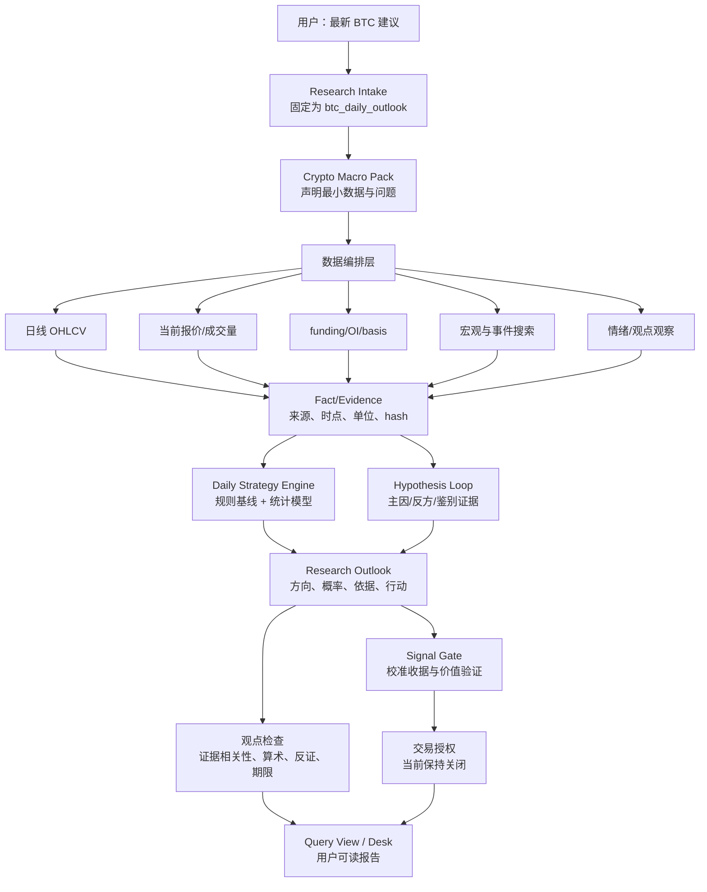

# Decision Hub 核心方向决策整改方案

> 日期：2026-09-18
>
> 目的：先把“用户输入 BTC 最新建议 → 数据 → 研究 → 方向观点 → 行动条件 → 可核验报告”做成一条可实现、可测试、可回滚的核心链路，再决定是否值得继续投入。
>
> 本文是实施前方案，不代表新策略已经实现，也不代表 BTC 已经存在经过验证的交易优势。执行代码前必须先按本文完成范围、合同和验收条件确认。

## 1. 先给结论

### 1.1 技术上能不能实现

**能实现。** 当前仓库已经有足够的底座：FastAPI、研究任务、Evidence、来源注册、市场 adapter、历史数据 adapter、LangGraph 编排、研究 Artifact、React 首屏和审计轨迹。需要改的是领域决策合同、周期、策略计算、数据降级语义和报告投影，不需要推倒 DSH 或重新建设一套平台。

### 1.2 能不能保证给出正确的买卖结论

**不能保证，也不应该承诺。** 技术实现可以让系统在数据可用时给出有依据的偏多、偏空或区间观点，并给出概率和行动条件；预测是否有超额收益，必须通过时间隔离的历史样本、成本后收益、回撤和校准结果证明。没有验证之前，不能把模型数值叫胜率，也不能把 LLM 的主观判断叫概率。

### 1.3 当前为什么反复不给结论

这不是单一数据缺失造成的，而是以下四个设计问题叠加：

1. `packs/crypto_macro/gates/horizons.yaml` 与 `agentic_research.schema.yaml` 把输出固定为 `30m/24h/72h`，不适合目前能稳定获取的日频数据。
2. `agentic_research_graph.py` 在周期不完整或研究未达到 `sufficient` 时清空/降级方向输出。
3. `application/commit.py::_research_result_is_publishable` 的发布条件要求三周期同时存在，并且排除 `long/short`；补齐数据后也不会自然发布方向 Forecast。
4. `query_views/research/service.py` 把数据不足、研究没有优势、复核保留意见和服务故障都汇总为 `do_not_trade`，用户看到的是同一个“观望”，无法知道系统究竟判断了什么。

因此，继续增加检索来源或继续改提示词，不能单独解决问题。必须同时改“周期合同、研究观点、策略计算、交易授权”四层。

## 2. 目标和非目标

### 2.1 本次唯一产品目标

用户只输入“给我 BTC 最新建议”或留空，系统在一个固定截止时间下：

1. 获取并记录可用的日线、当前行情、衍生品结构和相关事件信息；
2. 判断当前主要市场机制：趋势延续、趋势反转、区间，或者证据不足；
3. 对未来 **7 个自然日** 给出主要方向：`bullish`、`bearish`、`range` 或 `unresolved`；
4. 给出具体行动候选，例如等待回撤、突破后参与、降低敞口、保持原仓位或暂缓新增；
5. 写清楚最强反方、杠杆/清算风险、改变判断的条件和数据限制；
6. 只有在存在经过时间隔离验证的模型收据时，才显示数值概率；
7. 把研究观点与交易授权分开。研究可以明确偏多或偏空，交易自动执行和仓位授权仍关闭。

3 天和 30 天属于后续扩展。它们不能作为 7 天链路的必需条件，也不能用同一概率复制过去。

### 2.2 明确不做的事情

本批次不做：分钟级数据采购、小时级数据作为硬门槛、PPT、角色商城、全网社交爬虫、自动下单、杠杆仓位管理、为制造方向而放松质量门、用多 Agent 投票替代策略验证。

论坛、博主和情绪信息可以作为事件发现和风险观察，但在没有来源身份、时间、转载关系和历史预测记录时，不能直接进入概率计算。

## 3. 现状和问题的代码映射

| 层 | 现有代码 | 当前问题 | 整改结果 |
|---|---|---|---|
| 输入 | `packages/kernel/decision_hub_kernel/application/research_intake.py` | 当前模板要求短周期输出，输入合同没有日频模式 | 增加版本化 `btc_daily_outlook`，空白输入固定进入该模式 |
| 领域需求 | `packages/provider_adapters/research/fact_pack.py`、`packs/crypto_macro` | 研究需求主要围绕事件和 30m/24h/72h | 由策略声明日线最小数据，宏观与社交改为可选补充 |
| 周期 Gate | `packs/crypto_macro/gates/horizons.yaml` | 三个短周期同时要求，导致一项失败拖垮全部结果 | 7 天为主周期；3 天、30 天独立启用，不互相阻断 |
| 研究编排 | `packages/orchestration/langgraph/graphs/agentic_research_graph.py` | 合同不完整时把方向清空；停止码常常写成数据缺失 | 保留已形成的研究观点，区分 `synthesis_incomplete`、`data_unavailable`、`no_edge` |
| 研究循环 | `packages/kernel/decision_hub_kernel/decision/research_loop.py` | 已有 reviewer 和补证，但没有围绕策略假设的鉴别问题 | 每轮必须绑定 `hypothesis_id`、`question_id`、`expected_discriminator` |
| 市场数据 | `packages/provider_adapters/market/binance_research.py`、`okx_research.py`、`crowding.py` | 现有接口失败时整体退化；crowding 只是订单簿代理 | 部分字段可用则保留；标注 venue/单位/时点；crowding 不冒充清算事实 |
| 历史数据 | `packages/provider_adapters/historical/research.py`、`binance_vision.py` | 默认 `ohlcv_1h`，且当前连接未恢复 | 新增日频数据需求；小时数据只保留兼容路径 |
| 策略 | 当前没有领域内可回放的方向策略模块 | LLM 叙述与方向、概率混用 | 新增纯函数日频规则策略，再增加独立统计模型 |
| 提交 | `packages/kernel/decision_hub_kernel/application/commit.py` | 未满足完整研究 Gate 时 `long/short` 被降成 `no_trade/0.5` | `research_outlook` 独立保存；Forecast 继续受严格 Gate 控制 |
| Gate | `packages/kernel/decision_hub_kernel/decision/gate.py` | 交易安全 Gate 同时承担研究价值判断 | 交易授权继续关闭，但不再覆盖研究观点 |
| 查询视图 | `packages/query_views/research/service.py` | 多种失败原因合并为同一动作 | 首屏区分观点、数据状态、策略状态、执行权限 |
| 前端 | `apps/decision-desk/src/research/ResearchPage.tsx` | 已能展示动作/触发/证据，但缺少主要观点和统计依据 | 增加 7 天方向、行动候选、反方、拥挤风险和限制 |

## 4. 目标架构



每一层只承担一个责任：

- **DSH/编排层**负责执行模型、工具预算、超时、回执和多轮停止，不决定 BTC 多空。
- **Pack/领域层**定义指标含义、数据要求、假设、反证和适用周期。
- **Adapter 层**只负责从合法来源读取数据并说明字段语义，不补造缺失值。
- **策略层**把已冻结的事实计算成可复算的方向和概率，不由 LLM 临场编权重。
- **研究层**解释事件、找反方、判断是否已定价，不直接授权下单。
- **Kernel Gate**判断策略是否有可信凭据，交易授权与研究观点分离。
- **UI 层**只展示已保存结果，不从一段自然语言自行推导交易信号。

## 5. 输出合同

新增 `research_outlook.v1`，与历史的 `horizons` 保持兼容读取：

```yaml
schema_version: research_outlook.v1
asset: BTC
cutoff_at: 2026-09-18T00:00:00Z
primary_horizon: 7d
outlook: bullish | bearish | range | unresolved
basis: rule_based | statistical | hybrid
probability:
  value: 0.58
  target: close_at_t_plus_7d_gt_close_at_t
  status: calibrated | uncalibrated | unavailable
  model_version: daily-trend-v0
action_candidate:
  flat_user: wait_pullback | breakout_participation | reduce_risk | no_action
  existing_long: hold_with_invalidation | reduce_risk | no_action
  leveraged_short: forbidden_by_product_policy
reference:
  price: null
  source_as_of: null
  freshness: unavailable | fresh | stale
invalidation:
  - condition: close_below_sma60
    observed_by: daily_ohlcv
drivers: []
countercase: []
crowding_risk: []
missing_impact: []
evidence_refs: []
strategy_receipt_ref: null
signal_status: unvalidated | baseline_only | calibrated | rejected
execution_permission: false
```

这几个字段必须分开：

- `outlook=bullish` 表示研究方向偏多，不表示现在立即买入。
- `action_candidate=wait_pullback` 表示方向和入场赔率不同。
- `probability` 只描述事先定义的统计目标，不描述根因正确率。
- `signal_status=baseline_only` 表示有规则基线，但还没有证明能赚钱。
- `execution_permission=false` 表示产品不自动下单，也不对个人仓位授权。

如果只有数据故障，`outlook` 可以保留最近已核验的日频观点，但 `reference_price` 和实时入场条件必须标记不可用；如果连日线都没有，则 `outlook=unresolved`。这三种情况不能都显示成“证据不足，不应交易”。

## 6. 数据方案：不依赖小时数据，但不掩盖实时限制

### 6.1 最小数据集

| 数据 | V1 是否必需 | 作用 | 获取路线 | 失败时行为 |
|---|---:|---|---|---|
| 已收盘 BTC 日 OHLCV | 是 | 趋势、动量、波动、回撤、回放 | Binance 公共日线/归档；Coinbase 日线作核对 | 无日线则不能形成策略观点 |
| 当前 BTC 报价 | 仅实时行动必需 | 当前价、入场、滑点提示 | Binance/OKX/Coinbase 公开接口 | 可发布截至最近收盘的日频观点，但不写当前价入场 |
| funding rate | 否，V1 增强 | 永续合约拥挤风险 | 交易所公开衍生品接口 | 拥挤风险显示 unavailable，不改写基础方向 |
| open interest 及变化 | 否，V1 增强 | 杠杆扩张/收缩 | 交易所公开接口或已留存数据 | 禁用清算推断，不填 0 |
| basis/premium | 否，V1 增强 | carry 与风险偏好 | mark/index/futures 接口 | 保留未观测状态 |
| 宏观日频 | 否，V1 解释 | 利率、美元、风险环境 | FRED/ALFRED/官方发布 | 不阻断价格基础策略 |
| 情绪指数 | 否，V1 解释 | 市场情绪背景 | Alternative.me API 等 | 不阻断，不单独决定方向 |
| 清算热力图 | 否 | 风险提示 | 仅在合法公开接口可用时接入 | 不购买也不阻断 V1；不能把估计图当事实 |
| 论坛/KOL | 否 | 发现叙事和反方 | 仅接入有权限、可留档的来源 | 不得直接成为事实或概率权重 |

### 6.2 数据语义约束

1. 日线只能支持日频到周频判断，不能解释盘中插针顺序。
2. `open_interest` 的静态值不能当作 `open_interest_delta`；账户多空比不能当作全市场仓位。
3. 订单簿 imbalance 只能叫订单簿代理，不能叫清算量、杠杆拥挤或资金流。
4. 多个媒体转载同一公告只算一个上游事实；文章数量不能叠加权重。
5. 每条市场 Evidence 必须包含 venue、instrument、interval、observed_at、单位和原始响应 hash。
6. 成功响应不等于可用于模型。字段缺失、时间未闭合、单位不符、跨所对象不同都必须拒绝入模。

### 6.3 当前访问问题如何处理

当前本机实测 Alternative.me 可达，Binance、Coinbase、OKX、Kraken 等部分端点出现 `ConnectError`。先做 DNS/代理/TLS/HTTP 分层诊断和一个官方备用端点，不通过关闭证书验证或不断换域名解决。所有访问测试写入 provider receipt，不把探针结果直接当 Evidence。

如果运行环境始终不能访问行情源：

- 使用明确标记的冻结日线数据验证策略计算和报告链路；
- 生产模式只能输出最近可知收盘的研究观点；
- 禁止显示当前价、实时入场和“现在买入”；
- 不能把冻结数据验收写成 live 交易能力。

## 7. 策略方案

### 7.1 V0：日频规则基线

这是第一条必须完成的核心链路，目的不是声称高胜率，而是先让产品产生可复算的方向观点。

使用已收盘日线计算：

- `SMA20`、`SMA60`；
- 20 日收益；
- 20 日实现波动；
- 20 日高点/低点；
- 成交量相对 20 日中位数的偏离。

初始方向规则：

- 偏多候选：收盘价高于 SMA20，SMA20 高于 SMA60，20 日收益为正；
- 偏空候选：收盘价低于 SMA20，SMA20 低于 SMA60，20 日收益为负；
- 其余为区间/趋势分歧。

这组规则是可复算基线，不是已验证的最佳参数。不能把三个条件满足解释成 75% 胜率。

行动映射：

| 研究观点 | 无仓位用户 | 已有多仓用户 | 备注 |
|---|---|---|---|
| 偏多且未拥挤 | 等待回撤或突破确认后分批参与 | 持有并按日线失效条件管理 | 不输出杠杆倍数 |
| 偏多但拥挤 | 不追价，等回撤/拥挤释放 | 持有但降低新增风险 | funding/OI 缺失时标记未知 |
| 偏空 | 暂缓新增多头，等待重新站回趋势 | 降低敞口或按失效条件管理 | 不自动建议开杠杆空单 |
| 区间 | 等待区间边界和确认 | 保持或降低频繁操作 | 必须提供实际区间计算 |
| unresolved | 不新增风险 | 不做自动调整 | 说明缺失事实阻断哪条判断 |

失效条件必须来自实际数据，例如日线收盘跌破 SMA60、突破失败并回到区间、或者策略所依赖的价格结构失效；不能只写“市场变化时重新评估”。

### 7.2 V1：7 日方向概率

在 V0 能稳定回放后，使用有限特征训练正则化 Logistic 模型：

- 7 日收益；
- 20 日收益；
- 价格相对 SMA20/SMA60 的距离；
- 20 日波动；
- 成交量偏离；
- funding/OI/basis 只有在历史覆盖足够时才加入。

预测目标固定为：

`P(close[t+7] > close[t] | 截止 t 时已知数据)`

训练、校准、测试严格按时间顺序；7 日标签重叠部分按时间隔离，不能随机切分。保存模型版本、特征定义、数据集 hash、训练区间、校准区间、测试区间和成本假设。

概率只有在以下条件同时满足时显示为数字：

1. 有独立测试区间；
2. 校准器不是在测试集拟合；
3. 与上涨频率和 V0 基线比较；
4. Brier score、log loss、可靠性曲线和覆盖率达到预先写定的最低标准；
5. 同时检查扣费率、滑点后的收益与回撤。

否则显示 `probability_status=uncalibrated`，但仍可以显示 V0 的方向观点。绝不能用 `0.5` 充当“模型暂时不确定”的实际概率。

### 7.3 杠杆和双向清算风险

这些信息作为风险修正和行动限制，不作为单独方向信号：

- 上涨 + OI 增加 + 正 funding/basis 异常高：偏多趋势可能拥挤，降低追涨评分；
- 下跌 + OI 下降 + 可核验清算增加：支持去杠杆解释，但不自动抄底；
- 负 funding + OI 高 + 现货企稳突破：支持空头挤压情景，但仍需现货确认；
- 双向长影 + 高波动 + 趋势延续差：取消突破追单或降级动作。

公开数据不能知道所有账户的止损价，因此报告只能说“存在双向扫损风险”或“结构脆弱”，不能断言某个资本会在哪个价格插针。

## 8. 研究和信息权重方案

### 8.1 事实权重与预测权重分开

信息进入系统后分两步处理：

1. **事实准入权重**：来源身份、原文可取、发布时间、是否同源转载、时间有效性、字段完整性。
2. **预测贡献权重**：该特征或机制在同类历史状态、同一预测周期中的样本外表现。

官方 Fed 公告可以在事实层是高可信，但不因为官方就自动在 BTC 7 日方向层拥有高权重；情绪指数可以是真实观测，但不能因为它每日更新就成为方向信号。

### 8.2 Agent 的职责

Agent 只负责：

- 找到事件和原文；
- 判断是否已定价；
- 写出主因和最强反方；
- 提出下一条能改变判断的证据。

Agent 不负责：

- 临场创造权重；
- 把多个 Agent 投票平均成概率；
- 把网页转载数量当独立证据；
- 把订单簿代理写成清算事实。

每轮研究必须保存 `previous_outlook`、`new_evidence_refs`、`changed_claims` 和 `change_reason`。如果没有新增鉴别证据，只能保留原判断并说明停止原因。

## 9. 具体代码实施顺序

### 批次 A：合同和冻结用例，先不接真实行情

修改：

- `contracts/schemas/agentic_research.schema.yaml`；
- 生成的 Python/TypeScript contracts；
- `research_intake.py`；
- `packs/crypto_macro/gates` 与 Pack doctrine；
- 新增 `tests/research/fixtures/daily_outlook_*.json`。

内容：

1. 新增 `btc_daily_outlook` 模式和 `7d` 主周期；
2. 新增 `research_outlook.v1` 和 `strategy_receipt.v1`；
3. 明确旧 `horizons` 只用于兼容读取，不再作为新模式硬门槛；
4. 准备五个冻结案例：上涨趋势、下跌趋势、趋势但拥挤、区间、数据矛盾。

出口：合同校验通过；五个案例能在内存中表达明确方向、行动、反方和限制；没有改动交易授权。

### 批次 B：日线数据和纯函数策略

修改：

- `packages/provider_adapters/historical/research.py`；
- `packages/provider_adapters/historical/binance_vision.py`；
- `packages/provider_adapters/market/*_research.py`；
- 新增 `packages/kernel/decision_hub_kernel/decision/daily_strategy.py`；
- Pack source manifest 和 semantic policy。

内容：

1. 读取已收盘日线；
2. 验证连续性、时区、单位和未完成 candle；
3. 计算 V0 指标；
4. 产生可复算 `strategy_receipt`；
5. 允许成功现货与失败 OI 分开落库，禁止失败字段填 0。

出口：五个冻结用例分别触发预期观点；策略结果包含输入 hash、参数、指标和失效条件；无 LLM 参与也能重算。

### 批次 C：观点与交易权限分离

修改：

- `packages/kernel/decision_hub_kernel/application/commit.py`；
- `packages/kernel/decision_hub_kernel/decision/gate.py`；
- `packages/query_views/research/service.py`；
- `apps/decision-desk/src/research/ResearchPage.tsx`。

内容：

1. 保存 `research_outlook`，不再用 `do_not_trade` 覆盖所有方向；
2. `signal_status` 单独显示 `baseline_only/unvalidated/calibrated`；
3. `execution_permission` 继续固定为 false；
4. 首屏顺序改为：主要方向 → 当前动作 → 依据 → 反方 → 拥挤风险 → 数据限制 → 权限；
5. 服务故障显示 `data_unavailable`，策略无优势显示 `no_edge`，不能都翻译成“不交易”。

出口：冻结案例中，方向观点可以显示 bullish/bearish；没有验证的策略仍不会生成可执行交易授权；前端能区分数据失败和研究结论。

### 批次 D：真实数据、研究循环和因果证据

修改：

- `packages/orchestration/langgraph/graphs/agentic_research_graph.py`；
- `packages/kernel/decision_hub_kernel/decision/research_loop.py`；
- `packages/provider_adapters/research/fact_pack.py`；
- web search/fetch composition；
- Evidence 相关性检查。

内容：

1. 真实行情来源至少打通一个日线来源，并保留来源回执；
2. 当前报价失败时仍能发布带截止时间的日频观点；
3. 研究问题绑定到能改变策略判断的证据；
4. 工具失败使用 tool receipt，不能拿不相关的 Fed Evidence 支撑 OKX 失败；
5. 只在新增鉴别证据时继续下一轮。

出口：一次真实空白输入能完成日线策略、研究解释、证据引用、首屏回读；至少有一个实际方向分支被触发。若当天数据条件未满足，必须显示具体缺口，而不是假装完成。

### 批次 E：7 天统计概率和行动价值

新增离线工具：

- `tools/research_evaluation/build_daily_dataset.py`；
- `tools/research_evaluation/train_daily_baseline.py`；
- `tools/research_evaluation/audit_daily_calibration.py`。

内容：

1. 以日线构造 7 日标签；
2. 与上涨频率和 V0 比较；
3. 生成校准和测试 receipt；
4. 计算 Brier、log loss、命中率、覆盖率、成本后收益、回撤；
5. 只有测试通过才允许 `probability.status=calibrated`。

出口：如果模型没有超过 V0 或成本后无正期望，保留 V0 并明确“没有证明统计增量”；不继续调参刷测试集。

### 批次 F：衍生品和风险增强

只有批次 E 通过后执行：

- funding/OI/basis 历史覆盖检查；
- 多空比例口径检查；
- 清算数据可得性和模型估计标记；
- 比较“基础价格模型”和“加入杠杆风险后的模型”是否真的改变行动质量。

缺少这些数据不会阻断 V0，但会阻断“拥挤风险已核验”的表述。

## 10. 自测与验收标准

### 10.1 单元测试

- 计算指标与边界：不足 60 根日线、未闭合日线、缺失日期、时区转换、重复 candle；
- 规则方向：明确上涨、明确下跌、交叉和区间；
- OI/funding 缺失不填零；
- crowding proxy 不得序列化为 liquidation fact；
- 7 日标签不泄露未来；
- 概率状态没有 calibration receipt 时不能为 calibrated；
- 研究观点可以 bullish/bearish，但 execution_permission 始终 false。

### 10.2 回放测试

五个冻结案例必须满足：

1. 上涨趋势不再被强制改写成 `no_trade`；
2. 下跌趋势能给出偏空或降低风险的观点，但不自动建议杠杆做空；
3. 趋势和拥挤冲突时显示“方向与入场风险分离”；
4. 区间显示区间或等待，不伪造方向概率；
5. 数据不足显示 `unresolved/data_unavailable`，并指出缺失数据影响哪条判断。

### 10.3 真实主链测试

固定输入 → 日线数据 → 指标 → 策略收据 → 研究循环 → Evidence → `research_outlook` → UI。

验收必须记录：

- `run_id`、`artifact_id`、`strategy_receipt_id`；
- 数据源、observed_at、instrument、interval、hash；
- 主判断、反方、行动条件、失效条件；
- 每个失败工具的错误类型和是否影响方向；
- UI 首屏是否能在一分钟内读懂当前观点。

### 10.4 价值验收

以下条件没有通过，就不能说产品有交易价值：

- 五个核心案例至少四个能产生具体、可核验的机制或明确 unresolved；
- 上涨和下跌数据充分案例不能全部返回 no_trade；
- V0 必须与普通搜索总结相比多出数值指标、主反方、行动条件和失效条件；
- V1 必须在留出样本上报告校准、覆盖率、成本后收益和回撤；
- 如果 V1 没有优于 V0，保留更简单的 V0，不宣称模型升级成功。

## 11. 明确的停止线

### 可以继续

- 连接问题能通过合法网络配置或官方备用端点修复；
- 至少一个公开日线源可稳定读取并通过字段校验；
- V0 在冻结案例中能形成方向观点；
- V0 或 V1 在留出样本上有明确、可重复的增量。

### 必须暂停产品方向投资

- 经过两条独立官方日线路线仍无法获取数据；
- 真实数据可用，但 V0/V1 与简单基线相比没有增量；
- 观点只能靠 LLM 文本，无法保存输入、参数和计算收据；
- 加入更多来源后只能增加篇幅，不能改变判断或提高可核验性。

暂停时仍可保留 DSH、Evidence、来源审计和研究轨迹作为通用基础，但不能继续以“交易决策产品”名义添加外围功能。

## 12. 最终可实现性判断

| 事项 | 判断 | 原因 |
|---|---|---|
| 不依赖小时数据实现 7 天日频观点 | 可实现 | 日线公开数据和现有历史 adapter 足够支撑 V0 |
| 纳入 funding/OI/basis 和双向清算风险 | 可实现但受数据覆盖限制 | 公开接口存在，但历史完整性和可达性必须实际验证 |
| 给出明确偏多/偏空和行动条件 | 可实现 | 由规则策略或统计模型产生，观点和授权分离 |
| 给出经过验证的概率 | 可实现但不能立即承诺 | 需要时间隔离数据、校准和留出样本 |
| 保证准确率或最高胜率 | 不可保证 | 市场非平稳，历史优势可能失效 |
| 自动判断庄家插针位置 | 不可实现为可靠事实 | 公开数据不是全市场账户和止损清单，只能估计脆弱性 |
| 通过增加 Agent 数量解决数据和策略问题 | 不可行 | Agent 不能替代行情、标签和校准凭据 |

## 13. 执行规则

1. 在用户确认这份方案前，不继续添加外围能力，不启动新的评测平台，也不修改交易 Gate。
2. 方案确认后严格按 A→B→C→D→E→F 顺序执行，每批完成后才进入下一批。
3. 每批只能有一个明确出口；失败时记录事实、停止原因和下一条可行路径，不用“再加一个 Agent”掩盖失败。
4. 任何“方向有效”“概率已校准”“数据已充分”的结论，都必须附对应 receipt 和测试结果。
5. 如果批次 B/D 完成后仍不能形成明确方向，直接说明是数据或策略价值失败；不再用“需要更多研究”无限延长。

## 14. 当前唯一执行目标：D0-7D-DIRECTIONAL-CORE

本目标把上面的整改方案收敛为第一条可交付纵向链路。它不是“完成整个金融智能系统”，也不是“证明 BTC 能盈利”。它只验证产品能否从用户输入走到一个可复算、有方向、有边界的 7 天研究观点。

### 14.1 目标定义

实现并自测：

`空白/简单 BTC 请求 → btc_daily_outlook 输入 → 已收盘日线 Fact → 日频 V0 策略 → research_outlook → 主因/反方解释 → 首屏报告`

实时行情、funding、OI、宏观和搜索作为增强项接入；它们缺失时不得把基础日频观点改写成无理由的 `do_not_trade`，但必须在报告里说明影响。交易授权、自动下单和校准概率不在本目标内。

### 14.2 本目标必须修改的现有代码

1. `packages/kernel/decision_hub_kernel/application/research_intake.py`
   - 把默认模板从“必须输出 30m/24h/72h”改为“默认 7d 日频研究”；
   - 保留历史请求的兼容入口，不静默改变历史 Run 的含义。
2. `contracts/schemas/agentic_research.schema.yaml` 与生成代码
   - 新增 `research_outlook.v1`、`strategy_receipt.v1`、`primary_horizon=7d`；
   - 不直接把 `HorizonDecision` 的 enum 扩大后继续走旧发布逻辑；新结果必须有独立模型。
3. `packages/provider_adapters/historical/research.py` 与 `binance_vision.py`
   - 增加已收盘日线读取、连续性、单位、时区和 hash 校验；
   - 允许冻结 replay 数据用于离线验证，明确标注 `replay`。
4. 新增 `packages/kernel/decision_hub_kernel/decision/daily_strategy.py`
   - 实现 SMA20/SMA60、20 日收益、20 日波动、20 日高低点和 V0 方向规则；
   - 输出纯函数 `strategy_receipt`，保存输入数据 hash、参数、指标、方向、失效条件。
5. `packages/kernel/decision_hub_kernel/application/commit.py` 与 `decision/gate.py`
   - 保存研究观点，不再让研究观点被 `no_trade/0.5` 覆盖；
   - 保持 `execution_permission=false`；
   - 未有校准 receipt 时不得写 `probability.status=calibrated`。
6. `packages/query_views/research/service.py`
   - 增加观点、行动、数据状态、策略状态、权限状态的独立投影；
   - 区分 `data_unavailable`、`no_edge`、`unresolved` 和 `wait_for_confirmation`。
7. `apps/decision-desk/src/research/ResearchPage.tsx` 及对应类型/测试
   - 首屏展示 7 天主要方向、行动候选、三项依据、最强反方、失效条件、数据限制；
   - 不把未知概率显示为 50%。

### 14.3 本目标不修改的内容

- 不修改交易授权为 true；
- 不新增自动下单；
- 不把清算热力图或订单簿 imbalance 写成真实清算证据；
- 不实现 3 天/30 天的强制联动；
- 不实现校准模型和“最高胜率”；
- 不接入无法留档或没有权限的论坛、KOL 数据；
- 不因一个行情 provider 失败而改写其他已成功的 Fact。

### 14.4 完成定义

以下条件全部满足才算 D0-7D-DIRECTIONAL-CORE 完成：

- [x] 空白/简单输入确定性归一化为 7 日日频研究模板；
- [x] 日线适配器支持合法 OKX 1D 端点；当前环境实时读取以 `ConnectError` 失败，冻结 replay 已明确标记并可运行；
- [x] V0 策略在无 LLM 情况下可重算，并保存 `strategy-receipt.v1`；
- [x] 上涨、下跌、区间、数据不足四个案例各有一个回放结果；
- [x] 上涨案例产生 `bullish` 偏多观点；
- [x] 下跌案例产生 `bearish` 偏空/降低风险观点；
- [x] 区间案例不伪造方向概率；
- [x] 数据不足案例抛出明确历史缺口，不掩盖为模型判断；
- [x] 实时源不可达已记录，并用 `HistoricalDataResearchAdapter → Fact → research_outlook` replay 链验证计算路径；
- [x] 前端测试、后端定向测试、生产构建通过；
- [x] 研究观点可以显示方向，但交易授权仍为 false；
- [x] `CORE_CHAIN_DEV_LOG.md` 和 D0 自测报告记录命令、replay 标识、receipt hash、失败原因和遗留项。

### 14.5 目标失败条件

出现以下任一情况，目标必须标记失败并停止扩展：

- 只能靠 LLM 文本产生方向，无法从日线重算；
- 四个基本案例全部变成 `do_not_trade`；
- 日线数据被缺失值或未闭合 candle 静默补齐；
- 观点和交易授权仍被同一个字段控制；
- 真实运行失败后用 replay 结果冒充 live 结果；
- 测试只证明服务启动，没有证明方向分支和数据语义。

### 14.6 下一目标的进入条件

只有 D0-7D-DIRECTIONAL-CORE 通过，才可以开始 D1-7D-CALIBRATED-PROBABILITY：使用多年日线、时间隔离训练/校准/测试，并比较 V0 基线、上涨频率和成本后收益。D0 未通过时，不做模型训练、衍生品增强或 UI 扩展。
