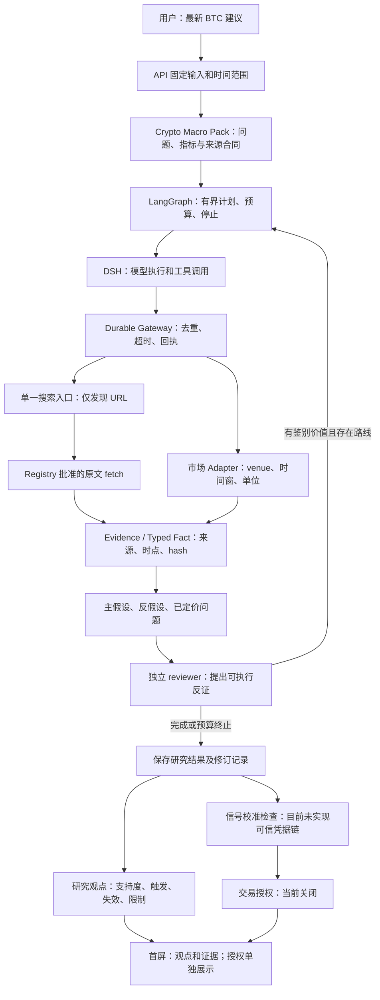

# 核心目标进度快照与产品价值复审（2026-09-18）

状态：下文保留当日早期复审快照；随后 C0a 完成工程路径验证，交易方向价值仍未通过。最新用户要求取消小时历史前提、调整周期；后续核心执行方案以 `FINANCIAL_INTELLIGENCE_PROBABILITY_UPGRADE_2026-09-17.md` 第 34 节为准，详细进展见 `CORE_CHAIN_DEV_LOG.md`。

## 1. 用户真正要求的产品

依据本任务可见历史用户消息、最初三个方案及后续生死线文档，目标一直是：用户只说“现在怎么操作”，系统主动获取当前信息，解释最可能的市场机制、最强反方与改变判断的条件，形成可核验的研究倾向和条件行动建议。不是要求用户写专业提示词，也不是每次只返回“质量门不通过”。

用户同时要求：先做核心；金融结论不能为交付而伪造；多轮必须补到新证据或修订观点；论坛、博主、情绪可以提供线索，但热度和转载次数不等于事实；概率不是百分之百保证，也不能是模型随口编的胜率；DSH 是通用执行底座，金融规则在 Pack/领域层维护。

历史约束仍有效：

- `CORE_VALUE_RESCUE_PLAN_2026-09-16.md`：研究价值与方向价值分别验收。研究是否具体、可核验、可反驳；方向是否在留出样本上超过简单基线并覆盖成本。
- `CORE_DECISION_VALUE_VALIDATION_2026-09-15.md`：旧结果没有证明方向优势，`STOP_PRODUCT_LAYER_INVESTMENT` 不能被一次链路成功推翻。
- `FINANCIAL_INTELLIGENCE_PROBABILITY_UPGRADE_2026-09-17.md` §32：先 C0a 单一纵向闭环，再 C0b/C1。当前不做社交爬虫、角色扩展、PPT、概率训练或自动交易。

以上是从用户历史和文档提炼的要求；下面的诊断、取舍与验收细化属于本轮评审意见，不冒充用户逐字承诺。

## 2. 可恢复的进度快照

当前 goal 为 active：简单/空白输入固定 BTC 研究 → 单一 Responses search → Evidence → 建议首屏 → 针对性测试与真实主流程。未标记完成，也没有新建另一个目标掩盖旧目标。

仓库已有大量未提交改动，包含先前多轮工作。本次只记录状态，不执行 git stash、reset 或大范围提交。运行入口为 `infra/dsh/run-product.ps1`，本地恢复配置目录 `data/dsh-live-recovery`，产品数据目录 `data/core-live-20260913`。所有密钥仍仅存在本地忽略目录。

2026-09-18 13:59 +08:00 只读检查：8047、8037、3097 均监听，`GET /health/ready` 返回 ready。它只证明进程可用，不能证明行情可达或研究有效。research worker 的 uv → python → python 是同一父子进程树，不能仅凭两个 python 进程认定重复消费；并发抢占是否存在仍需 lease/trace 证据。

| 项目 | 已有证据 | 当前判断 |
|---|---|---|
| 固定简单输入 | `research_intake.py`、API/前端测试 | 代码与离线验证已有；正确模板的本轮 live 未验收 |
| 搜索 provider 装配 | 单一 composition 与 fail-closed 配置 | 已实现 |
| 搜索超时 | 独立探针约 36.5 秒返回，原网关 20 秒截断 | 原超时不足，已改 web.search 为 60 秒、DSH wrapper 为 65 秒 |
| Responses search | `data/product-local/search-canary-60s.json`，5 个 Fed 来源 URL | locator 搜索可用；没有原生 citation spans，不能冒充事实 |
| 原文到 Evidence | `data/product-local/search-fetch-proof/receipt.json` | 真 fetch 得到 1 条 accepted/official Evidence；只证明隔离链路 |
| 当前产品运行 | `run_2a832a156ec842d9b5bae320c9fe4cc6`，Artifact `art_83625047c3d34efdb7f7dc31feede9f7` | research_only，无 run-level failure，但 accepted Evidence=0 |
| 产品数据供给 | 该 run 中市场、历史、搜索失败及 coverage 0 | 当前建议不具备充分市场依据 |
| 多轮停止 | `should_continue_after_round` 已修终止优先级 | 有修复与定向回归；不能因此认定研究质量改善 |
| 首屏 | 动作/触发/失效/证据限制的组件与构建 | 展示已改；有价值观点尚未验收 |
| C0a 退出 | 正确 BTC 模板的真实市场 receipts、完整产物、UI 回读 | 未完成 |

必须纠正先前记录：`run_2a832...` 实际走宏观事件合同，API 回读有 9 项 requirement，而不是本次固定 BTC 快照；不能充当“空白/短输入固定入口”的验收。可能有命令行中文编码问题，但原因尚未证明。先前“只剩补齐市场数据”的表述也不准确，搜索预算与端到端入口仍需分别验证。

独立 fetch 记录 `run_7f819ba342354022950a479de7fcfa0a` / `ev_ce1e676188f30e95bf25f0196d98e6b0` 只覆盖 `market_narrative`。其 `published_at=null`，不能把观察时间当成发布时间，也不能据此声称市场数据 hard coverage 已通过。

## 3. 为什么一直模糊：按层定位，而不是归咎于 Docker

### 3.1 研究方向、信号与交易许可混用了状态

`packages/kernel/decision_hub_kernel/application/commit.py` 中 `_research_result_is_publishable` 要求 horizons 全部不是 long/short；不满足时 candidate 和持久化 Forecast 会被改成 no_trade/0.5。`gate.py` 的方向发布另需 `directional_value_validated`，当前研究提交未提供可信校准凭据。

但不能夸大为“所有原始方向都被删除”：`packages/query_views/research/service.py` 仍从 `result.horizons` 回读原始研究情景。问题是两条投影语义不一致，且 `artifact_status=limited` 会参与 `do_not_trade` 判定。前端又把 long/short 都表达为“观望，满足条件后再评估”。用户很难区分：有研究倾向但尚未验证、有证据冲突、还是系统根本没拿到数据。

结论：保持交易关闭有依据；把它当成整个研究报告的结论没有帮助。不能通过简单删除 Gate 或强行输出 long 来修复。

### 3.2 数据失败与研究质量失败叠在一起

旧记录中确有双 venue、小时历史和 Artifact 成功的 run，但那不能证明今天仍可达。最新 run accepted=0；Fed fetch 成功也不能替代 BTC spot、OI delta、funding。市场 API 可达性、字段身份、同步窗口和历史覆盖必须单独核实。

当前本地服务可以不依赖 Docker 运行，因此 Docker 异常不是所有模糊结果的充分解释。给定今天的零证据 run，也不能仅凭 UI 或状态修复声称已经能判断市场。

### 3.3 多轮已有，但未等于有效的假设研究

`decision/research_loop.py` 已有 reviewer challenge、hard/soft gap、无进展与无路线停止；只执行声明过的 requirement。自由文本问题无法自动成为可执行研究计划。现有循环更偏向补覆盖率，尚未证明能围绕“新增空头 / 多头平仓 / 现货卖压”等竞争解释补关键鉴别证据，并保存观点为什么变化。

固定轮数不是质量目标。需要的是每轮明确：要区分哪两个解释、读取哪个来源/指标、什么观察会改变当前判断、拿到了什么新证据。重复相同失败工具或重复改写报告不算研究增益。

不能说项目完全没有 Deep Agent 或观点变化。`CORE_VALUE_RESCUE_PLAN_2026-09-16.md` 记录 `run_74992bc99715451897801ca5210e5a62` 曾有 2 轮、3 个 DSH subagents、16 条 accepted Evidence，并在 reviewer 后从 short 候选收敛为 no_trade。那说明编排及文本修订已经发生；还欠缺的是结构化的 claim/问题映射、可回读的修订差异，以及这类分析比简单回答更有用的证据。

### 3.4 验收对象多次漂移

进程 ready、测试通过、Artifact 落库、硬覆盖率、研究有用、预测有优势，是六种不同结论。过去经常以前几项替代后几项，再在失败时加外围工程。本次恢复点必须以同一用户用例贯穿输入、数据、研究、提交和首屏。

## 4. 保留分层，但明确各层只负责什么

图中“明确的假设修订记录、独立研究观点投影、可信校准凭据”是待改部分，不表示已经实现。DSH 不承载行情语义规则；Adapter 不裁决交易；UI 不从一句模型话推导授权；Kernel 不通过把所有观点覆盖成 no_trade 来承担全部风险控制。

## 5. 最小改造顺序与失败时怎么办

### P0-A：恢复同一用例，先查可达性，不反复烧模型

涉及：`research_intake.py`、`apps/hub_api/main.py`、现有市场 adapters、`infra/dsh/run-product.ps1`。

先保存 UTF-8 请求、归一化事件类型、requirement IDs；必须是 crypto_market_snapshot。直接探测当前 hard requirement 所需接口，记录 transport/certificate/HTTP/字段缺失各自原因。优先修现有来源访问；替代源必须核对同一 instrument、venue、窗口与指标，不能拿单一报价冒充双所衍生品确认。

出口：正确模板 + 必需市场原始回执 + search/fetch 原文回执；数据不满足时保留可用事实和具体不可判问题，不把失败宣布为闭环成功。是否需要双所才能支持某一研究 claim，在下项按 claim 分级；当前合同不偷偷降低。

### P0-B：分开研究观点、信号资格和交易授权

涉及：`contracts/schemas/agentic_research.schema.yaml` / `workbench_assets.schema.yaml`、生成类型、`commit.py`、`gate.py`、`query_views/research/service.py`、`ResearchPage.tsx`。

最小增量是在已保存的 ResearchSessionResult 上形成版本化 research_outlook 投影，不先建立第二套研究引擎或通用表。字段至少包含 horizon、倾向（bullish/bearish/neutral/unresolved）、支持与反对 Evidence、支持度原因、触发、失效、as_of/有效期。支持度不显示百分比。无法核验的 claim 不得进入肯定结论。

signal_status 分为未验证/不适用/验证通过（最后一种必须有真正的内核 receipt）；trade_authorized 继续 false。`Forecast` 保持原有受控语义，历史 0.5 不得解释为五五开。迁移只在确需持久字段时新增，不为展示先增多张表；生成的 Python/TS 类型统一更新。

出口测试：相同有证据的 long/short 研究情景在报告可读，信号仍未验证且交易关闭；hard 冲突时显示争议或 unresolved；缺数据时显示缺哪项、阻碍哪条判断；旧 API/历史报告兼容。不能仅把红色提示改成绿色。

### P1：一个机制的真正研究循环

涉及：`fact_pack.py`、Pack profiles、`research_loop.py`、`agentic_research_graph.py`、`research_review.py`、研究 contract。

先只做“BTC 下跌由去杠杆还是现货主动卖压主导”这一组解释。每个 hypothesis 列出观测、传导链、反证和所需指标；snapshot 与窗口变化分开，OI 下降本身不充分证明多头清算，订单簿 imbalance 不冒充真实 taker flow。

下一轮任务绑定 question_id、claim_id、requirement_id、capability、query、预期鉴别点；映射失败可见，但不能执行模型随意创造的工具。保存 previous/current hypothesis、新增 Evidence、变化原因、仍未解决问题。网络重试预算与研究轮次分开；截止后保留已获证据和受限结论。

出口：一个反方问题真的引出新增可接受证据，导致修订或有证据地保持原判断。无增益时解释为何停止；多跑一轮本身不计完成。

### P2：信息广度与来源独立性，随后再做概率

沿现有 search → fetch 扩展最小来源谱系：原始发布者、发布时间、转载关系、内容 hash、claim 归属。先 exact duplicate，不把相同 Fed 公告的五个链接当五条独立论据。公开论坛/KOL 先用于发现叙事与反方，标记观点、时点、利益冲突和可核实引用；无 API/权限的来源记作未接入，不能声称“大而全”。

权重先拆维度：来源真实性、相关性、时效、独立性、观察与推断、已定价证据。不得随手把 0.8/0.6 相乘后叫胜率。研究支持度与未来收益概率分别建模。只有研究价值过线，再用时间隔离样本校准和检验方向、覆盖率、成本后收益及回撤。

### 获取路径与当前证据边界

| 信息 | 复用位置与获取方法 | 当前已知 / 下一检查 |
|---|---|---|
| BTC 现货、funding、OI、basis | `market/okx_research.py`、`market/binance_research.py`；现有交易所公开 HTTP 接口 | adapters 存在，最新 run 失败；先检查传输及每个字段回执，不增加泛用搜索替代行情 |
| OI delta 与同步窗口 | Binance adapter 已请求 `openInterestHist`；历史作业/现有窗口逻辑 | 至少两条相同时钟与单位的记录；静态 OI level 不能伪装成 delta |
| 小时价格背景 | `data.historical` + 已有 historical worker / DataJob | 读取当前已完成小时覆盖；不要为了当前建议先购买宏观分钟档案 |
| 官方政策/经济数据原文 | `web.search` 限定 Fed/BLS/BEA → `source_registry.yaml` → `web.fetch` | 本轮仅 Fed 路径有真实 fetch 证明；BLS/BEA 注册不等于当天已抓取成功 |
| 利率、美元与风险环境 | 已有 macro_market / FRED 路线；按原频率读取 | 当前运行有失败；日频数据只能支持日频背景，不能冒充事件分钟反应 |
| KOL、论坛、情绪 | 后续沿同一搜索入口发现，再以允许的 API/正文获取 | 目前没有“大而全”接入证明；先登记可获取来源和权限，观点不可直接升级 official fact |

领域知识落点采用 Pack 内可维护的机制说明和查询模板：每个机制写清前提、所需观测、相似解释、反证、适用 horizon 与来源路线。金融专家角色提示词可以复用这种说明，但只更换角色名称或安装 skill 不能制造数据，也不能证明专家判断正确。

## 6. 生死线与下一目标的边界

继续沿原 C0a 恢复，不新建与它并行的大目标。上述 P0-B/P1 是待执行的核心改造批次，不能在本轮复审就打勾。P0-A 的证据齐全后，才能区分“数据不可达”和“模型研究没有增量”。

研究价值验收沿用原 5 案例：去杠杆、现货卖压、宏观 risk-off、证据矛盾、数据不足。至少 4/5 给出具体且可核验的机制或有事实依据的 unresolved；前 3 个数据充分案例不能全部靠 unresolved 通过。至少一个 reviewer 反证实际纠正过强结论。逐条核对重要引用，不以自评高分代替。

用同一批可见数据、同一 cutoff 对比一次普通模型搜索回答，人工检查是否更具体、少遗漏、少返工。若数据已充分而仍没有上述增量，停止自研研究引擎，保留 Evidence 适配与审计能力、评估接入现成研究服务；不继续堆 agent。若只是某一数据接口未恢复，记录该具体阻塞，不据此断言金融研究在技术上不可行。

该小样本只验研究可用性，不能证明交易胜率。方向优势仍须另过原定生死线。现成 Deep Research 也不自带可验证的盈利保证，替换编排不能自动补齐市场数据。

## 7. 评审与外部依据

已回读 architecture_core_audit 此前完成的独立意见；decision_usability_review、history_value_audit 本轮再次因平台 Selected model is at capacity 失败，不能写成“三路一致通过”。主 agent 已逐段检查 commit、query view、UI、loop 与原文档，并明确纠正“所有原始方向均被清空”的过度概括。对 architecture_core_audit 发起的补充复核在收口时仍未返回，已中断，避免等待本身继续拖延；因此本文件尚未取得一次新的完整独立对抗审查通过结论。

外部资料只支持方法，不证明本项目有效：

- [Anthropic 多 Agent 研究实践](https://www.anthropic.com/engineering/multi-agent-research-system)：多 Agent 增加协调和可靠性难度；适合并行获取独立信息，不能把 agent 数量当研究质量。
- [scikit-learn 概率校准](https://sklearn.org/stable/modules/calibration.html)：校准应使用与模型拟合分离的数据；本项目尚无可信校准链，主观权重不应称为概率校准。
- [FINRA GenAI 风险说明](https://www.finra.org/rules-guidance/guidance/reports/2026-finra-annual-regulatory-oversight-report/gen-ai)：agent 仍存在幻觉和偏差风险；因此来源回读与事实/推断分离不能省略。

## 8. 恢复 checklist

- [x] 保存原目标、代码位置、运行目录、最近真实 run 与未完成项。
- [x] 复核历史产品价值与两个生死线。
- [x] 核对架构意见与代码，区分 Forecast 降级和原始情景仍保存。
- [x] 补查搜索探针与 fetch 凭据；不把隔离成功算整条产品验收。
- [x] 正确 UTF-8 固定入口的一条真实端到端 Run 与首屏回读（`run_87a7390aa675402fae6b57ad59fb1abe`；主流程有界研究结果，非交易通过）。
- [ ] P0-B 研究观点/信号/授权分离的实现及纵向回归。
- [ ] P1 具体机制的鉴别取证与假设修订。
- [ ] 5 案例研究价值及简单回答对照；通过后才讨论概率阶段。

本次复审没有修改交易授权、没有放松质量门、没有执行交易，也没有把产品标记为可交付。

本次验证：`pnpm test tests/research-tool.spec.ts` 为 4 passed；`uv run pytest -q tests/kernel/test_core_flow.py tests/research/test_research_observability.py --basetemp=data/pytest-value-review-20260918 --disable-warnings` 为 17 passed。它们核对已有超时 wrapper 和 Gate/回读行为，不是 P0-B/P1 已实现的证明。数据库只读查询确认上述最近 run 的 event_type 为 macro_event。

## 9. 最新执行状态：D0-7D-DIRECTIONAL-CORE

上述早期复审快照之后，D0 已按单一纵向目标完成工程实现和自测。它只证明“从固定输入到可复算 7 日研究观点”的链路，不推翻方向价值生死线。

- 默认入口已固定到已收盘日线和未来 7 个自然日；`market_regime_context` 的 Pack 合同已改为日线指标。
- 1D loader、DataJob、Fact attributes、strategy receipt、`research_outlook`、前端 7 日观点展示和交易授权分离均已落地。
- 上涨、下跌、区间、历史不足四类 replay 通过；实时 OKX 探针在当前环境以 `httpx.ConnectError` 失败，已记录为实时不可达，未将 replay 冒充 live。
- 历史 worker 现在同时维护 1h 和 1d 分区；网络恢复后不需要人工改代码即可按 UTC 日边界刷新日线。
- 定向后端 `109 passed, 1 skipped`（含历史 worker）；契约生成检查通过；Ruff 通过；前端 `14 passed`，生产构建成功。

D0 自测细节、回放 hash 和命令见 `D0_7D_DIRECTIONAL_CORE_SELFTEST_2026-09-18.md`。下一阶段只能是可达日线后的时间隔离校准和研究价值对照；在此之前不宣称概率、胜率或可交易。

恢复 checklist 更新：

- [x] P0-B 的 7 日研究观点/信号/授权分离和纵向回归已完成（D0 范围）。
- [ ] P1 具体机制的鉴别取证与假设修订。
- [ ] 5 案例研究价值及简单回答对照；通过后才讨论概率阶段。
