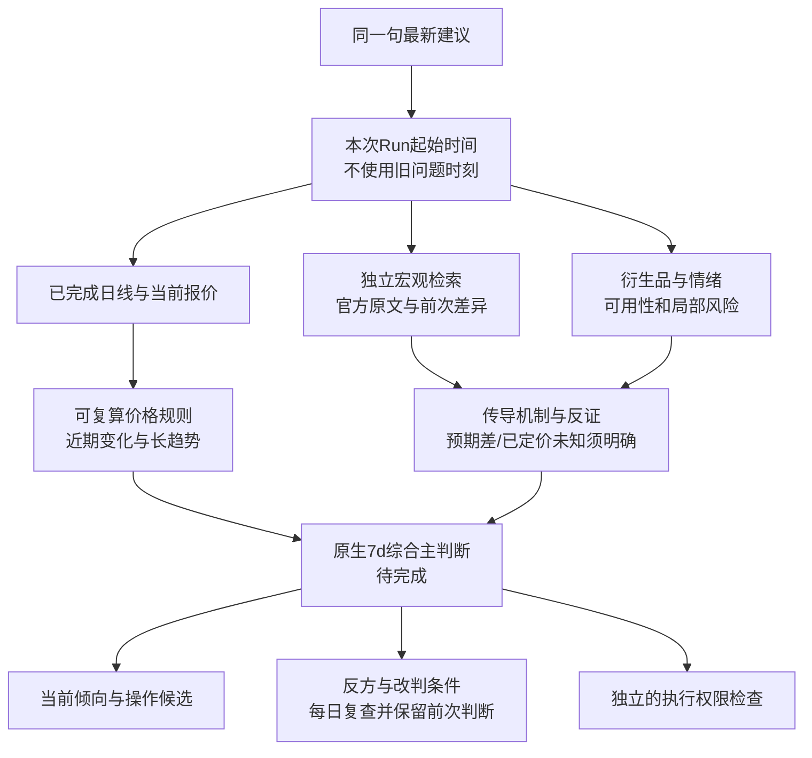

# 当前方向判断整改（替代 C1 的过早交付结论）

## 判定

C1 证明了工程链路，未证明综合研究价值。撤回“核心已达到可交付”的结论。此次不以多空出现率或强制买入为验收，而检查同一截止时间的真实信息是否足以支持清楚的主判断。

## 代码根因

1. daily_strategy.py 的 v0 只有三条件趋势过滤；其余全部 range，不能区分回落、恢复与真正横盘。宏观/情绪未进入计算，不能称综合模型。
2. historical/research.py 把不足 24 根小时线也聚成 confirmed 日线。旧报告 2026-09-16 的 close 75707.6 不可直接当 UTC 完整日收盘。
3. 可达的 Gate 日线尚未接入刷新 worker，报告使用旧归档；freshness 不能只按读取归档的时刻算。
4. ResearchPage 首屏优先旧 horizons，把 7d 观点覆盖成观望；missing_impact 未展示，as_of 也不突出。
5. query view 读取 receipt 不审核绑定 Evidence/Fact；图、复核和合成仍要求三个旧周期。上轮修改显示完成没有解决该合同分裂。
6. profile.py 的 history_anchor 来自入站 Evidence.received_at。同一句短输入被 Admission 内容去重后，今天的 Run 仍用旧问题时刻选择日线窗口。首次改用 context.created_at 的真实复测也失败：graph 会用旧 cutoff 重建 context。本轮最终改为 live/current 使用 deadline_at 减原始总预算确定本次请求起始时刻；replay 保留历史截止。两次中间复测不能算成功。
7. historical/research.py 的 `_unit` 将收益率和波动率标成 usdt，将量比标成 btc，导致取得真实日线仍报 semantic_mismatch。本轮修正为 percent / ratio。

## 本批实施顺序与出口

- [x] P0 数据：新增 gate_daily.py 接入 worker 和 DataJob；排除未闭合、非 UTC 边界、缺小时、重复小时；保留真实 source id/url。DataJob datajob_aecca9438e3a4201be63d1121cd3da0d 已完成90天日线入库。旧报告不覆写。
- [x] P0 语义：首屏优先 7d 价格规则倾向，明确数据截至、当前动作、改判条件、缺口；交易授权另列；不隐藏复核失败。旧 v0 小时聚合结果加更正提示。
- [x] P1 当前策略：daily-trend-v0.1 receipt 增加 1/2/7 日收益，解释近期变化和长趋势是否相反；偏多已有持仓/空仓分别给当前候选，突破不是形成观点的前提。方向判定三条件保持原样，该规则仍是未验证基线，不虚构宏观分值。
- [x] P1 同源时间回放：同一个新数据源，按 t-2/t-1/t 截断重算；记录在 data/product-local/core-direction-recheck-20260919/daily-time-comparison.json。这是当前下载数据的事后回算，不证明当时可得性。
- [x] 真实日线方向主链验证：最新输入 → 新日线和现货 → 新 receipt → 报告 → UI。run_fba7737392a2444f8ef0c77ad3ebeb0d 已完成；仅证明日线方向链修复，综合研究仍未验收。

## 后续综合研究必需改造（本批不宣称完成）

1. 在 agentic_research.schema.yaml 增加原生 7d synthesis，贯穿 DSH synthesis tool、result mapper、graph、commit、query。旧报告兼容读取，不让旧周期决定新报告有效性。
2. 当前日频主策略的最小集是完整日线；衍生品缺失限制杠杆/拥挤解释，不否决日频方向。要在 fact_pack 声明策略依赖后分别检查，不能简单把全部 hard 改 soft。
3. 宏观独立检索：Fed 最新决议原文和前次比较、收益率/美元日频变化；行情背景来源与情绪来源各自记录，情绪成功不能终止宏观检索。每个 claim 保存证据、时点、传导机制、反方、已定价情况及不确定性。既无价格响应也无预期差，不可把“加息”直接写成 BTC 必跌。
4. 主判断必须明确：当前偏多/偏空/分歧、决定性原因、最强反方。区间只有横盘证据成立才使用；趋势冲突应说明短期与长期分别指向哪里。方向、入场赔率、个体持仓动作、执行权限四者分开。
5. 保存前次主判断及当时阈值、新证据和本次修订。按固定日频复查，不把阈值触发当唯一研究入口，不在价格追上时无解释地移动门槛。
6. 综合排序使用预先声明的机制优先级，展示贡献和冲突，不把临场打分当概率。概率模型需独立时间验证；本轮不以构造单调行情的单元测试声称五案例价值通过。

验收需一份真实报告同时显示价格变化与宏观原文依据；日线方向不能冒称综合宏观预测。失败说明具体受影响的判断，不能笼统只给“不能交易”。

## 本轮复算与测试

| UTC 收盘日 | Gate 收盘 | 近2日收益 | 近7日收益 | 同一规则输出 |
|---|---:|---:|---:|---|
| 09-16 | 76202.1 | -2.56% | -2.69% | 趋势分歧 |
| 09-17 | 76417.0 | +1.03% | -0.21% | 趋势分歧 |
| 09-18 | 80890.4 | +6.15% | +4.74% | 偏多 |

最后一天尚未突破20日高点82278.2，但规则已经偏多。它反驳“只能等突破才有观点”，不能证明预测成功。

后端定向回归121 passed/1 skipped，前端14 passed，Ruff通过、生产构建通过（既有chunk警告）。新增隔天同问题窗口回归、部分日/重复小时拒绝、Gate开放K线过滤、字段单位回归。

## 最终真实运行与未通过项

- Run：`run_fba7737392a2444f8ef0c77ad3ebeb0d`；Artifact：`art_5691ce7f1a1040cd925a643be2d13d83`。两轮后正常结束为 `research_only / no_actionable_path`，不是完整综合研究成功。
- 新报告实际采用 Gate 原生90根日线，截至09-18完整收盘，`derived_from_hourly=false`；Gate/Huobi现货分别81135.7/81105.46，另有情绪API和Fed日历，共5条accepted Evidence。
- receipt/API/UI一致为 `bullish`，当前候选“已有现货：持有倾向；空仓：多头候选优先，入场风险需单独评估”，复查条件明确“当前偏多条件已成立”。浏览器实际回读确认首屏标题、日期、1/2/7日变化和宏观未纳入提示。概率为null，执行权限false。
- **未通过：宏观原文获取。** 主链只保留Fed日历，并未获取最新Statement正文；前面手工探针拿到原文不能计为产品能力。仅增加提示词不足，需要把日历链接发现、正文抓取、前后比较设为独立可执行任务及完成条件。
- **未通过：策略依赖隔离。** 衍生品路线失败仍触发旧图的全局方向抑制，旧30m/24h/72h被改写为no_trade；前端只能保留可信价格receipt，尚不能替代原生7d综合合同。这是下一批第一项核心改造，不是继续堆外围测评。
- **未通过：最强反方质量。** 本次反方仍混入“工具失败/缺数据”，并把日线Evidence用于引用工具失败；工具状态不等于市场反证。后续复核须区分运行限制、支持相反方向的事实和情景假设，引用必须实际支持对应claim。
- **未通过：入场风险与方向的连接。** SMA60失效位只描述长趋势，不能当成实用止损；当前没有手续费/滑点后赔率模型，不能把“偏多”冒充“现在追涨有优势”。下一批需在已有证据上单独解释近期上涨幅度、波动与追涨风险，并保留当前方向。
- 完整API回执存于 `data/product-local/core-direction-recheck-20260919/live-run-result.json`。旧报告原文保留；不把本次结果回填为过去的预测。

下一批顺序固定：原生7d综合合同与策略依赖 → 宏观独立取证与反证 → 当前方向/入场风险/前次修订一致输出 → 同一真实运行端到端验收。上述未通过项未解决前，不能恢复C1交付结论。

## 来源

- Gate 日线格式：https://www.gate.com/docs/developers/apiv4/en/spot/
- Fed 决议发现入口：https://www.federalreserve.gov/monetarypolicy/fomccalendars.htm
- 本次查到的官方事件：https://www.federalreserve.gov/newsevents/pressreleases/monetary20260916a.htm
- 本机探针：data/product-local/core-direction-recheck-20260919/。探针文件本身不是已接入研究主链的证明。
