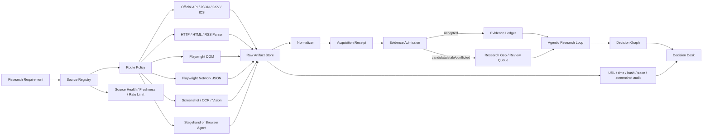

# Decision Hub 核心研究链路与可解释性重构详细方案

日期：2026-09-21  
适用范围：`decision-hub` 当前 BTC/加密宏观研究固定入口  
文档状态：方案已补充并冻结，执行目标已创建  
执行顺序：按 P0 → P1 → P2 开发，每个里程碑必须自测和记录

## 1. 本文要解决的问题

当前产品不是完全没有能力，而是能力之间没有形成用户可验证的闭环。代码已经有固定入口、证据账本、宏观事件、研究轮次、复核计划和执行 Gate，但用户看到的仍然可能是一句“偏多/偏空”加一堆日志，无法回答：

1. 系统究竟是什么触发了本次研究；
2. 系统查询了哪些数据，哪些数据没有拿到；
3. 哪些事实支持当前方向，哪些事实反驳当前方向；
4. 结论是模型综合结果、规则基线，还是超时后的证据降级结果；
5. 新报告为什么和上一份不同；
6. 宏观日历中的事件是新增、更新、发布还是修订；
7. 研究方向、入场/持仓倾向、交易权限和预测准确度分别是什么状态。

本方案的目标不是做一个漂亮的流程图，也不是把研究循环无限扩大，而是把已经存在的研究状态投影成一条可追溯、可比较、可复查的决策链。

交付目标定义为：

> 用户不输入任何专业字段，点击一次“获取最新操作建议”，系统自动取得当前 BTC 及宏观证据，形成带主链、反方链、缺口、行动候选、失效条件、上一版差异和下一次复核时间的 7 天研究结果。模型超时或数据缺失时，系统给出明确的有界降级链，不伪造因果关系、概率或交易授权。

## 2. 代码现状核对结论

### 2.1 当前不是“脱离 DSH”的架构

当前调用关系是：

```text
Decision Desk UI
    ↓ HTTP
Hub API
    ↓ durable Run / queue
Research Worker
    ↓ LangGraph product-level graph
DshWebResearchRuntime
    ↓ persistent DSH Web Host
DSH model/tool/subagent session
    ↓ typed result / trace
Hub Evidence Ledger + Commit + Gate
    ↓
Research Query View / Decision Desk
```

职责已经有边界：

| 层 | 当前职责 | 不能交给它的职责 |
|---|---|---|
| Decision Desk | 触发、回读、展示 | 不应从文本重新推断结论 |
| Hub API | 入队、查询、幂等、权限 | 不应在请求线程内执行长模型任务 |
| Research Worker | 领取 Run、重启恢复、提交结果 | 不应绕过 Run ledger 写状态 |
| LangGraph product graph | 研究轮次、覆盖率、缺口、重规划、停止 | 不应决定交易权限的最终数值门槛 |
| DSH Web Host | 模型会话、工具调用、压缩、原生轨迹、结构化综合 | 不应成为 Hub 的证据事实源或 Gate |
| Provider Adapter | 读取市场、宏观和文档数据 | 不应补造缺失值或解释成交易结论 |
| Commit/Gate | 固化快照、预测、执行权限和审计状态 | 不应把方向观点抹成唯一的 no-trade |

因此不建议移除 DSH。DSH 应继续作为“模型/工具会话运行时”，但必须保持可替换：Hub 通过 `ResearchHarnessRuntime` 接口调用 DSH，未来可以加一个固定 GPT API runtime 或离线 replay runtime，不改变 Evidence、Run 和 Gate。

当前 DSH preset 的模型路由由 DSH Web Host 所有。若固定使用 GPT 系列，不能只在 Hub 里改一个字符串，必须在 DSH Host 的模型路由配置中设置兼容 OpenAI API 的 `base_url`、模型名和超时；Hub 只记录最终的 `runtime_id`、模型版本和请求 hash，不读取或保存密钥。

建议的配置契约：

```text
DECISION_HUB_RUNTIME=dsh-web
DECISION_HUB_MODEL_PROVIDER=openai-compatible
DECISION_HUB_MODEL=gpt-5.5
DECISION_HUB_MODEL_ROUTE=primary
DECISION_HUB_MODEL_STEP_TIMEOUT_MS=150000
DECISION_HUB_MAX_SYNTHESIS_REPAIRS=1
```

这组变量只是产品侧契约。真正的供应商 URL 和密钥仍由 DSH Host 或受控 provider route 管理，不能把密钥提交到仓库或写入运行日志。

### 2.2 固定入口已经存在，但用户体验会误以为必须输入

`apps/decision-desk/src/research/ResearchPage.tsx` 已有“获取最新操作建议”按钮，提交时如果文本为空，会发送固定文本“获取最新操作建议”。

`packages/kernel/decision_hub_kernel/application/research_intake.py` 已有：

- `LATEST_ADVICE_SOURCE_ID`；
- `LATEST_ADVICE_EVENT_HINT`；
- 固定 BTC 研究模板；
- “当前/最新 + 操作/建议”等自然语言归一化；
- 空文本自动展开成固定研究任务。

所以用户理论上不需要知道关键词，也不应该被要求编写专业 prompt。当前大文本框应该改成折叠的“可选补充关注点”，按钮旁边直接写“无需输入，系统会自动核验 BTC、衍生品、日线和宏观信息”。

当前前端每次提交使用随机 `Idempotency-Key`。这会让用户连续点击时创建多个独立 Run。需要增加产品级的 `request_window_key`：

```text
instrument + canonical_template + optional_focus + utc_window
```

同一窗口内存在进行中的 Run 时返回它；用户点击“强制刷新”时才创建新的 Run，并记录 `supersedes_run_id`。

### 2.3 多轮补证已经存在，但不是无限研究

`packages/orchestration/langgraph/graphs/agentic_research_graph.py` 已经实现了有界研究循环，状态中包含：

- 当前轮次和历史轮次；
- Evidence 和 Fact；
- Coverage gap；
- review replan；
- inquiry target；
- synthesis revision；
- thesis/action delta；
- no-progress 轮数；
- tool call、deadline、cost 和 subagent 预算。

当前逻辑是：

```text
计划
→ 取证
→ Evidence admission
→ coverage/conflict 评估
→ 只针对 canonical gap 重规划
→ 独立复核
→ 必要时补证
→ 综合
→ Gate
```

它已经具备 Agentic 研究的骨架，但还有两个关键缺口：

1. 一些缺口虽然被发现，却没有生成用户可读的“缺口 → 下一条检索 → 新证据 → 观点变化”链条；
2. DSH 模型综合超时或结构化结果不合格时，只保留 Evidence-only 结果，`causal_case` 可能为空。

因此不能把当前能力描述成“已经有完整根因链”。更准确的状态是：

> 根因链合同、Evidence 引用和有界多轮补证已经存在；完整综合成功时可以产生主链/反链，但综合失败时缺少确定性的可解释降级链。这是当前需要优先修复的核心断点。

### 2.4 最新真实运行暴露的是综合降级问题

2026-09-20 的真实 BTC Run 有 13 条 Evidence，hard/soft coverage 均为 100%，但 DSH 模型步骤在单步时限内超时，最终进入 `research_only` 和 evidence-only fallback：

- 7 天规则基线为偏多；
- 概率不可用；
- 交易权限未授权；
- 没有完整 `causal_case`；
- reviewer 指出了成交量偏低、美元和 10 年期收益率上行、基差为负等反方限制。

这说明取证链不是完全没有工作，断点在“从已验证证据生成结构化综合结果”。如果只增加一个流程图组件，用户仍然会看到一张空图或一条断链。必须先补齐 evidence-only 的结构化降级投影。

### 2.5 宏观数据和小时级数据的边界

当前官方来源适配器已经覆盖或预留：

- Federal Reserve 日历和讲话；
- ECB 日程；
- BOJ 日程；
- BLS 发布日历；
- 官方宏观发布正文；
- FRED/历史宏观类数据适配路径；
- 交易所和市场适配器；
- 搜索/文档读取能力。

宏观事件的时间、发布状态和官方正文通常可以通过公开来源获取；市场共识、期货隐含概率和高质量衍生品字段需要单独的 provider，不能从 prior 或新闻摘要推断。

分钟级和小时级数据不是 7 天方向研究的必要前提。产品应分成三层：

| 层级 | 最小数据 | 缺失影响 |
|---|---|---|
| 7 天方向 | 已收盘日线、当前现货、成交量、宏观事件与主要跨资产 | 仍可形成规则方向，但需说明时效和反方 |
| 入场/持仓倾向 | 日线 + 当前现货 + 可用衍生品/流动性 | 缺失时降低行动强度、禁止追涨或杠杆判断 |
| 30m/24h 执行候选 | 高质量短周期价格、流动性、衍生品和校准策略 | 缺失时不得生成可执行短周期 Forecast |

不能因为拿不到小时数据，就把 7 天宏观方向也改写为“永远不能判断”。同样不能把宏观公开资料当成已经足以授权交易。

### 2.6 Computer Use 的正确位置

浏览器和页面视觉读取可以帮助发现资料、阅读没有稳定 API 的官方页面、核对网页中的图表和公告，但不能替代证据适配器：

- 浏览器截图必须保存 URL、页面标题、抓取时间和内容 hash；
- 视觉读取只能生成候选 Evidence，经过来源、时点和字段校验后才能进入 accepted Evidence；
- 页面上的广告、评论、动态数字和未核实摘要不能直接进入硬证据；
- 结构化数值优先使用 API、CSV、ICS、官方 JSON 或稳定 HTML parser；
- Computer Use 作为 `browser_readback` capability，不作为核心 Gate 的唯一来源。
### 2.7 信息源获取必须成为独立的通用工程

目前项目已经有 Provider Adapter 和官方 Feed，但它们主要以“研究能力调用”的形式存在，缺少一层统一的信息源获取工程。后续其他交易员入口、PPT、复盘任务和宏观监控都需要相同的能力，因此不能在每个业务模块里重复写爬虫。

信息获取工程必须同时解决四件事：

1. 页面能不能打开；
2. 页面里的内容能不能稳定提取；
3. 提取结果能不能证明在正确的时间点可见；
4. 结果能不能被 Evidence Ledger、复盘和版本比较重复使用。

建议建立统一的 Source Acquisition Layer：

```text
Research Requirement
    ↓
Source Registry：来源、能力、权限、频率、字段、版本
    ↓
Route Selector：API → HTTP/HTML/ICS → Playwright DOM/Network → Screenshot/OCR
    ↓
Acquisition Job：隔离浏览器、超时、重试、限速、缓存、trace
    ↓
Raw Artifact Store：响应、DOM、截图、HAR/trace、内容 hash
    ↓
Normalizer：字段、单位、时区、发布时间、观察时间
    ↓
Admission：authority、freshness、PIT、independence、schema、hash
    ↓
Evidence Candidate / Accepted Evidence
    ↓
Research Graph / Decision Graph
```

其中 Browser 页面只是一个来源读取方式，不能直接成为结论。所有读取方式都必须产出统一的 AcquisitionReceipt：

```text
acquisition_id
source_id
capability_id
request_url
access_mode
started_at / finished_at
published_at / observed_at
cutoff_at
provider_identity
parser_version
content_hash
source_content_hash
raw_artifact_ref
visual_artifact_ref
network_artifact_ref
status
error_provenance
```

这样后续任何项目都可以复用“来源注册、访问、解析、证据准入和复核”，而不是复用某一个交易页面的选择器。

### 2.8 信息获取路线和开源组件选择

信息源获取不应该默认“打开浏览器截图”。正确的路线是从稳定、可验证、成本最低的方式开始，只有前一层无法满足字段或时效时才降级到下一层：

| 优先级 | 获取方式 | 适合内容 | 进入 Evidence 的条件 |
|---|---|---|---|
| A | 官方 API、CSV、JSON、ICS、RSS | 宏观事件、官方数据、公告时间 | 保存原始响应、字段 schema、发布时间和 hash |
| B | HTTP + HTML parser | 官方公告正文、静态表格、网页历史列表 | 保存正文和 locator，parser 版本固定 |
| C | Playwright DOM | JavaScript 渲染的表格、动态页面、无公开 API 的公开数据 | 保存 URL、DOM 摘要、页面状态、观察时间和 trace |
| D | Playwright network interception | 页面背后返回的 JSON/XHR、图表数据、分页接口 | 保存请求/响应元数据和响应 hash，校验同源页面 |
| E | Screenshot + OCR/视觉模型 | 只有图表、canvas、地图、图片公告中的数值 | 必须保存原图、区域坐标、模型版本；重要字段要求第二来源复核 |
| F | Computer Use/浏览器 Agent | 登录后仪表盘、需要复杂点击或临时发现资料 | 只能生成候选 Evidence，不直接进入 hard Evidence |

推荐的开源组件组合：

| 组件 | 在本项目中的位置 | 是否作为核心 |
|---|---|---|
| Playwright | 浏览器生命周期、DOM、网络监听、截图、Storage State、Trace | **核心基础库** |
| Crawlee PlaywrightCrawler | URL 队列、并发、重试、session、持久化队列和浏览器池 | **采集任务管理层** |
| Stagehand | 需要自然语言定位、页面结构变化明显的 discovery/备用流程 | 受控 fallback |
| browser-use / open-browser-use | 已登录浏览器或需要模型操作页面的特殊来源 | 仅 discovery/人工辅助 |
| OCR/视觉模型 | canvas、图片和图表局部读取 | 只做候选字段提取 |

Playwright 官方能力覆盖网络请求监听、浏览器上下文隔离、Storage State、截图和 Trace。网络监听可以读取页面 XHR/fetch，Trace 可以保存 DOM snapshot、截图、动作、控制台和网络日志，适合做可复核的浏览器采集。[Playwright Network](https://playwright.dev/docs/network)、[Playwright BrowserContext](https://playwright.dev/docs/api/class-browsercontext)、[Playwright Trace Viewer](https://playwright.dev/docs/trace-viewer)

Crawlee 官方提供 PlaywrightCrawler、请求队列和浏览器池，可以在不改变采集器接口的情况下从 HTTP crawler 切换到浏览器 crawler；它适合做可复用的采集任务调度，而不是让业务代码直接管理浏览器。[Crawlee Quick Start](https://crawlee.dev/js/docs/quick-start)、[Crawlee PlaywrightCrawler](https://crawlee.dev/js/api/3.10/playwright-crawler)

Stagehand 的 act、observe 和 extract 适合页面变化较大的自然语言操作，并支持结构化提取；但这类 AI 动作具有非确定性，不能直接决定 Evidence 是否 accepted。它应放在 C/D 路线失败后的受控 fallback。[Stagehand](https://stagehand.dev/)

browser-use 适合让 Agent 操作真实浏览器或连接现有 CDP 浏览器，但它的默认能力是“根据任务决定下一步动作”，不适合作为金融事实采集的唯一来源。它应当只产生候选 URL、截图、DOM 或结构化草稿，再经过 Source Registry 和 Evidence Admission。[browser-use browser configuration](https://github.com/browser-use/browser-use/blob/main/skills/open-source/references/browser.md)

推荐路线不是把所有项目都改成 AI 浏览器 Agent，而是：

```text
Playwright + Crawlee = 确定性采集底座
Stagehand/browser-use = 动态页面发现和兜底
Hub Evidence Admission = 唯一事实入口
```

### 2.9 信息源采集工程的代码结构

建议新增通用包和一个独立 worker，避免把浏览器生命周期塞进 Research Worker：

```text
packages/source_acquisition/
  contracts/
    acquisition_receipt.py
    source_manifest.py
    browser_artifact.py
  registry/
    source_registry.py
    capability_registry.py
    route_policy.py
  http/
    http_fetcher.py
    retry_policy.py
    cache.py
  browser/
    playwright_runner.ts
    crawlee_queue.ts
    context_policy.ts
    network_capture.ts
    dom_snapshot.ts
    screenshot_capture.ts
    trace_capture.ts
  visual/
    ocr_adapter.py
    chart_region_extractor.py
  normalizers/
    macro_event_normalizer.py
    market_snapshot_normalizer.py
    document_normalizer.py
  admission/
    freshness.py
    point_in_time.py
    source_independence.py
    evidence_candidate.py
  artifacts/
    content_addressed_store.py
    redaction.py

apps/source_acquisition_worker/
  main.py / main.ts
  queue_consumer.py
  health.py
  metrics.py

packages/provider_adapters/
  official_sources/
  macro_market/
  market/
  research/
```

当前的 packages/source_adapters/official_feeds 和 packages/provider_adapters 不删除，而是逐步把重复的抓取、hash、时间和回执逻辑迁移到 source_acquisition。Provider Adapter 只负责“这个来源如何解析成领域字段”，不再重复实现浏览器池、重试、截图和原始工件保存。

### 2.10 浏览器采集的可复核流程

```text
1. Source Registry 根据 requirement 选择来源和允许的 access_mode
2. Route Selector 先尝试 API/HTTP，再决定是否启动 BrowserContext
3. BrowserContext 使用隔离 profile，禁止读取其他任务 cookies
4. Playwright 打开页面并等待稳定条件，而不是固定 sleep
5. 同时记录 DOM、ARIA/可见文本、网络 JSON、console、截图和 trace
6. Normalizer 从 DOM/网络响应中提取 typed fields
7. 若只剩 canvas/图片，再调用 screenshot/OCR/视觉模型
8. 将 raw artifact、visual artifact、network artifact 都写入 content-addressed store
9. Evidence Admission 校验来源权威、发布时间、观察时间、PIT、字段完整性、hash 和独立性
10. 只有 accepted Evidence 才进入研究循环和 Decision Graph
```

截图和视觉读取必须带有明确标签：

```text
access_mode = screenshot_vision
quality = candidate | accepted | conflicted
visual_region = {x, y, width, height}
model_version = ...
second_source_required = true
```

对于价格、利率、资金费率、持仓量等关键数值，优先从 DOM 或页面 network JSON 提取；如果只能从截图读取，至少需要第二来源、前后两次观察或人工复核之一，不能把单张截图中的文字直接当作精确市场数据。

### 2.11 采集工程的安全、成本和合规边界

“放开信息获取限制”应该理解为支持更多公开来源和更多读取路径，不是绕过登录、付费墙、验证码、robots 或来源权限。工程约束如下：

- 每个来源保存 rate limit、访问窗口和失败退避；
- 所有浏览器任务使用独立 BrowserContext；
- Storage State 只存本机受控目录或密钥管理器，不能进 Git；
- 不在 trace、截图和日志中输出 cookie、Authorization、API key；
- 公开页面可以自动抓取，登录后页面需要明确的账户授权；
- 浏览器 Agent 不允许自动下单、改仓位或执行不可逆操作；
- 429、403、验证码和条款限制必须形成可观察的 provider error，而不是无限重试；
- 采集失败时保留失败回执和数据缺口，不生成猜测值。

### 2.12 信息来源完整架构图



这张图的关键约束是：任何采集方式都先进入 Raw Artifact 和 Acquisition Receipt，再经过 Evidence Admission；浏览器、截图、Agent 和模型都不能绕过这条链直接写研究结论。

## 3. 多 Agent、handoff 和 DSH delegation 是否需要

### 3.1 当前已有的 delegation

`infra/dsh/presets/decision-research/agent.cordis.yml` 已配置 DSH 内部的 bounded delegation：

- 角色是独立 reviewer；
- reviewer 无工具；
- `maxDepth=1`；
- reviewer 只能检查已提供的 Evidence 和主张；
- reviewer 不能继续检索、再综合或递归委派。

这符合当前金融研究场景的安全边界：作者负责提出解释，reviewer 负责挑战解释，Hub 负责 Gate。

### 3.2 当前不需要实现外部 handoff

暂时不建议增加 Hub 到多个外部 Agent 的 handoff，也不建议自由 swarm，原因是：

1. 当前问题不是“Agent 数量不够”，而是已有 Evidence 没有被投影成可解释链；
2. 外部 handoff 会增加 session、权限、结果回执和去重边界；
3. 多个 Agent 可能重复访问相同来源，被错误计为独立证据；
4. reviewer 如果和作者共享上下文，审查并不独立；
5. 研究停止和交易 Gate 不能由 Agent 自主决定。

只有当以下条件满足时，才考虑第二阶段增加受限的角色委派：

```text
主研究 Run 已经能稳定生成 Decision Graph；
source independence 和 Evidence hash 已经稳定；
需要并行处理宏观、市场结构、事件叙事三个不同领域；
每个子 Agent 有固定 capability、预算、输出 schema 和 receipt；
父 Run 只接受经过 admission 的 typed result。
```

因此本方案采用：

```text
确定性 Hub 状态机
    + DSH 单一研究会话
    + 一个无工具独立 reviewer
    + Provider 层并行取证
```

不把 handoff 作为当前交付目标。

## 4. 可视化组件选型与取舍

### 4.1 需要区分三类产品

当前要做的是“只读决策链查看器”，不是：

- 用户自由画脑图；
- 多人协同白板；
- 任意节点拖拽的流程设计器；
- 3D 展示所有研究日志。

如果直接把一个白板组件塞进页面，会遇到节点布局不可复现、文字超框、用户误以为可以修改事实、图和 Evidence 不同步等问题。

### 4.2 组件选项比较

| 方案 | 优点 | 问题 | 结论 |
|---|---|---|---|
| `@xyflow/react` + `elkjs` | React 原生、自定义节点、边、折叠、点击详情、适合 DAG；ELK 支持动态节点和边路由 | 需要自己做数据投影、样式和布局约束 | **首选** |
| `@xyflow/react` + Dagre | 配置简单、布局速度快 | 动态尺寸、复杂分支和子图能力弱 | 小图可作为降级 |
| tldraw | 完整白板 UI、文本/框/箭头/分组/自定义 Shape、适合头脑风暴 | 偏编辑器；用户可移动事实节点；自动 DAG 布局和版本只读语义需要大量封装 | 不作为主链路，可用于未来人工标注 |
| Mermaid | 文档和静态导出方便，子图语法简单 | 交互和 Evidence 抽屉能力弱；复杂长文本可读性差 | 报告/导出降级 |
| Cytoscape.js | 大型网络图和复杂布局能力强 | React 状态、节点详情和样式集成成本更高 | 当前规模不需要 |
| AntV G6 | 中文生态和图布局能力较丰富 | 与当前 React 状态和既有样式体系需要重新整合 | 备选，不优先 |
| Three.js/3D | 可做沉浸式关系探索 | 信息密度、可访问性、截图和文字阅读都差；3D 不会增加证据可信度 | 不用于核心结果 |

React Flow 官方支持自定义节点，节点可以包含图表、表单和其他交互内容；官方也明确把布局交给 Dagre、D3 或 ELK。ELK 适合本项目的动态卡片、主链/反链和 Evidence 分组。[React Flow Custom Nodes](https://reactflow.dev/learn/customization/custom-nodes)、[React Flow Layouting](https://reactflow.dev/learn/layouting/layouting)、[React Flow Auto Layout](https://reactflow.dev/examples/layout/auto-layout)

tldraw 的 Shape/Frame/Group 体系适合白板和人工编辑，但这不是当前主需求；其官方文档也显示它的核心是可编辑的 Shape Store 和 UI slot。[tldraw Shapes](https://tldraw.dev/sdk-features/shapes)、[tldraw UI Components](https://tldraw.dev/sdk-features/ui-components)

### 4.3 最终可视化方案

采用：

```text
@xyflow/react
    + elkjs
    + 自定义只读 Node
    + Evidence 详情抽屉
    + 分支折叠
    + 固定层级布局
```

不采用自由画布。每次由后端返回逻辑图，前端只负责布局和交互。布局结果在前端按 `layout_version` 和节点尺寸计算；不把用户拖拽位置保存回研究账本。

布局层级固定为：

```text
触发 / 时间
    → 事实 Evidence
        → 派生信号
            → 支持 / 反方 / 冲突
                → 主情景 / 反方情景
                    → 行动候选
                        → 失效条件 / 下一次复核
```

节点设计约束：

- 卡片宽度固定在 240–320px；
- 标题最多两行，摘要最多三行；
- 超出文字进入详情抽屉，不在节点内硬塞全文；
- Evidence 默认按来源分组折叠；
- 主链、反方链、未解决问题有不同颜色和图例；
- 节点不允许编辑；
- 节点点击只打开详情，不改变 Run；
- 页面提供“只看主链”“只看反方”“显示全部 Evidence”三个视图；
- 复杂图超过阈值时按分组折叠，不强行渲染成一张全展开大图。

## 5. Decision Graph 数据契约

当前 `CausalCase` 是线性的 main/opposite chain，不能直接冒充完整 DAG。新增一个查询层投影，不修改原始 Evidence 和旧结果：

```text
GET /v1/research/runs/{run_id}/decision-graph
```

返回 `decision-graph.v1`：

```json
{
  "schema_version": "decision-graph.v1",
  "run_id": "run_xxx",
  "graph_status": "complete|bounded_fallback|incomplete",
  "generation_mode": "dsh_synthesis|evidence_projection|rule_projection",
  "generated_at": "2026-09-21T00:00:00Z",
  "layout_version": "decision-graph-layout.v1",
  "nodes": [
    {
      "id": "fact-volume",
      "type": "fact",
      "title": "成交量低于近期基线",
      "summary": "现货成交量比率为 0.476",
      "status": "accepted|conflicted|stale|unknown",
      "confidence": null,
      "reason_code": "evidence_observed",
      "evidence_refs": ["evidence_x"],
      "source_ids": ["market_spot"],
      "observed_at": "2026-09-20T00:00:00Z",
      "detail_ref": "hub://runs/run_xxx/evidence/evidence_x"
    }
  ],
  "edges": [
    {
      "id": "edge-volume-counter",
      "from": "fact-volume",
      "to": "scenario-bullish",
      "relation": "contradicts",
      "label": "削弱突破有效性",
      "evidence_refs": ["evidence_x"]
    }
  ],
  "unresolved_questions": [],
  "stop_reason": {
    "code": "sufficient|no_progress|dsh_model_step_timeout|critical_data_unavailable",
    "detail": "..."
  }
}
```

允许的节点类型：

```text
trigger
event
fact
derived_signal
conflict
inference
scenario
action
invalidation
review
limitation
```

允许的边类型：

```text
supports
contradicts
causes
requires
invalidates
rechecks
derived_from
```

### 5.1 完整综合成功时

从以下对象投影图：

- `causal_case.main_chain`；
- `causal_case.opposite_chain`；
- `causal_case.unresolved_questions`；
- accepted Evidence；
- `horizons`；
- reviewer challenge；
- coverage conflicts；
- review schedules；
- invalidation 和 next review。

### 5.2 DSH 超时或综合失败时

生成明确标记为 `bounded_fallback` 的确定性链：

```text
trigger
  → accepted Evidence
  → coverage result
  → support / contradiction groups
  → unresolved synthesis
  → rule-based outlook（如果存在）
  → action candidate
  → execution gate
  → next review
```

这条链不把 Evidence 直接伪装成因果结论。节点必须注明：

```text
“DSH 综合未完成，本节点只表示已验证证据或确定性规则投影。”
```

如果没有足够的 Evidence 支持方向，则只显示“方向未形成”，不能从缺口推导偏多或偏空。

## 6. 研究循环与信息补齐的详细设计

### 6.1 Canonical Requirement Registry

每次固定入口只允许使用 Domain Pack 声明的 requirement，不能由模型自由发明缺口：

```text
daily_direction:
  market_daily_history
  crypto_spot_confirmation
  macro_transmission
  opposing_market_signal

position_bias:
  current_spot
  recent_range_or_trend
  liquidity_context
  derivatives_crowding

execution_candidate:
  calibrated_strategy
  execution_cost
  current_liquidity
  risk_limit
```

缺口必须绑定：

```text
requirement_id
importance: hard|soft
query_hint
allowed_capabilities
blocks_directional_output
blocks_execution_output
```

这样“缺小时数据”只能阻断短周期执行候选，不能自动阻断 7 天方向。

### 6.2 每轮处理流程

```text
R0 Trigger Snapshot
    ↓
R1 Plan：将 requirement 编成任务
    ↓
R2 Acquire：并行调用官方、市场、宏观、文档和搜索能力
    ↓
R3 Admission：校验来源、时间、hash、字段和独立性
    ↓
R4 Sufficiency：计算 hard/soft coverage、冲突、stale 和空窗口
    ↓
R5 Review：挑战主张和最弱 Evidence
    ↓
R6 Replan：只针对 canonical gap 或 reviewer challenge 补证
    ↓
R7 Synthesis：DSH 结构化综合；失败则确定性投影
    ↓
R8 Freeze：保存 decision snapshot、graph、revision 和 Gate
```

### 6.3 什么时候继续查，什么时候停止

继续查必须同时满足：

1. 存在明确的 hard gap、来源冲突、反方缺口或关键事件未解析；
2. 存在允许该 requirement 的 capability；
3. 仍在轮次、工具、费用和 deadline 预算内；
4. 下一次检索预期能产生新 Evidence 或解决冲突。

停止条件：

- hard coverage 达标，且主链/反方链没有可解决的 material gap；
- 连续两轮没有新增 accepted Evidence 或状态变化；
- 所有允许路径都尝试过，但 provider 不可用；
- 达到预算或截止时间；
- 发现 PIT/future leak、hash、合同或来源身份错误；
- 冲突不能消解，保留 `mixed` 并降低可信度。

建议第一版保持有界预算，不直接承诺 25 或 50 次模型循环：

```text
max_evidence_rounds = 8
max_tool_calls = 48
max_subagents = 1
total_deadline_seconds = 480
max_structured_repairs = 1
no_progress_rounds = 2
```

低成本 Provider 查询可以在一轮内并行；模型综合和复核仍然受单步超时控制。扩大循环次数不能替代数据源质量和结果投影。

## 7. 版本、日历和触发设计

### 7.1 触发注册表

新增或投影统一 Trigger：

```text
trigger_id
trigger_type
instrument
source_ref
parent_run_id
supersedes_run_id
request_window_key
created_at
reason
```

触发类型：

| 类型 | 触发方 | 是否自动创建 Run |
|---|---|---|
| `manual_latest_advice` | 用户按钮 | 是，窗口内幂等 |
| `macro_release` | 官方日历发布/修订 | 仅当 admission policy 判定 material |
| `scheduled_recheck` | review schedule | 是 |
| `invalidation_evidence` | 新证据命中失效条件 | 是 |
| `outcome_due` | 预测到期 | 创建复盘任务，不一定创建新方向 Run |

普通自然语言只用于触发归一化，不能作为调度器的隐式规则。调度器依赖 Trigger Registry 和 admission policy。

### 7.2 日历接口

新增：

```text
GET /v1/macro-events?view=upcoming&from=&to=&family=&status=&limit=&cursor=
GET /v1/macro-events?view=history&from=&to=&family=&status=&limit=&cursor=
GET /v1/macro-events/{macro_event_id}/vintages
GET /v1/macro-events/{macro_event_id}/impact-runs
```

事件身份仍然是 `source_id + external_event_id`：

- 新事件新增 current record；
- 同事件新 payload 更新 current record；
- payload hash 变化时追加 immutable vintage；
- released/revised 追加状态 vintage；
- 旧事件和旧 Run 不覆盖。

前端禁止再用 `slice(0, 8)` 代表完整日历。必须使用分页或按 Upcoming/History 分栏查询。

### 7.3 Run 比较接口

新增：

```text
GET /v1/research/runs/{run_id}/comparison?against=previous
GET /v1/research/runs/{run_id}/comparison?against=parent
GET /v1/research/runs/{run_id}/comparison?against={other_run_id}
```

返回：

```text
previous_thesis
current_thesis
direction_before / direction_after
action_before / action_after
probability_status_before / after
added_evidence_refs
removed_or_stale_evidence_refs
changed_requirements
changed_triggers
changed_invalidation
changed_gate
reason_codes
```

这部分是解决“是不是系统推翻了过去”的关键，不是可有可无的管理功能。

## 8. 前端页面设计

页面不再把所有工程日志和用户结论混在同一屏。

### 8.1 首屏

首屏固定显示：

```text
当前方向：偏多 / 偏空 / 区间 / 未形成
当前行动：持有 / 等待回撤 / 轻仓观察 / 不追涨 / 无法判断
研究可信度：高 / 中 / 有限 / 未完成
交易权限：未授权 / 人工复核 / 授权
数据截止时间：...
相对上一版：方向未变 / 方向改变 / 证据变化
```

首屏不显示 provider 调用数、内部 session ID、框架名称等开发信息。

### 8.2 Decision Graph 区域

工具栏：

- 主链；
- 反方链；
- 未解决问题；
- 全部证据；
- 只看影响 7 天方向的节点；
- 展开/折叠证据分组；
- 版本选择：当前 / 上一版。

点击节点打开 Evidence Drawer：

```text
证据标题
来源和权威等级
发布时间 / 观察时间 / 截止时间
原文摘要
来源 URL
内容 hash
支持或反驳的 claim
是否 stale / conflicted
```

### 8.3 研究过程区域

使用时间线而不是原始日志：

```text
触发
→ 计划
→ 取证
→ 充分度
→ 复核
→ 补证
→ 综合
→ Gate
→ 下一次复核
```

每一步显示：

- 为什么进入该阶段；
- 新增了多少 Evidence；
- 哪些 gap 仍未解决；
- 是否改变了 thesis/action；
- 是否因为超时或 provider 失败而降级。

### 8.4 日历区域

显示三个标签：

```text
未来事件 | 历史事件 | 修订记录
```

每条事件显示：

- scheduled/released/revised/cancelled；
- prior/consensus/actual/surprise；
- 官方来源；
- 是否触发研究；
- 关联 Run；
- 当前版本和上一版本差异。

## 9. 代码实施映射

### P0：核心可解释链路

先做，不能被外围任务打断：

```text
packages/contracts_py/.../decision_graph.py
packages/contracts_ts/src/index.ts
packages/kernel/.../decision_graph_projection.py
packages/kernel/.../research_revision.py
packages/kernel/.../research_intake.py
packages/kernel/.../commit.py
packages/query_views/research/service.py
apps/hub_api/main.py
apps/decision-desk/src/api/client.ts
apps/decision-desk/src/api/types.ts
apps/decision-desk/src/research/ResearchPage.tsx
apps/decision-desk/src/research/DecisionGraph.tsx
```

工作内容：

1. canonical latest advice 幂等窗口；
2. `supersedes_run_id` 和 comparison；
3. evidence-only / rule-only fallback graph；
4. `GET /decision-graph` 和 `GET /comparison`；
5. 首屏分离方向、研究可信度、行动倾向、执行权限；
6. 真实 Run 回读和超时回归。

### P0-A：信息获取底座先做最小闭环

信息获取工程是 P0 的一部分，但第一版只接入两个真实来源作为纵向验收，避免一开始铺设几十个站点：

1. 一个官方动态宏观页面，例如 BLS/Fed/ECB/BOJ 日历中的一个 JavaScript 页面；
2. 一个公开市场页面，用于验证 DOM/Network/截图三种读取路径；
3. 一个当前已有 API/HTML adapter，作为结构化路线基线。

P0-A 的完成条件：

- Source Registry 能声明同一来源支持 API、HTML、Playwright DOM 或 screenshot_vision 哪些能力；
- Route Selector 按优先级选择路径；
- Playwright Worker 能创建隔离 BrowserContext；
- 能保存 DOM、network JSON、截图和 trace 的内容 hash；
- 能生成 AcquisitionReceipt；
- accepted Evidence 能引用 raw artifact 和 receipt；
- provider 失败时写入 gap，不改变研究结论；
- 研究 Run 的 Decision Graph 能显示 Evidence 的 access_mode。

P0-A 不要求接入 browser-use 或 Stagehand。先证明 Playwright/Crawlee 的确定性采集和回执链有效，再为动态页面增加受控 AI fallback。


### P1：日历历史和版本

```text
packages/kernel/.../macro_event.py
apps/hub_api/main.py
packages/contracts_py/.../macro_event.py
apps/decision-desk/src/research/MacroCalendar.tsx
```

工作内容：

1. upcoming/history/all 查询；
2. vintages 查询；
3. revision diff；
4. event impact runs；
5. UI 分页和筛选；
6. 事件 admission 记录。

### P2：Decision Graph 交互实现

```text
apps/decision-desk/package.json
apps/decision-desk/src/research/DecisionGraph.tsx
apps/decision-desk/src/research/graphLayout.ts
apps/decision-desk/src/styles.css
apps/decision-desk/src/research/DecisionGraph.test.tsx
```

依赖选择：

```text
@xyflow/react
elkjs
```

不引入 tldraw、Cytoscape、Three.js 作为当前主链路依赖。Mermaid 仅作为无 JS 导出或故障降级文本。

### P3：工程观测和外部 trace 集成

暂缓。Langfuse、Phoenix 或 OpenTelemetry 可以在核心链路稳定后接入，用于开发人员查看 span、工具调用和评测，但不能替代当前的 Run ledger、Evidence ledger、Decision Graph 和版本比较。

## 10. 测试和自测矩阵

### 10.1 触发

| 场景 | 预期 |
|---|---|
| 空输入点击 | 自动使用固定 BTC 模板 |
| 连续点击 | 返回同一窗口内的活跃 Run |
| 强制刷新 | 创建新 Run，保存 supersedes 关系 |
| “现在怎么操作” | 归一化为固定模板 |
| 非研究普通文本 | 不误判为最新建议 |

### 10.2 多轮补证

| 场景 | 预期 |
|---|---|
| hard gap 可由 provider 补齐 | 下一轮只查询目标 requirement |
| provider 失败但已有证据足够 | 进入 bounded fallback，明确影响层级 |
| 连续两轮无新 Evidence | `no_progress` 停止 |
| 发现冲突 | 保留两侧证据，不能多数票抹掉冲突 |
| 未知 requirement | 不触发永久循环 |
| DSH 综合超时 | 仍生成 evidence projection graph，状态为 bounded_fallback |

### 10.3 日历

| 场景 | 预期 |
|---|---|
| 新 external_event_id | 新 current event |
| 同事件相同 payload | 不增加 duplicate vintage |
| 同事件新 payload | current 更新、vintage 增加 |
| release/revision | 状态变更并保存 vintage |
| history 查询 | 不被未来事件占满 |

### 10.4 版本比较

| 场景 | 预期 |
|---|---|
| 新证据没有改变观点 | 显示 thesis unchanged |
| 新证据改变观点 | 显示 before/after 和 decisive evidence |
| 只改变 Gate | 方向保持，执行权限变化单独显示 |
| 预测未到期 | 显示 pending，不称为错误或命中 |
| 无校准 receipt | 概率状态为 unavailable/uncalibrated |

### 10.5 UI

必须至少覆盖：

- 决策图完整链；
- 决策图降级链；
- 主链/反方折叠；
- Evidence Drawer；
- 长标题和长摘要不溢出；
- 旧 Run/新 Run 版本比较；
- Upcoming/History/Revisions 日历；
- DSH timeout 状态可见；
- 不把内部错误码放在首屏主结论。

## 11. 明确不做的事情

在 P0/P1/P2 完成前，不做：

- 交易下单；
- 自由多 Agent swarm；
- 外部 handoff 编排；
- 3D 思维图；
- 用户自由编辑研究事实；
- 购买分钟级数据作为核心前提；
- 用浏览器截图替代结构化数据；
- 继续增加 PPT、角色入口和外围管理页面；
- 用一次真实 Run 宣称 60% 胜率；
- 为了图形完整而编造因果边或概率。

+## 12. 方案最后审查补充

在开始写代码前，方案还必须补上以下工程约束。它们不是新增外围范围，而是保证前面 P0/P1/P2 能真正落地的必要条件：

### 12.1 合同、迁移和生成代码

新增或变更的 Python/TypeScript schema 不能手改 generated 文件，必须走：

~~~text
canonical schema
→ contract codegen
→ Python/TypeScript generated types
→ API schema check
→ backward-compatible fixture tests
~~~

涉及数据库的对象必须同时提供 Alembic migration、SQLite/local smoke 和重启恢复测试。旧 Run、旧 MacroEvent、旧 API 字段必须继续可读。

### 12.2 采集任务的生命周期

Source Acquisition Job 需要和 Research Run 一样具备：

~~~text
queued → running → succeeded
                 ↘ retry_wait
                 ↘ failed
                 ↘ cancelled
~~~

每个 Job 保存 lease、attempt、deadline、provider error、artifact refs 和 receipt。Research Worker 只能读取 Job 的 typed result，不能直接读取浏览器内存。

浏览器任务崩溃、页面卡住、浏览器进程退出、429/403 和验证码都要有明确终态，不能靠进程异常让整个 Research Worker 退出。

### 12.3 原始工件的保存和清理

Raw HTML、JSON、DOM、截图、trace 和 HAR 都应使用内容寻址保存，并由 retention policy 管理：

~~~text
Evidence accepted：长期保留或按 Run 保留
candidate/rejected：保留有限时间用于排错
cookie/storage state：禁止进入 artifact store
trace/HAR：默认脱敏后保留
~~~

任何 artifact 删除都不能删除 Evidence ledger 中的 hash、来源和 acquisition receipt。

### 12.4 来源登记和健康检查

每个来源必须登记：

~~~text
source_id
authority
allowed_access_modes
supported_capabilities
rate_limit
robots/terms status
schema_version
parser_version
freshness SLA
last_success_at
last_failure_at
failure_streak
~~~

新增来源不能直接在业务代码中写 URL。必须先进入 Source Registry，并通过一个 live canary 验证，才能被 research capability 使用。

### 12.5 测试分层

浏览器和网络相关测试分成三层：

1. **离线 contract/fixture**：固定 DOM、JSON、截图和 trace，验证 parser、normalizer、Evidence Admission；
2. **本地 browser smoke**：用 Playwright 打开本地测试页，验证 DOM、Network、截图、trace 和失败重试；
3. **真实来源 canary**：只验证来源可达、字段存在、时间和 hash，不把一次成功包装成数据质量或预测胜率。

真实来源 canary 失败时，应记录 provider 状态并继续使用 fixture 测试，不能把测试替换成猜测值。

### 12.6 功能开关和回滚

P0/P1/P2 的新行为先通过 feature flag 启用：

~~~text
DECISION_GRAPH_ENABLED
SOURCE_ACQUISITION_BROWSER_ENABLED
MACRO_EVENT_HISTORY_ENABLED
RUN_COMPARISON_ENABLED
~~~

旧查询路径保留一个版本周期。若新采集 worker 或图投影异常，Run 仍然可以回退到旧 Evidence/Query View，但不能回退到伪造方向或概率。

### 12.7 交付日志必须记录“未完成”

每一个里程碑必须记录：

~~~text
目标
代码范围
数据库/合同变化
运行命令
测试结果
真实 Run ID
页面回读结果
已知限制
未完成原因
下一步
~~~

如果真实 provider、DSH 或 Docker 不可用，日志必须记录“阻塞的是哪一层”，不能写成“产品完成”。


## 13. 交付判定

只有满足下面条件，才称为本轮核心交付完成：

1. 用户零输入可以得到固定的最新 BTC 研究 Run；
2. 重复点击不会无界创建重复 Run；
3. 新 Run 和旧 Run 有明确版本关系；
4. 研究过程能显示缺口、补证、复核和停止原因；
5. DSH 成功时显示主链/反链，DSH 超时时显示有界降级链；
6. 每个推断或行动节点都能追溯到 Evidence；
7. 宏观日历能查询未来、历史和修订版本；
8. 方向、研究可信度、行动倾向、交易权限四层分开；
9. 未校准结果不会显示伪概率；
10. 真实 Run、自测、UI 回读和故障回归全部通过。

本方案先锁定核心链路。确认后按 P0、P1、P2 实现；每一阶段都必须回读真实 Run 和页面结果，再进入下一阶段。

