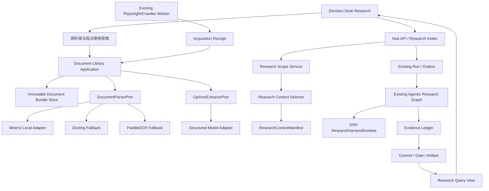

# Decision Hub 资料智能入口与研究域隔离方案

日期：2026-09-22  
状态：执行前冻结方案  
适用范围：`decision-hub` 当前 BTC/加密宏观研究，以及后续博主资料、中国股票和跨资产研究  
本方案原则：复用现有 DSH、Run、Evidence、Gate 和 Research UI；只增加一个边界清晰的资料智能模块，不创建第二套 Harness、账本、研究循环或报告协议。

## 1. 先给结论

这项需求不是“加一个 OCR Skill”，而是增加一条受控的资料链路：

```text
PDF / 图片 / 允许访问的网页
        ↓
资料接收与来源登记
        ↓
文档解析与原件归档
        ↓
页码/区块/表格/图片可回读的结构化文档
        ↓
作者观点与事实候选抽取
        ↓
人工或规则确认
        ↓
按研究域选择上下文
        ↓
现有 Decision Hub 研究 Run
        ↓
DSH Agent Runtime + Evidence Ledger + Gate
        ↓
带来源、根因链、反方、限制和复盘指针的报告
```

当前项目已经具备一部分底座：

- `ContentAddressedDocumentStore` 能以内容哈希保存不可变文档；
- `document.readback` 能从已入账证据回读原文；
- `source_acquisition_worker` 已能使用 Playwright/Crawlee 保存 DOM、网络、截图和 trace 回执；
- `ResearchContextManifest` 已能记录选入、排除和输入指纹；
- `Decision Desk` 已有 `Research` 入口和同一条研究提交/报告链路。

当前缺口也很明确：

1. 没有 PDF/图片的受控接收和结构化解析闭环；
2. 没有“作者观点”和“市场事实”的独立数据对象；
3. `research_context.py` 的策略仍写死为 `crypto_macro.research`；
4. 没有将中国股票资料、宏观资料和 BTC 资料隔离的研究域策略；
5. 前端没有资料上传、解析状态、观点审核和选入本次研究的入口；
6. 当前文档回读只能覆盖文本资产，不能完整展示页码、表格和图片区块。

因此，方案的第一目标不是把研究能力做“大”，而是完成：

> 用户提供一份 PDF 或图片后，系统能够保留原件、解析成可引用结构、抽取带作者归属的观点、由用户确认后将其作为软证据接入现有研究 Run，并且不会自动污染其他市场的研究上下文。

## 2. 分层架构与职责

### 2.1 总体结构



### 2.2 层级所有权

| 层 | 负责 | 明确不负责 |
|---|---|---|
| Decision Desk | 入口、资料列表、解析状态、观点审核、报告展示 | 不解析 PDF、不直接调用 DSH、不自行判断方向 |
| Hub API | 鉴权、幂等、命令/查询 DTO、文件接收边界 | 不执行长时间 OCR、不调用模型做业务判断 |
| Document Library Application | 文档版本、解析状态、观点生命周期、资料与 Run 的绑定 | 不决定 BTC 多空、不发布交易权限 |
| Research Context Application | 研究域、时间点、来源权限、选择和排除规则、上下文指纹 | 不抓网页、不运行 OCR、不做自然语言综合 |
| Document Parser Port | 统一解析接口 | 不创建 Evidence、不改变来源权限 |
| Provider Adapter | MinerU/Docling/PaddleOCR/API/浏览器等具体协议 | 不拥有账本、Gate、Run 或全局上下文 |
| Existing Research Graph | 计划、补证、反方、重规划、结构化综合 | 不绕过 Evidence Admission 和 Gate |
| DSH Runtime | 模型会话、工具调用、子代理、轨迹和会话恢复 | 不拥有资料库事实、不拥有交易授权 |
| Evidence/Gate | 来源准入、PIT、独立性、质量、发布状态 | 不把缺失数据伪造成结论 |

强制规则：UI → API → Application → Port → Adapter。UI 不得直接读文件，Adapter 不得直接写 `runs`、`snapshots` 或 `artifacts`。

## 3. 解析技术选型

### 3.1 默认方案

默认使用本地 MinerU 作为解析器，原因是它已经支持 PDF/图片、版面、表格、公式、图片和结构化输出，并且官方仓库目前包含 `skills/mineru`。本地运行不需要上传私有资料；远程 API 只能在用户显式选择时启用。见 [MinerU 官方仓库](https://github.com/opendatalab/MinerU) 和 [MinerU 文档](https://mineru.net/doc/docs/index_en/)。

解析器不能直接写入 Evidence。它只产生一个不可变 `DocumentParseReceipt`：

```text
原始文件哈希
解析器与版本
解析时间
页数、字符数、表格数、图片数
Markdown/JSON/页面图/表格工件引用
每个区块的 page/block/bbox 定位
质量信号与错误
```

### 3.2 备用解析器

- [Docling](https://github.com/docling-project/docling)：多格式、阅读顺序、表格和 OCR，作为通用 fallback；
- [PaddleOCR PP-StructureV3](https://github.com/PaddlePaddle/PaddleOCR/blob/main/docs/version3.x/pipeline_usage/PP-StructureV3.en.md)：中文扫描件、截图、表格、公式和图表质量不稳定时使用；
- [AllenAI olmOCR](https://github.com/allenai/olmocr)：特殊 PDF 或批量线性化场景的备用方案。

路由顺序固定为：

```text
文件类型/质量预检
  → MinerU local
  → 失败或质量低于阈值时 Docling/PaddleOCR
  → 仍失败则需要人工处理，不自动把模型视觉结果当原文
```

不得同时运行多个解析器后让模型自由选择一份结果。若发生 fallback，回执必须记录失败原因、备用解析器和最终选用版本。

### 3.3 API 模式

远程 API 只作为 `RemoteDocumentParserAdapter`，具备以下硬条件：

- 默认关闭；
- 每次请求明确记录 `remote_upload=true`；
- 私有/收费博主资料默认禁止远程上传；
- 用户明确允许后才可调用；
- 保存供应商、模型、请求时间、响应哈希和费用；
- 失败不得回退到未带定位信息的普通 OCR 文本。

Skill 只描述编排步骤，不能替代上述存储、解析和审计工程。

## 4. 数据模型与版本策略

### 4.1 文档、版本、区块

新增契约文件：

```text
contracts/schemas/research_library.schema.yaml
```

主要对象：

```text
ResearchDocument
- document_id
- title
- owner_scope: private / shared
- source_profile_id
- market_scopes: crypto / macro / cn_equity / cross_asset
- created_at

ResearchDocumentVersion
- version_id
- document_id
- original_file_ref
- original_file_hash
- parsed_bundle_ref
- parser_ref
- published_at
- observed_at
- received_at
- supersedes_version_id
- status: received / parsing / parsed / review / ready / failed / archived

DocumentBlock
- block_id
- version_id
- block_type: heading / paragraph / table / figure / image / footnote
- page_no
- bbox
- content_ref
- content_hash

AnalystClaim
- claim_id
- version_id
- author/profile
- publication_at
- market_scope
- instrument_scope
- horizon
- claim_type: fact_claim / opinion / forecast / scenario / rumor
- stance: bullish / bearish / neutral / mixed
- claim_text
- supporting_quote
- locator_refs
- conditions
- invalidation_conditions
- status: candidate / accepted / rejected / superseded
- attribution_confidence
```

观点不是事实。即使资料来自用户信任的博主，也必须标记为 `opinion` 或 `forecast`，不能直接提升为官方/市场硬证据。

### 4.2 版本不覆盖

每天的新资料采用追加版本：

```text
同一作者/资料系列/日期
  → 新建 ResearchDocumentVersion
  → 旧版本保留
  → 若明确修订，写 supersedes_version_id
  → 过去已经生成的 Run 仍引用旧版本
```

这样可以回答“上次分析使用了哪一版资料”和“本次观点为什么变化”。删除私有原件时保留哈希和删除 tombstone，但未来 Run 不得再引用已删除正文。

### 4.3 现有存储如何复用

现有 [document_store.py](../../packages/provider_adapters/research/document_store.py) 的 `document://sha256/...` 引用和完整性校验继续保留，作为 v1 文本资产兼容层。新增的文档包只扩展内容类型和区块清单，不另建一套独立的证据存储。

建议用同一个内容寻址根目录保存：

```text
data/documents/<hash>/original.pdf
data/documents/<hash>/normalized.md
data/documents/<hash>/layout.json
data/documents/<hash>/pages/001.png
data/documents/<hash>/tables/001.json
data/documents/<hash>/receipt.json
```

数据库保存索引、状态和关系；大文件不塞进 SQLite 行中。

## 5. 研究域隔离和上下文连续性

### 5.1 研究域

研究 Run 必须携带一个不可变的 `ResearchScope`：

```text
research_family: crypto_macro | cn_equity | cross_asset
domain_pack_ref
instrument_scope
as_of / cutoff_at
library_context_mode: none | auto | selected
selected_version_ids
allowed_bridge_families
```

现有 `/v1/research/observations` 继续兼容，默认映射为 `crypto_macro`。新增资料研究入口使用新的 `ResearchRequest`，但仍调用同一个 `queue_research`、同一个 Run、同一个 Worker 和同一个 DSH Runtime，不产生第二条业务链。

### 5.2 资料进入 BTC 的规则

BTC Run 默认允许：

- `crypto_macro` 的市场、衍生品和宏观硬证据；
- `cross_asset` 的已审核摘要；
- 与 BTC 或宏观相关的博主观点，作为软证据。

BTC Run 默认排除：

- 只谈单个中国股票的观点；
- 没有市场范围和时间的泛化文章；
- 发布日期晚于 `cutoff_at` 的资料；
- 仅有截图、没有可回读原文的候选；
- 状态为 `candidate/rejected/superseded` 的观点。

中国股票 Run 可以使用中国股票资料和宏观桥接，但不会把整个中国股票资料库注入 BTC。

### 5.3 选择和排除必须可见

扩展现有 `ResearchContextManifest`，增加：

```text
research_family
scope_ref
selected_document_versions
selected_claims
excluded_claims: [{claim_id, reason}]
bridge_refs
```

排除原因至少包括：

```text
wrong_market_scope
future_publication
not_accepted
stale
duplicate_source
outside_policy
context_budget
missing_locator
```

研究报告页面必须能展开“本次使用的资料”和“被排除的资料”，不能只有一句最终摘要。

### 5.4 不使用全局对话记忆

历史资料持续保存在资料库，但不会自动成为所有未来 Run 的 Prompt。每次 Run 使用一个冻结的上下文快照；新的每日资料需要经过解析和状态确认后，按研究域策略被选中。DSH Session 只服务当前 Run，不拥有跨市场全局记忆。

## 6. 入口和完整使用场景

当前侧栏已有 `Research`，不再创建第二个 DSH 页面。`Research` 内部增加三个子视图：

```text
Research
├── 最新建议
├── 资料研究
└── 来源库
```

初期继续使用现有前端状态和 URL 查询参数，不引入新的路由框架：

```text
?view=research&tab=latest
?view=research&tab=library
?view=research&tab=sources
?view=research&run_id=...
```

### 场景 A：用户只想要最新 BTC 建议

1. 进入“最新建议”；
2. 点击“获取最新操作建议”；
3. 用户不需要输入关键词；
4. 系统自动创建 `crypto_macro` Run；
5. 资料上下文按策略自动选择，默认不引入未审核博主资料；
6. 报告展示方向、当前动作、主机制、反方、证据、限制、失效条件和下次复核时间。

### 场景 B：用户上传当天博主 PDF

1. 进入“资料研究”；
2. 上传 PDF 或拖入图片；
3. 填写或选择作者、发布时间、市场范围；
4. 系统保存原件并显示哈希；
5. MinerU 解析；
6. 页面展示页数、表格数、图片数、失败项和可回读页面；
7. 系统抽取观点候选；
8. 用户可以逐条确认、驳回或修改归属字段；
9. 点击“用于一次 BTC 研究”；
10. 系统创建一个带 `selected_version_ids` 的 `crypto_macro` Run；
11. 报告标明这些资料是外部观点，不把它们当作硬证据。

### 场景 C：同一作者每天追加新资料

1. 新文件创建新版本；
2. 旧版本不被覆盖；
3. 系统根据作者、日期和内容哈希识别重复；
4. 新版本通过审核后才进入 `ready`；
5. 后续 Run 只按 `cutoff_at` 和研究域选择；
6. 旧报告继续指向旧版本。

### 场景 D：一份资料同时包含宏观和中国股票

1. 解析层识别章节和市场范围；
2. 观点逐条标记 `macro`、`cn_equity` 或 `cross_asset`；
3. 中国股票观点不能直接成为 BTC 硬证据；
4. 宏观部分可作为跨资产桥接候选；
5. 报告显示实际使用的章节和排除的章节。

### 场景 E：从允许的网站导入博主文章

1. 使用现有 Playwright/Crawlee Worker；
2. 产生 acquisition receipt、DOM、截图、网络和 trace；
3. 通过来源注册和域名策略；
4. 将页面内容转换为同一 `ResearchDocumentVersion`；
5. 后续解析、观点审核和研究接入与本地 PDF 完全相同。

不绕过登录、验证码、robots 或付费墙；无权访问的资料不进入系统。

### 场景 F：解析失败或远程服务不可用

1. 版本状态变为 `failed`；
2. 展示解析器、阶段和错误；
3. 可以手动重试或切换允许的 fallback；
4. 不生成观点，不创建“看起来完整”的研究证据；
5. 现有 BTC 主链不受影响。

### 场景 G：历史复盘

1. 选择一个已有 Run；
2. 查看其 `ResearchContextManifest`；
3. 回读当时使用的文档版本和观点；
4. 使用新版本重跑时创建新 Run；
5. 比较上下文变化与结论变化。

## 7. API 和内部接口

### 7.1 新增 API

```text
POST /v1/research-library/documents
GET  /v1/research-library/documents
GET  /v1/research-library/documents/{document_id}
GET  /v1/research-library/versions/{version_id}
POST /v1/research-library/versions/{version_id}/parse
GET  /v1/research-library/versions/{version_id}/claims
POST /v1/research-library/claims/{claim_id}/review
POST /v1/research/requests
```

`POST /v1/research/requests` 的核心字段：

```json
{
  "research_family": "crypto_macro",
  "instrument_scope": ["BTC-USDT"],
  "focus": "获取最新操作建议",
  "library_context_mode": "selected",
  "selected_version_ids": ["docver_..."]
}
```

它只负责把请求转换成现有研究 Intake；不要为资料研究复制一套 Worker、Agent Loop 或报告对象。

### 7.2 Port 接口

新增：

```text
packages/kernel/decision_hub_kernel/ports/documents.py
```

接口包括：

```python
class DocumentParserPort(Protocol):
    async def parse(self, asset: DocumentInput, options: ParseOptions) -> ParseReceipt: ...

class OpinionExtractorPort(Protocol):
    async def extract(self, parsed: ParsedDocument) -> tuple[ClaimCandidate, ...]: ...

class ResearchLibraryPort(Protocol):
    def list_versions(...): ...
    def select_claims(...): ...
    def review_claim(...): ...
```

Kernel 只依赖 Port。MinerU、Docling、PaddleOCR、远程 API 和未来其他解析器都在 `packages/provider_adapters/documents/` 实现。

## 8. DSH 的位置和是否需要 Fork

不 Fork DSH，不把 DSH 业务代码复制到资料模块。

当前上游版本、归档哈希和插件边界由：

- `infra/dsh/upstream.lock.json`；
- `infra/dsh/verify-upstream.mjs`；
- `extensions/dsh/decision-hub/`；
- `infra/dsh/README.md`。

DSH 继续负责：

- 当前 Run 的模型会话；
- 工具调用和多轮补证；
- 子代理和轨迹；
- 结构化综合。

资料模块负责：

- 解析和保存资料；
- 提取带来源的观点候选；
- 按研究域和截止时间选择上下文。

资料解析不需要启动 DSH。观点抽取可以使用现有结构化模型适配器；需要进一步检索或验证时，才把已确认的观点作为输入送入当前 DSH Run。这样既复用 DSH 的研究能力，也不把文件解析耦合到 DSH Session。

只有当上游公开 seam 不足以满足明确需求时，才创建单独的 DSH upstream fork 和 patch；在此之前不得通过修改缓存源码或 DOM/CSS hack 扩展功能。

## 9. 文件级落地设计

### P0：契约和边界冻结

新增或修改：

```text
docs/decisions/ADR-XXXX-research-library-boundary.md
contracts/schemas/research_library.schema.yaml
packages/kernel/.../ports/documents.py
packages/kernel/.../application/research_context.py
```

工作：

- 将 `crypto_macro.research` 改为 Research Family Policy Registry；
- 给旧请求默认 `crypto_macro`，保持兼容；
- 明确 `selected/auto/none` 三种资料上下文模式；
- 扩展 `ResearchContextManifest`，保持旧 JSON 向后兼容；
- 先写契约和隔离测试，再写实现。

### P1：本地文档闭环

新增或修改：

```text
packages/provider_adapters/documents/mineru_local.py
packages/provider_adapters/documents/docling_fallback.py
packages/provider_adapters/documents/paddleocr_fallback.py
packages/provider_adapters/research/document_bundle_store.py
packages/kernel/.../application/research_library.py
apps/hub_api/routes/research_library.py
apps/hub_worker/document_pipeline.py
migrations/versions/<next>_research_library.py
```

工作：

- 本地上传、哈希、版本和解析状态；
- 解析包和区块定位；
- 复用现有 outbox/worker，不创建第二个队列；
- 解析失败和重试；
- 兼容旧 `document://sha256` 文本资产。

### P2：观点候选和审核

新增：

```text
packages/provider_adapters/documents/opinion_extractor.py
packages/kernel/.../application/claim_review.py
apps/decision-desk/src/research/ResearchLibraryPanel.tsx
apps/decision-desk/src/research/ClaimReviewPanel.tsx
```

工作：

- 严格结构化模型输出；
- 每条观点必须带 locator；
- 观点和事实分离；
- `candidate → accepted/rejected/superseded`；
- accepted 观点只能成为软证据。

### P3：接入现有 Research Run

新增或修改：

```text
contracts/schemas/research_request.schema.yaml
packages/kernel/.../application/research_intake.py
packages/query_views/research/service.py
apps/decision-desk/src/api/client.ts
apps/decision-desk/src/research/ResearchPage.tsx
```

工作：

- 资料研究子标签页；
- 选择资料并创建同一个 Research Run；
- Context Manifest 显示选入/排除；
- 报告显示观点来源、原文定位、反方和资料变化；
- BTC 默认隔离中国股票观点。

### P4：网页和社交媒体来源

- 复用 `source_acquisition_worker`；
- 为每个平台添加 Source Registry，而不是写通用无限爬虫；
- 先做公开、允许访问的来源；
- 保留 PIT、截图、DOM、网络和 trace；
- 统一转换为 `ResearchDocumentVersion`。

### P5：评测和复盘

- 固定一批 PDF、图片和网页 fixture；
- 比较“没有资料”和“加入 accepted 观点”的同一 Run；
- 记录证据覆盖、观点冲突、上下文变化和未来结果；
- 不能在没有回放数据时声称胜率提升。

## 10. 不做的事情

在 P0～P3 完成前，明确不做：

- 不建立第二套 DSH/Harness；
- 不做全局向量数据库；
- 不把所有历史文档自动注入所有 Run；
- 不让博主观点直接通过硬证据 Gate；
- 不做任意社交媒体无限爬取；
- 不做 3D/复杂流程图重写；
- 不为每个市场复制一套 Worker、报告或账本；
- 不把模型自报置信度当成预测胜率；
- 不把解析失败降级成无来源的模型猜测。

资料量较小时，先使用结构化 claims + 确定性上下文选择 + `document.readback`。只有在资料量和检索评测证明需要时，才增加 BM25/向量混合检索。向量库是检索优化，不是证据真相源。

## 11. 自测与交付门槛

### 11.1 固定样本

至少准备：

1. 文字型 PDF；
2. 中文扫描 PDF；
3. 含表格和图表的 PDF；
4. 一张手机截图；
5. 同一作者两个版本；
6. 一份同时包含宏观和中国股票观点的资料。

### 11.2 必须通过的场景

```text
[ ] 重复上传同一文件是幂等的，不产生重复版本
[ ] 原文件、解析文件和观点都有哈希
[ ] 每条 accepted 观点都有页码/区块/图片定位
[ ] 解析失败不产生 accepted claim
[ ] 远程 API 默认关闭，未授权不会上传私有文件
[ ] 旧版本不会被新版本覆盖
[ ] cutoff_at 之后的资料不会进入历史 Run
[ ] cn_equity 观点不会自动进入 BTC 硬证据
[ ] BTC Run 可以显式选择跨资产摘要
[ ] Context Manifest 能列出选入和排除原因
[ ] 同一资料上下文可回放出相同 fingerprint
[ ] 观点不能独立提升 hard evidence coverage
[ ] DSH 不可用时资料仍可解析，研究 Run 进入明确降级状态
[ ] DSH 只收到选中的结构化上下文，不读取全局资料库
[ ] 报告可跳回原始页面、区块、表格或图片
[ ] 旧的 /v1/research/observations 仍按 crypto_macro 正常工作
```

### 11.3 交付标准

不是“上传按钮能用”，而是以下闭环同时成立：

```text
上传 → 解析 → 定位 → 观点审核 → 选择研究域 → 现有 Run → Evidence/根因链 → 报告 → 可复盘
```

如果其中任何一步只能依靠模型猜测、隐式全局记忆或无法回到原文，就不能标记为可交付。

## 12. 最终落地建议

第一交付目标只做 P0～P3：本地资料闭环、观点审核、研究域隔离、接入现有 Research 页面和同一条核心决策链。这样可以直接验证用户真正关心的价值：提供资料后，报告是否更有依据、是否能解释资料影响、是否能区分事实和观点、是否不会污染 BTC 主链。

P4 的社交媒体自动化和 P5 的胜率评测必须建立在这个闭环上。否则继续增加来源、角色和流程图，只会把当前的维护问题放大。

本方案的架构决策是：**DSH 继续使用；Decision Hub Core 继续拥有证据、上下文、Gate 和报告；资料智能作为独立边界模块通过 Port 接入；UI 只增加 Research 内的资料子入口；所有跨市场资料通过显式 Research Scope 和 Context Manifest 流动。**
