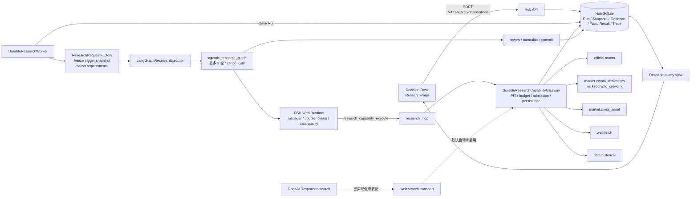
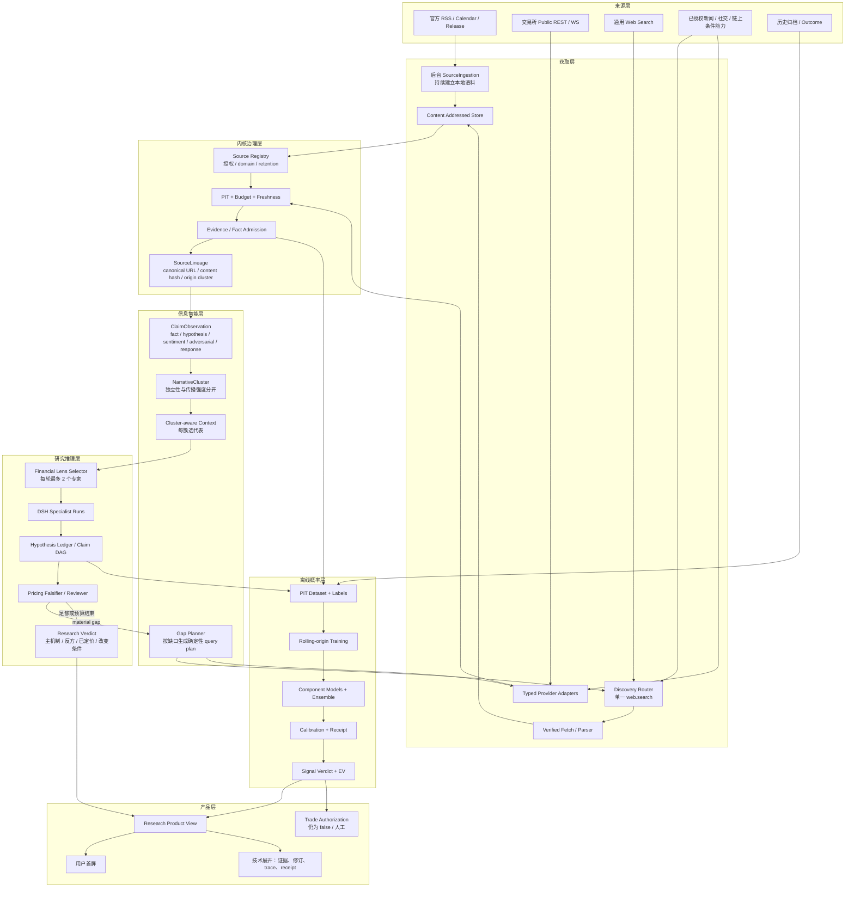
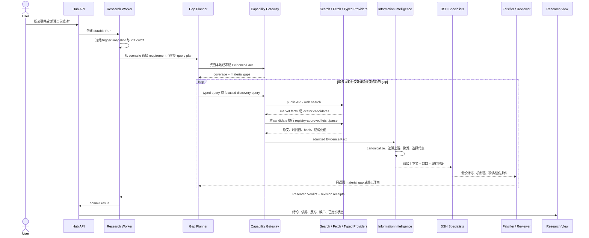
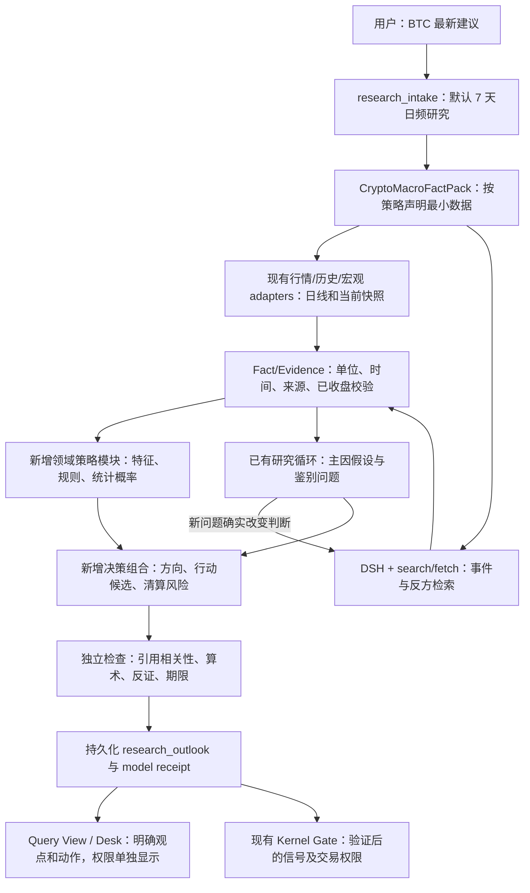

# Decision Hub 金融信息智能与概率决策升级方案

> 日期：2026-09-17  
> 状态：2026-09-18 用户明确调整产品周期和数据约束；当前后续核心方案以第 34 节为准。C0a 仅有工程路径验证，不代表方向价值验收通过；第 32 节的小时数据、固定三周期和先做外围准备的顺序不再作为新开发前提。  
> 关联方案：[CORE_VALUE_RESCUE_PLAN_2026-09-16.md](./CORE_VALUE_RESCUE_PLAN_2026-09-16.md)

## 1. 这次补充解决什么问题

当前系统已经具备 Evidence、来源注册、PIT、因果链、反方审查和多轮补证的骨架，但仍缺少成熟交易研究的三层能力：

1. **金融解释层**：同一个指标在不同市场状态、时间尺度和定价阶段中的含义不同。系统现在有指标和因果链模板，但还没有稳定的宏观交易员解释框架。
2. **信息智能层**：系统会区分来源等级，却没有判断“十篇文章是否都抄自同一条消息”“观点是否可能由机器人或利益相关方放大”“信息是在解释已经发生的价格，还是领先价格”。
3. **概率与决策层**：当前 `subjective_probability` 是模型填写的主观数，没有历史校准器。它不能被称为胜率，也不能直接驱动 long/short。

目标不是让模型读更多材料后写更长的报告，而是让系统回答以下问题：

- 现在市场最可能处于什么机制和状态？
- 哪些事实是真实且独立的，哪些只是同源转述或市场叙事？
- 主因、次因和反方解释各得到多少支持，差异来自哪里？
- 市场是否已经对这个事实定价？
- 对 30m、24h、72h 的上行、下行和区间概率分别是多少？这些概率是否经过样本外校准？
- 即便方向概率占优，扣除成本并考虑盈亏幅度后，是否存在正期望值的行动候选？

## 2. 对用户思路的判断

用户提出的主体思路是对的：广泛获取信息，识别共同点、亮点、假象和关联关系，对信息的真实性、价值、时效与影响做权重处理，最后给出概率判断，而不是等待百分之百确定。

需要增加四个约束，否则会生成看起来精确、实际上虚假的结论：

1. **采集可以大而全，进入判断必须窄而严。** 一条消息被一百个账号转发，仍然只能算一个上游事实源；不能按帖子数量累计一百次权重。
2. **事实可信度不等于方向预测力。** 官方公告对“发生了什么”可以非常可信，但它对未来 30 分钟涨跌的预测力可能接近零，因为市场已经定价。
3. **观点权重不能由 LLM 临场编造。** 来源质量可由规则做 admission 和折扣；方向预测权重必须来自该来源、特征或模型在同类市场状态与同一 horizon 的历史样本外成绩。
4. **最高胜率不是最终目标。** 一个系统只在最容易的 5% 情况下出手，可以制造很高命中率。验收必须同时看概率校准、覆盖率、扣成本期望收益、回撤和尾部损失。

## 3. 现有能力和真实缺口

### 3.1 已有能力

- `packs/crypto_macro/doctrine/causal-chain.md` 已要求从事件、预期、深层驱动、跨资产传导到 BTC 现货与衍生品确认。
- `source_registry.yaml` 已有 P0-P4 来源分层和 `independence_group`。
- Evidence admission 已检查 authority、freshness、PIT、冲突和独立来源数。
- Research loop 已支持 counter-thesis、data-quality reviewer 和定向补证。
- 旧 `crypto-macro-decision` Skill 已积累指标清单、根因链、priced-in、拥挤度和 EV/R 等交易研究经验。

### 3.2 缺口

- 旧 Skill 中 `-4..+4` 之类固定人工分数和 `subjective_probability` 没有样本外校准，不能直接迁入生产 Gate。
- 现有来源独立性主要按 publisher/group 配置，不能识别媒体转述、新闻稿转载、KOL 跟随和协调传播形成的同源簇。
- 社交来源目前整体禁用为 Evidence；这避免了假消息进入事实层，但也丢失了可作为“情绪、拥挤和叙事传播”观测的数据。
- 系统没有观点台账，无法区分长期准确的明确预测、模糊的事后解释和删除/修改过的历史发言。
- 当前因果链没有显式表示市场状态、是否已定价、传播阶段和反身性。
- `subjective_probability` 同时混淆了“根因正确的概率”和“未来收益方向的概率”。这两个量不是一回事。
- 多个 Agent 的答案目前没有一个经过验证的概率融合器；Agent 数量增加不会自动提高质量。

因此，问题不是项目完全没有金融知识，而是**金融知识没有成为可执行、可追溯、可验证的计算对象**。

## 4. 目标架构

```text
广泛采集
  -> 事实/观点/情绪/市场反应分类
  -> 原始来源追溯与同源叙事聚类
  -> 真伪、时效、利益冲突、操纵风险审查
  -> 宏观/流动性/仓位/微观结构/链上/事件六类专家解释
  -> 主假设、反方假设、未知项组成 Claim DAG
  -> 定向补证与“市场是否已定价”审查
  -> 各 horizon 的专业模型概率
  -> 样本外加权、融合与校准
  -> 概率 × 盈亏幅度 × 成本 × 风险的决策层
  -> Research Verdict / Signal Verdict / Trade Authorization
```

该结构继续使用现有 DSH、Evidence、Gateway、LangGraph 和 Kernel。新增的是 Domain Pack 的金融知识、信息结构和概率组件，不增加第二套 Agent 平台。

## 5. 信息分层：不能把所有材料当“证据”

| 类型 | 例子 | 系统角色 | 能否直接证明事实 | 能否影响方向 |
|---|---|---|---:|---:|
| 原始事实 | 官方数据、央行公告、交易所成交/OI/order book | Fact Evidence | 是 | 需经过机制解释 |
| 可归因报道 | Reuters 等引用具名主体的报道 | Fact/Discovery | 视原始来源追溯结果 | 可以，需去重和时效折扣 |
| 专业观点 | 机构研究、宏观交易员、分析师 | Hypothesis | 否 | 作为待验证假设或专家预测 |
| 群体情绪 | Reddit、X、Stocktwits、论坛、搜索趋势 | Sentiment Observation | 否 | 作为拥挤、注意力和叙事传播特征 |
| 可疑传播 | 泵盘群、机器人、付费宣传、匿名传闻 | Adversarial Observation | 否 | 作为操纵风险或反向指标，不能做事实 |
| 市场确认 | 价格、成交量、期限结构、资金费率、OI、主动买卖 | Response Evidence | 证明市场行为 | 用于判断传导、定价和执行条件 |

社交数据不再只有“完全相信”和“完全丢弃”两个选择。它永远不能单独证明现实事件，但可以进入独立的情绪/叙事特征族。

## 6. 金融专家知识层

### 6.1 六个解释镜头

每个镜头只解释自己的变量并输出结构化结果，不直接决定交易动作。

1. **宏观状态**：增长、通胀、政策、实际利率、美元、金融条件、信用利差、流动性。
2. **跨资产传导**：美债曲线、DXY、VIX、黄金、原油、Nasdaq、信用和 BTC 的同步或背离。
3. **现货与衍生品结构**：spot/perp lead-lag、funding、basis、OI delta、liquidation、taker flow、book imbalance、options skew。
4. **链上与资金流**：ETF flow、稳定币供给、交易所净流、SOPR/MVRV 等，只在匹配 horizon 时使用。
5. **叙事与情绪**：注意力、观点分歧、恐慌/贪婪、传播速度、机器人概率、同源集中度、价格领先/滞后。
6. **事件与地缘场景**：事件真实性、概率树、一阶冲击、二阶通胀/利率影响、三阶流动性与仓位反馈。

### 6.2 指标必须条件化解释

指标不能保存一条永久的“涨/跌含义”。每个知识条目至少包含：

```yaml
indicator_id: cboe.vix
measurement: expected_30d_spx_volatility
valid_horizons: [24h, 72h]
applicable_regimes: [risk_off, volatility_shock, event_risk]
direct_observation: true
direction_rule: conditional
common_misuse: generic_fear_score
confirmation_features: [spx_return, credit_spread, dxy, btc_return]
invalidation_features: [volatility_supply_flow, isolated_equity_hedging]
source_refs: [cboe.vix_methodology]
```

例如：

- VIX 是从 SPX 期权报价推导的未来 30 天预期波动，不是一个通用的“恐慌分数”。
- COT 是周频且周五发布前一周二的仓位，适合中期仓位背景，不适合解释刚刚发生的 30 分钟波动。
- 美债收益率上升可能来自增长、通胀、财政期限溢价或仓位/对冲流；在不同机制下对 BTC 的含义不同。
- 地缘消息需要拆解为能源/避险的一阶冲击、通胀与利率的二阶冲击、流动性和杠杆仓位的三阶冲击。

### 6.3 专家不是一个人格

不建立单个“金融专家 Agent”。使用有边界的专业模块：

- `macro_regime_analyst`
- `cross_asset_transmission_analyst`
- `crypto_flow_analyst`
- `narrative_forensics_analyst`
- `event_scenario_analyst`
- `market_pricing_falsifier`

每个模块必须返回 claim IDs、evidence refs、适用 horizon、确认/证伪条件和未解决项。Synthesizer 不能引用模块的身份作为权威，只能引用它提交且通过 admission 的内容。

## 7. 信息真伪、价值与独立性

### 7.1 两类权重必须分开

**Evidence Quality** 用于决定材料能否进入上下文以及需要多大折扣：

- 原始来源可追溯性；
- 发布时间、观察时间、接收时间和修订状态；
- 来源身份和利益冲突；
- 内容是否具体、可证伪；
- 与同一上游来源的重复程度；
- 机器人/协调传播概率；
- 是否为事后改写；
- 是否有独立市场数据确认。

**Predictive Skill** 用于决定某个特征、模型或观点在某个 horizon 的预测贡献：

- 同类市场状态的样本外 Brier/log loss；
- calibration error；
- coverage；
- 预测的明确程度；
- 方向和幅度结果；
- 稳定性和近期衰减；
- 与其他模型的误差相关性。

高权威并不自动获得高方向权重；高历史预测力也不能让一个 KOL 的未证实事实绕过 Evidence admission。

### 7.2 同源叙事图

新增 `NarrativeCluster`：

```text
origin claim
  -> original document/post/data
  -> attributable reports
  -> commentary accounts
  -> repost/quote/bot burst
  -> market reaction timeline
```

需要记录：

- `origin_cluster_id`
- `canonical_claim_hash`
- `first_observed_at`
- `upstream_source_ref`
- `propagator_count`
- `unique_source_groups`
- `copy_similarity`
- `account_concentration`
- `coordination_risk`
- `price_lead_lag`
- `revision_or_deletion_history`

系统按独立上游簇计数，不按 URL、帖子或转发数计数。大量同向转发只提高“叙事强度”，不能提高“事实独立性”。

### 7.3 识别市场迷惑和操纵

以下信号不直接断言操纵，而是提高 `coordination_risk`：

- 短时间内文本高度相似的集中发布；
- 少数账号贡献大部分互动；
- 账号新、自动化概率高或长期只宣传单一资产；
- 没有可追溯原始文件，却声称“内部消息”；
- 价格先动、叙事后到，观点主要是事后归因；
- 叙事与 funding/OI/spot flow/order book 的实际行为矛盾；
- 发布者有仓位、赞助或发行方关系但未披露；
- 预测事后修改、删除或只保留成功案例。

这类内容可作为“市场正在传播什么”和“拥挤风险”的数据，不能成为事件已经发生的证明。

## 8. 博主、分析师和机构观点怎么用

建立 `AnalystThesisLedger`，不按粉丝数或表达自信程度加权：

```yaml
thesis_id: ...
author_ref: ...
published_at: ...
immutable_content_hash: ...
asset: BTC
horizon: 24h
direction_distribution: {up: 0.55, down: 0.25, range: 0.20}
mechanism_claims: [...]
conditions: [...]
invalidation: [...]
source_citations: [...]
conflict_disclosures: [...]
outcome_available_at: ...
outcome_ref: ...
```

观点只有在事件发生前给出、方向和 horizon 明确、原文留存且结果可计算时才进入预测成绩。模糊观点、事后解释、没有失效条件的观点仍可用于假设发现，但不计入专家权重。

专家权重按资产 × horizon × regime 分桶，以滚动样本外表现更新；样本少时向等权或零贡献收缩。任何人的历史表现都不能替代当前事实核验。

## 9. 从根因概率到方向概率

系统必须区分三个概率：

1. `P(hypothesis | evidence)`：某个根因机制成立的概率或相对支持度。
2. `P(return bucket | evidence, regime, horizon)`：未来收益处于 up/down/range 的概率。
3. `P(action succeeds | entry, stop, target, costs)`：按特定入场、止损和目标执行成功的概率。

根因判断正确，不代表方向仍可交易。消息可能已经被定价，或正确的长期逻辑在 30 分钟内被仓位清算反向覆盖。

### 9.1 在校准前

如果没有足够历史样本，只输出：

- `relative_support_score`
- `evidence_quality_band`
- `model_disagreement`
- `uncertainty_reasons`

不得把 0.68 这类主观数字显示为“68% 胜率”。

### 9.2 校准后的概率更新

可以用下式表达设计，但参数必须从 PIT 历史数据学习：

```text
logit P(H_k | E, regime)
  = logit base_rate(H_k | regime)
  + sum_i discount_i * log likelihood_ratio(feature_i | H_k, regime)
```

其中 `discount_i` 处理来源可靠性、时效、同源相关和操纵风险；`likelihood_ratio` 由历史样本估计，样本不足时向 1 收缩。LLM 负责构造候选机制和解释，不负责填写似然比。

## 10. 多模型组合

保留五类专门模型：

1. Macro regime model；
2. Cross-asset/market pricing model；
3. Crypto spot/derivatives flow model；
4. Narrative/sentiment model；
5. Event/geopolitical scenario model。

每个模型分别输出 30m、24h、72h 的 `P(up/down/range)` 和适用性。Meta ensemble 只使用各模型的样本外预测：

```text
p_h = Calibrate(sum_m w[m, regime, h] * p[m, h])
```

- `w >= 0` 且和为 1；
- 权重由 rolling-origin 的 Brier/log loss、coverage 和误差相关性决定；
- 样本较小时先使用等权或截尾平均，防止复杂权重过拟合；
- 模型高度分歧时扩大不确定区间，不强制制造一致结论；
- 任一新模型必须与 always-neutral、momentum、简单 funding/OI 规则和等权 ensemble 比较。

目标不是选出永远最好的模型，而是在状态切换和模型失效时保持稳健。

## 11. 概率之后才是决策

方向概率不能直接映射成买卖。决策层至少计算：

```text
EV(long) = P(up) * expected_upside
         - P(down) * expected_downside
         - fees - slippage - funding - tail_penalty
```

55% 的胜率在盈亏比好时可能值得候选，在止损大、目标近时也可能是负期望。最终展示：

- calibrated direction distribution；
- 预期收益与不利情景；
- 数据和模型分歧；
- 当前价格是否已充分反映信息；
- 触发、失效和复查条件；
- Research Verdict、Signal Verdict、Trade Authorization 三者各自状态。

## 12. 产品输出

用户第一屏按以下顺序展示：

1. **研究结论**：主机制、次机制、最强反方机制和当前证据等级。
2. **分 horizon 概率**：只有校准后显示数值；未校准时显示相对支持和分歧。
3. **市场是否已定价**：未定价、部分定价、过度定价或无法判断，并列依据。
4. **行动候选**：long/short/neutral/trigger/no action 及 EV/R；未通过 Signal Gate 时仍保留清晰的研究方向。
5. **关键证据**：支持、反对、同源簇、冲突和时效。
6. **信息取证**：观点来自谁、是否有利益冲突、历史预测记录和原文时间戳。
7. **改变结论的条件**：具体指标、方向、窗口和阈值。

技术人员展开后能查看 Claim DAG、NarrativeCluster、模型分量、calibration receipt 和每轮 revision delta。

## 13. 接入当前代码的实施顺序

### F0：迁移金融知识，不迁移主观分数

- 把旧 Skill 中经过审查的指标定义、根因链、priced-in、拥挤度和 EV/R 规则迁到 `packs/crypto_macro/doctrine/`。
- 为每个知识条目标注适用 horizon、regime、确认、证伪、常见误用和来源。
- 删除“分数达到阈值就交易”的生产含义；旧分数只作为生成假设的启发。

验收：同一指标在不同 regime/horizon 下能产生不同解释；所有条目可追溯到方法或原始来源。

### F1：信息类型与来源谱系

- 新增 Fact/Hypothesis/Sentiment/Adversarial/Response 五类输入。
- 扩展 `source_registry.yaml`，将论坛和社交源限定为 sentiment/hypothesis，禁止作为事件事实。
- 新增 `origin_cluster_id` 和 narrative duplication 检查。
- 保存原文时间戳、hash、上游来源、修改/删除状态和利益冲突。

验收：同一新闻的 100 次转载只产生一个独立事实簇；可以同时显示传播强度很高。

### F2：观点台账与叙事取证

- 增加 AnalystThesisLedger、NarrativeCluster 和 Point-in-Time outcome linker。
- 对观点的明确度、可证伪性、提前量和历史校准做评估。
- 增加协调传播、bot 风险、来源集中度和 price lead-lag 特征。

验收：用一个已知社交炒作案例验证“热度高但事实权重不升”；用一个真实领先观点验证其只在匹配 horizon/regime 获得历史 skill weight。

### F3：专业模型与多轮根因闭环

- 在现有 research loop 中加入六个有边界的专业视角。
- Claim DAG 增加 regime、priced-in、reflexivity、origin cluster 和 horizon 属性。
- Reviewer 针对排名前两位机制寻找最强证伪证据，补证只围绕会改变排序的缺口。

验收：每一轮必须改变 hypothesis rank、关闭 material gap，或以明确证据说明无法改变；禁止只增加摘要长度。

### F4：概率、融合与决策价值

- 使用冻结 PIT 数据构建各专业模型的输出和 label。
- rolling-origin 训练、独立 calibration 和 holdout；先比较等权 ensemble。
- 生成内核签发的 calibration receipt，包含模型、特征、数据 hash、样本量、horizon、regime 和有效期。
- 只有 receipt 匹配时显示 calibrated probability 并进入 Signal Verdict。

验收：同时冻结 Brier、ECE、directional accuracy、coverage、成本后收益、回撤和置信区间；无 receipt 时 UI 不出现伪胜率。

## 14. 最小代表案例

在现有五个核心案例上增加四个信息智能案例，不建设大型平台：

1. 同一原始消息被大量转载；
2. 社交热度由少数疑似机器人账号推动；
3. 正确宏观消息已经被市场充分定价；
4. 多个高质量模型在 regime 切换时明显分歧。

通过条件：

- 事实独立性不会因转发数虚增；
- 情绪强度与事实可信度分别显示；
- 至少一个 reviewer 找到会改变主假设排序的反证；
- 概率只来自持有有效 receipt 的模型；
- 未校准阶段仍能给出清晰主机制、相对支持和具体补证方向；
- 输出能解释为何有方向观点但当前不适合入场，或为何低于 50% 的胜率在非对称赔率下仍有正 EV。

## 15. 明确不做

- 不把全网内容直接塞进一个超长 prompt；
- 不因插件数量多就宣称信息充分；
- 不把论坛共识当成事实投票；
- 不让 LLM 自己填写“来源 0.8、观点 0.7”后计算伪概率；
- 不以粉丝数、点赞数或单次命中给博主高权重；
- 不先建设通用知识图谱平台、数据湖或自动交易；
- 不用高胜率掩盖低覆盖率、负赔率或大回撤。

## 16. Skill 与外部插件的定位

当前环境没有已安装的“宏观交易员/金融专家”Skill。用户自己的 `crypto-macro-decision` 是最直接的领域知识资产，但它以前已经暴露出长上下文、执行真实性和主观评分问题。因此正确做法是把其中有价值的知识迁入当前 Domain Pack，并由 Evidence、PIT、Review 和 Calibration 约束，而不是再次把整个产品退回到一个 Skill prompt。

可选插件中，Financial Datasets、Binance、CoinMarketCap/CoinGecko、Stocktwits、Bigdata.com、LONA Trading Assistant、TradingCursor、Alpaca、IBKR 等可以成为数据或观点适配器。它们的作用是扩展来源，不自动获得事实权威或预测能力；每个插件仍需经过来源注册、授权、许可、PIT 和样本外评估。

## 17. 外部研究依据

- Cboe 对 VIX 的定义：<https://www.cboe.com/tradable_products/vix/faqs>
- CFTC COT 用户指南：<https://publicreporting.cftc.gov/stories/s/COT-Help/p2fg-u73y/>
- SEC 社交媒体操纵执法案例：<https://www.sec.gov/newsroom/press-releases/2022-221>
- 社交机器人与加密资产人工活跃度研究：<https://journals.plos.org/plosone/article?id=10.1371/journal.pone.0284501>
- Twitter 情绪预测的异质性与机器人问题：<https://www.sciencedirect.com/science/article/pii/S104244312030072X>
- 预测组合综述：<https://www.sciencedirect.com/science/article/pii/S0169207022001480>
- 专家预测聚合综述：<https://pmc.ncbi.nlm.nih.gov/articles/PMC7996321/>
- 机构市场研究的多维信息示例：<https://www.coinbase.com/institutional/research-insights/research/trading-insights/crypto-market-positioning-july-2026>
- 用户原 `crypto-macro-decision` Skill：<https://github.com/luguochang/crypto-macro-decision>

这些来源提供方法、数据定义或风险案例，不代表其方向观点应被直接采纳。机构和博主内容必须记录利益冲突，并作为假设来源接受独立验证。

## 18. 对上一版方案的纠正

上一版给出了金融解释、信息取证和概率校准的方向，但没有把它完整映射到当前 composition root、Capability、Contract、数据库和 UI，因而还不能直接作为开发任务。代码核对后确认四个关键事实：

1. Windows 产品启动脚本 `infra/dsh/run-product.ps1` 的默认能力列表没有 `web.search`；Linux 的 `infra/dsh/run-product.sh` 也没有启用它。当前产品默认只能抓已知 URL，不能围绕未知缺口发现新来源。
2. `packages/provider_adapters/search/openai_responses.py` 已有要求显式 sources 与 URL citation 的 Responses 搜索 transport，但 `apps/research_mcp/main.py` 没有把它装配进产品；`web.search` 仍固定指向 DeepSeek 原生搜索 transport。聊天模型可用不等于该网关支持 Responses `web_search`。
3. 现有 `EvidenceCandidate`、`FactEnvelope`、`HorizonDecision` 和数据库表没有 `information_role`、上游来源谱系、叙事簇、假设版本、模型分量和 calibration receipt。只改 prompt 无法保存或核验这些对象。
4. 当前十二个 PIT/replay 案例适合验证研究链和防未来信息泄漏，不足以训练或证明 30m/24h/72h 的可校准胜率。现阶段只能交付可审计的研究方向和不确定性，不能把模型自报的数字包装成历史胜率。

因此，实际顺序改为：**先接通发现与证据闭环，再实现信息独立性和根因修订，最后才训练概率与 EV。** 六个专家不全部常驻；每轮最多选择两个最相关角色，另保留一个确定性的反证审查节点，避免成本和伪共识膨胀。

## 19. 当前真实技术架构



当前主链对应关系如下。

| 环节 | 当前入口/实现 | 已有能力 | 真实限制 |
|---|---|---|---|
| 用户触发 | `apps/hub_api/main.py` 的 `/v1/research/observations` | 建 Run、返回异步状态 | 不负责证据发现 |
| 请求冻结 | `apps/hub_worker/research.py::ResearchRequestFactory` | 固化 trigger snapshot、选择 Fact Pack requirement、限制上下文 | 最大 12 条原始 Evidence，尚未按叙事簇选代表 |
| 多轮编排 | `packages/orchestration/langgraph/graphs/agentic_research_graph.py` | 补证、反方、review、预算终止 | 缺口到搜索 query 主要依赖模型临场决策；没有来源簇新颖度终止条件 |
| DSH 底座 | `packages/runtime_adapters/dsh_runtime/web_runtime.py` 与扩展 | 会话、子角色、MCP 工具调用、轨迹 | 多 Agent 共享不足证据时会形成伪共识 |
| Capability Gateway | `packages/kernel/.../research_evidence.py` 与 `packages/workbench_adapters/durable_research_gateway.py` | 能力白名单、预算、PIT、Evidence/Fact 持久化 | 没有信息角色和上游来源谱系 |
| 搜索发现 | `packages/provider_adapters/search/*` | DeepSeek、Tavily、OpenAI Responses transports 均存在 | 产品默认未启用；OpenAI Responses transport 未装配；两个对模型暴露的 search capability 会增加分叉 |
| 网页验证 | `packages/provider_adapters/research/documents.py` | Registry、域名、路径、hash、正文抓取 | PDF/二进制拒绝；搜索摘要不能变成事实，这是正确约束 |
| 结构化市场数据 | `packages/provider_adapters/market/*` | OKX/Binance/CoinEx 的现价、成交、funding、OI、basis、order book proxy | 免费接口的历史深度和跨市场覆盖有限；OKX 当前快照本身不能给出 OI delta |
| 宏观/跨资产 | `packages/provider_adapters/macro_market/*` | FRED 日频/延迟数据；intraday 与 expectation provider seam | 盘中宏观与预期定价 provider 尚未配置，不能用日频数据冒充事件分钟窗口 |
| 官方后台采集 | `packages/source_adapters/official_feeds/presets.py` | Fed/BLS/BEA RSS、BLS calendar；去重/revision/cursor | 只覆盖少量官方发布，不是通用新闻流 |
| 历史数据 | `packages/provider_adapters/historical/*`、`apps/hub_worker/historical.py` | OKX 90 日 BTC 1h 自动刷新；Binance Vision loader 存在 | 当前默认训练样本窄；历史分钟数据、标签和事件对齐尚未形成校准数据集 |
| 结果提交 | `packages/kernel/.../commit.py` | 会移除无内核证明的 `calibrated` 声明 | 尚无真正 calibration receipt，所以数值概率不能发布为胜率 |
| 产品展示 | `packages/query_views/research/service.py`、`ResearchPage.tsx` | 结论、horizon、证据、因果链、review、trace | 当前结论仍以单 action + 主观概率为主，缺少假设排序、独立来源簇和模型分量 |

## 20. 目标技术架构

目标继续以 DSH 为通用 Agent 底座，只在 Domain Pack、Gateway、Kernel 和查询层增加金融产品能力。



这张图有两条彼此独立的价值链：

- 在线研究链负责解释现在发生了什么、主机制是什么、反方是什么、还缺什么。它无需等待概率模型，可以先形成产品价值。
- 离线概率链负责回答历史上同类信息和状态对应怎样的收益分布。没有足够 PIT 样本和有效 receipt 时，它不得阻断研究结论，也不得生成伪胜率。

## 21. 一次在线研究的确定性时序



循环停止条件不能只看 URL 数量。以下任一条件满足即停止：

- hard requirements 满足，且主假设与最强反方都有独立来源；
- 新一轮没有新增独立 `origin_cluster_id`，假设排序和 priced-in 判断均未变化；
- reviewer 判定剩余 gap 不会在当前 horizon 改变结论；
- tool、时间或成本预算耗尽，并明确列出未解决项。

## 22. 信息如何搜索、获取、核验和落库

### 22.1 四种获取通道

| 通道 | 适用信息 | 触发方式 | 是否直接形成 Fact |
|---|---|---|---:|
| 后台订阅 | 官方发布、日历、修订 | Source worker 定时 poll | 经过 parser 与 admission 后可以 |
| Typed provider | 价格、成交、funding、OI、order book、FRED series | Requirement planner 直接调用稳定 capability | 可以，需单位、时间、venue 和 freshness 校验 |
| Web discovery | 未知新闻、事件原文、反方材料 | Gap planner 生成 focused query，经单一 `web.search` 路由 | 不可以，只生成 locator |
| Verified fetch/parser | 已知 URL 的正文或结构化文档 | Registry 批准后抓取，保存原文 hash | 经过来源与 parser 规则后才可以 |

完整链路是：

```text
material gap
  -> deterministic query template
  -> web.search provider
  -> SearchLocator(url, title, cited excerpt, observed_at)
  -> Source Registry(domain/path/license/role)
  -> web.fetch 或 typed adapter
  -> ContentAddressedDocument(hash, raw timestamp, retention policy)
  -> EvidenceCandidate
  -> FactEnvelope / ClaimObservation
  -> SourceLineage + NarrativeCluster
  -> cluster-aware research context
```

搜索摘要永远停留在 `search_derived`，不能直接满足金融事实。若页面不允许抓取、无法确认发布时间、正文与摘要不一致或不在 Registry，locator 可以作为“尚待验证线索”展示，但不能升级为 Fact。

### 22.2 缺口到 query 的规则

不能只让模型自由决定搜什么。`GapPlanner` 按 requirement 与事件生成 2 到 4 个窄查询，并记录 query receipt。

| 缺口 | 首选能力 | 查询模板或参数 | 终止目标 |
|---|---|---|---|
| `event.identity` | `official.macro`，其次 `web.search` | `site:{official_domain} {entity} {event} {date}` | 找到原始公告与准确发布时间 |
| `policy.delta` | 官方 release parser | `{release} statement changes from previous release` | 得到本次与上次文本差异；不能由新闻摘要猜测 |
| `expectation.pricing` | 配置后的期货/预测 provider | event contract / futures implied probability | 获得事件前冻结的市场预期；无 provider 时标缺失 |
| `macro.transmission` | intraday typed provider | DGS2/DGS10/DXY 对齐 t-5m、t+1m | 得到同一窗口、同一单位的变动 |
| `crypto.spot` | OKX/Binance typed provider | BTC-USDT candles/trades，事件窗口 | 得到价格、量、event return |
| `crypto.derivatives` | Binance/OKX typed provider | funding、OI history、basis、order book | 得到杠杆与拥挤变化，而非只有静态 OI |
| `market.narrative` | `web.search` + verified fetch | `{asset} {time window} why moved`、主机制与反方各一组 | 至少两个上游独立簇，或明确没有可靠解释 |
| `counter.thesis` | 反方模板 | `{event} alternative explanation` + typed market contradiction | 找到最强证伪或关闭 gap |

`market.narrative` 是需要新增到 `source_manifest.yaml` 的 soft requirement。没有它，当前图即使支持 search，调度器也未必主动寻找“市场为什么动”的新闻和观点。

### 22.3 单一搜索路由

保留对模型稳定的 `web.search`，把 provider 选择放入 composition root：

```text
web.search
  -> SearchProviderRouter
       1. openai_responses（必须通过 web_search sources/citation canary）
       2. dsh_native（仅在 DeepSeek 原生搜索 endpoint/key 完整时）
       3. tavily（配置 key 后的 fallback）
```

实施要求：

- `DECISION_HUB_SEARCH_PROVIDER` 明确选择 provider，不从聊天 base URL 猜测；
- 启动 canary 必须返回 `action.sources` 和可绑定的 `url_citation`；仅能完成普通 Responses/Chat 请求不算搜索可用；
- `web.search.tavily` 保留为兼容 alias，但不再作为第二个 model-facing capability；
- provider 不可用时 readiness 显示 `search_disabled`，研究仍可使用已知官方源和市场数据，但报告必须显示“未执行开放网络发现”；
- Windows 与 Linux launcher 只有在 canary 通过后才把 `web.search` 加入 enabled capabilities，避免“配置上写了、实际上不能搜”。

OpenAI 官方 Responses 文档说明 `web_search` 会返回 `web_search_call`、URL citation，并可通过 `web_search_call.action.sources` 读取完整来源列表；当前仓库的 `OpenAIResponsesWebSearchTransport` 正是按这个结构校验，接线即可复用，无需重写 transport。<https://developers.openai.com/api/docs/guides/tools-web-search>

## 23. 数据源矩阵：现状、费用和接入顺序

| 数据族 | 当前代码/状态 | 获取方式 | 成本/授权 | V1 决策 |
|---|---|---|---|---|
| Fed/BLS/BEA 发布与日历 | 已有官方 feed presets 和 official document adapter | RSS/ICS + approved fetch | 公开；保留原文仍按 Registry retention | 立即使用并补 policy/data delta parser |
| FRED 跨资产 | `FredSeriesResearchAdapter` 已接 DGS2/DGS10/DTWEXBGS | FRED CSV/REST | API 正式使用需 key/terms；频率多为日频 | 用于日级 regime，不冒充分钟事件反应 |
| ALFRED vintage | 未接入 | FRED/ALFRED realtime period | 需 API key | 加入离线 PIT 数据集，防宏观修订泄漏 |
| OKX 现货/永续/盘口 | 已接 primary 与 crowding proxy | public REST；后续可加 WS | Market Data endpoint 无需认证，有 IP rate limit | 立即使用；保存 provider timestamp 与 sequence |
| Binance 现货/永续 | 已接 fallback；Vision loader 已存在 | public REST + Binance Vision archive | 公开接口有 rate/历史窗口限制 | 立即补事件窗口与免费历史分钟数据 |
| CoinEx 盘口 | 已接 fallback | public REST | 公开、限流 | 只做 fallback，不视为独立宏观来源 |
| 通用网页搜索 | transport 已有，产品未接 | Responses web search / DeepSeek / Tavily | 模型或搜索调用成本 | V1 首要修复；只负责 locator discovery |
| Reuters/CME 页面 | Registry 中 candidate | 搜索后 approved fetch 或正式 feed | 许可、登录、再分发需逐源审查 | 可做发现；未经批准不保存/展示全文，不设为硬依赖 |
| 盘中美债/DXY/VIX/指数 | provider-neutral seam 存在，未配置 | 授权 market-data provider | 实时/低延迟通常付费 | V1 可以缺失降级；30m 宏观信号上线前必须采购或验证授权源 |
| 利率预期定价 | seam 存在，未配置 | futures/OIS/CME 或授权聚合器 | 常有授权约束 | 没有 provider 时明确显示缺失，不能由 LLM 推断数字 |
| X/Reddit/Stocktwits | 未接，X 被 Registry deny | 官方/授权 API 或安装后审查 connector | 商业使用、存储、派生用途存在许可限制 | V1 不做自动抓取；只预留 sentiment port |
| Google Trends | 未接 | 官方 Trends API alpha | 目前需申请 alpha | 条件能力，不进入 V1 硬 Gate |
| ETF flow / on-chain | 未接 | 发行人/链上节点/授权供应商 | 免费源口径不一，稳定 API 多为付费 | 24h/72h 模型的 V2 能力，先做 provider interface |
| 分钟历史价格与衍生品 | 部分 loader 已有 | Binance Vision、交易所历史 API、自建持续采集 | 可先免费，但深度、清算和跨资产历史有限 | 足以做工程回放，不足以单独证明完整交易 alpha |

OKX 官方文档明确其 Market Data endpoint 不要求认证，并提供 ticker、order book、candles 等接口；这使当前现货、盘口和短窗口数据链具备低成本可行性。<https://app.okx.com/docs-v5/en/> Binance 官方衍生品文档也提供 funding、open interest、premium index 和 depth 等市场接口，但部分历史统计只保留有限窗口，因此必须持续归档或使用历史文件。<https://developers.binance.com/docs/derivatives/coin-margined-futures/market-data/rest-api/Get-Funding-Info>

FRED/ALFRED 支持 `realtime_start`、`realtime_end` 查询过去当时可知的 vintage，这正适合构造宏观 PIT 数据；正式 API 请求需要 key 并受其条款约束。<https://fred.stlouisfed.org/docs/api/fred/realtime_period.html>

Reddit 的 Data API 条款对商业用途、超限研究、保存与再利用设置额外协议要求，因此不能把网页爬虫当成免费生产数据源。<https://redditinc.com/policies/data-api-terms> Google Trends API 目前仍是需申请的 alpha，也不能成为首版硬依赖。<https://developers.google.com/search/apis/trends>

## 24. 信息独立性与防投毒实现

同源判断分四级，不能一步就上复杂知识图谱：

1. **确定性规范化**：去 tracking query、canonical URL、redirect chain、publisher/domain、正文 content hash；完全相同内容直接合并。
2. **近重复聚类**：对标题和正文做 SimHash/MinHash，时间邻近且相似度高的转载归为同簇；保存阈值和算法版本。
3. **上游归因**：从 `according to`、链接、官方 release ID 和引用段落抽取 upstream ref；LLM 可提议，只有可点击原文或确定性 parser 才能确认。
4. **市场与传播分离**：`unique_origin_clusters` 决定事实独立性；转发量、发帖速度和账号集中度只进入 narrative intensity/coordination risk。

每条材料新增或派生以下最小字段：

```yaml
information_role: fact | hypothesis | sentiment | adversarial | market_response
canonical_url: ...
content_hash: ...
source_ref: ...
upstream_source_ref: ...
origin_cluster_id: ...
first_observed_at: ...
published_at: ...
received_at: ...
independence_status: independent | attributed_copy | near_duplicate | unknown
license_status: approved | review_required | denied
conflict_disclosure: ...
```

防投毒规则由 Kernel 执行：

- 搜索排名、点赞和转发数不提高 authority；
- 新域名默认 discovery-only，未经 Registry 不进入 Fact；
- 页面内 instruction、prompt 或交易指令只作为 untrusted document text；
- 同一 origin cluster 对 requirement 的独立来源计数最多为 1；
- 观点与事实分开持久化，观点不能修改 FactEnvelope；
- 已删除/修改内容保留此前 hash 和 observed_at，但遵守 provider 的删除与 retention 义务；
- 引用页面必须展示可点击来源与时间，无法回读时降级而不是补写摘要。

## 25. Contract 与数据库设计

避免把所有字段塞进现有 `EvidenceCandidate`。V1 新增一个信息智能 contract，并让现有 Evidence/Fact 通过 ref 关联；概率 contract 在真正训练时单独新增。

### 25.1 V1 必须实现

`contracts/schemas/information_intelligence.schema.yaml`：

- `SourceLineage`：canonical URL、redirect、hash、publisher、upstream ref、license、retention；
- `ClaimObservation`：information role、claim text/hash、Evidence refs、Fact refs、horizon、valid time；
- `NarrativeCluster`：origin ref、member refs、unique source groups、copy similarity、传播强度与协调风险；
- `ResearchHypothesis`：机制链、relative support、confirmations、falsifiers、priced-in state、rank；
- `HypothesisRevision`：上一版本、变化、触发 gap、使用的新 origin clusters、review receipt。

`migrations/versions/0033_information_intelligence.py`：

- `research_source_lineages`；
- `research_claim_observations`；
- `research_narrative_clusters`；
- `research_hypotheses`；
- `research_hypothesis_revisions`。

以上表全部以 `run_id`、`trigger_snapshot_id` 和 PIT cutoff 关联现有账本，不建立第二个数据库。

### 25.2 具备样本后实现

`contracts/schemas/signal_forecast.schema.yaml`：

- `DirectionDistribution(up, down, range)`；
- `ComponentForecast(model_id, horizon, regime, probabilities, feature_snapshot_hash)`；
- `CalibrationReceipt(dataset_hash, split_policy, sample_count, metrics, valid_from, expires_at)`；
- `SignalVerdict(probability distribution, expected move, costs, EV, disagreement)`。

`migrations/versions/0034_signal_calibration.py`：

- `signal_component_forecasts`；
- `signal_calibration_receipts`；
- `signal_verdicts`。

现有 `HorizonDecision.subjective_probability` 暂时保留兼容，但查询层在无 receipt 时只展示相对支持和“未校准”，不再把 `0.5` 解释成真实概率。

## 26. 文件级改造结构

```text
apps/
  research_mcp/main.py                         # 装配 SearchProviderRouter 和单一 web.search
  hub_worker/research.py                       # 调用 GapPlanner，传入簇级上下文
  decision-desk/src/research/ResearchPage.tsx  # 展示主机制、反方、独立簇、修订和概率状态

contracts/schemas/
  information_intelligence.schema.yaml         # V1 新增
  signal_forecast.schema.yaml                  # 概率阶段新增
  research_product_view.schema.yaml            # 增加 hypothesis/cluster/receipt view

migrations/versions/
  0033_information_intelligence.py
  0034_signal_calibration.py

packages/provider_adapters/
  search/router.py                             # provider 选择、fallback、canary 状态
  research/web_search.py                       # 继续只生成 search_derived locator
  research/documents.py                        # verified fetch；补 PDF parser 前仍 fail closed
  research/source_lineage.py                   # URL/hash/redirect/近重复规范化
  market/                                      # 复用现有 OKX/Binance/CoinEx
  narrative/                                   # V2 授权 provider，V1 不实现爬虫

packages/kernel/decision_hub_kernel/
  application/information_intelligence.py      # ClaimObservation/NarrativeCluster 持久化
  application/hypothesis_revision.py           # 版本化假设与 revision receipt
  application/research_context.py              # 每簇代表、支持/反对平衡选择
  application/analyst_ledger.py                # V2
  decision/source_independence.py              # 独立簇计数和 admission
  decision/calibration_gate.py                 # V3 receipt gate
  decision/expected_value.py                   # V3 概率通过后计算 EV

packages/orchestration/langgraph/
  planning/gap_planner.py                      # requirement -> typed/search query plan
  graphs/agentic_research_graph.py             # hypothesis revision 与 cluster novelty 终止条件
  state/research.py                            # 增加 hypothesis/cluster/revision refs

packages/query_views/research/service.py       # 组装用户首屏与技术展开

packages/signals/                              # V3 才创建
  features/
  models/
  calibration/

packs/crypto_macro/
  evidence/source_manifest.yaml                # 新增 market.narrative soft requirement
  evidence/source_registry.yaml                # 信息角色、许可、retention
  doctrine/financial-lenses.yaml               # 有来源的指标解释
  doctrine/priced-in.md
  profiles/market-structure.yaml
  profiles/information-quality.yaml
  profiles/falsifier.yaml

tools/canary/
  run_search_canary.py                         # sources/citation/fetch 全链 canary

tools/signal_training/                         # V3 才创建
  build_pit_dataset.py
  train_components.py
  calibrate_and_issue_receipt.py
```

不新建另一个 Agent 平台、向量数据库、通用数据湖或自动交易服务。以上文件围绕现有四个边界扩展：Provider Adapter 获取数据，Kernel 拥有事实与 Gate，LangGraph 只编排，DSH 只执行受限研究角色。

## 27. 分阶段开发目标与依赖顺序

### C0：搜索与来源闭环

目标：真实产品 Run 能从信息缺口发现两个独立来源，并把原文通过 Gateway 变成可引用 Evidence。

改动：

- 在 `apps/research_mcp/main.py` 装配 `OpenAIResponsesWebSearchTransport` 和 `SearchProviderRouter`；
- 在 Windows/Linux launcher 增加显式 provider 和 search readiness，不盲目默认成功；
- 增加 `market.narrative` soft requirement 和 `GapPlanner`；
- 增加 search -> fetch -> Evidence 的 live canary；
- UI 显示 search 是否执行、使用哪个 provider、哪些 locator 未能升级为 Evidence。

退出门：

- 一个真实“解释 BTC 当前波动”的 Run 至少产生一次可追溯 search call；
- search result 必须包含 sources/citations；
- 至少一个 locator 被 approved fetch 并保存正文 hash；
- 搜索摘要不能直接通过 Fact Gate；
- provider 不支持搜索时启动自检明确失败，主研究链降级而非假成功。

### C1：独立来源簇与根因修订

目标：报告不再按 URL 数量制造证据充足，能够展示主机制、反方机制和每轮结论变化。

改动：

- 实现 0033、SourceLineage、ClaimObservation、NarrativeCluster；
- context 从“最多 12 条 Evidence”改为“按 hard requirement、支持/反对和 origin cluster 选代表”；
- 增加三类角色：market/macro、information-quality、falsifier；每轮最多运行两个；
- 保存 hypothesis rank、priced-in state、revision delta 和停止原因；
- Research Product View 增加独立簇、冲突、未知项、改变结论条件。

退出门：

- 同一原始稿的多次转载只计一个独立来源；
- 每轮必须新增独立簇、改变假设排序、关闭 material gap，或立即停止；
- 主假设和最强反方都引用 Evidence/Fact，而不是引用 Agent 身份；
- 即使不能交易，也必须给出清晰研究方向、阻断原因和可观测触发条件。

### C2：免费数据增强与真实案例联调

目标：先用可合法获得的数据把当前事件链走完整，不等待用户提供分钟文件。

改动：

- 将 Binance Vision 的免费历史分钟与 futures metrics loader 接入 DataJob；
- 持续保存 OKX/Binance 事件窗口快照，补 OI delta、basis、funding 和盘口变化；
- 用 ALFRED vintage 构建宏观发布 PIT；
- 为 intraday macro 和 expectation pricing 保留缺失状态，只有配置授权 provider 后才作为 hard fact；
- 选择 CPI、FOMC、就业、地缘冲击和纯加密清算各至少一个真实案例。

退出门：

- 真实 Run 从输入、搜索/typed data、假设修订、review 到 UI 全链可回读；
- 30m 案例若缺盘中宏观数据，报告明确降级但不伪造；
- 72h 案例可以使用日频 regime，但区分它与事件分钟确认；
- Docker 或某个 provider 故障不会让所有数据源一起消失，健康页能定位到具体能力。

### C3：概率与 EV

目标：只有在样本和样本外结果支持时显示概率。

先决条件：

- 每个 horizon 至少约 200 个不重叠、PIT 完整的 labelled samples，且 up/down/range 每类有最低样本；这是初始工程下限，power analysis 和 regime 分桶可能要求更多；
- dev、calibration、holdout 按时间切分，事件窗口不跨 split；
- always-neutral、momentum、简单 funding/OI 与等权 ensemble 均作为基线；
- 交易成本、延迟、缺失数据和修订必须进入回放。

退出门：

- holdout 上 Brier/log loss、ECE、coverage 和成本后结果同时报告；
- calibration receipt 绑定 dataset hash、feature version、split、样本量和有效期；
- 无 receipt 或 receipt 过期时，UI 自动退回 relative support；
- Signal Verdict 不修改 Research Verdict，Trade Authorization 仍保持 false/人工。

### C4：授权新闻、社交、KOL、链上

目标：只有数据权利和历史可验证性成立后才增加预测特征。

退出门：

- provider 协议允许目标用途、存储时长和用户展示；
- 删除/修改义务可执行；
- 观点有不可变原文、发布时间、明确 horizon 和可计算 outcome；
- 新特征在 holdout 上相对基线有稳定增益，否则只保留为研究上下文，不进入模型权重。

## 28. 开发 Checklist

### 核心链必须先完成

- [ ] `web.search` 有且仅有一个 model-facing capability。
- [ ] Search provider 启动 canary 能验证 sources、citation 和成本。
- [ ] `run-product.ps1` 与 `run-product.sh` 的能力列表、provider 和 readiness 一致。
- [ ] `market.narrative` requirement 能从真实 gap 触发 search，而非只依赖模型偶然调用。
- [ ] 搜索结果经过 Registry 与 verified fetch 后才能成为 Evidence。
- [ ] 至少一个真实 Run 完成 search -> fetch -> Evidence -> hypothesis revision -> review -> UI。
- [ ] 用户首屏先展示结论、反方、证据等级和改变条件。

### 信息智能随后完成

- [ ] 0033 migration 和 contracts 生成通过。
- [ ] canonical URL、content hash 和 exact duplicate 测试通过。
- [ ] near duplicate/origin cluster 使用冻结 fixture 验证。
- [ ] 独立来源计数按 origin cluster，不按 URL。
- [ ] Fact、Hypothesis、Sentiment、Adversarial、Market Response 分开。
- [ ] 每轮 hypothesis revision 可回读，并记录停止原因。

### 概率阶段不得提前

- [ ] PIT label 与 feature snapshot 无未来信息。
- [ ] rolling-origin split 无重叠事件窗口。
- [ ] 简单基线、等权 ensemble 与复杂模型同时比较。
- [ ] calibration receipt 由 Kernel 签发和校验。
- [ ] UI 无 receipt 不显示“胜率”。
- [ ] EV 包含费用、滑点、funding 和不利幅度。

## 29. 自测与验收矩阵

| 层级 | 测试 | 必须证明 | 不能用什么冒充 |
|---|---|---|---|
| Contract | schema/codegen/migration tests | 新对象可版本化、升级/回滚可读 | 只测试 Pydantic 构造 |
| Search | fake transport + live canary | sources/citation/domain/budget/timeout/fallback | 普通聊天请求成功 |
| Fetch | frozen pages + redirect cases | hash、发布时间、Registry、retention、失败关闭 | 搜索摘要 |
| Independence | copied/near-duplicate fixtures | 100 个转发只计 1 个 origin cluster | publisher 数或 URL 数 |
| Planner | requirement fixtures | material gap 会产生 bounded query plan | prompt 中写“请搜索” |
| Research loop | replay + one live run | 每轮有 revision delta 或停止 | 文本变长 |
| UI | component + browser E2E | 首屏有可读结论、证据/反方/缺口；技术层可展开 | 只展示内部状态码 |
| PIT dataset | timestamp audit | 每个 feature 在预测时已可知 | 今天看到的修订值 |
| Signal | rolling-origin holdout | calibration、coverage、成本后表现 | 训练集 accuracy |
| Operations | kill/restart/provider outage | Run 可恢复，故障定位到 capability | Docker 进程存在 |

产品验收采用一个 live 当前事件和五类历史事件。Live 用来证明网络、模型和 UI 真实可用；历史冻结案例用来证明 PIT、来源独立性和结果可复现。两者不能互相替代。

## 30. 可行性审查结论

| 能力 | 结论 | 理由 |
|---|---|---|
| 搜索发现接入现有主链 | **可实现，C0** | transport、Gateway 和 fetch 已存在，主要是 composition、provider canary 和 planner 接线 |
| 免费 BTC 现货/衍生品当前数据 | **可实现，C0/C2** | OKX/Binance public market endpoints 和现有 adapters 可复用 |
| 官方宏观发布与日频 regime | **可实现，C0/C2** | feed、official adapter、FRED 已存在；需补 delta 与 vintage |
| 盘中跨资产和预期定价 | **条件可实现** | 当前只有 provider seam；需要合法低延迟数据源，不能用日频数据替代 |
| 新闻同源去重与根因修订 | **可实现，C1** | 可先用 URL/hash/文本近重复和显式引用做确定性版本，不依赖大图数据库 |
| 全网社交情绪与机器人识别 | **首版不可承诺** | API、商业授权、删除义务、账号特征和历史覆盖均未解决 |
| KOL 历史权重 | **条件可实现，C4** | 必须先有不可变、事前、可结算的观点台账；粉丝数不是预测力 |
| 30m/24h/72h 校准概率 | **当前不可交付，C3 条件能力** | 样本量、标签和实时跨资产数据均不足；可先交付 relative support |
| “最高胜率”或稳定盈利 | **不可承诺** | 市场状态变化、成本和选择偏差使它只能由持续样本外结果检验 |
| 有价值的研究工作台 | **可以立即验证** | C0/C1 能给出主机制、反方、来源独立性、已定价判断和改变条件 |

本方案的可实现边界是：**先把 Decision Hub 做成会主动找证据、能区分同源传播、会修订根因并给出清晰研究结论的工作台；经过足够历史样本后，再决定它是否有资格成为概率信号产品。** 如果 C0/C1 完成后，在冻结案例与真实事件中仍不能比“直接让同一个模型搜索并回答”稳定地产生更多独立证据、更少事实错误和更清晰的可证伪结论，则停止 C3/C4，把产品收缩为证据审计工具，而不是继续堆数据源和 Agent。

## 31. Go / No-Go 闸门

### 进入 C1 的 Go 条件

- live search/fetch/Evidence 链成功；
- 搜索 provider 失败可以被准确观测；
- 用户能看到至少一个有来源的主结论和一个反方结论。

### 进入 C3 的 Go 条件

- C0/C1 的真实研究价值通过盲评；
- PIT 数据量达到初始下限并通过泄漏审计；
- 简单基线在 holdout 上可复现；
- 盘中数据源覆盖目标 horizon。

### 项目收缩或停止条件

- 接通搜索后，事实错误率、独立证据覆盖和可证伪性仍不优于单次基线；
- 合法数据成本超过预设预算且免费/延迟数据无法支持目标 horizon；
- holdout 概率长期不优于基线或扣成本 EV 为负；
- 产品只能解释事后原因，无法在决策截止时间前稳定给出增量信息；
- 用户无法从首屏在一分钟内说出“主机制、最强反方、证据强弱和什么会改变判断”。

这些闸门用于阻止再次“外围功能已经很多，但核心结论仍不可用”。

## 32. 现在应该锁定的唯一开发目标

目标编号：`R3-core-intelligence`。

目标陈述：

> 对一个用户输入的“解释 BTC 当前波动并给出 30m/24h/72h 研究方向”请求，产品必须在一次真实 Run 内主动调用可验证的网络搜索和结构化市场数据，形成至少两个上游独立的信息簇，经过至少一次有实际变化的主假设/反方假设修订，最终在首屏给出主机制、最强反方、已定价判断、研究方向、证据强弱和改变结论条件；所有结论可点击回到 Evidence，无法校准的概率不得显示为胜率。

这个目标只包含 C0 + C1 的最小实现，不同时启动社交爬虫、KOL 权重、复杂多模型、自动交易、通用知识图谱和概率训练。

按依赖顺序执行：

1. `R3-01 Search composition`：单一 `web.search` router、provider canary、launcher/readiness；
2. `R3-02 Deterministic gap planning`：新增 `market.narrative` soft requirement 和 bounded query plan；
3. `R3-03 Discovery-to-evidence`：locator 经过 Registry、fetch、hash、PIT 才进入 Evidence；
4. `R3-04 Source independence`：实现最小 SourceLineage 与 origin cluster，exact duplicate 必须先完成，near duplicate 可以作为第二提交；
5. `R3-05 Hypothesis revision`：主机制、反方、priced-in、revision delta、停止理由；
6. `R3-06 Product view`：首屏按结论优先重排，技术展开显示簇、Evidence、review 和 trace；
7. `R3-07 Real end-to-end acceptance`：从当前输入跑到 UI，保留 run_id、search/fetch/tool receipts、截图和开发日志；
8. `R3-08 Baseline comparison`：同一输入与“单次模型搜索回答”盲评，决定是否允许进入 C2。

### 当前执行拆分：先完成 C0a，再进入 C0b/C1

前述八项是完整 `R3-core-intelligence`，不能作为一个无边界开发批次。当前开发目标收窄为 `R3-C0a-latest-advice`：

1. 用户只需点击“获取最新操作建议”，补充关注点可以留空；API 把空白或一句话输入确定性展开为 BTC 当前快照合同，固定 `crypto_market_snapshot`，不依赖用户理解内部 Evidence 词汇；
2. 当前快照继续使用已接通的双交易所现货/衍生品、拥挤度和小时历史，不等待宏观分钟付费数据；
3. 稳定能力名保持为一个 `web.search`，provider 在 composition root 选择；`market_narrative` 始终作为当前快照的 soft requirement 出现在最终 Coverage 中，但只有真实 canary 返回明确 sources/citation 后，launcher 才把搜索 route 加入 audited allowlist；
4. 搜索 route 可执行时固定 search → Registry-approved official fetch → Evidence：搜索摘要只能定位 URL，不能覆盖 requirement；fetch 原文经过 publisher identity、hash、PIT 和 authority 校验后才可引用；
5. 首屏先显示最新动作、30m 触发和失效条件，再显示证据状态、三周期情景和技术追踪；未校准概率不显示成胜率，交易权限保持关闭；
6. C0a 的真实退出证据必须包含一次简单输入的 live Run、真实市场 Tool receipts、搜索 canary 或明确的搜索降级原因、最终 Artifact/报告和 UI 回读。

C0a 完成前不创建 `0033` 聚类表，不实现 KOL/社交权重，不扩展概率训练。C0a 通过后按以下顺序继续：

- `R3-C0b`：在 C0a 已完成的单一 `market_narrative` search → fetch 纵向路径上补启动 readiness 和来源谱系准备，不新增并行搜索入口；
- `R3-C1`：定义 SourceLineage/origin cluster contract，再实现 exact duplicate、主/反假设 revision delta 和停止理由；
- 只有 C0a/C0b/C1 的 live 证据齐全后，才执行基线盲评并决定是否进入 C2。

当前 C0a checklist：

- [x] 简单/空白 Desk 输入固定展开为 BTC 最新建议研究；
- [x] 单一 `web.search` provider 路由与错误关闭测试；
- [x] Windows/Linux launcher 增加 canary 通过门，未验证时不宣称搜索可用；
- [x] 当前快照固定生成 `market_narrative` gap；未启用 search 时保留缺口且不执行无目标 fetch；
- [x] search locator 不能覆盖 requirement，Registry 批准的官方原文 fetch 后才进入 accepted Evidence；
- [x] 首屏突出动作、触发和失效条件；
- [x] API、后端、前端构建与定向测试；
- [x] 真实 Responses search locator canary（2026-09-18 已返回 5 个来源 URL；兼容网关无原生 citation spans，仅作 URL 发现；随后独立真实 fetch 生成 accepted Evidence，见当日进度复审）；
- [x] 用本次代码完成一条正确 BTC 固定入口的真实 live Run 并回读 UI（`run_87a7390aa675402fae6b57ad59fb1abe`；Artifact `art_ada26a6ecaa34920bdad27a467cac5be`；accepted Evidence 1；UI 显示研究限制与未授权交易）。

2026-09-18 进度与方案复审见 [CORE_PROGRESS_AND_VALUE_REVIEW_2026-09-18.md](CORE_PROGRESS_AND_VALUE_REVIEW_2026-09-18.md)。搜索兼容说明：`allow_locator_only` 只接受 provider 返回的来源 URL 作为 candidate，不赋予事实权威、不覆盖 requirement；canary 通过仍是启动搜索 route 的必要条件。独立 fetch 的成功也不替代产品完整 Run、市场证据或 UI 验收。原先的沙箱阻塞记录是历史状态，不是本日仍待用户授权的事项。

目标完成定义：

- 代码、Contract、migration 和必要测试通过；
- 一个真实 live Run 与两个冻结 replay case 通过；
- live Run 不是 replay、fixture 或手工灌入结论；
- 用户首屏能在一分钟内读懂结果；
- 技术人员可以从结论追到原文、typed fact、Agent revision 和停止原因；
- 后台没有会改变结论可信度的未解释错误；
- `docs/plan/CORE_CHAIN_DEV_LOG.md` 按任务记录修改、验证命令、run_id、失败与遗留项；
- 未达到以上条件不得把目标标记为完成，也不得转去做 C2-C4。

该目标是下一轮开发的边界。C2 及以后只是条件路线图，不属于当前交付承诺。

## 33. 对抗审查记录

本轮按用户要求分别启动了“代码映射”“信息源获取”“业务/概率反方”三路独立 Agent，并在首轮失败后更换多种可用模型重复调度。代码和数据两路被平台以模型容量不足或 stream disconnected 中止；业务红队返回了一份局部意见后终态同样异常。因此，本文件**不宣称已经通过完整独立多 Agent 审查**，只采纳可由当前代码复核的三点：搜索尚未真实接通；origin cluster 在 contract、迁移和算法版本确定前不能先建表；R3 必须拆成 C0a、C0b、C1 顺序交付。

在独立审查不可用期间完成的本地反方核对如下；这些结论来自代码和官方数据源文档，属于方案作者自审：

| 反方质疑 | 代码/事实证据 | 已做修正 |
|---|---|---|
| “方案假设产品已经能搜网” | `run-product.ps1/.sh` 默认能力没有 `web.search`，OpenAI Responses transport 未在 `research_mcp` 装配 | 把搜索 composition、canary 和真实 search->fetch->Evidence 设为 C0/R3-01 首要退出门 |
| “模型会自己发现叙事，所以无需 requirement” | `CryptoMacroFactPack.contract_requirements_for_event()` 对 current snapshot 会裁掉事件/反方项，当前没有 `market.narrative` | 新增 soft requirement 与确定性 GapPlanner，不靠 prompt 偶然性 |
| “多几个专家就能补信息不足” | 三个现有角色共享同一 Evidence snapshot，最多 12 条上下文 | 每轮最多两个专业角色，先按 origin cluster 选择上下文，保留独立 falsifier |
| “网页搜到就等于证据” | `WebSearchResearchAdapter` 明确只产出 `search_derived` locator | 强制 Registry + verified fetch/parser + hash + PIT 后才能升级 |
| “免费 FRED 可以支持 30m 宏观反应” | `FredSeriesResearchAdapter` 输出 delayed 日级 level | 只用于 regime 背景；盘中宏观未配置时必须显示缺失 |
| “所有社交内容都可免费抓取训练” | 现有 Registry 对 X deny；Reddit 商业/API 条款要求单独授权 | C4 前不建设社交爬虫，V1 只定义 port 和信息角色 |
| “十二个案例足够算胜率” | 当前 replay/PIT 案例仅用于链路与泄漏验证，且 commit 会移除无 receipt 的 calibration | C3 设置 PIT 样本、时间切分、基线和 receipt 闸门；当前只显示 relative support |
| “一次性做完所有层级更完整” | 历史交付已出现外围完成而核心不可用 | 当前目标锁为 C0+C1 的单条纵向链，完成 live Run 前不启动 C2-C4 |

后续如果独立 Agent 调度恢复，审查者应分别回答以下不可合并的问题，并把结论追加在本节：

1. 代码审查：R3-01 至 R3-08 是否能在现有边界内实现，是否遗漏必须修改的 contract 或 composition root；
2. 数据审查：每个 V1 来源的授权、PIT、频率、历史窗口和 retention 声明是否准确；
3. 业务红队：C0+C1 的输出是否比单次搜索回答产生可测增益，Go/No-Go 是否足以阻止继续沉没成本。

## 34. 2026-09-18 核心纠偏：日频策略、明确观点、概率与行动分离

### 34.1 适用范围与明确结论

用户本轮明确要求：不再拿小时历史作为前提；允许数天、一周、一个月的方向；需要真实信息、可解释权重、策略和杠杆清算风险，而不是无限补证后仍一律观望。本节替代此前与这些要求冲突的周期和开发顺序。现有工程与数据回执保留，不追溯更改旧报告。

**只补数据不能解决当前产品问题。** 技术上可以做可复现的日频研究决策；是否有超额收益仍未证明。目前缺少的是可执行策略与预测凭据，而不只是一个小时文件。产品目标改为：对 BTC 给出有依据的主要方向、主导机制、行动候选、价格/事件失效条件，并能说明为什么选择它而不是反方。报价不可用时必须明示截至时间，不能发布“当前买入价”。

本次完成代码核查、网络资料检索、公开端点探测及方案修订；以下实施项均尚未完成。不把本文件当产品已修好的凭据。

### 34.2 本轮代码证据与前述解释的纠正

| 问题 | 代码位置与事实 | 对结果的影响 |
|---|---|---|
| 周期合同过窄 | `gates/horizons.yaml`、`agentic_research.schema.yaml`、`agentic_research_graph.py::_valid_horizons`、`application/commit.py::_research_result_is_publishable` 均固定 30m/24h/72h | 一个周期不合规即可使整组三周期无效；改提示词不足以支持 7 天 |
| 观点与发布资格耦合 | `commit.py` 的发布条件包含所有 action 不是 long/short；否则 candidate 转为 no_trade/0.5。graph 对非 sufficient 的 horizon 也降级 | 即使数据补齐，有研究方向仍不等于能发布方向 Forecast。原始 proposal/部分研究记录仍可能保留，不能说全部原文删除 |
| 首屏把不同原因合并 | `query_views/research/service.py` 将数据不足、复核保留、limited Artifact 合并为 do_not_trade；trade_authorized 恒为 false | 用户看不到“偏多但不宜追价”和“系统故障”之间的区别 |
| 停止原因失真 | graph 将三周期结构失败标为 critical_data_unavailable | 模型合成/合同错误被说成数据不足，会误导后续修复 |
| 小时历史不是必需项 | `evidence/source_manifest.yaml` 的 market_regime_context 是 soft；历史 adapter 当前指定 ohlcv_1h | 本次不能把缺小时数据当唯一原因，也不应要求用户提供它 |
| 拥挤度语义不足 | `market/crowding.py` 明确只是 order-book imbalance proxy | 不等于持仓杠杆、主动成交、真实爆仓或全市场清算价分布 |
| 还没有可信概率通道 | `commit.py::_remove_unattested_calibration` 拒绝仅由模型自称 calibrated；`decision/gate.py` 依赖 directional_value_validated | 安全检查有必要，但对应模型/数据版本凭据尚未打通，不能永远靠拒绝来替代策略实现 |

另一个实质问题：最近 live run 的 `r2-derivatives-gap`（OKX 工具失败）引用了 Fed 新闻 Evidence。即使 Fed 页面真实，也不能证明 OKX 请求失败。工具失败应引用 tool receipt，市场判断引用支持该判断的事实；仅检查 evidence_id 存在不够。

### 34.3 产品输出：观点、行动建议、自动执行分别表达

默认主周期 **7 个自然日**，3 天为战术补充，30 天为背景判断。一周与 7 天是同一周期。先实现 7 天端到端，再增加另外两个独立模型/规则；不要求三个周期同时成功。周期延长并不天然提高准确率，30 天有效独立样本反而更少。

每个周期保存：

- `outlook`: bullish / bearish / range / unresolved；必须给主要判断及它超过次优解释的依据。
- `basis`: rule_based / statistical；研究判断也能明确偏多或偏空，无须先获得自动交易许可。
- `probability`: 可空；数字必须注明目标（如未来 7 天收盘高于参考收盘）、模型版本、数据截止、校准状态。研究支持度不能冒充收益概率。
- `action_candidate`: 现货分批参与、回撤后参与、突破后参与、降低敞口、保持原仓位或暂缓新增；每个动作有适用持仓情景。未提供账户信息时分别说明空仓和已有多仓，不推测用户仓位。
- `reference_price` / `entry_condition` / `invalidation` / `review_at`：来自价格及波动计算或具体可核验事件，不能只写“等数据一致”。缺报价时无实时报价型入场计划。
- `top_drivers` / `strongest_countercase` / `crowding_risk` / `missing_impact`：按重要性展示，缺项明确影响哪条判断。
- `signal_validation` 与 `execution_permission` 单独展示；未验证策略照样可以发布有依据的研究观点，但不能包装成已证实的盈利信号。默认现货研究，不把看空自动翻译为开杠杆空单。

“偏多，但暂不追涨”是两个明确判断：预期方向偏多、当前入场赔率不佳；“数据请求失败”是服务故障；“区间”则必须有真实价格区间和趋势不足证据。三者不能混为同一种观望。

### 34.4 数据最小集和缺失处理

取消本用例对分钟/小时文件的依赖，保留旧短周期事件研究的历史兼容。日线用于计算趋势、波动、回撤、支撑阻力和训练标签，实时快照用于报告时点报价与执行成本判断。新闻用于事件变化和竞争解释。这些用途不能互相替代。

| 数据组 | 首选获取与回退 | 作用、限制和失效范围 |
|---|---|---|
| 已收盘 BTC 日 OHLCV | Binance spot `/api/v3/klines?interval=1d`、公开日频归档；Coinbase `/products/BTC-USD/candles?granularity=86400` 作独立路线 | 先取至少 220 根已收盘日线供规则使用；训练需多年历史且按实际覆盖判断。USD 与 USDT 不直接拼接；多来源可用于异常核对，单一合格来源允许受限日频观点 |
| 当前报价/成交量 | 复用现有 Binance/OKX/CoinEx adapters，增加已验证的备用路线 | 缺实时价格阻断“现在这个价入场”，不自动抹去截至最近收盘的日频观点；跨所异常需核查汇率/稳定币脱锚 |
| funding、OI 变化、basis | 交易所公开 funding、openInterest、openInterestHist/premiumIndex；复用现有 adapters | 单独记录 venue、币本位/美元名义单位及结算周期；API 历史窗口有限，不假装已有多年 OI。缺失时保留基础趋势模型，拥挤度模型禁用 |
| 多空账户/持仓比例 | 交易所公开 ratio（字段区分账户数和持仓量） | 只能表述该交易所/该账户群体；并非所有人仓位，更不是所有人的止损价 |
| 宏观与跨资产 | 现有 FRED/官方公告、收益率/美元/股市已发布日频数据 | 按实际发布时间和 vintage 使用，周末不伪造更新。官方消息真实性不等于 BTC 方向权重高 |
| 资金流/供需 | 发行方可核实的基金持仓/份额变化、官方披露、公开链上统计（逐路核实可用性后接入） | 不把 AUM 涨幅当净申购，也不把交易所转账自动当卖出；暂不可得不阻断基础模型 |
| 情绪/观点/事件 | Alternative.me API；现有 search→fetch 扩展至可读取的新闻、公告和公开帖子 | 情绪指数包含价格相关输入，不能与动量反复计权；帖子用于观测观点而非自动判定事件为真；付费/登录/API 未授权来源不假装接入 |
| 清算数据/热力图 | 真实公开清算记录可选；Coinglass 模型图只作估计数据 | API 可能需订阅，V1 不依赖购买。不把图上估计当全市场真实订单，不承诺预测插针时间 |

2026-09-18 22:48–22:49 +08:00 从本机 httpx 实测：Alternative.me 返回 200/3 条记录；Coinbase 日线、Binance 日线/funding/OI、OKX OI，以及后续 Binance 归档/市场数据域名、Kraken 日线均 ConnectError。保存于 `data/product-local/daily-strategy-source-probe-20260918/receipt.json` 与 `fallback-receipt.json`。本次没有证明连接错误是地区、代理还是 TLS 所致，不能擅自归因。也没有把该探测写入产品 Evidence 或声称市场数据已恢复。

下一步网络修复必须分辨 DNS、代理、TLS、HTTP 状态，再选择合法可达的官方端点；不用关闭 TLS 验证、不无限换域名、不以搜索摘要代替 OHLCV。若所有行情实时接口仍不可达，允许先开发并以冻结日线证明策略计算正确，但当前产品 live 验收保持未通过，不要求用户先找小时文件。

### 34.5 一套先能落地的策略，逐项加入增量

先做一个**日频趋势策略**作为可复算基线，随后加入“杠杆脆弱性”风险修正与“宏观/事件”解释。不是同时训练一堆专家模型，或把十种技术指标当十个独立投票。

**A. 规则版 v0，先输出有依据的观点。** 使用已收盘日线，计算 SMA20、SMA60、20 日收益、20 日已实现波动和历史高低点。候选规则为：收盘高于 SMA20、SMA20 高于 SMA60、20 日收益为正时为偏多；镜像为偏空；否则为趋势分歧/区间候选。区间仍需验证价格范围，不能自动当作低风险。阈值与周期是工程初始策略假设，不声称论文验证了这套精确参数；通过可重复计算和时间隔离检验后才决定保留。不能将“三条规则满足”翻译成 75% 胜率。

入场规则必须事先固定为有限候选（例如前 20 个已完成交易日高点突破、或趋势内回撤），支撑/失效和波动缓冲由日线算出，报告列出实际值。前 20 日高点必须排除当前待判定日，避免条件永远无法成立。日线回测若同日触及止盈止损，不能用高低价猜先后，应保守处理或标记不可判，不为此强制采购分钟数据。

**B. 概率版 v1，实际学习权重。** 先在价格基础模型中使用有限特征（7/20 日收益、SMA20/60 距离、20 日波动、成交量偏离），采用正则化 logistic 模型预测固定 7 日收益正负；标准化仅在训练集拟合。特征相关性受正则约束。基准是训练期上涨频率和简单趋势规则；不是随机挑一个最好看的模型。

记录概率目标 `P(C[t+7] > C[t] | cutoff=t)`；它是收盘方向概率，**不是**止盈先于止损的概率，更不是当前盘中入场的胜率。若报告时点晚于模型 cutoff，展示延迟及最新报价，不能悄悄把概率解释成从现在起 7 天。

按时间顺序训练/校准/测试；训练标签结束不得越过校准起点，校准标签也不得越过测试起点；7 日标签边界至少隔离相应跨度，30 日另算。不能随机切分重叠收益标签。模型/标准化/校准器/数据 hash/成本假设都要有版本。通过可靠性检查再展示概率；未通过仍展示明确规则观点，同时写“概率尚未验证”，不回填 0.5 冒充五五开。[概率校准文档](https://scikit-learn.org/stable/modules/calibration.html)、[时间序列切分](https://scikit-learn.org/stable/modules/generated/sklearn.model_selection.TimeSeriesSplit.html)支持方法，不证明金融优势。

**C. 风险增强。** funding、OI、basis 有足够历史和同一时点覆盖后，另训练/检验增强版本。缺衍生品数据则使用在相同可用特征上训练的基础模型，不临时对剩余权重归一化，更不能把“缺数据”当中性数值。订单簿不平衡只作微观结构辅助，不承担杠杆变量角色。

**D. 事件研究与信息权重。** Agent 负责查明发生了什么、预期差、市场是否已反应、最强反方及下一条鉴别证据。逐条保存原始发布者/发布时间/转载来源/事实或观点。先按真实性、时效、独立性作准入和降级，再按与当前判断的关系排列证据。尚无可用历史标签的新闻不能直接改已校准概率；若形成不同研究倾向，应并排显示“统计基线”与“事件修正观点”及差异原因。只有该修正本身经过前瞻记录和校准后才融合为一个数。

主观角色投票、新闻条数、来源权威性都不能直接决定预测系数。对已核实的重复新闻只计一个起源；冲突信息保留，按“最可能改变方向/行动”的问题继续检索，预算用完保留现有最优解释及限制，不删除已获得的有效观点。

### 34.6 杠杆、插针与双向清算如何进入判断

公开的是部分聚合指标，不是全市场每个账户的成本、杠杆和止损。不能根据“价格有长影线”直接断言资本操纵。下列是待检验的机制假设：

| 联合观测 | 可支持的解释 | 动作影响与反证 |
|---|---|---|
| 上涨、OI 增加、正 funding/basis 异常高 | 杠杆需求/多头拥挤风险增加 | 不自动做空；即使 7 天偏多也降低追价吸引力。需要现货成交和趋势是否继续支持 |
| 下跌、OI 回落、可验证多头清算增加 | 去杠杆与清算相容 | 不自动抄底；观察后续日线是否站稳、现货卖压是否持续 |
| 负 funding、OI 高、价格企稳并突破 | 潜在空头挤压 | 需现货买盘和结构确认；负 funding 单独不足以做多 |
| 日线双向长影、波动高、方向不延续 | 震荡和反复扫损风险 | 取消突破追单候选或降低参与风险；无需伪造“庄家止损地图” |

日频只能评估尾部风险与路径不确定性，不能保证避开盘中插针。风险模型与方向模型分开输出；“上涨更可能”仍可能伴随很大的先跌后涨风险。

### 34.7 从概率到动作：最大胜率不是唯一目标

比较参与、保持、降低敞口和等待的收益/损失情景及成本，不能只挑最高概率。简单二元例子：命中 60%、赚 1 单位、错时亏 2 单位，期望为 -0.2 单位，尚未扣成本。因此方向正确率和行动价值必须分开。

实际计算使用与动作路径匹配的历史收益分布/成本模型，不能把收盘上涨概率直接塞进止盈止损公式。至少展示收益分布、尾部损失、费率/滑点敏感性；杠杆产品另含 funding 和清算风险。未给账户规模和风险承受能力时不输出个人化金额或声称最优仓位。V1 先现货研究，避免把复杂执行问题混入方向价值验证。

### 34.8 代码落点与最小架构



| 修改边界 | 实际位置 | 具体任务 |
|---|---|---|
| 周期与输入 | `application/research_intake.py`、Pack gates/doctrine/profiles | 新增版本化日频模式；7 天默认，不把旧报告静默重标为 7 天 |
| 合同 | `contracts/schemas/agentic_research.schema.yaml`、workbench schema、生成 Python/TS 类型 | 新 research_outlook 与 model receipt；周期由配置列表驱动且有上限；兼容读取旧 horizons，避免只扩大 enum 却遗漏 validator |
| 数据 | `provider_adapters/research/fact_pack.py`、`historical/research.py`、market adapters、manifest/semantics、research MCP composition | 日频行情按策略独立需求；逐字段返回部分结果，某个 OI 请求失败不能吞掉成功现货结果；单位/时点校验不能删 |
| 可计算策略 | 拟新增 `kernel/decision_hub_kernel/decision/daily_strategy.py` 与 Pack 策略配置 | 纯函数 features→outlook，保存输入/参数/贡献；统计训练单独离线产 receipt，在线只推理，不让 LLM现场训练/编权重 |
| 研究循环 | `decision/research_loop.py`、`orchestration/langgraph/graphs/agentic_research_graph.py` | 方向可局部保存；合同失败用 synthesis_incomplete 等相符原因；每轮围绕改变结论的关键证据，不要求所有增强项齐全 |
| 提交与发布 | `application/commit.py`、`decision/gate.py` | 研究观点独立持久化；失效 claim 单独降级；正式 Forecast 仍要求相符凭据。不能简单删除 Gate 中 long/short 条件来冒充已验证信号 |
| 首屏 | `query_views/research/service.py`、`ResearchPage.tsx` | 优先主要方向、当前动作候选、具体依据/反证；数据和执行状态分开；旧 0.5 不显示成概率 |

DSH 保持通用模型/工具底座，不放金融指标计算和胜率定义。优先复用 ResearchSessionResult/Artifact 存储；只有版本化合同确实需要时迁移，不先建泛用模型平台或新数据湖。

### 34.9 顺序、验收与失败处理

**批次 1：7 天规则观点端到端，必须先产出核心结果。**

- [ ] 实现日频合同和日线 adapter；修复/接通至少一个官方日线来源，明确当前报价可用性。无需小时数据。
- [ ] 实现上述可计算规则，保存实际指标、关键价位、主/反判断及行动条件。
- [ ] 研究观点脱离交易许可展示；只缺 funding/论坛/宏观补充项时，仍能发布基础趋势观点。
- [ ] 核查 5 个冻结用例：上行趋势、下行趋势、趋势但拥挤、证据矛盾、主行情失效。前两个必须分别给有依据的偏多/偏空；其余正确说明动作和限制，不能所有样本 no_trade 即通过。
- [ ] 真实简短输入 → 日线/快照 → 数值计算 → 因果解释 → 原文/receipt → 首屏。至少一次真实有方向的研究结果；若当天实际区间不能伪造，应保留 live 结果并用明确标识的冻结趋势用例验方向分支，产品方向 live 验收待后续真实触发。

**批次 2：把概率和动作变成可检验的数字。**

- [ ] 用真实多年日线训练小型 7 日模型，时间隔离校准并生成可信 receipt；不等待积累多年论坛历史。
- [ ] 比较上涨频率、简单趋势基线，报告 Brier/log loss、覆盖率、成本后收益/回撤及时间分段。相关样本用合适的时间块评估不确定性，不能把重叠 7 日样本当独立样本夸大置信度。
- [ ] 没优于基线就保留较简单策略，并明确“没有证明额外预测价值”；不能通过不停调参在同一测试集刷分。
- [ ] 接通 funding/OI/basis 风险版及事件反证；展示增量是否改变方向/入场或仅改变风险。再分别验证 3 天和 30 天，不捏造跨周期一致概率。

这两批都是核心工作；最小统计检查是防止制造虚假概率，不扩大为独立评测平台。此间不做 PPT、新角色商城、全网爬虫、自动下单和漂亮管理面板。

产品生死线：批次 1 连有依据的主要观点和明确行动条件都出不了，则核心未完成；批次 2 没有增量，就降低模型复杂度/保留经验证基线，停止宣称高胜率。若研究也不比普通搜索总结有用，再考虑只保留数据证据层、替换研究实现。不能用“有拦截所以安全”充当产品价值，也不能为避免观望而硬造 long。

### 34.10 来源依据与方案自审

- [Binance 官方公开归档](https://github.com/binance/binance-public-data)：可公开下载，支持日线与其他粒度；2025 年起 spot 归档时间单位有微秒变化，解析须显式处理。公开提供不代表本机已经可达。
- [Coinbase 日线接口](https://docs.cdp.coinbase.com/api-reference/exchange-api/rest-api/products/get-product-candles)：支持 86400 秒粒度；分页、完整性和当前未完成 candle 仍需客户端处理。
- [Liu/Tsyvinski 作者对研究的说明](https://cepr.org/voxeu/columns/risks-and-returns-cryptocurrencies)：其历史样本支持动量和关注度作为候选因素；不能外推为今天 BTC 或本项目策略已获高胜率。
- [AQR time-series momentum](https://www.aqr.com/Insights/Research/Journal-Article/Time-Series-Momentum)：跨资产趋势方法的研究依据；不是 BTC 7 天参数证明。
- [BIS Crypto carry](https://www.bis.org/publications/working-paper-1087-crypto-carry)：研究高 carry 与崩跌风险关系；这里借作风险机制依据，不能把期货 carry 直接等同永续 funding 或当作定时反转信号。
- [Binance 衍生品接口](https://developers.binance.com/docs/derivatives/coin-margined-futures/market-data/rest-api/Get-Funding-Info)：funding、账户多空比等字段与历史窗口；COIN-M 和 USD-M 合同不能混用。
- [Coinglass 清算热力图说明](https://docs.coinglass.com/reference/liquidation-aggregate-heatmap-model2)：热力图由行情和杠杆级别计算，API 需 key，不是全部账户清算价的实测清单。
- [Alternative.me 方法及 API](https://alternative.me/crypto/fear-and-greed-index/#api)：情绪资料来源，不直接当买卖信号。
- [ALFRED 的历史可知数据](https://fred.stlouisfed.org/docs/api/fred/alfred.html)：宏观修订会影响回测，必须按当时可知版本处理。

自审结论：方案可在现有 Python/DSH/Pack/React 边界内实现；主要现实风险是本机市场源仍未通、衍生品长期数据不足、样本外优势可能不存在。应对分别是修连接/官方回退、先价格基础模型后增强、明确比较基线；不存在“先拿到世界全部数据”的前提。该结论是本轮作者自审，不宣称已获新的多 Agent 审查或交易盈利验证。
