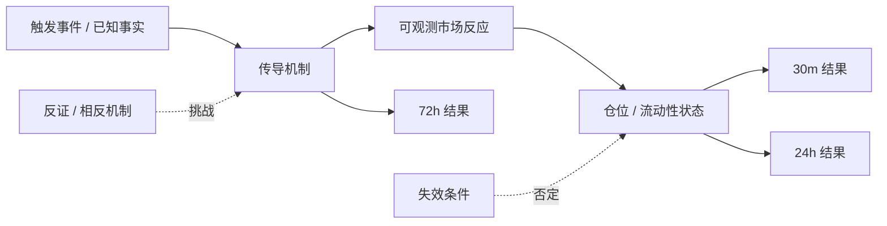
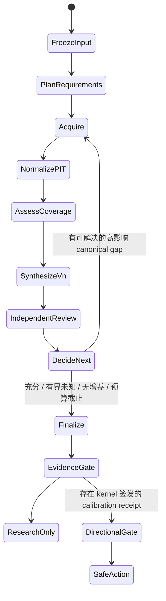

# Decision Hub 多轮根因研究核心方案与执行清单

> 日期：2026-09-15  
> 状态：P0 核心实现与真实服务验收完成；结论保持 research-only/no-trade  
> 本轮唯一目标：把“输入问题 → 证据计划 → 检索/读取 → 根因链 → 反证复核 → 定向补证 → 修订结论 → 有界停止 → 可审计输出”做成真实可运行的核心闭环。

## 1. 产品结论

项目不应放弃，但必须停止把“证据覆盖率通过”当成“研究结论可靠”，也不能把“模型给出一个观点”当成“可交易信号”。当前代码已经具备 Trigger Snapshot、Evidence、PIT 截止、Gateway、DSH 工具调用、有限多轮、报告和 Gate 等底座；失败发生在这些组件之间的业务语义没有闭合：

1. 当前多轮主要追踪 Evidence coverage，没有追踪“根因假设因新证据发生了什么变化”。
2. reviewer 可以要求补证，但 prompt 同时禁止 review 后修改 thesis。系统因此能多取一批数据，却不能证明数据改变或确认了结论。
3. `missing_facts` 和 `unresolved_questions` 是自由文本，无法稳定映射到 Evidence requirement，容易产生无效循环或直接停止。
4. hard evidence 达到 100% 就可停止；因果链缺口、未解决反证、周期冲突未成为完成条件。
5. 没有 DSH 原生审查回执时，代码会根据 coverage 自动生成 `independent_reviewer/accepted`。这不是独立审查，却会在 UI 和提交链路中被当成独立复核通过。
6. 30m/24h/72h 的模型判断目前仍是未校准研究假设。Evidence Gate 通过只证明资料合规，不证明预测有增量价值，更不授权交易。

因此本轮不再扩 PPT、角色入口、调度器、微服务拆分和大规模评测框架。先纵向打通一个真实问题，使用户能看到：查了什么、找到什么、根因链是什么、什么证据反对它、为什么又查了一轮、结论是否变化、为什么停止、当前结论允许用于什么。

## 2. 原始设计与代码现状的偏差

| 原始设计要求 | 当前已有 | 当前偏差 | 本轮处理 |
|---|---|---|---|
| DSH 负责模型、工具和子 Agent 循环；LangGraph 只负责确定性边界 | 已有 DSH runtime 与 LangGraph 外层 rounds | 外层只按 coverage 续轮 | 增加确定性 inquiry decision，仍不把业务权限交给模型 |
| 缺口驱动补证 | coverage gaps 可触发下一轮 | 因果疑问/周期缺口是自由文本 | 只接受可映射的 canonical `requirement_id` |
| review 针对具体主张并触发修订 | 有 `ResearchReview` 和 replan trace | review 无法指出 requirement；prompt 禁止改 thesis | review evidence refs 映射到 requirement；允许显式 thesis revision |
| 每轮 query/target/fields/window/provider 的差异才算新动作 | 有 capability attempt lineage | 主要按 capability 粗粒度去重；review 会重开全部 requirement | P0 先限定到精确 requirement；P1 增加结构化 RetrievalAttempt |
| 多轮过程可回读 | rounds、trace 已持久化 | 只显示“执行了 N 次补证” | 记录每轮 evidence delta、target、thesis/action delta、停止原因 |
| 独立复核必须是真实独立任务 | 可接收 DSH native review | deterministic fallback 可自动 accepted | fallback 永远 bounded，UI 不再显示独立复核通过 |
| 证据充分度、研究发布、方向价值、交易授权分离 | commit/gate 已部分 fail-close | 用户界面仍容易把报告完成理解为可交易 | 固定四层状态语义，未有校准凭证只能 research-only/no_trade |

## 3. 六层架构

### 3.1 产品任务层

每个 Run 必须冻结：用户问题、标的、事件族、`as_of`、PIT cutoff、deadline、30m/24h/72h 三个周期、允许能力和预算。多轮对话只能补充目标或约束，不能暗中改变已经冻结的时间点。

系统输出分四层：

1. **Evidence audit**：证据是否真实、可读、时点合法、来源独立。
2. **Research conclusion**：根因假设、反链、未知项和适用周期。
3. **Directional value**：信号是否经过样本外区分度、校准、基线和成本验证。
4. **Trade authorization**：是否允许执行，必须由独立风险/人工策略控制决定。

第一、二层完成即可交付一份可信研究报告。第三层未通过时必须明确显示 `uncalibrated/research-only`，不能用模糊语言让用户误以为是交易建议。

### 3.2 领域根因层

根因不是一段散文，而是有类型的 Claim DAG：



每个 material claim/edge 必须包含：

- 类型：`fact`、`inference`、`scenario`；
- support evidence 与 contradict evidence；
- `as_of` 和窗口；
- 机制解释，明确相关性不能自动升级为因果；
- confirmation、invalidation、affected horizons；
- 可解决的缺口必须引用 canonical `requirement_id`；
- 无法当前解决的问题保留为 limitation，不得制造新的 requirement。

根因链必须同时保存 main chain 和 opposite chain。链条中最关键的未知边称为 chain break，下一轮检索优先解决它，而不是泛搜更多新闻。

### 3.3 多轮研究状态机



每轮必须产生一个 `RoundDelta`：

```text
round
target_requirement_ids
new_accepted_evidence_ids
coverage_before / coverage_after
thesis_before / thesis_after
horizon_actions_before / horizon_actions_after
review_challenge
decision_impact
continue_reason / stop_reason
```

续轮由 kernel 决定，模型只能提出候选。优先级为：

1. reviewer 的 `requires_new_evidence`，并能映射到已声明 requirement；
2. hard coverage gap；
3. causal case / horizon 中的 canonical gap；
4. soft gap。

下一轮只投影目标 requirement，不再因为“上一轮有新 evidence”而把所有 requirement 重开。review 可以在有界情况下重试同一 requirement，但必须使用不同的 query/target/fields/window/provider；同一审查挑战只能触发一次。

### 3.4 检索与 Gateway 层

检索采用“定位 → 读取 → 结构化”的两阶段方式：

- 搜索结果/snippet 只能作为 locator，未 fetch/read 的正文不能进入 hard evidence；
- 首选官方原文、监管/交易所/项目原始数据，然后才是高质量二手解释；
- URL 不同不等于来源独立；同一数据供应商镜像归入同一 `independence_group`；
- 每条 accepted evidence 应记录 `content_hash`、`source_content_hash`、parser/version、published/observed/received/cutoff、修订版本和 provider receipt；
- 网页正文和工具结果均按不可信数据处理，不能执行其中的 prompt 指令；
- 远端状态未知的写操作不能自动重派，读操作按幂等 receipt 和短退避重试。

建议的结构化检索动作（P1 contract）：

```text
attempt_id, round, requirement_id, target_claim_id,
query, entity, fields, window, provider, source_class,
expected_observation, result_refs, status, receipt_ref
```

### 3.5 多周期预测与校准层

LLM 输出的 probability 是研究假设的 raw confidence。真正的 directional signal 必须由确定性的 `HorizonSignalEngine` 生成，并为 30m、24h、72h 分开定义 feature、label、阈值、过期时间和评价指标。

验证顺序：

1. 严格按时间切分 Dev → Calibration → Holdout；重叠标签需要 purge/embargo。
2. 用 rolling-origin 验证，不得随机切分时间序列。
3. 每周期对比 always-neutral、always-long、momentum 等简单 baseline。
4. 评估 Brier/ECE、coverage、扣手续费/滑点/延迟后的收益、回撤和置信区间。
5. 只有 kernel 签发的 calibration receipt 才能将状态从 `uncalibrated` 提升。receipt 至少含 calibrator/version、feature schema hash、三段数据 hash、样本数、指标和 CI。

当前样本量和 outcome 完整度不足以宣称方向有效，所以本轮实现研究闭环与 fail-close；不会为了验收伪造 calibrated 状态。

### 3.6 运行与用户可见层

用户报告必须直接显示：

- 当前操作结论与用途边界；
- main chain、opposite chain、关键 chain break；
- hard/soft coverage 与 accepted/stale/rejected 数量；
- 每轮为什么继续、查了哪些 requirement、增加了哪些证据、结论发生何种变化；
- review 来源与结果版本；synthetic check 必须标成自动检查/有界；
- 停止原因、剩余 gap、预算；
- Evidence Gate、Directional Value Gate、Trade Authorization 三个不同状态。

开发者视图展示 receipt、trace、planned vs actual、异常 provenance；provider/schema 计数不应占据用户主报告中心。

## 4. 有界停止规则

继续研究必须同时满足：存在高影响且当前可解决的 canonical gap、存在允许的能力路径、预算/截止点允许，并且没有命中 circuit breaker。

停止条件：

1. hard requirements 已通过，因果链不存在可解决的 material chain break，review 已解决或明确 bounded；
2. gap 对应的所有声明路径已经尝试，当前不可解决，明确输出 unknown/limitation；
3. 连续两轮没有新增 accepted typed evidence，且 coverage、claim 状态、horizon action 均无变化，停止为 `no_progress`；
4. 达到 rounds/tools/cost/deadline；
5. PIT/future leak、合同/身份/回执错误立即 hard fail；
6. 冲突证据无法消解时保留 `mixed`，降低置信度并停止，不允许模型用多数票抹掉冲突。

`missing_facts` 或 `unresolved_questions` 中的未知 ID 不触发检索。它会被记录为 `unmapped limitation`，避免模型制造永久循环。

## 5. 多轮对话策略

用户的后续消息按三类处理：

1. **澄清目标/标的/周期**：在 Run 未开始前修改任务；开始后创建可审计的 revision。
2. **提供新证据**：经过同一 admission、PIT、hash 和 source independence 检查后加入 Evidence，不直接改变结论。
3. **质疑结论**：转成 reviewer challenge，绑定 target claim 与预期反证；系统定向补证并生成新 synthesis revision。

模型不应每轮重新读全部历史。上下文只包含 immutable input、当前 agenda、相关 accepted evidence、上一版 claim、review challenge 和尚未解决的 canonical gaps；完整历史留在 checkpoint/ledger，按需 readback。

## 6. 对抗审查结论与控制

三个独立审查视角给出一致结论：采用“代码编排的确定性状态机 + 有界的模型研究节点”，不要让自由 swarm 决定 Gate、权限或停止。

主要攻击/失败场景与自动控制：

| 风险 | 控制 |
|---|---|
| 模型虚构 requirement 导致无限补证 | 只认 Pack 声明的 exact requirement ID，未知 ID fail closed |
| 同一来源十个 URL 被当成独立证据 | source hash + independence group 去重 |
| snippet/摘要被当成原文 | locator-only；必须 read/fetch 后才能 accepted hard evidence |
| prompt injection 污染研究计划 | 所有 Evidence 内容均为不可信数据；能力和 requirement 由 kernel 固定 |
| reviewer 与作者同一上下文、自审自批 | 必须有独立 session/context/result hash receipt；否则 bounded |
| coverage 通过但因果链为空 | causal/review completion 与 evidence coverage 分别检查 |
| 补证后偷偷改结论 | 允许修改，但必须记录 thesis/action before/after 和 decisive evidence |
| 没有新信息仍循环 | 连续两轮无 evidence/state delta，`no_progress` |
| 模型自报 calibrated | 只信 kernel calibration receipt |
| 研究报告被误译为交易 | Directional Gate 和 Trade Authorization 单独 fail-close |

Kill criteria：出现任何 future leak、未授权 long/short、自报 calibrated、伪 independent accepted review 或突破预算时阻断；若代表性案例持续无法产出用户可理解的根因结论，则停止外围扩张，把产品收缩为研究助理并评估接入现成研究/交易数据方案。

## 7. 代码实施映射

### P0：本轮完成

- [x] 新增 kernel `research_loop` 决策器：canonical gap、review 定向映射、可行动路径、停止语义。
- [x] LangGraph checkpoint 保存 inquiry target、unmapped questions、review fingerprint、synthesis revision、thesis/action delta。
- [x] 下一轮只投影目标 requirement；review 不再重开所有 requirement。
- [x] 删除“review 后不得改 thesis”的冲突指令；要求显式 revision/delta。
- [x] deterministic review fallback 永远 `bounded`，不能伪装 independent accepted；native receipt 写入独立 provenance schema 并在 Commit Gate 复核。
- [x] trace/UI replan 展示目标和原因，不再只显示“执行 N 次”；UI 区分 native reviewer 与自动检查。
- [x] 自动测试覆盖 canonical causal gap 续轮、自由文本不续轮、review 定向、thesis 改变、synthetic review bounded、空合成、未知 Evidence 引用、搜索 locator、伪 calibrated。
- [x] 跑真实服务核心链路，保存 run_id、报告状态、证据/轮次/停止原因和后台错误；本次运行已完成并记录在验证记录。

### P1：完成 P0 真实验收后

- [ ] contract 增加 Claim/ClaimEdge/ClaimRevision/RoundDelta/RetrievalAttempt；当前 CausalLink 仍是带 evidence 的线性链，不能冒充完整 DAG。
- [ ] capability attempt 去重升级为 query/target/fields/window/provider 指纹。
- [ ] source content hash、parser receipt、independence group 进入 Evidence admission。
- [ ] 明确区分 DSH wrapper 调用数与实际 capability invocation 数；本次 live run 的顶部计数为 10 个 DSH 调用，而 acquire 步骤记录 23 个 capability 调用，两个数字都是真实的不同层级，但当前 UI 没有解释这一点。
- [x] 当前 DSH native review receipt 具备运行内时间/hash/ID 校验，并以 durable `research-review.native-attested.v1` 与自动检查分开；跨进程不可伪造的 reviewer session/context/tool receipt 仍需 P1 contract 扩展。
- [x] 连续两轮无状态增益 circuit breaker 进入正式 stop enum。

### P2：有足够 outcome 后

- [ ] HorizonSignalEngine 与每周期 feature/label 定义。
- [ ] Dev/Calibration/Holdout + rolling-origin + purge/embargo。
- [ ] kernel calibration receipt 和 directional value gate。
- [ ] 基线、成本、回撤、置信区间验收；未胜过基线不晋级。

### 明确暂缓

- [ ] 交易员角色入口扩展、PPT 操作、更多管理看板。
- [ ] 为架构好看而拆更多服务或引入自由多 Agent swarm。
- [ ] 在核心闭环未通过前购买分钟级数据或扩大批量评测。

## 8. P0 验收矩阵

| 场景 | 必须结果 |
|---|---|
| hard gap 首选失败、fallback 成功 | 第二轮只收到目标 requirement，最终 coverage sufficient |
| coverage sufficient，但 causal unresolved 指向 canonical ID | 有可用路径时续轮；记录 causal_question |
| unresolved 是自由文本 | 不制造新 requirement、不无限循环，显示 unmapped limitation |
| reviewer requires evidence | 只补与 review evidence refs 对应 requirement；同一 challenge 只触发一次 |
| 新证据改变 thesis | 新版本允许改变；trace 显示 old → new 和 horizon delta |
| 新证据不改变 thesis | 显示 thesis unchanged，而不是无过程记录 |
| 无 native review | fallback resolution=bounded，commit/UI 不得显示 independent accepted |
| PIT/future evidence | hard fail，不能转成 bounded success |
| 三周期缺失或签名复用 | fail closed/no_trade |
| live 端到端 | 输入、plan、tool、evidence、review、replan、synthesis、gate、stop 全部可回读；后台无未解释错误 |

## 9. 外部方案依据

- OpenAI Deep Research 建议由应用层先澄清/改写研究问题，使用 web、file 和 MCP 数据源，并用 `max_tool_calls` 限制工具预算；输出中保留工具调用和引用。[OpenAI Deep Research guide](https://developers.openai.com/api/docs/guides/deep-research)
- OpenAI Agents SDK 把 manager 调用 specialist 和 handoff 作为两种编排方式；本项目采用 manager/state-machine，因为 Gate 与权限需要单一确定性控制点。[OpenAI Agents SDK orchestration](https://openai.github.io/openai-agents-python/multi_agent/)
- Anthropic 的研究系统采用 lead agent + 并行 subagents + citation processing，同时记录了过度委派、重复工作和无限寻找不存在来源的失败模式；其多 Agent 研究消耗显著高于普通对话，所以只用于可并行、信息价值足够的子问题。[Anthropic multi-agent research system](https://www.anthropic.com/engineering/multi-agent-research-system)
- IRCoT 说明检索与推理交错优于一次检索后再推理，支持本方案的 claim/gap 驱动循环。[IRCoT, ACL 2023](https://aclanthology.org/2023.acl-long.557/)
- ReAct 将 reasoning trace 与 action 交错，适合作为模型内部研究循环，但 action 仍需外部 allowlist 和 receipt 约束。[ReAct](https://openreview.net/forum?id=WE_vluYUL-X)
- Self-RAG 和 FLARE 都强调按生成状态自适应检索，而不是固定取一批文档；本方案把触发条件收紧为 kernel 可验证的 canonical gap。[Self-RAG](https://openreview.net/forum?id=hSyW5go0v8)，[FLARE](https://aclanthology.org/2023.emnlp-main.495/)
- RARR、FActScore 与 SAFE 支持把长结论拆成原子主张，再逐项检索、归因和核验。[RARR](https://aclanthology.org/2023.acl-long.910/)，[FActScore](https://aclanthology.org/2023.emnlp-main.741/)，[SAFE](https://deepmind.google/research/publications/85420/)
- 时间序列应使用 rolling-origin 验证；概率校准必须使用独立校准集，且小样本下复杂校准器容易过拟合。[Hyndman time-series cross-validation](https://robjhyndman.com/hyndsight/tscv/)，[Guo et al., calibration](https://proceedings.mlr.press/v70/guo17a)

## 10. 执行纪律

每次代码变更后在本文件 P0 checklist 标记状态，并在文末追加验证记录。若某项无法完成，记录确切错误、已尝试的替代路径、对业务结果的影响和下一步；不能用“质量门拦截了”代替原因分析。任何外围任务只有在 P0 live 纵向链路通过后才能开始。

## 11. 验证记录

### 2026-09-15/16 P0 核心回归

- `uv run python -m tools.contract_codegen generate` 与 `check`：通过，canonical schemas 与生成代码一致。
- 核心 Python 回归：`139 passed, 1 skipped`（LangGraph、loop/review、Commit Gate、Evidence admission、runtime prompt、native replay matrix）。
- `uv run ruff check`：通过。
- Decision Desk `npm run build`：通过；仅有现有 chunk size 提示。
- 核心 Python 回归（最新）：`141 passed, 1 skipped`；新增断言覆盖综合证明失败时保留 accepted Evidence 并降级 `research-only`。
- 全仓回归基线：`664 passed, 3 skipped, 18 failed`。失败集中在既有 legacy/evolution/scheduler 测试仍期望旧的 `completed/publish` 或旧 stop enum；本轮新增核心断言已同步，不能把这些旧语义当作核心闭环通过证据。下一步应单独迁移 legacy 合同，不回滚本轮 fail-close 规则。
- 本轮新增的确定性 fail-close：空 causal case/缺三周期 → `synthesis_incomplete`；未知/未 accepted Evidence 引用 → `synthesis_incomplete`；search-derived locator 保持 `candidate`；model `calibrated` 无 kernel receipt 会被降为 `uncalibrated`；自动 review 永远 bounded；Commit 只接受 durable native review provenance。
- 真实端到端验收：`run_74992bc99715451897801ca5210e5a62`。输入为 BTC-USDT-SWAP 回落根因研究，真实 DSH、Research MCP、Hub API 和 research worker 均在线；运行完成 `research_only`，共 2 轮，hard coverage `100%`、soft coverage `33%`，保留 16 条 accepted Evidence、3 条 stale Evidence，触发 10 个 DSH wrapper calls / 23 个 capability invocations，3 个 DSH subagents。第二轮实际改写 thesis，并把 30m 从 `short` 收敛为 `no_trade`；review 为 `bounded`，因为宏观传导与跨资产验证仍不足。停止码为 `no_actionable_path`，不是“永远无法交易”，而是本次 pack 已声明能力路径耗尽；报告、证据、trace、review、两轮 replan 均可回读，`trade_authorized=false`，后台没有未解释异常。
- 本次 live run 的用户结论是：`do_not_trade`、可靠性 `low`、`probability_uncalibrated`、`directional_value_unvalidated`；这证明核心链路已经能给出带证据和停止理由的可审计结论，但尚未证明交易预测有增量价值。若要把该案例推进为方向信号，下一步必须先补充可复现的宏观/跨资产机制证据并建立样本外校准，不能靠再加一轮自由检索。
