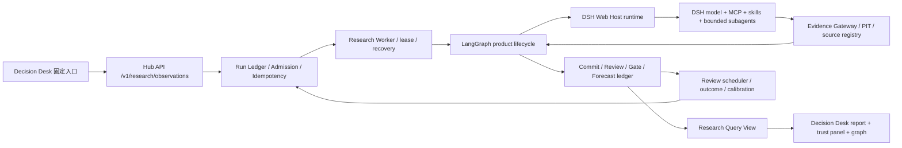
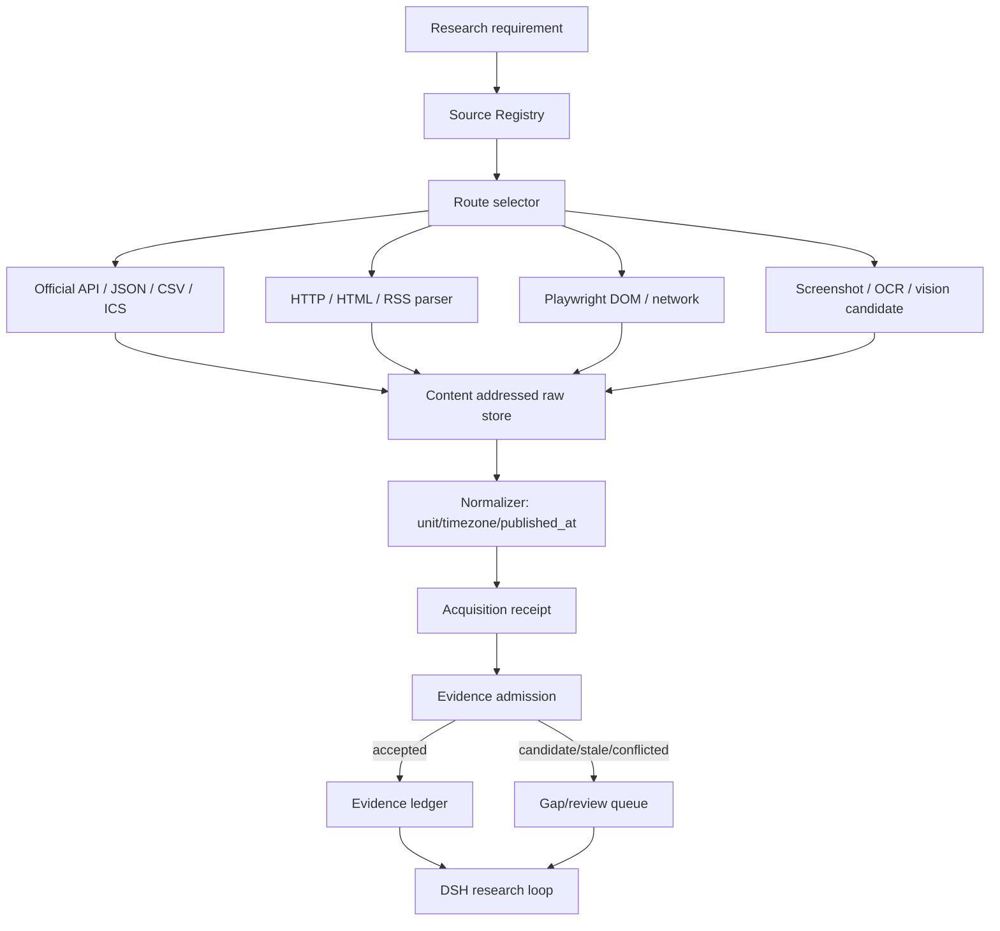

# Decision Hub 预测研究能力升级方案（代码现状版）

日期：2026-09-21  
状态：冻结，作为本轮实现与验收依据  
范围：BTC/加密宏观研究固定入口、DSH 运行时、来源获取、前置预测、复盘与可视化  
目标：把现有系统从“可运行的证据研究链”推进到“可审计、可前置预测、可复盘的研究产品”。本方案不承诺在没有样本外数据和校准 receipt 的情况下达到 60% 胜率，也不允许用漂亮的流程图掩盖信号没有价值。

## 1. 本轮的唯一目标

用户点击“获取最新操作建议”后，不输入专业关键词，系统在同一个固定入口完成一次有界研究，并返回一份可复核的 7 天研究结果：

1. 自动记录触发原因、研究截止时间和运行时版本；
2. 按来源注册表获取价格、衍生品、跨资产、宏观日历和公开叙事资料；
3. 保存每个事实的来源、观察时间、发布时间、内容 hash 和证据状态；
4. 对缺口继续执行有界补证，记录“缺口 → 检索 → 结果 → 观点变化”；
5. 生成主链、反方链、关键风险、失效条件和行动候选；
6. 将方向和交易授权分开展示；
7. 在预测到期后保存 outcome，并按时间顺序计算校准、Brier、log loss、命中率、成本后收益和回撤；
8. 只有通过独立样本外校准 receipt，才允许显示 calibrated 概率或打开执行授权。

本轮不做自动下单、不做绕过付费墙/验证码/登录限制、不引入第二套 Harness、不用 LLM 自填的胜率作为真实胜率。

## 2. 代码现状核对

### 2.1 已经存在且要保留的链路



实际代码对应关系：

| 环节 | 代码 | 当前状态 |
|---|---|---|
| 固定用户入口 | `apps/decision-desk/src/research/ResearchPage.tsx`、`application/research_intake.py` | 已有，空输入会归一为 BTC 最新建议 |
| Admission/Run | `apps/hub_api/main.py`、`application/admission.py`、`application/run.py` | 已有幂等和持久化 |
| 调度与恢复 | `apps/hub_worker/research.py`、`application/scheduler.py`、`review_schedule.py` | 已有 lease、优先 lane、scheduled recheck |
| 外层研究流程 | `packages/orchestration/langgraph/graphs/agentic_research_graph.py` | 已有有界轮次、coverage、gap replan、review、synthesis fallback |
| DSH | `infra/dsh/presets/decision-research/agent.cordis.yml`、`runtime_adapters/dsh_runtime` | DSH 是唯一模型/工具会话 Harness |
| 能力网关 | `apps/research_mcp/main.py`、`packages/workbench_adapters/research_mcp.py` | 已有 canonical capability、预算和 receipt |
| 来源与证据 | `packs/crypto_macro/evidence/source_registry.yaml`、`application/research_evidence.py` | 已有 P0-P4、PIT、独立性、拒绝原因 |
| 预测/复盘 | `persistence/db.py`、`application/forecast_audit.py`、`application/review_schedule.py` | 已有输入 fingerprint、forecast/outcome/recheck |
| 校准 | `packages/evals/forecast_calibration.py`、`application/calibration.py` | 已有 walk-forward、gap、Wilson、Brier、净收益、回撤和 receipt Gate |
| 浏览器采集 | `apps/source_acquisition_worker/src/server.ts`、`packages/provider_adapters/research/browser_readback.py` | Playwright+Crawlee receipt 经 Hub 校验后可进入 `browser.readback` candidate；仅覆盖注册官方日历 |

### 2.2 本轮必须承认的缺口

1. 浏览器 worker 已能向 Hub 提交 acquisition receipt；`browser.readback` capability 可以校验 DOM 工件并生成带 receipt 引用的候选 Evidence，但仍只覆盖注册官方日历。
2. 现有 `OfficialHtmlCalendarSource` 仍通过 Python HTTP/HTML 适配器作为首选；Fed/ECB/BOJ 动态日历的 HTTP 失败会通过稳定的 `web.fetch` fallback 实际切换到 Playwright receipt，其他来源不会扩大浏览器权限。
3. 当前 live Run 可得到规则方向，但真实策略没有 passed calibration receipt；这不是模型“保守”，而是防止虚构准确率。
4. 现有角色已经有 manager、counter-thesis、data-quality，并在 DSH prompt 中描述市场/宏观/衍生品职责，但需要把角色输出统一为事实、反方、缺口和证据引用，防止角色只生成自然语言意见。
5. 前置预测字段和 review scheduler 已存在，但“预测时刻可见的数据”和“预测之后才出现的数据”需要在 UI 和回测命令中明确区分，避免事后追涨被误认为预测。
6. 当前流程图是结果投影，不能读取 DSH 私有思维链。允许展示的是结构化步骤、证据引用、工具 receipt、缺口、冲突和观点变化，不展示或伪造隐藏思维链。

## 3. 架构决定

### 3.1 DSH 继续作为唯一 Harness

DSH 的定位固定为模型会话运行时：模型路由、工具调用、技能、会话、原生轨迹、上下文压缩和受控 subagent。Hub 的 Run ledger、证据账本、预测和交易 Gate 仍是权威状态。LangGraph 只负责产品级生命周期和恢复，不承担第二个 Agent Loop。

DeepSeek Harness 官方资料强调“everything is a plugin”，能力包括模型、工具、技能、session、storage、loops、scheduling 和 UI；这与当前 DSH preset 的职责匹配，因此本轮不重写 Harness。官方项目仍处于 developer preview，版本变化快，仓库会锁定 commit/版本并只通过 `DshRuntime` adapter 使用。[DeepSeek Harness 官方介绍](https://deepseek.com/harness/en/)、[官方仓库](https://github.com/deepseek-ai/deepseek-harness)

不引入 AutoGen 作为第二运行时。官方仓库现在说明 AutoGen 进入 maintenance mode，新项目建议 Microsoft Agent Framework；它的分层设计可作为对照资料，但不能再给本项目增加一套 team/orchestrator。[AutoGen 官方仓库](https://github.com/microsoft/autogen)

A2A 只作为未来跨进程专家服务的协议边界，不作为本轮核心链路。A2A 的目标是让独立、可能不透明的 agent 系统发现能力并交换结构化任务；本项目当前专家角色都在同一个 DSH pack 内，跨进程通信不会提高当前 BTC 信号质量。[A2A 官方规范](https://github.com/a2aproject/A2A/blob/main/docs/specification.md)

### 3.2 信息获取是独立层，但不绕过 Evidence Admission



获取顺序固定为 API/CSV/JSON/ICS → HTTP/HTML → Playwright DOM/network → screenshot/OCR/视觉。浏览器只负责读取公开允许的页面，不绕过登录、验证码、付费墙、robots 或速率限制。关键数值优先用 typed provider；截图/视觉只能生成 candidate，重要字段要求第二来源或人工复核。

当前 `apps/source_acquisition_worker` 已使用 Crawlee `RequestList` + PlaywrightCrawler，产出 DOM、XHR/fetch JSONL、截图、trace 和 content hash。Crawlee 官方文档把 PlaywrightCrawler定位为请求队列、重试和浏览器池的采集层；Playwright 官方文档提供 network events、BrowserContext 隔离和 Trace Viewer。两者适合作为确定性底座，Stagehand/browser-use 只能作为动态页面 discovery/fallback，不直接决定 accepted Evidence。[Playwright Network](https://playwright.dev/docs/network)、[Playwright BrowserContext](https://playwright.dev/docs/api/class-browsercontext)、[Playwright Trace Viewer](https://playwright.dev/docs/trace-viewer)、[Crawlee Quick Start](https://crawlee.dev/js/docs/quick-start)、[Crawlee PlaywrightCrawler](https://crawlee.dev/js/api/3.10/playwright-crawler)

### 3.3 预测和胜率的真实边界

模型必须先写 forecast，再等到期 outcome；每条 forecast 固化：

```text
forecast_id / run_id / strategy_version / horizon
forecasted_at / as_of / evidence_cutoff_at
input_snapshot_id / input_fingerprint / feature_snapshot
raw_direction / raw_probability / probability_status
invalidation / cost model / regime label
```

回测只能按时间顺序拆分 Dev → Calibration → Holdout，并为 30m/24h/72h/7d 设置 horizon gap/embargo。指标至少包括 accuracy、Wilson 下界、Brier、log loss、reliability bins、coverage、交易成本后收益和 max drawdown，并与 always-long、always-flat、事件后动量等 baseline 比较。没有真实样本和 passed receipt 时，UI 显示 `unavailable/uncalibrated`，方向可以显示为研究倾向，但不显示“胜率 60%”。FinRL 的公开架构也把 ingest、环境、训练、backtest、paper/live 分开，并强调未见数据的 train/test/trading 分割；本项目借鉴其数据与评测分层，不引入 RL 以替代当前证据研究链。[FinRL 官方文档](https://finrl.readthedocs.io/en/latest/finrl_meta/overview.html)、[FinRL 官方站点](https://www.finrl.ai/)

### 3.4 金融研究角色是固定职责，不是无限加 agent

DSH pack 保留一个 manager，由它按缺口调度以下有限角色：

| 角色 | 必须产出 | 主要数据 |
|---|---|---|
| Market structure | 趋势、波动、成交量/价格关系、关键区间 | spot OHLCV、日线/可用 4h/1h |
| Derivatives/crowding | funding、OI、basis、liquidation、options skew（缺失则明确） | 交易所 typed provider |
| Macro/calendar | 事件 prior/consensus/actual/revision、时间和传导路径 | Fed/ECB/BOJ/BLS/FRED 等官方来源 |
| Cross-asset/risk | DXY、US10Y、SPX/Nasdaq、VIX/VXN、gold、流动性 | typed market provider |
| Narrative/source critic | 消息共同点、独立性、冲突和事实/观点分离 | P0-P3 文本来源 |
| Counter-thesis | 最强反方、反转条件、拥挤和止损猎杀风险 | 全部 accepted Evidence |
| Data-quality/provenance | freshness、PIT、来源 hash、覆盖缺口 | Evidence/Acquisition receipt |
| Reviewer | 只审结构和证据引用，不创造新事实 | immutable snapshot |
| Synthesizer | 主链/反链/行动候选/失效条件 | fixed snapshot + receipts |

角色之间传递 typed packet（facts、claims、evidence_refs、gaps、confidence_state），不传无引用的长文本。最多一层直接 subagent，循环由 manager 按 `max_evidence_rounds`、`max_tool_calls`、`max_subagents` 和 deadline 控制。

## 4. 信息源与本地知识库

### 4.1 来源分层

* P0：监管机构、央行、交易所 typed API、官方日历；可作为 hard evidence。
* P1：有编辑责任的主流财经媒体、期货/期权交易所公开页面；需来源状态和字段校验。
* P2：审计过的聚合器、公开情绪指数；只支撑相应的市场叙事或交叉确认。
* P3：搜索发现页面和博主观点；只作候选/反方，不直接进入 hard evidence。
* P4：未验证社交内容；当前注册表拒绝，不进入研究结论。

相同新闻转载不算独立来源。source registry 必须声明 `independence_group`，聚合权重时先按独立组去重，再按权威、时效、字段完整性和与其他来源的一致性评分。冲突不通过平均数抹平，要生成 conflict claim 和 counter-thesis。

### 4.2 本地知识库

现有 SQLite/SQLAlchemy ledger 继续作为 Run、Evidence、Forecast、Outcome 的权威存储。增加的本地文档存储只做原文和检索辅助：

```text
data/decision-hub/documents/<sha256>/raw
data/decision-hub/documents/<sha256>/metadata.json
```

用户后续提供的 PDF/图文必须保存来源、接收时间、页码/区域、内容 hash、解析器版本和许可状态。FTS/vector index 只用于召回候选，不改变 Evidence 的真实性；embedding 不能把未经验证的文本变成金融事实。每次研究只读取 cutoff 之前可见的文档版本。

## 5. 分阶段 checklist

### P0：架构和来源路由冻结

- [x] DSH 唯一 Harness、LangGraph 外层生命周期、Hub Ledger/Gate 权责冻结。
- [x] 固定入口空输入归一为最新 BTC 建议。
- [x] source registry、P0-P4 分层、PIT/独立性/拒绝原因存在。
- [x] 明确 acquisition receipt 如何提交 Hub，并为重复 receipt 做幂等校验。
- [x] Evidence admission 已支持引用成功且同 source 的 `acquisition_receipt_id`；浏览器正文必须先经过 hash 校验和 normalizer，仍不会绕过 accepted Evidence 门。

### P1：信息采集工程接通

- [x] 在 Hub 增加 acquisition receipt ingest service：校验 schema、source_id、allowed domain、status、artifact hash、observed_at/cutoff_at。
- [x] 统一 production artifact root 并校验路径、文件存在性和 content hash；receipt 保存 access_mode、raw/visual/network/trace refs。
- [x] 为 Fed/ECB/BOJ 动态日历把 `web.fetch` 失败自动切换到 `browser.readback`；HTTP 成功时不启动浏览器，失败只在受审计官方日历 URL 上触发 fallback，并保留 browser acquisition receipt。
- [x] 失败写入 worker receipt/error code，normalizer 拒绝缺失 DOM、hash 不匹配、越权路径和 cutoff 过期；截图和错误页不会成为 Evidence。
- [x] TypeScript worker 增加 smoke；Hub service/API 测试覆盖未允许域名、重复 receipt、路径穿越和空 artifact；worker 后续补纯函数单测。

### P2：前置预测与复盘门

- [x] Forecast PIT fingerprint、outcome due、scheduled recheck、样本外 calibration evaluator 已存在。
- [x] UI 已显示预测时点、cutoff、horizon、outcome 状态和输入指纹；“事后趋势”字段继续沿用 audit receipt。
- [x] 校准报告增加 baseline 对比和失败原因展示；无 receipt 时明确 `uncalibrated`。
- [x] 现有 replay/calibration fixture 已覆盖历史 input fingerprint 不随 outcome 变更；本轮全量回归通过。

### P3：专家角色和结构化链

- [x] 将 market/crowding/macro/cross-asset/source-critic 的结果投影为 `role-packet.v1` typed packet；packet 只含声明、Evidence refs、缺口和结论，不暴露私有思维链。
- [x] 每轮通过 durable round/replan trace 生成 `claim-transition.v1`，记录轮次、实际新增 Evidence、开放缺口和是否有显式观点改变。
- [x] evidence-only fallback 通过同一 role-packet/decision view 输出主链（若存在）、反方/数据质量包、缺口和质量门失效边界，不再只输出一串 Evidence。
- [x] reviewer 继续只读 immutable snapshot；原生 reviewer 失败时保留 bounded review 和已验证 Evidence。

### P4：页面交付和自测

- [x] trust panel、source matrix、DSH runtime/profile、freshness、source identity 已有。
- [x] 结构化链已投影为可缩放全屏 Graph；节点只来自 trace/claims/evidence/gaps，不渲染隐藏思维链。
- [x] 页面首屏先显示结论状态、方向、horizon、证据覆盖、概率状态、交易授权，再显示链和原文。
- [x] 旧 run URL 找不到时自动回退到最新终态，并明确告警。
- [x] API、Python、TypeScript、前端、真实 canary 和一次 live Run 已有验收记录；本轮新增 receipt→Evidence admission 回归。

## 6. 本轮实现顺序

1. 先实现 P1 acquisition receipt 接入和 admission 测试；这是“信息层是独立工程”从口号变成真实边界的最小闭环。
2. 再实现 P3 的结构化 gap/claim transition 和 evidence-only fallback，解决用户看不到分析依据的问题。
3. 最后实现 P2/P4 的预测审计投影和可缩放链展示；不先改漂亮组件。
4. 每完成一个阶段立即追加 `docs/plan/CORE_CHAIN_DEV_LOG.md`，记录命令、测试结果、receipt/run id、未完成项和风险。
5. 全部完成后运行后端全量 pytest、Decision Desk test/build、source acquisition typecheck/smoke、contract consistency 和一次隔离 live canary。

## 7. 验收标准

交付必须同时满足：

* 触发一次空输入请求后，能从 `run_id` 回读 DSH session、工具调用、来源、证据、主链/反链、缺口、预测和复核计划；
* 至少一条浏览器采集 receipt 能被 Hub 校验并关联候选 Evidence，不能只存在 worker 临时目录；
* 报告能清楚区分研究方向、行动候选、交易授权和概率状态；
* 任何没有 passed calibration receipt 的方向都不会被标记 calibrated，也不会获得交易授权；
* 每条 forecast 都能回答“预测时刻是什么、当时看到了什么、何时到期、结果是什么”；
* 研究综合超时或 provider 失败时仍有结构化 bounded fallback，包含数据缺口和反方；
* 页面展示的是可验证链路，不宣称展示模型私有思维链；
* 测试和 live canary 全部通过，失败项明确记录，不以“服务启动了”代替产品验收。

## 8. 不可交付的误区

以下结果不能作为交付：

* 只有一个“偏多/偏空”标题，没有截止时间、数据来源和失效条件；
* 用搜索结果数量、LLM 自评 confidence 或 Fear & Greed 单指标冒充胜率；
* 只展示流程图组件，但节点没有 Evidence/receipt 引用；
* 把事后已经上涨/下跌的价格作为“提前预测”；
* 因为缺少小时数据就永远 no-trade，或因为宏观新闻多就给出交易授权；
* 把 DSH、LangGraph、AutoGen、A2A 同时作为运行时，造成多套状态和不可复盘；
* 为了通过门槛伪造样本、outcome、consensus、actual 或 calibration receipt。

本文件是本轮唯一开发计划。任何新增功能必须先说明它对应哪一条缺口和哪一个验收标准，否则不进入编码。
