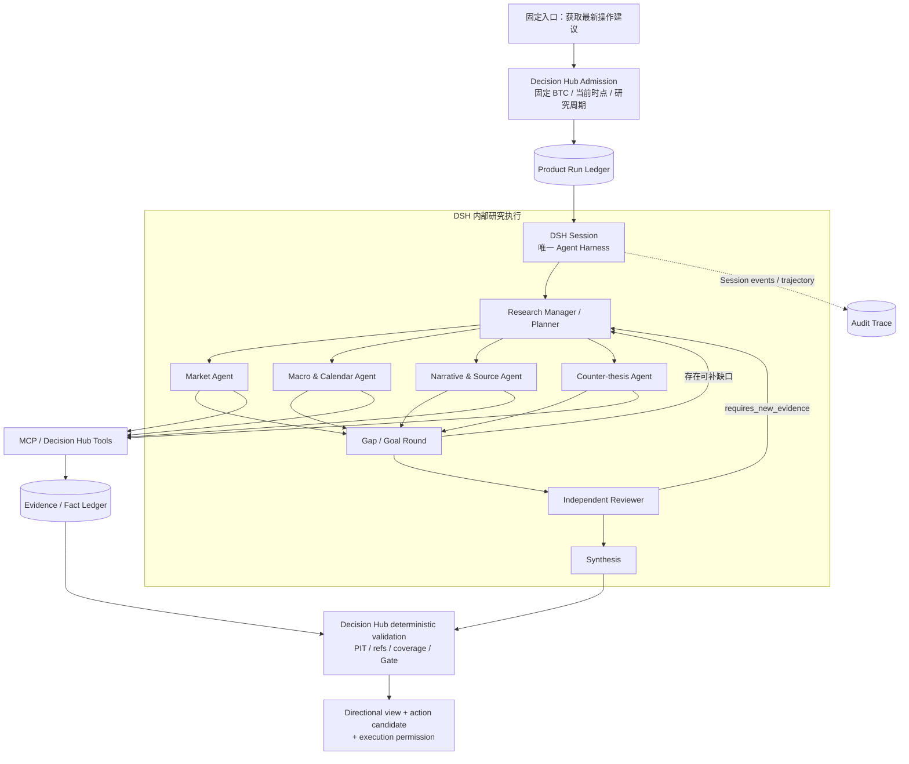

# Decision Hub DSH Harness 稳定架构与核心研究整改方案

日期：2026-09-21  
状态：架构边界已纠正并冻结  
适用范围：用户固定入口 → DSH 深度研究 → 证据账本 → 金融结论 → Review/Gate → 产品报告

> 纠正说明：本文件最初错误地建议引入 Deep Agents 作为新的 Research Harness。重新核对已锁定的 DSH 源码、运行 Profile、既有 ADR 和真实 Run 后确认，DSH 本身已经是完整 Agent Harness，具备 Session、Agent Loop、subagent、MCP、checkpoint、compaction、skills、todo/goal 和 trajectory。再引入 Deep Agents 会形成第二套 Harness，违反项目原有“不自写或并存第二个 Agent Loop”的架构原则。本文已改为 **DSH 是唯一 Harness，Decision Hub 只拥有金融业务内核和外层生命周期**。

## 1. 最终决定

1. **DSH 不删除、不降级为普通模型适配器。DSH 是本项目唯一 Agent Harness。**
2. **不引入 Deep Agents、OpenAI Agents SDK 或另一个 Harness 到生产运行链。**它们只可作为设计和评测参考。
3. **LangGraph 保留，但只负责产品外层生命周期**：Admission、Run 状态、截止时间、恢复、Evidence/Fact 入账、Review/Gate、Artifact 和 Outcome。它不得再实现第二套内部 Agent 计划、角色调度或推理循环。
4. **DSH 负责内部研究执行**：规划、工具选择、并行 subagent、持续补证、上下文压缩、同 Session 续跑、轨迹和模型交互。
5. **MCP/Decision Hub Plugin 是 DSH 与金融能力之间的受控边界**。所有可进入报告的金融事实仍必须经过 Decision Hub 的来源、PIT、身份和 Evidence 校验。
6. **先升级和正确使用 DSH，再考虑 fork 上游核心。**业务功能优先通过 preset、plugin、Skill 和 MCP 扩展；只有插件扩展点无法解决的上游缺陷才进入 fork。

这个决定不再随着某次模型输出或某个 UI 问题改变。除非 DSH 在下面定义的 Spike 退出门上失败，否则不允许再提出第三套 Harness。

## 1.1 当前运行链和两个页面的最终定义

代码与本机进程核对后的事实如下，后续不再用“DSH 可能只是后台适配器”描述：

```text
Decision Desk (API 静态前端，Windows 默认 http://127.0.0.1:8047)
    -> Hub API / Run Ledger
    -> LangGraph 外层生命周期
    -> DshWebResearchRuntime
    -> DSH Web Host (Windows 默认 http://127.0.0.1:3097)
    -> DSH Agent Loop / subagents / web + MCP tools
    -> decision_hub_synthesis_submit
    -> Hub attestation / Gate / Decision Desk 报告
```

- **DSH Web Host 是必需的运行时**：`run-product.ps1`/`run-product.sh` 通过 `dsh-web` 运行时把研究任务提交给它；结论由 DSH Session 内的 Agent Loop 产生，再由 Hub 的合成 Tool、证据校验和 Gate 接管发布。
- **DSH Web UI 不是第二套业务前端**：它用于查看原生对话、工具轨迹和恢复状态，是开发/审计控制台；它可以打开，但不应要求用户在里面学习关键词或手动填写研究参数。
- **Decision Desk 是唯一业务入口**：用户点击“获取最新操作建议”，固定 intake 模板负责标的、周期、宏观/衍生品/叙事/反方需求；空白补充说明也能触发。报告页展示方向、行动候选、证据、根因链、反方和 Gate 限制。
- 启动器同时输出 `DECISION_DESK_URL`（用户入口）和 `DSH_TRAJECTORY_URL`（调试入口），避免把两个 URL 解释成两个产品。当前若看到 8047 Vite 页面代理到 8000，而 3097 仍是另一组 DSH Host，说明运行的是手工/旧进程组，应先停止后用统一启动器重启，不能据此判断 DSH 没有参与。
- 研究 worker 采用两个调度 lane，但仍只有一套账本和一个 DSH Harness：普通 lane 处理所有 Run，`hub-research-priority-worker` 只 claim `priority=100` 的手动 Run。这样长时间 scheduled recheck 不会让用户的手动入口排队；它不复制模型上下文、Evidence 账本或业务结论。

## 2. 为什么之前看起来像 DSH 能力不行

问题不是 DSH 没有能力，而是我们没有把它完整用起来，同时在外面又写了一层研究循环。

### 2.1 DSH 已有的能力

当前仓库已锁定并下载官方源码：

```text
repository: https://github.com/deepseek-ai/deepseek-harness
locked version: 0.1.2-alpha.2
locked commit: 0a53fb55bea101816fa226bb964ae2bed71c343b
local source: .cache/dsh-upstream/source
license: MIT
```

源码和现有组合已包含：

- Agent turn/step loop 和 tool execution barriers。
- Session JSONL persistence 和 checkpoint policy。
- in-process subagent、subagent tool 和委派深度。
- MCP client。
- todo、goal 和 goal-round-driver。
- compaction 和 tool-result pruning。
- Skill registry、filesystem Skill 和 Skill tool。
- trajectory、Session events、重启恢复和 Web UI。

官方项目本身定位就是开源 Agent Harness，并采用“Everything is a Plugin”的 Cordis 架构。当前官方 release 已到 `v0.1.6-alpha.2`，而本项目仍锁在 `v0.1.2-alpha.2`。新版还增加了可继续对话的 Subagent、Subagent 会话侧栏、计划预览和 Inbox 重启恢复等能力。

### 2.2 我们实际限制了什么

此前的 baseline 曾经做过这些限制：SDK `skills.enabled: false`；唯一 subagent 是
`toolFilter.allow=[]`、`maxDepth: 1` 的 reviewer；Prompt 禁止 `todo_write`；Web
profile 也没有研究型子 Agent。外层 `agentic_research_graph.py` 还可以在方向 hard
coverage 通过后结束。这些限制解释了历史上“只跑一轮、证据不足”的结果，但它们不是
DSH 的能力上限。

本次架构纠正已把限制改到可执行的深度研究 profile：Web/SDK 都挂载 DSH Skills、goal、
todo；`subagent` 变成可继续的研究子 Agent，允许当前 preset 实际注册的 `decision_hub_research`、`web_fetch`、
`skill` 和 `todo_write`，并由父 Session 指派 market、macro、narrative、
counter-thesis、data-quality 角色；单独的 `subagent_reviewer` 仍是无工具复核器。子 Agent
允许直接子任务（`maxDepth: 1`）；子 Agent 工具白名单不含任何 subagent 工具，因此不会递归委派，但不限制它补证。Domain Pack
的外层预算已提升到合同上限：10 个 evidence round、100 次 tool call、32 个 subagent、
1800 秒 deadline、per-tool 120 秒、per-model-step 600 秒和 3 次结构化修复。

因此，当前产品不再是“DSH 执行一次受限研究 + 外层判断是否再调一次”的既定设计；它是
“DSH 在同一 Session 内进行计划、并行补证、Gap 重排和 reviewer，再由 LangGraph 负责
账本与发布”。外层仍可因预算、截止时间或真实证据耗尽停止，停止原因必须写入报告，不能
用一轮成功覆盖未执行的需求。

## 3. 稳定的职责边界



### DSH 拥有什么

- 模型 turn、step 和 tool loop。
- 研究计划和 todo/goal。
- subagent 创建、并行、handoff/continuation。
- MCP 工具使用。
- Session、checkpoint、compaction 和 trajectory。
- 研究什么时候继续寻找信息、什么时候请求 reviewer。

### Decision Hub 拥有什么

- 用户请求和固定研究模板。
- Run、Evidence、Fact、Claim、Review、Forecast、Outcome 业务账本。
- 来源许可、PIT cutoff、URL/时点/单位/venue、事实去重和冲突。
- 交易方向、研究可信度、行动候选和执行权限的确定性分层。
- 预算、deadline、最终发布权和失败语义。
- 用户报告和可审计查询视图。

### LangGraph 拥有什么

LangGraph 是外层产品 workflow，不是另一个 Agent Harness：

```text
admit_run
  -> start_or_resume_dsh_session
  -> receive_attested_result
  -> validate_and_persist_evidence
  -> deterministic_review_gate
  -> resume_same_dsh_session_if_needed
  -> publish_or_bounded_stop
```

它不能规划“让 macro agent 查什么”，不能模拟 subagent，也不能拥有一份与 DSH Session 重复的模型上下文。

## 4. 是否 clone DSH 源码直接改

### 当前事实

源码已经以锁定 tarball 的形式下载到 `.cache/dsh-upstream/source`，但该目录是可再生缓存，不允许直接修改。直接修改会在下一次 fetch/build 被覆盖，也无法形成清晰升级历史。

### 最终策略

采用三层修改策略，按顺序升级，禁止跳级：

#### 第一层：Preset / Skill / MCP / Product Plugin

优先在当前仓库维护：

```text
infra/dsh/presets/decision-research/
extensions/dsh/decision-hub/
packs/crypto_macro/skills/
apps/research_mcp/
```

这正是 DSH “Everything is a Plugin” 的设计用途。金融角色、研究流程、工具权限、报告工具、Skill 和 UI 入口都应该在这一层实现。它升级成本最低，也不会把金融代码混进 DSH 核心。

#### 第二层：版本锁升级

把官方 DSH `v0.1.6-alpha.2` 放入一个隔离 cache/branch，与当前 `v0.1.2-alpha.2` 做 contract、replay 和 live canary 对比。验证通过后只更新：

```text
infra/dsh/upstream.lock.json
Python SDK/runtime pin
plugin compatibility seam
acceptance snapshots
```

DSH 官方明确仍是 developer preview，并可能发生兼容性破坏，因此不能直接把 `master` 或最新 tag 指到生产。

#### 第三层：受控 fork

只有以下条件同时满足才 fork DSH：

1. 缺陷位于 DSH 核心，不是我们的 Profile、Prompt、Plugin 或 MCP 问题。
2. 官方扩展点无法覆盖，且已有最小复现测试。
3. 该缺陷阻塞核心验收，例如 Session 无法恢复、subagent 结果无法持久化或 Plugin 无法获得必要事件。

届时建立独立仓库 fork 或 `vendor/dsh-fork`，保留 upstream remote、明确 patch 列表和 rebase 测试。金融业务代码仍不得写入 fork；fork 只维护通用 Harness 修复，并优先向上游提交。

所以结论是：**可以 clone 并二次开发，但不是先复制整个源码再到处改。当前应先升级官方版本并利用插件体系；只有核心扩展点不够时才维护 fork。**

## 5. DSH 深度研究的具体改造

### 5.1 升级评估

建立 `DSH-UPGRADE-016` 隔离 Spike：

- 当前锁定版本继续作为 baseline。
- 拉取官方 `v0.1.6-alpha.2` 的 immutable release 和 SHA-256。
- 不修改 active pointer，不覆盖现有 DSH_HOME。
- 运行 source verify、official build、Web auth、Session create/resume、plugin load、MCP、subagent、compaction 和 restart recovery。
- 检查新版 Session API、plugin runtime resolution 和 subagent slot 的 breaking changes。

通过后再更新 lock；失败则保留 0.1.2，不影响产品账本和 API。

### 5.2 启用金融 Skills

在 DSH preset 中启用 project Skills，新增：

```text
packs/crypto_macro/skills/
  market-structure/
    SKILL.md
    references/field-semantics.md
    scripts/validate-market-facts.py
  macro-calendar/
    SKILL.md
    references/event-transmission.md
  source-critique/
    SKILL.md
    references/source-authority.md
  causal-synthesis/
    SKILL.md
    references/claim-evidence-policy.md
```

Skill 负责金融方法、字段语义和工作流程；业务账本仍由 Hub 持有。Skill 不能直接放宽 Gate 或写数据库。

### 5.3 从 reviewer-only 改为专业 subagents

固定角色：

| Agent | 工具权限 | 产物 |
|---|---|---|
| Research Manager | todo/goal、subagent 控制、只读结果 | 计划、Gap、终止理由 |
| Market | market typed capabilities | 现货、日线、OI、funding、basis、crowding |
| Macro & Calendar | official macro/cross-asset/calendar | 事件、前值/预期/实际、传导链 |
| Narrative & Source | web search/fetch、official documents | 原文、观点、来源质量和冲突 |
| Counter-thesis | 只读 Evidence + 必要 discovery | 反方机制、失效条件、遗漏风险 |
| Independent Reviewer | 只读 Evidence/Claim | ReviewReceipt、是否要求新证据 |

专业 Agent 使用 DSH 自带 subagent 体系，不在 Python 中再实现一套 `market_agent.run()`/`macro_agent.run()` 模型循环。

### 5.4 使用同一 Session 持续补证

固定流程：

```text
manager 建计划
  -> 并行委派专业 Agent
  -> 收集已 attested Evidence
  -> gap/goal round 检查
  -> 有可执行缺口：继续同一 DSH Session
  -> reviewer 挑战
  -> requires_new_evidence：继续同一 DSH Session
  -> synthesis tool 提交结构化结果
```

外层 Gate 发现合成引用错误或明确缺口时，通过 DSH inbox/followup 继续原 Session，而不是创建新 Session 或启动另一个 Harness。

### 5.5 停止条件

不要求固定跑 25/50 次。Research Manager 只有在下面条件满足时完成：

- 主方向和反方向都绑定了 Evidence。
- 每个关键方向主张至少有两个独立来源路径；交易所数据不得把同 venue 多接口算成多来源。
- Market、Macro、Narrative 三类中可获得的需求均已执行，失败有 provenance。
- reviewer 已完成且不再提出可执行的新证据请求。
- 剩余缺口被标记为 `bounded_unavailable`、`budget_exhausted` 或 `source_exhausted`。
- 工具调用、时间、token 和成本预算未越界。

## 6. 不再改变的架构规则

- DSH 是唯一 Harness。
- 不引入 Deep Agents 或 Agents SDK 到生产执行链。
- 不在 Python 中重写 DSH 的 Agent Loop、subagent、Skill、compaction 或 checkpoint。
- 不把 DSH Session 当业务账本；Evidence/Forecast/Outcome 继续由 Decision Hub 持有。
- 不直接改 `.cache/dsh-upstream/source`。
- 不跟随 `master`；每次 DSH 升级必须锁定 tag、commit、archive hash 和回滚点。
- 不因为一次 provider 失败或一次模型输出差就更换 Harness；先区分 Profile、工具、数据、模型和 Harness 的责任。
- 不因 UI 流程图难看就调整研究架构；UI 只消费真实 Session 事件和 Evidence。

## 7. 实施里程碑

### M0：纠正架构与基线

- [x] 确认 DSH 已有 Session/subagent/MCP/checkpoint/compaction/skills/trajectory。
- [x] 确认当前 profile 禁用了 Skills，并仅允许 reviewer subagent。
- [x] 确认外层 graph 会在 direction coverage 达标后提前关闭。
- [x] 冻结“DSH 唯一 Harness”的架构规则。
- [ ] 保存当前 0.1.2 baseline 的两个真实/回放 Run。

### M1：DSH 0.1.6 隔离升级 Spike

- [ ] 拉取并锁定 v0.1.6-alpha.2。
- [ ] 验证 upstream source/build/Web/plugin/SDK。
- [ ] 验证 Session restart、pending inbox 恢复、subagent continuation。
- [ ] 验证现有 Decision Hub plugin 和 MCP 合同。
- [ ] 形成升级/不升级结论；禁止边修边切 active。

### M2：DSH 原生深度研究 Profile

- [ ] 启用 project Skills。
- [ ] 配置 manager、market、macro、narrative、counter-thesis、reviewer。
- [ ] 接入 todo/goal/round driver 或等价的 DSH 原生计划机制。
- [ ] 同 Session gap continuation 和 reviewer continuation。
- [ ] 保留 DSH compaction、trajectory 和 tool-result pruning。

### M3：精简外层 LangGraph

- [ ] 删除外层对内部角色、研究轮次和模型上下文的重复所有权。
- [ ] 外层只保留 Run 生命周期、Evidence attestation、Gate、恢复和发布。
- [ ] 任何补证都 resume 同一 DSH Session。
- [ ] 对旧 graph 保留 replay 对照，迁移通过前不直接删除。

### M4：交付验收

- [ ] 简单/空输入自动归一为最新 BTC 研究，无需用户写关键词。
- [ ] 真实 trajectory 显示 planner、专业 subagents、工具和 reviewer。
- [ ] 至少完成一次由 gap 或 reviewer 驱动的同 Session continuation；若一次证据已完全充分，必须有确定性停止回执。
- [ ] 页面显示真实步骤、来源、Evidence、主链、反链和终止理由。
- [ ] 重启后恢复，不重复提交 Evidence/Artifact。
- [ ] 最终输出方向、行动候选、可信度、执行权限和失效条件。
- [ ] 没有 PIT 样本外 CalibrationReceipt 时继续显示 probability unavailable。

## 8. Harness 更换停止线

只有在 M1/M2 完成后，DSH 仍无法满足以下任一硬条件，才允许重新评估 Harness：

- 无法稳定恢复同一 Session。
- 无法运行受限并行 subagent。
- 无法把工具调用和结果形成可信 trajectory。
- 无法通过插件/MCP 限制权限和校验证据。
- 无法在给定预算内继续 gap/reviewer 驱动的研究。

届时必须用同一 fixture、同一金融工具、同一 Evidence/Gate 合同，把候选 Harness 与 DSH 对照。没有对照数据不得再次改架构。

## 9. 参考

- [DeepSeek Harness 官方仓库](https://github.com/deepseek-ai/deepseek-harness)
- [DeepSeek Harness releases](https://github.com/deepseek-ai/deepseek-harness/releases)
- 本地锁定记录：`infra/dsh/upstream.lock.json`
- 本地集成边界：`infra/dsh/README.md`
- DSH runtime 边界：`packages/runtime_adapters/dsh_runtime/README.md`
- 现有 DSH preset：`infra/dsh/presets/decision-research/agent.cordis.yml`
- 既有架构原则：`docs/EXECUTION_PLAN.md`、`docs/decisions/ADR-0008-agentic-research-runtime.md`
