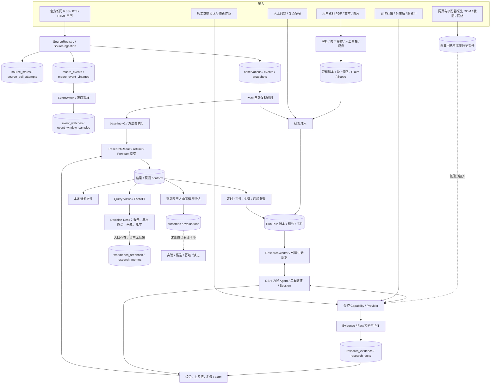
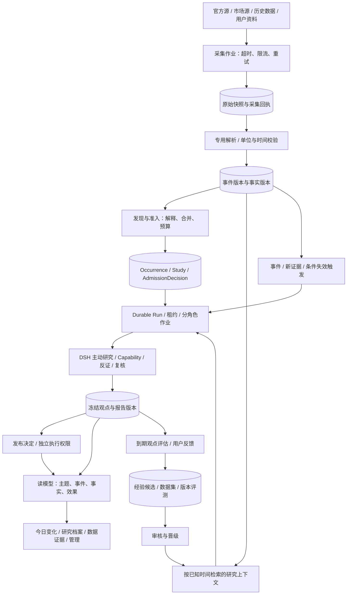
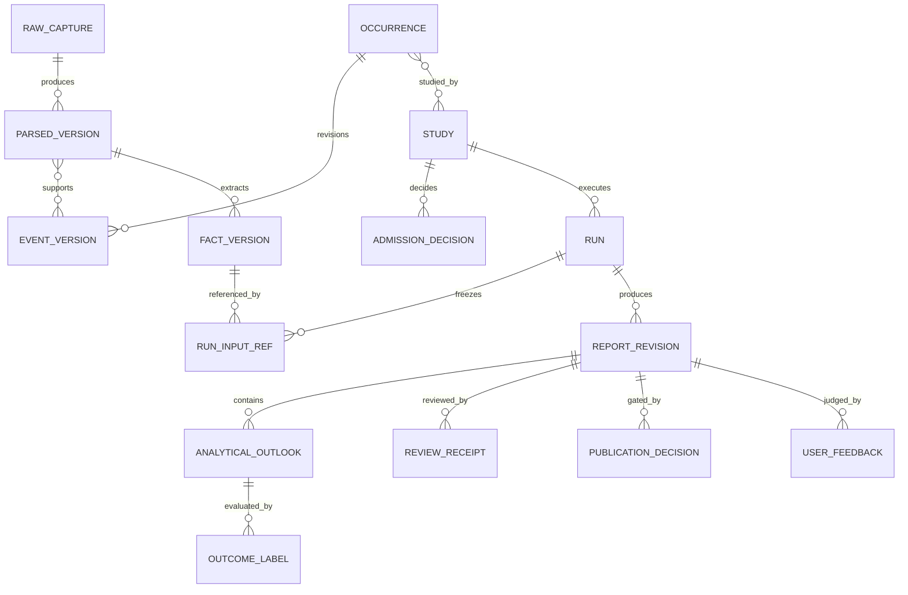
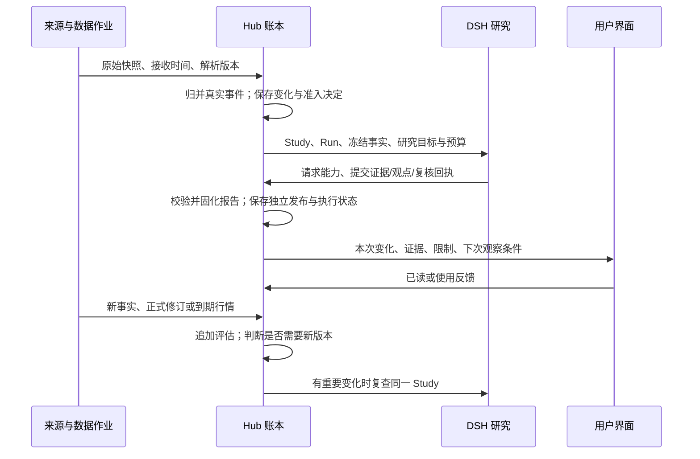

# Decision Hub 全链路架构审查与整改方案

日期：2026-09-29。当前状态：**用户于2026-10-07暂停整改目标，先讨论预测价值与产品方向；具体断点以唯一执行台账为准**。范围：数据输入、采集、事件、调度、AI、证据、报告、复盘、演进、运行平台与页面。原方案与已验成果保留，未完成门不自动关闭。

本次讨论：[预测价值与产品方向审查草案](DECISION_HUB_PREDICTIVE_VALUE_DIRECTION_REVIEW_2026-10-07.md)。该草案不恢复执行或启动新目标。

进一步审查：[产品价值根因与新方案](DECISION_HUB_VALUE_ROOT_CAUSE_AND_NEW_PRODUCT_PLAN_2026-10-07.md)。用户要求重新定义方向，旧AR/W推进顺序不自动作为新目标主线；未完成工程项及历史成果仍保留。

本文件是本次整改的总入口，补充 9 月 26 日全项目 PRD，纠正只从页面体验判断可交付性的做法。文中的目标结构、接口和验收门是提案，不表示功能已经上线。历史阶段的通过结论只对对应版本、范围与测试样本有效。

实施接续：[唯一执行台账](../plan/ARCHITECTURE_REMEDIATION_EXECUTION_LOG.md)。下文现状计数和审查结论保留原审查时点；实施中新增的正式方法身份缺口见[研究方法生效 ADR](../decisions/ADR-20260930-research-method-activation.md)。

## 1. 结论与原始预期的差距

**当前是具有真实 AI 研究、审计与部分自动化能力的内部研究系统，尚未形成可靠的“持续发现—主动研究—交付变化—积累知识—验证价值”产品闭环。**

最主要的问题有四组：

1. 上游数据语义错误：官方页面请求成功，会议日期却漏提取或混入其他发布日期；日历游标会漏掉插入和修订。
2. 编排对象偏向单次 Run：自动发现弱，持续跟踪按事件类型选择一个根任务，不能准确承载多个并行研究主题。
3. 数据沉淀缺少统一查询与复用：账本和事实量已经可观，跨时间指标、修订、来源血缘、研究变化和知识复用仍不完整。
4. 研究价值与交易门槛耦合：运行完成、证据检查、观点质量、预测有效性和交易权限没有在所有接口与页面中一致分开，用户看到很多限制，却难以知道研究到底帮助了什么。

| 用户预期 | 当前已存在 | 实际缺口 |
|---|---|---|
| 打开就看到系统主动发现的重要变化 | 来源轮询、自动准入、定时复查、首页 | 本次账本中来源自动触发的 research.v1 只有 1 次且失败；人工和复查占主体 |
| 关键事件和关键时间留存、可回看 | Observation、MacroEvent、Vintage、Watch、窗口采样表 | 日历语义错误；时间精度/时区契约不足；版本和窗口没有完整产品视图 |
| AI 自动查证并解释影响 | DSH 执行、工具调用、事实校验、主反链、结果固化 | 能执行不代表能可靠发现；独立复核凭据、数据质量与观点价值仍有缺口 |
| 历史数据越积越有用 | 历史分区、Evidence、Fact、报告、轨迹 | 缺跨 Run 的 PIT 查询、相似事件检索与可验证引用复用 |
| 能判断研究有没有用 | 质量评估、Forecast、Outcome、校准表 | 用户反馈为 0、校准为 0；机器质量评估不能代替用户价值和样本外验证 |
| 后续研究黄金、宏观市场 | Domain Pack、Provider/Capability 边界 | 数据集、品种别名、交易时段、后验采样与触发范围仍有加密市场专属实现 |

### 1.1 本次审查方式与边界

- 代码：读取实际入口、Composition、源连接器、调度、事实库、研究提交、查询和页面代码；不是仅阅读旧 PRD。
- 数据：对 `data/core-live-20260913/db/decision_hub.sqlite3` 使用 SQLite `mode=ro`、`query_only` 和单个读事务；下文计数固定于 **2026-09-29 20:41:15 +08:00**。运行中数据会继续增长。
- 网络：实时获取 Fed/BOJ 官方 HTML，保存 SHA-256，交给现有解析器离线回放；另查官方架构资料。
- 自动化：39 项相关既有测试通过；两个纯内存解析探针复现缺陷；5 个本地 GET 返回 200；浏览器操作首页、报告、技术详情、图谱全屏、来源状态和后台入口。
- 运行：审查开始 API 不可访问，调用现有启动工具恢复；原因未被当前日志证明。本次没有把它归因于 Docker、SDK 或会话中断。启动后 API/研究进程在线，但 BLS 两个源异常，**没有达到全部能力正常**。
- 本轮没有新建人工研究、提交反馈或修改业务记录；恢复服务后，原有后台任务会自然继续写入。没有进行全量按钮认证、压力测试、长时间守护验证或新的前瞻收益实验。

复现入口：[审查脚本](../../tools/architecture_review_snapshot.py)。原始证据在 `data/product-local/architecture-audit-2026-09-29/`；摘要见 [验收证据](../evaluations/ARCHITECTURE_AUDIT_2026-09-29.md)。

## 2. 现状架构：从输入到交付、复查与沉淀

下图实线表示已有代码连接；虚线表示存在边界或局部接入，不能认为端到端已通过。



### 2.1 三类状态必须保留不同权威

| 状态 | 回答的问题 | 整改约束 |
|---|---|---|
| Hub 业务账本 | 什么被接收、为什么入队、采纳何证据、发布哪个结果、哪个版本受评估 | 唯一业务状态依据；状态转换、幂等键和领域事件归 Hub |
| LangGraph checkpoint | 外层流程运行到了哪一步、如何恢复 | 保存执行恢复点，不承担跨任务知识检索和业务版本身份 |
| DSH Session / JSONL / 工具轨迹 | Agent 如何调用工具、返回了什么、哪个会话执行 | 保留原始轨迹，使用 run_id/session_id/结果哈希与 Hub 对账；不用前端推测完成 |

本次看到的是 Windows 本地多进程入口，DSH Host、API、MCP、采集服务和多个 Worker 由 PowerShell 组织。换成 Docker 本身不会修复日期解析、事件身份或结果契约。

## 3. 逐层盘点：现状、问题、整改与完成标准

| 层 | 代码入口（相对仓库根） | 已有实现 | 主要整改与验收 |
|---|---|---|---|
| L01 关注范围与研究输入 | `research_intake.py`、`packs/crypto_macro` | 人工问题、资料作用域、来源事件 | 增加持续研究主题与关注范围；默认主动交付，临时问题仍保留 |
| L02 来源目录 | `source_adapters/official_feeds/presets.py` | 8 个源、权威和能力声明 | 覆盖目标、实际可用能力、限流和失败策略单独展示；声明不能代替启用凭据 |
| L03 采集执行与原始留存 | `source_ingest.py`、SourceAcquisition 服务 | 轮询记录、回执、DOM 等文件 | HTTP/浏览器结果统一请求链；每次采集的时间、哈希、解析版本可追溯 |
| L04 日历与文档解析 | `html_calendar.py`、`calendar.py`、文档 Parser | ICS、泛 HTML、文档解析 | 按官方站点和表格列定义解析器；会议/声明/纪要分型；真实页面 fixture 必须通过 |
| L05 事件身份与版本 | `macro_event.py`、`source_ingest.py` | Event、MacroEvent、Vintage、哈希去重 | 稳定 occurrence 身份；改期和修订追加版本；对误解析旧记录追加纠正关系 |
| L06 时间和事件窗口 | `event_watch.py`、`composition.py` | Watch、计划窗口、Sampler 接口 | UTC、来源时区、日期精度、计划/实际时间分开；到期采样、迟到补采、恢复都可验 |
| L07 自动发现与准入 | `provider_adapters/research/discovery.py` | 四源标题关键词，baseline + 可选 research | 留存每项 admitted/ignored/merged 的原因和策略版本；新颖性、影响范围、预算联合决定 |
| L08 队列、调度与恢复 | `scheduler.py`、`review_schedule.py`、`hub_worker/research.py` | Run 租约、幂等、取消、复查 | 分离来源/采样/研究/通知等作业通道；以 Study 而非 event_type 取代权为准 |
| L09 AI 研究执行 | DSH Runtime、`apps/hub_worker/research.py` | 真实模型、工具、预算、主反链 | 任务对象和证据目标明确；接受凭据对应固定结果版本；失败有分型和可操作恢复 |
| L10 能力与数据访问 | `provider_adapters`、Pack capability 配置 | typed provider、网页、历史数据等 | 有效配置与能力注册统一可查询；按市场/指标粒度暴露覆盖、限制和替代能力 |
| L11 事实与证据存储 | `fact_store.py`、`research_evidence.py` | 原子校验、来源、单位、PIT、哈希 | 增加跨 Run 的版本化事实查询和引用关系；保持每次运行的冻结输入 |
| L12 综合、复核与发布 | `application/commit.py`、`decision/gate.py` | 质量 Gate、失败关闭、结果固化 | 分开研究观点、公开报告、执行授权；不能为了让页面有结论而放宽验证 |
| L13 用户交付与读模型 | `query_views/research`、`decision-desk/src` | 报告、来源、单次图谱、局部比较 | 主题时间线、变化摘要、证据趋势、原始材料；列表和诊断按需加载 |
| L14 后验与价值评估 | `outcome_due.py`、`research_value.py`、校准服务 | 多空标签、机器质量、校准契约 | 分别评估研究 usefulness、观点准确性、策略经济价值；真实分母与样本版本可见 |
| L15 资料与知识演进 | `research_library.py`、Evolution 服务 | 资料复核、观点、候选/实验接口 | AI/规则处理模式准确命名；相似事件与经验须引用原始版本并经过审核 |
| L16 平台与工程治理 | `run-product.ps1`、`persistence/db.py`、`tools/ops/database.py` | 一键启动、心跳、SQLite WAL、备份脚本 | 持久守护、按故障域恢复、有效配置清单、全资产恢复演练、唯一规格入口 |

表中未带目录的服务文件位于 `packages/kernel/decision_hub_kernel/application/`。整改拆分详见第 8 节。

## 4. 已证实问题与根因

证据等级：A = 自动化/真实数据复现；B = 明确代码路径或产品结构限制；C = 待专项压测/长期观察的风险。P0 指阻断可靠验收，P1 指完成主线所需，P2 指主线稳定后的扩展。

### AR-01 · P0 · A：请求成功不能代表日历正确

- 当前官方 Fed HTML 回放只解析出 **2028-01-26** 这一条备注。官方 2026 日历含 10 月 27–28 日、12 月 8–9 日会议安排。[Fed 官方日历](https://www.federalreserve.gov/monetarypolicy/fomccalendars.htm)
- `html_calendar.py:130` 的遍历不包含主表的月份/日期 `div`，依赖全文正则和滚动年份上下文。不能把备注命中当成完整日历。
- BOJ 回放产生 16 个日期，其中部分来自会议纪要/意见摘要列；月份缩写、跨列和多日会议语义没有分开。当前落库 9 条 BOJ 均在 2027 年，1 条 Fed 在 2028 年。[BOJ 官方表格](https://www.boj.or.jp/en/mopo/mpmsche_minu/)
- 源健康视图把这些成功 HTTP 请求显示为正常；ECB 当前成功但游标为空；BLS 两源连续失败 344/346 次。原因应从请求回执进一步细分，不能统称 SDK 启动问题。

**改法**：站点专用解析器 + 原始文件回放 + 日期范围/数量/字段语义的质量检查。健康拆为“连接、解析、覆盖、新鲜度、准入”。对公开页面访问失败，按允许的官方接口/页面适配并保存失败证据，不把随机备用站点当官方数据。

### AR-02 · P0 · A：未来日期游标漏掉插入与修订

`OfficialHtmlCalendarSource.poll` 以 `scheduled_at|id` 大于游标选取新项。纯内存探针先接收未来 11 月会议，再加入同年 10 月会议和 11 月会议新内容，第二次应观察到 2 个变化，实际输出 0。

**改法**：日历按稳定来源条目身份 + 内容版本差异同步；游标表示源检查位置/版本，不表示最晚事件日期。定期滚动重扫覆盖范围。首次扫描的 bootstrap 行为显式配置并落库，不能通过清空正式游标盲目重放全部新闻。

### AR-03 · P0 · A/B：日期精度与时区没有贯通

- 只有日期的会议被构造成 `00:00 UTC`，伪装成精确发布时间。
- `/v1/macro-events` 返回 `2027-05-07T00:00:00`，没有时区；页面显示本地 00:00。`_macro_event_view` 未统一处理 SQLite 返回的 naive datetime。
- 80 条窗口样本全部 pending，时间均在未来，**不能据此判定它们已逾期**。但正式启动器没有显式设置 `DECISION_HUB_EVENT_WINDOW_LIVE_ENABLED`，Composition 默认不启用；当前进程可能继承环境，仍需有效配置接口确认。

**改法**：`scheduled_date`、可空 `scheduled_at`、`time_precision`、`source_timezone`、`confirmed_at`；精确时间统一 aware UTC。仅日期事件只生成日级提醒，精确事件窗口待时间确认。采样能力进入正式 readiness，而不是仅检查端口。

### AR-04 · P0 · B/C：运行稳定性依赖启动父进程，调度故障域偏大

- `run-product.ps1:468` 轮询子进程；任一受管进程退出即进入 catch，停止整组进程。脚本要求窗口持续打开，缺少按角色自恢复与稳定启动身份。
- `RealtimeScheduler.tick` 依次等待全部源、窗口、baseline 执行、Outcome、通知；一个慢阶段会延迟后续阶段。RealtimeWorker 心跳在 tick 前后写，长 tick 可能造成心跳与实际执行不一致。
- 本次入口起初不可达，恢复后在线；缺少直接证据证明停机是上述哪一条造成，不能做确定归因。

**改法**：服务管理器/隐藏守护进程，明确一键 start/status/stop/recover；研究故障不关闭只读报告 API；源、采样、标签、通知具有独立 deadline、退避和可恢复作业。先保留模块化单体和多个角色，不为此引入大规模微服务。

### AR-05 · P1 · A/B：自动发现缺少可以解释的准入闭环

快照中 1,115 次运行：自动 baseline 18、自动 research 1、人工 research 100、定时复核 996。唯一来源自动 research 于 9 月 22 日失败，原因 `provider_timeout`。这不是当前系统成功率：账本混有多个版本、历史故障和取消任务，不能直接计算 SLA。

`CryptoMacroDiscoveryPolicy` 只匹配允许来源的第一条非空文本（标题）；来源初始化可只建立游标。现状能解释主动研究少，但尚未对全部历史条目计算召回率。

**改法**：增加 durable admission decision，记录候选、主题、影响市场、规则/模型版本、忽略原因、合并对象、预算和触发时间。规则初筛后仅在必要时调用有界分类模型；用人工标注的事件样本评估漏报/误报。用户无需每次编写研究问题。

### AR-06 · P1 · B：复查取代范围是事件类型，业务身份不够

`review_schedule.py:132` 选择每个 `event_type` 的最新根 Run，并退休其他根任务的未执行复查。它确实防止复查树爆炸；同时会把同类型但独立的研究课题视为可相互取代。失效扫描也需补齐 domain/instrument/Study 范围。

**改法**：引入持续研究主题 Study、真实事件 Occurrence 和报告版本 ReportRevision；一个 Study 的新版只取代同一 Study 的复查权威。跨主题合并必须留存原因。保留 Run 作为执行审计，不能拿标题字符串或 event_type 代替业务身份。

### AR-07 · P1 · A/B：数据已有积累，事实复用和血缘仍局部化

- 6,619 Evidence、19,566 Fact；Fact 无孤儿 evidence 引用、无跨 Run 错配，现有归属校验值得保留。
- FactStore 的查询与 OI 前值比较主要在 Run 内；历史数据 Adapter **已经复用落地分区**，不能说所有数据都没有复用。
- 6 个浏览器采集回执存在，但 Evidence 的 `acquisition_receipt_id` 全部为空，581 条有 `content_ref`。说明这条显式采集血缘没有贯通当前研究数据；其他 URL、哈希、工具引用仍存在，不能把它解释为所有证据不可追溯。

**改法**：RawCapture → ParsedVersion → FactVersion → RunInputRef → Claim → ReportVersion 可反查。跨 Run 复用先过市场、单位、时间、版本、可信度和授权范围过滤，重新产生本次采纳引用，不绕过旧的 PIT 检查。

### AR-08 · P1 · A/B：研究观点、发布方向与评估对象耦合

`commit.py` 对缺少有效独立复核/校准凭据的方向关闭发布，`_fail_closed_horizon` 会转成 `no_trade`；`outcome_due.py:32` 只评估 long/short。这一门槛保护发布，但没有独立的研究观点前瞻评估对象。

快照中 Forecast 共 1,608 条，其中 no_trade 1,578、neutral 18、long/short 12；Outcome 10 条且都为 estimated；校准 0。**不能把 10/1,608 当作标签完成率，更不能把没有校准说成已证明策略无效。** 页面顶部 7 日价格基线与 Forecast 的 30m/24h/72h 也没有统一评估口径。

**改法**：冻结独立的 `AnalyticalOutlook`（方向、窗口、证据、方法、适用范围），另存 `PublicationDecision` 与 `ExecutionPermission`。即使执行权限关闭，合格的研究观点仍可进入前瞻观察集；原始模型输出、核验后观点和公开结论分别留版本。规则基线、AI 综合、反方链分别评估，不能混成一个“AI 胜率”。

### AR-09 · P1 · A：可视化存在，但不能呈现系统积累

浏览器验证单次研究已有 **27 节点分析图**、来源矩阵、轨迹、复查计划、预测审计；代码已有 `/comparison` 和技术页比较面板。缺的是跨主题/跨时间资产视图，不能再写“完全没有图谱/比较”。

图谱全屏仍把大段属性铺进节点，初始缩放下难读；技术页展开同屏 100 条任务、日历、图、证据、日志。研究页出现“反方职责阻断/0 证据”同时正文反链有证据引用，属于角色投影口径需要核对的具体矛盾。顶部下一次复查仍显示过去的计划时间，实际计划有已完成/入队状态，应使用调度投影。

**改法**：面向问题的读模型，先显示变化和结论，按需展开原始记录；图节点只放一句结论/数值/可信度，点击侧栏显示字段与原文。ID、JSON、实现名称进入技术抽屉，保留可复制能力。

### AR-10 · P1 · A/B：通知、用户反馈和学习还没形成业务闭环

530 条 outbox 为 local/sent，表示本地通道写出，不能声称用户已收到或阅读。608 条 research_value_evaluations 是机器研究质量记录；workbench_feedback、research_memos、experiences、experiments、candidate_versions、promotion_decisions 均为 0。

**改法**：产品内研究收件箱具有可见、已读、反馈状态；外部渠道后续接入。最小反馈为“有帮助/已知信息/证据有误/未解决问题”，可附原因并引用报告版本。经验只能由可追溯的结果与评估生成候选，经审核/实验再晋级，不能从 Agent 自评直接更新生产策略。

### AR-11 · P1/P2 · A/B：文档与多市场能力的名称超前于默认实现

当前唯一修正记录使用 `financial-correction.deterministic.v1`；默认修正器进行规范化，有条件的模型修正器存在。ClaimExtractor 为启发式实现。界面应显示实际处理模式与未识别范围。

黄金接入需要品种、市场日历、货币/计量单位、数据权限、版本与标签提供方的完整契约，不能只把 BTC 菜单改成黄金。历史数据出现 BTCUSDT、BTC-USDT、BTC-USDT-SWAP 等别名，应明确现货/合约/报价币和映射来源。

### AR-12 · P1 · B：文档、接口与真实配置存在多份“当前”

旧架构认为 DSH Web 是主入口，实际正式启动器输出 Decision Desk；多个“最终/accepted/当前唯一阶段”文档并存。能力表为空不意味着工具不可用：正式启动器有显式 capability allowlist，需把有效配置作为只读事实展示。

**改法**：本文件管理整改状态；PRD 管业务、ADR 管边界、验收记录管版本证据。新增 ADR 明确 Desk 为普通用户入口、DSH 为原生执行/深度诊断入口，并标注替代的旧决策。冻结 build/config/schema/pack/runtime 身份，前端显示与后台一致。

## 5. 沉淀的数据：哪里能看，哪里缺视图

| 数据资产 | 快照数量 | 现有展示/复用 | 需要补齐的可视化与查询 |
|---|---:|---|---|
| 来源状态 / 轮询 | 8 / 2,265 | 来源页与分页轮询表已接通 | 来源×日期覆盖热图；成功请求、零提取、未准入分开 |
| 浏览器采集回执 | 6 | 后端查询、磁盘 DOM 等材料 | 原始页/截图/网络响应/解析版本四联视图，连到事件和 Evidence |
| Observation / Event | 各 91 | 业务账本 | 同一真实事件的多来源归并与重复关系 |
| MacroEvent / Vintage | 各 10 | 日历；Vintage API 已有，普通 UI 未完整使用 | 计划时间→改期→实际发布→数值修订时间线 |
| Watch / 窗口样本 | 10 / 80 pending | 调度与计划存储 | 事件前后窗口图，未到期、迟到、缺失、已采样必须区分 |
| Evidence / Fact | 6,619 / 19,566 | 单 Run 列表、引用、主反链 | 指标时间序列、单位/市场筛选、PIT 查看、来源血缘和冲突 |
| 历史 DataJob | 189 | 更新作业页；86 completed、99 failed、4 running | 数据集覆盖与缺口区间，实际分区可用性；失败历史不可等同当前不可用 |
| 研究结果 / 轨迹 | 528 / 47,529 | 报告、单次图、技术轨迹 | Study 版本时间线、增量证据、结论变化与总成本 |
| 角色输出 | 1,180 | 角色状态/研究过程 | 真实执行/规则投影区别、Claim 引用完整性、复核凭据匹配 |
| 复查计划 | 1,155 | 单报告诊断 | 全局日程/积压/取代原因，合并到 Study 时间线 |
| Forecast / Outcome | 1,608 / 10 | 单次预测审计、汇总统计 | 分市场/方法/窗口/版本的 eligible cohort、质量分层与校准曲线 |
| 机器质量评估 / 校准 | 608 / 0 | 研究诊断 / 校准入口 | 机器检查、主观 usefulness、统计验证分开展示 |
| 本地 outbox | 530 | 本地文件投递 | 产品内可见/已读回执；重复投递消重 |
| 资料 / 版本 / Claim | 各 1 | 资料工作台 | 资料段落→观点→报告引用，修正版本对比与权限作用域 |
| 用户反馈 / Memo / 演进候选 | 均 0 | 部分后台入口 | 从报告发起的轻反馈与经验证的知识资产；无样本时展示空态 |

数据量不是独立样本数：同一来源在不同 Run 内再次采纳会形成多条 Evidence；同一主题的 30m/24h/72h 也高度相关。图表必须附分母、去重口径、时间范围和数据截止时间。

### 5.1 优先建设的六个真实数据视图

1. **来源覆盖面板**：最近成功、最后有效内容、未来 30/90 天覆盖、解析质量、未研究原因；从异常直接进入对应原文。
2. **事件档案**：按真实事件组织公告、修订、时间、指标和研究；时间线联动事件窗口价格/利率/美元指数。
3. **事实浏览器**：按市场、指标、来源、时间选择数据；显示单位、频率、版本、是否代理指标，并可“按当时已知信息查看”。
4. **研究主题时间线**：本次改变什么、哪些新增证据导致改变、哪些条件尚未满足；读者可退回原报告。
5. **运行与成本瀑布**：采集/排队/模型/工具/复核/发布的时间；真实成本与未知项分开，未知耗时不显示 0ms。
6. **研究效果面板**：观点队列、到期状态、标签质量、基线比较、用户反馈、置信区间；样本不足时保留原始样本表而不画虚假的可靠曲线。

## 6. 目标架构与数据模型

保留现有 Hub/DSH/Provider/Domain Pack 边界，在共享基础上补上业务身份、事实版本与读模型。



### 6.1 建议的实体关系（新增，不替换旧审计记录）



- **Occurrence**：真实世界一次事件的稳定身份；机构、事件类别、统计期/会议批次为键，计划时间是可修订属性。关联现有 MacroEvent，不重复制造两个日历真源。
- **Study**：持续回答的研究问题，限定市场、品种、窗口与关注目标；多个同类事件可进入同一 Study，一个事件也可影响 BTC 与黄金两个 Study。
- **Run**：一次执行；重试、复查、模型执行各自有审计关系。
- **ReportRevision**：不可变结果版本；引用 source_run、previous_revision、input_fingerprint、可发布状态与变化摘要。
- **FactVersion**：指标、市场、单位、有效时间、发布/接收/采纳时间、source_revision、原文哈希、质量和授权范围。跨市场不能仅靠指标名称 join。
- **AnalyticalOutlook**：可评估的研究判断；包括版本、窗口、生成时间、失效条件、概率状态与支持证据。执行权限单独决定。

建议字段将 `occurred_at / scheduled_at / published_at / observed_at / received_at / accepted_at / evaluated_at` 分开；禁止用新加入的 `received_at` 冒充历史当时已知时间。FRED 的 realtime period 是数据“当时可知版本”语义，不能误作行情秒级实时频率。[FRED 官方文档](https://fred.stlouisfed.org/docs/api/fred/realtime_period.html)

### 6.2 应有的主动研究序列



### 6.3 代码与部署调整

- `contracts` 保留公共模型，新增契约通过版本和兼容测试发布；业务不变量继续在 kernel。拆分路由文件、QueryService 和前端巨型详情组件，但按完整业务切片推进。
- 源轮询、窗口采样、AI 研究、历史更新、到期评估、投递各有独立 job type、deadline、retry policy 和 heartbeat；共享账本，受控并发。模型调用期间不持有写事务。
- SQLite 已有 WAL 与 busy_timeout，本次无事实证明必须立即迁移数据库。先测写等待、事务长度、WAL/checkpoint、磁盘和读查询延迟；出现多主机或持续写瓶颈再考虑 PostgreSQL。[SQLite WAL](https://www.sqlite.org/wal.html)
- checkpoint 只负责流程恢复；跨任务知识检索走独立持久 store 和 Hub 约束。[LangGraph 持久化](https://docs.langchain.com/oss/python/langgraph/persistence)
- 原有 Artifact/Forecast/Outbox 提交边界保留；投递消费者按 dedupe_key 幂等，并补产品内送达/已读状态。[事务 outbox 设计](https://docs.aws.amazon.com/prescriptive-guidance/latest/cloud-design-patterns/transactional-outbox.html)
- 原始实体、生成活动与执行主体可采用 PROV 的关系思想，用现有关系表和引用实现；当前无需先引入图数据库。[W3C PROV-O](https://www.w3.org/TR/prov-o/)
- API→Worker→DSH→Provider 传递 trace/run/job 身份；业务证据继续落库，trace 负责运行定位。[OpenTelemetry 上下文传播](https://opentelemetry.io/docs/concepts/context-propagation/)

## 7. 产品交互：让架构能力可以使用

### 7.1 日常主线

**选择一次关注范围 → 自动跟踪 → 阅读重要变化 → 查看依据 → 提出追问/纠错 → 自动复查与复盘。**

普通用户无需理解 Run、Worker、Capability 或填写研究 prompt 才能开始。首次可选择 BTC 宏观观察；黄金范围必须通过数据与评估准入后才能标为可用。

| 页面 | 首屏回答的问题 | 默认内容 | 保留的深层能力 |
|---|---|---|---|
| 今日研究 | 今天什么发生了变化，为什么值得看 | 新事件、研究变化、待处理问题、内容截止时间 | 原有 Run 记录、系统状态、人工快照研究 |
| 市场与事件 | 发生/将发生什么，对关注市场有什么证据 | 事件时间线、市场窗口、来源完整度 | 原始公告、修订、采集回执 |
| 研究主题 | 当前观点是什么，与上次差在哪 | 综合观点、主要证据、反方、变化、后续条件 | 历史版本、分析图、逐步执行与取消/重试 |
| 数据与资料 | 我有哪些可信数据，它们来自哪里 | 指标图、来源、历史覆盖、上传资料 | 字段、JSON、文件、版本、人工观点复核 |
| 研究效果 | 研究产生了什么价值 | 已到期观点、方法对比、用户反馈与样本不足提示 | Forecast、Outcome、校准、实验与晋级审计 |
| 管理与审计 | 哪一层出了问题、如何恢复 | 能力状态、积压、成本、修复建议 | DSH 技术轨迹、服务、数据库与版本身份 |

### 7.2 每个状态都要包含下一步

- 连接正常但日历为空：显示覆盖异常、最后有效内容与对应来源；不能用绿色“正常”概括。
- 研究运行中：显示已完成的阶段、正在获取的数据和实际进度事件；进度百分比没有定义时不编造。
- 研究受限：说明能回答什么、缺少什么；仍提供可用结论与证据。
- 新版本无重要变化：合并到主题时间线，减少重复提醒；保留审计记录。
- 无权限或输入不足：按钮旁给出原因；需要理由的取消/重试在操作时弹出中文表单，不靠技术页空文本框使全部操作静默禁用。
- 反馈入口放在报告结论附近；用户无需进入技术详情。

现有 V2 设计包的组件样式、布局原则可继续用；其 KNOWN_LIMITATIONS 已声明示例曲线/时间是演示数据，不能用它们填补实际数据缺口。

## 8. 按依赖执行的工作包与验收门

规模用于拆分任务，不代表未经验证的工期承诺。每包必须记录代码版本、数据版本、测试命令、截图、真实运行结果和遗留项。

| 工作包 | 优先级 / 依赖 | 代码与交付 | 通过标准 |
|---|---|---|---|
| W0 可复用验收基线 | P0 / 无 | audit 脚本、有效配置清单、统一入口与证据目录 | 换会话可定位同一 DB/DSH/构建；启动和业务能力状态分别可核对；本次已交付审查脚本，运行清单仍待补 |
| W1 来源、日历与时间 | P0 / W0 | 专用 parser、版本同步、时间契约、覆盖读模型 | Fed/BOJ/ECB/BLS 保存的真实页面或官方文件覆盖样本；跨年、缩写、多日、改期、修订、DST 测试；官方未来事件在 UI/DB 一致 |
| W2 运行与队列隔离 | P0 / W0 | 持久 supervisor、角色故障恢复、独立任务时限、明确窗口开关 | 测试环境停止一个 Worker，报告 API 可读，恢复后无重复发布；进程重启后任务可追踪；做跨会话持续运行验证 |
| W3 主题身份与主动触发 | P1 / W1、W2 | Study/Occurrence/AdmissionDecision、作用域复查 | 两个同类型独立课题互不取消；重复抓取只留新版本；无需输入 prompt 可由真实源形成研究；忽略原因可查 |
| W4 数据血缘与 PIT 复用 | P1 / W1、W3 | FactVersion、RunInputRef、原始快照关系、查询索引 | 任一采纳 Fact 可回到原始材料；修订不改变旧 Run；未来才收到的修订不能进入历史 as_of；重复使用不重复计独立来源 |
| W5 研究、发布与评估分层 | P1 / W3、W4 | AnalyticalOutlook、PublicationDecision、复核版本绑定、方法基线 | 研究受限也能正确保存可评估观点；无校准绝不显示校准概率；7d 与 30m/24h/72h 各有正确标签规则 |
| W6 数据与主题可视化 | P1 / 对应 W1、W3–W5 | 六类读模型和页面，旧路由兼容 | 图表可追溯原始数据；空值/未来/修订可区分；分页、筛选、深链和刷新不丢上下文；无需读技术字段完成日常任务 |
| W7 交付、反馈与经验 | P1 / W5、W6 | 产品收件箱、read receipt、反馈、经验候选 | 本地 sent 与用户 read 区分；反馈对应报告版本；晋级必须有固定评测结果和可回滚指针 |
| W8 黄金宏观试点 | P2 / W1–W7 主线达到准入 | 新 Domain Pack、品种与交易日历、专属 Provider/标签 | 同一事件可分别研究 BTC/黄金而不串事实、窗口或结果；独立数据覆盖/前瞻样本验收 |

执行路径：**W0 → W1 + W2 → W3 → W4 + W5 → W6 + W7 → W8**。每次先完成一条从输入到交付的完整切片，再推广到第二个事件/市场。

### 8.1 第一条完整切片

以已取得官方原始材料的一个 FOMC 事件作为固定回放：

1. 采集回执及 parser 版本 → 正确事件身份/会议日期/声明时间；不把会议日期当精确发布时刻。
2. 新旧材料比较 → 入队或忽略决定 → 同一 Study 的 Run。
3. 冻结宏观/行情事实 → DSH 补证与反向分析 → 有版本绑定的复核结果。
4. 保存研究观点与独立质量门结果 → 首页交付“本次变化”。
5. 到期采样 → 观点观察与用户反馈 → 后续版本。

回放只证明确定性链路。另对正式来源未来真实事件进行在线验证；历史材料重放结果不能冒充未来预测成功。

### 8.2 可测量的指标

| 类别 | 指标定义 | 首次验收规则 |
|---|---|---|
| 来源 | 正确提取条目 / 人工核对官方条目；有效内容新鲜度 | 冻结样本的关键事件不漏、不把纪要当会议；线上缺失即显式异常 |
| 触发 | 准入到开始的等待；人工标注集的漏报/误报 | 无需手动 prompt 的完整主线有证据；阈值在样本集冻结后预先登记 |
| 运行 | 各阶段 p50/p95、超时率、恢复时长、重复提交数 | 恢复后重复业务提交为 0；报告 API 不因单个研究 Worker 退出而不可读 |
| 数据 | 原始引用可解析率、PIT 违规、单位冲突 | 新链路采纳事实引用完整；PIT 违规为 0；未确定单位不能默认为已确定 |
| 研究 | 新增可靠信息率、重复报告率、用户 usefulness | 质量检查与用户反馈分别计数；禁止用工具次数作为研究价值 |
| 预测 | eligible/到期/可标注/已标注的 cohort；基线差异和置信区间 | 固定方法、窗口、市场、时间切分与成本口径后再比较；不凭小样本晋级 |
| 成本 | 每 Study / 新信息 / 报告的模型和数据成本 | 未知费用单列；预算越限有明确停止/降级原因 |

## 9. 数据迁移、兼容与回滚

1. 先冻结 schema/build/config 身份，执行现有 SQLite backup/integrity；补充原始文件、历史分区 manifest、DSH 状态和 checkpoint 的恢复清单。现有 DB 备份工具继续使用，不能假称备份能力从零开始。
2. 新实体与列以 additive migration 引入，旧 API/Run 深链继续可读；新读模型可重建、可回退，不成为第二份业务真源。
3. 按现有 event/run/source/hash 回填关联。无法可靠推断的 Study、发生时刻、原始回执，标记 legacy/unknown 并留回填依据；禁止猜时间、补造原始凭据。
4. 当前误解析日历追加 correction/supersedes 记录，撤销对应未执行计划并保存原因。先在复制的测试库预演再修改正式库，不直接删除旧事件或重置整个来源游标。
5. 新解析和调度先 shadow，对比旧链路的差异与重复；按来源、Study 开关切换，明确唯一发布权威。回滚停止新准入并继续读取历史不可变结果。
6. 恢复验收覆盖：数据库、原始内容哈希、报告引用、运行/会话映射与同一个 Run 的用户深链；单独恢复数据库文件不算全资产恢复完成。

## 10. 黄金与宏观扩展边界

黄金是第二个验证平台抽象的用例。实施前明确“研究哪一种黄金”：现货 XAU/USD、期货合约或 ETF 属于不同工具，价格序列、交易时间、成本和标签不能混用。

应补齐：Instrument/venue/quote currency/单位、时区与休市、期货换月规则（如适用）、宏观指标的 vintage、数据许可/覆盖、来源独立性、对应 OutcomeProvider。BTC 的 funding/OI/订单簿字段不能直接用作黄金同名因子；DXY、实际利率等共享事实通过显式关联复用。

优先输出可核验的宏观研究与情景解释。交易预测价值继续遵循原冻结验证与前瞻样本门槛；9 月 15 日 `STOP_PRODUCT_LAYER_INVESTMENT` 是当时验证范围的结论，不会因为重做 UI 或增加新市场自动变为通过。当前整改为重新建立可用研究链路，恢复方向产品投入需重新登记证据门槛。

## 11. 现有功能保留清单

| 现有功能 | 新结构中的位置 | 迁移验收 |
|---|---|---|
| 人工研究 / 自动发现 / 复查 | 主题与任务记录 | origin、触发理由、父子关系保留 |
| 日历 / 事件详情 / Watch | 市场与事件 | 正确版本、时间精度、历史修订可访问 |
| 上传 / 解析 / 修正 / Claim 复核 | 数据与资料 | 文件与审核作用域不变；任何模型处理可识别 |
| 历史数据作业与补采 | 数据与资料、管理 | 任务、覆盖、分区、失败原因可查 |
| 主反链 / 图谱 / Evidence / 轨迹 | 报告展开与技术抽屉 | 旧深链重定向后仍指向同一对象 |
| 取消 / 重试 / 立即复查 / 反馈 | 报告操作菜单 | 仍经过后端权限、理由与幂等校验 |
| Forecast / Outcome / Gate | 研究效果及业务账本 | 旧数据语义不改写；新研究观点独立计数 |
| DSH 原生 Session | 技术轨迹 | Run/Session/结果哈希能对账 |
| 演进 / 候选 / 实验 / 晋级 | 管理与研究效果 | 无数据展示空态；有记录可全量回看 |

## 12. 文档与实施纪律

- 当前产品规格：[全项目 PRD](DECISION_HUB_FULL_PRODUCT_PRD_2026-09-26.md)；本次问题与工作包以本文件为准。
- 已执行的局部 UX 验收：[9 月 29 日可用性评估](DECISION_HUB_DELIVERY_READINESS_REVIEW_2026-09-29.md)，不能据其推导全架构通过。
- 历史方向价值证据：[9 月 15 日核心验证](../plan/CORE_DECISION_VALUE_VALIDATION_2026-09-15.md)。
- 每个问题按 `发现 → 已复现/代码风险 → 修复 → 回归 → 真实链路验证 → 完成` 更新；不能以“文档已写”“端口打开”“测试全绿”代替业务完成。
- 本次交付新增审查工具、证据、架构图与整改方案。**AR-01～12 仍待按工作包整改；39 项测试通过并没有覆盖本次真实 HTML 解析缺陷。**

## 13. 2026-10-01 补充：完整研究方法、真实对照与部署主门

本节是基于代码审查的实施设计，完整主门状态为**未完成**。HM-01 入口修复及 HM-02 准入评分/Replay 审计已局部验证，见 13.5～13.6；HM-03～07 和正式方法闭环仍待完成。实际进度继续由唯一执行台账记录；新增设计不改变正式阈值、已有报告、评分或演进指针。手机验收继续暂停，PC 为本轮产品验收范围。已有范围隔离、完整任务冻结、原文准入、模型派发与工具权限凭据应保留并继续使用。

### 13.1 审查确认的断链（修复进度见13.5～13.6）

| 编号 | 当前代码证据 | 直接影响与实施边界 |
|---|---|---|
| HM-01 对照入口选错运行适配器 | 整改前 `tools/research_evaluation/run_runtime_comparison.py` 的参数允许 `dsh-web-graph`，但构建分支仅判断 `== "dsh-web"`；其内部 `product_graph == "dsh-web-graph"` 永远为 false | 选择生产图对照会进入 SDK 分支，无法验证声明的 Web Host/图/复核路径；没有 SDK 时再次产生 SDK 不可用。入口局部修复见 13.5，不以此代替真实业务对照。 |
| HM-02 评分重新提升未采纳材料 | `packages/evals/research_comparison.py::_evidence_for_scoring` 根据 `published_at or observed_at` 与案例 cutoff 重写 `quality`；`_facts_for_scoring` 再将关联事实改成同样的 quality | 原 candidate/stale/rejected/conflicted 可被改成 accepted；缺发布时间的非市场材料也可凭读取时间通过。影响研究对照覆盖和质量成绩，不能把该成绩作为可信的 Harness 评测证明。 |
| HM-03 发布与评测使用不同窗口签名 | 正式图 `agentic_research_graph.py::_valid_horizons` 使用证据、触发、失效、到期与复查时间；`research_comparison.py::_horizons_distinct` 使用方向、概率、证据、触发、失效，忽略期限 | 正式图认可的不同时间窗口可能在评分中失败；仅概率差异也可能在评分中制造不同观点。应使用同一冻结政策与纯检查函数，并记录检查版本。 |
| HM-04 声明政策没有执行消费 | Factory 仅加载 manifest/evidence/doctrine/roles；`gate_policy_ref` 和 `evaluation_policy_ref` 指向文件，但正式 `commit.py`、`decision/gate.py` 与研究对照没有读取文件 | `gates/horizons.yaml` 声明未校准上限 0.7，实际 `gate.py` 为 0.65；rubric 中 authority/precision 等不等于已经执行。不能把保存引用或文件存在显示为政策已生效。 |
| HM-05 方法身份与结果身份不完整 | `research_method.py::method_definition` 固定提示规则、Host 构建、能力与预算；尚未关联完整 task hash、完整外层流程及发布/评分内容。`analytical_outlook.py` 用 profile/runtime 名称形成方法版本；`research_assets.py::_candidate` 用名称等语义摘要形成候选 hash | 两次同名但不同政策的结果可能无法在现有方法名称上区分；对照成绩不能直接证明完整制品一致。应固定完整执行定义，并让报告、观点、实验引用同一身份。 |
| HM-06 正式 Harness 部署没有消费链 | `EvolutionAssetService` 明确拒绝对 `research_harness` 进行方向指针晋级/回滚；正式 `build_research_worker` 不消费 `active_pointers`，目前没有独立 Harness 部署确认状态机 | 现有方向指针的范围隔离是正确保护。审核、方向候选或服务在线不能解释为正式 DSH 方法生效；后续必须实现审核、实际加载确认、新 Run 固定和回滚。 |
| HM-07 对照隔离配置没有贯通 | `research_runtime.py::_start_mcp` 继承进程环境，没有把传给 `CaseScopedDshWebResearchRuntime` 的隔离数据库传给 MCP；`apps/research_mcp/main.py::create_server` 使用 `Database()`，由 DATA_DIR 选库；受管 Host 由 `DECISION_HUB_API_URL` 回调其启动时配置的 API | 仅提供 CLI 的 `--database-url` 不能证明 MCP/Host 使用同一隔离账本。实际执行前应确认并固定 Hub DB、隔离 API、Host 回调、MCP/原文目录和端口的共同身份；拒绝把正式 8037 或正式 API 混入测试。当前仅修构建分支，没有实跑该路径。 |

`CaseScopedDshWebResearchRuntime(product_graph=True)` 已存在图和复核路径，但它按案例构造请求，未执行正式 Factory 的完整 Pack 装配与 Commit 发布，也没有正式部署代次。因此修好 HM-01 只能证明该对照适配器可达，不能据此称完整产品方法已受评测。现有 `test_research_runtime.py` 的相关测试替换了真实 GraphExecutor，未覆盖 CLI 选错分支或完整业务消费。

### 13.2 评分提升的触发条件、风险等级与既有结论边界

HM-02 的真实触发条件是：材料的 requirement_id 存在于案例要求；内容发布时间或观测时间距 cutoff 在 freshness_seconds 内，或者它命中现有“全部关联事实都是所需 baseline”例外。代码没有先要求原 quality 为 accepted，也没有把非市场材料缺发布时间保留为未知。其后的充分度检查仍会核对来源权威、独立性和所需事实字段，所以不是所有错误材料都能覆盖要求；但满足其他条件时，原拒绝原因会被评分清洗掉。

2026-10-01 纯内存复现（没有服务、数据库写入或模型调用）：加载 `r2r_pit_v1` 的 `powell_stanford_20240403` 冻结案例，取其真实 event_identity 模板；分别令原材料和关联事实 quality 为 candidate、stale、rejected、conflicted，发布时间为 null，观测时间为案例 cutoff 前 1 秒，收件时间为 cutoff。调用现有评分规范化及同一充分度检查，四种输入均发生 **quality → accepted，单项 hard coverage 0 → 1**。原引用未采纳材料时，`_citation_support_ratio` 仍返回 1.0，因为它只查 ID 属于输入或结果集合，不核验采纳状态、引用权威或具体支持内容。

这是**评测可信性的阻断问题**，应在新 Harness 成绩、审核或效果比较之前修复。它不等于当前正式报告被即时改写：调用方检索显示该函数用于研究对照、数据集审计和 DSH 归档回读；正式 ResearchWorker/Commit、当前研究价值查询没有调用它。现有方向晋级还拒绝 `research_harness` 范围。未检查所有历史对照制品，故本轮不能声称已有成绩均受到影响，也不能声称均安全。应只读盘点旧评分版的原材料处置与重算差异，保留旧文件和记录，追加新版本结果与失效说明；禁止覆盖旧成绩或把旧报告改成未经验证的新结论。若后续发现该旧成绩已被产品、人工审核或部署当作有效依据，应将对应对象列为 P0，停止其新的消费并逐对象纠正。

### 13.3 下一步实施拆分与固定底线

1. **先修对照入口和评分准入。** HM-01 限定工具构建分支与选择测试，分别验证 SDK、Web、Web+Graph；Graph 模式必须创建 Web 适配器且 product_graph=true，SDK 构造次数为 0。HM-02 要将“按历史 cutoff 重判时效”与“原始材料已核验”分开：保留原处置，不用 fresh 自动生成 accepted；未知发布时间、缺采集/解析凭据、损坏、拒绝或冲突的输入不能凭时间变为有效。确有历史时效转换需求时，使用单独类型化归档凭据和原因，不能修改原事实 hash 或处置。
2. **固定并消费发布/评分政策。** 在 `contracts/schemas/agentic_research.schema.yaml` 或专用 schema 中定义闭合规则、作用域、参数、检查结果与规则版本；未知规则、重复规则、路径越界和 scope 不匹配在执行前拒绝。Factory 通过已有 `pack_file` 读取真实 gate/rubric 文本及解析内容、SHA，随新 Run 的 Pack 保存；旧凭据缺内容保持未记录，不从今日文件回填。`research_method.py` 关联完整 `research_task_request` hash、冻结政策 hash 与加载时检查实现身份。`commit.py`、Graph 终态和对照评分共享纯检查函数，并保存本次实际使用的政策与检查结果回执。
3. **作用域先于阈值消费。** 现有 gate YAML 要求 event_identity/policy_delta，而默认 BTC 快照的完整 6 项要求主动排除了事件身份等事项。直接全量消费会把有效快照错误变成缺事件；静默跳过未知要求又会放宽事件政策。应显式登记事件研究与当前市场快照的适用要求、时间窗口及报告/执行检查。设计审定前保持现有 0.65 底线；禁止因 YAML 为 0.7 自动提升概率上限。硬证据、PIT、原文、来源权限、独立复核、校准及执行许可继续由 Kernel 保持不可放宽的约束；模型文本或候选规则只可增加检查，不能绕过这些底线。报告保存、研究观点、方向公开和执行授权仍分别判断。
4. **补完整方法制品与成对评测。** 完整 Harness 制品至少包含实际装配 Pack、政策、提示、外层流程/检查实现、工具权限/实现及 Host 实际加载身份，关联完整 Task、实际模型派发和所有必要的输入/结果。`research_assets.py` 不再仅以 runtime/profile 名称生成“完整方法”内容身份；实验、阶段凭据、观点和报告均引用固定制品及评分规则。Provider 公开派发参数仍不能证明底层端点、凭据代次或服务端权重，缺少实际确认继续明示未知。
5. **最后接审核、部署和回滚。** 使用独立 Harness 范围和部署代次，审核通过生成待部署记录；只有 Host/Worker 回报实际加载内容与期望 hash 一致才切换新 Run 选择。运行中与恢复 Run 继续冻结旧方法，缺旧制品明确拒绝新模型派发。部署失败保留旧有效版本和失败回执；回滚只选择已确认且可读取的旧完整制品，记录新代次。不得复用方向 `active_pointers` 冒充正式 DSH 部署，也不得把当前仍 false 的完整认证/部署标记改成 true 来通过验收。

建议每项作为唯一台账的后续子步骤记录，依次交付可运行切片；本节不建立第二份执行进度清单。

### 13.4 成对对照与 PC 验收要求

- 先在隔离数据库、隔离回执/原文目录和明确测试 MCP 端口做无付费的选择与准入回归；正式 8037 不被评测脚本替换。新的收费研究对照保留现有授权、预算和单例端口约束，本轮设计检查没有执行它。
- 同一对照对使用同一冻结案例、原文/事实版本、完整要求、PIT、窗口与预算；基线和候选实际运行定义、工具权限、评分政策及结果 hash 分别落库。一个方法失败或输入失效时保留配对缺失，不只比较各自成功子集。历史案例用于 replay/holdout，不能冒充未来 shadow 或成熟前瞻成绩。
- 准入回归必须覆盖四种未采纳状态、缺发布时间、低权威、未来输入、坏 hash、baseline 例外、有效已采纳材料；检查为 0 模型调用且没有原数据变更。窗口对照覆盖“只差概率”和“只差期限”两种反例，正式图、提交和评分应得到一致结论。
- 恢复验收覆盖政策/实现变化、原凭据缺失、同 Run 继续旧政策、新 Run 使用新政策、损坏制品拒绝、重复评分复用，以及旧报告/旧成绩可读且 hash 不变。正式部署阶段另验审核→加载确认→新研究→结果绑定、在途保持及回滚，不能以静态测试替代。
- PC 在报告技术详情显示“实际执行政策已核验 / 仅保存声明 / 历史未记录”，给出完整任务与本轮的关系；成绩页分别显示质量检查、配对输入有效数、未知成本和成熟样本。用户应能从不通过的中文原因回到对应材料或原始政策记录。没有实际部署确认时，管理页明确“未用于正式研究”，不显示“已生效”。默认报告保留可读结论与材料入口，原始英文属性和 JSON 仅放技术展开区。
- 当前 HM-02 不直接改变 PC 日常报告；若把旧对照“质量成功率/覆盖率”展示为产品表现，会高估可用性。整改后保留旧成绩的评分版本及限制，新增可核验的对照结果；不能将评分变低误报为新执行故障，也不能用隐藏旧记录解决差异。

本节代码核对与纯内存探针只证明上述断链及设计约束，**不证明正式发布政策已消费、完整 Harness 评测通过或部署/回滚完成**。对应主门继续未完成。

### 13.5 本轮可独立完成的 HM-01 入口修复

`run_runtime_comparison.py` 的 Web 分支改为接受 `dsh-web` 和 `dsh-web-graph`，后者实际构造 `CaseScopedDshWebResearchRuntime(product_graph=True)`。新 `tests/evals/test_research_comparison_runtime_selection.py` 从真实 CLI 参数解析进入 `run`，覆盖三种选择；Web 使用真实适配器构造函数，明确断言 Graph 开关和 MCP 端口，并用 SDK 构造计数保证 Web 模式不回落 SDK。对照 runner、模型基线、数据库与资产写入被测试替身阻断，测试只检查构建/关闭，不调用模型、启动 MCP 或写业务记录。

验证命令（从仓库根目录；创建独立测试目录的父目录后执行）：

```powershell
.venv/Scripts/python.exe -m pytest tests/evals/test_research_comparison_runtime_selection.py tests/evals/test_research_comparison_cli.py -q -p no:cacheprovider --basetemp data/product-local/remediation/W7/harness-entry/pytest-selection-20261001-architecture-gate-1
.venv/Scripts/python.exe -m ruff check tools/research_evaluation/run_runtime_comparison.py tests/evals/test_research_comparison_runtime_selection.py --no-cache
```

实际结果：7 项通过，1.79 秒；Ruff 通过。首次测试因默认用户 Temp 目录访问受限出现 3 个 fixture setup error，另 4 项通过；改仓库内独立 basetemp 后发现父目录未建立，创建父目录后运行通过。这些准备错误不是 Graph 业务失败，未通过重启服务解决。首次 Ruff 的两条 B009 已修正。没有变更正式门政策、生产库、服务或执行收费对照任务。HM-02 后续进展见下节，HM-03～07 和正式业务对照仍按前述设计接续，唯一执行台账由主执行者记录本步。

### 13.6 HM-02：准入评分与 Replay 审计局部验证

评分版本独立为 `research-runtime-comparison.admission.v2`。评分只重算原 accepted 的历史时效，并可降级；candidate/stale/rejected/conflicted 不升级，缺可信发布时间的非市场材料与非法 PIT 不获得准入。事实不能借父证据升级。新资产登记前重算保存原结果、核对逐案例文件；旧 v1 experiment/result 保留，不能静默重标。

只读盘点 43 份 comparison：4 份的 8 个案例共 16 条 raw candidate 曾被原评分提升，相关 hard ratio 从原 1/3 重算为 0；quality_success 仍 false、结论仍 retain_baseline。三库原资产与文件 SHA 未变，正式库没有这类登记成绩。另两项保存结论与当前全评分器的差异没有受本次准入提升影响，不能归为 HM-02 或覆写历史。

评分修正后旧 Replay 审计四项曾实际变为 0，揭露它直接把 candidate 送入评分器。现已使用原 source registry `require(usage=evidence)`、真实 Gateway、同事务 Kernel Evidence/Fact 准入、冻结案例时点，再调用 v2 评分；每案例内存库，不改素材、政策或来源许可。四套原 dataset 的实际 hard mean 均为 **5/18（27.78%）**，accepted Fact=0；Binance Vision/Kalshi 未登记、Reuters 未批准等缺口保留。原四条旁路高覆盖期望与失败日志保留，新期望按原注册表的实际拒绝结果核验。

**离线 audit v2 不能用于晋级或部署。** 历史网络素材真正可得时点与当时 source policy 未有凭据；现有字段 PIT 顺序成立不证明历史 HTTP 可得。没有用新注册、伪造发布时间或降低门恢复旧数字。联合 60 项通过，定点 Pyright/Ruff/diff 通过；0 模型/服务部署/正式评测写入。

完整证据与复用命令：`data/product-local/remediation/W7/hm02-admission/REPORT.md`、`W7/hm02-replay-admission/REPORT.md`。下步仍是固定并实际消费发布/评分政策及统一窗口检查、完整方法身份、隔离配对对照、审核加载和回滚。PC 总验收与手机暂停范围依唯一台账执行。


### 13.7 HM-03：窗口、业务时点与最终发布投影的统一

正式图、比较评分和最终 Commit 已调用同一 `research-horizon-contract.v1`：名称为
30m/24h/72h，签名由规范引用、触发/失效条件和UTC期限组成；仅方向/概率/引用顺序
不能制造区别。Graph采用真实decision cutoff，评分采用case.cutoff，Commit核原完整Task
及真实trigger/decision快照，最终同事务复验review/calibration/cutoff绑定。窗口签名
有效不表示语义因果独立、引用precision、可信校准或执行权全部成立。

评分新默认为 `research-runtime-comparison.horizon.v3`，显式admission.v2仍可按原算法
重建；v1报告schema没有scorer字段，不能推断历史producer。新评测需新ID/独立目录，
Runner执行前与exclusive写保护旧输出。研究评分未加入方向晋级白名单。

发布门核typed30m实际投影，caller低概率或布尔不授发布；最终Gate未publish时正式
Forecast为no_trade/0.5，原Outlook假设仍保留。现行0.65常量不变，其它窗口的完整
版本化概率与权限规则继续由HM04设计/证明，不能由当前主候选门外推。

源码切片最终213项联合与限定静态/独审通过；**正式运行、新代码部署与完整PC仍未通过**。
复现、真实命令/阶段失败/11SHA及当前资源证据见唯一台账和
`data/product-local/remediation/W7/hm03-three-entry/REPORT.md`，不以单个source green代表全项目。

HM04下一步具体代码设计见`W7/hm04-implementation-plan/REPORT.md`；已真实复现原Gateway
错误恢复当前Event scope而覆盖完整Task，正在修。Gate/rubric完整内容编译/冻结、Method
hash/SourceRegistry/MCP实际消费、不可变checker三态回执、新policy评分、完整方法审核/部署/
回滚依然是未完成主门，不能用本节窗口规则替代。手机验收暂停。

### 13.8 HM-04 进展：原任务范围准入已修，完整政策执行仍待接线

Gateway 已读取原完整 Task 的要求，避免当前 Event 覆盖 Watch、历史复盘或市场快照的
原语义。已有 Task 损坏、错 Run 或要求已删除时拒绝新适配调用；在途 Task 漂移在最终
材料事务再次核验，保留真实成功调用回执及原始结果，拒绝新的 Evidence、Fact 和复用。
取消与范围漂移同时发生时，审计明确记录范围拒绝及原取消时点，已消除虚假的“证据已接受”。

final02 四文件联合 66 项通过，独立复核完成。该结论限于 Task scope 和回执语义；
前置检查与 reservation 尚非同一事务，完整 v2 Pack/Method、政策 checker、MCP/来源执行
身份及正式部署仍未完成。原无 Task 的旧兼容路径不被升级为完整方法证明。
实现与原红/绿证据见 `W7/hm04-task-scope/gateway/REPORT.md`，独审见同级
`independent-review/REVIEW-02-FINAL.md`；进度仅在唯一执行台账记录。

PC 在旧正式 bundle 中实测账本筛选、历史详情、失败材料、图谱节点、搜索、分页及返回，
发现退出图谱详情会丢失筛选与列表状态。当前源码复现和修复分别记录在
`W7/hm04-graph-context`，旧页面证据在 `W7/hm04-pc-ledger`。
这些读取路径可用不能代表新的研究、上传、取消/重试或完整启动已验收。

HM03 环境口径补正：旧 helper 正确关闭通用 LLM 开关，但文档纠错开关名称误写。
补充审计确认本 213 项的实际构造与受控执行路径未发现模型派发，原结果和源码身份仍有效；
原封存证据保留，不能说两个真实配置都已显式关闭。详见 `W7/hm03-env-flag-audit/REPORT.md`。

下一阶段实施独立的闭合政策合同、有界资源读取和纯编译器，状态为 prepared；
接入真实执行和最终事务校验后才可保存 executed 证明。手机继续暂停，整体目标仍 active。

### 13.9 HM-04：政策声明结构与存储完成，完整方法继续实施

新增闭合 typed 政策合同、相同 Python/Zod 输入边界、有界原字节资源读取与纯编译器。
14项规则仍全部 unavailable，编译输出为 prepared、allowed_execution=false；文件/注册表
指纹证明当前源码内容，不是实际 checker 执行或运行进程加载证明。A最终66专项通过，
旧61源/212生成TS块及原public模型保持；独审与可复用命令见
`W7/hm04-policy-compiler/REPORT.md`。

新不可变存储使用完整输入身份、hash/schema/时间复核与调用方同一SQLite事务。
独审实际复现新helper的ORM缓存漏检3例后，已强制从SQL复读；最终A66+存储24的
90联合通过，限定静态通过，原红与工具错误保留。该helper只验证声明存储：未读取可信
原任务/方法/快照，未实际运行handler或被Commit消费，不能授予发布/方向权限。
细节见 `W7/hm04-receipt-boundary/REPORT.md`；完整D仍待后续实施。

PC当前源码修复了退出图谱丢筛选/list、任务历史必需覆盖与补充缺口文案，以及未知依据
误显示100%的问题。图谱48相邻组件、历史35组件与当前最终合同下前端类型检查通过。
正式8047仍旧bundle，已实测演进候选解释/返回和历史入口并保存六DOM/三截图；
原候选不可执行和未消费状态明确。新源码未部署，截图不是修复后验收结果。

下一步完整bundle必须在同一事务保存原Pack、完整Task、首次Watch/Event/Study来源和
compiled；首个v2保守要求原Study三窗口齐全，不从Pack补用户scope。之后保留fullTask、
link、实际first全文、每代全文及rowpayload各自hash，绑定Method/Prompt；每次RPC与
正常/取消恢复最终写事务复核原件。原v1历史不可补造v2执行证明，所有旧恢复保护保留。
实施准备见 `W7/hm04-full-method-prep/REPORT.md`，实际进度仅在唯一执行台账。

正常运行仍受资源余量和浏览器8074保存禁止项限制，实际2在线/5离线；未绕过权限或
盲启服务。B完整方法、source/MCP身份、实际checker、最终消费、新评分成对方法、
审核加载/回滚和完整PC仍未完成。手机暂停，整体目标继续active。

### 13.10 HM-04：原始输入原子保存与调用前校验完成有限阶段

原始来源层已增加闭合合同：Run/Watch或Event/Study三窗口、原trigger身份/时间、资料许可
和原版本文件哈希分别保存；Pack、完整Task和prepared compiled在同一SQLite事务真实插入。
恢复使用原件，同时核对当前Study范围和资料许可。资料原文件SHA来自摄取时保存的版本记录，
本步没有在Factory重读磁盘原文件，不能将其当成新的物理文件真实性验收。

| 阶段 | 已结束门 | 当前边界 |
| --- | --- | --- |
| B闭合合同 | B59+A66联合125；跨端53同样本一致；13源冻结 | 准备结构，不证明来源身份或checker执行 |
| B1输入bundle | 34真实SQLite专项；19必要旧相邻回归；5源静态通过 | 仅实际临时Pack显式V2入口；默认旧B01半份Pack红仍保留 |
| B02正常Runtime | 89相邻联合；最后13专项；3源静态和独审通过 | 原Task漂移/缺执行锚及截止后新调用已拒绝；完整MethodV2仍待接线 |

各门按独立阶段记录，数量不相加。新V2入口已有完整/部分/混合、回滚、两连接冲突、原始
Snapshot语义篡改与坏配置文件门。运行时在首次readiness与每次RPC尝试前核原Task和原
执行哈希；Host真实返回的远端引用/哈希仍保留，漂移不能变成有效报告。旧无证明历史不补签。
首败、复用命令、SHA和实际限定结果分别见 `W7/hm04-binding-contracts`、
`W7/hm04-full-method-b1-integration`、`W7/hm04-full-method-b1-tests` 和
`W7/hm04-full-method-b02` 的REPORT；独立审查在 `W7/hm04-b1-independent-review`。

下一步MethodV2需冻结三receipt行身份/schema/payload hash/共同记录时间的bundle digest，
覆盖fullrequest外的Source、许可和library_inputs；每代真实全文/reduced hash各自保存，
Prompt与execution/integrity同事务。正常/取消恢复、每RPC及最终语义事务复核该持久方法；
全凭据协同改签、RPC与数据库原子性和真实费用/取消行为尚未证明。V2旧Runtime当前明确
报方法未接线，不能走旧renderer假成功。旧renderer及0.65/黄金权限未改。

Library selector目前缺PIT过滤是独审源码发现，尚未行为复现。B2/D接入前须核实际进入
上下文材料原published/observed/received与冻结PIT；缺时点显式NA或拒绝，不能靠删资料
或填今天凑覆盖。prepared哈希校验不能替代时间合法性、内容正确性或真实executor身份。

03:26—03:27正式PC新截图仍2在线/5离线、旧bundle；03:12系统提交内存余量约1.5GiB，
不足当前6GiB恢复门。人的PC授权已收到，8074保存禁止项仍待解除，未绕路；其它项目整体
停止选择未回复。正式部署、全服务恢复及PC写流程未通过，唯一台账继续逐步记录，目标active。

### 13.11 HM-04：资料时点选择与执行提示词继续接线

资料时间已产生真实行为证据：prepared/legacy两条replay路径，在Snapshot冻结之后才
实际上传、解析、校正和接纳的资料仍被带入完整Task，2个反例失败、4个合法对照通过。
随后Graph真实请求捕获也复现晚到input/candidate进入Runtime，预算截断但合法的已采集
Evidence引用对照通过。没有造模型输出或执行报告，不能将这些反例写成Commit发布绕过。

三个源码入口现已接统一received cutoff：Factory第一次选择和Graph每轮选择均检查；
replay用原PIT，live取实际选择时刻与PIT较早者。排除材料在ContextManifest保存
`received_after_cutoff`，原Version、权限scope、完整Task和原摄取时间仍保留；Graph只删
时点不合法引用，预算截断的合法已采集引用保留。首修18专项通过，必要旧邻接、静态和
独立审查仍在进行；派生correction/accepted/claim时间需另做真实历史边界门。

新独立V2 renderer从冻结Pack/Task/compiled投影原文和政策声明，保留prepared/全部
not_available，当前工具只能收窄。独审真正复现可变Sequence多次迭代带入未获准工具，
已改为一次有界快照再校验/投影；原失败证据保留，稳定源最终门仍在核。此投影没有执行
checker、认证数据库行身份或连接Runtime；新source hash也不是部署进程或bytecode证明。

B2 canonical保public reduced link hash、首轮实际FULL请求hash、原完整Task hash各自
语义，保flat request_pack_hash等旧公共字段；三行raw身份digest及每代同事务写入继续实施。
04:00:14系统提交内存余量1,670,045,696 bytes仍不足恢复门；没有盲启全服务。手机暂停，
当前源码专项通过不关闭正式全服务、新PC写流程或全产品交付目标。

### 13.12 HM-04：输入时间门和执行合同的阶段验核

Library received筛选已完成18专项、61必要旧邻接与6源静态检查；V2纯提示词投影完成
当前13专项、静态和独审。前者仍需保存Graph每轮实际选择clock/effective cutoff及时间
政策身份；Factory初次选择的now已落manifest，不能一概说选择时点未落库。published/
observed先后及校正、接纳、Claim派生可知性继续需要独立门。后者尚未连接Runtime。

B2执行合同13源阶段完成152联合、60跨端同样本及旧公共字段保留；Method/每代实际
全文请求、公开reduced身份、原三行bundle digest和内部Prompt sidecar的语义已封存。
独审另外发现emoji提示词在码点/UTF16长度边界可跨端分歧，当前样本没有覆盖；新精准
反例及修复另阶段推进，原FINAL01不改写。持久化消费者已经开始同事务准备实现，尚未
因此关闭实际Runtime、取消恢复、最终语义事务与真实checker验收。

04:38正式PC新截图仍2在线/5离线、旧bundle，用量队列794项延后。当前PC尚不可交付，
截图、源门与合同门各自限定；系统资源最近实际采样仍04:00，低6GiB恢复门，未盲启。
8074已收到人的授权，但保存禁止项仍待解除；没有换地址或工具绕过。手机暂停，完整目标
继续推进。各阶段实际首败、当前源码与证据副本、独审及下一步只在唯一台账持续追加。

Library与B2独审现已分别封存；B2 Unicode边界另阶段修。原子消费者首个真实SQLite
合法入口1门通过，其Graph合法引用、flush回滚、重试/修复代门正在核验。Runtime下一
2源接线计划已保存，尚未实施；旧V2 unsupported不算既有合法路径的产品回归。
04:44资源15最新commit余量1,647,943,680 bytes仍不足恢复门，没有服务恢复尝试。

Unicode边界现已FINAL01修复封存：6个实际误拒已闭合，新14样本两端一致，旧校验块
保持；独审另推进。原子准备现有16个scope/flush/generation门通过，包含合法Graph
引用和真实SQL写后完整回滚，并发/损坏历史/静态尚在核，不冒称完整producer完成。
Graph时点方案另封为选择回执与generation关联两阶段，readiness前失败也须保选择原件；
这项目前仍是方案，不当成关键时间落库已实现。其实现不回填旧历史、不重写原Task。

### 13.13 HM-04：执行准备封存后的输入来源复核

原子准备 FINAL01 已完成当前30专项、21必要旧接口回归和四源静态检查；首代五件、后代
三件、Run版本与Link advance同事务，真实SQL写后故障回滚及双连接竞争均留证。旧报告
和副本保持，30与21不相加，也不把有限生产入口当成正常Runtime已接线。

独审继而发现合法Evidence ID可携带改写的结构化输入内容。新阶段真实复现原Task与同Run
SQL来源各9种字段漂移，共18个失败用例；三个真实selector/Graph正例通过。修复将所有
非excerpt字段与原件精确核对，excerpt只接受原文或实际selector算法投影。修后精准22门
及当前50专项通过，两源静态通过；新阶段封存、独立审查还在进行。时间按aware datetime
值核对，不因此证明独立含时witness、Graph选择clock或资料派生时间完整性。

Unicode独审已核实际五源、100证据及旧合同块保留，新B2有限长度边界没有剩余阻断。
正常Runtime两源仍未改写，待输入来源审查闭合后才接入原子准备；readiness后原bundle锚
复核与prepare必须在同一个BEGIN IMMEDIATE内，避免两个事务之间替换原件的窗口。
时间回执ABI仍是方案，完整请求hash沿用既有canonical kind，整行、self和witness另行区分。

最新运行证据仍为04:38正式PC两在线/五离线及旧bundle、04:44系统commit余量低于6GiB。
全服务、真实DSH/MCP和PC提交/上传/取消/重试尚未通过；手机暂停，完整目标继续active。

05:42:37资源16实际commit余量1,436,979,200 bytes，仍低恢复门，未启动/停止服务或执行
restore03。时间ABI补充SUPPLEMENT-01已封并保原REPORT：新FULL沿既有canonical recipe，
原B1历史kind字面保持；不将完整request hash误作含scope/library的Task整行身份。

输入来源新独审现已封，确认该明确边界关闭；Runtime三源窄接线已授权，先保存baseline
再实现并自测。generation与round、跨重启repair额度、不同Host并发版本和事务最终锚是
必要门；旧四consumer/取消恢复/最终业务事务并行只读梳理，未将计划当消费已完成。

05:55～05:58正式PC三次只读导航和原报告读取正常，仍旧bundle、两在线/五离线。另发现
首页使用旧7天日线headline，而同报告主区域是3窗口AI综合；已开最小查询/显示投影片，
保原文与历史数据。截图/JSON/可见console已保存，修后源码及部署PC分别验核，不以导航
成功宣称新研究启动、隔离写验收或全产品交付通过。

### 13.14 HM-04：正常执行及消费者逐片接线

输入来源限定缺口独审已闭合。Runtime现用公开有界write lane将原bundle锚复核和V2准备
放进同一真实写事务；首个受控正常入口及6个漂移、重试、晚commit和代次门已通过。
新V2完整证明需独立有界时间且不得超过原deadline；旧V1/默认250ms不扩大。持久repair
额度、清理、最终静态和必要旧接口尚待，不将控制Host结果写成真实Provider成功。

模型回调S1以首轮linked hash为公共身份，同writer核最新V2完整原件，不让prepared缺件/
混合记录降为旧路径。首轮20门通过，最终负例/旧接口门正在运行。其后仍要连接Gateway
reserve/返回语义事务、取消原会话恢复、报告最终事务及只读审计；正常研究主线不等到
全checker扩完才接，但prepared/NA声明不能授予交易或晋级。

首页原预览与报告主判断不一致在独立小片修复。新预览必须有显式身份与状态，原headline
原文保留；不得靠摘要里的特定文字辨别可信AI综合。该修复、Runtime和S1均未正式部署，
旧PC截图仅证明旧构建的实际导航/显示。手机暂停，完整交付目标仍active。

首页显式预览现已FINAL01源码封存，24后端/6旧查询/19界面门及前端类型通过；旧20查询
类型诊断保持且明确未清。S1模型控制已封22新/33旧和最终typed两精准门、owned静态0，
独审进行。两处只读Method消费者另片已实际复现合法V2错误分类并修；当前24真实SQLite
门通过，local类型及必要旧读取门尚待最终验核。不得把prepared/prefix完整性显示为实际
checker、Provider或部署完成。06:46:52系统commit余量2,463,600,640 bytes仍低恢复门，
新代码未部署、正式PC写流程未验，所有原首失败及阶段边界在唯一台账保留。


### 07:15 S4类型后实测、旧读取失败分类及最终报告源审

S4最终typed三主体0诊断、同源码24真实SQLite门通过；旧读13通过和两失败保持，失败是
旧英文regex及Windows长临时路径。保存原件后窄修测试/runner，两失败单独2绿，必要
旧Model root/child读取另2绿；四owned Ruff0，第四旧test未作Pyright0声明。新残缺组合
（缺Method及compiled/全部bundle而execution仍存）可能被旧verified掩盖，源审后另实测，
尚未FINAL。复用hm04-execution-read-views-v2各fresh门，不覆盖原日志和SQL观测。

S1模型控制及独审、首页显式预览已分别封存，未部署。S3b最终观察/Graph/Worker/Commit
方案已封并在独审；Graph/Review另须同writer核取消、lease和Snapshot原cutoff，四组行为
门仍未运行。所有实现/运行边界在唯一台账记录，不能把prepared/NA当执行成功。
资源17余量仍不足6GiB，没有restore03/其它项目停止/正式PC业务写；手机暂停、目标active。


#### 2026-10-02 08:12 S4组合缺件修复、Runtime回包独审与S3a封存

1. S4在真实Factory/SQLite原件上复现较旧Method掩盖新Run损坏：orphan-red01四项在误猜
   compiled角色名的fixture前置失败，0 SQL观测；实际角色research_compiled_policy修正后
   orphan-red02为3真实失败/1控制通过（13.63s、21输入稳定、4 SQL）。删除Method+compiled
   或全bundle+Method而execution/integrity仍在时，readiness不得只显示较旧verified，audit
   不得误写未记录。最小只读修后4通过13.25s；V1同role prefix不会因此被升级。
2. S4最终当前28通过74.41s（wrapper76.297s、21有限输入稳定、28 SQL）；必要旧Pack/Prompt
   与Model读取4通过2.51s（27有限输入稳定）。Ruff owned4=0、Pyright主体3=0，第四旧test
   未宣称Pyright0。封4owned/17protected/5380实际阶段文件/28 SQL copies，5380多数是
   临时Pack/历史fixture而非覆盖数量。唯一Model授权S1 overlay显式记录；原失败/长路径
   与窄error-code旧断言保留。独审正在核最后报告，不重跑28。证据hm04-execution-read-views-v2。
3. 原Runtime FINAL02已封6源/1652 artifacts/37 protected；body当前9、取消/partial58、
   transport7分别指各自source/AST门，不加总成最终全34。root独审发现foreign回包身份
   真实缺口：首cancel-red01 1失败4.78s，原Link被写cancelled/seq7且多result RPC；矩阵
   26失败/2合法控制23.42s，包括foreign accepted实际污染另一个真实Link。六单字段
   accepted/running是较晚Kernel拒绝，不称26项全为污染。新2源补片修后28通过22.95s，
   必要旧16通过4.26s、真实V2正常/repair两个控制31.46s；owned2 Ruff/Pyright0。
4. Runtime身份补片封2src/260 artifacts/43 immutable；原FINAL02 1652 SHA保持。root
   实际独审capture exit0核全部和原SQL1/28/28/2，25带before_reply的反例全列不变且无
   新RPC，首cancel另有原断言证据，完整newtest AST与绿时副本相同。新独审report SHA
   7fdc6c64fd94e8f6b8d94255ecd9074b45ee142c8c9ec2ed904553168d425bd1；只关闭expected
   submit回包身份边界，旧PRE/源/结论不回签。web现5faa1f8…607f50。
5. S3a原V2已取消会话恢复封2源/111 artifacts，最终当前27新+41旧三文件联合68通过
   118.18s、23有限输入稳定；owned2 Ruff/Pyright0。root实际capture核2当前/copies、111
   artifacts、23 inputs及完整旧V1 load_binding尾段AST相同；独审report SHA
   5a42a7c7fa4b5cc9a6b0c838395857e962c476044c9c19c355a939d9df8258d1。fresh完整原件
   每RPC前后与最后真实writer核验，保原session/generation/cost。green02虽1通过却跨
   Runtime授权改件，stable=false，不能当FINAL；首新test只SHA无早期copy也已明示。
6. S3a默认2s held-read实际证明pending/Host0，slot至原future真实done；5/8s合法门不证明
   默认maintenance足够。默认正常收敛和rejected-raw持久归档必须继续实现/验证，不因
   有限68绿关闭。S3b观察引用/Graph/Worker/Commit仍未实现，独审方案已经封存。
7. root已开S2三产品+新test有限实施窗口：borrow reserve和live timing同真实writer，newV2
   compound query_hash绑定immutable原锚、V1 recipe保持；旧V2无新证明不补签/不重执行。
   first global ceiling与current generation实际reservation额度分别核；raw成功结果/cost
   与semantic savepoint分开，原锚漂移/推进代次不能用currentInputs追認prior。当前尚未有
   S2绿门。另发现inner adapter返回后校验若在inner.execute返前拒绝，外层拿不到result/cost，
   三源窗口只能覆盖inner成功返回后的原件保全；postvalidation前原adapter出参观察seam是
   后续必做，不弱化knowncap/PIT/Fact准入，也不以本片宣称该风险已关闭。
8. 07:39:05资源18实际system total36,461,043,712 / limit38,822,330,368，available
   2,361,286,656 bytes（约2.2GiB）、physicalfree10,448,523,264、load69%、process462。
   仍低6GiB恢复门，非峰值预算证明；0服务/HTTP/模型动作。未restore03、未停另一项目，
   整体停止授权仍待答。人已允许继续PC验收，8074保存禁止仍无解除证据，未反复重试或
   绕工具/地址。正式仍以05:55旧bundle/2在线5离线观测为历史，不能冒称当前正常启动。

本步复现/源审只使用隔离SQLite、受控Host及stdlib只读证据，真实Provider与PC写闭环未验。
所有源门与正式部署分开记录；全目标active、手机暂停。唯一下一执行入口仍是本台账。


#### 2026-10-02 08:15 S4独审收口与后续三个实际窗口

S4独审已实际封存：hm04-execution-read-views-v2-independent-review/REVIEW-FINAL-01.md
SHA 8f20459483d9774315c8bcf9e189d217c86236542516796537f2f4a4e8092c51，82 review artifacts。
4owned/current/copies、17protected、5380 owner artifacts及28原SQL/copies SHA全核符；旧PRE
24原件保持。两组合缺件边界有限关闭，查询before/after与较旧Run都不回写。same-time >=
只源码核验、未额外行为门；旧Pack wholemodule AST仅允许一个英文match换稳定error_code
断言后相等，不跳整个函数。reviewer首次误拼repo相对SQL路径FileNotFound是工具前置，
原script/诊断保，改查根规则后verify/seal实际0，没有重跑pytest/Node/DB/服务/模型。

继续三个独立有限工作：S2 Gateway三产品原锚/timing/结果费用；S3b1实际transport与mapped
观察出口（计划4候选源不足，root另授权mapper/attestation最小witness seam，共6产品和
newtest，先保before/计划/真实反例）；maintenance默认2s充分性从实际Worker入口另准备
一次真实正例计时/反例，尚无产品修改授权。selected capture没有可信generation字段，
只保存call/result真实event索引/原SHA/callID及可空seq，origin若无原transport exactpair
证明就unknown，不猜round/current；mapping-input与latest transport代次分开。没有开启
Graph/Worker/Commit发布窗口，没有切默认Pack或恢复正式服务。

root此次文档01把原CRLF文本decode后用Windows默认write_text写回，实际产生CRCRLF导致
空行倍增；本02先保存三before副本，再只规范换行并以write_bytes固定UTF8，正文原记录
保留。此为文档工具失误，非产品Bug；原helper/JSON保持，不覆盖第一步证据。总目标active，
手机暂停，Provider与完整PC仍未通过。


#### 2026-10-02 08:20 PC实观复查、资源19与S2三个真实准入缺口

PC通过已授权的原8047当前tab，实际点击首页“查看完整状态”→管理与审计→滚动当前进程→
“今日研究”返回，保run_4669原深链；未reload/提交/上传/取消/重试/模型/业务POST。三个
native JPG及顺序DOM JSON保存于hm04-continuation-0812；文件0816标签的实际采集时间
为08:17:16，processes08:17:38，home08:18:13，文件名不替代原时间。当前旧bundle仍
index-Baj4SUUw.js，1280viewport/1265scroll无横向溢出；console error/warn 0（30条上限）。
7角色配置/心跳投影仍API和资料2在线、来源/自动研究/用户研究/小时行情/经验演进5离线。
794项归集逾计划且最近核验仍10/1 16:29:36，不能把页面能开当研究正常；DSH/MCP真实
执行也没有因此通过。截图是当前旧build，不能说已部署首页显式预览或新S4源码。

资源19实际08:15:56：system total36,266,713,088 /limit38,822,330,368，available
2,555,617,280 bytes（约2.4GiB）、physicalfree10,367,123,456、load69%、process462。
仍低原6GiB恢复门，0服务/HTTP/模型操作、非峰值预算证明。资源18保历史，不盲启restore03、
不擅停另一项目；8074保存禁止项未解除，人的继续PC验收授权保留。

S2 actual admission-red03为3真实失败/1合法控制16.98s（wrapper18.75s，28有限输入稳定、
4 SQL观察）：真实Factory→B1→V2Method/current准备合法对照adapter1/cost.01且retry
不重复；另一SQLite连接在preflight后/reserve前替换Pack/Method/integrity原rowID，三例
仍执行adapter1/counter1，Method/integrity还准入Evidence，Pack到最终Taskguard才拒。
根因原锚与reservation不在同writer核，owner正在已授权三产品最小修。admission01缺
Query必填字段、02观察器误读trace字段都是fixture前置，两原失败保存不算产品红。
postvalidation前inner已发生的raw/cost保全另是后续必做，不放宽原PIT/knowncap门。

本轮root第一次本地读DOM JSON用Windows默认GBK而UnicodeDecodeError，改显式UTF8后
实际成功；第一次猜S2未带behavior前缀log不存在，rg定位实际路径，同时少数旧pytest目录
ACL拒访问，不算目标证据缺失或产品失败。以上工具错误保存于本阶段记录，不改ACL、不
递归清理旧目录。目标active，手机暂停，新Provider/完整PC闭环仍未完成。


#### 2026-10-02 08:43 三个并行最小修复的实际进展（未封本片FINAL）

S2 admission-green02原log实际4 passed /21.70s，28有限输入稳定；原三准入并发缺口
已修并保留合法控制。另真实已准备V2删bundle和Method（缺失/unknown两例）公共
reserve无callback降为旧路，orphan-red01实际2 failed /9.08s，正在同observer修复。
result-red01实际3 failed /1既有控制：在途Method/integrity漂移仍准入；Evidence写入
后Fact故障回滚整外层导致原结果/cost丢失。result-green01原log实际6 passed、4 deselected
/26.49s（wrapper28.281s、28有限输入稳定），包含在途三原锚、语义savepoint和孤儿两例；
不与4准入门累计、不宣称全Gateway完成。仍需原时间、预算、同键拒绝回放与旧V1门。
inner physical adapter返回后、inner校验抛异常前的raw/cost出口不在这三源，另片必做。

默认真实Worker维护入口behavior02实际1 failed /1控制passed /14.41s，wrapper17.6296s。
真实Factory→准备→接受→取消→public维护无budget覆盖，1.9946s退出confirmed0/pending1；
4次实际全原件证明各约0.49~0.50s，原future真正结束后Link仍admitted。独立8s控制约
3.0344s确认completed，实际6次证明约0.49~0.53s；原Run cancelled、cost .37、原deadline/
会话/代次/额度均保留，85表除Link原件均未变。事件循环心跳仅fixture证据，不等于API压测。
已授权只改apps/hub_worker/main.py、cancelled_sessions.py及新增测试：默认统一8s、limit4、
interval15不变；env DECISION_HUB_CANCELLED_SESSION_RECOVERY_TIME_BUDGET_SECONDS为空8、
显式2仍2，必须finite且0<值<=30；一次/后台同解析，build前校验非法配置。实际17门尚待
共同稳定源窗口，无正式进程重启；双任务有限收敛不能称4个每tick或全队列能力。

S3b-1六源观察出口red02实际2 failed /19.63s、11输入稳定：合法Host结果没有raw/mapped
原件；Host返回后Task漂移虽不mapping，却没有先保存原transcript。green01实际2 passed
/20.35s：真实合法accepted/status/result+mapped、漂移raw保存/mapped0。仍需精确选择witness、
partial/冲突/static门，未封FINAL。PLAN01原字节保存，SUPPLEMENT01明确Host无可信产生代，
origin_generation始终null；presence_generation/ref仅证明该capture见过pair，不能授权降级。
后续Graph必须引用此前native准入mapped观察及真实后代失败，不能用capture补签来源代。
HTTP decode前raw body仍未接；Graph/Worker/Commit发布写入与取消/lease/Snapshotcutoff仍未实施。

本轮文件定位首次猜packages/contracts路径不存在，rg定位实际contracts_py后读到原DTO；
它没有semantic-admission字段，因此同键raw缓存不能仅凭DTO当已准入，已交owner以实际
源路径/SQL门核验，不先宣布新缺陷。snapshot04首次猜plan-seal文件名错误前置失败，04b
只纠正实际带连字符文件名，50保存文件0 mismatch；保留前置/helper，非完整源码封存。

资源19与PC08:17三图仍最近实观，0新service/Host/model/浏览器提交操作；8074保存拒绝项未
解除，用户继续PC授权保留，手机暂停。新片有限通过不替代真实DSH/MCP或完整PC验收。


#### 2026-10-02 08:53 PC原文往返与默认维护17门；两个新拒绝出口真红

在原8047 tab实际点击“阅读结论与依据”→衍生品证据1→“查找已保存的原始响应”→
“查看原始响应1”→关闭证据→“返回今日研究”。Run4669全程原深链保留，读取原
10/1 08:50:46报告、采集10/1 08:46:32~33的7份响应，第一原文实际包含源长短账户与
open_interest原JSON；只点击local读取，未打开第三方来源链接、未reload/POST/模型。
原报告综合窗口30m/24h/72h、日线7天参考明确分开，首页旧build仍展示7天摘要；新首页
封存源码尚未部署。实际截图和DOM JSON为evidence-archive0849、evidence-raw0851、
pc-evidence-return0851，**文件名不是实际时间**：evidence-archive-0849=2026-10-02T00:45:52.369Z; evidence-raw-0851=2026-10-02T00:46:17.664Z; pc-evidence-return-0851=2026-10-02T00:46:26.405Z。返回页console warn/error
30条上限实际[]。截图实视仍有provider技术英文标题gateio-derivatives-public；多原文仅
按序号/秒级时间/HTTP状态难区分端点，应后续显示中文来源+明确资料类型，原标识保在
技术详情，未知标识不猜译。当前只证明这条历史只读路径，不证明新研究/全部按钮。

默认维护behavior03 original actual17 passed /26.46s（wrapper29.1469s、30输入稳定、3份
全SQL原观察）。默认8约3.1340s确认；独立8控制3.0586s；两个真实Run共享8约6.3834s
confirmed2/pending0，12次实际全原件证明；cursor到maxRun，下一tick scanned0无重复RPC，
原Run取消、originaldeadline/ref/cost均保全，线程退出0。实际main once/background默认8
和显式env2四透传通过，6非法值在真正main构建前拒。不是真实Provider/服务部署。
ownedRuff03三件0；Pyright02 actualexit1，helper/newtest0，Main只保留original baseline
optional process_due一错（行+5），不是全模块0。newtest新增合法类型guard/typedspy，full
AST真变；当前target7+old6共13门正在共同稳定窗口验，不重跑17/不相加历史通过数。

S2 cache-red01实际真正Evidence flush后语义拒绝，reservation completed保raw/cost .01；
完全同key再请求adapter仍1却将raw候选直接返回成功。已授权最小复用error_json保存原
语义拒绝，status/result真实完成记录保留；同key应再次返回原拒绝，不重Provider、不重
语义写。尚未宣布绿，默认cache合法V1/V2需保留。

S3b1原boundaries01 actual8 passed /94.55s，11输入稳定：同遍历selected pair indices/
JSON pointer、原events UTF8 SHA、origin unknown、foreign/badresultSHA raw字段不改且mapped0、
重放原receipt/time、failpartial+evidence-only、真实writer删Task拒且rollback等有限门。
它仅runtime_mapping_observation_only，Kernel指针不复制Tool matcher，不能冒称Kernel独立
attestation。随后root实际源码确认失败只保存原件再raise并reset，Graph无法拿这次精确
失败ref。failure-outlet-red01 actual1 failed /12.27s、11 stable：真实format-invalid回包
raw result/error都存在，mapped0，唯一失败caught error缺observation_ref。已授权仅owned
新ports/web兼容异常子类携本次confirmed error ref、原错误字段/cause链保持；不允许
返回后readLatest补签。最终static、当前门与必要旧兼容尚待完成，Graph/Commit仍未接。

本轮root再次猜维护gate green03不存在，实际GetChild定位behavior03后核原log；原工具错误
保留，不算产品红或数据缺失。资源19仍最近资源证明、2在线/5离线背景未恢复；总目标active。


#### 2026-10-02 09:10 默认维护已独审封存、资源20与两个仍在收束的消费者片

默认Worker预算owner FINAL01 actualseal0：3owned/23protected/153artifacts/8原SQL副本。
两产品SHA helper8825bb9c4b19190bd752ac30f77ea099b6176a1fe8d14af764e69e573dc413eb，
Mainc8ec395f23242c32f4a75dfde2b886a69827363b36d82465e9fcc7e80aba62c6，新test
a8aa4a694e61af5ff592ec1b1245b4755d93c0530c01f3579e7922e85ad112db。original17
passed26.46s/current13 passed27.19s分版本保留；最后默认3.1816007s、8s控制2.9572169s、
2Run共用8实际6.0946691s，均原SQLite/受控Host，不是Provider或线上。

Root独审capture_review01 actual09:01:45 exit0，完整核3当前/副本、23保护、153artifacts及
8原路径SQL副本；所有原表除Link原恢复字段保持，原2s失败实际future完后仍admitted、
当前2Run cursor无重复RPC均独立核。完整产品AST含注解/typecomments只消去明确获准预算
变化后等原件；当前test AST等13门、不等历史17，未跳旧函数。报告
hm04-cancellation-maintenance-budget-independent-review/REVIEW-FINAL-01.md SHA
81cab4148716b8a04a79648dc58dc5f6273ac59c47de589a333a385b2991f810，reviewseal
actual09:02:57 exit0/7artifacts。Main原1类型错误保留、无新增；不称所有模块0、4任务每tick/
全队列/实际API延迟/远端已停止/完整PC已过。原Reconciler默认2s/upper30、原deadline不改。

资源20 actual09:09:22 helperexit0：systemtotal36,632,764,416、limit38,822,330,368，available
2,189,565,952 bytes（约2.04GiB），physicalfree10,007,224,320、load70%、process466。
仍低原6GiB启动恢复门；E300,204,400,640 / C16,293,474,304 free，0service/HTTP/model动作、
非峰值预算证明。资源19保原历史，不用旧PID或低物理负载推定可全启动，不执行restore03。
其它项目整体停止授权仍待答；8074保存拒绝未解除、用户允许PC验收授权保留；手机暂停。

S2 Watch窗口真红 actual1failed1passed17.08s/28stable：真实Factory冻结原scheduled_at，
另一SQLite连接改currentWatch/slots偏移1小时，actualadapter1/cost.01却使用今天窗口。
ownedGateway已仅V2按原冻结Task event_watch/samples投影，V1原分支保留。state-green01
actual7passed45.03s涵盖原Watch、取消先提交/返回在途两顺序、下一真代raw-only、外层
completion存储unknown且同key不重调。随后originalfinal-current01 actual30passed167.18s/
28stable、必要三旧文件neighbors-current01 actual64passed10.11s/28stable；这是保存版本，
尚非本片最终当前声明：后续Watch samples合法narrowguard与cache全SQL断言/类型注解收束。
最小current watch2/cache1及orphan门待验，不重复30/64或累加旧重叠。

PC独审源级发现exact reserved numeric execution/integrity role若unknown outer schema，
删B1三原件+Method后旧footprint只recognize knownV2会降成旧publicreserve。此时尚未实际
行为红，不提前当已证缺陷；owner已同当前片授权以真Factory第二SQL只改outerSchema保存
原payload反例，已知V1原schema控制保留，不能按任意roleprefix升级V1。等真门/最终封存
PC再独审，未改其它已封源码。

S3b失败ref出口 original2green11.79s，保AgentExecutionError原字段/cause链和这次confirmed
精确error观察，不返回后readLatest；旧raw按原已保存字段读取、不补新默认字段。接着
raw-wait-red01实际pass10.89s（未复现，不把red文件名当产品失败）；raw-wait-red02 actual
1failed20.44s/11stable：原默认5s DB等待、持真实writer6.5s，Hostsubmit3、重复时原future
仍live，原future最终ready/raw真commit。最小_retry_host_call遇research_observation_unavailable
直接raise，保pending/原retryable而不在内部重发Host。raw-wait-green01 actual2passed26.29s。
这是受控真实线程writer故障门，不证明磁盘正常/全跨层重试。owned静态收束/最终current
门待封；Graph/Worker/Commit和inner postvalidation raw/cost出口仍未实施，14checker prepared
not_available不升级执行。目标active，正式DSH/MCP及新PC完整闭环未通过。


#### 2026-10-02 09:38 S3b-1观察出口有限独审完成、S2 FINAL02与资源21

S3b-1 owner FINAL01实封7源/96证据/13 SQL观察副本；当前联合门实际30 passed135.82s，wrapper137.625s，26声明输入稳定。该30含当前新门、必要旧mapper/attestation、真实V2修复代次1→2→3与V1控制，有参数化及重复范围，不另相加。owned7 Ruff02/Pyright03均0。

Root helper01先核7当前源/副本、96证据与16当前保护源，读取首个原pytest临时文件PermissionError后退出1。一次内联PowerShell字符串SyntaxError属于准备错误，未产品执行；保存builder生成helper02后实际退出0。核13封存SQL副本、27 transport/mapped行正文和内容地址、精确Tool事件/JSON指针、格式失败这次confirmed ref、同回执原time/ref、真实writer拒绝后旧mapped行不变、raw未确认时submit1且原future真实commit。当前新测试全模块AST含注解/typecomments与门捕获副本相符。13原临时路径均PermissionError，独立实读原路径0/封存副本13；未改ACL、删除临时目录或重跑测试。当前S2三源是授权移动依赖，不冒充本片16件当前保护源。

独审报告 hm04-runtime-observed-result-v2-independent-review/REVIEW-FINAL-01.md SHA6fb8e6f7a0ffb45599efa2c4882586e9f9645682fd88bc7a466a2c61696a7c06，review-seal-final-01实际09:36/21件独审artifact。报告手填“09:38”分钟误录已由ERRATA-01.md更正为实际09:36，原报告/seal不覆盖。没有产品import、DB/服务、Node、Host、模型、浏览器操作。这是Runtime观察与映射回执出口，scope仍runtime_mapping_observation_only，origin_generation/presence未知；不证明Tool matcher独立重验、Graph语义许可、lease、费用、checker或发布。

S2 owner FINAL02已实封4源/24保护/10旧seal额外依赖/695证据/118阶段SQL观察；FINAL01全部560 artifact原SHA保留，PC正在独审。独审发现的3native准入拒绝原adapter/counter/reservation为0但Trace=[]，实际red3failed15.31s。真实根因是read_prepared_execution_in_session在callback之前抛ResearchExecutionBindingError(ValueError)，原sibling except封装后直接raise，不能再次进入前面的ResearchCapabilityError catch。先前源推导的callback RCE根因不适用于该3行为红，保留历史并纠正。已只合并明确绑定/解码拒绝白名单一次审计，未把SQL/IO未知归成确定拒绝。成功拒绝各1trace；审计存储失败保原cause/__cause__，OSError只__context__与unknown note，不伪造已落审计。

final-audit-focused-03实际12 passed49.50s/28稳定；最终因果链收束后当前2 passed11.94s/28稳定，仅owned4 Ruff/Pyright0；紧邻12与历史原30/旧64分版本保留，不冒称最终重跑全部。当前Gateway SHA574e94fdad1efa5cc9885deacd48c3186859df547be25f954c4cde855ca13000，Observer4e83e9e369611195dc0163b6650985dab44c28dcffe495555cdd171a04663061，Invocation71396bb7db090138720d6cfe35a6edb0585bac4ce4b1896538d70121f8b85863。原state-green01实际45.01s，之前45.03s文字误录，以原log为准。

后续实施义务：1) inner research_evidence actual adapter返回后、server clock/PIT normalization/_validate_result失败时，outer仍未拿到raw/cost；安排准确最小postreturn seam，不降低校验。2) Graph每轮观察准入、借用Snapshot/Evidence/Fact writer和旧mapped+真实next-format-failure有限fallback；Worker/review/Commit所有新发布路径同writer原lease/cancel/native核验。3) 完整time selection witness和14checker真实执行尚未闭环。已分派最小切片只读规划，未授权跨片覆盖或声称完成。

资源21 actual09:36:34 helper0：systemtotal36,378,640,384、limit38,822,330,368、available2,443,689,984 bytes（约2.28GiB），physicalfree10,199,957,504/load70%/process460；E300,020,039,680、C16,277,426,176 free。仍低原6GiB恢复门，0服务启动停止/HTTP/model动作，非峰值预算证明。没有执行restore03、停止其它项目或改pagefile；整体停止其它项目授权仍待答。8074保存拒绝仍未解除，不绕过；用户PC验收授权持续有效。正式PC现用旧bundle，已实际历史报告→证据→原文→返回有限路径通过，新Home/S4没有部署。目标active，手机暂停，正式全服务/真实Provider/MCP/新PC业务完整验收仍未通过。


#### 2026-10-02 09:50 S2独审封存、旧PC事件时间线及下一最小实施片

S2 FINAL02 PC独审 actual stdlib0：4当前/ownercopies、24+10保护源、695 owner证据、22阶段、118原SQL observation JSON原路径及gate嵌入body、旧FINAL01全部560证据SHA相符，0 mismatch。完整Gateway模块AST只恢复FINAL01 reserve except handlers后完全相同，含annotations。报告 hm04-gateway-execution-v2-independent-review/REVIEW-FINAL-02.md SHA c118f5677225b22cfe3da982e3af9d909620fafa83a4e47fda505791b38b8d30，独审136 artifacts封存；无pytest/Node/DB/服务。已关闭预算准入拒绝未落审计的有限发现，当前2/紧邻12/历史7/30/64保持分版。

精确原因更正：Pack reader拒绝实际research_bundle_receipt_invalid；Method/integrity为research_execution_receipt_invalid，都为ValueError系。owner原FINAL02概括为同cause不精确，已另封 errata-final-02/ERRATA-01.md /errata-inputs/errata-seal；不覆盖原报告/manifest/log。原state-green实际45.01s而非旧文字45.03s。上述更正不改产品、不新增行为执行。

实际PC允许范围内继续旧8047只读：管理页 observed_at=2026-10-02T01:40:07.866Z（09:40:07），7角色API/资料2在线，来源/自动研究/用户研究/小时更新/经验5离线，用量794项逾期；截图 management-processes-0940.jpg/json，console=[]。市场页→10/28 FOMC event observed_at=01:44:34.135Z（09:44:34），原事件macro_e19a3c15d3211ddc6bad4e4dc1299370：计划版本1、仅日期/具体时刻未知、America/New_York、来源观察/系统登记分别显示，无观察窗口/关联研究；关闭回原market，原Run4669仍在外层URL。event-timeline-0947文件标签非实际分钟，以JSON为准；console=[]。无refresh/研究提交/新采集/外部链接/服务动作，不能把旧包导航绿当新版或自动研究通过。

PC待验矩阵只读stage hm04-pc-pending-matrix-readonly实封23源/13证据copies/40artifact，当前Home/Graph/Coverage前后SHA稳定且等原freeze；REPORT.md细分正常服务、新首页/图谱/覆盖、四首次提交、上传、命令恢复、演进和原文/事件返回。源码准备中误猜不存在路径与旧pytest目录ACL拒绝都记录为读取前置限制，非产品失败。

Root已按只读方案授权postadapter最小2产品research_evidence.py /durable_research_gateway.py及new tests/research/test_gateway_postadapter_raw.py；既有observer/invocation/表/ports/合同不改。内部context-local actual返回下一同步语句冻结typed canonical JSON，非Providerbytes；原server_received_at/actualeffectiveQuery/原raw费用/null保留。合法normalized结果/cache保持，原typed sidecar内部RunRoleOutput不可变；postreturn校验失败raw-only+原拒绝，不接纳Evidence/Fact/reuse。序列化/IO未知保持原running阻挡自动重调，不能假free/成功。原片FINAL02不覆盖，先真合法控制+clock/PIT/resultValidation红再修；research_evidence先归该owner，Graph borrowedSnapshot等新SHA串行。

Root另授权最小中文可读性仅 ResearchPage.tsx 四处主层复用既有sourceLabel及其现ResearchPage.test.tsx必要语义门；已知Gate.io衍生品、未知来源名称待核对，完整source_id默认折叠可核。去重/key/href/原Run/原文不改，不杜撰HTTP响应端点类别、不改EvidenceCapturePanel/API/DTO。先before/source差异、精准现有门，Node与Gateway pytest互斥，无build/deploy/服务。Graph下一片只读方案仍待准确scope，未暗扩其他保护文件。

完整服务恢复仍低原6GiB门；隔离浏览器保存拒绝未解除，整体停其它项目授权待答。用户PC授权持续有效，手机暂停，目标active；新UI实际部署/Provider/完整业务闭环仍未通过。


#### 2026-10-02 10:22 真实PC滚动缺陷、来源中文独审与Graph/raw当前反例

旧正式8047实际PC wheel反例：event-background-scroll-1001.json observed_at=2026-10-02T01:59:50.742Z（09:59:50），同Run4669事件modal在遮罩真实滚轮后pageTop 0→720，drawerTop仍0、html overflow auto。event-background-scroll-return-1004.json实际02:02:00.979Z（10:02:00），关闭仍原market/Run而pageTop720，console空。对应JPEG已保存；这是旧bundle真实UI故障，不是JS写scrollTop或新源推定。Root已全文读hm04-modal-scroll-lock-plan/REPORT.md（10源/2PC JSON/15产物只读seal），授权新共享hook、DesignStatePage、ResearchPage共3产品+1新精准测试。锁html/body、token嵌套/StrictMode、精确inline priority恢复、Graph旧独立body锁替换、同焦点preventScroll；inline useDetailFocus排除。不能无条件清理scrollTo覆盖导航位置。仍待实际红/绿/静态、新构建与真wheel复验，不称所有modal完成。

来源中文片owner FINAL01已封2源/7保护/48产物：ResearchPage20d3e022e0df2a97678ced59085ccd9794635151c6ab3628cafae6bfd380e5f7、test b57ddac836b469e1ba63a8ecc17deef41ec579d170b5536d73f781c5a6b5c3cb。真2红1.87s→必要4绿3.20s（含2原控制）与tsc0/15.687s，9输入稳定；不累加重叠。四主层来源映射与两默认折叠原ID核对，原key/href/Run/正文/回调保持。Root实际标准库helper0，逐字节2当前/副本、7保护/48owner证据，完整人工差异；反向4表达式/2行后全产品行内容相等，5处CRLF→LF故字节不等，未作TS AST验证。独审REVIEW-FINAL-01.md SHA37d1ebc72cf677d89b58f583519b8649abcf236adcfedbdf396d77e70305d570，实seal02:18:01UTC/6产物；关闭有限展示片，未build/deploy/新PC。

Raw片hm04-gateway-postadapter-raw：behavior-red01实际3F/1合法P23.45s、30稳定；真实adapter已返回cost.01，后serverclock/PIT/validate失败却原outer failed/resultNULL/rawsidecar0/material0。behavior-green01实际4P22.82s/30稳定，三原失败现raw-only completed/原费用/原拒绝/material0，合法normalized保留；该绿是初新设1MiB版本，不能冒称当前64MiB版。当前边界已统一typedResult/query分别64MiB，总序列化observation envelope64MiB；合法DTO仍可超此新内部边界，超限/序列化失败须unknown/running阻止自动重调，非流式或峰值内存证明。新cache-reader-red02实际3F/16deselect24.60s/31稳定：当前writer真生成sidecar+versioned completion marker，另连接删/自洽改签/移请求锚，封存S2旧缓存consumer仍静默成功；这是新producer→旧consumer跨版本遗漏，非旧producer本来有sidecar。cache-reader-red01 Windows副本路径过长前置失败保留，runner改短映射；旧报告不覆盖。当前expanded matrix/static/final尚待完成。research_evidence仍归Gateway，Graph借用writer待FINAL新SHA串行交接。

Graph方案hm04-graph-observation-integration-plan已只读封28输入（26在/2新缺）及7原S3b1源相等，Root全文读并授权8产品+2新测试。pure Kernel projection/sharedbinding不能反向importCommit/LangGraph；Graph/state/executor/Worker ctor与borrowedEvidence/Fact将同Session用原观察refs、fresh native/lease/cancel/terminal、原Snapshotcutoff并最终clock fence，绝不checkpoint自签或readLatest追认。首none/lease gate共59.17s实际均失败：无finalref、原lease换走后仍decisionSnapshot；cancel前两trace命中Runtime guard属定位前置限制。正确graph-cancel-red-03实际1F/2deselect14.32s：真实tempPack一轮、Factory原Task/bundle、Runtime/Host和product:<Run> Graph writer trace，另一SQLite连接cancel后旧Graph仍degraded/freeze Snapshot。三行为缺口保留，集成当前草稿未freeze或宣称绿。mapper原selected generation与latest/context generation独立，不推造origin。review/Commit/Worker最终消费者root只读计划hm04-review-commit-consumer-plan/PLAN-READONLY-01.md SHA bc4045cabb96a34501ea18b7eb7dda5bd73560099c6c03cd73ec68b45e2f8552，4源副本、无产品执行；需等真实Graph API稳态再实施。两oldArtifact保存分支、fresh writer clock/原calibration+review绑定均需同门，不放宽14checker。

Root继续旧PC只读日历：全部38条→历史0明确空状态→搜索美联储10条→加日本类别0明确无匹配→清除恢复38→返回原market/Run4669，警告/错误console空；无刷新、源采集/研究提交或任何HTTP业务写。calendar-history-1024.json、calendar-filter-path-1028.json和calendar-filter-clear-1028.jpg保存实际时间（文件分钟标签不是时钟）。只能证明旧包有限按钮/筛选/返回，不证明新构建、自动源与研究。浏览器继续使用既有8047授权范围，8074保存拒绝没有解除证据，未换origin/browser/tool绕过；用户继续PC授权有效。

资源22实capture helper0，02:21:09.745644UTC（10:21:09）：systemtotal36,518,838,272/limit38,822,330,368/available2,303,492,096 bytes（约2.15GiB），physicalfree9,943,105,536/load70%/process463；E299,883,044,864/C16,250,724,352 free。仍低原6GiB门，0服务/HTTP/model，非峰值预算；21等原历史保持。未runrestore03/停其它项目/改pagefile，整体停止其它项目授权仍待答。Root读文件曾误猜update_documents08.py，实定位record_documents08.py后读取，属于读取前置失败不计产品红。源码切片继续并行，重测试串行。正式2/7旧服务、真实DSH/MCP、新PC业务闭环仍未通过；目标active、手机暂停。


#### 2026-10-02 10:57 Raw独审、共享滚动锁封存与下一消费者接线

实际PC账本追加缺陷：`W7/hm04-continuation-0812/ledger-background-scroll-1031.json/jpg` actual02:25:28.717UTC（10:25:28，文件标签不是时钟），旧8047原Run4669抽屉在遮罩真实wheel后根pageTop251→971，drawerTop0；10:25:43.101关闭后仍原Inbox/before/Run、根971、console空。截图还见报告全文headline直接占据h2与英文摘要提示泛称整个材料。Root据此扩大共享滚动锁范围到App/Observation，原3源baseline未覆盖，两新增接线源单独scope02。

滚动锁owner `hm04-modal-scroll-lock` FINAL01实封5prod+1newtest/9保护/130产物。red01零测试fixture收集错保留；red02 3真F1.74s/12稳定；扩展red03 7真F2.06s/14稳定；green01 12P1F因新测试未等query notify/act警告；green02 13P2.63s/14稳定；必要adjacent01 11P/80skip6.43s/15稳定；noEmit0/wrapper15.766s/15稳定，Node已释放。首Observation CRLF预设失败保留，不用半改源跑门。Root独审capture_review01实际0于02:54:34UTC，核6当前/副本、9保护、130owner及所有gate副本。人工完整patch/hook读并精确逆本片接线后4旧源全字节等baseline（非TS AST）；共享html/body token/priority恢复，不捕wheel或强scrollTo，inline focus原件保持。独审`hm04-modal-scroll-lock-independent-review/REVIEW-FINAL-01.md` SHA bbac8138b28f4e7ba3abf8f5415204503b48233f8ca7a418de4136a8c2fafc0e，seal02:55:31UTC/10产物。未build/deploy，真wheel新包门未通过，不称全modal完成。

Raw owner `hm04-gateway-postadapter-raw` FINAL01 3源/25保护/279产物/38原SQL，report aaee201db79183c7d471c70b560e107215816ed767df565fe142b1785d14bf7c；当前语义matrix27P168.96s/wrapper171.265s/30稳定，最终注解/格式字节必要旧24P2.94s/30稳定，owned Ruff03/Pyright03=0。Root新独审capture_review02实际0于02:51:22，38原SQL路径全实读、sealed/embedded一致、27case/22content-addressed sidecar与nested原typed result/query hash核；3当前/25保护/279产物全等。首roothelper01 AST assertion失败仅TypeIgnore.lineno因空行176→175，未读SQL即停，不是产品红；helper02不重写三原独立副本，保tag只规整该位置。全文diff核inner Iterator→Generator/import/return注解、test一local注解/Session移位/格式；Gateway全文AST同，运行AST桥接同，非final27字面重跑。6文档副本为owner gate后恢复，原错误copy/失败保留。独审report SHA a038cc96d10a2e9ac919ec06293041fc49a5ef268eed3f8e6eccbc390fee2a7e，seal02:52:57UTC/8自身产物；不启动模型/服务/DB。typed result/query各64MiB且总envelope64MiB是新增内部兼容边界，exact/+1用小fixture测量，不证明64MiB峰值；未知费用/持久化失败保running/unknown，无fakefree/resend。固定trace原锚约束current cache，历史无row无marker仍legacy；全DB和trace重写不在此证明内。

02:51:22后Root明确把inner当前SHA62324a68b09d8f85a7b0fe49a7bd44599de38b12cc210c377527e410cd9b7558串行交给Graph片，仅borrowed writer wrappers；不再要求永久冻结。Graph8prod/2newtest实施与3真实红门继续，未claim绿。Worker constructor已Arch冻结fc09f644ab5e1f842205602dfd2eec0f3ba225373e9aac93579f65b2479bafb5（仅expected_lease_owner=self.worker_id），Arch不再写Worker。Root已followup Gateway新独立消费者片：research_review.py/commit.py/Worker research.py共3prod+1newtest，先fresh baseline，用实际Factory/Runtime/Graph final ref同Session Review/所有Result写者/fresh lease-cancel-terminal-finalclock，completed原Artifact同ref同内容只能pure replay，missing terminal Result不能追补；原calibration/native/horizon/14checker/Forecast门不弱化。原观察回执不是语义permission，旧Artifact两个早返也纳入检查。重门一进程串行。

标题只读计划`hm04-legacy-report-reading-plan/REPORT.md` SHA1c315df06638391e986fae45ed07398fded6c9c0c34c5ce46e122f1f80fd6c6f，6读源/9产物已封，Root全文核后授权另片App+legacyRunPresentation两prod、RunDrawerReadability及modal新test仅相关断言两tests。固定h2“执行记录详情”，任务/报告headline默认闭合审计原件完整；英文提示限定这段report.summary，不改generic legacyContent/technicalPresentation。不删原功能/按钮、不自动编译译写结论。待真正红绿与静态，modal原130seal不覆盖。

正常全启动仍被10:21资源22约2.15GiB available<原6GiB门阻止；restore03、其它项目停止、pagefile均未执行。用户已允许PC，8074保存拒绝无解除证据，未重复或绕origin/tool。考虑下一仅前端静态构建：在既有允许8047、旧API保持运行，先兼容核/源输入/原dist备份/隔离outDir构建，再可恢复发布index+新assets且保旧chunks；尚未build/deploy。此有限新UI/旧API门不算全服务/新S4/真实DSH完成。时间witness及prepared14真执行仍开放；总目标active、手机暂停。每步命令/输入/失败/证据保留，不能用源码绿封整项目交付。


#### 2026-10-02 11:32 新前端实际发布/PC复验与原消费者缺口

标题summary owner `hm04-legacy-report-reading` FINAL01 4源/13保护/120产物，2产品精确逆字节baseline、modal test唯一loaded-title overlay精确逆全文，原modal130及来源48保持。真正标题3F、摘要单case1F为分版重叠，不计4独立缺陷；当前19P3.53s（13modal+6readability）/17输入稳/noEmit0wrapper15.766。Root全文patch/helper/current6test读，独审helper03实际0于03:12:21，4当前/副本、13保护、120及全部gates副本/旧178产物核无差异；reportSHA dc13caba7da293e33e927c2fffb972f12cebd4032c8616a235a74db70ffd8234，9自身产物。Root首helper选了更早另一drawer-header行，第二helper非ASCII bytes语法错，均未改产品、不作为产品红；原件保留后第三准确编码/定位通过。

Root `hm04-pc-static-release`：build01实际Vite0，6.77s/wrapper8.078，164声明src/public/contracts/config/package/lock输入前后稳，旧正式dist未变，25输出。stdout最后打印✓受GBK编码限制使Python wrapper1，在JSON/log全部保存后发生，不是Vite失败，不重跑。入口555.04kB/gzip157.88kB的>500kB警告保留，不调阈值隐藏。publish01实际0，17新增file、全部2477old non-index SHA保留，index最后atomicreplace；新index SHA b281e31957b98c95bd14df861ef02a7e05e4629c4bce271afb949e6aa6bc4f8c，原index-before01可恢复，oldchunks不删。VITE_API_BASE_URL显式空同origin，未安装依赖、API/Worker/DB/Provider均不重启。Node释放后与两Python owner重门串行。源码声明含repo manifests/lock非所有node_modules全依赖bytes，资源前后非peak证明。

真实新PCreload03:14:02UTC观察index-Bvg1sNsX.js；Home旧API缺preview显示“旧版本报告摘要：综合判断来源未确认”，原摘要及title仍closed。03:15事件外wheel0→0内0→606，关闭原home/Run4669 root0/overflow恢复/console空。03:18账本h2固定/两原title与task+Artifact原JSON精确，closed可展开，外251→251内0→720，关闭原Inbox/before/Run root251/console空；summary提示仅“这段摘要”，原中文facts保持。03:20证据Gate.io衍生品/原gateio-derivatives-public可展开，外271→271内0→186关闭同report/back/Run root271/console空。对应JSON/PNG与actualtime见static-release REPORT01，不用文件分钟名当时钟。03:16新管理页实API/document2在线、另5离线，APIboot原10/1 14:44:45，未恢复全服务。旧包Observation空提交disabled/Cancel实际02:59:50记录，不作为新包提交成功。

Graph实全屏/list/query/源node→Evidence→同Graph node返回，Gate.io query/list/node/Run保留；导航把父Graph换成Evidence后再返回（同时Dialog不是2层），root1391→1098属于实导航变化，不宣称重叠两层全顺序通过；Graph backdrop实际1098→1098、roots hidden。native summary AXbutton但Playwright role不匹配，实际DOMsummary后点击有效，不计产品按钮坏。另真PC新缺陷图谱独立复核默认mixed英文长段+raw限制IDs，在列表两行和右检查器原长文可见。`graph-review-long-original-1133.png`及language-defect JSON实际保存；PC owner独立只读核review正则把“；限制=”一起捕获使中文尾部误放行英文，Canvas/list2行CSS不删DOM、右检查器无clamp；typed review字段可安全限定但无review_id要核producer序号/完整summary/refs。新只读片仍待封/Root授权实施，不伪造翻译，不改原DTO/search/links，不能以新静态已有通过掩盖该问题。

后端Graphlegal03真实1P30.65s/wrapper32.406/38稳，Factory→Runtime观察→同Tx round→Snapshot/finalprojection首次成立且准确degraded，不当publish。前两新接线失败保留：SQLAlchemy naive/aware evaluater已改同步选项、strictRef datetime Python-mode JSON parse已改正确JSON-mode，非放松DTO。owned9 types01真55诊断（prod12含executor旧1/new11，tests43）未静态绿，正在窄修，保首日志。Gateway新消费者真实red01 2F/1合法P105.12s/wrapper107.047/25稳，三个case实际Factory→Runtime→Graph round/final/Snapshot已到合法边界；缺ref Review仍写review、Commit仍写Result/Artifact/Gate/Outbox，errorNone，三SQL完整保，不是缺keyword/前置TypeError红。原3prod开始sameSession/fresh native-owner-cancel-expiry/末clockfence/source row+canonicalcandidate+原KernelGate/calibration绑定，所有旧Artifact早返纯读同ref原Result，无source缺Result拒不补签；source闭合角色不能改原Graphhash或豁免unknownrole。尚未新绿或部署。

资源23实际03:08:48UTC（11:08:48）available2,336,792,576/systemtotal36,485,537,792/limit38,822,330,368，约2.18GiB仍<原6GiB，physicalfree10,218,381,312/load70/process463；E299,639,803,904/C16,205,991,936free。0服务/HTTP/model，不runrestore03/停其它项目/改pagefile。用户已允许PC，本片沿既有8047正常静态发布，没有换origin/browser/tool绕8074saveddeny。新前端/旧API有限PC不是S1/S4/新Python/fullDSH部署或全部业务闭环；时间witness/真实checker/全PC矩阵继续待验。总目标active，手机暂停。


#### 2026-10-02 11:46 第一静态 PC 封存、图谱展示新片与消费者竞态审查

Root第一静态stage `hm04-pc-static-release` REPORT01/seal01实际03:43:33.777UTC封212文件，reportSHA2bc3dbba7dec322da876e92025869de34785186844e84b00e29822e16c9f1b7c。补实际Escape03:34:04.832：同报告/Run/Inbox back/query独立复核/list保留，root1098、0dialog、html auto/body visible、console空。新静态/旧API有限event/ledger/evidence/Graph的具体实际wheel和导航限制保原件；默认Graph review长英文缺口仍开放。ERRATA02单独纠正报告手填授权03:38分钟并非测得时间：精确秒未知，仅可靠顺序授权先于clock03:41:09；原report/seal不覆盖。构建/发布/各browserJSON实际时钟不受影响。

Root全文读graph-review audit PLAN-SCOPE-FINAL02并明确授权3prod graphPresentation/ResearchPage/DecisionGraphCanvas+3existingtests。实际review-1截图证明中文尾部混入英文challenge导致原regex中文误判；统一ReadonlyMap匹配需原review ordinal/title、完整未截断summary和原非空有序去重refs全同，>2000/截断/未知格式不前缀背书、不任意按“；限制=”拆用户正文。先原challenge判语言，再仅已登记状态/限制中文分类、未知只计数，默认closed原Review全字段/原node，原search/IDs/evidencehrefs/Run/back/回调保留。新owner实施中，未新绿或发布。第二发布stage `hm04-pc-review-static-release` prepare01实际0，第一212原件SHA全等；仅派生隔离build/publish helper和计划，stdoutUTF8修wrapper输出问题，未执行build。必须新源门/root复核+重门释放后才构建，不把prepare当通过。

Arch owned9类型门真实55→4→0，首55诊断/后两日志留存；Graph direct binding实际8P196.46s/wrapper198.641/38声明稳/7SQL观测，覆盖原同键time/counters、3cache漂移、completed纯读/active拒、Task/Method/Prompt漂移、真实SQLflush后的round/Snapshot rollback和lease到期最终fence、partial/orphan/V1adapter区别。协调口头9为预估误计，owner gate-count-correction01准确记录1同键+3漂移+2rollback+1expiry+1footprint=8，没有第9项被跳/删/中断。重复完整proof耗时如实保留，不暗减核验以伪装性能。richFact/跨generation/checkpoint与后续最终gate仍未完成，8不是整个Graph封板。

Gateway `hm04-research-publication-consumer-v2` legal02实际1P5deselect73.88s/wrapper75.813/25输入稳/1原SQL多步：真Factory→Runtime→Graph→同TxReview；caller改headline和publish gate各拒且0pub写；正确Result/Artifact/source实际写入；同ref/原body replay保持原id/gate和全SQL不变。legal01是新test漏GateStatus导入collection前置错误，原log保留，不算产品行为红。原red01两缺ref漏洞与1合法control保留。fault/finalexpiry与terminal缺Result/正文漂移门正在串行；新源非FINAL未部署。

Root全文读当前V2 Review/Commit/source/replay并发现dispatch TOCTOU：初read-only Session判无V2，退出后再走旧writer，初版未在该物理writer BEGIN之后fresh重查footprint。Gateway确认源点成立；将用两真实SQLite连接在dispatch后插入由真实Factory/Runtime/Graph原件得到的reserved row，先留真竞态红，再在3授权prod范围使旧实际write/两Artifact早返同writer重查V2、缺ref拒，绝不latest补签/补owner。原V1无footprint控制保持；尚未红/修复/绿，不冒称已关闭。

用户PC授权继续有效；本步既有8047读取/markHandoff，无8074重试或绕origin/tool。资源最新仍resource23约2.18GiB<原6GiB，未restore03/停别项目/pagefile；新静态旧API不能证明新Python、正常全DSH/Provider/业务提交。时间selection witness、14checker真实执行、完整PC业务矩阵仍待验。总目标active，手机继续暂缓。下一步先独立复核展示片并新包实际PC，再完成Graph/消费者矩阵/独审；正常服务恢复以资源和原守门证据为准。


#### 2026-10-02 12:20 接续状态更新

图谱复核展示已有限源独审并新D40静态发布，在旧8047实际PC验list/Canvas/Inspector、closed原JSON展开、原节点回调、证据返回和Escape通过；详细失败/版本/证据以唯一执行台账末尾为准。第二stage报告：`data/product-local/remediation/W7/hm04-pc-review-static-release/REPORT-FINAL-01.md`。仍是新前端/旧API，不代表全部正常服务。

真实Graph跨await分派竞态已造成材料先写后拒；消费者三入口同类竞态以及Artifact+source自洽改签正文断链已真红，正按samewriter freshprobe/原Result纯projection修复，未新绿/部署。resource24实际11:47:32 available2,177,585,152bytes(~2.03GiB)<原6GiB，全恢复尚未执行。时间canonical目前仅只读方案，不改合同依赖；全DSH/Provider/提交矩阵/时间见证/checker仍待验，总目标active、手机暂缓。


#### 2026-10-02 12:36 接续状态更新

Graph分派写入补片当前真实2P；三consumer入口竞态与历史正文改签补片当前真实4P。均尚未整体FINAL/部署。多代门实际2F1P：checkpoint控制通过，gen3合法构造和evidence-only新增断言须核原件后修正，失败记录保留。时间canonical33读件/48产物只读方案已封，FULL沿现有规范、2050/bytescap为待实施新边界，无codegen或合同改动。详情与证据统一见执行台账末尾。新D40有限PC通过不替代完整正常服务/业务提交；目标active、手机暂停。


#### 2026-10-02 12:54 接续状态更新

新D40的8047真实PC发现全屏Shift+Tab逃到背景，原截图/DOM已存`W7/hm04-pc-keyboard-focus`，准备窄修，未声称modal全部完成。资源25实际12:39:53 available1,882,009,600bytes(~1.75GiB)<原6GiB；两大Python只读归属meeting-copilot，未获整体停止答复且未停进程。后台current消费者1F4P（新Worker期望与实际reject不一致）和Graph原SQL两round口头纠正均保原失败，修正有限门正在接续。时间方案48件独审、微秒精度/新bytes边界补充仍只读未实施。实际命令/边界统一在执行台账，目标active、手机暂停、完整服务/业务验收未完成。


#### 2026-10-02 13:30 接续记录

用户PC授权持续有效，手机暂停。全屏键盘焦点最小修复已20P/类型0，尚待新构建和真实PC正向验收。后台原5s第三代准备超时有原SQL，采用真实检查点恢复控制、不放宽默认预算；Worker自动pending接线未完成。历史发布状态缺原决定交叉校验的真红已记录，纯reader修复与唯一green接续。时间精确微秒/16MiB等15文件方案为只读待实施。所有失败、实际命令、版本和边界在唯一执行台账，目标active，完整正常服务/PC业务尚未验收完成。


#### 2026-10-02 13:47 接续记录

新Cys前端已真实构建/8047发布：Tab隔离、原summary/证据路径与exact返回通过；但Esc到BODY的新返回焦点缺口待窄修，未宣称键盘全部完成。消费者FINAL4源/12保护/377证据与原AST、最终原SQL4拒绝及合法reject回放已root独审接受，后台未部署。Graph5 heldnative通过、真实官方saver恢复门接续；close不等待future口径已ERRATA。时间15合同首片源码开始，producer/运行证明仍待验。所有实际版本、命令、失败、下一步在唯一执行台账，目标active，手机暂停。


#### 2026-10-02 14:26 接续记录

PC返回焦点窄修已新构建BVJ并在8047真实验：review节点Escape/总图退出按钮均返回精确同report、默认折叠、视窗内summary焦点，后继Tab可用、滚动释放、console空；构建后并行源码变化导致首次发布预检拒绝，冻结后第二构建/发布实际通过，原失败保留。Graph默认5s官方saver真实恢复1P160.32秒，原gen3身份不变；Worker自动pending接线仍待实现。14:00:48系统可用commit2.04GiB<6GiB，新Python/正常全服务未部署；不得停其它项目或降低门槛。时间15合同首片实施中，独立首FULL新必填字段已审，producer尚未接线。准确命令/原件/每版失败见唯一台账；总目标active、手机暂停。


#### 2026-10-02 14:46 接续记录

Graph FINAL已独立核9源/12保护/675原件，原官方saver160秒恢复事实及helper/test行为等价接受有限交接。新时间15合同FINAL：61 Python、43同组双端、类型/有限静态/codegen check通过，旧265块/36manifest/公开原prefix保留；仅声明合同，真实取时/落库producer待接线。Worker真实首红已复现旧失败，最小两源接线进行中，真实新owner恢复和pending技术页文案未验。14:32 PC现场API在线、来源/两个研究通道未在线；14:29:42可用commit1.96GiB<6GiB，正常全服务启动仍未过。唯一台账逐步保留失败/证据，目标active、手机暂停。


#### 2026-10-02 15:12 接续记录

Worker隔离真实原任务自然lease到期→新owner官方checkpoint恢复1P74.63s（原Gate reject，受控Host），metadata/实际5000ms SQLite busy两门2P18.06s并whole SQL rollback；shutdown新fixture5P1F已保留，修真实Task.cancel控制中，FINAL未交。时间合同独审接受，最终serialized+self-hash落库字节必须writer再核（原pretyped cap不足），producer仍只读方案并需显式解决旧float规则v1版本矛盾。PC仅范围推进；完整服务受原6GiB commit门阻碍，新Python未部署，目标active、手机暂停。


#### 2026-10-02 15:32 接续记录

PC真实报告→原账本任务抽屉→browserback全参数返回通过（W6/pc-report-ledger-return-29，8件seal），默认摘要英文术语残留已截图待修。Worker真实外部取消1P5.39、全物理row busy/rollback/原error保护3P20.28、最窄旧4P5.67及owned2静态通过，FINAL/独审待封。4PC等待文案+独立CLI方案已全文审，未实现；存储未持久诊断不伪造已保存pending。资源28 15:14可用commit约2.08GiB<6GiB，正常全服务/新Python部署未过，目标active、手机暂停。


#### 2026-10-02 15:41 接续记录

Worker FINAL已封2源/41保护/529产物/15SQL，独审进行中；PC等待文案4prod+4test开工且独占重门，CLI once仅2源准备待重窗。T1显式ReceiptV2/新精确µs规则17路径只读补方案已全文审，未接线/执行，保持合同源冻结至PC构建发布。正常全服务及新Python部署未通过，目标active、手机暂停。


#### 2026-10-02 15:51 Worker独审接受；PC三组件真红与首绿限制

Worker FINAL独立只读审查已接受；PC三入口等待文案真实3F后首绿2P1F（新test容器定位错误）继续修，CLI仍准备未跑。Source freeze到PC构建发布后再推进T1；真实服务启动资源门未过，新Python未部署，目标active、手机暂停。


#### 2026-10-02 16:03 PC历史39门与CLI11状态实际通过；最终provenance窄修

PC历史39精准测试和noEmit实际通过，最终null/[] provenance差异仍在窄修；CLI实际11状态及旧生命周期3项通过，原collect_labels类型baseline诊断保留。静态构建发布仅准备，尚未执行。用户PC授权持续；正常全服务启动、新Python部署和全PC业务仍未完成，手机暂停。


#### 2026-10-02 16:14 CLI FINAL有限接受；PC最终窄门通过与合同宽化纠正

CLI两源FINAL有限接受，11状态/3生命周期门及Ruff过，原未改collect_labels类型诊断1项保留。PC最终2窄门和types03过，null只属畸形raw控制，另发现Python生成宽化与canonical/TS不一致待整改。资源29≈2.01GiB<6GiB，全服务、新Python及真实pending PC仍未验收；手机暂停。


#### 2026-10-02 16:37 Bny前端实际发布与同报告Graph/账本PC闭环

新Bny前端真实发布并完成同8047报告→Graph/复核Esc+退出按钮/Tab→原账本→原报告的PC读链，截图和原失败已存。旧assets保留；Python/Worker未部署，1/3/约2.01GiB资源门仍阻正常启动，真实pending及全部PC业务未过。英文显示和Python合同宽化另有只读窄方案，时间producer未实施；目标active、手机暂停。


#### 2026-10-02 17:14 正文词组真实PC发布、两字段合同有限接受与T1合同实施接续

PC正文词组已实际构建发布并在8047验证中文、原文和证据返回；217产物有限封存。后台两字段20输入合同一致、fullcodegen检查0，Python尚未部署，坏历史null reader另待验。17:11:15资源30可用提交内存2.04GiB<6GiB，全服务/Provider/完整PC尚未通过；手机暂停、目标ACTIVE。T1第一合同13源正在实施，账本长摘要另规划。详见唯一执行台账本次追加及pc-market-term-static-release/REPORT-01.md。


#### 2026-10-02 20:17 用户进展汇报及T1接续、历史reader诊断准备

两字段5/39/179只读独审已Root接受。T1第一13源已实际生成exit0/14.188秒，39case及剩余门/FINAL仍接续，不能当时间producer完成；历史null真实reader5case仅准备未运行。账本preview规划未完成。用户已收到整体进展及全服务/完整PC尚未通过的汇报，目标ACTIVE、手机暂停。


#### 2026-10-02 20:18 进展汇报前 fresh资源31与T1窗口确认

20:17:55 fresh资源31可用提交内存1.62GiB<6GiB，替代17:11资源30作为最新值。无启动/停机；T1剩余有限门接续中，历史reader5case未运行，完整PC与正常部署仍未完成。


#### 2026-10-02 20:35 内存大头归因：两套常驻ASR模型、保留实例与当前资源32

已定位内存大头：meeting-copilot两套常驻PyTorch/FunASR模型Worker合计7.59GiB私有内存（不是物理工作集），分属旧8765和设备8767服务。8秒闲置不证明无用；未关闭另项目、批杀进程或改守门。20:33资源32可用commit1.27GiB<6GiB，正式全服务仍未启动，详见唯一执行台账和W6/pc-memory-review-20261002/DIAGNOSIS-01.md。


#### 2026-10-03 00:20 正常运行恢复、T1合同有限接受及账本预览真PC验收

最新证据已入唯一执行台账：资源达到原6GiB启动门、 fresh只读在线备份后，restore03实际exit0正常受管启动，七服务/DSH/采集/MCP ready；不是完整业务通过。T1合同13源已有限接受并独审，真实时间selector/producer及Graph prior ABI接线待实现。账本四源9绿/type0，169输入隔离build和静态发布成功；真PC20摘要完整显示、原文及报告往返保留，手机未验。历史provider_attempts:null读回失败已真实诊断，兼容尚未修复。所有原失败/副本/证据保留；真实Provider新流程、方法/checker、黄金及全PC仍未通过，总目标active。


#### 2026-10-03 00:38 当前内存归属与单次真实PC研究闭环

当前内存只读已确认：DecisionHub20 PID/10角色私有2.483GiB，Codex/MCP29 Node私有1.892GiB；物理可用11.796GiB。旧两语音模型已不存在，没发现同端口第二套项目实例，未擅停进程。正常运行后单次PC“更新公开证据”于282秒生成e6c4唯一受限报告，原源Run/Artifact/22角色行保持；三时点六GET均200。网页404、叙事/复核/费用/校准缺口保留。Trace历史null读取必要marker与V3真实原件producer开始后续实施；全PC/方法/checker/黄金未完成，手机暂停，总目标active。


#### 2026-10-03 00:56 回执 33：当前内存归属核对与重工具资源约束

当前内存核对详见唯一台账回执 33 和 W6/pc-memory-review-20261002/current-20261003-02/DIAGNOSIS.md。项目 Python/Node 20 PID / 10 角色约 2.382 GiB 私有提交，8 个 uv 启动器另约 0.435 GiB；Codex 工具 Node 29 PID 约 1.898 GiB。物理可用约 11.847 GiB、提交额度余量约 4.225 GiB。没有确认可安全终止的重复项目服务，本次未杀进程。重门串行，工具会话/uv 启动链优化待办；整个 PC 和架构目标仍未完成。Trace 兼容的 4 external generated mirrors 精确增量已获必要范围授权，有限门尚在执行。


#### 2026-10-03 01:42 W7 当前正式 PC 资产链路、真实 Yahoo 口径缺陷与串行修复进展（回执 34）

回执34已追加唯一执行台账：当前8047资产只读链路有新增真实PC/GET原件；发现Yahoo未结束日线与live receive鲜度洗白，实际首红2F/首绿6P但边界/部署未完成。Trace投影13P/API1P、V3统一generate/check实际0；producer有限门与Runtime占位误差保留精确边界。前端七源中文/口径准备仍未验证构建发布。heavy串行，未新增服务/停止无归属进程；手机不处理，目标active。


#### 2026-10-03 02:04 回执 35：当前内存复查与进程归属、资源约束延续

当前内存复查收据35已同步唯一台账，证据W6/pc-memory-review-20261002/current-20261003-03。物理可用11.908GiB/提交余4.408GiB；10受管角色（含启动链）2.854GiB，Codex桌面与29工具Node约6.129GiB。未发现精确入口测试/构建残留，尚无可直接停止的无用进程证据；未停机、未新增监控，必要重门顺序执行。前端14P/types/build/publish实际通过但新PC验收未完整；Yahoo未部署、T2仍方案。手机暂停/总目标active。


#### 2026-10-03 02:47 Root 回执 36：当前内存归属、已发布 PC 有限验收与必要后端重载实测

Root 回执36：当前内存新诊断在 W6/pc-memory-review-20261002/current-20261003-04（物理已用约20/31.84 GiB；项目私有提交2.68，ChatGPT/Codex/工具6.33 GiB；已识别测试入口0）。记录uv减层、按角色延迟导入和工具会话回收候选，尚未实施内存优化或证明泄漏；修正诊断漏计WSL的解释与采集器（语法门0，未覆盖旧结果）。W7/pc-current-pending-20261003新增有限PC报告/8源124产物SHA；W7/pc-targeted-backend-release-20261003四角色必要重载实际0，after45源/旧研究/VIX保持，五GET200。新的Yahoo正式Run和T2消费者/正式B1前置仍待继续；全PC写入/失败分支未穷尽，手机排除，完整目标active。详见唯一执行台账回执36。


#### 2026-10-03 03:23 Root 回执 37：内存复核、Yahoo 正常新研究有限结果与 T2 实施开始

当前内存复核见唯一台账Root回执37和W6/pc-memory-review-20261002/current-20261003-05/REPORT.md。03:19物理已用19.81/31.84 GiB、可用12.03，提交29.45/34.40；项目40登记PID身份全部确认、私有2.78 GiB，未识别可安全停止的无用项目/测试进程。工具具体聊天归属仍未明，未批杀、未新增监控；角色延迟导入/uv减层/工具回收未实施。正常Yahoo新Run已有有限真实raw/事实/时间验收，Root封存待收尾；T2首三真实红门2F1P后开始授权实现，generate01 session28654尚待退出；8prepared资源只是stdlib封存，不是规则执行。完整目标active、手机排除，四前端日线语义修复仍在before/PLAN阶段。


#### 2026-10-03 04:09 Root 回执 38：八前端源正常 PC 发布与接受、T2 控制进展、当前内存复核

Root 回执38详见唯一执行台账。八展示源已完成限定23项组件门、最终type/build并原子发布至8047（实际index-BlakNH73）；正常PC验US10Y日线/空发布时间/单位/原文与返回、旧72h中文条件/原值与返回、账本同义方向/完整原文/筛选保留。Root PC接受和265件有限seal已落 W7/pc-evidence-daily-semantics-20261003；不是全部PC按钮或全目标通过。

T2 generate、selected合法、第二SQLite删/重签Selection、Graph合法四门已报告实际退出和有限通过；仍为受控Host degraded，完整RPC/原子/代次/旧邻居/正常新Run接线及静态修复未完成。新prepared八资源已冻结，14handler仍NA非执行。旧ABI/原数据和原Kernel义务保留。

用户内存复核06在03:53：物理19.92/31.84GiB、提交29.51/34.40；项目10角色40身份全match private2.78，工具Node21约1.36。未确认可安全停止的遗留项目进程，未杀/重启；角色延迟导入、减少uv层和工具会话回收尚未实施。两快照不证明泄漏或清理收益。继续单重任务串行、实际退出回执、无新监控。其它七新Run问题、AR全链/Gold/所有PC写分支继续，goal active；手机排除。


#### 2026-10-03 04:34 Root39：当前内存归属与重任务终止复核；新PC七源待验

Root39 当前内存实采见 data/product-local/remediation/W6/pc-memory-review-20261002/current-20261003-07/REPORT-02.md：04:29实际采集exit0，物理19.74/31.84GiB，项目private2.79GiB；10角色40身份相符，识别重测试入口0，无确认可安全结束的当前遗留进程。21工具Node仅类别归属，未关闭。Gateway异常重试测试已精确中止并保留aborted，权限分型待修。新PC七源author未test/type/build/发布；减uv/按角色导入未实施，不声称全链路完成。总目标active，手机排除，实际步骤见唯一台账。


#### 2026-10-03 05:18 Root40：当前内存归属与资源待办；七源PC及真实研究收尾、T2和已读恢复接续

Root40已同步唯一执行台账。当前内存08（05:12）物理20.19/31.84GiB、项目private2.81GiB、工具24Node1.53GiB；10角色40出生身份确认，识别测试入口0，无确认可停遗留进程。uv减层/按角色加载/工具具体会话回收尚未实施，未停机或报节省。证据data/product-local/remediation/W6/pc-memory-review-20261002/current-20261003-08/REPORT.md。

七源105行为/type/build及正式PC有限接受，正常fa364后续研究303.834秒产唯一受限报告、旧两Run六表SHA不变；ready一次超时后单GET恢复、原因未修。T2五binding控绿/consumer三绿两测试预期失败，正常默认部署未完。AR10六前端真红与一SQLite真绿，四前端源首版author待强DTO/后台/门；总目标active、手机排除。详情与全部原失败见唯一台账Root40。


#### 2026-10-03 06:06 Root41：AR10显式阅读回执限定PC通过；资源09与未完成门

AR10显式阅读回执限定通过：新增严格read-command-receipt.v1及只读原命令GET；旧规范/Python镜像/旧r2完整前缀保留。前端独立sessionStorage原意图与cleanup备份，GET先行/同键恢复/坏回执保持未确认。原2真数字时间红及18测试socketpair误拦均分类保存并窄修。实际80前端/49后端、type/canonical/Ruff/build过；20契约重跑是49子集。只重载API42928→17084，另9角色与supervisor不变；发布D_kOFubz，保留2665旧资产。正常8047 PC实操打开不读、筛选返回、已读/撤销/刷新共两命令，撤销后原ACK准确读回、当前仍未读，旧三Run六表/原命令不变。证据W7/pc-read-command-recovery-20261003/REPORT-01.md及PC-ACCEPTANCE-01.json。

资源09有限实测63.3%、可用11.687GiB，项目private2.748、工具Node24个1.530身份未增，无确认可安全结束的遗留测试或重复服务。内存整改未实施；563.55kB包/英文/ready曾超时原因保留。故障恢复有隔离测试，正常浏览器本步未造这些故障。完整目标active、手机排除，完整AR10反馈/经验、全PC、T2正常启用/方法/来源/观点评估/黄金/资源仍未完成。唯一进度入口为执行台账Root41及资源09追加，原件保留。


#### 2026-10-03 06:42 Root42：T2 orphan末尾真实绿、最终静态与兼容27绿；当前内存归属10，部署与反馈待验

Root42：T2 orphan cause窄纠正实际2绿、85表仅trace追加；最终同21目标type/3源Ruff与文档/Worker/readiness27实际绿，原3静态红、2UP047/2UP049及Root命令启动错误均保留，未冒产品成功。原代正常composition3控制和反馈3POST反例仅作者冻结，尚未Root实际门；T2正式部署/真实PC、取消邻门和完整反馈/经验仍待完成。用户内存新追问10于06:30一次finite采样，物理20.031/31.843GiB62.9%、余11.812；项目private2.779、40登记身份完整/与09相同，识别测试/未知项目PythonNode0，未确认可清理遗留/重复服务且未实施优化；uv减层/按角色导入/工具归属回收待办。完整目标active、手机排除；证据与命令见唯一执行台账Root42及W7/hm04-context-time-t2-normal-acceptance-20261003、W6/pc-memory-review-20261002/current-20261003-10。


#### 2026-10-03 07:33 Root43：原代正常兼容3绿、selected取消3绿与85表原件核对；反馈3实际断链，Root03实施中

Root43：旧正常composition3实际绿，真正Selection3/Method3取消3实际绿，每例85表原件分类（合法仅会话transport变，损坏Host0且取消后全表不变），受控Host不冒正式Provider。反馈3真实POST/GET反例实际语义红，保存只新增意见、未生成对应评估，同键重放全表不变。Root03后端/storage、严格契约与UI三作者实际实施中，query形式exact/basis保留含/键，旧ABI/replay与材料保留；尚未生成/运行新门/上线。内存11物理19.913/31.843GiB62.5%、40登记身份完整，无新增遗留测试或清理优化。下一步严格生成/反馈事务与迁移/UI门、正式备份最小受管发布、正常PC真实反馈和新T2研究；总目标active、手机排除。详唯一执行台账Root43与W7/pc-revision-feedback-evaluation-20261003、hm04-context-time-t2-normal-acceptance-20261003。


#### 2026-10-03 08:21 Root44：反馈严格契约78绿、事务/迁移16绿；UI112原绿加1修后绿，静态红保留

Root44：Root03严格契约实际生成/check过，三端严格78绿；新后端真实POST/GET原3语义红原字节转绿，12绑定/事务/并发/原依据风险控制+1迁移合计16绿（86表原件）。type0，UI原113中112绿加唯一等待失败仅test窄修后实际1passed/21skipped，未称113重新联合；Ruff53/Pyright37混合新增和旧债务真实失败保留，新增片修复/旧AST分类中，后端静态修复尚未复跑、整体尚未发布。内存依据07:24快照而非重复采样，未确认可停遗留进程、未清理/优化；重门单一串行且当前已结束。正式DB备份/副本迁移/最小受管发布/正常PC新反馈与fresh T2尚未做；全目标active、手机排除，完整政策/经验/黄金/费用/资源等未完成。详唯一执行台账Root44与W7/pc-revision-feedback-evaluation-20261003/ROOT-GATE-CLASSIFICATION-02.json。


#### 2026-10-03 09:34 Root45：反馈静态收口与迁移/上传15风险绿；新包待发布，正式取消恢复与Host500已定位范围

Root45已同步唯一执行台账：当前backend05最终15文件Ruff/Pyright实际0（454源稳定）；联合业务77P4F后仅剩风险15控实际全绿，覆盖原writer不释放、第二writer忙、实际DDL回滚、6旁路拒绝、早备份间隙真实提交保留及3上传。新可复用迁移CLI含writer内最终完整备份与failure receipt，旧399278080B备份/副本85原表保持的证据按旧版本单列，正式库仍0064。

UI实际tsc/Vite子进程0、210源稳定；打印日志GBK错误导致外层1，原结果保留，独立所有源/产物SHA复核0且未重建。CzPt3XMZ/610.11kB待发布，warning未隐藏。正式只读诊断发现cancelled9非terminal Link和1 running预约；真实9Host GET为5failed/1admitted/3HTTP500，未改原件或发模型、未停服务/迁移/发布。源码作者正在定位恢复/Host500，不再把0active Run叫全idle。正常PC新反馈及fresh T2仍待；完整政策/经验/黄金/费用/资源/全PC未完，目标active、手机排除。最新资源12已在台账资源行，内存优化尚未实施。


#### 2026-10-03 09:49 Root46：纠正Host GET写入范围；恢复功能发布与PC闭环优先

Root46纠正Root45 Host观察范围：直接脚本SQL写0不代表GET调用链零写入，Host status可触发terminal callback。只读复核原9条中5条Link现failed、所核Run状态/lease/finished/deadline相同；4条剩余缺原model_step_timeout_ms，保持未知，1历史running工具预约及成本原件保留。

用户要求主线优先，当前全项目未完成。新增显式终态历史加法迁移模式与已知冷会话错误分类正在实施、尚未测试或正式发布；不重复已有构建或资源采样。下一步是0065备份升级、最小API加载、现有新反馈包发布和正常8047 PC闭环验收。完整方法/经验/费用/黄金/全部PC仍未完成，目标active，手机排除。


#### 2026-10-03 10:32 Root47：版本反馈正式发布并完成8047 PC闭环；恢复主线交付

Root47：正式数据库已升0065；终态历史与完整备份保护实际通过，备份入口固定读取快照并加60秒deadline，首次403秒未完成备份/受控停止及所有失败记录保留。当前31项迁移/真实SQLite控制、Ruff/Pyright通过，包含原27不重复累计。原56 Run/55 Link/1预约保留，未知成本不算0。

仅重载API（另九角色原身份保持），直接发布已有CzPt3XMZ产物，没有重复构建/内存采样。正常8047 PC已实测版本反馈保存、当时评估冻结、显式完整依据、刷新、报告返回；1笔明确测试反馈落库，原报告七表SHA不变。初次DOM导出截断导致验证器exit1已保留；分块重取页面完整JSON后，18表/身份/hash/API与PC逐值一致实际通过。详见唯一执行台账Root47和`W7/pc-feedback-runtime-20261003/`收据/截图。

全项目仍未交付。下一步回到正常默认T2真实AI研究与完整用户流程验收；14政策、经验晋级/前瞻校准、完整费用、黄金真实准入、BLS403和剩余PC异常/英文仍开放。Host官方异常类型依赖缺口只读记录未修，不把旧取消历史当作fresh Provider成功。手机排除，原总目标active。


#### 2026-10-03 20:20 Root48：默认真实AI研究通过；修复主线阻塞并明确自动复查与PC缺口

Root48：正常8047默认空输入研究053e真实产出一份受限报告（10采纳证据/6合法Gateway、原生复核bounded），完整方法3/Selection3/Execution3/Link2和prepared1.1.0已真实加载。报告原件、反馈/18类冻结basis/刷新和后续观察有限PC路径通过。自动775c在11:02失败，原trace证明cancellation_projection_db_busy；未生成报告，失败原件保留，自动闭环仍未通过。

修复API嵌套连接、历史V2 Pack投影、Prompt query范围、原始receipt写入等待和阶段实际执行时间，当前49/16/10/10专项及Ruff/Pyright通过（有重叠，非全套）。正式15并发详情全200、保存Pack1.1.0回读正确；bounded复核不改成accepted。继续时旧角色实际全无，显式复用校验242源码/36产物恢复十角色，无新构建/内存采样；最终启动门20P/3skip/1deselected。

可复用启动命令（从仓库根执行，只有当前源码/产物仍与receipt一致才有效，变化时立即拒绝）：

```powershell
pwsh -NoProfile -File infra/dsh/run-product.ps1 -ValidatedBuildReceipt data/product-local/remediation/W7/pc-default-research-20261003/validated-builds02.json
```

不带参数仍执行原双构建；不能修改旧receipt冒认旧产物对应新源码。启动日志中的本机token URL不要公开。

新发现反馈把发布no_trade混成研究无方向、失败复查入口隐藏及证据定位失效，PC最小修复正在实现。20:12从原报告单次更新6428正在真实执行，不能提前记通过。全项目未交付；自动失败恢复/研究评估分层、14政策、经验晋级/费用/校准、黄金真实准入、BLS和其余PC仍开放。唯一台账Root48与W7/pc-default-research-20261003保留步骤、失败和实际证据，手机排除，原目标active。


#### 2026-10-03 21:10 Root49：手动更新报告与新PC功能实际验收；自动持续研究尚未交付

Root49：6428从原053e报告单次更新公开证据已真实保存新报告（20:18:16，10证据/6Gateway，原报告完整留存），同Run终态CLI实际通过。期间GET20秒超时与QueuePool问题原日志保留；当前仅修同请求重复原依据读取并加载API，35专项/Ruff/Pyright绿，正式四混合回读200。运行Provider拥塞未再次验，列表/Inbox查询放大仍待。

四处PC功能修复实际121项通过，前端只构建一次并发布Atc7fWZu，无插件构建或内存采样。首次只切hash仍用旧CzPt3XMZ，真reload后来源展开/10证据/焦点、原文查找/返回、默认失败复查导航、旧反馈发布账本中文语义实际通过；console0、PC宽度无溢出。旧validated-builds02因源码和index变化已失效，Root48复用命令属于旧快照，当前不可照用；须取对应新实际构建证据后才复用，不得篡改旧收据。

项目整体仍部分交付。775c自动失败未恢复；6428手动子版本actual plans=[]，持续调度依据/防递归/共享预算待实现。研究独立评估、14政策、经验/校准/成本、黄金真实准入、来源和全PC矩阵继续未完成，手机排除，原目标active。唯一台账Root49记录每步、实际失败、修复和验收边界。


#### 2026-10-03 22:21 Root50：更新后持续跟踪正式落库与PC接续通过；未来执行保留待验

Root50当前实际：更新后持续跟踪缺口已修；正常Worker为6428落库24h（10月3日22:42:50）/72h（10月4日08:14）两计划，旧计划有可验证接续关联，原775c失败与7类原件不变。有限联合117绿、类型/Ruff绿、UI8绿；三个消费者受管加载、另七身份不变；仅一次UI发布，PC新CyjUH27M实加载/14px/原报告→接续→返回→首页最新版本实核。证据W7/pc-continuous-tracking-20261003，完整命令/原red/helper错误及限制在唯一台账Root50。当前未来复查尚未执行、真实Provider恢复尚未发生，完整项目仍部分交付；独立评估/14政策/经验/费用/来源/黄金与全PC继续开放。手机排除，总目标active；旧validated receipt02失效，勿沿用或改写，勿重建/采样替代业务门。


#### 2026-10-03 23:23 Root51真实自动复查到期RED与当前活动隔离实施接续

Root51实际：今晚22:42:50自动复查到期后未启动，正式计划因study_host_terminal_unknown保持planned/deferred、无child，shared24h9。只读实查同Study1059Run/591Link/49历史未知；正常Host GET结算两个真实failed后仍47未知，6428原Result/Artifact/Revision SHA保持。三作者已进入独立当前Host/Home/workspace活动核验、lineage fence、认证回执与guard修复，后端门/部署/真实自动出报告待验。PC保存延期截图，误指当前报告未结束的提示源码已改、8专项绿但未发布。两enabled BLS原RSS/ICS实际本机403，非DSH未启动。10角色身份live，本片构建/停止/内存采样0。证据W7/pc-tracking-execution-20261003与唯一台账Root51；全项目仍部分交付、W5原件统计/14政策/来源/黄金/全PC开放，手机排除，目标active。


#### 2026-10-04 00:19 Root52同一真实定时复查自动出报告与PC返回原版闭环

Root52实际：181后台联合测试、72Host测试、各类型/Ruff门通过；保留测试路径/语法/Optional/请求头/Exception断言等所有RED。只做本次UI/Host各1次必要构建，发布D2dxy5XM/c10861…，fresh243源/36产物receipt经正常run-product启动复用，无再次build。发布前业务idle；新supervisor15844/10角色及Host13592身份live。47历史unknown保留，独立认证当前scope完整静止+lineage fence原件SHAfa631…有效解除活动互斥，不补旧终态或恢复资格。

同一22:42真实计划于00:01自行admitted，唯一scheduled child2b535a于00:06:24保存真实codexai/gpt-5.5报告、plan completed。10Evidence/37Fact/6Gateway/1复核，Selection3/Method3/Execution3/Link2/Integrity2及新认证terminal原件，Result/Artifact/Revision保存；原053e/6428/775c的7类typed SHA保持。实际PC原版→自动任务→新报告→返回原版→首页最新报告6步骤通过，console0/无横溢出，截图与回执见W7/pc-tracking-execution-20261003。

本步仅自动复查链有限通过；DBdegraded/PC仅研究、费用unknown，原72h08:14计划未到。另保留一次review-plans GET20秒超时（后续200）为W2响应稳定性待排查，不能以恢复抹去。BLS403、W5原件评估分母/方法身份、14政策handler、W1时间/来源、可视化/经验/黄金和剩余PC矩阵仍开放。手机排除，总目标active、整体未完成。恢复应使用当前validated-activity-builds01.json并先独立核源/产物，不能照旧Root48失效收据再次打包。


#### 2026-10-04 00:23 Root53保留真实API线程与连接池拥堵为主线性能待办

Root53：在Root52真实自动出报告/PC闭环后，保留一次review-plans20秒超时为W2性能待办。已有正式日志同窗线程40/40、17等待、15连接占用、同logged request首字节24.94秒且其他请求QueuePool首次checkout timeout；隐藏Run ID不能唯一匹配CLI或归因具体持池者。plan读路径单Session索引查询，无HTTP/全Study/第二Session；父事件N+1不足解释当前2plan超时。只读证据api-response-audit01.json已保存。下一步定位持Session的昂贵列表投影/阻塞后修正，按实际门验收，不扩大池掩盖、不继续内存/打包循环。总目标active、整体未完成，手机排除。


#### 2026-10-04 10:48 Root54回到功能主线：原件统计实现与正式慢请求RED，继续修复不记交付

Root54回到功能主线。W5报告原件/独立标签/保存版本内首次/跨版本保守资格门及全窗口cap已实现，137后端/51UI专项、Ruff/前端类型/新模块API限定Python类型门通过，全部RED保留；全量Python类型、稳定配方映射、daily认证、14政策未完。仅API与双研究Worker加载，其余七树保持，UI只构建1次7.28s/BeO0BVwZ，Host源码产物不变、plugin0。正式五表全部旧行SHA保持，无新研究/直接写库/迁移。新cohorts30秒超时、detail22.66秒/assessment14.019秒，统计PC不能记通过；只读profile定位25次prepared/22670次形状校验，正修一次读取scope内安全复用，经独立审查后有限门和API加载，前端不再build。先收此实际联调RED再W2/W1/完整政策/可视化经验费用/黄金及全PC，手机排除，整体未完成。get_goal实际blocked，未新建/缩目标或标complete；按人已授权继续推进。


#### 2026-10-04 12:11 Root55正式慢接口修复与32项PC操作记录通过，继续方法身份与政策主线

Root55继续原全链路整改目标；get_goal实读已active，整体未完成、手机排除。W5真实慢点从重复形状/Graph认证修起，纯成功JSON scope有界且owner隔离，不缓存授权/失败，不提高容量；14560错误Rule分支反证保留。cohorts共享2秒预算停止新核验，pending明确无版本/无率，后台批量核验未实现。正式仅API25340→33052受管加载，另9树保持；真实cohorts200/6.993s、detail4.689s/assessment4.388s，五表所有旧行SHA不改、Root模型/直接写库/迁移0，既有72h自动报告run603于08:20:22完成。183形状/139后端/37预算专项有重叠，Ruff/限定Python types通过，旧211严格错误及全部RED保留。PC32项有限操作通过、console0：效果/筛选/详情/报告往返/冻结依据/原文归档/刷新分页/分组/历史前瞻；全PC未完。实际发现long/volume_ratio_20漏译并修中文，原条件审计保持。50UI+独立3Readiness/TS通过，一次必要UI build6.95s/CpOaFXVG，W5累计UI2/Host0，03receipt/nativepreflight核243源/36产物，Host c10861及旧assets保留，后端修复本身build0；不用失效02，不循环打包。下一步补DSH V2/V3 Method↔Result身份直接核对，再真实recipe首位/未知先行者/后台核验；14政策执行、daily/Provider证明、W2/W1/W6/W7/费用/黄金及完整PC仍待，不能记总交付。


#### 2026-10-04 12:36 Root56继续后台主线：方法与结果身份直接核对已加载、实测通过

Root56在有限PC后继续后台修复。已在支持且认证的DSH V2/V3 Source核对declared/persisted Result与原MethodDefinition的profile_ref/runtime_version，再授配方身份；未改原件/schema/producer/交易门。10P95.58s专项（合法真V2 Graph、4 after-real-verify内存投影负例、2原SHA先行、3旧行为）；明确seam不冒称Kernel接受坏库。限定Python类型0；Ruff01两个访问器RED保留，最终仅两机械修正/Ruff02通过，旧测试字节备份与完整AST桥接，current字节未再执行、tests_rerun0诚实记录。正式V3 run603只读身份三方一致/source verified/not_due，原payload/SHA保持。171路径仅两项更新，12:29只API33052→27740受管加载，另9不变、UI/Hostbuild0、现03构建回执仍有效。实际8047 assessment200/7.824s，五表全部旧行SHA不改、模型/SQL/迁移0/无active；PC当前判断/中文/3/3/console0/无横溢出通过，新JSON/截图保存。确认引用准入漏顶层case refs，但Graph历史重算及投影文件hash耦合当前代码；下一步须保v1字节/默认语义、新v2严格分派与依赖manifest，不直接全局改或伪造旧hash。真实配方首位/未知先行者/后台核验、14政策执行、daily/Provider证明、W2/W1/W6/W7/费用/黄金/全PC仍未完，原总目标继续active/未complete，手机排除。


#### 2026-10-04 13:41 Root57继续后台功能：真实配方首位、原件投影与持久核验正式上线并PC实测

Root57继续原总目标而未收尾：已正式发布真实recipe首次selection v3、有原件SQL/archive/代码manifest的后台投影及0066持久队列，原realtime通道有界后台处理、lease/CAS/退避/取消恢复；生产cohorts读有效投影、详情真实fallback，进度与原账本保留，无假率/交易门放宽。专项85P、原件23P、UI53P/类型，pure20P、migration3P、writer14P；seam和scope限制明确，原RED输出保留，非全仓/全项目通过。副本预演+writer final backup后正式0066，仅新表和alembic更新，旧typed行/schema不改。UI必要1次build/index-e3tZBJxo，Host c10861/build0；04原生校验243源/36产物，Host实际消费46声明全相同，旧r2全文件非同字节已明示。受管仅API33592和realtime28160替换，其余8不变；首次旧observer0065拒绝未停角色，修0066只读检查后成功。正常8047真实刷新/组下钻/两类分页/详情→报告→证据往返/daily历史隔离，22观察保存，console0/无横溢出/默认审计关闭，截图证据保存。正式278 jobs全current manifest完成但不等于认证成功；五表旧行不改，daily reader不冒充AI证明，另AI02固定复杂原件及PC同范围HTTP证据。仍有保存别名分组/真实recipe导航、检查完成与等待核验文案冲突，下一片继续修；Graph v2引用准入/14政策/daily/Provider证明/W2/W1/W6/W7/费用/黄金/全PC仍待。目标保持active，手机排除。


#### 2026-10-04 14:25 Root58真实配方分组、已核优先与原报告深链正式PC验收，继续后端能力

Root58继续原全链路主线：真实配方分组先认证identity/完整Study首次再过滤分页，同配方跨保存别名聚合、不同配方分开、未知原档案独立；新增合法hash/unchecked筛选和闭合深链。PC发现已核组藏第二页后用真实RED修known-first；进度/历史不排队/daily未实现及认证计数矛盾均明确。后端62P、限定类型/Ruff通过；一次测试换行独立完整AST/执行字节恢复桥接，当前测试字节未重跑。66UI/类型绿；一次必要UI6.98s/index-Cga8Yr9K，Host0/c10861，05原生243/36与实际46消费声明复用证明。两次仅API受管加载，当前36532，其余9树保持；没有迁移/新研究/模型/直接SQL写/内存采样。正式7GET/21组4已核优先/已核和未知下钻同成员、非法422/冲突400，278 current-manifest completed无error但不等于认证通过，五表6499旧行保持。PC16状态观察含首次重载读取错误及自动恢复，原失败不覆盖，不把已不存在重试按钮计通过；69原账本/已核1记录→run603原报告→返回hash与outlook/未知2记录/审计折叠/21组分页实核，console0/无页面横溢出，截图保存。受管running≠业务ready需补可复用就绪门；daily真原件/Graph v2顶层候选引用与BTC提前闭合/14政策/W2/W1/W6/W7/费用/黄金/全PC仍待。目标active、整体未完成、手机排除。


#### 2026-10-04 14:31 Root59继续Graph引用准入实现，实盘daily原响应为下一片保依据

Root59继续后台功能而未停在Root58：已全文授权Graphcitationv2完整生产接线，三agent分别recipe/DTO/准入、Factory/Graph/Commit/assessor、真实候选顶层负例与独审。旧loop cc6fd/projection c085整字节与默认v1保留；新Task首派发前冻结sidecar，严格v2链/依赖身份、阻断BTC提前完成、Commit末核、assessor与新stable recipe同步。计划已存W7/graph-citation-v2-20261004，当前实现和门未收口，14policy不转executed，不构建/正式模型/写库。另mode=ro实盘run603确切daily7d原件：9accepted事实/1Parsed/1Gate raw response、90日线、archive SHA和冻结receipt一致、同snapshot原Outlook不改；inspection01实证保留。此为输入盘点，未重演或授旧件执行身份/方向资格；daily reader仍待。随后规则完整raw重演/producer执行凭据/后台依赖，再来源/业务ready/W2/W6/W7/费用/黄金/全PC。目标active、整体未完成、手机排除。


#### 2026-10-04 14:58 Root60真实链路确认候选引用漏洞，继续完整v2修复与有限门

Root60继续原目标：真实旧链路 RED03 已确认 accepted A 控制通过、candidate B 顶层因果引用仍能被 BTC sufficient 放入 final，1P1F/75.90s，安全断言与两个原回执保存。RED01 replay 前置失败、RED02证据目录失败如实保留，不作漏洞证明。Root五源短冻/精确旧源/finally恢复草稿结束，作者已继续完整 v2 Factory/Graph/Commit/assessor 接线与 public guard；14例引用控制、6例 publication 门尚未执行。新增 assessment_basis schema v2 防止旧 loaded verifier 用新 disk manifest 混签，真实快照测试已写未执行/加载。模型/HTTP/正式写库/构建/重载0。原目标active、全项目未完、手机排除；daily/14政策/来源/业务ready/Provider/全PC/费用/黄金后续继续。


#### 2026-10-04 15:30 Root61完整Graph接线待验：保留超时和取消断言RED，拆有限门继续

Root61四处Graph接线和v2原件guard已落未部署，限定9生产+5测试静态RED后修Nullable边界/typed seam/import，Ruff02通过、Pyright02=0且源稳定。真实14+10+6合并门达到600s上限exit124（含1失败，无最终summary），完整日志/源指纹/六份回执保留，不称30通过。单取消node RED定位actualINSERT→cancel后先ValueError(run_not_active)，测试误期待PermissionError；保真实全SQL回滚断言只修实际reason待重测。将补实际PyYAML/pydantic-core/Python/SQLite身份并有限控制，后拆6publication、旧v1/basis门再加载/PC。新业务ready四GET+DTO屏障未运行。daily44行8源/6组方案保存；Root59已有真Gate90bars，旧执行身份仍未知，daily未实现、14政策未执行。目标active、手机排除、全交付未完成；不重打包/内存采样。


#### 2026-10-04 15:55 Root62研究引用发布有限门续验：51旧兼容及取消身份通过，租约RED保留后单节点通过

Root62继续实施，当前Graph限定静态03、租约夹具静态04、4身份/取消和51旧v1/basis实际通过且源稳定。publication原门5P1F/310.17s，最后实例隔离节点因300s租约超时被末writer拒绝；仅夹具真实live renew900，生产权限不改，最后node独立1P，不称六项新夹具全跑或超时30全绿。当前8047原69列表可读、19分组待确认系核验缓存失效，尚未加载v2；将精确四角色加载、业务四GET+DTO、后台核验和PC后记录部署。daily仍stage草稿，14政策/Provider/BLS/其它隔离/全PC/费用回滚/黄金未完成；目标active，手机排除，无重复构建。


#### 2026-10-04 16:07 Root63受管加载真实失败接续：API已加载/四业务200，子进程登记时序待修后续三Worker

Root63准备预检实际184封板+原243/36产物复用通过/无构建。reload01第一个API恢复36532→6688后ready检查false timeout，exit1/四角色未通过，完整失败保留。实际新7276 config/心跳/Host/正式库吻合，Root一轮四GET200+真实DTO业务屏障通过；不授后台核验/全PC通过。将保持同root身份刷新children并用独立02接纳现API、仅续载三Worker，01不覆盖。daily stage两源草稿未部署，目标active/手机排除/全交付未完。


#### 2026-10-04 16:50 Root64 当前PRD/PC手册/11截图与16接口交付包；真实12AI回归及原实现只读恢复，运行与全产品仍待验

Root64：原PRD、PC手册、交付评估和README已更新，11实际截图/16GET/旧5表6499行保存证明、复用工具和文档链接检查均保存于 `W7/delivery-review-20261004/`，旧字节备份保留。四角色受管加载与业务ready实际通过，但原278批次出现12AI invalid/195旧缺件/71daily未实现，可信组4→0；5旧Selector/12AI原实现正式RO重演现通过，但尚未加载服务/复算/PC，缓存资源与联合多轮门待验。daily仅草稿、14政策/来源覆盖/费用/全PC/黄金未闭合；整体不可完整交付、手机排除、目标active。详细失败/修复/范围见唯一执行台账Root64。


#### 2026-10-04 17:00 Root65 五入口现状包封板、11真实截图；纠正11DTO/5shape、最终当前组合单例通过，未完整交付

Root65：原PRD/PC手册/交付评估及两README五入口、11实际JPEG和复用工具封板，document-package-check03通过；旧README误导修正、原字节保留。16API均200，实际计数11DTO/5shape，纠正Root64初稿笔误。当前必需Selection3/Method3/Graph2最终限定单例1P/41.46s、未知身份拒；旧5Selection/12AI原实现RO语义通过但最终仅import排序未重跑整12。缓存12原资源已核；服务加载/后台复算/PC恢复、Daily/多轮联合/来源/完整政策费用/全PC/黄金仍未完。get_goal本轮实际paused，未complete，手机排除；详见执行台账Root65。


#### 2026-10-04 17:30 Root66 继续核心优化；兼容四角色已加载，真实发现旧内存新manifest缓存污染，认证仍待恢复

Root66用户明确继续核心循环。D01 context-release02实际4受管角色ready/六另角色原树同/build0，首次无children监督者脚本误拒未stop留失败。17:23 api-snapshot02实际16GET200/五表6499原行同，但9bf新manifest277completed仍12AI invalid/194旧缺件/71daily未实现/可信组0；job-age证明全部旧内存重核早于17:22加载，新worker跳过同manifest未来due，正修loaded verifier与产品重核。D10第二轮Graph2/v3prior三契约拒、D02日线身份仅stage；BLS本机原6官方请求403、API时序200不替代日历全文。按核心缓存→实际复算PC→多轮/日线→内容/用户旅程接续，手机排除、全交付未完。详见Root66。


#### 2026-10-04 18:04 Root67 D01原12AI正式认证与PC恢复；修复旧内存缓存污染，继续多轮与日线核心

Root67：D01 import冻结loaded verifier/basisv3实际65P、静态修正后pass（最终3P重叠）；只API/realtime受管加载，其他8与监督者不变/build0/直写0。正式progress02原12AI全部当前manifest source/method verified；API04 16GET200/21组4方法verified，旧五表6499行不变，PC刷新显示已核对并真实截图/正常cached reader实际DTO通过。D01仅有原件12条回归关闭，195旧缺件/71daily未实现/标签未到期/首位歧义保持。继续D10真实第二轮与D02日线，来源/政策/费用/全PC/黄金仍未完，手机排除；详见Root67。


#### 2026-10-04 18:13 Root68 D10真实第二轮RED；正式无活动维护实停，接线后统一恢复

Root68：D10 actual required Selection3/Method3/Graph2第二轮before真实RED43.22秒，source stable，首轮保存，v2prior在V3契约拒。当前producer磁盘identity没有loadedfence，正式维护18:11只停本项目10受管树+supervisor，idle空，原精确lifetimes全退出，备份原状态、build/模型/直写0。当前8047有意停服；D10/D02/D06最终source和离线门后UI/Host各一次必要build，再完整fresh启动/真实PC，未恢复不能称ready。D01正式12恢复与旧6499证明保留，现文档链接检查pass，总目标active/手机排除；详Root68。


#### 2026-10-04 18:36 Root69 D10跨端协议已接线，真实续轮仍被绑定读取时限阻塞；精准定位继续

Root69：D10真实apply8源+7aux、原e75312bytes不变，selector14源importfence，generated一致/静态通过，74pure和53+4cross有限门通过。联合after实际1F60.09秒，第二Selection已保存，readpending超5秒；实际RO anchor4.022+Selection2 7.082均pass，pure scope仍9.897秒，manifest仅1.304秒不落无效cache，精准定位剩余成本。不称两轮/部署/产品完成；D02/D06仍stage，正式维护保持，原Home已证dsh-live/原四端口，D01原12恢复保存。目标active/手机排除；详Root69。


#### 2026-10-04 18:44 Root70 核心循环继续：冷热读取仍超时，限定最小纯解析复用及独立重试审查

Root70：目标 active/PC优先，正式仍全停维护。profile04 是27.912秒含诊断开销；同进程 cold9.539/warm6.133且真实旧lease过期，不能算ready。批准只 current Base3既有纯shape复用+Runtime单callback scope，新真实Factory/有效lease重跑；不放宽5秒、不缓存原件/权限verdict、不改共享YAML。独审检查超时/冷初始化重启；D02/D06待接线，最终同Home正常启动和PC业务验收。详Root70。


#### 2026-10-04 18:57 Root71 最小解析修复39控制通过，真实两轮仍超时；接每日研判并纠正主题误导归因

Root71：current Base3+canonical purehelper+实际DB callback scope已落，旧e75312不变。39控制通过/Ruff/Pyright0，真实新Factory after08仍RED1F52.50秒，未第二Host/final，不能称核心闭环。独审发现超时线程继续/重试重提、cold首次anchor风险，保持原权限时限。D02预备27门、D06 37written未跑；银行审批实际ignored无run，主题默认BTC/active标签误导；603父6428/空子计划合法，父当前执行未知。正式仍维护，目标active/手机排除，下一步真实接线恢复PC。详Root71。


#### 2026-10-04 19:19 Root72 日线已真实接线，首完整门暴露mock时钟错误；结果页37控制实绿待加载

Root72：D02 SHAguard9源+fresh overlay真apply，加载身份1P，完整27门15P/3F/9E427.65秒，source稳定；根因是测试父mock把live未来PIT当观察clock及short准备误用PIT，不改生产PIT/倒填源时间，先窄修genuine+cancel。D06两文件真apply37P/source稳/build0，待PC。D10有效lease完整读取5.895/6.296通过却仍超5，双并发12.479，联合仍RED；pure fingerprint下一候选只stage。D05/D07 candidate02四源三test19written未apply/生成/门。正式仍维护，目标active/PC优先，最终加载验收未完成。详Root72。


#### 2026-10-04 19:51 Root73 日线真实发布与独立读取双verified，JSON数组协议bug已修；完整门超时补剩余

Root73：D02首测试clock/AnyUrl构造已修，Source真verified后发现生产decimal.traps tuple/list JSON读回误判，窄修native list保全部配置；2身份控制通过，新producer发布+fresh独立RO reader真2P154.66秒/source method均verified/原表不变。controls02仅600秒timeout且22成功dot无F/E，不称全27；只补剩余5。D10 pure snapshots/Runtime实际读写scope/冷schema初始化候选及23控制待应用，独审具体两formatter旁路已修，联合仍未过。正式仍维护、D0637P未build，目标active/PC优先，后续源收口再一次正常构建恢复PC。详Root73。


#### 2026-10-04 20:02 Root74 日线27控制范围分批覆盖，静态窄修终态通过；最终发布回读与两轮研究待收口

Root74：日线剩余5项实际208.49秒通过，与原22有序成功节点合计覆盖27控制范围，原600秒timeout仍保留不改写；owned9 Ruff03/Pyright03终态通过，91/87及中间RED保存。窄静态修影响源身份，最后新producer+fresh独立reader2门正在跑，源尚未交接。D05/D07待实际生成与门、D10真实两轮仍RED。当前正式维护未结束，必须源收口后一次正常UI/Host构建、原Home恢复及PC核心验收，目标active/手机排除。详Root74。


#### 2026-10-04 20:10 Root75 日线最终源码发布及独立回读通过并交接；两轮核心验收补真实发布核验尾段

Root75：D02最终9源封板/Root SHA核对，真producer+fresh独立RO reader2P160.40秒/source method双verified/原表不变，27控制范围+静态已过，网络正式发布与旧71不冒称认证。源交Startup exact入口7文件/一次codegen/有限门，Main等待。独审schema snapshot seal05 READY仍未实际门；原joint缺review→commit→assessor，Root批准同Run真实尾段，旧封板保存。正式维护尚未结束，必须最终一次正常构建、原Home恢复及真实PC核心旅程；active/手机排除。详Root75。


#### 2026-10-04 20:20 Root76 主题入口与子报告父回链已接线及有限门通过，唯一契约生成完成；转真实两轮核心

Root76：D05/D07 exact7应用及一次canonical generate成功，仅study/r2/manifest3真生成变化，旧e753原12+aux7/API9保留。实际backend11P、UI23P/89skipped、窄类型后new8P；Ruff与TS types通过，Pyright旧23和before精确同、新0，保RED不称全项目0。final10文件封板Root核对，源交Main运行真实两轮+review/commit/assessor尾段；尚未PC加载/服务恢复、UI/Host build0。正常全停维护未结束，必须一次正常构建/原Home恢复及PC主线，active/手机排除。详Root76。


#### 2026-10-04 20:50 Root77 解析控制61通过但真实两轮仍RED；定位两处未接共享shape入口并继续最小修复

Root77：D10 exact Runtime/Base已应用，纯首39P21F为bound method wrapper身份错误，窄修及new绑定控制后61P（37old+24new）/static0；after10错误把历史Task当live导致PIT正确拒绝，保原失败并撤候选改动。after11真实57.34秒RED，r1完整/r2Selection3保存但5秒Task读pending、无gen2/Artifact，lease与1800秒Run预算合法，尚没到review/commit/assessor。确证Execution/ContextExecution两base仍直接validate，Root仅授权其pure入口共享helper独审/门，保旧closure/原5秒。正式维护仍未恢复/build0，必须当前源真联合成功后一次正常启动和PC；active/手机排除。详Root77。


#### 2026-10-04 21:00 Root78 两处shape共享接线已应用；160实际控制通过，等待完整联合业务门

Root78：两shape遗漏入口独审READY并exactapply，旧capsule19原bytes不改；纯formatter/deny使用已冻结同义实现，每次投影/Pydantic/时间/size/权限仍保持，未知完整核对。原scope+原协议+8新forward共160P4.64秒/source稳，Ruff/types均0，首次RED留原。fresh实际joint12含Review/Commit/ROassessor尚在执行，不能把纯绿当核心完成。Root正常原Home launcher包装仅语法准备，维护仍未恢复/build0，业务门后一次正常启动和PC；active/手机排除。详Root78。


#### 2026-10-04 21:09 Root79 联合12失败留原、正式旧12只读通过；定位同Graph依赖11次重复核验

Root79：joint12真实1F60.34秒，第二绑定仍pending，gen2/publication未完成；final10七源已交还，旧19不动，不称160纯绿完成。Root当前源modeRO真实5旧Selection/12原AI Source/Method通过、6499旧行保全、source/manifest稳定，无写/模型/RPC。三方源审确证Graph同一次读至少11次重演同Prepared依赖，授权仅同函数物理快照复用真实已验证局部产物、原件/hash/关系/权限仍全核；独审/有限门→freshjoint13，5秒仍保持，旧v2不重签。正式维护/build0仍待正常恢复和PC；active/手机排除。详Root79。


#### 2026-10-04 21:34 Root80 Graph局部复用通过并跨过第二读取；定位完整准备与短确认窗口错配

Root80：局部DAG独审/apply、30P6.87秒（14new+16old）、Ruff/types0，旧19不改，首RED均留原；after13真实跨第二读/readiness到prepare，但5秒writer pending RED，gen2 RPC/publication未达。final11九源已交回。Root据实允许仅完整本地proof/唯一准备确认与短事务/取消窗口分离，原Task/model/tool/Host期限保留、一future确认、不replay/lateproof权限cache，须独审有限门→freshjoint14。正式维护/build0未恢复，真门后正常原Home一次build/ready/联网Run/PC；active/手机排除。详Root80。


#### 2026-10-04 22:47 Root81 完整确认有限控制通过；真实第二轮映射等待错配仍阻发布，优先恢复正常服务

Root81：实际controls02 19P/1F与Worker03单项1P分开记录（第二接管真实默认240、首20和原件/同Run/checkpoint/no replay不变）；Ruff/types0。joint14 1F138.42秒，第二轮请求/transport/mapped已真实保存但mapped5秒先pending，Review/Commit未达。全Runtime用途一次审完，唯一剩余mapped完整proof错用短窗，授权30硬上限+原Task/operation cap与必要有限门/joint15，禁止外围profile。18:11维护仍未收口，Root承认停服过长，优先正常原Home恢复/PC；未称核心或产品完成，手机排除。详Root81。


#### 2026-10-04 23:35 Root82 正常服务恢复及真实默认研究已验收；日线发布核验通过，AI协作完成流程仍P0

Root82：正常原Home服务已恢复，10角色/7心跳/4业务GET+ACQ ready真绿、freshPC3/3；常驻监督者保留，仅清理临时WaitForExit wrapper。真实默认联网Run c37a保存10证据/Graph2/Selection3/Review/发布与日线Source+Method verified/64recipe，但AI horizons空，原件证明后台子Agent未等待/未propose便主turn结束；优先future-only同步preset，保旧身份。mapped30有限18绿，joint15仍gen2 pre-submit proof未确认RED；无gen2RPC不伪称完整。日线隐藏/缺摘要引用文案已窄修，5有限绿+build8.34+PC同Run回链；cohort口径待核。旧5Selection/12AI及6499旧行RO保全、16业务GET成功。目标active/手机排除，完整交付仍未完成。详Root82。


#### 2026-10-05 00:21 Root83 日线缓存故障正常加载、自然重建及PC已闭环；AI提前终态根因已证，继续Host完成门

Root83：日线缓存边界故障已两函数窄修/19有限绿+静态0，真实仅API/realtime受管43.61秒，Supervisor/其余8不变且0build；job自然attempt1→2、source/method/recipe verified、PC08检查1/1，未到期/first identity unknown仍排除。同步新ID候选被原Method const真实拒，4P1F保留/未部署/不改schema。官方完整parent page证明首turn被Hub提前冻结，后续notice和模型授权被Run/Link终态阻断，下一优先Host原command真正完成门，旧身份保留；AI综合/双轮尚P0。客户3文档同步实际状态、5doc/11历史图链接通过、新08另存。工具goal仍blocked无法用当前工具恢复，本轮仍推进，不冒active/complete；手机排除。详Root83。


#### 2026-10-05 00:59 Root84 原命令完成门实际应用与一次Host构建、正常新epoch加载通过；新默认PC研究正在执行

Root84：3Host原command完成门已SHA守卫应用，actual installed33P/47skip/1.44与TS0；1必要Hostbuild724ms/0UI，plugin3aa20与原UI构建复用validator通过。原19胶囊/preset/schema保留。新鲜官方Host idle+Hub idle后正常受管新epoch，同原Home/workspace，10role/7fresh ready/4GET+采集通过并已恢复PC3/3。PC仅一次空关注点新Run df78真实执行中，未把收到回执/有限测试/服务ready当3窗口综合成功。D10/整体交付仍P0，goal旧blocked无resume工具，本轮持续推进；详Root84。


#### 2026-10-05 01:21 Root85 新正常Run实际3窗口综合已提交但凭据被50KB原生溢出，有限降级证据保留，继续窄修

Root85：df78真实默认PC已走4角色/独立reviewer/唯一3窗口synthesis，但正式degraded dsh_evidence_unattested，AI未落库，PC10仍limited。RO正式factory/Method3/Selection3/Graph2/Review/发布+7d认证、19 frozen/旧6499 PK不变通过；whole仍RED。精确发现原生50000B spill把真实197276B日线回执缩成不完整preview，唯一daily证据无法MCP认证；不可剥footer或放宽门。下一stage per-tool native finalizeContent保success≤1MiB完整JSON，其他/失败/取消界保留，尚未部署。D10同事务reuse只7有限控绿、联合P0；生产正常online，Root继续核心。


#### 2026-10-05 01:52 Root86 完整回执窄修与同事务Runtime已应用、正常原Home加载，真实PC主线重新执行

Root86已真实应用完整回执finalizeContent窄修（确切1,000,000B，8有限控制+strict0）、两Runtime同事务复用（7有限控，生产Ruff/Pyright0）。必要Host build725ms/0UI，新0ca74…790；旧UI/21identity/19capsule/native reuse验证保持。PS5维护计数拒绝发生before_stop未断产品，原失败留存后pwsh02正常重启。原dsh-live normal-ready02实际10role/7fresh/4GET+Acq通过，PC3/3。01:50:19默认新b6ab真实研究执行中，PC11保存；D10原联合node after16也在运行，二者未有终态，未宣称核心或完整产品过。


#### 2026-10-05 02:23 Root87 真实默认研究完整发布与原件核验通过；D10两轮发布超时保留

Root87正常空输入b6ab真实研究已提交与发布三AI窗口+独立7d/10证据/1复核，严格实际原件RO回读exit0/37.264s/16门verified，19capsule及旧6499原行不变，directionalfalse/Kerneldegraded保留。198171B日线native原回执及6FINAL结果实际完整验真；01验收器业务/RPC身份与rawabort误判保留并修02，9受控负例拒绝。PC12/13证明报告→已存原文→同Run返回；自然定时子报告PC14可读、后台子门另核。D10 after16两RPC/gen2/GraphFinal已保存但600.033s超时，Review/Commit0；单段ROFinal32.332s/1072SELECT通过，仅定位，不推发布。下一步同快照事务/重复认证主线，正常原Home10roles在线；全产品与手机除外门不称完成。


#### 2026-10-05 02:30 Root88 自动复查真实原件通过、客户文档更新；D10分段成本定位与接续

Root88真实scheduled e597与父b6身份一致，新的官方parent页+全16原件gate verified/39.156s/exit0，3AI/7d与独立复核报告已保存，0正式SQL写/模型/build，Kerneldegraded/方向未校准保留。完整客户PRD/手册/评估更新05并备份原件；旧日期checker07 RED保留、新02/check08实际5文档/11原图/0坏链接过，PC15当前在线父报告保留。D10六读RO同事务仍Final31.526s+Round2 21.692s，Round1于53.348s开始在60s cap未完，后3未执行；历史identity无active权限。原joint600s中Final前428s、后172s，具体卡点未知；scope候选未apply/不盲600重测，继续生产函数内重复认证与旧Source身份审查。旧goal blocked非完成，本轮已按原授权继续，目标未complete。


#### 2026-10-05 02:35 Root89 D10重复认证及历史身份保护交叉审查，下一实施门固定

Root89 D10六深读调用图与未apply3行scope候选已有源/AST等价证明（48断言/7异常控制/13权限期限keyword保持），原600s门不盲重跑。独审确认binding同时进入currentSelector与Graph2closure，直接性能改动会让刚verified b6/e597历史身份漂移，19e753不替代新release保护。下一顺序固定为保存当前完整闭包/资源→严格历史只读分派（不授权执行）→同事务函数内窄复用/新鲜权限守门→原两轮发布门→再次真实b6/e597及旧原件核验。此实现仍未完，D10仍P0；当前正常PC3/3、默认和定时已真通过、客户文档与截图已更新，goal不complete。


#### 2026-10-05 02:37 Root90 D10窄性能实施审查封板，当前状态交付与后续入口

Root90 D10独立窄性能审查封板tail-performance-review01.json（4bc6d98d…42236），Root实际读回：Final/Round重复Prepared及Selection/priorGraph深认证，需保护当前Graph2/Selector14真实历史身份后才改，递归未完成proof绝不复用。8生产源不变，0新probe/test/model/build/reload。正常DSH/PC在线，默认及自然定时完整通过；D10性能与两轮发布、其余PC矩阵仍开放，goal不complete/不伪标active。下一步有界RO导出当前完整历史manifest+实际源/资源，原授权继续，无新增确认。


#### 2026-10-05 11:43 Root91 目标接续：当前完整历史release已真实只读导出，D10实际实现启动

Root91收到目标接续后继续完整原目标，上一轮分类进展；旧get_goal paused元数据不伪标complete/active、不自暂停或重建goal。本轮已真实modeRO导出两Run原Graph2/Selector原件与完整130文件（71源/40schema/19aux、Selector14），manifest0de4b8…28296/selector12a0c4…37c0与原row相同，源/rows不变，0正式写/model/build。01长路径partial留存，02verbatim窄修actual0。历史只读dispatch与函数内proof复用两peer已实际stage编码，正常原Home不启停；稳定repo资源/MAX_PATH和loaded verifier重载门保留，PC原b6三AI页面可读，fresh10roles另验。下一步Root真实历史回放/正负门再apply与原两轮联合发布，全目标未完。


#### 2026-10-05 11:59 Root92 当前正常链新鲜复核及两份真实报告历史原算法重演通过

Root92新鲜10roles/41pid/4port/5typedGET/7service/3170officialSDK与原Home+workspace+plugin通过且idle。历史dispatcher stage真实正式库RO一snapshot逐原算法重演b6/e597 Final+Round+Selection共6项actualPASS/25.731s，receipt/projection全JSON和Selection原字节与原件相等，source稳定，0SQL写/model/build。namespace7/negative11/static绿为另证；尚未生产apply。performance候选与独审READY，Source/schema/runtime漂移guard及实际负控补全后合并；原600s/15s D10、正负权限/混链门全保，须真实联合发布/loaded verifier重载/PC与16门复验，不宣称全目标完成。


#### 2026-10-05 12:39 Root93 历史与性能代码实际合入、真实报告复验及联合发布尾链定位

Root93生产已apply116记录且旧19资源不变，生产Ruff/Pyright02绿、Source guard真实smoke通过。原D10 after17 exit124/600.028 Source稳定；两轮Graph/六项原件/混v1负控/Review/Commit/3AI已实际完成，AS总595.574s才开始仅余4.454s。AS单次原算法RO21.842s真实Source+Method通过（not_due/excluded/provider_unattested不变），原联合RED保留，定位前段485s。b6生产16/16复验实际PASS55.722s，0新SDK/model/SQLwrite/build。API已真正重载ready；重载null-child/初始children快照失败保留，剩7Python按fresh完整树完成。完整AR/W未完成，核心优先/手机排除。


#### 2026-10-05 12:54 Root94 八个Python消费者加载完成、自动报告与PC实际交互通过、性能瓶颈实测

Root94八个Python已实际加载（API原新epoch+6角色04+documents05），04 TTL到期安全拒绝保留，05 fresh官方08/Hub0/Source600/完整Tree只补最后documents actualPASS。新鲜5typedGET200/7servicesonlineerrornull/Hub0；Host/Acq/Sup不变0build。e597自动报告16/16RO51.895s通过，默认b6同门亦通过，0新SDK/model/SQLwrite。新API PC父→自动→证据→存档纯文本→关闭→父返回实际PASS并截图16-19/console错误0。实际profile方法清单13calls占40.56%，只优化不可变纯清单构造并每hit重新全源/Schema/inventory/runtime核对、失效回原builder，不缓存DB/权限；候选stage尚未apply/new600。原联合RED、完整AR/W未完成，手机排除。


#### 2026-10-05 13:21 Root95接续状态纠正与核心候选隔离原门准备

Root95纠正首页旧运行/joint16/PC快照，按Root93/94实际记录8Python/5GET7在线/默认自动各16门/joint17 Review Commit3AI和原600RED。get_goal实际paused、原因未知，本轮继续授权整改但未伪称应用active/全部完成。1219文件隔离源码+精确import来源与原D10 600s runner准备完成，候选未copy/未run/未生产apply。lazy capture62P已封板；纯清单memo23P1F正常Root junction资格失败正修，等待最终审查/真实warm与原联合。0新模型/正式SQL写/构建/重载，手机排除。


#### 2026-10-05 13:35 Root96纯清单候选封板与原联合验收启动、保留副本收集失败

Root96最终纯清单340f/testsdd498封板：24P6.05s/Ruff02+types02=0/独审READY，原13 AST语义同、完整linkwalk/cycle/caps回原builder；真实正常Root纯构造0.613→warm0.132–0.175s、73Source40schema原清单相同、warmbuilder0，仅纯构造收益。Root只隔离两文件apply，首次clone18因漏tools collector4保留；补98原helper后1317文件，原测试/600/15s/900lease/assert全不改，clone19原600实际启动session35810，目前未产结果/未生产apply/重载。原D10/全部AR-W仍未完成，手机排除；应用目标paused未伪称active。


#### 2026-10-05 13:54 Root97原600完整副本联合通过、两文件生产应用与8消费者PC加载闭环

Root97 clone19原完整600联合1PASS397.64/外400.034且双Source稳定，全部原assert/15s/900lease保持。2生产文件实际apply exact600两diff，原版本archive不改；当前Ruff/Pyright0 stable，8Python消费者01前5ready后TTL180拒剩余，fresh02只补余3 actual8ready，Host/Acq/Sup不变0build。PC20–23新Source父/自动/证据HTTP200/同父返回/刷新enabled通过console0。正常Rootafter20原600已实际启动session10150，结果待完成，未提前关闭D10/完整AR-W；手机排除。应用原目标paused需用户卡片恢复，async已说明，本轮继续。


#### 2026-10-05 14:15 Root98正式原600完整联合通过、真实报告各16门与客户文档收口，继续PC异常主线

Root98正常Root after20原完整联合actualPASS425.337s/pytest423.01s、九阶段含两RPC/gen2/旧v1拒绝/Review/Commit/3AI/Assessment全部通过，原600/15s/900lease/assert及600源稳定保持；D10本项受控联合超时关闭，非真实Provider全组合。b6/e597原16门在新源各actualverified43.384/51.320s，RO原行/parent/源保持，严格32项state检查已过。8Python已ready、14:06五GET200七服务online，PC20–23原件返回console0；客户PRD0.5/交付/手册实际更新、链接表格检查过。完整AR/W仍未完，接续PC失败取消重试/真实Provider组合与来源政策黄金；手机排除。用户已确认已恢复，但目标状态接口仍paused，自动接续未证实，当前继续原授权工作。


#### 2026-10-05 14:26 Root99 PC取消重试12阶段真实实操通过，误导文案进入窄修

Root99用当前dist/8075全新独立库实际完成取消重试12阶段CUA+原RO审计：cancel真实commit200→503、离页返只GET同key、协作取消清lease；retry已建唯一child但200held、离管理释放不抢路由、返A只GET原key→显式B→真实Worker失败/不继承资料→返A。command/receipt2/2/child1、原冻结资料等不变、模型DSH报告0；9组DOM/PNG和pc-acceptance01保存。仅legacy failure Runtime，非Method3或真实DSH费用/迟到成功门。隔离owned43172及8075已关闭，0生产修改/构建/正式角色停。两处误导状态文案窄修中，全PC/AR-W与来源政策黄金仍未完，手机排除。


#### 2026-10-05 14:49 Root100 状态文案真实发布通过，收窄超时证据并记录时限内迟到200返回入口P1

Root100仅ResearchPage两处误导文案实际guard应用，原三文件92 PASS及tsc/Vite一次必要产物通过，PC02新文案/失败子任务边界确认。保留并纠正Root99：01/02服务端retry200延迟33.621/32.178s超client30s，仅证客户端超时后的同key恢复。03实际0.858s POST200后同Kr GET继续且不抢管理页，但返回A丢回执/已创建child入口为P1；原后台final PASS不能代关PC。late-response-scope01保原证据/反例；三个隔离owned进程和8075均已关闭。P1窄hook补丁和5控制独审中，全目标未完，手机排除。


#### 2026-10-05 15:13 Root101 时限内迟到重试返回入口P1实际关闭，真实DSH全树停止进入下一核心片

Root101实际guard应用P1 hook仅延后离页ack，返回原key fresh GET后显式child。原97门94/3RED保留，纠正新测试外层键序比较/missing mock后97 PASS，类型+Vite一次必要产物通过、旧资源保留。全新04真实API/Worker+明确failure Runtime：0.853s retry200、管理页不抢、原keyGET243→back GET265→显式GET309唯一child→失败无父资料→返A已确认入口保留；6原RO/最终19全PASS，POST2/child1/模型0。停后终封pc-acceptance02纠正3动态hash及stopped02实际Ctrl+C1，owned35160/8075均无；正常3/3/原3AI日线报告可读，PRD评估手册已同步。下一片真实DSH父turn停而continuable子Agent全树静止未确认/费用迟到发布严检，正在官方SDK审查stage；全目标未完，手机排除。


#### 2026-10-05 15:26 Root102 真实DSH取消三项代码缺口已核，官方同树停止与精确generation候选准备中

Root102实读+独审确认真实DSH取消3代码风险：parent turn cancel不关continuable子树；aborted及在途terminal callback过早结算/terminal Link不再recovery扫；Host忽略已发送generation可旧请求误停新turn。官方exact Agent scoped drain公开同步封admission/child-first释放，parent cancel/whenIdle、owned jobs kill/wait已有public API及磁盘compiled实现，但实际加载仍须runtime能力门。已发生成本原件保留，现Commit/status/lease/CAS防迟到发布保障保留。最窄Host stage+有意义控制准备中，0生产修改/模型/SQL/Host重启；部署须新hash/旧原件兼容、真实Provider有child PC验收。原PC P1闭合不替代本项，全目标未完，手机排除。


#### 2026-10-05 16:17 Root103 PC无报告终态展示与问题定位真实复测通过，类型与路由失败原证据保留

Root103本片PC终态展示/问题定位实际通过：102 UI控制+原真实tsc/Vite0；原类型10错和PC05 route-remount BODY焦点失败不抹，按真实StopReason仅failure识别Owner、同页展开修正。PC05真实cancel commit→503→GET/原Kr .291614s时限内返回/3GET/唯一child受控失败/noinherit，19RO；PC06限定cancel+focus SECTION/stop原段/URL不换/折叠、11RO。normal新EwosH3ib加载、3/3/原3AI/7d/三复查完成可读；汇总标题误判01保留，真实DOM02十九bool通过SHA ee0c607b…abd4a8。PRD/手册/review已actual更新。精准probe均pid absent/8075无listener，Ctrl+C真实exit1未确认App graceful，05Win10054保留。Host0build/restart/模型0，本片不代替DSH真树停止。DSH最终封签/有限Host门/必要版本重载/真实Provider有child停止仍接续；全目标未完，手机排除。


#### 2026-10-05 16:40 Root104 DSH取消11文件实际应用；第一轮Host/类型门真实失败保留，继续修测试接线

Root104 DSH取消seal02独审READY后精确6runtime/5tests实际guard应用，receipt7e7ff138；31旧Host原件应用前归档。32新增控制实际通过，但7文件144控制143pass/1旧辅助ctx缺失fail（3.530s/exit1）；全tsc5处测试类型错误（19.799s/exit2），原01日志/回执保留。只stage窄补测试接线、保持断言，Root同门复测；官方原drain三控制并行有限执行中。Host0build/restart、新Provider0、数据库0，本片不声称磁盘新源已加载或树停止。final UI直接复用，后续实际Host绿门→一次必要版本构建/同Home受管重载→旧报告16RO和真实child取消，全目标未完/手机排除。


#### 2026-10-05 16:48 Root105 Host144控制/全类型与官方drain3控制实际通过；一次Host构建和严格发布准备完成

Root105测试窄补仅2tests已guard应用；原Host7file144/144PASS3.273s、全tsc19.299s实际0，6runtime/断言/原失败记录保留。官方原drain3控制PASS/102skip/exit0/3.610s、114源码稳定，helper两次未启动测试preflight失败独立留证；不冒充Provider。一次必要Hostbuild1.621s新5ecc07...5d5a1，UI0，构建11源稳定/旧31原件归档完整。严格releaseprepare实际0、253当前源/163历史guard，新validated b836c029...618f8；常驻Host仍旧0ca74尚未部署。接续fresh活动/流静止→同原Home受管10角色一次重载→旧b6/e59716RO/真实子树取消/晚发布/foreign隔离，完整目标未完、手机排除。


#### 2026-10-05 17:34 Root106正式服务已退出后冷恢复；新版Host真实加载且两旧报告16RO通过；实操发现进度页停止入口缺失

Root106当前正式栈原十角色及监督者原寿命全部已退出/4ports0（原因未知），独占保留stale注册后沿原Home原生validated冷恢复，build0/stop0，加载新5ecc07。实际独立cold observer十角色/7服务配置心跳/4端口/4GET全PASS，旧scope/nonce比较未覆盖明确false；不造正常维护stop。两旧b6/e597 after-load原16RO各16/16 verified、exit0、58.468s/61.921s，6499旧行无变化。正常idle helper不存在模块import实际失败1已窄修正确kernel import实际0，封05保留原件。PC真Compose run_eea80cf...81ba8已6协作研究，发现进行页没有停止入口P1正在复用原hook补；树/Job真取消及原回执/晚发布/独立任务隔离待实际。完整目标未完，手机排除。


#### 2026-10-05 18:00 Root107真实并发暴露SQLite写锁P0；进度页停止入口已应用与43控通过，真实取消尚未发生

Root107真实Provider A有受限已保存报告，独立B自然degraded；真实并发A2在点击Stop前因SQLite BEGIN IMMEDIATE锁争用failed，普通Worker调度也崩溃。原Database/原scheduler隔离持writer6.5s实际复现SQLITE_BUSY=5/5.500s，放锁0.047s成功，只证故障未证fix。Review/Commit/ModelBinding长writer为源码与时序强候选，持锁者未直接测定，三agent正修短事务+维护BUSY恢复，不能归咎Provider没启动。进度P1 Stop已Root严格apply2file/167guards、production43/43与fulltsc0，必要UI Vite一次0/9.671s、旧assets保留/Host0，PC实际1280×720加载新index-mBNrhcFr.js。仍0Cancel提交，原观察末官方readdeadline actual2失败保留、06截图误注释已独立更正；树/Job/回执/晚发布/独立隔离未验收。完整目标未完、手机排除。


#### 2026-10-05 18:35 Root108后台写锁修复与引用校验落盘；隔离门禁、独审缺口及失败逐项保留

Root108继续原PC核心目标：真实SQLite写锁已定位；scheduler逐项短writer与Worker维护BUSY恢复落盘，分别68/68相关、最终6/6及19/19相关、最终12/12物理争用通过，type/ruff0。Model/Review/Commit只读原件准备+短writer fresh读集/source/权限/最终CAS实现中，独审推动末端租约/DTO别名/源码闭包/只读待写自动提交5类修正并确认落盘，业务门禁未完成。真实A/B受限报告引用4条candidate导致Graph拒绝方向内容，现Native V2提前accepted+原输入白名单触发原一次synthesis修正；候选有界review和legacy保留，profile已恢复原字节。引用新7/旧50 PASS，最终type/ruff0、改动review3/3；native11通过1个exact-retry审计列表比较失败，原assert与失败/原SQL快照保留独审中。尚未正常后台载入/再次Model/真实Stop验收/整体交付；手机排除。


#### 2026-10-05 19:16 Root109写锁与引用修复实际载入；历史16项通过，真实PC A3新绑定失败继续修复

Root109最终报告提交80唯一案例PASS，引用新7/旧50/review3及exact-retry1 PASS，type/ruff0。正常原监督者实际恢复8Python消费者，DSH/采集原生命周期保留、build0；实际4GET200/7新PID心跳及sourceStable通过。首次工具缺字段及时间格式比较actual失败保留并最小修复。原历史b6 16/16只读实际通过、6499原PK全部保持。真实PC A3 run_a3d0f03f06d1479aaf22603ab6ae766d正常提交后19:11:28自然failed，dsh_model_binding_unavailable/cause failed、证据/调用0，继续查因。未点Stop、不计取消PASS，独立B3尚未POST；真实取消/原回执/子树Job/晚发布/隔离与整体交付未完，手机排除。


#### 2026-10-05 20:05 Root110模型绑定v3观测冲突修复载入；真实PC A4重试与独立B3运行中

Root110修复真实v3输入下Link观测推进可复现读集冲突，严格保留cancel/lease/gen/hash/原件约束，API409补安全诊断。当前24唯一案例实际PASS、Ruff/Pyright0；旧80为前源码版本，不拼接虚报。原定时BUSY控制失败保留，改为真实首次BUSY释放锁后通过。正常第二次8Python实际载入，ready03四GET/七新PID心跳PASS、Host/UI build0。真实PC A3正常重试产生A4 run_6ef283eec754ba0e03f3fc65365d4c9b；独立B3单POST202 run_50d241ae5c1f40a78b092047a78220c6，两Run/Link/官方parent当前running。尚未Stop，回执/子树Job/晚发布/隔离与AI报告质量仍未验收；整体未完成、手机排除。09瞬态PNG不能证明原因样式，11为已加载真实截图。


#### 2026-10-05 20:13 Root111真实A4/B3后续模型失败；受限产物无因果与AI窗口，继续并发与错误可见性修复

Root111保留真实A4/B3后续模型绑定失败；B3新API日志确证original_preparation_readset_changed/e282 wholeLink查询，后续terminal拒绝非首原因。原BEGIN BUSY及30.3478s请求继续查原因。A4自然degraded，研究DTO research_only、synthesis_incomplete/failure null，实际10证据/6采纳、causal null/AI窗口0，日线规则不计AI报告成功。PC打开受限报告但native失败说明不足，三agent并行修并发绑定、Run收尾传播和中文失败恢复入口。Stop尝试前任务已终态，无Cancel；85秒原watch actual0/Node0/sourceStable仅观察，不计活跃子树/Job/晚发布/隔离PASS。两组parent02子4均非运行、队列4/3、Job0、unresolved true不证明释放。B3当前仍running/Linkfailed。隐藏空白PNG不作布局证据；手机排除、整体未完。


#### 2026-10-05 20:28 Root112真实PC停止B3原回执GET通过；原生队列残留与三个Worker锁崩溃继续修复

Root112真实PC对底层已failed仍运行的B3单次Stop，20:15:38 accepted原回执research-command:6f442297-deca-410d-82ff-62569fa40bb8可原GET200回读，Runcancelled/lease清、Research/ProductCommand各1。15/16为已渲染1425宽桌面截图。导航恢复页原确认回执主页面未留，待持久审计入口核验。原生parent false但queue3仍在、4child非running/Job0；不计活跃子树/Job释放。三Worker实际因SQLITE_BUSY自动重启：两个Link.observe BEGIN BUSY+fail_if_owned二次BUSY，Evolution首heartbeat UPDATE BUSY；原Run失败未落库，5分钟lease到期后恢复原gen，非Root12:08重载。正在并行修精确Model计数边界、原status/失败投影有限待写和heartbeat容错、原native原因安全投影与中文AI失败说明。待有限门后联合载入，真实A5/B4仍需完整验证；手机排除、整体未完。


#### 2026-10-05 22:21 Root113三处核心候选修复及当前有限门完成；一次UI构建，等待精确终态队列收尾后统一加载

Root113三处候选修复已封存：Model单调tool计数31 unique PASS；Worker原status初始BEGIN与终态CAS BUSY原错误保留/Evolution heartbeat容错，同源25 unique PASS（gate03 Windows206原exit1保留，gate04只5项补测通过）；原native失败安全DTO+中文AI失败首屏8PY/83UI PASS，原tests无pre-hash不声称稳定。一次必要Vite构建actual0/9.156s、旧资源保留、Host0。新API/Worker尚未加载，A4/B3原终态parent queue4/3阻止重载quiescence，正做原scope/fence/逐notice准确dry-run，避免全清或改历史结果。真实AI报告、活跃子树/Job取消仍未通过。原真实Model BEGIN BUSY30.3478s独立问题继续审计；整体未完，手机排除。


#### 2026-10-05 22:42 Root114正常冷启动加载三候选并通过4GET/7心跳、PC失败说明；A5/B4真实模型回执仍失败继续修

Root114实际原normal supervisor/10roles全部CIM寿命absent且4ports0，terminal dry-runGET10061，未做activityPOST/SDK删除。Root正常coldstart03复用exact验证build，launcher11208，0Stop/0build；48source/75artifact manifest03与295source/2997artifact复用receipt已核，4GET/7新服务配置+birth+heartbeat/sourceStable PASS。17真实1425宽PC原A4首屏AI失败原因/20:04:45时间+6采纳证据/独立日线参照保留，真实GET200。新A5 UI一次更新与独立B4一次202均真实失败：A5原Model行14:32:39已落库但15.172秒回调后判bindingunavailable，Run2秒内终态/lease清；B4取证10条后受限报告，nativefailed/causalnull/windows0。0实际Stop，不虚报活跃取消。sourceguard实测约0.2秒在writer，不能猜HTTP25秒全锁；继续真实物理RO原认证profile/回执问题，UI无报告矛盾原因文案P1新增。整体未完/目标active/手机排除。


#### 2026-10-05 23:02 Root115 静态启动预热候选与失败提示 PC 修复；真实核心验收待加载

Root115已完成固定校验器/图元数据启动预热候选（dsh-web就绪前执行、失败阻止启动、保留原认证/权限）；9项窄启动测试和2文件Ruff通过。真实物理SQLite mode=ro首项认证13.124→2.680秒（profile包含开销，不能当作线上HTTP或writer时长），每项52SELECT/0写入；442原算法源码保持相同哈希。真实PC失败提示矛盾与10px横排已修复，4项针对性UI测试/TypeScript通过，一次8.25秒必要UI构建保留全部原hash资产；截图19显示原A5原因/22:32:49时间、未生成报告与重试入口。刷新后原操作回执未恢复新增问题，正在定位。新API候选尚未正常加载，真实A6/full AI/活跃child取消仍未通过；目标active、全AR01–12/W0–W8范围保留、手机排除、整体未交付。


#### 2026-10-05 23:28 Root116 API实载与A6真实失败；隐藏重查询已修复，A7进入真实取证

Root116实际API单角色暖启已加载：API一次原树退出、新API18236/restart1，supervisor及其他9角色原pid/ticks/restart/children/commandhash均保留；4176.5ms预热完成、4GET/新心跳PASS。原维护helper因活动stderr Get-FileHash占用exit1保留，只读postcheck收口通过，无第二次Stop。真实A6仍模型回调失败（16.095/11.330/5.920秒都在native终态后409，0binding/0evidence）；未假报暖启解决。真实RO列表100=5.861s/1056SELECT，Inbox100=7.902s/1070SELECT，主要完整合同重复校验CPU，SQL执行约0.08s；现成shape memo加scope没有净收益，候选未应用。已修复PC隐藏列表/Inbox/日历轮询、终态detail无谓轮询；19窄测试/TS0/sourceStable、一次8.188s构建/旧资产保留，截图22已加载。20秒accesslog零计数因stdout空/无正控不可作为实证，原件+更正保留。新真实A7仅一次retry，已真实rootModel binding、1采纳证据/active租约、detail GET0.172s，无causal/windows/report，后续尚待验收。目标active、完整AR范围保留、手机排除、整体未交付。


#### 2026-10-05 23:46 Root117两项真实AI报告落库，但引用质量失败；刷新回执修复已apply待加载

Root117真实A7和独立B5均native gen2 completed，6采纳证据、因果链、30m/24h/72h报告已落库并清租约；PC23报告/24原文已验收。但A7最终因果链仍引未采纳宏观ev_1b5e...，主线引用质量判失败待修；archive7个混合来源显示需核。B5在启动取消验收前已终态，未假报活跃取消PASS。刷新原回执修复stage 15 server/17 frontend窄用例通过、ruff/type0/460guard稳定，Root恰好4源apply；实际TS0/23.031秒+UI必要一次7.5秒/旧hash保留，API加载与PC刷新仍待验收。正式目标active；整体未交付，手机排除。


#### 2026-10-05 23:58 Root118自动研究与并行暴露绑定失败；引用归类纠正、回执发布顺序修正

Root118修正Root117引用归类：ev_1b5...是授权original_input中的unverified研究模板，四处引用均scenario/gap，membership accepted∪original合法，并非伪造宏观fact或membership规则bug；实际失败是原输入无可追溯抽屉/归类。Archive7是同次call合法Gate+HTX完整输入集，原hash/字节匹配；需显示URL/host/hash/粒度，不能假称逐证据exactsource。A7自动复查A8实际23:45:10启动后23:49:07模型绑定失败，B6/A9也root绑定失败；活跃取消未执行未通过，85秒watch仅观察不判PASS。A8原拒绝两次readset_changed fingerprint e282...+并发callback8.6–20.9s超5s，根因stage继续。回执4源已apply但API未加载，build04曾先发布导致404原回执warning，已精确回退index至build03/无新build；新UI候选待正常API加载。B5另自动复查run4a1d8...持真实lease/7bindings，维护review03即时拒绝/Stop0。目标active，优先核心绑定和回执联调，整体未交付/手机排除。


#### 2026-10-06 00:09 Root119回执刷新PC闭环、A7原数据审计与版本反馈实证；核心绑定性能继续

Root119刷新原回执真实闭环完成：两次即时idle检查后API仅一次原树退出，supervisor11208/其他9role保留，新29308/restart2/4186.711ms暖启+4GET/heartbeat PASS；加载新route后再恢复已构建index，0额外build/0Host重启。A7原GET200恢复request e6d083ae.../sourceA6/targetA7/原15:24:33.373838Z，PC27 reload验证；A7 artifact/gen2/原更新时间不变。A7严格只读61核对原数据/血缘/真实HTTP正文/daily复算通过，但原input抽屉与混sourcearchive展示待修；复核是bounded automated check，不能假称独立AI审查已attested。PC28三AI窗口+独立daily已保存，30m/24h无方向不纳前瞻、72h/7d待到期，首次配方身份未明限制保留。PC29一次真实needs_review反馈保存到A7唯一revision，评估available/frozen，原报告不变。Model绑定失败仍需pure shape解析性能stage与真实并行验收；Root旧_permission完整合同推断已撤销，实际只是轻Run租约检查，不做无效移动。整体未交付/目标active/手机排除。


#### 2026-10-06 00:22 Root120目标恢复实核；无收益解析候选封存；采集来源修复已应用待加载

Root120在用户回复已恢复后实读get_goal=status active。纯解析fastfail最终172项隔离gate通过但同fixture串行/真实4子SQLite并行没有收益，明确不apply。baseline并行batch5.299s、candidate5.321s，均有2/4超过Host5秒期限；串行root3.212→3.151/child3.141→3.110/replay2.802→2.909，不能宣称性能优化成功。采集来源四文件sealed修复已00:20:07应用，复用RawCaptureView保留完整请求组并标每份安全URL/主机/hash，server6/frontend4/Ruff0/type0通过；API/UI尚未加载/0build/0Stop。原input通用权限读模型和Host有界回调+signal/断连/迟到拒绝方案并行stage中。原API29308/restart2与其他9服务保持。整个项目未交付/真实运行取消未通过/手机排除。


#### 2026-10-06 00:49 Root121有界回调、原输入与首页候选正式应用；一次必要构建和标准重启准备

Root121已审并应用callback10（Python27/Host25/TS0/Ruff0）、原input4（server14/front5/jointtype0）和首页2（front15/同一次jointtype0）；加Root120 capture4共20源码文件，尚未加载运行。仅Model bind独立默认/上限30秒+单PUT、官方signal在Model前复核、API断连/期限在writer和commit前检查，既有权限/source/readset/lease/终态/CAS保留。原input保持授权上下文而非accepted，A7真实owner-bound retry可读、Library拒绝新GET绕权；新UI root技术owner问题记录待下一stage。首页unavailable preview将明确未形成综合判断，保留材料入口和持久parent上一版入口，不假称父report完整；旧UI实际PC30截图已记录。旧supervisor内存Env固定5ecc hash，新bundle仅Host-only重拉会不兼容，故合法维护需一次必要插件+UI构建后标准stop/start重建supervisor与10role，DB/workspace保留，0vendor rebuild；目前已授权执行必要build，未Stop/Model。整体未交付，真实并行/运行取消仍待实际PC。


#### 2026-10-06 01:13 Root122 唯一实际构建完成；维护只读预检失败留痕，继续加载与 PC 核心验收

Root122：目标实际active。已完成唯一必要Host1.842s/UI7.837s实际构建，未重做vendor/type；原index保持至标准停后发布。维护04/05实际只读预检分别发现local children属性和旧helper exclusive输出目录问题，均在Stop之前失败，错误原件保留并继续修复，不能宣称新版本加载。PC31及官方SDK确认B5自动复查gen2 Provider TIMEOUT，6采纳证据仍保留；不是SDK unavailable。下一步实际标准加载后做PC原输入/来源/上一版报告与真实并行活跃取消。root owner补洞隔离stage中，整体未交付/手机排除。


#### 2026-10-06 01:53 Root123 标准产品实际加载与 PC 原输入、来源、上一版报告验收

Root123：正常维护07实际stop/start/verify均exit0，新20源已加载，10角色/7心跳/4接口通过、304原抓取任务身份保留。PC32–35确认未形成综合判断首页/上一版真实AI报告/原输入档案与刷新恢复/混合调用档案按实际来源显示；A7原反馈保留。实际A10/B7各提交一次，等待真实owned多子任务运行后单次取消及>=60s观察，未算通过。owner6与terminal cleanup8仍stage，后者既有合法gen2门发现永久fence误用并修复中。原历史TIMEOUT不归为SDK unavailable，不盲增timeout。整体未交付，手机排除。


#### 2026-10-06 02:07 Root124 真实停止发现写锁500；原键恢复阻止发布，独立研究真实完成

Root124：实际A10父+4子/B7独立父+2子并行时首次UI停止API500，真实SQLite BEGIN IMMEDIATE写锁失败、未落库。UI同原键核对重试17:56:57 accepted，取消阻止最终报告发布并留存材料；原生gen2完成在此前12秒，不能计强停通过。后续4分钟观察无迟到发布/Lease空；原watch03只读超时保留，04实际native54秒不夸连续60秒。独立B7真实AI报告01:59:45形成、6采纳/1复核，正常自动复查另创建。正在集中修command BUSY2、owner6、terminal清理8及其同步预算缺陷，候选未加载。整体未交付，手机排除，目标active。


#### 2026-10-06 02:48 Root125 14项联合修复实际加载；真实研究暴露模型绑定超时及写锁竞争

Root125：14唯一源(owner6/终态8/BUSY2)实际应用及一次Host+Vite构建、正常启动已完成，699源/10角色/305任务保留。PC39原自动复查真实报告通过。新A11/B8各一次UI提交却均首Model30秒预算失败、0工具/无报告；API绑定37–44秒、status初始写锁约5.6秒，实际writer持锁原因仍定位。后续409 cancelled是原HTTP断开guard，不是Stop。原native父已quiet、原因保留，但无活跃子取消或非空drain PASS。原件/失败截图/receipt全部保留；目标active，整体未交付，手机排除。


#### 2026-10-06 03:09 Root126 新手动根输入回读通过；排除未复现猜因，定位研究列表实际慢请求

Root126：PC41新手动根B8 owner v2原输入档案实际回读通过，原关注点/时间/指纹一致，未冒充证据或研究成功。实际预热后Model准备1.03秒、source guard0.2秒、schedule隔离writer3–11ms，均未复现37–44秒；不采慢shape/22ms外围候选。原列表最长20.229秒，100项只读profile定位V2完整请求重复校验约7.6秒，列表优化正在精确DTO/分页对照。3旧py+1安全阶段计时候选隔离接线，真实加载及Model/强停仍未过。保留全部原件；整体未交付，手机排除，目标active。


#### 2026-10-06 03:29 Root127 阶段观测封板与独审；列表慢候选拒绝；纠正维护加载顺序

Root127：3旧+1新Python阶段观测已封板，原15控制与闭连接新增1控制通过，最终Ruff/Pyright和修后独审通过；尚未生产加载。列表scope候选3.403秒比baseline3.144秒慢，明确弃用。无HTTP的QueryClient控制确认默认SSE invalidate可重复启动未完成列表；合并刷新方案仅stage。维护09先apply后stop的错误顺序已审查拦下并要求修正为先标准Stop、再4源更新、复用3093构建Start。真实绑定根因及active强停未解决，整体未交付/目标active。


#### 2026-10-06 03:54 Root128 四源观测实际加载；首次活跃四子停止及独立真实报告通过，保留证明界限

Root128：实际09先标准Stop再apply4/Start，700源、3093原构建、10角色/7heartbeat/4typedGET、306原抓取jobs均验证，0新build。A12一次UI重研真实Model取证，在父+4子活跃时首次Stop一键accepted且原父队列移除4通知；A12持续无报告误发布，B9独立Study继续自然gen2保存真实7证据/1复核报告，PC43–45及宏观自身原响应回读通过。逐cold子物理作业数组仍未直接暴露；reload最新Stop回执P1未过。真实23绑定200但max19.886秒，usage21.28秒，A11/B8失败根因未关闭。SSE/费用/locator窄优化候选待统一加载验收。整体未交付/目标active/手机排除。


#### 2026-10-06 04:09 Root129 目标恢复；定时复查真实落库报告，回执整改补齐旧记录恢复

Root129：原目标已实际active。B9 04:00自动复查自然生成run_36d1952985c5483c8975eebd7227024a，PC46取证、PC47于04:07:33真实保存8采纳/1复核AI报告，Root0手动提交；父报告入口保留。SSE5、费用5、前端合并请求4控制完成，候选尚未部署。发现session locator不能追溯旧A12 Stop，追加DB latestown GET显示wrapper，同时保原incoming输入授权，3源final gate待封板。维护10 stage残留3107筛选已实际对照当前3097要求纠正；计划8源/700总数、1Vite/0Host，未实施。原绑定失败/约20秒响应/逐cold子物理证明及AR剩余项不关闭，整体未交付、手机排除。


#### 2026-10-06 04:30 Root130 八源实际加载；旧Stop刷新与费用历史折叠验收通过

Root130：八源正式加载完成，700源/3112产物，1Vite7.54秒/0Host，原307抓取jobs完整保留；新supervisor30548/10roles/7heartbeat/4typedGET通过，首次starting过早观察失败原件保留并仅readiness补测，不重复构建。PC48旧A12刷新恢复原Stop key/time，P1通过；B9自动真实报告仍可读，PC50费用历史收起重开保原04:05:07版本与不完整状态。源码/控制/seal/实际命令/截图均入台账。新版本从自动报告单次一键更新 accepted生成run_da3f0e21158521b8cbad94736cd26cb3，真实Model回归进行中，未冒称报告完成。旧A11/B8绑定失败、约20秒风险/内容中文化/逐cold子物理界限与AR剩余未关闭，目标active/整体未交付/手机排除。


#### 2026-10-06 04:54 Root131 新版真实报告与回读通过；纠正独立复核口径并定位引用编号缺陷

Root131：维护10新版本B10真实报告/9采纳、刷新原回执、本次TNX原文、父报告保留及返回新任务通过；11只读SELECT核result/artifact/revision各1、lease空。但唯一review和父均automated-check/bounded，严格native-attested子门及总passed:false保留，纠正Root129‘独立复核’用词。限定新日志33条绑定200/max3.435秒、一次隔离双并发全200/22.75秒，不关闭历史双Run失败。本次复现同名证据编号错配，批准三源隔离UI候选；Host历史白名单遗漏subagent_reviewer待本SID原事件取证，未冒称因果或已加载。目标active/整体未交付/手机排除。


#### 2026-10-06 05:07 Root132 恢复目标、真实复核错位证据与三处页面候选封存

Root132：原目标已确认active。B10自然04:45定时子报告PC已打开，04:52:20保存9条采纳证据和3时间窗，父报告与未来计划保留。一次真实SDK原page证明gen1 reviewer成功但bounded，复核target196字与后来两代最终thesis311字不同；Host历史工具传递漏reviewer尚待修，不能宣称最终独立AI复核完成或回填旧报告。3处UI候选已15唯一测试+TS通过、尚未发布。先联合解决最终观点绑定和回执传递，再一次必要维护与新真实Run/PC验收；其他AR与旧双Run超时未关闭，整体未交付，手机排除。


#### 2026-10-06 05:22 Root133 最终完整候选复核接线设计与维护前门

Root133：Host历史reviewer传递单源候选5实际控制PASS、700正式源稳定，仍未发布；真实B10预算32subagents/3structuredrepairs/100tools/1800s，修复不扩大预算或自动发第二次review。最终完整candidate冻结+内部可信review_gate+mapper读取设计已独审，专门覆盖同thesis但时间窗改变不得沿用accepted。必要Bridge/index只读Run/RPC绑定、profile/Tool/helper/mapper仍stage中；当前4源维护草案保留，待联合seal后一次标准Host+Vite发布及新真实Run/PC验收。PC_ACCEPTANCE.md包含验收流程图和限制；旧B10不回填，其他AR/双Run超时未关闭，整体未交付，目标active，手机排除。


#### 2026-10-06 05:49 Root134 十二源联合封存与正常发布执行

Root134：目标active；12源最终候选与有限控制已封，含最终完整候选冻结/唯一复核/跨代绑定、UI中文及统一引用。Root进入maintenance11一次正常发布（fresh idle→Stop→12 apply→1Host+1Vite→normalStart），还未宣称发布/真实Run验收完成。旧B10不回填，后续一次新UI真实研究与PC/原command回执检查；其他AR及双Run遗留仍待关闭，整体未交付/手机排除。


#### 2026-10-06 05:56 Root135 正常发布实际构建与两处启动脚本修复

Root135：原idle/标准Stop、12源apply实际通过；真正Host仅1次1.925s、Vite仅1次7.318s，新manifest701源/3133产物，plugin0591dc2…873b。构建opaque校验及启动helper输入登记两处脚本错误已最小修补/原件保留，未重复构建。normal-start11b正式publish/Test/launcher已执行，ready/新真实Run待验，旧B10不回填；整体未交付，目标active，手机排除。


#### 2026-10-06 06:00 Root136 正常就绪与一次新UI研究验收

Root136：maintenance11已正常上线，10新角色/7心跳/4typedGET实际PASS、308原持久job全部保留。PC新UI旧报告引用/对应raw原件/诚实自动审查/原Stop回执正确；一次UI更新已启动B11（run_16bb…000bd），原key回执及旧B1004:35:42保存，新Run正在真实取证复核，不能预报成功。图谱审查计数措辞待修，旧双Run超时及其他AR未关闭；整体未交付/目标active/手机排除。


#### 2026-10-06 06:15 Root137 B11真实报告与核心最终复核验收失败

Root137：新B11报告与唯一真实native bounded审查已经落库，PC原操作重载/旧报告保存通过；最终复核门实际未通过（review target与冻结thesis不符，全C输入未证、gen2改C），两个成功wrapper正确保持unreviewed/research_only，未伪造accepted。一次11SELECT+完整278event官方page证据已封。继续优先修确定性review输入/target及结构修复候选保持，暂缓UI措辞和fixture外围；整体未交付，目标active/手机排除。


#### 2026-10-06 06:25 Root138 目标已恢复；校正 B11 复核失败原因并推进核心候选

Root138：用户已恢复，原目标实读 active。B11 真实复核仍失败；离线校正为正确 167 字符目标被 reviewer 扩展成 409 字符，及未准入引用触发合法 gen2 候选修复。原输出/审计不改。现推进产品拥有的完整冻结输入、复核前引用准入、唯一官方 reviewer body 三项核心候选；尚未接线测试/部署，本步 0 模型/SDK/SQL/HTTP/Stop/build。维护11服务与旧账保留，PC 范围，整体仍未交付。


#### 2026-10-06 07:01 Root139 核心复核候选封板；正常维护12发布准备完成

Root139：三项核心候选封板，有限控制 5/16/2/10 PASS、联合类型 0 diagnostics；末次 null 冻结谓词用逐字逆向桥接并经最终 16 PASS，未宣称全 SHA 再类型检查。维护12发布准备实际成功（14源码+1校验脚本、701→703计划、0构建/0生产应用）。接下来正常 Stop/一次Host构建/UI复用/启动，再PC真实研究和原生复核验收。原B11复核失败、UI RED、旧双Run及其他AR未关闭，目标active/整体未交付。


#### 2026-10-06 07:04 Root140 维护12实际应用、一次插件构建与正常启动

Root140：实际idle=0后标准停止，15文件应用成功；仅1次Host构建exit0/5.883秒，0 UI构建/0 index写入，新703来源manifest已正常校验并启动。10角色running但正式readiness/真实PC研究尚待验，不能以启动代称业务通过。310原data jobs待重启保存对照；旧B11失败/双Run/UI RED/其他AR仍未关闭，目标active。


#### 2026-10-06 07:06 Root141 正常维护12业务readiness通过；PC一次真实B12已接受

Root141：维护12真实readiness PASS（10角色、7心跳、4 typed GET200、310原data jobs保留、703来源一致、SQL0写）。PC唯一一次公开证据更新被接受：B12 run_8b2bd473f9c2c25486f06b1d54e6931b，原request dde8e79c…，07:04:58；截图64保留原回执。研究仍进行中，待报告和真实独立复核原生门验收，未把accepted视为完成。总交付/旧双Run/UI RED/其他AR仍未关闭，目标active。


#### 2026-10-06 07:18 Root142 真实B12报告保存；原生门仍失败，精确定位结果配对问题

Root142：真实B12 07:11:38保存，9fresh/6来源/3窗口/1原生bounded审查，完整C和精确目标保持、gen1-only。但原生日志复放final-review仍unreviewed：success配对函数将唯一reviewer匹配出2事件，须按真实outer pair继续窄修。单RO11SELECT0写+SDK单page327事件采证完成；原结果不改/不强迫accepted。UI2源6场景PASS仅stage，旧双Run/其他AR仍未关闭，目标active/整体未交付。


#### 2026-10-06 07:31 Root143 原生压缩投影根因确认、窄修封板与维护13准备

Root143：B12拒绝精确来自官方compaction对同message的replace被计作第二success，原目标222字符/fullC/9refs均精确。单源窄修5PASS、stage同SDK类型配置0diag，原日志回放candidate matched/bounded但生产原B12仍unreviewed；RED原件保留。维护13准备成功（gate1/UI2共3源码、703不增），0生产应用/0构建，后续正常idle/Stop/Host+UI各1构建/官方校验/Start/PC真验。截图66原回执重载、67本次TNX原响应通过；自动后续不强停，旧双Run及其他AR未关闭，目标active。


#### 2026-10-06 07:34 Root144 维护13源码与两构建完成；收尾helper缺导入已记录，禁止重复构建

Root144：维护13实际idle=0/标准Stop/apply3成功；Host/Vite各1次构建均exit0（1.920/7.218秒），新index和旧资产恢复完成。收尾helper因未导入check_map失败已保存原failure，当前仍停机窗口；正在用新增仅收尾校验脚本补manifest，不重建/不改来源，随后标准启动readiness及PC真验。不能把两构建成功代称完整发布，目标active/整体未交付。


#### 2026-10-06 07:39 Root145 维护13零重建收尾成功、正式校验与标准启动完成

Root145：维护13收尾实际完成，0再build/0源码修改，原缺导入failure保留；当前manifest703/3154/newplugin4a206…，正式703完整校验通过并启动launcher9652。两构建仍仅Host1/Vite1、启动0index发布。恢复中，readiness/PC新Run门待验。复用原f969 helper需先独立修check_map导入，不能直接当成功模板；整体未交付/目标active。


#### 2026-10-06 07:45 Root146 维护13正式恢复通过、真实B13完成保存，开始核验原始审查门

Root146：原目标active；维护13实际readinessPASS（10角色/7心跳/4接口/703source/3154artifact，310旧source_jobs保留）。Root唯一PC更新创建真实B13，07:44:47已保存9fresh/6来源/3窗口/1审查记录并截图68–70，但页面独立复核仍未完成，原始SDK门待核。修正build helper的check_map导入模板单次Ruff F821 PASS、未再构建，原failure保留；复用须重新绑定实际窗口。旧双Run及其他AR仍未完成，整体未交付。


#### 2026-10-06 07:49 Root147 B13原始日志确认预检失败误耗审查机会，保留失败并修核心状态门

Root147：B13实际审查FAIL已定位并留原证据，RO11SELECT/0changes、官方SDK单页204events/4899完整、原日志/当前gate一致。AI无freeze早调用reviewer被产品预检拒绝且未start child，却误耗唯一机会，后综合unreviewed。现修核心预检状态门，完整C/target/预算不放宽；没真实freeze/复核的wholeC和target为N/A，不能借B12补PASS。PC回执刷新和自身HTX原文可读已截图71–72；公开参数REDACTED可读性留待优化。目标active/整体未交付。


#### 2026-10-06 07:55 Root148 预检恢复最小两源候选封板，准备标准维护14

Root148：预检拒绝误耗审查机会修复两源candidate已封935a123…，5风险控制PASS、指定SDK类型0诊断、profile AST仅字符串变化。仅严格可证明prestart拒绝允许进入正式冻结/唯一child流程，未知/真实执行失败仍耗且硬门不放宽。维护14精确helper已准备并8PY/5PS语法通过，703→703、计划Host1/UI0；实际Stop/发布/PC新Run仍未执行。B14真实身份未填，旧B13FAIL不改；目标active/整体未交付。


#### 2026-10-06 07:58 Root149 维护14因自动研究入队拒绝停机，保留原失败并等待正常空闲

Root149：维护14初次实际发布前被current_hub_not_idle阻止，B13 07:56:24自动复查正好入队；原failure fbdff…保留，标准Stop未执行、0apply/0build，生产仍维护13。自然子任务866325…真实研究中，未人工触发/停止。等待其结束，fresh14b再正常发布同两源候选；不放开idle门。维护准入与调度竞态留AR02整改，目标active/未交付。


#### 2026-10-06 08:07 Root150 真实运行中UI与自然复查终态已验，维护14b保留待空闲执行

Root150：已实测维护13真实运行中“当前任务状态”及自然子任务08:01:55保存后的“审查有保留尚未通过”，截图73–74；仅UI与自动保存证据，未借此称完整native门PASS。fresh14b仅隔离输出，release/两源seal原byte复用，已复制但因正常研究未idle尚未Stop/apply/build。按Study暂停会跳过计划且恢复不重放，不作为临时无变化维护锁，本次未调用。生产仍13，preflight修复仍stage；下一步fresh14b正常发布/真实PC B14审计。原目标active自动接续，整体未交付。


#### 2026-10-06 08:19 Root151 用户恢复原目标，核清维护竞态和公开参数遮蔽

Root151：用户已恢复原目标，get_goal实际active，沿用原任务继续。当前生产仍维护13；核心两源候选已有限验证但14b尚未发布、B14未创建。确认14失败留下的终态SID fence不会阻止不同新Run；全局保留计划的维护drain尚不存在，Study暂停会取消/跳过，未调用。08:18 RO生命周期快照仍2个正常自动Run active/0changes，不能称idle通过。HTX公开参数白名单漏3项已准备独立后续候选，5纯函数controls PASS，未上生产/未并入14b/不回填旧URL；CaptureBatch/API新数据联调待验。下一步真实idle完成14b正常发布与PC B14原回执/native审计；所有未闭合AR和整体未交付保留。


#### 2026-10-06 08:35 Root152 核心两源正常发布完成，真实PC B14原回执已接纳

Root152：维护14b实际标准Stop成功、2源正式应用、Host1/UI0完成，新plugin ee1a93…/manifest3a306a…/703源3154产物。正常启动实际Supervisor29488/Host2412；早观察启动未完成与一次来源poll仍active的失败保留，未重复启动或放宽guard，fresh readonly-after14b02 readiness f28633…真正PASS：10角色7心跳4GET200及312旧来源任务/采集identity保留/sourceStable。PC原B13唯一更新生成真实B14 run_3b0dd008e45afa6f236840c987cf77ae，原request5524b214…在08:32:32.305291 accepted，截图75；目前特定Run真实running，原回执仅接纳不等于独立审查通过。Root实际绑定已准备，终态11SELECT+SDK400页尚未执行。全局无损drain仅草稿、HTX参数仍独立候选；双Run/方法加载回滚及其他AR不关闭，整体未交付/目标active。


#### 2026-10-06 08:55 Root153 B14完整原生独立审查与最终报告匹配，审查结论仍有保留

Root153：当前14b上的真实B14自然保存1报告/1Revision，完整C freeze5312与final9366相同，官方SDK原页一次309 records/hasMore=false，唯一实际原生reviewer5639及官方prune/replace5648/5649识别正确；actual_prompt274104字节/fullC/325字target真实传递，最终matched/exact_target，审查链路已实证。审查resolution bounded、非fallback，指出论据不足及24h措辞/action冲突，所以所有accepted业务断言仍false，research_only/尚未通过；不能关闭整个AR08。summary6e7bb6…/seal377eb0…，PC77～79保存真实报告、刷新原回执、own HTX HTTP200响应及rawSHA。运行中比较误显示变化已录76截图；单TSX候选31b844…5子测试PASS，wrapper因GBK打印失败退出1原样保留，未重复测试/正式发布。HTX参数候选与drain草稿仍未实施。继续不同Study双Run取消隔离与反馈Harness装载/回滚，整体未交付/active/手机排除。


#### 2026-10-06 09:10 Root154 不同Study真实并行运行与PC取消A，B继续自然研究

Root154：真实不同Study的A172b…/Study9ffd…和B2620…/Study3fd3…从正式无资料研究API各一次入场202，两个新Study暂停回执均0取消/0retire，保留manual研究且不新增自动followup；不触碰默认主题或旧计划。01:05:13.912339Z RO单点证明两Run/Link同时running且各原模型绑定匹配；3.547685秒后PC唯一Stop A原request306f9c56…accepted01:05:17.460024Z，刷新原回执同，截图80～84。after A Run+Link cancelled、B继续running/5binding，B已真实取证9条6来源但终态报告尚待；A原native jobs/queues/streams未知不能称drain通过。Compose仍固定同Study，独立主题UI缺口与A0review却显示有保留问题已录并stage。AR10可部署Harness缺口/最小代码路径封为DESIGN02，bundle首代码步在stage，未部署。目标active/整体未交付/手机排除。


#### 2026-10-06 09:22 Root155 不同主题取消隔离有限通过、B真实报告及反馈；继续修复

Root155：目标active。不同新Study A/B真实并行，PC只取消A且原回执刷新保留；A终态RO无迟到报告，B自然保存1报告/9鲜证据/6来源，完整C→唯一native review→最终matched/exact_target实际证明，真实审查bounded且research_only不升级。PC截图85/86保存真实报告及宏观缺口反馈，反馈已落库但Harness更新未实现。A原页没有子Agent派发；parent queue/jobs0，physical streams UNKNOWN，所以活跃子drain仍未验。有限结案limited-acceptance01 SHA63ad6943…。UI取消0review误显示/检查点/运行中比较与HTX参数均候选待统一发布；Bundle首代码15P/Ruff0仅stage，部署加载回滚未闭合。整体未交付/手机排除。


#### 2026-10-06 09:53 Root156 维护15九源实际发布和PC验收；新B自然报告，检查点缺投影继续修

Root156：原目标active。维护15九源已真正Stop/apply/必要Host2.029s+UI7.367s各一次/正常start，首次ready实际PASS；705源/3173产物、313source job保留，新Host25864。PC87取消未复核文案正确、88旧报告反馈重启保留、89运行中比较不可用、91新B自然保存及限制可见、完成后比较可用。B真实完整C→唯一native review→final matched/exact_target，bounded/research_only保持；但新DTO checkpoint仍0且1failed原记录保留，实际投影缺口继续定位修复。新A唯一retry原回执PC90保存，B在Stop前结束，A父idle/子cold，未发送Stop，活跃子并行物理drain不记PASS。官方宏观直接证据和AR08分层仍缺；AR10 Bundle/独立部署服务隔离10unique controls仅stage，真实scorer/加载/反馈/回滚未闭合。所有实际命令/hash/首败和下一步已在唯一台账追加，整体未交付/手机排除。


#### 2026-10-06 10:09 Root157 活跃子并行取消实测发现漏清理P0；封板原C传输修复和宏观根因

Root157：真实补测A2/B2同时启动，B2取消前3个子任务warm/provider活跃。PC92/93唯一Stop及原回执刷新保留，A2自然保存；但36.5s后B2父仍provider1/queue2、Host requestedfalse。真实Stop后0.509s权限异常run_not_active先于1秒watcher结束操作，漏Host清理；最终父自然归零不记ownerdrain PASS，cold子仍UNKNOWN。P0正在窄修+独审，不称已修。Host原C漏传另1源候选5必要控制实际通过但未上生产，旧失败/Hash不回签。宏观关注点只入text/计划限定nominal代理，官方数值能力缺失已定位，三软requirement最小切片未实现；官方页面可读不冒本机下载成功。AR10独审4个发布阻断项及真实评分/加载/反馈/回滚缺口保留。生产仍15，未重build/重启；下一步合并核心两问题一次必要发布和实际验收，原目标active/整体未交付/手机排除。


#### 2026-10-06 10:19 Root158 原目标已恢复、并行自然报告最终证据与取消P0候选23项有限控制

原目标实际已active。A2/B2最终有限封签证明外Run自然报告的完整原C/实际复核精确匹配、PC94可见；B2取消仍未证明Host主动停止。最窄P0候选已复现baseline Host cancel0真实RED并通过23隔离控制，原C传输候选5控制通过；两者仍未正式加载，maintenance16文件准备中。下一步正常发布后验真实active-child取消，宏观3直接事实和Harness生产闭环继续未完成。完整命令、SHA、保留RED、seam局限和下一步见唯一执行台账Root158；整体未交付/手机排除。


#### 2026-10-06 10:27 Root159 两项核心修复正式正常加载，Host一次/UI0及业务就绪通过

Root159 两项核心修复正式正常加载完成：最终P0补外部shutdown边界（2RED→3P）获独审，正常15任务空闲后保314条来源任务/标准Stop，仅两源apply、Host1次2.017s/UI0完整原产物复用；10roles/7心跳/4接口/705源码3173产物门首次通过。当前plugin343d905e…66ff00、Hostinstance d194d248…79e9/PID32680，不能复用旧scope。仍待新真实active-child取消/foreign自然报告/原C页面门；宏观三事实与Harness生产闭环继续未完成，整体未交付/手机排除。完整命令、原RED、SHA和下一步见唯一台账Root159。


#### 2026-10-06 10:37 Root160 新真实并行PC取消，Host主动Stop已成立但物理子资源与cancel运输审计仍有限

Root160 正常维护16新A3/B3实际并行；真实一子warm/provider1后PC唯一取消B3，PC96/97原accepted回执刷新保留。当前Host requested=true/settled、父provider/queue/jobs0、Link Stop后4.717s cancelled、该单点0报告；A3未Stop仍运行。子cold counts UNKNOWN、physical_release false，不能全物理释放PASS；原运输缺phasecancel原因待核，不补假审计。下一步A3自然报告/原C真实前端与无晚报告有限收口；宏观候选实际HTML/观测lag必要控制中，Harness未完成，整体未交付。详细时间差18.351990s、SHA与所有边界见唯一台账Root160。


#### 2026-10-06 10:51 Root161 实际PC双任务收口，宏观候选封板与本机直连失败保留，目标已恢复active

Root161目标已恢复active；维护16双任务有限PC门已收口：A3自然保存报告、原完整C/prompt/复核准确且实际DTO显示1检查点/原1失败，PC98；B3原Stop/0晚报告PC97，子cold物理资源与缺cancel审计原因仍UNKNOWN。宏观10源候选/独审封板、final4P/新增type0（保留2baseline），真实本机3GET均响应头前10s超时，不能fixture替代；正在脱敏诊断和单源审计修复，准备维护17 Python/YAML0构建加载。三项Fact与Harness生产闭环未完成，整体未交付，手机排除；SHA与实际命令范围见唯一台账Root161。


#### 2026-10-06 11:03 Root162 网络等待阶段已定位，单源取消审计5控封板，准备正常零构建加载

Root162本机FRED必要诊断停止：现代理端口/TCP/CONNECT/TLS均有实际成功阶段，WRESBAL和DFII10均在目标响应头等待约20s失败，remote或proxyupstream具体原因UNKNOWN，不归SDK/Docker；无原body不能冒Fact。原失败和可复用trace工具已封。显式只外网proxy配置入口stage实现中，未自动启用7892或修改系统/.env。取消审计单源final实际5P，保持5s RPC及独立1s审计尾段，仍待新真实Stop；维护17零Host/UI构建准备。AR10部署服务阻塞继续stage修，完整评分/加载/回滚生产门未完。目标actualactive，整体未交付，手机排除；详细证据见唯一台账Root162。


#### 2026-10-06 11:23 Root163 维护17首尝试在Stop前机械拒绝，修正后准备fresh17b；原目标active

Root163原目标actualactive；维护17首次collector sourceproof/10roles/唯一SDK13.687s通过后误读normal16输出路径，实际exit1且在Stop前中止，正式服务和源码仍正常16。原件保留，修ActivityLabel共用路径helper03静态0错；旧window17短暂peer修改已准确恢复/留原事实。Root准备fresh17b+normal17b重新采集TTL并13源zero-build加载。网络配置候选最终8P及独审通过，但本机FRED实际HTTP仍失败、可选key未配置。AR10隔离服务02封板最终2+1控/旧5控范围保持，真实认证/评分/Factory/方法/Host消费未完；整体未交付、手机排除，详见唯一台账Root163。


#### 2026-10-06 11:31 Root164 13源正常17b零构建加载通过，PC双研究暴露early DSH error并继续修

Root164维护17b实际13源/711source/3173精确复用零Host/UI构建正常加载PASS，首次7新心跳/4typedGET200/10roles/315来源任务保留；新Host26080/a4742074、supervisor20564/032540413Z。PC99/100 actualA3更新+B3重试产生不同Study A4/B4原accepted差0.265948s；finite RO4SELECT+selected2GET暴露bothrunning却linkidle/dsh_session_error/lastseq6/childbinding0，selectedcursor或prompt mismatch；未Stop/未冒暖子通过，双agent正在定位修核心。AR10独审无指定新增blocker但最终仅2unique节点/旧5及ASTbridge范围，真实评分/认证/Factory方法Host加载仍未完。FRED真实HTTP继续失败、整体未交付、目标active、手机排除。


#### 2026-10-06 11:40 Root165 actual native首轮目录合同拒绝确证，失败任务PC结算保原件，核心两修准备维护18

Root165真实A4/B4官方session压缩原件确证模型前unrecognized_keys：Python目录新excluded_paths/match_paths_exactly与Host严格4字段不兼容。并暴露nativeerror被变idle导致30min空等/页面仍研究中。RootPC唯一Stop各A4/B4保原回执PC101/102，A4后ledger0report但冻结3macrosoft存在/0actualmacroattempt，B4两有限时点0晚报告/运输cancel及物理释放仍未确认。两实质修stage进行：目录显式typed兼容保约束/hash + exactinbox/turn原失败结算，下一必要Host1/UI0正常维护18，用新任务自然报告/暖Stop验收；不归SDK未装、不宣离线candidate覆盖了Host。AR10纯重算/Registry候选封但真实评分与加载资格false，整体未交付、目标active、手机排除。


#### 2026-10-06 11:48 Root166 模型前目录兼容与可信失败结算两源收口，恢复原目标并准备真实正常加载18

Root166原目标actualactive，延续PC核心修复。目录strict显式接受2optional字段，真实Python目录→TS/assembly 5P、单源type0diag且独审通过；exact inbox/turn原件早期失败结算单源5P/单源type0diag，保quiet/drain与owner优先，独审中。两源计划同一次必要Host1/UI0维护18；当前正式仍17b、A4/B4各唯一PC取消原件保留，尚未新加载/自然报告/真实暖Stop通过。FRED实际网络及AR10真实资格未完，整体未交付、手机排除。


#### 2026-10-06 11:57 Root167 两个核心修复正常加载18及PC A5/B5真实模型取证，原数据保留

Root167目录兼容+原件早期错误结算两Host源已正常Stop/apply/唯一Hostbuild1(UI0)/Start加载18；711source/3173资产、新plugin fe705006、Host27576/主管6452。首次真实ready7心跳/4typedGET200/10roles/315原来源jobs保留PASS。PC103/104新A5/B5原accepted差0.216382s、不同Study；两任务均真实模型dispatch、linkrunning/errornull、取证入库，已越过旧模型前schema拒绝。A自然报告/B暖子唯一Stop尚在验收，未宣总交付。AR10 reader故障P2已记录并stage修，评分实际加载资格false；目标active/手机排除。


#### 2026-10-06 12:17 Root168 A5自然超时失败与B5受限真实报告核验，继续核心回调修复

Root168原目标active，正常18未再打包/重启。PC105 A5自然模型绑定Hub回调30.104s失败/0报告；PC106 B5自然degraded，实际14ROSELECT/一次SDK页400上限完整/一次typedGET200核1Result/1Report/1revision/9fresh/3horizon/3forecast/1nativeReview。C实际matched与正式gate离线一致，独审真实bounded/research_only，不能称accepted。官方macro3每项2尝试但directFacts0；B5未Stop、4cold子取消UNKNOWN。当前API保存尾日志同route近30s才headers，无Runjoin；正查post-bind/watcher，不盲增budget。AR10 reader02独审通过但Factory/真实资格未加载；UI3中文缺口stage待下一次必要加载。A超时/暖子取消/宏观真实数据/AR10/总回归未完成，手机排除，整体未交付。


#### 2026-10-06 12:30 Root169 新报告证据与复盘交互实测，回调关联诊断及中文复核候选完成独审（待加载）

Root169 PC107审查bounded展示正确但缺中文摘要；PC108报告引用→来源/时间→已保存HTTP200原响应→关闭通过；PC109 AI30m筛选/观点详情/冻结与到期/原报告返回通过，未到期与中性不算命中。Main实际Request控制未复现watcher延迟5.492ms；2Python最小请求关联诊断5P/Ruff0/strict15=15且0新增、原RED保留，独审831b36…870通过，未冒A5故障已修。Root中文独审prompt2字符串stage seal6efd…6e34，旧B5不重写。下一19计划5已有源/Host1UI1必要构建，尚未执行加载；AR10首冻stage待final，宏观3Facts/暖子取消/真实评分/总验收仍未完，目标active/手机排除。


#### 2026-10-06 12:46 Root170 正常19五源加载与PC新A6/B6启动，AR10首次冻结候选独审完成

Root170 正常19完成唯一Host1(1.980s)/Vite1(6.962s)构建及标准启动，5已有源/711sources/3192产物，新plugin38360d21…7614，Host31036/6d76f8a7、supervisor23368。一次readiness7服务/4GET200/10角色/316来源任务保留通过，whole_complete=false；PC110宏观3缺口中文显示，PC111原A5重试A6、PC112原B5更新B6 accepted原件/截图已留，首次pair同时running。已开420s有界首子绑定观察，冷资源UNKNOWN/未Stop。AR10 first-freeze final4e6010…独审2fb6debc…eaa77阶段通过，依赖/真实native MethodV4/评分尚未加载，默认关闭。回调故障根因、活跃子取消、宏观3Facts、总验收仍未完成，目标active/PC优先。


#### 2026-10-06 13:01 Root171 新A6真实报告与中文独审核验通过，B6停止传输缺口实证保留待修

Root171 新A6自然degraded保存1报告/1版本/9fresh/1bounded nativeReview/3窗口观点，同Run冻结candidate bcca4348…6d371与review1292b72c…e5c9/最终Cmatched实际+离线一致；SDK一次0.355s完整、typedGET200，PC114中文有保留正确。B6首暖子真实provider1后唯一Stopaccepted，实际32.686s间隔；PC113/原JSON保留、业务cancelled/leaseclear/两时点0报告，但typedHostcancel仍false、父模型仍暖，物理释放未通过。已保存唯一API完整908052B原件，50exactID joins，最长200回调10.65s服务内慢，不能反推旧A5根因。取消普通异常遗漏正在最小stage修复；显示3源、AR10 baseline接线4隔离控仍仅stage待门。目标active/整体未交付/手机排除。


#### 2026-10-06 13:09 Root172：停止普通异常修复四控制与独审通过；正常20限定Runtime/UI闭集，来源性能瓶颈有实测

原目标 active；Root172已实读单Runtime停止普通异常候选四SQLite控制PASS和非作者peer，baseline失败保留；真实B6唯一根因/Provider释放未证。正常20限定4existing Runtime/UI源，Host0/UI1、AR10不并入，生产尚未执行。已保存API50精确join独审确认来源检查存在秒级成本，旧A5根因仍未知；下一步实际加载和PC A7/B7复验，整体未交付。


#### 2026-10-06 13:22 Root173：正常20真实加载四处修复、Host0/UI1；317来源任务保留，PC新A7/B7运行复验

正常20实际加载4existing Runtime/UI源，Host0/Vite1(7.3s)，711源/3211产物；原13Host及plugin不变，7心跳/4GET/10角色/317来源任务保留PASS。PC115中文审查显示已验证，116/117新A7/B7运行唯一原回执；warm watch复验已启动，取消/自然报告结果未到。Root操作前两机械错误保留，未重复业务动作。AR10独审通过但未加载/producer与真实资格仍缺；整体未交付，原目标active。


#### 2026-10-06 13:37 Root174：正常20完整PC复验未过；B7取消回执超时与A7 watcher阻塞已定位

Root174关闭正常20实际复验：B7首暖子后5.186s唯一Stop，业务取消/两时点0迟发/Linkcancelled/Hostoperation settled成立，但Runtime5.016s未收到typedcancel，4cold子物理释放UNKNOWN。A7真实native预算失败、受限回退保存/无nativereview或C/0horizon；PC119明确失败。单API32精确join定位A7服务3.61s后watcherfinally26.39s阻塞，非本次SQL30s；旧A5原因未知。两P0在stage修，整体未交付、原目标active。


#### 2026-10-06 13:54 Root175：原目标实读active，两P0隔离控制/独审完成，正常21实际联合加载就绪；业务PC门待验

原目标 active，继续PC核心。API watcher停止/外cancel末检查与Host4s明确停止回执、后台同原30s drain两P0隔离控及独审通过；UI长审查意见折叠一并加载。正常21实际Host1/Vite1、711源/3230产物、plugin1438018e、Host9732/fd883db1、supervisor26016；7服务/4GET/10角色/317来源任务保留通过。三final seal/两peer与维护全部实际回执见Root175。新A8/B8实际PC报告/取消及物理/foreign/迟发门待验；cold/NULL不计0，AR10未加载，整体未交付。


#### 2026-10-06 14:14 Root176：正常21真实AI报告闭环与可审计原生取消确认；47请求P0收尾效果通过，冷子释放/快停止及AR10仍未完成

正常21主线实测：A8真实native完成，1报告/7fresh证据/独立审查/3窗口、原冻结C匹配；宏观3官方Facts仍0，bounded/仅研究限制保留。B8 4.000s有效pending回执/audit4.031s，随后已有原生认证cancelled回执一次RO验证通过，两时点0迟发/foreignA8自然完成；五cold子释放仍UNKNOWN、Stop距首暖实际18.484s>10s不计快停止PASS。47请求独审最长6.099s/watcher UTC最大1.013ms，当前保存窗口未见预算超时，旧A5原因仍未证。PC121–127原件及全部SHA/命令见Root176；双编号/long、accepted漏译修复候选未加载。AR10producer/MethodV4/真实资格仍未完成，原目标active、整体未交付、手机排除。


#### 2026-10-06 14:27 Root177：目标已恢复active；报告审计按需读取与两显示修复候选独审通过，正常22核心见证联合准备

原目标已真实确认active，继续PC核心。报告工具审计改为用户展开才读取/按Run收起，保默认真实失败提醒；与双编号/long、accepted漏译合并候选，UI02+language非作者独审通过，0加载/0build，待正常22联合实测。Main三源Host计数/官方drain结果见证仍stage，cold queue/jobs及physicalfalse不放宽；AR10producer/V4/真实资格仍未完。当前运行仍正常21/A8报告与B8原件结论沿Root176，整体未交付。


#### 2026-10-06 14:46 Root178：正常22联合加载完成，PC128–131报告阅读修复实测；真实取消继续验收

正常22唯一联合发布实跑完成：711源/3249产物、Host4652/instance973ca0c0、supervisor32532，10角色/重启0、7配置/4GET/318来源任务保留，Host1/UI1构建结束。PC128–131默认按需工具日志/关闭卸载/切Run收起、中文条件与完整8条限制无双编号通过。新Host model生命周期/同绑定drain见证已加载，真实B9取消待验；旧B8时间差失败与冷物理未知保留。AR10producer独审通过但未加载，V4/真实资格未完；总目标active/整体未交付。


#### 2026-10-06 14:59 Root179：正常22真实四子模型取消闭环通过；操作迟发37.611秒与原生回调缺件保留

正常22真实B9从原报告重试后确有四个warm子model/provider1；唯一PC取消后前端已取消、同原五资源model/provider全0、同绑定official drain成功，typed cancel原transport明确cancelled/业务租约清，单时点0报告且A8旧终态未变。Root触发迟发37.610608s>10s如实失败；特定native认证callback一次读取0条仍UNKNOWN，待代码分析，4cold物理状态未知。AR10标准默认可信baseline与actual root MethodV4 loaded见证在stage，资格/真实授权未完成，未重复打包。原目标active/整体未交付。


#### 2026-10-06 15:29 Root180：目标确认恢复；取消回调竞争与默认方法加载候选封板，准备正常23联合验收

目标再次实读active；正式仍正常22/原PC128–133保留。已隔离复现并修复typed cancel伪Completion与认证native callback的身份竞争（2源/5唯一控，Root独审）；标准默认可信baseline launcher3受控案P、10源闭集封签并独审；MethodV4根实际输入见证11源5PY+5TS实际P，静态门待补。23唯一候选/9新路径联合正常23及0067备份副本预演正在准备，Host1/UI0，尚未实际加载。真实native资格、owner批准/回滚、冷子物理释放、停止触发<=10秒等仍未完成，整体未交付。


#### 2026-10-06 16:08 Root181：正常23已迁移加载；实测双研究启动失败定位并补完整Pack回执，继续恢复验收

正常23已经实际加载23源/9新、正式0067四空Harness表与原业务记录不变；Host一次2.014秒/UI0，新plugin7164df5b。实际readiness失败：两research lane因维护回执漏prepared Pack7文件启动崩溃，API/Host响应正常。Root实际生成完整727源/3249产物不可变23b回执（6391dc15...），旧/新官方guard两次通过，0源写/0再build，旧失败保留；正在正常24恢复，未提交新A9/B10。目标active、整体未交付，PC范围；真实取消认证回调/快速触发、完整配对资格/owner批准等仍待验。


#### 2026-10-06 16:45 Root182：正常24真实READY，PC新A9/B10已启动，继续报告与取消验收

正常24已真实READY：727源/3249产物，双研究Worker新heartbeat正常，10进程restart0、7服务4接口通过、320来源任务保留；本次恢复0构建0迁移。PC134/135真实启动A9更新证据与B10重试并取得新公开证据，已绑定原UI回执和Host992/supervisor3712。下一步单次warm观察后立即PC取消及真实认证回调、A9终态输入见证/报告质量验收；目标active、整体未交付，手机排除。恢复的空Host/PowerShell保留变量失败原件保留且已解决，旧Stop迟发失败不改。


#### 2026-10-06 16:56 Root183：新研究报告与认证取消已真实闭环，记录主线宏观与时间账缺陷

正常24新A9真实保存报告/1Result1Artifact，V4实际根模型输入一次9SELECT原件通过；B10实际PC停止且真实认证Host取消回调一次SELECT确认（accept后5.79秒completed），补上先前回调缺口。PC134–141点通更新/取消/三窗口审查/证据原文/效果筛选详情/版本反馈。报告仅受限研究可读；新发现5次官方宏观20s超时/3facts缺失、coverage错误归因与工具耗时后写重复完成失真，已分派源码修复，未加载。warm-child与10秒触发门失败、冷子物理UNKNOWN及配对资格/owner批准等未完；整体目标active/未交付，手机排除，0新构建0迁移。


#### 2026-10-06 17:15 Root184：核心三源修复已审查，宏观超时直连与系统代理对照均保留

Root本轮实读原目标active。三Python核心候选已审查：P1精确无材料失败归因(5unique控制)，P2首终态与原报告只读展示耗时(5unique控制)，正式待normal25一次加载、0Host/UI构建0迁移。WRESBAL本机直连与可信系统代理两次20秒有界探测均在源HTTP响应头阶段超时，TCP/TLS成功；旧失败保留，没有持久化失败代理或增加期限，官方web通道可读不作为研究事实补写。主线宏观质量仍未修复，整体未交付。


#### 2026-10-06 17:48 Root185：正常25三核心源已加载与PC耗时验收，维护失败原件保留

原目标active。normal25实际authenticated idle/fence→owned Stop→3PY apply→标准Start通过，727源/3249原产物/7164plugin，0新build/migration/index。WinError206备份失败在正式写前发生，短名映射修helper并保留原失败，未重复Stop。10角色running/restart0；完整typed readiness暂因只读盘点把旧Windows PPID的MoNotificationUx错认child被拒，已证child早于parent、未操作外部进程，待collector修。PC142/143实际A9耗时5.2/5.5/13.7秒，原Result/轨迹/反馈保留。宏观P0已定位browser来源/整体deadline接线缺口，10源候选待seal、正常加载和真实FRED取证；4Python替身有限控通过不冒称network。P1未来Run、UI叶子、warm-child/完整资格/PC矩阵仍未完。


#### 2026-10-06 17:51 Root186：正常25完整只读业务就绪检查通过，继续宏观真实取证接线

normal25 actual fresh afterplan与一次typed business readiness P：10rolesrestart0、7服务心跳、4typed HTTP、727sources/3249artifacts stable、SQL changes0。只读collector准确排除child早于当前parent的Windows旧PPID行，未改变正式ownership/未Stop外部进程；Host32056/supervisor18384。PC142/143显示核心耗时修复。P0候选补Hub completed>received落库前拒绝，新增1必要负控P、旧4未重跑；worker两TS+newPY未在原manifest，下一正常加载须增加3guard到730，不做Host/UIbuild。真实宏观取证/未来Run/完整资格/PC仍未完成。


#### 2026-10-06 18:10 Root187：宏观浏览器抓取候选完成离线验证，正常26准备发现既有入口漏登记

原目标active；normal25仍正常运行。P0 final10离线8项及canonical Worker tsc通过，尚未加载/联网。正常26 file-only prepare真实失败KeyError apps/research_mcp/main.py，未Stop/正式源写/请求；Root逐项盘点原map漏4条而非3，应727→731、实际新文件仍1。旧730封签/失败原件保留，独立successor修正清单后继续主线真实取证/新Run/PC。整体未交付。


#### 2026-10-06 18:24 Root188：宏观抓取修复真实加载，原文回执及候选指标通过，PC新研究已启动

normal26 actual02已加载10源，精准731/3249，原8Pack/Plugin/历史构建回执不变；标准ownedStop/apply/Start P、10rolesrestart0/7services/4typedHTTP/source stable P，0build/migration/index。一次真实WRESBAL browser原文→Hub success200回执→1候选Fact1Evidence P（wrapper7.187秒，20秒预算不变），非Kernel准入/非三指标全过。PC单击更新已生成A10 run_a39b7d9143a91999445beca099d6326e、18:20:48受理→研究中，原command及截图146保留；终态三指标/血缘/P1/P2/PC待核。发现自动feed临时blocked后无恢复新核心缺口，独立candidate处理中，正式无迁移。总目标active/整体未交付/手机排除。


#### 2026-10-06 18:43 Root189：A10已保存并点通原文；终态核验脚本失败保留，自动准入恢复候选待独审

原目标active/PC优先/未总交付。A10已于18:27:57保存报告，PC147–153报告实际引用宏观3指标、11采纳/7来源/9取证/1保留审查，WRESBAL保存原文与返回点通。一次终态助手03实际HTTP1/RO5SELECT/0写失败terminal_run_binding_invalid，原因跨层stored degraded vs DTO research_only误等，旧失败保留，04按生产算法修正；Macro3 Fact/回执血缘核验尚未完成。P3中文来源/类别/返回4existing源封待加载；自动准入临时恢复7候选/17唯一离线场景曾通过、0068未上正式，独审及副本预演待完成。暖子取消/方法配对/owner部署/全PC等仍未完成。


#### 2026-10-06 18:58 Root190：宏观三指标全血缘与原生耗时核实；恢复候选独审、真实库副本迁移通过

A10真实宏观3 Fact↔Evidence↔own reservation/result↔Hub SourceAcq↔DOM/text/archive/parser/PIT/20s门全通过，actual04 readcompleteTrue/macro3completeTrue/HTTP1/RO14SELECT/0写；原stored degraded/Artifact仅研究/display仅研究严格映射P。旧04 P2false为跨namespace误等，离线05 actualP（22 native首终态精确、9Gateway独立、0HTTP/SQL），原失败保留。自动准入恢复02独审P、17旧唯一曾绿+取消线程单控1P；真实893MB库RO副本0067→0068预演P，17.493s/91旧表及18摘要保留/newjobs0/原库仍0067。恢复7+P3四准确731→733、UI单位中文候选待type/build/load/PC，当前正常26未Stop未新构建。PC155–158另确认7在线配置不匹配与BLS两来源403仍未解决。原目标active，整体未交付、PC优先。


#### 2026-10-06 19:19 Root191：自动准入恢复与PC修正正式加载；真实后续观察发现配方原件核对异常

normal27已真实加载：11源/733sources/3268artifacts，正常Stop→fresh current backup→原库0068迁移一次P（旧91表/18关键摘要不变、新jobs0/业务DML0）→标准UI tsc/Vite一次33.478秒/Host0→单次index发布→正常Start READY。10role/restart0/7PID配置/4typedHTTP200通过；PC159–169报告中文单位、FRED官方身份、观察详情与对应报告回链、保存原文通过。自动恢复真实符合RSS事件尚未触发验收；A10 30m已观察+0.10%但效果source_reason=research_graph_recipe_selection_changed新异常已取证诊断；管理配置200条全Host挤占7当前配置已2GET确证，4源候选未加载，BLS403未解决。原目标active无限预算/整体未交付/手机排除，下一步核心原件核对修复+运行配置修复真实PC验收；不提升证据准入或交易权限。


#### 2026-10-06 19:38 Root192：正常来源观察与三项修复加载；标准类型检查发现旧夹具缺字段并保留失败

Root192：原目标active。W3两次真实3SELECT job0/无符合事件，Fed与BEA真实poll成功，正控保持待验。A10旧配方120依赖仅normal27合法db.py漂移；候选改“核验程序待恢复”且保无法认证，真历史ORM重放未恢复。normal28正确0068 helper02/13byte相同，fresh正常Stop后7现有源实际apply P/0迁移/SQL/model/Host；第一次标准UI类型检查27.181秒TS2739失败（旧AssetPages mock缺新增recorded_at/process_id），原日志/旧index/assets/Host保留，无Start。唯一fixture一行候选已封尚未apply，下一步补1源+必要第二构建+正常Start/PC，累计命令2不能说一次全绿。当前服务维护停止，normal28未READY；整体/手机/其他开放项范围不变。


#### 2026-10-06 19:54 Root193：正常28已恢复并PC核实；发现并修复自动恢复说明的合同500，继续实际历史核验

Root193正常28已真实恢复：原7源+旧typed fixture1实际分段apply、733src3287artifacts，首UI type失败保留；必要第二标准tsc/Vite32.848s P，累计UI/type命令2/首失败1/成功Vite1/Host0/迁移0。标准Start一次publish，55.128s→10role running/restart0，7当前配置子PID/4typedHTTP200/sourceStable P。PC174–183同A10报告/观察回链、采纳集合正确文案10/7、管理7配置与登记PID6824通过；旧缓存179完整reload后才验新JS。真实A10 source_reason仍context_selection_implementation_unavailable/invalid，labelverified/directionfalse，历史认证未恢复。并行真实私库复现自动恢复nested说明导致两个API500，4正规合同候选→200/200+三端3负例拒P/旧原件PIT不改，独审P；另历史私有原ORM完整A10 retained-snapshot重放source/method verified P而权限不升，两片尚未正常加载。下一步normal29合并与真实PC；原目标active，整体/自然W3正控/其他开放项未完成。


#### 2026-10-06 20:13 Root194：正常29加载自动恢复DTO与历史方法兼容修复，真实PC核验通过，整体继续

正常29两项核心修复已加载：恢复记录DTO允许确定合同，历史A10使用原方法/原ORM重放。正式0068无迁移；UI类型/Vite1次33.665秒通过、Host0；854源/3306产物，10角色running/restart0、7当前登记实例和4typedGET200。PC187实际来源/方法/行情均verified；188/189核验正文与原报告返回通过，Provider与方向资格未提升。两个Study/Discovery真实GET200且合同解析P。W3一次只读自然观察仍job0，真实恢复正控待验；BLS旧403原文已查，明确官方usage-policy Access Denied，需合规访问恢复。后续公共transport配置和一case两正式Harness配对；黄金、PC剩余矩阵、Provider/部署、取消10秒门槛仍未完成。详细回执/命令/截图见唯一执行台账Root194与artifacts/normal29-actual01。原目标active，手机排除，不声明项目交付。


#### 2026-10-06 20:39 Root195：正常30采集配置修复实际加载和PC回归通过，继续核心方法对照

原目标已恢复active。normal30仅4采集配置源码实际apply，855源/3306旧产物strict reuse，UI/Host/type/打包/迁移/index发布均0；10角色运行、7当前登记服务和4typedGET200，Host29908/supervisor18348。PC198管理、200来源、202原A10报告完整reload回归通过；BEA首次404原件保留，20:32自然采纳1项后正常无新增，继续真实W3观察。BLS RSS与日历旧403原文为官方usage-policy Access Denied；访问未恢复，官方合法API与事件时间不可混用。W6下一步冻结A9实际原输入做2新Run各自V4/root见证，设计/有界ROcollector准备中，未假称已实现。自然恢复正控、正式方法对照、Provider/取消10秒、黄金与剩余PC门槛仍未完成。证据见唯一台账Root195与artifacts/normal30-actual01；手机排除。


#### 2026-10-06 21:05 Root196：真实原材料与raw15核齐，推进双研究执行和来源/主题核心修复

normal30运行稳定；本步不打包、不迁移、不调用模型。A9一次17SELECT/0.125秒核齐原Pack/Task、10Evidence/37Fact/141材料指纹，全部原PIT内；原raw15及10parsed引用实际离线字节P，rights/native/parsed归档内容资格不提升。Windows stat/fstat首次ctime夹具误判及纠正原件保留。W6 core/PC并行实施签名手动双Run/frozen world/各新V4与根消费，PC隔离5/5P但后台SQLite/正式加载仍未完成；不会恢复源自动计划或污染Study报告/预测。BEA真实trade ignored因当前15标题词缺发布家族，W3job0正确；Root新增全国发布家族/v4两功能源+1版本fixture候选、隔离入库/旧ignored与PIT保存/同key单Run控制P，待独审/加载，不重放旧事件。主题资料范围/长提示词可用性2源候选在核，官方英文翻译/中文搜索仍遗留。详细证据/失败原件/后继见唯一台账Root196。原目标active、手机排除、整体未交付。


#### 2026-10-06 21:17 Root197：原目标已恢复，关闭自动研究恢复政策与真实PC接线缺口

用户已恢复，Root实查原目标active；正常30仍当前已验收运行。BEA独审发现家族规则未入恢复政策快照的实质缺口，FINAL04四既有源候选+同唯一隔离控制第3次2.97秒P，旧v2/v3字节保持，0live/model/生产写，待后继独审/部署。Study当前fixture漏实际带任务标签的B6输入，Root找到完整原payload交后继修；不能用简化正例计交付。W6 public barrel、非research.v1结果入口、停止对照真实接线正在关闭，旧5/5及type02 RED均保；full SQLite/正式pair/下一版加载尚未完成。详见唯一台账Root197；手机排除、整体未交付。


#### 2026-10-06 21:38 Root198：真实原材料准备通过，保留失败并收尾两方法独立执行

原目标实查active/手机排除，normal30 /0068仍在线。BEA FINAL04实际控制+独审P、Study FINAL02真实完整B6输入联合节点P，均尚未加载。W6 PC05封签，取消仅登记/每份执行时限诚实显示；后台收暂停更新时间、37旧FactVersion复用/旧daily非当前native、末写租约fence。Root私有原材料准备execution01时区RED保留，最小UTC后继实际4.255秒P，161原行/4GraphRefs/10E37F/15raw/原PIT保持，prepared_only且0live/model，不能当新研究成功。Core full隔离控制/正式两新arm/normal31单次维护与PC仍待完成；详见唯一台账Root198。


#### 2026-10-06 21:55 Root199：固定材料双方法候选封签，开始统一正式加载准备

W6 FINAL02已停写，23源（14既有+9新），真实隔离签名API/双新Run/新Factory/各10E37F原版本复用/停止与原回执34check36.687秒P，另5RO父链/旧A9root不能授新执行/重复容器核验2.75秒P。01HMAC与02trigger身份业务RED已修，04只读authorizer/05计数控制RED均保。Root读最终service/gateway/Worker启动接线，末fence闭合；52bindings独审落签中，fresh模型/native/Result仍pending。BEA4+Study2+W6合29delta，真实9新增+4既存首次guard，855→868准确库存（此前864仅预计已纠正）。normal31一次Stop/apply/0069/UIbuild/currentinstalledconfig/start/PC仍未执行，normal30保持在线。台账Root199/手机排除/整体未交付。


#### 2026-10-06 22:12 Root200：更新前实机校验通过，开始正常31统一维护

Root200：原目标active。正常31最终17助手FINAL02及五关键文件非作者审通过；旧参数args24错误在执行前发现，successor仅改@idleArgs31，旧记录保留。Root已实机捕获10角色进程树并校验855源/3306产物及29候选，prepare exit0；artifacts/normal31-actual01/release-before-stop31.json SHAd3a6cc38be55fd42ec15c38ccc6f0fc6d9a24f75520f8f122ef05a7c835a03ff。正式仍normal30，实际Stop/apply/0069/UI/new模型/PC尚待，下一步立即统一维护。手机排除/整体未交付。


#### 2026-10-06 22:13 Root201：标准停机及29源正式apply完成

Root201：官方当前native空附着链/idle P（6.047秒），Hub active0/4SELECT0写；标准Stop exit0，旧10角色/Host/supervisor生命周期及端口已清空，数据日志保留。fresh停机校验后29源正式apply complete/source_stable P，原字节逐文件保留，receipt e52970483a6bf139db9c1f8ebdccd7359ad41127f40a8bb81be494c71647888a。本步骤迁移/build/index/模型0；目前0068维护停机中，立即继续0069备份升级、UI一次构建和正常启动/PC。整体未交付。


#### 2026-10-06 22:15 Root202：真实0069迁移完成，旧业务数据校验一致

Root202：真实正式0068→0069一次Alembic升级exit0/physical_commit true。停机新备份ebe2670d29118785fbb3c0f1c012a4e141917e2393144f3f3f194f1c05f7bbd7；旧91表计数/schema、18关键表逐行SHA一致，业务写授权0/无回填。唯一新assignments表空0、7列/4唯一键/created索引，integrity ok。receipt fc68948a4e1d1a8637519bd9f20762ef85317f881012c07a1b9d2032d70756a5。仍维护停机，立即一次UI构建/Host0，再实际启动与PC。整体未完成。


#### 2026-10-06 22:20 Root203：PC标准构建一次通过，进入实际启动

Root203：唯一PC标准tsc -b+vite build真实P，33.616秒exit0，Host/vendor0。868源/3325产物=3306旧byte exact+19新；旧index已还原待唯一发布。manifest9cab3fd517777cdf4b9d9db8b1cc031f5fffe88e4fd54fdeac4ee857589fceb0，build d6ab8d1533f19382ac72e4b7e2cf6d0df43fa916be855df528ab14315aaa5f7d。立即实际installed配置与标准启动/READY/PC；尚不能以构建P称核心交付。


#### 2026-10-06 22:24 Root204：normal31真实READY，PC新版主题及管理页通过

Root204：normal31实际标准Start/READY P，10角色restart0、7当前heartbeat/4typedHTTP200；868源/3325产物，0069一次/UI一次/Host0/index一次。真实installed私有配置7.372秒P，新Host bc3d671f-f127-44a8-a789-580c0c1f6006；readiness af5b00512303c55445fd998263cecfd97724af5847cea54b86901fbd15916a0c。PC强制reload主题0报告与准入说明正确/管理7服务在线，210/211截图保存；实际双新研究/报告尚在验，整体未完成。


#### 2026-10-06 22:36 Root205：PC真实对照首轮失败，定位研究目录类型衔接缺口

Root205：PC signed owner与一次对照提交P，创建两真实新Run，但首轮均dsh_turn_error/没有报告。已保存原pair/request及212/213证据；native多frame归档各8event无user/message，明确模型前research_catalog_http_409。Root后继GET409/frozen_scope_not_verified/provider_attempts[]；Code定位旧目录只接受research.v1，evaluation.harness.v1缺独立签名目录衔接。这是代码缺口，正在Core最窄候选及normal32零构建准备，失败保原不伪成功。normal31服务仍READY，业务对照未通过/整体未交付。


#### 2026-10-06 22:53 Root206：补齐模型目录与独立复核衔接，PC原回执恢复验证

Root206：已恢复原目标active，继续核心PC。沿native独立复核还发现普通research reader对evaluation.harness.v1的404；与模型前catalog409合并为5既有源窄修，公开普通强门不放宽、私有bridge凭据及当前generation/root验证完整。旧A10完整报告PC回归215 P；刷新+重验+GET原pair恢复216 P/精确四ID，未重复POST。控制初次导入RED保留，正式5源未应用；normal32终稿只源码更新/新installed配置，UI/Host/build/migration/index全0。新真实对照报告仍未通过，整体未交付。


#### 2026-10-06 23:09 Root207：联合接口控制通过，历史行情与后代轮次反例收敛

Root207：隔离catalog+private review control04 P/20项/41.703s，普通公开门/旧root/expired仍拒；prepared-only seam/root fixture非实际Host/模型，正式调用0。保01–03夹具RED。历史dataset symbol不匹配且local adapter空domains导致05窄控RED，Root授权现5源内修原dataset_id/local storage读；独审再修合法后代轮次first-dispatch不可变兼容，当前root严格。旧pair跨安装是否可读须正式比非secret方法字节+GET，已纠正‘必拒’推断。final02/独审/normal32封签待齐，normal31服务运行/两Run仍failed，未称可交付。


#### 2026-10-06 23:22 Root208：最终五源独审与更新前全映射通过，进入正常停启

Root208：final5源03be0e Root关键复核P/非作者39绑定P/普通投影AST同原。旧20P不冒新控；successor08最终5SHA10P/32.125s，historical9原Fact/PIT/foreign dataset拒、gen2当前root与immutable gen1 dispatch正确，失败05业务与06/07夹具原件保。14helpers seal290482…8AST6PS P。Root已copy16文件/fresh实机plan/全868源3325产物prepare4.681秒P，release05ee82…；5正式源未应用，进入官方idle/标准停启/新installed32/真实PC双研究，UI/Host/build/migration/index全0。


#### 2026-10-06 23:34 Root209：真实停机前状态404反例，补生命周期读取与维护恢复

Root209：实机停机前idle8.172s RED，2失败eval business-status404→Host unknown/no fence；未Stop/未apply，仍normal31运行。Root实际两GET404保存，SDK全Host官方census完整3448 rows全inactive/attached2非empty，不能归咎SDK环境。Core同5源补signed生命周期status可terminal/no未来root循环，公开门保持。Main准备独立wholeHost维护proof：fresh完整census/原Link/typed generic Run终态/Hub-source-data0/TTL→原标准Stop先禁重启并查ownedlife真实gone；不伪unknown/fence、session终态或cancelsettled。旧失败/封件原件保，业务未通过。


#### 2026-10-06 23:40 Root210：同五源生命周期修复封存，进入正式维护重启

Root210：同5源FINAL03 sealed，4生命周期API分支P（13.875秒，write0），failed/premodel不再404；原公开门/report/root/unknown/cancel证明保持，Rootdelta实读P。未Stop/未apply，马上正常32-actual02加载，zero新build/migration/index；真实新pair/model/Report/review仍未通过。


#### 2026-10-06 23:58 Root211：真实自动复查完成报告，维护检查保护活动研究

Root211：normal32-actual02 capture/868-3325 prepare P；维护census实发现新scheduled自动研究active，3.281s正确RED，未Stop/apply。该自然复查随后真实模型/报告落库（degraded，独立复核缺口保留），PC217可见完整判断/13证据7来源。Main维护helpers最小动态根subset后继，正常32加载/新对照仍待实做；不混W3临时阻断恢复正控。


#### 2026-10-07 00:33 Root212：五源正式加载和真实READY完成，PC启动新对照；复核遗漏定位为Host投影错误

Root212：normal32-actual07全Host正常Stop、FINAL03五源正式apply、868/3325全复用、真实installed32与standard Start/READY均P（7心跳/4typedHTTP200）。此次UI/Host/build/migration/index0。原失败pair PC GET保持原记录；新key一次提交两新Run正在执行。实际独立复核遗漏定位为Host first-end时间投影错误，原typed DTO 162events/hash exact保留，2Host源候选及真实验收继续；整体未交付。


#### 2026-10-07 00:48 Root213：真实对照双失败，定位三处跨层兼容问题并合并必要修复

Root213：normal32新对照实际双failed，原SQL/native/PC221保留。定位gateway冻结query返回时钟shape不符、Factory oldlive/oldPIT与新AI时钟冲突、candidate ordinary5s回调对实际7.2809s成功回执提前超时；均为代码兼容缺口，不冒Provider环境不可用。Host投影2源4P、callback1源3P已封，gateway+Factory/FrozenSource隔离候选继续；计划一次6源Host33维护/Host1/UI0/迁移发布0，尚未加载、整体未交付。


#### 2026-10-07 00:58 Root214：六源修复联合检查完成，开始真实正常加载

Root214：目标再次实查active。必要六源联合隔离检查完成：冻结Factory/Source50P、真实native invoke intent→原四槽persist33P（6Evidence/21Fact），Host4P/callback3P保留。旧terminal回执跨catalog只读兼容有控，执行/cancel仍严格；原PIT/预算和缺槽unknown保持。开始一次正常Host33加载/真实PC验收，尚未生产应用或核心交付。


#### 2026-10-07 01:07 Root215：六源正式加载、Host一次构建和READY通过，PC真实新对照开始

Root215：normal33六源真实Stop/apply P，标准Host build仅一次1.984秒P、全部UI复用，868源/3325产物、migration/index0；installed33 7.158秒P、10roles/7heartbeats/4typedHTTP/sourceStable READY。PC跨新catalog原失败回执GET原ID保留，新key单次真实双研究17:05:35开始（296590…/c437ce…），最终报告/独审仍验收，整体未交付。


#### 2026-10-07 01:17 Root216：真实报告读取409与冻结目录可发现性问题，保留原件并继续修复

Root216：normal33真实基线失败，Host原完成hash存在但HTTP409；actualHub DTO .970000Z与native/correlation .970Z同瞬间字符串误拒已确认并封原证据。另真实冻结目录隐掉原replay槽且不列原window，使AI猜不同窗被合法拒。修Host2+FrozenSource1并同批必要加载；候选仍真实running，原失败/原数据/门保留；整体验收未通过。


#### 2026-10-07 01:35 Root217：normal34三源修复真正加载并单次发起新对照，原失败保留

Root217：normal33两原模型完成但Host读取409导致业务failed均保留。最窄Host同UTC时间精度比较2源（7P）+冻结目录原槽窗口元数据1源（22P）已实际normal34标准维护加载；Host1/UI0/installed34/7心跳4HTTP10角色READY均P，当前Host21600。PC升级后GET原失败回执保持，17:33新key单次POST两新Run509e5…/f575f…，实际running/admitted与截图230已保存。报告/证据/复核/真实Host读取仍验收中，目标active，整体未交付。


#### 2026-10-07 01:56 Root218：两份真实报告原件18检查通过，成本实现缺口阻断正式对照并前置修复

Root218：normal34两新Report/Graphfinal/reviewer实际保存，4E18F+6E22F；真实Host GET200和两Report原件18检查P。两Run仍因estimated_cost=null失败，成本链未实现且实际codexai无可信USD，不能借价格/填0；正做server提交前拒不可核成本新pair与Panel准确提示、旧组保留。手册已正式合并/PRD与交付评估补实际状态，原件备份。当前normal34运行，normal35两源仅候选，原目标active，总交付未完成。


#### 2026-10-07 02:20 Root219：normal35两源实际加载与PC回读通过，普通研究正常终态；下一片修复追踪未知回执

Root219：normal35两源正式加载，标准Stop/单次UI+type/正常Start/7heartbeat+4typedHTTP/sourceStable P；实际认证新create409且无新assignment，旧两报告原GET200，PC234/235同原group并中文费用限制/禁新start。普通scheduled_recheck实际完成报告与复核、材料限制degraded。完整USD仍未实现；主题tracking丢响应恢复下一片stage，身份自然expiry PC待验。PRD/手册/交付评估同步，旧失败和原件保留；原目标active/PC only/总交付未完成。


#### 2026-10-07 02:38 Root220：普通报告与原文PC通过，发现历史核验回归并准备原版本兼容；自动复查回执恢复候选通过

Root220：普通F21报告/13采纳证据/1有保留复核PC236、原Gate响应档案PC237实际可读，效果4观点notdue正确。发现normal35后旧Graph版本a58938未登记，RO核唯一FrozenService字节差；Main已封128原source/schema+索引/loader兼容候选，全链实查待normal36。tracking原回执GET2backend+持久intent3UI已封4/8 controlsP，Root选无Run/plan原主题验收。语言小片待并；当前仍normal35，费用真实未完成，goalactive总交付未过。


#### 2026-10-07 02:47 Root221：实际身份失效与同原回执恢复通过；记录空Host维护入口失败并继续修复

Root221：原目标active继续。normal35自然身份到期→原回执被拒/快照标注→同scope重认证后同assignment/request/两Run恢复PC240-242实际P，新Start仍禁用。normal36首次维护发现当前完整emptyHost却被非空入口拒绝，Stop0/源写0/build0/模型0，原失败保留并接通已有严格empty分支；产品仍normal35，136业务修复及原Graph全链验收待加载，整产品未交付。


#### 2026-10-07 03:06 Root222：normal36正式加载；旧报告完整核验、主题开关和效果页实际通过

Root222：normal36正式136源加载+唯一UI/type构建、原Host复用，真实7服务/4读取READY。F21旧Graph/Review/发布/saved+4原观察13P，效果PC248-250明细及四组1/1自动核验；中性与未到期门保持。tracking原GET7P、实际pause/reload/resume+两新原ACK5P/0Run或计划；现场丢ACK未诱发不冒成功。已加载中文呈现并核原双Result逐字不变。后续原文串scope/效果详情刷新3源3隔离P待37加载；整体交付及费用/独立样本/黄金等仍未完成。


#### 2026-10-07 03:19 Root223：normal37三UI正式加载，原观察刷新及证据切换PC通过

Root223：用户已恢复，实查原目标active。normal37 exact3UI/997源正式应用，唯一UI/type构建P(Host0)/3382产物，installed37+标准Start+7服务/4GET READY实际P。PC251原F21观察明细刷新6P，同URL/原核对/未到期/4组不变；PC252-255日线原文→新现货证据5P状态重置及自身raw响应真实P。未伪造延迟、SQL或模型成功。下一步更新PRD/手册并实现同Study原父版并排，自动archive与完整费用仍未实现/外部账单未配置，总目标未完成。


#### 2026-10-07 03:27 Root224：PRD、交付评估及PC用户手册同步实际37结果，继续原版本对照

Root224：三份PRD/交付评估/PC手册已guard+保原更新本轮37事实与251/255截图，历史阶段明确标日期，手册增加4步使用，不再保过期的身份/开关待验结论。原版本并排backend7候选实控P，Root发现第三旧报告缺件不应阻塞当前pair，交Core/Hist收窄；Main继续trusted历史recipe归档独立候选。无额外现场/构建/模型，总目标active未完成。


#### 2026-10-07 03:47 Root225 原目标active复核、普通前后版真实预检与归档接线准备

Root225：原目标active复核；normal37真实已验收及产品文档保留。普通同Study本版/保存原前版各真实200；comparison FINAL02 11源与automatic archive FINAL01 2源候选已审，18文件控制P、长路径初RED保留。自动归档仍缺launcher/API/worker共享可信receipt接线，正在准备normal38实际落地与PC，不标整体完成；成本/W3/成熟样本/黄金保留未完成。


#### 2026-10-07 04:28 Root226 normal38正式落地、自动归档读取与双报告PC闭环

Root226：normal38正式1129源/3402产物，严格idle标准Stop后UI/type各1、Host0/migration0，7在线/4typed GET200/source stable P。同Study双保存报告+当前FRED原文+前版Gate关联原响应+回链/重读/收起重开PC257–261通过。自动archive真实reader_ready通过，但e9业务Run重放未验；normal39修首屏AI层级与可信默认receipt复用，成本/W3自然恢复/成熟样本/黄金仍未完成。


#### 2026-10-07 04:44 Root227 normal39正式加载、三周期AI对照PC验收及产品文档同步

Root227：normal39三既有源正式加载，严格idle标准Stop后UI/type各1（33.93s）、Host/vendor/migration0；1129源/3421产物、10角色/7服务/4typed200/source stable P。同Study三AI摘要、6条件默认折叠/中文正文+原始措辞/日线参考/重读PC262–263通过。固定receipt指针实际发布与实际production reader fullguardP，默认整次重启未验。PRD0.7/手册/交付评估已同步；W3当前无job保留自然正控待验。继续准备零Run未知开关回执真实PC，成本/自然到期/活跃原生停止/黄金等未完成。


#### 2026-10-07 04:59 Root228 隔离网络验收启动与浏览器拒绝真实收尾、继续UI语义修复

Root228：normal39/PC/产品文档已完成范围保留。真实隔离8074→8077仅controlStudy1/Run0 setup成功，但浏览器因saved访问阻止再次拒绝，已请求解除，0PC POST/0故障/未验收；120秒正常退出，0command/Run/原件且端口清空，不留无用进程、不绕过。03仅加本地stop正常收尾待使用。并行准备2个已确认UI语义修复（熟悉来源名、AI与日线比较范围），待FINAL后normal40单UI/type/8047 PC；原目标active，整体未完成。


#### 2026-10-07 05:03 Root229 原目标恢复确认与normal40两UI语义修复审查

Root229：用户恢复目标已实查active；正式当前normal39。两既有UI最小候选审查通过：来源友好名称、AI与独立7d日线摘要范围分开；saved DTO语义唯一节点1P3.431秒/源稳定，0正式执行。normal40待helperFINAL后Root单UI/type+正常8047真实PC；8074保存阻止解除pending，不冒候选完成。


#### 2026-10-07 05:13 Root230 normal40两UI正式安装、真实PC与三产品文档更新

Root230：normal40两既有UI正式修复与正常8047真实PC264–267通过；严格nativeidle/Hub0后标准Stop，UI/type一次33.028秒，Host/vendor/migration/额外publish0，1129源/3440产物。真实READY10角色/7heart/4typedGET200；AI与7d日线分别说明、来源注册名称/22原回链/重读P，原报告不改写。PRD0.8/评估/手册按实证更新并修D1/D2旧矛盾。8074保存阻止解除/可信费用输入pending，自然恢复/样本/来源/黄金及全PC未完成；目标active。


#### 2026-10-07 05:30 Root231 核心来源准入与报告因果图候选审结，下一批零构建影响确认

Root231：当前仍normal40已验收；BLS全国月度标题两源与因果图末端一源FINAL已审，隔离唯一节点分别1P4.196秒/1P1.85秒，均无生产/模型操作。3源影响只读FINAL确认1129库存、3440artifact保持且下一批UI/type/Host/archive/index0；旧test版本断言另封同步。下一步Root严格维护正式加载与HTTP/PC；来源403/8074/费用/自然恢复等仍未完成，目标active。


#### 2026-10-07 05:54 Root232 正常41真实安装与图谱PC闭环，核心执行及阅读候选继续

Root232：normal41三生产后端+一既有test断言正式安装；10roles/7hearts/4typed GET200/sourceStable、installed7.397秒通过，1129源/3440产物保持、所有构建/迁移/index0。原F21真实接口图谱两末端6/3修正，29node/47edge其他字段保持；PC节点13证据→原始响应→原节点/主题对照P，实际回执25526b6d…9db4。PRD/评估/手册同步。缩放重置/两英文仍待修，BLS实际403、8074/费用/自然恢复等未完成；Main6源引用执行+Hist2UI隔离候选继续，目标active/整体未交付。


#### 2026-10-07 06:12 Root233 核心校验真实反例修正，联合控制和一次加载继续

Root233：正常41仍在线已验收。六源03修正真实Factory版本合同不符，保registry.v1协议并把executor.v2纳实际代码身份；独审107d693a…903e窄scope通过，未正式加载。唯一私控已实际Factory/Graph/Commit两phase/Artifact/3AI保存，旧fixture未产fact导致原reject被保留；09合法Fact输入、eval/负控/幂等继续，不能报全P。42动态归档+2UI助手DRAFT/FINAL_SEALS=None，两静态衍生错误保留后窄修；等待最终控制封签后一次正式加载。目标active/整体未交付。


#### 2026-10-07 06:33 Root234 联合机制19项成立、真实读取性能待修，04核心优化继续

Root234：原目标实际active。正常41仍在线；六源03机制由09的14断言和10同节点5尾部联合成立，全部原RED/fixture限项保留。实际单次幂等19.250s、评估45.641s仍影响体验，Root授权04在真实physical快照内去重复认证，保每phase和末writer独立fresh/全部失败判据。Main独立候选、Hist只读审、Core有限新Factory计时准备；03已停写，42与2UI未正式加载。整体未交付，PC优先。


#### 2026-10-07 06:46 Root235 04核心性能候选与独立窄审封签，有限控制获准

Root235：完成独立04性能候选(draft4ed5f055…c826f)与窄审32799e7e…12ff，代码保持六源闭包、只有checker/Commit/eval变化；actualphysical快照内去重复读，Commit末fresh权限/回滚不减，eval整个assessment仅Engine distinct native转移且不动caller权限/UOW。材料无自digest/无逐phasewallclock保证限项明确。唯一新Factory计时及相关负控已获准，终态未到；不能报04已P/正式加载。正常41仍在线，42与2UI待实际验收，整体未交付。


#### 2026-10-07 07:00 Root236 新核心真实正链与性能定位，副本反例尾部继续和05窄修

Root236：04实际新Factory/Graph/Commit普通报告、两phase、3AI与9具体相关检查成立，原02整体仍RED534.609s（复制私库未找到forged目标receipt、未进伪造/eval），失败保留、只读核副本后仅补剩余尾部。带profile幂等16.609s、cleanEngine eval18.109s/两次Graph顶层1，延迟仍待修；不能跟03未profile直接比。05仅checker在同physical快照去重复fullRound，drafta036923…7415+独审e4464b…9647，未执行/未部署。正常41在线、42/2UI待真正PC，总交付未完成。


#### 2026-10-07 07:21 Root237 05核心真实单读性能与有限控制收口，转正式42和PC

Root237：04机制12P和05必要机制6P已联合封签，全部原RED/主文件副本/变量遮蔽/import/URI解析失败保留，并记录合法SQLite只读onlinebackup与闭库复用。真实无profile单读幂等4.297s、eval4.860s，相较03同类19.250/45.641有明确下降，Root接受normal42本批；非整页/全项目性能保证，原receipt performancefalse不改。Main sourceFINAL/Hist42finalpin继续，Root下一正式archive/Stop/一次core6+UI2加载+UI/type1/Host0+HTTP/PC；不写06/不加新门。正常41仍在线，总交付未完成。


#### 2026-10-07 07:36 Root238 正式42加载与HTTP通过，PC发现证据返回缩放遗漏并准备43

Root238：normal42 core6+UI2已真实归档/Stop/apply/唯一UI+type构建/installed/标准Start/READY（1260源3459产物、10角色7心跳4HTTP200，Host0）。旧F21六GET22checks及Graph完整DTO/两版3AI/原rawSHA通过，PC100%节点切换和两中文通过；原始证据关闭返回同thesis却缩放20%，PC42-ZOOM-02失败原回执保持false。Root已定位外boundary及内processOpen卸载/视图清空，43最小2UI上下文候选封签；纯UI正式加载/同失败路径复验待做，不停在已知遗漏。整体未交付，13NA及外部未完成保留。


#### 2026-10-07 07:51 Root239 正式43启动READY，PC发现证据弹窗层级阻断并准备44

Root239：normal43两UI已完成严格idle/标准Stop/apply/一次UI+type/installed/Start；60秒等待超时原件保留，随后真实10角色7心跳4HTTP200/fullsourceStable READY。PC原报告100%thesis和中文P，但Graph z1000盖证据drawer z10导致原文按钮不可操作，PC43-DRAWER-01已截图，原回执false；Escape本次返回原节点/viewport实测P，不冒失败。44最小同ResearchPage coveredGraph/focus/Escape后继正在准备并将正式复验。PIT只staging未控；整体未交付，外部缺口保持。


#### 2026-10-07 08:10 Root240 正式44修复证据遮挡并完成PC17项，交付文档更新

Root240：normal44单页coveredGraph修复已真实strict idle/标准Stop/apply/唯一UI+type/installed/标准Start/READY，1260源3497产物、10角色7心跳4HTTP200、Host/backend0。PC17项P：原完整响应8813字符SHA不变、证据可操作、关闭/Esc与节点切换100%位置保持、q/kind/list与原主题两版返回；等待排版完成稳定截图仍P。完整PRD/交付评估/用户手册已更新含实际图，42/43失败留原件；44助手复制命名/旧pin拒绝已最窄修复并记录技术债。正式仍citation1/13NA、PIT只staging未控、外部缺口及fullPC未完成；原目标active。


#### 2026-10-07 08:13 Root241 用户手册按真实操作路径简化，PIT有限控制继续准备

Root241：客户手册快速上手按当前真实按钮简化，解释默认读报告、原文核对、原前版对照、默认快照和计划复查；移去内部版本/GET/SHA/构建回执到交付评估，历史原件全部保留。正式normal44与17PC已通过状态不变。下一PIT有限3Factory/6断言脚本仍只staging，执行/加载未完成；原目标active，whole仍未交付。


#### 2026-10-07 08:20 Root242 PIT有限联合控制首次实际RED与夹具新鲜度参照根因

Root242：PIT唯一有限控制实际execution01 RED19.921秒/checks0，原回执完整保留；Kernel把夹具当前spot判stale，根因为继承离线夹具将未来30分钟Task截止用于新鲜度，正式Graph用round cutoff，正式live故障尚未证。全部87输入/source守卫稳定，正式SQL/HTTP/SDK/model/build/write0。下一正确修私有live参照后运行6必要组，未P不应用；normal44 PC17P与整体未交付状态保持。


#### 2026-10-07 08:35 Root243 PIT fresh/reused语义修正后实际RED，定位真实UTC存储codec缺陷

Root243：fresh/reused原时间语义已据正式代码分支修正，仅候选；实际control02唯一运行RED39.875秒/checks0/sourceStableP，真实Kernel已正常采纳，候选在Graphfinal拒内部Snapshot UTC无offset编码。根因snapshot.py100明确，下一03仅认证捕获副本codec修正，外部naive拒绝与known<=decision门保持；原01/02RED保留、formal SQL/HTTP/SDK/model/build/write0。运行版本normal44/PC17P不变，下一确定性4规则拟组合后端维护，所有未通项仍未完成。


#### 2026-10-07 08:46 Root244 PIT03六组真实隔离控制通过，时区新写缺陷与下一后台批次

Root244：PIT03唯一真实隔离控制6组P/sourceStableP，total283.141秒；正常2phase PIT/citationP+12NA，两个Graph前1µs反例身份P而独立PITfail，idem/readonlyeval/回放NA/后冻结拒绝/realflush全行回滚P。133原件守卫与旧2源稳定，formalSQL/HTTP/SDK/model/build/write0、尚未加载，不能冒native/全政策/旧Method升级。又定位新Observation +08入SQLite错8h与naive写入风险，旧库未核/不猜回填；下一UTC入口修正+4确定性规则拟同批实现并实际后台验收。normal44/PC17P和whole未交付保持，目标active。


#### 2026-10-07 08:51 Root245 目标恢复确认与PIT03/四规则/UTC联合后台批次封签

Root245：原目标active确认。PIT03六组实际P保持；四项独立规则（含原mapped概率防0.5掩盖）+新Admission aware→UTC/naive整批拒绝共3现有源prepared sealed，作者外交叉审查与单finite联合控制准备中，尚无新runtimeP/正式应用。formal仍normal44/citation1+13NA，PC17P保留，全交付未完成。未做生产SQL写/HTTP/SDK/model/UI/type/build/服务动作。


#### 2026-10-07 08:57 Root246 源码交叉审查发现缺结果误判，最小修正与独审闭合

Root246：UTC单源独审无阻断；四规则01独审查出空saved horizons可仅凭原mapped误capP，旧失败保留。02仅加缺结果→NA两行，作者外精确delta review838cb8…925d通过；source-seal4fd4d4…c9bc，runtime尚未跑。3Factory+UTC单联合脚本并行准备，正常44仍formal citation1+13NA，PC17保持，全交付未完成。0生产SQL/HTTP/SDK/model/process/正式source/build/type。


#### 2026-10-07 09:09 Root247 四规则与UTC唯一联合实测六组通过，转一次后台加载

Root247：四规则02+Admission UTC唯一真实联合6组P、194.968s/sourceStableP，原AI0.66在保存0.5后仍capfail，重复窗口horizonfail且capNA，无假Outlook；realflush完整回滚P；UTC/+08/6naive/clock/借UOW零半写P。1024守卫稳定、3Factory/57私连接，正式SQL/HTTP/SDK/model/source/build0。正式仍normal44/citation1+13NA，下一一次正常45后台加载+旧F21回归；全交付/Native/8余规则仍未完成、目标active。


#### 2026-10-07 09:16 Root248 真实旧读取逻辑保留与后台prepare通过，Stop前发现启动参数阻断

Root248：实际45.prepare file-only P，whole prior1260源/3497产物守卫与旧Reader/Selector archive189实际完成，动态after1449/delta192；尚未Stop/正式source apply。Root发现Start参数名不一致会阻启动，正在唯一字段修正，旧sealed/helper失败保留且服务未受影响。原文件prepare placeholder assertion已在原namespace续完，无重复业务控制/归档/复制。下一fresh idle标准后台加载+旧报告回归，8余规则与全交付仍未完，目标active。


#### 2026-10-07 09:20 Root249｜目标恢复核实，唯一 Start 参数后继02已绑定，实际加载继续

Root249：get_goal 原目标 active/无预算限制；Start 唯一参数修正02装入 actual45 staging并保留原 badStart；override ea9393…9058，release/13助手不变。正式服务/源未改；独审后继续 freshidle→标准Stop/apply→零构建Start/真实READY→原F21 HTTP回归，联合6P及PC17P不重复，wholefalse。


#### 2026-10-07 09:24 Root250｜真实空闲、标准 Stop 与正式192项加载通过，启动验收进行中

Root250：原01 Start缺陷和02独审P分别保留；Root真实 currentHost/Hub/source/data idle P→标准Stop P(0276c4…c0c7)→freshStopped350031…b3ae/apply06fa0a…c96d P，正式3业务+189旧逻辑保留=192项加载，1260→1449源。zeroBuild复用与唯一standardStart运行中，READY/旧F21回归待验，wholefalse。


#### 2026-10-07 09:28 Root251｜normal45真实加载 READY与旧报告22项回归通过，产品文档同步

Root251：normal45实际全链加载完成，manifestb56d…089=1449源/3497旧产物，installed45P7.613s、标准runningP35.104s、10角色/7心跳/4typed200/稳定P(readiness831fe0…1731)。旧F21六GET22P(ee9aa0…7b57)，Graph/三窗/Study前版/rawSHA保持，旧Result全字节不在范围。PRD/评估/手册同步，旧PC17截图保留。新6执行规则/8NA，全规则/whole/执行资格仍false；两轨迹独立readset仅设计，后续继续核心，手机排除。


#### 2026-10-07 09:35 Root252｜下一核心两轨迹设计独审通过，实施与官方来源恢复推进

Root252：normal45真实READY/旧F21 22P保持；两轨迹只读design独审P（3374ec…9f9f，21exactbindings）。Core仅两源staging实现中，Main候选封后独审，Root独占运行；Hist仅官方BLS恢复选项研究。产品PRD/review纠正“8项不适用”为未完成执行能力/缺件，proof0bf9ea…5eaf；未加规则/不升资格。wholefalse/goalactive/手机排除。


#### 2026-10-07 09:43 Root253｜BLS官方替代路径完成一次本机实测，仍403原件保留

Root253：官方HTML月度日历候选做唯一次本机原transport GET，仍403/1325B/0.326s（receipt798a98…cbff），原文与失败回执保留。无TLS/UA/proxy/auth变更，无生产SQL/采集/模型；未实现或启用同hostfallback、不冒称BLS恢复。normal45已验收状态保持，两轨迹staging继续，wholefalse/active。


#### 2026-10-07 09:57 Root254｜normal45新增PC数据链路验收与真实问题记录；候选封板待独审

Root254：normal45新增8047 PC来源原文/14日覆盖/指标5版本曲线/失败作业覆盖/计划事件版本可见；截图+DOM保留。真正发现首页运行文案、指标英文漏映射及归档输入读取错误，待修验，fullPC未过。Home单源与轨迹两源候选封板/独审、未合入或运行；正式仍6支持/8缺件，旧22与PC17保留。无POST/模型/构建，goal active/wholefalse。


#### 2026-10-07 10:02 Root255｜PC实际12项记录与归档404根因；两个规则兼容缺陷已封后继待控

Root255：新增PC实际12项9符合/3问题回执dd9b46…f6856；归档input实测404 unsupported逻辑目录，同版document文件/内容hash存在，不是丢失。Home/指标展示独审P；两轨迹01有trace/cancel兼容RED，02窄修独审P尚未运行。归档2源候选与最小私有控制/46组合单次UI/type准备中；正式45保留、fullfalse/active。


#### 2026-10-07 10:08 Root256｜归档原文私有11项实际P；研究轨迹首次控制RED留痕并修正确调用范围

Root256：归档候选独审P96a9…e3b，Root实际private原文回读11P/2.955秒/回执092eb6…7d27，正确拒缺件/坏hash/unknown/partition，生产不写。两轨迹actual控制01 RED bb3582…2680：live调用误用replay fixturecap，0checks/sourceStable，仅privateDB；守卫未绕、helper后继修。正式normal45不变，46缺轨迹实际P拒维护，目标active/fullfalse。


#### 2026-10-07 10:16 Root257｜目标真实active；轨迹实际02 RED保留并复用已持久研究继续验证

Root257：用户恢复后原目标实测active。轨迹control02真实67.469秒RED/0checks/sourceStable（356be5…fd5），Factory与Graph已持久但clone全字节断言失败，没有差异证据不能归因SHM或业务篡改；03准备复用真实Graph继续尾段。46十五模板DRAFT并行独审，仍缺轨迹实际P拒维护；normal45不变，PC3问题尚待正式修复，wholefalse。


#### 2026-10-07 10:22 Root258｜轨迹03/04实际失败逐项留痕；已核原数据未变，继续最小尾段修正

Root258：actual03 RED2.11秒（3184fe…164）已证main及同事务逻辑数据不变，但RO初次打开创建空WAL/SHM触发absence门；actual04 RED18.438秒（6cccb2…021）成功恢复原Graph后非必要诊断误访问不存在bundle.method。都0checks并完整保留，业务02未改；05最小尾段准备。46草稿独审已核关键链，仍待actual轨迹P，正式45运行/0build/PC3问题未正式修/wholefalse。


#### 2026-10-07 10:28 Root259｜研究提交与只读回查首组实际P；原05/06失败保留，纯控制DTO最小修

Root259：05实际38.735秒RED因pooled counter误判；06实际38.734秒首组Commit/RO回查P，真正总counter45→45/增量0/TX保留/UPDATE拒/原件stable，但纯DTO trace_ref=None导致后3组未验，原d7b911…850a仍RED。07仅修fixture纯控制字符串，业务源不改；46仍缺4P拒维护，正式45不变，PC三问题未交付/wholefalse。


#### 2026-10-07 10:32 Root260｜研究轨迹四组实际P，进入六源正式修复与PC回验

Root260：trajectory07 Root实际4P/67.453秒/0errors/sourceStable，回执e5d3db…e783，真实Commit/RO零新增写、缺usage/drainNA、原sidecar/终态篡改拒、freshwriter全rollback都P。0新Factory/Graph/SDK/models/正式写，native authorityfalse；旧01–06RED不回改。46开始最终封签有限独审，正式六源+单次UItype+PC回验待做，目标active/wholefalse。


#### 2026-10-07 10:54 Root261 正常46正式加载、原文与旧报告回读、PC三问题关闭

Root261：正常46正式6业务+189留存源码，唯一UI/type各1，Host/vendor/迁移0。标准启动READY10角色/7当前心跳/4typed HTTP200；原F21六GET22P，原文API两GET四检查P。PC实际12/12关闭原45三个问题，截图/失败/回执均保留。8规则执行器、6待实现；bounded-stop可信原native/USD/drain仍NA，全14与研究资格/整个产品交付false。Fed新闻404后采集自然恢复且原失败保留，BLS2源未恢复；不等于W3主题恢复。下一步同步产品文档与核心规则优先序；PConly，原目标active。详见唯一执行台账Root261与artifacts/normal46-pc-core-acceptance01/pc-acceptance46.json。


#### 2026-10-07 11:02 Root262 PRD、交付评估、PC手册同步及剩余核心规则接续

Root262：现有PRD、交付评估和PC手册已同步normal46，原完整字节备份/normal45历史保留，当前截图与复用脚本链接已核对，有限只读独审未发现错事实或全交付误导。doc更新9fe8…feb5，正式业务源/构建/SDK/HTTP/SQL0。当前8规则执行器/6待实现，wholefalse；下一片概率来源首次冻结策略/窗口/回执/哈希及时点旁证仅staging准备，生产可信选择器与历史known time缺件保持NA。BLS/W3自然主题恢复/USD/native排空/样本/完整PC/黄金继续待完成，手机排除，原目标active。


#### 2026-10-07 11:26 Root263 概率生产与数学消费断链确证、候选兼容阻断及完整后继实现

Root263：确证当前概率Report留存缺原样本/known time、calibrate_probability无实际消费者、AI Forecast可混入7d审计fallback；旧v1反向收益语义不得证明原方向策略。概率01仅引用冻结，无数学正资格，独审发现旧prepared首次Commit新sidecar阻断（32hash匹配但review=false）；未发布，正式仍normal46/8执行器。02正补旧兼容及可信producer→原样本→真实数学输出→两phase/Commit闭环。源审/失败/独审原件保留；本批SQL/HTTP/SDK/build/正式源0，无新运行通过。PC优先、目标active、wholefalse。


#### 2026-10-07 11:44 Root264 完整概率后继并行实作、旧读取修复与正常调度接线

Root264：完整概率02代码并行推进。锁定原Graph研究值保留、独立Kernel数学旁证/publication.v3；修正跨样本scope误用每Run compiledHash，并补旧publication/policy原版本只读消费。Root scheduler/composition两源已stage，调度处理明确批准plan，不自动晋级；两个实际联合/迁移脚本已准备但未运行，原文件准备失败保留。正式normal46/8执行器与上批验收未变；新源/DB/math/旧读者均待真实控制和发布，wholefalse、目标active。


#### 2026-10-07 12:04 Root265 目标恢复、实际数学三组通过与进程归档接线

Root265：用户恢复已确认active。三进程真实DB归档接线stage，完整producer的循环import/错误reader与lazy部分cache问题正在源内修。独立v2数学实际4.34秒/3组通过（120 synthetic/default5fold/原方向净47.5、每label known时间、非法输入和阈值降低拒绝），无真实样本或activation资格；首脚本导入失败原件保留后另02通过。旧v5需归档当前46原closure才可验证读取，Hist正确owner02必须union独立路径。全链提交/迁移/producer/旧读者仍待验，normal46未改、wholefalse、手机排除。


#### 2026-10-07 12:50 Root266 核心提交、校准等待、迁移与原版本回读实测通过

Root266：候选提交2P/99.687秒、真实empty校准等待作业P、私库0069→0070迁移P、exact旧46原版本3owner回读与namespace/DB守恒P。实际修复循环import、同名策略类型桥接、CAS时区比较及旧helper身份漂移；夹具/长路径/UTF8/控制断言失败原件完整保留。union05仅history1源后继，不重复数学/迁移/八规则。正常Study/API还无v2 plan创建入口，非空cohort/activation正链及真实100+成本资格未验；继续补这些核心缺口再正式切换/PC。正式normal46未改，wholefalse，原目标active，手机排除。


#### 2026-10-07 13:33 Root267：真实历史采样暴露旧发布读缺口；效果跟踪API与PC入口接线、合同生成及TS通过

Root267：原目标active，PC优先/手机排除。真实F21非空私库诊断RED查明a589归档缺原publication consumer；保留原件，限定旧v1协议兼容待实测，不能用原46回读P或F21 DTO读P替代。新效果跟踪借用writer接口、service/schema、API、主题及报告直达入口已候选接线；真实生成新合同和全PC TS noEmit 21.5秒P。业务/ASGI/浏览器尚待验，未发布；正式normal46仍8执行器/6待实现、SQL/源码/SDK未改，整体未完成。


#### 2026-10-07 14:03 Root268：按用户转整体架构复盘；入口未交付，确认90天等待与费用缺口

Root268：按用户要求完成整体架构总评，正式normal46普通研究/报告/回源/主题对照已有，本次PC7服务在线。新概率/效果入口仅候选，8前端/全TS P但ASGI三次0请求前置装配RED，未交付。确认空采样nextdue被max推至90天末、cost profile批准接点缺件，均待修，不是已证线上死循环。既有总评/PRD列正式/候选/未开通、架构图、三截图与四批退出门；下批先报告→登记→真实Worker进度→结果回链及清晰主题。原目标active、PC优先/手机排除，整体未完成。


#### 2026-10-07 14:34 Root269：waiting实跑4P；API已进入原报告登记，精确历史方法未注册409

Root269：原目标active；waiting5min后继真实4组P，90d/min100/costNone/立即重入0保留。候选API补完整PY/迁移后正常启动，真实登记cd928仍409：原Graph e26/selector6ff未注册；已找116精确原字节，正准备terminal-only只读归档，不替换身份。UI同方法422链接候选已修但未HTTP/PC验；成熟结果与完整校准计数/新版本隐藏旧计划仍待修。正式normal46/8执行器/6待实现、源/SQL/服务未改；0新模型/SDK/Run/正式构建重启，新闭环未交付。下一步精确归档+Pack→真实登记/ACK/rollback→Worker进度→结果/旧plan回链→正式PC；其他全目标与手机排除保留。


#### 2026-10-07 14:57 Root270：整体架构复盘与收口调整；最新候选registry缺LF，主线仍未交付

Root270：用户要求整体架构检查，三代理/源码/原回执/14:51正式PC只读复核；更新交付总评与PRD的正式/候选/缺口/四批门。七服务在线不代业务完成；原目标active、正式normal46/8执行器/6未实现不变。最新API10业务0因候选registry缺canonical尾LF（不是用户DSH）；UI06候选两源/增量脚本均未运行。下一步仅固定上下文并修codec→真实原报告登记/ACK/rollback/Worker/Results→正式PC发布；来源/W3/费用/质量/样本/黄金保留。0正式源/SQL/构建/迁移/服务/模型变化。


#### 2026-10-07 15:30 Root271：更新整体架构复盘；候选API/Worker/UI实际通过，37秒登记与正式PC发布仍待收口

Root271整体架构复盘同步最新实际：candidate mirror09原报告API4P、同私库真实Worker/Results4P、UI06 DOM3P及type通过；registryLF/JSON日期回执两候选缺陷已修，正式normal46/0069仍未安装。首POST约37.1s>前端30s为具体PC风险。下一步仅窄性能→旧F21/六registry/0070/正式安装→真实PC闭环与手册；不重未改控制、不等成熟资格拖住如实等待交付。全目标active、手机排除；来源/W3/费用/6规则/评测回滚/资产恢复/黄金开放，0本步正式源码SQL构建迁移服务模型改变。


#### 2026-10-07 15:56 Root272：登记性能最小尝试无改善；完成限定诊断与旧F21只读回归，准备参数化正式安装

Root272实际进展：service shape03+mirror10/api13四组P，但首POST38.187s仍超30s；一次限定诊断14四组P/333.484s定位共同报告与历史材料重认证，SQL摘要小，探针延迟不作产品性能。旧F21私库八GET24项P/16.875s/0copy，原Graph/两版身份/前版/原文保持；首读控制Windows-loop前置错误已只改初始化顺序，旧失败保留。当前10owned角色只读running，正式46未改；参数化安装助手待final性能源与真实预演，0070/UI1/Host复用/六registry/备份保护保留。下一步共享同干净事务原件材料且末写复核→正式安装PC；全目标active、手机排除，来源/W3/费用/6规则/演进回滚/黄金未关闭。


#### 2026-10-07 16:17 Root273：整体架构复核与分批收口；真实0070私库迁移预演通过，正式未发布

Root273整体架构复核：存在反复装配/局部验收的交付循环，未证明生产算法无界死循环；正式normal46/0069，新增效果登记未发布、首POST38.187s超30s。真实Alembic0070私库预演3P/47.609s，物理回滚/再次提交及94原表保持，正式操作0。16:12正常PC七心跳在线、用量积压0，仅只读状态抽查。四文件性能源和参数化安装助手仍候选未实跑。当前只推进首批有限性能→正式发布→原报告/ACK/Worker/结果回链PC；之后持续研究、质量费用演进、黄金；全目标active，手机排除。


#### 2026-10-07 16:59 Root274：整体架构盘点收口；最新API/Worker/旧报告通过，性能24.391秒仍失败，正式未发布

Root274整体审查：交付过程有反复装配/局部验收循环，未证生产无限循环。正式normal46/0069、效果登记未发布；候选API16四P/first24.391s仍未达20s门，latest default Worker/Results同库四P27.922s无额外DBcopy，旧F21八GET24P16.203s，失败500/task三元组修正保留。16:53原10角色running，仅只读状态。保持单体/Kernel/Workers；首批最小原键持久受理、只读认证关闭后新短writer完整复核/三窗+finalACK+job CAS，再最终真实迁移/受控正式发布/PC手册；设计尚未实现，helper02DRAFT。之后持续来源/W3/Study、质量费用演进、黄金；全目标active，手机排除。


### 2026-10-07 18:32 Root275：本批落地与下一批边界

normal47/0071真实安装、迁移和恢复；持久受理/只读认证/短写事务与原键恢复落地。7异步/4Worker/6UI/旧24项实证，本批正式PC主线实际通过，详见原回执；全PC异常矩阵仍开放。运行清单与审计历史分离修复启动2MB阻断，原完整审计及全源码/产物映射保留。顺序维持：本批PC/手册收口→持续来源/Study工作区→质量费用演进→黄金。全AR/W目标active；此为子批完成，不关闭长期样本/完整资格/剩余规则。
