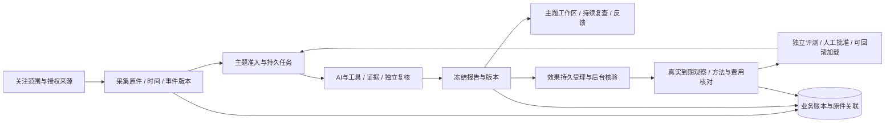
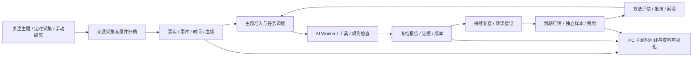
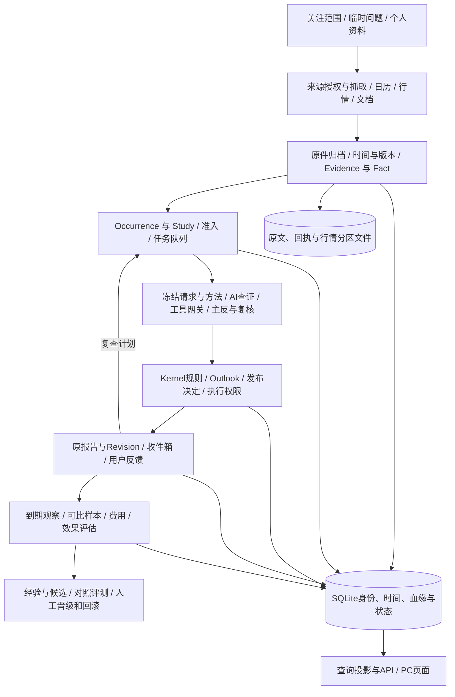

# Decision Hub 当前实现与交付评估

## 当前实施状态：2026-10-07 21:39（Root281；正式仍为normal50 / 0071）

**交付过程确实出现重复装配和验收返工；现有证据没有证明生产程序无界死循环。内部BTC/宏观研究主线可以使用，整个产品尚未完成稳定交付。** 拖延涉及执行方式和后台边界，不只是样式。完整逐层架构图、累计实现和A/B/C/D门仍见下方Root277复核；进度只以唯一台账为入口。

| 架构层 | 已完成且有证据 | 仍未完成 |
|---|---|---|
| 来源/时间/原件/事实 | 真实采集尝试、原件与事件修订、事实版本和PIT血缘读取 | 关键来源合法可用通道、事件日期/完整时间覆盖、沉淀六视图 |
| 主题/任务/AI报告 | 默认研究及定时复查真实报告；队列与恢复；normal48–50 URL/分类/主题最新报告工作区 | W3自然临阻恢复、完整Provider/native取消排空、全PC核心异常 |
| 报告交付/反馈/效果 | 原证据与前版对照、异步受理三窗、到期结果回链；本批正式反馈及补充的独立冻结绑定、刷新返回 | 文档提交已完成但回执未知的同键确认PC缺口；全资料引用；可信费用和成熟独立评估 |
| 研究规则/方法演进 | 14规则9接线、版本/反馈/候选/诊断账本 | 剩5规则；两实际计划失败；真实成对评测→批准加载→回滚，尚无优化生效证明 |
| 部署/新市场 | 受管运行、复用维护入口及可追溯正式normal50 | API/DDL分离、共享装配、最小历史身份、UI独立发布、全资产恢复；黄金未准入 |

### 这批实操得到什么

同一原B报告只提交原反馈及补充2笔，8项PC实操和最终6项读回检查通过，console=[]。两意见各自保留冻结评估与时间，原意见/ACK/依据不变；92主题/1277Run/663版本/2原效果请求四表全行SHA保持。没有新研究或效果申请。三呈现候选修正一个测试fixture错误后4控制通过，但尚未正式应用或发布。

反馈自然触发4个演进job、10次规划角色调用：1操作跟进结束且无候选、1候选因评测材料跨组重复等待、2计划校验失败。**模型返回成功、反馈保存成功和候选登记都不能计为优化成功。** 静态确认外层任务schema与图门不一致且拒绝子因未持久化；历史任务无法据hash猜具体字段。下一批优先统一任务校验和安全准入诊断，再按现有A矩阵补文档未知回执恢复，必要改动合并一次发布。来源/六视图→质量费用与真实方法闭环→黄金仍按B/C/D推进。

本批正式源/构建/停止启动/Host/迁移0；自然规划实际10次，不能写模型0。已验未改范围复用；成熟样本和罕见自然异常写观察条件，不重复打包等待。

证据：[本批回执](../../artifacts/pc-core-actions281/receipt01.json)、[PC8](../../artifacts/pc-core-actions281/browser-steps01.json)、[反馈与冻结绑定读回](../../artifacts/pc-core-actions281/supplement-return01.json)、[实际演进结果](../../artifacts/pc-core-actions281/evolution-trace01.json)。唯一进度见[执行台账](../plan/ARCHITECTURE_REMEDIATION_EXECUTION_LOG.md)。


## Root280阶段状态：2026-10-07 21:12（normal50 / 0071）

**研发过程确实存在反复装配和验收绕圈；没有证据证明生产程序存在无界死循环。核心研究有限闭环已可用，整个项目仍不能按稳定全功能交付。** 这轮不是全部功能重做：原报告与效果主线保持，三文件将主题阅读入口前移，最近任务、历史和审计按需展开，并用真实字段显示当前任务与下一步。

| 分类 | 当前裁决 |
|---|---|
| 已有真实闭环 | 默认研究/定时复查→报告保存→原证据回读→前版对照；原版本效果受理→后台核验→三窗计划→到期结果→原报告；原键恢复、分类与URL返回 |
| 本批新关闭 | 最新原报告首屏可读；历史分页不冒充最新；旧效果深链单实例；任务/无报告/未知/资料准入动作真实；分类横排、长题限行、已知中文标题且原文可查 |
| 实现/受控证明仍需正式异常 | 部分本地凭据冲突、永久失败关闭/精确双404、缺当前运行指针、损坏目标；没有自然永久失败或整浏览器崩溃证明 |
| 尚未闭环 | 全PC操作异常、来源/关键时间覆盖和六视图、W3自然临阻恢复、5规则、可信费用/成熟评估、完整Provider、真实方法评测批准部署回滚、黄金 |

实际本批：3受控React/client节点、候选type检查、一次标准UI/type构建33.992秒；正式PC17项、console=[]；正式2GET/3检查，92主题/663版本/1277Run/2原请求全行SHA保持。7服务/4HTTP正常，PC后监督者及10角色精确身份仍在。没有新研究或效果请求、Host构建或迁移。最新报告按钮由约1347px移至269px，历史翻至9–16仍保留真实最新报告。

证据：[PC17](../../artifacts/normal50-pc-workspace01/browser-steps01.json)、[数据与最新身份](../../artifacts/normal50-pc-workspace01/final01.json)、[正常READY](../../artifacts/normal50-actual02/normal50-retry02/readiness.json)、[汇总](../../artifacts/normal50-pc-workspace01/receipt01.json)。normal47主线7/恢复3、normal48路由8、normal49分类API28/PC13复用。


### 架构师当前判断与执行约束

主要拖延原因是：API装配与DDL副作用未分离；Graph身份扫描导入闭包和全部schema，扩大历史维护；研发审计/全局发布绑定使单UI修改仍需全栈停止和安装。首次normal50维护甚至被两个正常采集租约挡在Stop前；租约自然释放后显式恢复成功，原失败保留，进一步说明发布边界耦合。最小适配器已减少脚本复制，UI/API/Worker独立发布仍未完成。

当前保留模块化单体、Kernel/SQLite账本、原件归档及Worker分工。后续按下方A/B/C/D四批，一次一个在制：A继续关闭剩余核心操作与异常矩阵，降低旧完成回执、效果说明和相似主题的阅读负担；B持续来源/时间线六视图；C质量费用演进和具体装配债；D黄金准入。已验未改路径复用，成熟样本和罕见自然失败按条件观察，不以重复打包等待。

英文未映射原件仍真实保留；BOJ混合日期需要真实事件修订投影，归档并不能证明日期正确。14规则9执行器接线不等于资格通过。PC17是本批受影响验证，不冒称全按钮、全异常或全部产品验收通过。

## 架构复核裁决：2026-10-07 19:05（Root277，阶段状态按顶部更新）

**研发交付过程确实反复绕圈，尚无证据证明生产程序发生无界死循环。整个项目仍是内部 BTC/宏观研究版，不能按全部功能完成交付。** 本次先做整体检查；没有执行新的打包、迁移、服务停止或模型请求。根代理对范围排序、重复装配与验收后置负责。

### 1. 本次怎么检查

核对现有完整 PRD、整改方案、唯一台账、正式 normal47/0071 原回执和核心源；两个子代理分别只读审查业务链与装配边界。正式 PC 重新查看首页、研究入口和主题页，保存[首页](../../artifacts/architecture-overall-review-20261007/home277.jpg)、[主题页](../../artifacts/architecture-overall-review-20261007/studies277.jpg)及页面文本。19:00 精确核对 PID 与出生时间：[10 个角色与原监督者仍在](../../artifacts/architecture-overall-review-20261007/current-process277.json)。只有本轮主动恢复验收的 realtime 有一次重启，其余角色 restart_count=0；这不能证明所有后台循环均无缺陷。

首页实际显示 API/研究 3/3、发现与研究已就绪、无进行中研究、最近保存报告 08:39、2 个来源需检查。主题页实际显示 92 项：来源未研究事件和已研究主题混列，多条相同长题，英文来源标题占据业务主视图；历史“1082 次已登记任务”不等于执行成功 1082 次，也不能据此推定当前持续触发。

### 2. 从架构层看，做了什么、还缺什么

以下是累计正式实现与已有验收的状态，不把全部列为本轮新增；“局部通过”保留其边界。

| 架构层 | 已正式实现 / 已有实证 | 尚未完成 |
| --- | --- | --- |
| 输入、来源、原件、事件、关键时间（L01–06） | BTC/宏观范围；真实采集尝试、原文归档、事件修订、时间精度、事实版本/PIT、血缘回读；部分源失败退避和恢复 | BLS 当前可用通道、关键事件完整覆盖、完整迟到/修订/恢复验证；不是所有源均成功 |
| 准入、主题、队列、AI研究（L07–11） | 自动发现准入留痕、Study/Run、持久队列、真实 DSH Web/工具/复核；真实默认研究和定时复查保存报告 | W3 临时阻断后自然研究恢复、真实 Provider 全组合/取消排空、完整故障矩阵；最小来源/研究分类已normal49落地；主题聚合与身份业务解释仍需产品化 |
| 综合、规则、报告交付（L12–13） | 报告/三窗/证据原文/过程图/前版对照；版本反馈与已读回执；14 条规则中 9 条已有执行器接线 | 其余 5 条；接线数不是完整规则资格。主题三类与上下文回读已落地；normal50紧凑主题阅读与已知标题投影已通过；全PC按钮与联调异常仍未收口 |
| 效果登记与后验（L14） | 原报告→原版本→持久受理→后台核验→三窗计划→结果→原报告，正式 7 步；关页/跨页签/单 Worker 中断后自然租约与退避恢复，正式 3 项 | 版本切换URL已normal48正式PC通过；本地凭据冲突/终态失败恢复已实现且受控5节点通过；正式自然异常样本仍缺；成熟独立样本、可靠费用及可信总体分母 |
| 资料、经验与方法演进（L15） | 资料原件/解析/版本/审核/作用域入口，反馈/候选/实验/批准/回滚代码和局部验证 | 全资料实际引用路径、真实成对评测→批准加载→回滚完整闭环；不能称已自动优化研究质量 |
| 运行、部署与治理（L16） | 受管启动/监督者、准确进程身份、迁移与保留旧数据、构建/运行投影；当前normal50正式加载并有业务回读 | API 与 DDL 分离、统一可复用装配、缩小历史指纹依赖；全资产恢复和完整交付签收 |
| 黄金与其他市场 | 领域隔离和准入设计 | 实际资产/数据/授权/方法/用户流程均未开通；手机验收仍排除 |

本批正式证据：[7 步主线](../../artifacts/normal47-pc-core01/receipt01.json)、[3 项恢复](../../artifacts/normal47-pc-recovery01/receipt01.json)。72h 等待和未知成本保持真实状态；不是全项目验收通过。

### 3. 架构诊断：为什么拖了这么久

1. **交付批次没有及时收口。** 局部修复、候选组合、历史认证、测试和发布互相打断，用户旅程验证后置；代码/脚本/回执数量增长没有直接对应可使用功能。
2. **应用装配带业务之外的副作用。** [API 工厂](../../apps/hub_api/main.py:237)中初始化/建表（249–253），模块末尾又创建全局 App（1754）；纯读装配也承担全套运行依赖，且从 Worker 导入 composition（44）。[数据库构造](../../packages/kernel/decision_hub_kernel/persistence/db.py:1664)的数据根创建与迁移入口（1680）进一步增加隔离验收难度。应把迁移放在明确部署步骤，共享装配移出 apps 跨引用，读入口按所需依赖构造。
3. **历史核验身份过宽。** [Graph 配方](../../packages/kernel/decision_hub_kernel/application/research_graph_recipe.py:182)扫描导入闭包并纳入全部 schema（199），无关合同变化也会扩大历史维护范围。[原历史 reader](../../packages/kernel/decision_hub_kernel/application/research_graph_history_versions.py:683)应保留；后续固定显式读取协议与最小依赖集合，避免每个普通页面修复继续扩大历史包。
4. **研发审计和运行发布耦合。** normal47 完整清单 2,512,860 字节触发 [2MB 运行读取门](../../apps/hub_worker/installed_harness_bootstrap.py:56)。本批已拆出运行投影并保留完整原件引用，但单 UI 修复仍需要更新全局绑定和装配。下一步合并到一套可复用发布入口，按 UI/API/Worker/Host 实际影响更新；不再每批复制一套维护脚本。
5. **昂贵认证曾位于点击与长写事务。** 现已改为 [持久受理](../../packages/kernel/decision_hub_kernel/application/study_effect_tracking.py:401)→后台只读核验→新短写事务；首次受理实测 0.187 秒，正式 PC 已过。这项关闭，后续复用，不重开同步性能循环。
6. **数据模型有了，产品查询中心尚未成形。** 用户仍须在主题、任务、来源、报告、结果多个账本拼接上下文；来源事件、相似主题和技术说明混列。以 Study 汇总最近变化、报告、待处理、下次检查和效果，审计按需展开；所有已有功能保留入口。
7. **交付与长期资格混成同一终点。** [规则缺执行器](../../packages/kernel/decision_hub_kernel/application/research_policy_checker.py:1361)、[样本/费用缺件](../../packages/kernel/decision_hub_kernel/application/calibration.py:463)必须明确阻断相应资格；它们应分别管理，不能使已保存报告、日常研究工作区和普通修复无限等待。
8. **多份“当前”造成进度误读。** PRD正文仍有 normal46/8条接线与顶部 normal47/9条不一致。本次统一正文与当前入口，历史快照折叠保留；实施进度仍只用原唯一台账。

### 4. 保留的架构与边界

保留模块化单体、Kernel/SQLite 业务账本、原件文件归档与现有多 Worker 分工。现阶段没有证据要求拆成微服务、替换数据库或重写整个产品。



### 5. 后续只按四批交付

| 批次 | 要做的事 | 结束条件 |
| --- | --- | --- |
| A：PC核心收口，当前唯一在制批次 | URL与分类/原请求恢复已落地；收敛紧凑主题阅读、标题投影、待处理与下一步；补核心异常矩阵，保留自然异常样本门 | 正式用户能完成阅读→回源→更新/复查→反馈/效果回看；写入可读回、未知可恢复、无重复任务；问题逐项复测和截图。已通过 7+3 路径复用 |
| B：持续来源与沉淀可视化 | 关键来源覆盖/自然恢复，来源→解析→准入→报告时间线，观点/证据变化、覆盖缺口 | 一条真实关键事件的原件、各类时间、准入和报告可追溯；核心视图显示真实数据、缺失和截止时间 |
| C：研究质量、费用与演进 | 剩5条规则；可信 USD/完整用量；真实配对评测、批准、部署/回滚；按有界缺陷拆装配与历史读取 | 必需规则有真实依据，费用可核，方法更改有独立比较和回滚证明；未成熟样本单列等待，不触发重复构建 |
| D：黄金准入 | 品种/单位/日历/授权来源、方法和结果标签隔离 | 黄金真实链路与独立数据验收通过后开放；不提前展示会落回 BTC 的入口 |

当前A的URL已normal48通过，分类/分页/原版回读已normal49正式PC13通过，原请求恢复受控5节点通过。normal50紧凑阅读、准确最新/历史与旧效果返回PC17已通过；仍缺其余全PC异常与自然永久失败样本；不重复已通过主线。B–D 排队，不再用全部远期目标拖延 A 的明确交付。

工作规则：一次一个在制批次；变更清单冻结后只执行受影响的必要验证；同一范围一次标准构建；未变化源/产物复用原证据；只在具体门失败时增加验证；环境问题记在可复用入口；业务完成以正式操作、持久结果、异常恢复为准。长期等待项有明确条件，自动接续不再用其重复启动或构建。

实施和遗漏：[唯一台账](../plan/ARCHITECTURE_REMEDIATION_EXECUTION_LOG.md)；产品规格：[完整 PRD](DECISION_HUB_FULL_PRODUCT_PRD_2026-09-26.md)；使用方法：[用户手册](../user-guides/DECISION_HUB_CUSTOMER_USER_MANUAL_2026-09-22.md)。本次完成整体检查和计划整理，未将原整改目标标完成或暂停。

<details>
<summary>历史阶段快照与原始失败记录（不代表当前状态）</summary>


### 2026-10-07 18:50 Root276：正式PC在途恢复已验

本轮用已保存的14:01报告单次登记效果。受理后关闭验收标签页；请求真实running时，只中断原realtime-worker（PID20572），原监督者自动恢复到26536，其余9角色与监督者身份不变。原3分钟租约自然到期，浏览器显示真实重试和18:44:27计划，attempt2完成原请求。重开页面与第二页签均恢复同一请求、阻止新登记并读取三窗原计划；原ACK与新请求final_receipt完全一致。Study、原Run、版本与该主题全部19个Run原行指纹保持，新研究0、新效果请求1。

命令：`capture01.py --phase baseline/poll/final --output ...`只读SQL/GET；`restart-role01.ps1`核精确pid/ticks及真实running后调用既有Stop-ProductProcessTree，交原监督者恢复；`record276.py`核对原件并记录。真实浏览器页签10关闭→11重开→12第二页签；截图和时序见[正式恢复回执](../../artifacts/normal47-pc-recovery01/receipt01.json)。本批没有UI/Host构建、迁移或额外模型调用。

新增待修：StudiesPage切效果版本只改本地状态，URL保留旧effect_revision，刷新/结果返回可能回旧版本；已定位，下一步修复URL单一状态并实操刷新/返回。静态审查另发现本地凭据冲突仅反复报错、缺逐原键对账入口，保留待办。当前没有自然发生的正式不可重试失败请求，因此终态失败关闭仍仅有受控组件证明，不能计正式PC通过。关闭的是标签页，本轮没有关闭整个浏览器应用。完整异常矩阵、规则/费用/演进、来源/工作区和黄金仍未完成，目标active，手机排除。


### 最新收口进展：2026-10-07 18:32（Root275，正式 normal47 / 0071）

整体检查结论不变：没有证明生产程序发生无界死循环；研发曾在局部修复、装配、兼容验证之间反复循环，交付排序和收口由根代理负责。本轮实际完成效果跟踪的持久受理、后台只读认证、新短写事务、原键恢复及失败记录关闭，并已受控安装、迁移、构建和恢复服务。本批正式PC主线实际通过，详见原回执；全PC异常矩阵仍开放。整个项目仍为内部BTC/宏观研究版，完整交付目标保持active，手机排除。

| 范围 | 已完成并实际核对 | 还需要做 |
| --- | --- | --- |
| 来源、原件、时间、事件与事实 | 现有采集、归档、身份/时间/血缘、部分来源退避与回读保留 | BLS可用覆盖、关键事件覆盖、自然恢复与主题时间线完整可视化 |
| AI研究与发布 | 已有真实BTC/宏观研究、AI三窗、规则约束、证据、报告和版本回链、用量账本；normal47的14条规则有9条接线 | 剩5条执行器、完整方法部署/配对评测、Provider取消/排空、可信USD费用及完整归集证明；接线数不等于通过资格 |
| 效果跟踪主线 | 新异步7组P，首202受理0.187秒；后台三窗/最终ACK原子保存；Worker/Results4组P；UI增量6组P | 长期到期观察、可比成熟样本、方法晋级/回滚及完整正式PC异常矩阵 |
| 历史兼容与迁移 | 旧报告8GET/24检查P；0069→0071真实迁移，原业务不回填，备份保留 | 更稳定的历史读取协议、恢复/回滚完整演练 |
| 运行与发布 | normal47已安装；一次UI标准构建、Host复用；真实启动/READY见原件 | API工厂与DDL分开，共享装配与固定环境模板，按业务结果判健康 |
| 黄金与其他市场 | 扩展边界、准入计划保留 | 来源授权、行情/日历覆盖、方法/样本/用户流程均未开通 |

本批真实证据：[异步登记7组](../../artifacts/effect-tracking-entry-control01/execution_async01/receipt01.json)、[Worker/结果4组](../../artifacts/effect-tracking-incremental-flow-control01/successor03/execution01/receipt01.json)、[旧报告8GET/24检查](../../artifacts/effect-tracking-f21-read-control01/execution05/receipt01.json)、[新交互6组](../../artifacts/effect-tracking-ui-control01/successor03/executions/execution01/receipt01.json)、[正式迁移](../../artifacts/normal47-actual01/migration.json)、[正式启动](../../artifacts/normal47-actual01/normal-start.json)、[正式READY](../../artifacts/normal47-actual01/normal47/readiness.json)、[正式PC主线回执](../../artifacts/normal47-pc-core01/receipt01.json)。真实数据保留；受理不等于完成登记，采集进度不等于预测资格。

#### 整条业务架构与目前断点



前半链能采集并产生真实报告，效果登记的新异步链已经落地；末端完整可信评估和方法演进仍未闭环。PC仍把部分采集主题、长标题和技术审计混在阅读路径中，已落库数据没有全部变成易读的主题时间线。关键时间必须区分来源发布时间、抓取时间、观察有效时间、任务执行与报告冻结时间；不能用数据库创建时间替代真实事件时间。

normal47未接线的5项：citation-authority、citation-precision-review、causal-quality-review、counter-thesis-quality-review、execution-permission。probability-provenance是本批第9个接线项；可信生产样本、有效数学产物、完整成本及自动批准仍未获完整资格。先前8/6口径仅属normal46历史。

本批正式PC已核对“原报告→准确版本→受理→刷新恢复→三窗登记→到期结果→原报告”，没有重新发起AI研究，原Study/报告/版本及该主题Run集合与迁移前备份一致。结果详情能分别显示报告原件和行情已核对、样本身份待确认；页面仍有长说明、长标题和多个相似主题，普通用户工作区仍需简化。此次仅实测刷新恢复，浏览器关闭、跨页签、服务重启和完整异常矩阵不能由此推定通过。

研发循环主要来自：同步昂贵核验阻塞首次登记；装配和历史认证耦合造成返工；核心纵向验收被局部兼容反复打断；测试副本、运行环境及启动清单没有固定边界；历史审计嵌进运行清单造成发布体积增长；用户旅程验收被后置。这些工作中有必要修复，也有交付排序和重复验证问题。不能再以文档条数、构建次数或绿色健康端口作为功能完成量。

#### 架构上最需要改的边界

1. 保留模块化单体、Kernel账本和现有Worker。先完成一条纵向业务链，再按实际变化收窄依赖。
2. 命令持久受理与昂贵核验分开；关闭只读快照后再开新写事务，复核原件和租约后提交。本批已实现并测试。SQLite读取快照直接升级写入存在竞争限制，见[官方说明](https://www.sqlite.org/isolation.html)。
3. 运行清单与研发审计历史分开。实测完整构建件2,512,860字节，历史evidence约1.49MB，导致原2MB启动读取门拒绝。完整审计保留，运行投影保留全部源码/产物/插件映射及归档注册表，并用真实SHA引用完整原件；启动校验仍核全部文件。此缺陷属于发布设计，不归因DSH或用户中断。
4. Study作为业务查询中心：材料变化、报告、版本、下一复查、跟踪与结果在同一主题可理解地连接。技术细节按需展开，已落库资产需要业务时间线与血缘入口。
5. 报告读取、方法核验、成熟效果、演进批准分别表述。未知成本、缺件、未到期与未资格不能显示为0或成功。

#### 下一步只按四批推进

- 第一批：结束本批正式PC/手册与核心异常恢复验收；退出条件是原报告→原版本登记→刷新恢复→真实结果→回原报告可操作，最终数据落库且无重复任务，异常恢复与截图有真实证据。
- 第二批：持续来源与主题工作区；关闭关键来源覆盖/自然恢复，补事件时间线与最近变化。退出条件是一条真实关键事件从原件、各类时间、事实到报告能追溯，普通用户能从主题直接完成阅读和跟进。
- 第三批：质量、费用和演进；完成5条剩余规则、可信USD成本和完整归集证明、配对评测、批准和回滚。退出条件是必需规则和真实费用可核验，评测与批准可复现、部署可回滚；等待到期的长期样本单列，不反复触发构建。
- 第四批：黄金；沿同一架构补资产、来源、行情与方法准入。退出条件是真实来源与日历覆盖、黄金研究和结果核对完整通过，才开放给用户。

每次一个在制交付批次，未改范围复用已有证据，源码实际变化才触发相应构建。以下旧“最新”内容保留为各时点的历史，不覆盖本节状态。


## 当前整体架构复盘：2026-10-07（正式 normal46，候选尚未交付）

本节回应“是否陷入死循环、五天做了什么、还要做什么”。检查了正式代码、完整 PRD、唯一执行台账、候选源与实际失败回执，并在正式 8047 用浏览器查看首页、管理、主题和报告；三个子 agent 分别审视产品、API/Worker 和历史/血缘。**没有足够证据证明线上程序发生无界死循环；可以确认研发收口方式存在反复装配、验证和扩大范围的循环。根代理的排序与交付管理需要改。**

当前定位仍是**内部 BTC/宏观 AI 研究版**。普通研究、报告、原依据、版本变化已有真实价值；稳定 PC 全流程、持续效果学习和完整方法资格没有交付。不能把候选实现、测试数量或服务在线记作用户已获得功能。

### 最新核实：整体检查与架构收口（2026-10-07 16:55）

**交付过程已经出现循环：局部修复→新候选装配→兼容失败→补控制→再装配，长期没有结束在正式用户旅程上。** 当前证据不足以判定生产程序存在无界死循环。根代理的范围排序、变更批次和发布收口有问题，不能将五天未交付归因于DSH环境或用户中断。

| 分类 | 截至本次复核的实际状态 | 用户现在是否获得 |
| --- | --- | --- |
| 已正式存在 | BTC/宏观真实研究、定时复查、保存报告与三个AI窗口、证据/原文/图谱、同主题前版对照、部分到期观察、资料与反馈入口；近期修复状态误报、中文指标和原文404 | 有限范围可用；完整PC按钮与异常矩阵仍未关闭 |
| 实现且有限实测，未发布 | 效果登记三窗与原ACK、同键恢复、篡改整批回滚、5分钟采集计划及Results回链；最新API四组通过，最新旧报告八GET/24项通过 | 正式normal46尚无新增闭环，不能记成交付 |
| 当前直接阻断 | 首次登记24.391秒，未达到≤20秒门；认证位于`BEGIN IMMEDIATE`内，长时间占用写事务 | 候选交互仍不顺畅，尚无正式PC验收 |
| 后续缺口 | BLS有效来源/关键覆盖、W3自然研究恢复、6项规则、可信费用/独立样本、成对评测部署回滚、全资产恢复、主题工作区 | 尚未全部完成 |
| 扩展 | 黄金领域来源、品种单位、日历、规则及真实结果标签 | 未开通；手机排除 |

四文件共享材料方案实际曾返回500：新增捕获器把`read_task_request`返回的三元组当作单个模型。修正后API四组通过，首次请求从38.187秒降至24.391秒；这是候选实现缺陷及有限改善，**性能门仍失败**。[失败原回执](../../artifacts/effect-tracking-entry-control01/execution15/receipt01.json)、[修正后四组](../../artifacts/effect-tracking-entry-control01/execution16/receipt01.json)、[原首次请求](../../artifacts/effect-tracking-entry-control01/execution16/response-01.json)。旧报告新候选回读为八GET/24项通过，16.203秒；仅私库只读验证。[历史读取回执](../../artifacts/effect-tracking-f21-read-control01/execution03/receipt01.json)。16:53复用现有启动核查脚本确认原监督者及10个角色身份仍运行，没有Stop、build、迁移或模型调用。[当前进程身份](../../artifacts/architecture-overall-review-20261007/current-plan04.json)。

本次同时复用原增量脚本，在最新API16同一私库执行默认producer及Results回查：四组通过、27.922秒，三窗保存waiting/五分钟下次检查、立即重入0、两个结果筛选200，原报告/Study/ACK保持。无额外数据库复制、新Run或模型调用；不是正式PC或成熟效果资格。[最新Worker/结果回执](../../artifacts/effect-tracking-incremental-flow-control01/successor02/execution02/receipt01.json)。

#### 需要改变的架构边界

1. **命令受理与昂贵认证分开。** 当前同步认证占写锁；继续增加缓存收益有限。推荐持久保存原键、用户及报告绑定，快速返回“已受理”；后台真实认证后原子保存三窗计划和最终回执。受理不是登记成功。最小代价是一张专用任务表、既有Worker租约模式和对应合同/UI状态。
2. **只读认证与最终写入分开。** 复用`prepare_originals`读取真实原件；关闭读事务，再开新短写事务复核范围、缺失行、归档、源码和任务租约。直接把同步函数搬到Worker仍会占锁；同一读快照升级writer也可能发生SQLite快照竞争。16:55时该方案只有设计；本轮实现与实际结果见顶部Root275。
3. **Study成为产品查询中心。** 从同一主题看到最近材料、准入原因、最新报告、下一复查、效果采集和原版返回；当前多个账本需要用户手动拼接。完整历史与技术详情保留在按需展开入口。
4. **报告读取、方法核验、效果资格分别负责。** 已保存报告稳定可读；高成本重认证在独立核验路径。旧记录缺件保持未知。历史算法闭包及跨apps装配的收窄作为后续有界重构。

保持模块化单体、Kernel账本与现有Worker分工。最先交付一条“报告→登记→进度→结果→返回”的PC纵向链，后续再补持续来源、质量费用与演进。每次只维护一个在制交付批次；未改路径复用已有证据；构建由实际源改动触发；功能完成必须同时有正式入口、持久结果、异常恢复和截图。禁止以候选目录、测试数量或进程在线代替交付。

### 架构师结论与执行调整（本次整体检查）

**存在交付过程反复绕圈的问题。** 已完成真实研究、原件血缘、报告阅读、部分自动复查和多项页面修复；最新候选效果跟踪已通过原真实报告的API四组、Worker/结果四组和UI三组有限验收，但尚未发布到正式版本。五天的工作没有形成与投入相称的、用户能直接使用的完整新增闭环；根代理需要承担排序和收口责任。

本次复核正式代码、原执行回执和三个子代理的独立审查，并于14:51只读查看正式8047管理页：七类服务心跳在线，归集页没有超过10分钟的检查积压。此观察无法排除全部运行缺陷，也不证明新增业务完成。[当前页面截图](../../artifacts/architecture-overall-review-20261007/management02.png)、[页面原文](../../artifacts/architecture-overall-review-20261007/management02.txt)。

| 要作的架构决定 | 本次裁决 | 实施顺序 |
| --- | --- | --- |
| 整体形态 | 保留模块化单体、Kernel账本和多Worker；现有L01–L16职责可复用 | 先完成一条纵向用户旅程；职责抽取随实际缺陷推进 |
| 产品中心 | 以持续研究主题连接来源、报告、计划、到期观察和反馈 | 首批统一原报告/原版本回链、历史活动计划与下一次检查 |
| 读取与认证 | 已保存报告的查询投影、描述性到期观察、方法核验、校准激活分别显示状态 | 当前登记保持原件校验；恢复精确旧reader。后续制定专用稳定读取协议，缺件保留未知 |
| 运行装配 | 正式与验收共用明确的运行目录、配置、迁移和归档清单 | 先收口当前闭包；后续用同一manifest装配。API工厂与启动建库分开，共享builder移出apps跨引用 |
| 交付判断 | 正式已用、候选已写、实际验收、等待外部材料分列 | 一个批次通过实际API/Worker/正式PC后关闭；未改范围复用原证据 |

**当前只保留三个连续行动：** ①完成持久受理及后台认证边界的最小实现，保留原回执恢复和原件校验；②复用同一候选，验证变更路径、实际迁移及正式发布；③在正式PC完成报告→效果登记→原回执→后台进度→结果→原报告回验、截图和手册。最新同步登记24.391秒仍未达≤20秒门，不能将此前门改标通过。其余质量/来源/费用/黄金需求继续在原目标中排队。长期成熟样本和方法资格不作为可读取、可登记、可持续更新的研究功能迟迟不交付的理由。

**本轮再次核查（16:11–16:12）：** 正式8047管理页显示API与研究进程3/3、七类业务心跳在线，用量核对当前没有超过10分钟的检查积压。此为只读状态检查，没有重跑全部按钮或新研究，不据此关闭交付门。[本次正式截图](../../artifacts/architecture-overall-review-20261007/management03.jpg)、[可见页面文本](../../artifacts/architecture-overall-review-20261007/management03.txt)。独立子代理复核得到相同结论：先结束候选与正式长期分离，再统一Study用户旅程；应用工厂和历史读取的结构拆分排在首批正式PC之后。

16:17阶段实证为**真实Alembic迁移私库预演三项通过，47.609秒**：先在物理事务中升级并回滚到0069，再实际提交到0070；94张原业务表的行与结构保持，仅新增3张空表，原快照与迁移依赖保持。[原始回执](../../artifacts/normal47-actual01/migration-preview01/receipt01.json)。它关闭了“只有建表模拟、没有真实版本迁移证明”的准备缺口；正式库仍0069，尚未迁移或发布。安装助手仍为DRAFT；四文件性能方案后续实测见顶部，未达到原门槛，不能计作正式完成。

### 后续核心修复进度（同日，正式仍为 normal46）

**此前性能诊断：** 最小三窗纯shape作用域后继actual execution13四组通过，但首次POST38.187秒，没有改善30秒超时；不能记为性能修复。限定函数诊断execution14_profile四组通过，累计六次共同`_source`、六次publication认证、24次当前prepared读取，SQL原件摘要1699次仅0.475秒（含探针，嵌套耗时不能相加）。当时决定优化同一干净事务内的共同材料认证；后续四文件实际改善与未过门状态以顶部为准。旧F21八GET/24项保留原Graph全DTO、两版报告身份/AI窗口、前版关系与8813字节原文；不是正式PC验收。

依据：[无改善的四组实测](../../artifacts/effect-tracking-entry-control01/execution13/receipt01.json)、[限定函数诊断](../../artifacts/effect-tracking-entry-control01/execution14_profile/limited-function-profile01.json)、[旧报告八GET](../../artifacts/effect-tracking-f21-read-control01/execution02/receipt01.json)。诊断首POST178秒有探针开销，不能用作产品延迟或与无探针实测直接比较。正式安装助手正改为同一显式输入与输出目录，尚待最终性能源码与实测绑定，不执行旧45常量版本。

| 项目 | 最新实际结果 | 尚未完成 |
| --- | --- | --- |
| 90天等待缺陷 | 新producer使用5分钟刷新；沿真实报告登记后的同一私有库，默认producer实际处理三窗并持久保存waiting与下次检查，立即重入0 | 尚未安装到正式Worker；未验证长期采集或未到期观察成熟 |
| API/Worker装配 | 完整候选mirror12实际使用正常API工厂；execution16四组通过：三计划/一回执原子登记、同键恢复、越权/错版本拒绝、flush后原件变动整批回滚 | 仅私有库ASGI，未发布/真实TCP/浏览器；首次POST200耗24.391秒，仍未达到≤20秒门，认证期间占写事务 |
| 历史方法核验 | 精确116原成员保留；registry补canonical末尾LF且六条JSON内容不变；日期回执解码修复后实际API通过，旧F21私库八GET/24项通过 | 两项均为候选实现/准备缺陷，不是用户DSH问题。最终版本仍须保持六条registry并完成正式安装及相关回归 |
| 结果回链与等待体验 | UI06类型检查与三组实际DOM/客户端测试通过；当前/旧活动计划、原版本链接、明确拒绝及未知回执恢复分别覆盖 | 测试使用有界fake fetch；未真实浏览器/正式发布。超时后手动取原回执虽安全，仍不够顺畅 |
| 真实报告Worker/结果 | 增量实际四组通过：原ACK/jobs、三窗真实waiting/五分钟due、Results两类筛选200、重入0且原报告不改。producer6.359秒 | 同方法结果当前为空，不能当成熟样本或资格。未有新Run/模型/正式写库/PC验收 |

证据：[等待4组实际控制](../../artifacts/research-probability-producer-candidate02/successor05/control01/execution01/receipt01.json)、[API实际登记409](../../artifacts/effect-tracking-entry-control01/execution08/receipt01.json)、[本地模块闭包审查](../../artifacts/api-worker-import-closure-source-review01/closure01.json)、[配置与迁移缺项清单](../../artifacts/api-worker-import-closure-source-review01/runtime-config-closure02.json)。

最新实际证据：[API四组](../../artifacts/effect-tracking-entry-control01/execution16/receipt01.json)、[Worker/结果四组](../../artifacts/effect-tracking-incremental-flow-control01/successor02/execution02/receipt01.json)、[旧报告八GET/24项](../../artifacts/effect-tracking-f21-read-control01/execution03/receipt01.json)、[未改UI06三组](../../artifacts/effect-tracking-ui-control01/successor02/executions/execution01/receipt01.json)、[registry修正件](../../artifacts/terminal-e26-retained-reader-candidate01/successor02/source-seal02.json)、[回执解码修正件](../../artifacts/study-effect-tracking-entry-candidate01/successor02/source-seal02.json)。这些证明候选机制和真实保存报告在私库可执行，不能替代正式PC交付。旧execution08–15失败记录保留。

### 1. 本次现场核对

| 事实 | 本次看到的结果 | 能证明的范围 |
| --- | --- | --- |
| 正式运行 | 13:51 管理页的 API、来源调度、自动/用户研究、资料、行情、演进七类服务都有当前在线心跳；本次启动约10:40–10:41 | 已启动且心跳新鲜，不代表每个业务任务成功；本轮没有重启或打包 |
| 真实 AI 内容 | 打开主题的 `run_f828b7cf46d948fba9eb072642f00122`：08:39保存，三个AI窗口、13条采纳证据、7个来源、1份审查记录；仍有审查保留和未核验最新信息 | 真实保存的受限研究可阅读；本轮只读，不是新发起研究或预测资格认证 |
| 主题体验 | 列表显示92个登记主题，混有英文官方公告、未研究资料和 AR04 验收主题；多个主题显示相同研究标题 | 用户选择负担与环境资产隔离问题；相同标题不能据此自动合并不同Study |
| 当前费用数据 | 管理页775次研究、898个会话版本，其中593已保存核验、285不完整、20等待归档 | 这是用量归集口径，不能推导完整美元成本，也不能与主题任务数直接相加 |
| 来源限制 | 首页仍有两个来源需检查，近期其他来源持续更新 | BLS原问题仍开放；其他来源在线不替代关键事件覆盖 |

本轮截图与页面文本：[管理](../../artifacts/architecture-overall-review-20261007/management01.jpg)、[主题](../../artifacts/architecture-overall-review-20261007/studies01.jpg)、[实际报告](../../artifacts/architecture-overall-review-20261007/report01.jpg)。仅观察与阅读，没有点击更新、暂停、反馈或其他写入按钮。

### 2. 从架构师视角看完整链路

现状是有明确领域边界的 Python 单体，加多个工作进程、DSH Host/MCP 和 React 查询页面。L01–L16 是职责分层，不是需要再拆成16个微服务。保留 Kernel 业务账本、领域插件和适配器边界，优先疏通数据与状态的纵向链。



事件驱动的持续研究、临时研究和资料研究共用此链。用户不必每次输入prompt。**保存研究报告、证明预测效果、批准方法或交易权限分别验收。** 成熟样本和未来观察不能用短期开发工作替代；采样期未结束仍应能更新采集进度。

### 3. 已完成、部分完成、尚未完成

“正式可用”仅指下列已部署能力及已记录验收范围，不等于整个工作包关闭。详细16层与表结构见[完整PRD第4–6节](DECISION_HUB_FULL_PRODUCT_PRD_2026-09-26.md)。

| 层级/业务 | 已经做成且正式存在 | 未完成部分 | 状态 |
| --- | --- | --- | --- |
| 输入与关注范围 | BTC快照、事件文本、资料输入；默认研究无需必填问题 | 缺清晰的持续关注工作区，黄金未准入 | 部分可用 |
| 来源与关键时间 | 轮询尝试、错误、下次计划、日历版本、UTC与日期精度保存 | BLS两个来源、关键宏观覆盖、未来事件完整窗口 | 部分可用 |
| 原件与数据沉淀 | 原文归档、Parsed/Fact版本、RunInputRef、PIT查询与限定工具复用 | 跨期贡献/缺口汇总、完整历史覆盖；旧缺件保持未知 | 核心已有，积累展示待补 |
| 自动发现与主题 | 准入/忽略/阻断/合并留痕，Study与版本；真实定时复查保存子报告 | 自然临时阻断恢复正控、召回与相关性质量；来源资料与研究主题混杂 | 部分可用 |
| 队列与恢复 | 通道隔离、租约、取消/重试、原命令回执及部分故障恢复 | 真实原生多Agent所有取消/迟到/排空分支、完整长期恢复 | 核心已有，异常未全验 |
| AI研究与发布 | 真实查证、三个AI窗口、独立7天日线、主反、复核、受限报告和同writer复核 | 真实Provider全部组合、语义质量和完整14规则 | 已有真实链，资格未全通过 |
| PC阅读与回源 | 首页、报告、证据原文、图谱位置返回、前后版对照、指标筛选 | 全按钮/异常矩阵、研究主题工作区、英文/验收资产整理 | 已有多个已验旅程 |
| 到期结果 | 独立观点、观察/标签、后台核验、配方分组与原报告回链 | 真实可比样本与可信分母，旧缺件不能修成成功 | 部分可用 |
| 概率与效果采样 | 正式只有旧校准报告保存/查询；新producer、0070、规则来源绑定、入口与UI在候选中，实际API四组/Worker结果四组/UI三组及类型通过 | 首次登记慢于前端超时；未正式安装或PC回验；可信费用/长期成熟样本/完整资格仍缺 | **候选链路已验，正式未交付** |
| 资料、反馈与演进 | 原件/版本/质量/人工审核、版本反馈、候选/实验/晋级回滚接口 | 测试资产隔离、全资料实际引用、可信成对评测到部署回滚 | 部分可用，不称自动进化完成 |
| 费用与平台 | 用量归集、心跳与配置、备份/迁移留痕、受管启动、构建复用 | 可信实际费用、完整恢复演练、统一候选运行上下文 | 部分可用 |
| 黄金与其他市场 | 范围注册/隔离、未开通说明 | 黄金来源、品种单位、交易日历、领域规则、真实标签和评测 | **未开通** |

正式 normal46 为1638份源、3516份产物，8个研究规则执行器、6个尚未实现。8个执行器不表示8项资格通过。6项是来源权威、逐论断引用精度、因果质量、反论证质量、概率来源与执行权限；其中概率来源已有候选，尚未正式生效。

### 4. 为什么局部功能反复拖延：根因和代码问题

| 编号 | 架构/执行问题 | 具体证据与影响 | 整改方向 |
| --- | --- | --- | --- |
| P0-1 | **采集进度和最终校准期限耦合** | 原候选空cohort用max写下一检查，可能等到90天末；successor05改有界5分钟刷新，限定真实时钟/持久写入/立即重入4组通过 | 后继未正式安装；在真实原报告计划上验证Worker进度，再发布。未到期/费用/样本不足限制继续保留 |
| P0-2 | **候选与正式版本长期分离，同步登记占写锁且过慢** | registry、回执解码和task三元组捕获缺陷已修；最新API四组通过、首次登记24.391秒仍未达≤20秒门。`BEGIN IMMEDIATE`覆盖昂贵认证，正式页面仍无新效果登记 | 持久受理→后台只读认证→新短writer完整复核及原子登记；保原键/原ACK恢复，再完成相关回归、受控发布和PC确认 |
| P0-3 | **产品身份与环境资产未在展示层收敛** | 正式主题页混有来源资料、同名不同Study、AR04验收主题；报告标题仍带B6和UUID片段 | 查询视图区分可确认的测试资产/来源资料/持续关注主题；保留原记录与历史入口，标题给用户业务含义 |
| P1-1 | 历史算法身份与普通读取耦合过宽 | Graph身份递归本地imports、整个schema目录及运行库；旧Graph闭包未存Commit，新消费者索取Commit导致候选F21认证RED，正式普通报告仍可读 | 分开已保存报告投影和原算法重核；首次发布冻结明确消费者协议/闭包，逐步缩小无关依赖。旧缺件不补签 |
| P1-2 | 应用导入承担启动与建库副作用 | `apps/hub_api/main.py` 末尾 `app=create_app()`；函数默认初始化DB、读取启动receipt。镜像漏包初始化时曾回落正式apps；后继路径身份检查仍失败 | 独立应用工厂与启动入口，显式注入DB/归档/运行配置；统一Windows路径规范与包闭包，复用一个验收启动方式 |
| P1-3 | 来源成功与持续业务成功的反馈脱节 | 来源poll在线与成功、Study准入、排队、报告、复查分别有记录，但用户须到多页自行连接；BLS持续失败未解决 | 同一主题显示最近材料、准入原因、最近报告、下一计划与实际阻断；对一个真实来源完成自然恢复闭环 |
| P1-4 | 核验/审计职责集中、改动传播面大 | checker约1882行、Commit约1977行、DB约2222行；loader、政策和消费者互相引用。行数本身不是缺陷，装配与历史回归已经表明耦合成本 | 按规则执行器、发布事务、历史协议读取、评估投影拆职责；先抽明确边界，逐步迁移 |
| P1-5 | 验收按零件堆积，缺正式用户旅程退出门 | entry到execution12才取得真实四组，多个后继用来补装配缺件；UI mock fetch、实际ASGI、Worker和浏览器范围不同，正式仍46 | 复用同一已验装配与业务入口；失败留下原因及下一步，每批以正式可用旅程结束，未改变部分不反复验证 |
| P1-6 | 校准资格缺服务端费用依据入口 | 候选Study服务固定 `cost=None`，producer必保留cost-unavailable；即使未来有100个合格样本，也无法完成费用后校准资格 | 建立有来源、版本和批准记录的服务端成本profile配置；样本采集独立更新。数学净成本与模型/SDK美元预算是不同对象，不用公开模型单价或假零值替代 |

P0-1代码：[候选producer第444/1097行](../../artifacts/research-probability-producer-candidate02/successor04/proposed/packages/kernel/decision_hub_kernel/application/calibration.py)、[入口90天及第225行默认费用](../../artifacts/study-effect-tracking-entry-candidate01/proposed/packages/kernel/decision_hub_kernel/application/study_effect_tracking.py)。候选scheduler/composition已构造并调用producer，**不是缺调度接线**；问题是waiting之后的due时间。P1-1代码：[Graph身份](../../packages/kernel/decision_hub_kernel/application/research_graph_recipe.py)、[历史reader](../../packages/kernel/decision_hub_kernel/application/research_graph_history_versions.py)。

本轮ASGI失败证据保留：[02快照关闭检查](../../artifacts/effect-tracking-entry-control01/execution02/receipt01.json)、[03错误包启动上下文](../../artifacts/effect-tracking-entry-control01/execution03/receipt01.json)、[04包路径检查](../../artifacts/effect-tracking-entry-control01/execution04/receipt01.json)。三次均未进入业务接口，不能写“后端登记已通过”，也不能据此认定正式API业务坏掉。旧零WAL/SHM保留，snapshot03与原DB字节相同，未写正式库。

### 5. 后续计划：按用户价值分批收口

**当前在制工作只保留第一批。** 四文件性能改动已实测，24.391秒未过原≤20秒门，进一步缓存优化结束在此。转为最小持久异步登记设计：原键受理、任务状态、真实后台认证、最终三窗与原ACK原子提交；快速受理建议目标≤2秒，后台时延另行实测，两者不能混作同步性能通过。并发采样/心跳、重启恢复、失去租约和原件变动必须实际验证。方案尚未实现，未安排其他功能同步扩围。

本批验证复用未变的UI、Worker和历史证据，只重验受改动影响的路径。完成后收口正式发布与PC旅程，再按下表逐批推进。每批结束必须给出正式可用入口、后台业务记录、异常恢复结果与截图；准备脚本、静态检查和端口在线均不作为关闭依据。

| 顺序 | 要完成的事情 | 必须交出的结果与退出门 |
| --- | --- | --- |
| **第一批：核心PC可用闭环** | 等待调度/登记/回执/Worker候选已验；收口持久受理/后台认证，再相关旧报告回归、最终实际迁移、安装、正式PC。其后整理可确认验收资产/标题 | 同一正式版本与真实DB：报告→原证据→效果登记→原回执→持久计划→实际Worker更新→等待/到期记录→原报告。重复点击/丢回执不重复登记，篡改回滚，下一次采集时间合理；截图和后台结果逐项匹配 |
| **第二批：持续研究可靠运行** | BLS合法来源与关键覆盖、发现相关性、W3自然阻断恢复；集中显示来源影响/计划/预算；完成本批涉及的PC成功/受限/失败/恢复矩阵 | 一个真实自然来源新增/修订→准入→研究→报告；临阻解除自动接续、不重复发布。来源抓取恢复与主题研究恢复分别证明 |
| **第三批：质量、成本与演进** | 剩余6规则按真实依据完成；可信成本profile配置与批准、Provider/native费用记录；独立配方样本与对照评测；逐步收窄历史协议/工厂职责 | 能解释每个结论/限制，能核对成本和可比样本；候选审核→部署→新Run→回滚有实际证据。没有真实费用/样本时保留未知 |
| **第四批：黄金宏观扩展** | 复用来源/原件/时间/Study/交付基础，增加黄金品种、单位、市场日历、专属领域规则与标签 | 独立Domain Pack和真实来源准入，黄金与BTC范围/标签分开，完成一条黄金研究旅程；手机继续排除 |

第一批的现有报告/证据阅读已通过部分真实验收，应复用该证据；变动涉及的写入、等待和返回路径必须重验。**不等待90天或100个成熟独立样本才交付“可登记、持续更新且如实显示等待”的研究功能。** 100样本用于新概率校准资格；结果页既有30样本汇总门是另一用途，两者不能混用或降低。未来观察、预测优势和交易授权继续独立。

执行顺序固定为：修具体主线缺陷→相关有限测试→一条跨层业务验收→受控发布→正式PC确认→更新当前清单。构建仅由实际源改动要求触发；原已验路径不反复全量重跑。出现装配失败先修复可复用启动上下文，不继续扩展新功能或新增平行验收框架。

#### 当前首批的具体完成清单

| 步骤 | 当前状态 | 下一动作与验收标准 |
| --- | --- | --- |
| 候选装配、registry和回执解码 | 已修且API实际通过 | 复用现有完整mirror12及原件，只覆盖必要异步登记文件；未变控制不重跑 |
| 原报告登记、原回执、幂等及原子回滚 | 私库API四组通过 | 正式PC的一次点击、重复与丢回执恢复必须沿同一Study/Revision验证 |
| Worker等待、下次采集和结果归属 | 同私库实际四组通过 | 正式Worker加载新producer；核对实际持久进度，结果空/未到期继续如实展示 |
| 登记性能与等待交互 | 同步24.391秒仍失败；持久异步设计已审，未实施 | 快速持久受理与最终登记分别显示；只读准备关闭后新短writer复核。重启/同键恢复/并发heartbeat/租约竞争/原件篡改必须实际通过 |
| 历史兼容、迁移与正式发布 | mirror12私库旧F21八GET/24项及真实0070迁移预演已通过；正式发布待做 | 最终若新增0071任务表，应真实预演完整0069→0070→0071，不能借旧0070回执代证；保六条registry和legacy3；正式备份/迁移、前端构建一次、Host复用、标准启动READY |
| 正式PC与用户手册 | 待做 | 核对整条旅程、失败/未知恢复、截图、实际后台内容和手册；通过才将首批标为交付 |

后续执行约束：每次只推进一个产品批次；同一批使用一份运行清单与验收上下文；未改源码复用已有证据；装配失败留下一个原因及可接续动作；PC已可用与资格等待分别结项。当前237条候选装配资源不等于237项功能，实际业务改动为34份文件，其余主要是保留旧读取逻辑和不变启动依赖。必要的原件保护继续保留；反复产生后继封签、目录和局部通过数不能替代正式发布。

### 6. 整体复盘阶段完成了什么（14:03，后续修复见顶部）

- 完成了源码/数据职责/正式PC及三方架构检查，确认在线研究有真实价值，整理正式、候选和未开通能力。
- 保存了三张真实页面截图和对应文本，发现主题/标题混杂，并从候选代码确认90天等待缺陷。
- 本轮之前完成的8个前端控制和最终TS保留通过记录；本轮新的后台联调仍为装配失败，业务通过数为0。概率/入口/历史后继仍未正式发布。
- 更新这份交付总评、PRD当前范围与唯一台账；不把本次检查记成已修复上述问题。没有运行新付费研究、写正式SQL、迁移、重启或新打包。

继续执行以[唯一台账当前入口](../plan/ARCHITECTURE_REMEDIATION_EXECUTION_LOG.md)为准。以下normal46及更早记录保留其当时范围。

### 本次复盘前的正式交付判断：2026-10-07（normal46）

**当前可继续使用已有BTC/宏观研究与阅读流程，仍不能按“全部功能已完成”交付。** 原目标已恢复为active。服务正常启动，本批三处PC缺陷已修复并实际回验；核心规则、来源、费用与完整异常流程尚未收口。

| 已关闭的原45问题 | 正常46复测结果 |
| --- | --- |
| 无进行中任务却显示正在研究 | 加载显示状态未确认；首页空闲时发现/研究通道已就绪，原报告仍可阅读 |
| 三宏观指标露出代码、来源与英文单位 | 指标、来源与单位中文可读，2.95/2.36/2,948,090及原时间保持 |
| 同版本原归档存在但input接口404 | 两个正式GET均200；真实按钮打开/收起原文，哈希核验；原Fact JSON完整SHA与45相同 |

#### 本批实际验收

| 验收范围 | 结果 | 限制 |
| --- | --- | --- |
| 正式维护与启动 | 六业务源+189份原核验依赖正式保存，1638源/3516产物；UI/type各一次，Host/vendor/迁移0；10角色/7当前服务心跳/4typed HTTP200 | READY证明当前加载和读取范围，不替代新研究全组合验收 |
| 原归档API | 指定同版本Fact与input两GET、四检查通过；原资产/文本哈希核验 | 不补造HTTP原始响应，不证明历史时点vintage |
| 旧报告有限回归 | 六GET22检查通过；完整原Graph29节点47边、三AI窗口、主题原前版、原始响应保持 | 不是全部历史Result/Comparison/ReportDTO逐字节比较 |
| 实际PC | 正式8047、Cua12/12，关闭原三问题；截图、DOM、返回操作与空闲状态保存；捕获warn/error实际0 | 本批针对性回验，未覆盖每个按钮/全部异常；旧图谱17项保留未重复 |
| 轨迹规则 | 两执行器正式加载；真实限定Factory→Graph→Commit/只读评估等四组控制通过，01–06失败保留 | 当前8个执行器/6待实现；正向原材料7P7NA，全规则、费用/原生资格与权限仍false |

Fed新闻在10:45:59发生一次HTTP404，10:48:03后自然采集恢复，失败行可继续查阅。BLS日历/发布仍未成功采集，首页继续显示两个来源需检查。**来源采集恢复不是W3主题临时阻断后自然研究恢复的验收证据。** 后者仍待验，不把定时复核代替自然恢复。

#### 下一步按核心业务推进

1. **概率来源与校准绑定**：明确每个策略/窗口与原Kernel回执的冻结引用，两阶段核验哈希；模型称已校准不能替代原件，缺件保持未知、错窗/篡改拒绝。
2. **剩余研究规则**：来源权威需当时的冻结登记依据；逐论断引用、因果语义、反论证质量需独立可核验回执；执行权限读取原Kernel决定，不从报告成功或取消ACK生成资格。
3. **来源与持续恢复**：BLS合法可用通道、事件覆盖、W3自然主题恢复；保留失败和重试计划。
4. **完整PC与价值验收**：成功/受限/错误/命令回执各分支、真实用量和费用、成熟独立样本、完整评测/部署回滚；手机排除、黄金仍未准入。

完整项目判断仍为未交付，不用有限测试数量计算百分比。正式研究规则支持数、独立材料通过数、正常服务数和实际PC覆盖分别记录。

证据与复用：
- [正式READY](../../artifacts/normal46-actual01/normal46/readiness.json)、[正式维护](../../artifacts/normal46-actual01/production-apply46.json)、[PC12回执](../../artifacts/normal46-pc-core-acceptance01/pc-acceptance46.json)。
- [留存原文两GET脚本](../../artifacts/normal46-pc-core-acceptance01/read_fact_after46.py)、[原报告六GET脚本](../../artifacts/normal46-f21-read-regression-wrapper01/read_f21_after46.py)、[已保存浏览器观察封存脚本](../../artifacts/normal46-pc-core-acceptance01/verify_saved_pc46.py)。前两项已实际各一次；封存脚本只校验捕获的观察，不代替操作浏览器。运行参数与原结果见[逐步台账Root261](../plan/ARCHITECTURE_REMEDIATION_EXECUTION_LOG.md)。
- [完整PRD](DECISION_HUB_FULL_PRODUCT_PRD_2026-09-26.md)、[PC用户手册](../user-guides/DECISION_HUB_CUSTOMER_USER_MANUAL_2026-09-22.md)。


以下保留历史快照，当前结果以上述normal46及唯一台账为准。

### 历史 normal45 接续验收：2026-10-07 09:26

当前仍为内部研究验证版。已有公开研究、自动复查、报告、证据和同主题前版对照继续保留；普通研究与交易权限分开。

| 本批范围 | 已实现能力 | 实际验收 |
| --- | --- | --- |
| 六项研究规则 | 引用成员资格、时间可得性（PIT）、冻结硬覆盖、因果链结构、窗口契约、Kernel 概率上限；按原输入和检查器版本复核，分别保存最终归纳与提交阶段回执 | 原引用/PIT控制已有通过原件；本批联合六组控制通过，核对正向保存、组合拒绝、缺件限制、原材料变动回滚。正向样本为六项通过、八项尚未执行，完整规则结论仍为 false |
| 数据时间准入 | 带时区输入统一保存为 UTC；整批缺少时区时在访问数据库前拒绝；保留原请求、原文和哈希语义 | 隔离控制核对 UTC 与 +08:00 同一时刻、六处缺时区整批拒绝、调用方与借用事务不变。没有猜测或修改历史行时区 |
| 历史报告连续读取 | 升级前保留原 reader／selector 闭集，旧报告继续使用原核验版本 | 正常45实际六个 GET、22 项检查通过；完整旧 Graph DTO、两报告绑定与三窗保存方向、原主题前版指针、原始响应完整 SHA 一致；未扩大为全部旧 Result／报告 DTO 字节比较 |
| PC 阅读操作 | 报告→图谱节点→证据原文→原节点→原主题保留位置、100%缩放、筛选和列表状态 | normal44 原17项PC检查与截图保留；本批复用同一UI，做必要后端回读，不声称新增全量PC验收 |

normal45 已真实加载并就绪：10 个角色运行、7 个服务心跳与 4 个状态接口200，全部加载源与原产物校验稳定。标准启动等待35.104秒通过；保留原工作区及配对。正式3处业务源更新并安装189份原核验逻辑保留文件，1260→1449源；3497份构建产物复用，本批前端／类型／Host／vendor构建、迁移及额外索引发布均为零。

**当前六项规则已有执行器，另外八项尚未完成执行能力，回执继续标为缺件或未执行；全14项、研究方法资格及执行权限仍未完成。** 本批联合控制是限定材料的真实 Factory→Graph→Commit／只读评估验证，没有新发起付费 Provider 研究，也不将旧报告提升为新六项通过。因果链结构检查不证明经济因果或语义真伪；不知道费用或时区时不填零、不猜测。

**整个项目仍未完成稳定PC交付。** 剩余包括研究轨迹与其他规则、可信实际费用、W3临时阻断后的自然恢复、BLS403及来源覆盖、成熟独立样本、完整PC异常矩阵与黄金准入；手机排除。8074隔离回执的技术访问限制仍保存待处理。

本批依据：[真实就绪](../../artifacts/normal45-actual01/normal45/readiness.json)、[原报告22项回归](../../artifacts/normal45-actual01/f21-read-regression01/summary01.json)、[联合六组控制](../../artifacts/research-policy-deterministic-execution-candidate01/control01/execution01/receipt01.json)、[原PC17与截图](../../artifacts/normal44-pc-graph01/pc-receipt44.json)、[逐步台账](../plan/ARCHITECTURE_REMEDIATION_EXECUTION_LOG.md)。

### 历史 normal44 接续验收：2026-10-07 08:09

当前仍为内部研究验证版。普通公开研究与自动复查保留当时报告、三个 AI 观察窗口、独立日线参考、证据和审查限制；同主题原前版对照不改写旧报告。保存成功不等于预测有效或已获执行权限。

| 本批范围 | 已实现能力 | 实际验收 |
| --- | --- | --- |
| 引用成员资格 | 核对报告引用与该次保存证据的成员关系；冻结实际检查器身份，分别保存最终归纳与提交阶段回执，提交与评估重新核验原件 | 引用成员资格规则已正式加载，并通过六组隔离机制控制；其他 13 条仍未执行。本轮没有新发起真实 Provider 研究来证明方法资格，普通研究与执行权限继续分开 |
| 图谱阅读位置 | 同一报告、图谱、节点与证据往返保留阅读位置；证据弹窗可操作，返回后恢复缩放与筛选 | 本条 PC 旅程 17 项检查通过：节点切换、证据关闭按钮和 Esc 返回均保留 100% 缩放与原位置；搜索“宏观”、综合判断类型和列表模式往返保持；排版结束后位置仍一致。原主题与原前版指针保持。完整 PC 异常矩阵仍待验收 |
| 两处中文说明 | 普通正文中 audited route 显示为“已核验的信息获取路径”，durable EventWatch 显示为“已持久保存的事件跟踪记录”；原引文、代码及配置值保留 | 原 F21 综合判断正文两处中文说明实际可读，原节点记录与原始响应没有改写 |

normal44 实际加载与就绪：10 个角色运行、7 个服务心跳与 4 个接口 200，全部加载源校验稳定；本次仅一个页面修复，UI 与类型检查各一次，后端与 Host 构建为零。标准启动等待 60.138 秒后成功。既有报告与后续核验的回读范围：normal42 六个固定 GET 的 22 项检查已通过；本次 normal44 页面回读原 F21 报告、三个 AI 窗口、同主题原前版及完整 8,813 字符原始响应，原 SHA 一致。后端本批未改；不将本次页面检查扩大为所有接口与全部历史数据验收。

**仅一条引用成员资格规则已实现；其余 13 条仍未执行，完整规则结论为 false。** 单条通过不表示全部规则合格、研究方法已获资格或可以交易。普通研究报告仍可按既有主线保存并以“仅供研究”使用；缺证据或原件不一致必须保留限制，不能用已保存的 pass 替代重新核验。

本片隔离控制的六组机制已通过；单次幂等读取 4.297 秒、单次干净 Engine 评估 4.860 秒，是限定样本的无 profile 实测。它们不是所有 PC 操作、较大样本或端到端延迟承诺，也不是本批真实原生研究资格证明。

**整个项目仍未完成稳定 PC 交付。** 完整费用与可信实际线路费率／账单、其余规则实际执行、W3 临时阻断后的自然自动恢复、成熟独立样本、完整 PC 异常矩阵、来源覆盖及黄金准入仍未完成。手机验收排除；8074 隔离回执的浏览器保存访问阻止限制尚未解除。后续研究源码升级仍须先归档原核验版本，不升级旧报告或旧凭据。

最新依据：[normal44 就绪](../../artifacts/normal44-actual02/normal44/readiness.json)、[本批实际 PC 验收](../../artifacts/normal44-pc-graph01/pc-receipt44.json)、[唯一执行台账](../plan/ARCHITECTURE_REMEDIATION_EXECUTION_LOG.md)。下方 normal41 记录保留当时范围。

本次返回原始证据后的实际页面：


normal42 缩放失败和 normal43 弹窗遮挡的截图与原回执保留于执行台账；本次实际验收范围见上表。

### 历史 normal41 接续验收：2026-10-07 05:53

正常前后端和真实 DSH Host 已启动。已有默认公开研究与自动复查保存了报告、三个 AI 观察窗口、独立日线参考及审查记录；日常阅读或更新公开证据无需每次填写研究问题。报告保留当时材料和审查限制，保存成功不等于预测效果已验证。

| 已修复的缺口 | 实际结果 | 验收范围 |
| --- | --- | --- |
| 同主题前后报告难读 | 按原前版指针并排读取两份完整报告；先读三个 AI 方向，长条件与日线参考按需展开 | 原所选 F21／前版 3b；PC257–263，原报告不改写 |
| 方向摘要混用 AI 与日线 | 分别说明 AI 三周期的可比性和独立 7 天日线方向；部分、未知或方法不同不推断整体一致 | 正常40 PC264；既有两处UI保持 |
| 材料来源只显示域名 | 复用登记名称显示 Gate.io、雅虎财经、FRED 等，采集时间与原文入口保留 | 正常40 PC265–266；22个材料回链保持 |
| 多步因果图错误连接结论 | 主向第6步／反向第3步作为末端连接结论，全部29节点、47边及其他DTO字段保留 | 正常41真实HTTP与PC268–273；同一已保存 F21，未改写原报告 |
| 图谱证据回链 | 节点13个证据入口→保存证据→原始响应→原节点→原主题前后对照走通 | 原始响应HTTP200、采集时间2026/10/6 08:00:08保持；本次零新研究 |
| BLS全国月度标题准入 | 已加载v5规则，隔离控制核对全文标题及重复去重；原预算、时间和快照契约保持 | 选择器控制通过；当前实际日历抓取403，尚无自然准入成功证明 |
| 历史实现保留 | 正式升级前保存原87 Python／41 schema资源，精确registry与原实现读取通过 | 原Graph e9 reader_ready与字节核对；e9业务Run重放尚未验证 |
| 默认启动版本丢失 | 固定指针核验源码与产物，坏指针或漂移明确拒绝 | 39生产reader／隔离默认分支通过；41实际更新指针，默认整栈实际重启尚未验收 |

normal41实际加载三处生产后端源码和一处既有测试版本断言；前端／类型／Host／vendor构建、迁移、额外索引发布均为零。7项服务心跳、四项实际读取、源码稳定以及安装核验通过（安装核验7.397秒）。上一批normal40的前端构建与类型检查各一次，既有UI产物完整复用。

**整个项目仍未完成稳定 PC 交付。** 本次实操另发现“清晰阅读100%后打开节点变20%”与说明中两个英文短语残留，修复候选待正式加载和PC核验。完整费用及可信实际线路费率／账单、W3临时阻断后的自然自动恢复、成熟独立样本、完整PC异常矩阵、来源覆盖及黄金准入继续未完成。手机验收排除。8074隔离网络回执仍被浏览器保存访问阻止设置拒绝；用户先前已授权继续，技术访问限制尚未解除。14项核心规则目前仍未完整执行；下一批引用成员资格的实际执行／保存／评估校验正在隔离验证，不能当成已安装。后续研究源码升级仍须先执行归档维护流程。

最新记录见[唯一执行台账](../plan/ARCHITECTURE_REMEDIATION_EXECUTION_LOG.md)、[normal41就绪](../../artifacts/normal41-actual01/normal41/readiness.json)、[实际PC验收](../../artifacts/normal41-pc-graph01/pc-normal41-receipt01.json)及[用户手册](../user-guides/DECISION_HUB_CUSTOMER_USER_MANUAL_2026-09-22.md)。下方历史阶段结果保留当时范围。


### 历史 PC 接续验收：未生成报告的取消与失败任务（2026-10-05）

取消、失败、拒绝任务现在先展示任务状态；已知错误采用现有中文映射，未知原因明确为“具体原因尚无可读说明”。没有报告时不展开报告复查建议和市场补齐条件。“查看问题详情”在当前页面展开技术内容并定位原失败/停止记录，原始技术码仍按需展开；普通视图页签保持原导航。原回执、Owner、待确认操作锁、显式后续任务入口与资料重新授权约束保留。

本片 102 项前端控制、实际类型/构建、PC05 取消/重试唯一任务与 PC06 焦点复测通过；正常旧真实报告的三个 AI 窗口、独立 7 天日线及三项已完成复查可读。首次类型门失败和 PC05 路由定位失败均保留，修正后另存证据。控制场景没有 Provider/模型调用或 AI 成功报告，**不能据此称真实 DSH 子树停止或项目全部交付**。真实 DSH 取消协议、其余异常矩阵和原整改未完成项继续列入唯一执行台账，手机验收仍排除。


更新：2026-10-07。本文件沿用原评估入口；历次原文完整字节已备份。当前判断见顶部接续验收；下方早期盘点保留当时的代码、页面、API 和正式库只读结果。

## 1. 当前还不能完整交付

**主线已经部分实现并真实执行，但没有完成稳定 PC 产品交付。** 来源检查、自动发现、主题归集、AI 研究、报告、证据原文、后续复查和数据记录都有真实实现。本轮历史依据回归已恢复；普通保存报告并排对照和本次历史配方归档已通过局部验收；完整费用、自然恢复、来源覆盖与全 PC 异常验收仍有缺口。

“服务已启动”“接口返回 200”“后台作业 completed”“有限测试通过”分别说明各自范围，不能直接推导为整个项目完成。没有按测试数量计算完成百分比。

### 为什么持续三天还没有交付

这段工作包含必要的主线整改，例如来源时间与修订留痕、上下文原件、Graph 引用、报告发布事务、费用真实性和历史可读性，并非全是外围。**执行优先级与交付收口确实有问题**：多次兼容性、构建和验证工作没有及时回到完整用户旅程，缺少一个持续可读的当前交付清单；阶段成功也没有始终与正式历史数据、组合链路绑定。根代理应对这个排序和状态说明不足负责。

最新回归尤其说明问题：51 项兼容测试通过，但其中旧版本 fixture 用今天的源身份创建，未覆盖真正已保存的历史身份；正式库复核才发现 12 条历史 AI 判断认证失效。修复需要保留原实现并重演，不能靠放宽检查或重新签名旧行变成通过。

没有记录可靠的工时分布，因此不能编造“多少时间浪费在外围”的比例。本轮先交付现状 PRD、手册、截图和复用工具，后续继续原目标，以主线缺陷和最终 PC 业务验收排序。

### 历史阶段实测：10 月 5 日

**10 月 5 日 15 时 PC 取消重试恢复验收：本项通过。** 发现并修复了“重试成功但离页后原请求凭据被清除，返回时无法打开已创建子任务”的缺陷。真实按钮操作中，重试响应在 0.853 秒返回，管理页未被跳转；返回原任务只核对原请求回执，再明确打开唯一的新研究。后台只有一次取消、一次重试、一个子任务；原资料正文与授权不继承。排队与回执尚未确认的状态文案也已纠正。[实际 PC 与落库验收封存](../../data/product-local/remediation/W6/pc-run-command-recovery/pc-20261005-04/pc-acceptance02.json)保留修复前反例和失败记录。本项使用真实 API、数据库和研究 Worker，以及明确的受控失败执行端；**真实 DSH 多 Agent 停止、已发生费用、迟到成功发布及其余 PC 异常仍未完成**，不将本项通过扩大为全项目交付。正常产品已加载新 UI，原默认报告的三周期 AI 判断、独立日线参考与自动复查回链仍可阅读，服务显示 3/3 在线。


**默认公开研究和本次自动复查已完成真实 PC 与后台原件验收，完整产品仍未交付。** 正常原 Home 于 01:49 加载本轮回执修复，10 个受管角色、7 个同版本后台心跳、4 项业务读取及采集服务实际就绪；PC 显示 3/3。[本轮正常启动回执](../../data/product-local/remediation/W7/graph-citation-v2-20261004/receipt-core-release02/normal-ready02/business-ready.json)只代表该就绪范围。

首页 BTC 快照**未填写研究问题**，实际发起 `run_b6ab8f8fe70547cea50f92162d6d4e87`，01:50:19 开始、01:55:52 保存结果。研究包含五个后台协作角色、独立复核、10 条采纳证据、6 个来源；30 分钟“未形成方向”、24 小时“中性观察”、72 小时“偏多”三个 AI 判断与独立 7 天日线参考均已落库。约 198 KB 日线完整回执现在通过已有工具正式输出接口传递，并由原认证门核验；原有限报告仍保留，没有改写成成功。[真实严格只读核验](../../data/product-local/remediation/W7/graph-citation-v2-20261004/command-core-release01/b6-normal-observation02.json)实际退出 0、37.264 秒，16 项检查通过：执行方法、研究上下文、过程图、认证终态、复核、结果、报告、三 AI 与日线来源和方法、历史原件。原验收器的业务/RPC 身份及终态误判已修正，原失败记录保留；9 个身份错配、普通取消和超时否定用例仍拒绝。


PC 已实际核对“报告引用 → 保存的 HTTP 200 原始响应 → 返回同一报告”，发布时间未知时仍显示未知。[原文截图](../../data/product-local/remediation/W7/graph-citation-v2-20261004/pc-core-release01/screenshots/13-native-original-response.jpg)保留采集时间与原响应。系统随后按原报告的 02:06:12 计划产生定时子研究 `run_e597191070c04c418938332147e58315`，02:13:21 保存子报告；没有再次人工发起。[自动复查严格核验](../../data/product-local/remediation/W7/graph-citation-v2-20261004/command-core-release01/e597-normal-observation01.json)退出 0、39.156 秒，16 项通过，父子身份、三 AI、7 天日线、复核、报告及原件一致。[自动复查截图](../../data/product-local/remediation/W7/graph-citation-v2-20261004/pc-core-release01/screenshots/14-scheduled-child-report.jpg)与返回父报告路径已验证。PC 已显示 24 小时与 72 小时 08:00 复查任务结束，但这两条还未做本次完整原件核验，不能算已验收。

两次核验均只读、0 正式 SQL 写入、0 模型提交、0 构建，19 份历史身份与旧 6499 条原件未变。**报告仍有限制**：Kernel 状态保留真实 degraded，来源覆盖与叙事缺口仍显示；来源和方法通过不代表预测已经校准，Provider 配置身份、成熟方向样本和长期效果仍独立。单次默认及一次定时子报告通过，不能推全按钮与全市场可交付。

**D10 两轮研究的受控完整发布门已通过。** 正常仓库执行原联合节点，pytest 实际 423.01 秒、外层 425.337 秒，通过两轮 RPC、上下文选择、执行方法、过程图、保存旧版本混用拒绝、独立复核、结果与报告发布、三 AI 窗口和只读来源/方法核验；原 600 秒上界、15 秒 fixture、900 秒租约及全部原断言保持。[正常目录完整回执](../../data/product-local/remediation/W7/graph-citation-v2-20261004/context-joint-after20.json)。仅修复重复方法清单构造与不合格边界的无效捕获；两个文件已精确应用，生产类型/静态检查通过，8 个 Python 消费者实际加载，新 API 的父报告→自动复查→证据原文→同父返回及刷新按钮通过。[当前 PC 截图](../../data/product-local/remediation/W7/graph-citation-v2-20261004/pc-core-release01/screenshots/23-pure-parent-viewport.png)。原 after16/17 超时与原件继续保留：after16 未到复核发布，after17 已完成复核发布但完整节点仍超时。本次是受控完整组合验收，不替代真实 Provider 所有组合、全 PC 取消/重试/异常恢复、来源覆盖、资料隔离、14 项政策执行和改进晋级验收；手机排除，黄金尚未准入。

### 历史阶段实测：10 月 4 日晚间至 10 月 5 日 01:21

正常原 Home 的产品已于 **22:49 恢复在线**。10 个受管角色、7 个后台心跳、4 项业务读取及采集服务就绪实际通过；正常 8047 的 PC 页面显示 3/3。[启动回执](../../data/product-local/remediation/W7/graph-citation-v2-20261004/core-release01/normal-ready01/business-ready.json)与[16 路 API 读取](../../data/product-local/remediation/W7/graph-citation-v2-20261004/../delivery-review-20261004/api-snapshot05.json)只证明对应就绪和读取范围。

PC 未填写关注点，实际发起了 `run_c37a0c7cf1594a3799ddfededd549bb8`。22:58 保存了 10 条采纳证据、6 个来源、Graph2、ContextSelection3、复核和报告；同次 7 天日线记录的来源、方法及稳定配方已由正式原件只读核对。[实际回读](../../data/product-local/remediation/W7/graph-citation-v2-20261004/normal-run-readonly01/normal-run-observation02.json)的整体结论仍为 **limited**：管理 Agent 启动后台协作后提前结束，没有提交综合候选，AI 三窗口为空。当前不能把它算完整 AI 研究成功。

页面已修复日线参考被隐藏与“无证据”误提示：显示实际 90 根完整日线、截至 10 月 3 日、独立 7 天参考，并保留综合判断不足和未授权交易的边界。已在 PC 展开、进入同 Run 的日线结果并返回原报告。


**10 月 5 日 00:18 PC 复验：日线缓存故障已关闭本次范围。** 调度修复通过 19 个边界、租约、并发与取消用例，只受管重载 API / 实时后台，DSH 及其余八个角色保持原进程。原作业自然从 attempt 1→2，无手动写库或人工执行作业。[自然重建回执](../../data/product-local/remediation/W7/graph-citation-v2-20261004/cache-boundary-scheduling01/natural-rebuild-observation01.json)显示来源、方法与配方通过，分组原件检查 **1/1、待核验 0**；PC 详情与分组一致，回原报告成功。未到 10 月 11 日观察期、首次身份仍待确认，方向样本为 0，不显示命中率。


**10 月 5 日 01:21：研究进程正常在线，AI 综合发布仍未通过。** 原命令完成门已修复、33 项相关测试及类型检查通过，必要的一次后台构建和正常加载完成；PC 显示 3/3 在线。新默认空输入研究真实执行了角色协作、独立复核，并提交了 30 分钟、24 小时、72 小时综合候选。最终后端证据校验拒绝了综合，三个 AI 窗口未保存，页面保留日线参考与限制，没有伪造成功。[本轮真实链路回执](../../data/product-local/remediation/W7/graph-citation-v2-20261004/command-core-release01/df78-normal-observation01.json)为 limited，实际方法、研究上下文、过程图、复核与报告原件、7 天日线及历史原件检查通过，不能据此称综合内容通过。

失败已定位到**历史行情回执传递**：约 197 KB 的完整回执被原生 50 KB 工具输出机制截成预览，综合引用的日线证据因此缺少完整可认证凭据。下一步使用已有工具正式输出接口保留有界完整回执，继续原认证，随后重新做真实研究验收。多轮流程的同事务重复核查也有候选，当前仅有限控制通过，联合验收仍未完成；全项目尚不能标为全部交付。


原 12 条 AI 记录的来源与方法重新核对通过；旧五表 **6499 条原行不改不缺**。新研究合法新增 42 条关联记录，不把“新增 0”继续当当前结论。[旧行与新行证明](../../data/product-local/remediation/W7/graph-citation-v2-20261004/core-release02/formal-history03.json)。195 条旧 AI 缺件和 71 条旧日线缺当时方法身份继续保持未知；新日线核验实现不能回签旧记录。

## 2. 本轮交付的文档与证据

| 入口 | 用途 |
|---|---|
| [全项目 PRD](DECISION_HUB_FULL_PRODUCT_PRD_2026-09-26.md) | 完整业务链、16 层架构、页面入口、落库与关键时间、实现状态、验收门 |
| [PC 用户手册](../user-guides/DECISION_HUB_CUSTOMER_USER_MANUAL_2026-09-22.md) | 当前真实按钮名称、日常操作、自动研究模式、失败恢复及未完成边界 |
| 本文 | 实现与未实现、内容可交付性、缺陷、工具与整改顺序 |
| [执行台账](../plan/ARCHITECTURE_REMEDIATION_EXECUTION_LOG.md) | 原整改目标的每一步、失败、修复和接续点 |
| [API 快照](../../data/product-local/remediation/W7/delivery-review-20261004/api-snapshot01.json) | 16 条真实响应、校验、用量、报告、认证原因及旧行保存证明 |
| [浏览器记录](../../data/product-local/remediation/W7/delivery-review-20261004/pc-browser-review01.json) | URL、DOM 文件、截图、宽度、控制台观测和操作超时留痕 |

本轮证据目录：`data/product-local/remediation/W7/delivery-review-20261004/`。主页面 7 张与判断、证据、主题、来源深层页面 4 张，共 **11 张真实截图**。主题页第一次截图操作超时，原失败保留后重试成功，没有伪称一次通过。

## 3. 完整链路现在实现到哪里

| 工作包 / 层级 | 已实现与已有真实证据 | 仍未完成或未全验 |
|---|---|---|
| W0 平台基线 | 实际配置与进程身份、迁移留痕、备份、构建复用；本轮四角色受管加载与业务 ready | 完整冷启动、退出、恢复与回滚总验收 |
| W1 来源、日历、时间 | 来源轮询、起止与下一次计划落库；解析、内容版本、修订、UTC / 日期精度；来源历史热图 | BLS 两项访问降级；近期关键宏观覆盖、真实未来事件前后采样未闭合 |
| W2 运行恢复 | 守护、研究通道、活动互斥、租约、取消及恢复；具体失败留痕 | 超时与所有异常分支、长时间运行矩阵未完成 |
| W3 自动发现与主题 | Study、事件发生记录、准入与合并账本、父子复查；真实定时子报告已保存 | 召回/误报、公告相关性、主题命名和长期自动运行质量 |
| W4 原始数据与上下文 | Raw→Parsed→事实版本→输入引用、当时可得性和数据复用；原文预览 | 旧记录缺件仍不可认证；全部来源与历史复用链的重演未全验 |
| W5 AI 与发布 | 实际默认/自动报告、能力网关、Graph v2、采纳集合、同 writer 复核发布和取消控制；受控两轮原完整联合已通过 | 正常 Root 原 600s 门和加载后 PC 本次范围已过；真实 Provider 所有组合及 14 政策全执行仍未验完 |
| W5 后续观察 | 旧 12 条 AI 正式恢复；新日线 producer、原件重演、同 writer 方法冻结及真实回读已通过 | 缓存到期重算本次已闭环，旧 71 日线无当时方法身份保持未知；可比样本与预测优势未证明 |
| W6 页面与可视化 | 日历、来源热图、主题变化、指标事实、图谱、结果分组、费用和审计深链 | 全按钮/写入/错误/跨期比较 PC 矩阵未完成；当前页面还有标题与统计说明问题 |
| W7 资料与学习 | 原件版本、解析审核、收件箱、已读和反馈、候选与审核接口 | 测试资料隔离、完整费用对账、真实配对评测、政策执行、晋级和回滚未闭合 |
| W8 多市场与总交付 | 市场注册与隔离准入；黄金缺项在页面明确显示 | 黄金专属来源、交易时段、领域规则、标签和后验未接通；完整交付总验收未通过 |

W0–W8 均不能仅凭一个切片通过标成整个工作包完成。层级与代码映射详见 PRD。

### 落库数据已经有可视化，但还没有完整转成用户价值


已经展示来源日历史、轮询解析、事件与修订、课题版本、证据原文、输入引用、结果组和用量归集。还缺全局数据缺口的业务解释、关键指标的连续趋势、可用研究样本与原始数量的明确分隔、完整费用对账，以及长期研究价值的验证。不能把落库数量本身当成成功价值。

## 4. 历史正式快照的具体问题（现状见顶部接续验收）

API 观测于 2026-10-04 16:34–16:35（北京时间）；截图观测约 16:31–16:38。后续修复应另存新证据，不能覆盖这份失败快照。

| 编号 | 级别 | 证据和原因 | 当前状态与关闭条件 |
|---|---|---|---|
| D01 | 本次默认及定时复查综合故障已闭环 | 完整原生回执修复加载后，真实默认 b6 与定时子 e597 均保存三 AI + 日线，16 项严格原件核验分别37.264/39.156秒通过；未放宽原认证 | 保留原有限报告和作者验收误判失败；普通取消/超时/身份错配9负例拒绝，不推全 Provider/全部数据矩阵 |
| D02 | 主体及本次缓存故障已闭环，旧件边界保留 | 新日线真实 Gate 原文/事实/方法/发布及正式回读 Source、Method、64 位配方通过；旧 71 条缺当时方法身份保持未知 | 缓存调度 19 有限用例、正常加载、原 job 自然 attempt1→2、PC 配方已核对/原件1/1 均实际通过；未到期与首次身份未确认不算方向样本，完整矩阵继续 |
| D03 | P1 | 195 条更早 AI 记录缺认证原件 `assessment_source_receipts_missing` | 明确保持未知；历史保全与显示说明必须完成，不能伪造旧成功 |
| D04 | P0 交付门 | BLS 两项无最近成功；已有 38 条事件仍不构成完整近期 CPI / 就业 / GDP 覆盖 | 需解决访问或经授权的可靠来源并核对解析内容及关键时间，不能用进程在线代替 |
| D05 | P1，展示部分修复 | 未准入银行公告实际 ignored、0 个任务，列表已显示收集未研究，PC 已核对 | 详情英文原标题、旧 BTC 范围与复查语义还需优化；整体相关性和自动触发质量未关闭 |
| D06 | P1，显示分类已修 | 程序不可用与原件不一致已按实际原因区分；真实新日线详情显示已核对 | 分组待确认属于另一个缓存调度缺陷；不把分类文案修复算认证通过 |
| D07 | P1，本次回链已验 | 603 子报告按防递归设计没有自己的自动计划，页面已提供说明与父计划入口 | PC 进入原父报告，24h/72h 均已完成，返回原子报告成功；未创建新任务，长期调度矩阵仍待验 |
| D08 | P1 | 资料库两份中仍有 acceptance fixture | 需显式标记并隔离测试资产；保留原件，不按标题删除用户记录 |
| D09 | P1 | 用量 699 研究 / 811 会话：560 核验、231 不完整、20 待归档；报告完整费用未知 | 需补全对账和价格凭据；未知不改成零，历史与本次费用口径分开 |
| D10 | 本次受控联合范围已关闭；真实 Provider 全组合仍待验 | 原节点正常 Root 423.01s、外425.337s/exit0、Source600稳定；两文件加载8消费者/PC20–23通过 | 原失败保留；继续实际 Provider 多组合及 PC 异常恢复 |
| D11 | P1 | 14 个政策消费者仍有 `prepared_not_executed` / 支持规则缺口，演进只有入口和部分结果 | 每项对应实际消费者、输入、输出、版本、对照和回滚回执；未执行不称自我进化 |
| D12 | P0 验收门 | 本轮 11 页截图及 16 GET 为读取抽查；未重新执行所有写入按钮及错误恢复 | 完成统一 PC 操作矩阵和后台业务 assertions，再签最终交付；手机不在本轮范围 |


旧无当时方法身份、新日线核验实现、原件缺失、加载回归与缓存过期调度是不同原因。以上 D02/D05/D06/D07/D10 已按晚间证据更新；16:34 失败照片保留原样。未到期仍属于正常状态，不伪造结果。

## 5. 返回的研究内容能否交付

### 可以阅读并人工复核的内容

本次真实报告 603 的 10 条采纳证据、6 个来源、1 轮研究与复核、29 次日志工具尝试（其中取证 6 次）能够读取。证据深链、当时原文档案和预览可用；AI 30 分钟 / 24 小时中性、72 小时偏多，与独立 7 天日线参考在 PC 页面分开展示。


报告保留衍生品未平仓量与期现基差的反向依据，也明确宏观数据是 Yahoo 延迟聚合日线、最新日期为 10 月 2 日。已经具备“有依据、可复核的受限研究记录”形态。

### 仍不满足稳定产品内容交付的条件

- 实际为 `research_only`，发布摘要为 `limited/partial`，复核为 bounded；公开信息叙事覆盖不足。
- 概率未校准，方向价值未验证，独立复核未完全接受。证据 10 / 来源 6 不能解释为 6 个独立支持来源。
- 12 条历史读取回归已恢复，但旧缺件、未到期与首位身份未确认仍限制效果分母，当前不能把效果页当经过验证的胜率。
- 完整费用和价格凭据未知，不能承诺成本闭环。
- API 的原 `action_summary` 仍承载 7 日规则摘要，AI 各窗口单独返回；PC 已区别显示，但其他调用方仍需要统一明确的产品语义。
- 子报告与父计划关系已补说明并通过本次 PC 回链；完整后续复查成功、失败、延后及恢复矩阵仍需验收。

本轮未发现报告标题实际乱码：保存的 UTF-8 标题是“BTC 最新操作建议”，无 U+FFFD。终端显示编码异常不能据此改写正式记录。`review-plans=[]` 对于定时子 Run 符合防递归设计，没有当作后端调度故障。

因此可以作内部受限研究记录使用，**尚不能作已完成的日常研究产品交付，也不能宣称经过验证的交易建议或稳定预测能力**。

## 6. 自动化工具、执行结果与复用方法

### 只读产品快照脚本

[collect_delivery_snapshot.py](../../data/product-local/remediation/W7/delivery-review-20261004/collect_delivery_snapshot.py) 使用真实 API 和只读正式库，保留响应、耗时、字段校验、源版本、认证原因与旧行交集。固定正常入口 8047，不提交研究、不调用模型、不直接写库、不构建；服务自己的后台衍生作业可以继续运行。

```powershell
.venv/Scripts/python.exe data/product-local/remediation/W7/delivery-review-20261004/collect_delivery_snapshot.py --output api-snapshot02.json
```

每次使用新的输出文件名，存在时拒绝覆盖。本次 `api-snapshot01.json` 为 **16/16 GET 200**，其中 11 路通过实际 DTO，5 路只做 JSON 形状或 ready body 检查；请求成功没有被计为认证通过。此处按快照中的 `validation` 逐项统计，已纠正初稿 12 / 4 的计数笔误。

16:34 只读快照的旧五表合计 6499 条、当时新增 0。晚间 formal-history03 对同 6499 条旧行全部核对未改未缺，正常新研究合法新增 42 条关联记录；证明仅覆盖这五表，不涵盖全数据库。

### PC 浏览器工具

使用 `computer-use / cua_repl` 的语义按钮定位、真实 DOM 与截图 API，记录保存于 [pc-browser-review01.json](../../data/product-local/remediation/W7/delivery-review-20261004/pc-browser-review01.json)。[浏览器复用步骤](../../data/product-local/remediation/W7/delivery-review-20261004/pc-browser-check.cua.js) 提供截图和导航的同类操作，须在该工具已经初始化并读过浏览器文档后使用，不能当普通 Node 脚本执行。

7 个主要页面与深链均使用正常运行服务读取，未做 CSS 注入或合成截图。宽度 1280 的观测未发现页面级横向溢出；这不是全部分辨率、所有弹窗或按钮样式验收。效果页截图时周期刷新可能显示暂时禁用，不能从单张截图认定永久不可用。

### 本阶段有界工程门

证据位于 `data/product-local/remediation/W7/graph-citation-v2-20261004/`，保留通过、失败、超时各次原始结果：

| 门 | 实际结果 | 能证明什么 / 不能证明什么 |
|---|---|---|
| 当前 Factory / 实际 INSERT 取消 | 4 项通过，26.73 秒 | 部分执行身份、错误身份与事务回滚；不是完整产品 |
| 发布链 6 项第一次 | 5 通过、1 失败，310.17 秒 | 原长链 fixture 租约过期被正确拒绝；失败保留 |
| 修正租约后的同配方用例 | 1 项通过，241.89 秒 | 真实续租条件下该用例通过；未冒称当前整组六项重新全跑 |
| 兼容与 assessment basis | 51 项通过，196.81 秒 | fixtures 范围通过；未包含真正旧 selector 身份，正式回归另见 D01 |
| 混合行为集 | 600 秒超时 | 没有完整总结，不计作通过 |
| 静态检查 | 已保存 Ruff / Pyright 通过记录 | 静态范围通过不证明运行语义与 Provider 行为 |
| 四角色受管加载 | 实际通过 | API 与三个 worker 加载恢复；UI / Host 构建 0、其余六角色未替换 |
| 当前必需原件组合单例 | 最终源码 1 项通过，41.46 秒 | 真实 Factory→ContextSelection3→Method3→Runtime→Graph2 及发布读取，未知原实现严格拒绝；多轮、真实 Provider 与服务部署仍未验 |

### 16:44 的兼容修复进展（当时快照）

[formal-history01.json](../../data/product-local/remediation/W7/graph-citation-v2-20261004/context-compat-gates01/formal-history01.json)记录新兼容读取器使用保留的原实现，对正式库 5 份旧上下文、12 条 AI 实际重演，来源与方法均 verified；五表 6499 原行仍不变，源码前后相同，无模型、RPC、衍生回填或直接 SQL 写入。仍有 Provider 配置未认证、未校准等限制，不能推为预测有效。

以下为当时记录：这是修复代码的真实只读验收，尚未重新加载运行服务、核对后台复算和当前页面。因此本次 16:34 API 失败快照及截图保持原样，D01 还不能关闭。保留的 12 份原实现资源已核对纳入缓存源清单，删除或修改会改变后续请求身份；日线草稿未接线，联合多轮仍需验收。最终代码与限定单例结果见 [source-seal01.json](../../data/product-local/remediation/W7/graph-citation-v2-20261004/context-compat-final01/source-seal01.json)。不要复制旧成功统计作为当前整体验收。

### D01 已完成正式恢复与 PC 确认

旧进程曾将旧评估结果标为新磁盘源版本，重载后又被未来重试时间跳过。修复在模块导入时冻结核验器 manifest，并为 basis v3 保存 loaded_verifier；旧 basis 按产品队列重新核对，源变化拒绝旧内存读写。

实际 65 项控制通过；新测试补注解后静态检查通过，最终 3 项与前者重叠。199 源预检后仅 API / realtime 新进程受管加载，另 8 角色及监督者未替换，无 UI / Host 构建、模型调用或直接 SQL 改状态。[正式进度回执](../../data/product-local/remediation/W7/graph-citation-v2-20261004/context-cache-release01/progress02.json)确认原 12 条当前 source / method 全通过；[加载后的普通 GET](../../data/product-local/remediation/W7/graph-citation-v2-20261004/context-cache-release01/cached-reader01.json)使用真实 DTO 返回 verified / verified / not_due。

[最新 API 观测](../../data/product-local/remediation/W7/delivery-review-20261004/api-snapshot04.json)仍为 16 / 16 GET 成功（11 DTO、5 shape），278 作业完成但只有 12 条来源通过，195 条缺件和 71 条日线未实现明确保留。21 组中 4 个方法已核对；未到期或首位身份歧义仍不能算方向样本。原五表 6499 行不改、不缺、未新增，本证明不覆盖所有表。


PC 刷新后核对详情和分组真实显示恢复；保留旧 11 张失败快照、加载脚本原失败和新的原始回执。该 D01 恢复阶段仅关闭原12条升级回归；当前日线重算和受控两轮联合已有后续通过证据，见本文件最新状态，其他验收仍未完成。

## 7. 后续按主线完成的顺序

1. **可信历史读取本次回归已恢复**：12 条真实后台与 PC 通过，未知身份仍拒绝，旧五表保存；保留源版本变化时的加载与重新核对门。
2. **继续真实 Provider 组合与主线异常恢复**：管理 Agent 默认/本次自动综合、日线自然重算和受控两轮完整发布本次范围已过。继续真实 Provider 全组合、取消重试和恢复，保留旧身份与失败，不用局部通过代替完整交付。
3. **恢复关键内容覆盖**：BLS 来源、近期事件、内容采纳与关键时间核对；解决主题误准入与标题。
4. **完成普通用户旅程**：阅读变化、证据、更新、资料、反馈、失败恢复和父子复查说明；将实际故障类解释给用户，压缩重复审计信息。
5. **补完整产品回归**：逐按钮写入与异常矩阵、冷启动/退出/恢复、费用、政策实际执行和晋级回滚。每步记录实施、验收和未通过原因。
6. **完成交付签收**：统一 PRD / 手册 / 版本 / 脚本 / 截图 / 原始回执，只有通过业务条件才改总状态。黄金在独立准入条件通过后开放。

原目标继续有效，**手机验收暂不处理**。本次完成的是当前文档与证据包，未将整个整改目标标成完成。

</details>
