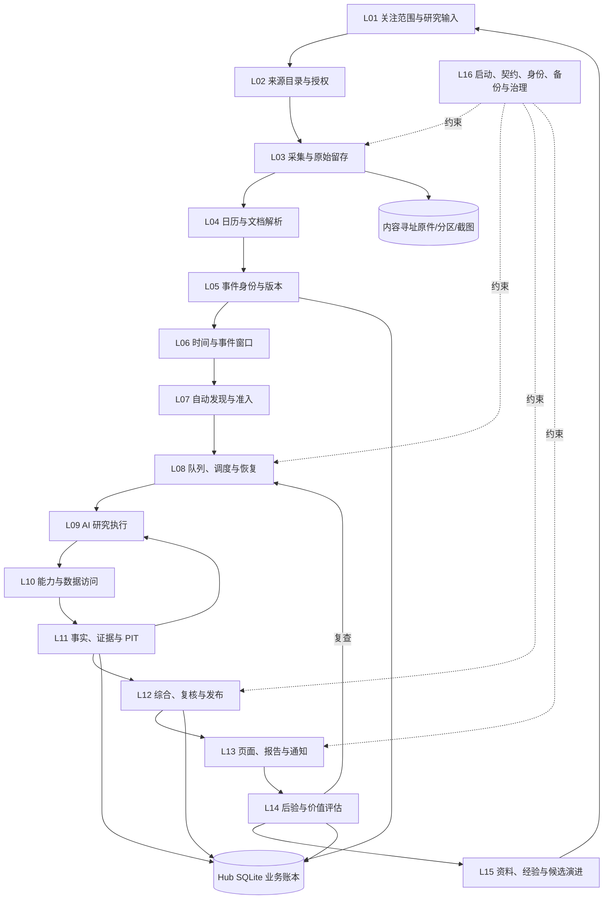

# Decision Hub 当前产品 PRD：需求、实现状态与交付门槛

## 当前市场风险改造：2026-10-10

本项目八层/33项的当前执行基线是[架构与验收](../design/market-risk-v1/CURRENT_ARCHITECTURE_AND_DELIVERY.md)、[逐项状态](../design/market-risk-v1/IMPLEMENTATION_CHECKLIST.md)和[当前任务](../design/market-risk-v1/CURRENT_FOCUS.md)。当前54正常STOP，55必要后继待合并/构建/启动，schema0091；历史54 Ready及资料用途/加载/原749段title URI/末页返回PC P保持。停前同BTC inspect queued/gen18/attempts16/version21、eligiblefalse、Saved/ACK0，无新CAS；原真实DSH/摘要与旧ETH报告保持。53 usage/PC F均保留。单次无locals栈见FrozenReplay旧quality/context/policy重复全源核验；180只是lease而非执行deadline，进度/续租和55 scope边界待验，不称loop或完全fix。新合法自动/复查、全PC、用量/性能、统计及黄金未完成；diag02/audit11未安装，0092另批。目标active、手机排除，见[54结果](../design/market-risk-v1/CORE_ACCEPTANCE54_RESULT.md)与[53原结果](../design/market-risk-v1/CORE_ACCEPTANCE53_RESULT.md)。

下方normal50/schema0071等为历史阶段，不能作为当前54/schema0091安装证明。原来源、资料、研究、报告、反馈和演进主线保留并纳入PC验收；未复验旧主线不自动计为全交付。

## 当前实现摘要：2026-10-07 21:39（Root281）

正式normal50/schema0071，PC、BTC/宏观范围，手机排除。持续来源→主题准入→AI研究→冻结报告/原件与版本→反馈/到期观察→独立评估→审核方法仍是完整主线；不会要求日常用户每次手写课题。默认研究、定时复查、报告回源/前版、异步效果登记/原请求恢复，以及normal48–50分类/准确版本URL/最新报告工作区已有真实路径。

本批正式只保存一次版本反馈及一次补充，8PC/最终6检查通过；各自冻结评估时点，原意见/ACK/依据保留，刷新/主题返回未重复。四原表92主题/1277Run/663版本/2效果请求全行SHA保持；没有新研究/效果申请。三回执与效果说明精简候选4控制通过、未正式应用/type/build/PC，不计已交付。

发现实际演进断链：反馈自然产生4job/10规划角色调用，1operational_followup结束、1候选等待独立输入、2research_plan_invalid失败。任务外层schema与图门不一致，图拒绝子因未保存；模型调用成功不表示候选/评测成功。最小任务校验/安全诊断修复候选待有限验证和正式发布，旧失败不改。全方法真实配对评测→批准加载→回滚尚未闭合，不能称自优化已经改善质量。

A继续关闭文档提交已完成但回执未知的原键浏览器确认等核心矩阵，合并必要发布；B来源/关键时间六视图；C剩5/14规则、可信费用、独立评测/方法部署回滚及装配；D黄金准入。成熟样本、完整Provider/native drain、自然临阻恢复和全资产恢复等保留未完成。已有通过范围复用，罕见自然样本/观察期单列条件。逐层已做/未做与架构图见[交付评估](DECISION_HUB_DELIVERY_READINESS_REVIEW_2026-09-29.md)，步骤与证据只记[唯一台账](../plan/ARCHITECTURE_REMEDIATION_EXECUTION_LOG.md)，本批[回执](../../artifacts/pc-core-actions281/receipt01.json)。总目标active，稳定全功能交付false。

历史版本与阶段验收摘要（仅供追溯）

### 最新实现状态：2026-10-07 18:32（Root275）

正式normal47/0071已安装并真实恢复；异步受理0.187秒、后台三窗与最终回执原子保存、原键持久恢复/失败关闭已实现，7后端/4Worker/6UI/旧报告24项实际通过。本批正式PC主线实际通过，详见原回执；全PC异常矩阵仍开放。完整PRD范围保持：来源→事实/事件→Study→AI/规则→报告/版本→到期观察→质量/费用→演进；黄金与5项剩余执行器、完整资格/演进和PC异常矩阵未完成。normal47规则接线为9/14，接线不等于资格。完整清单与四批计划见[整体交付复盘](DECISION_HUB_DELIVERY_READINESS_REVIEW_2026-09-29.md)。下方normal46及早期“当前”是阶段历史。

### 当前整体复盘补充（2026-10-07）

正式版本仍为normal46；普通研究、报告、原证据、前后版和到期结果已有可用能力，稳定全PC尚未交付。新概率producer、0070、效果登记与页面仍在候选。最新execution16在私有库沿原真实报告完成API四组，首次登记24.391秒，未过≤20秒门；沿同一最新私库的增量Worker/Results四组通过（27.922秒、无额外复制），UI06三组实际DOM测试及类型检查通过。新功能尚未正式生效，有限ASGI/DOM验收不代表真实TCP/正式PC通过。

三方架构审查确认：候选有Worker接线，原90天等待已修为5分钟刷新，并在真实报告三窗上持久保存waiting。registry缺LF、JSON日期回执解码409及task三元组捕获500均已修，是候选准备/实现问题，不能归因用户DSH；原116成员和原报告保留。当前阻断是同步认证慢且占用写事务、候选尚未正式安装，以及用户须跨多账本拼接业务。下一批只推进持久受理/真实后台认证→相关回归/最终真实迁移/正式发布→PC原报告登记/回执/进度/结果回链与手册，再处理持续来源/自然恢复、主题工作区、完整质量与费用，最后黄金。未研究来源、验收主题与重复标题仍待整理。成熟样本、预测资格和交易权限分别验收。

当前完整已做/未做、架构图、根因、四批计划和现场截图见[交付评估的整体架构复盘](DECISION_HUB_DELIVERY_READINESS_REVIEW_2026-09-29.md)；逐步状态仍只记[唯一台账](../plan/ARCHITECTURE_REMEDIATION_EXECUTION_LOG.md)。以下保留正式normal46当时已验范围；候选不计为用户已经能使用。

性能接续实测：shape后继38.187秒，共享材料修正后24.391秒，API四组通过不能关闭原性能门。停止继续堆叠缓存，推荐最小持久异步登记：原键受理、只读认证关闭后新短writer完整复核、三窗计划/原最终ACK/任务完成原子保存，明确“已受理”与“已登记”。16:55时仅为设计；本轮已实现，当前结果见顶部Root275。最新旧F21八GET/24项回归通过、16.203秒；正式安装仍待主线收口与真实PC。尚未停止正式服务、执行0070迁移或发布新入口。

本轮整体复核补充：16:11–16:12正式管理页七类心跳在线，无超过10分钟的用量检查积压；16:53原监督者/10角色身份仍运行，只证明所观察运行状态。真实Alembic私库0069→0070升级、物理回滚、再次提交与94原表保持三项通过，正式库仍0069；若异步方案新增0071，必须另验完整最终迁移。同步≤20秒门仍失败，异步快速受理建议≤2秒并单独测后台完成，不能混成性能已通过。首批以正式PC原报告/原回执/实际Worker进度/结果回链交付；长期样本、全规则资格、费用、演进与黄金分别排队。架构与执行收口结论见上方交付评估链接；总体状态仍为内部研究验证版。

### 当前实现与验收：2026-10-07（normal46）

**定位：BTC 与宏观因素的持续 AI 研究工作台，当前仍为内部研究验证版。** 系统按已配置来源发现材料、按准入条件组织研究，并保存报告与证据；用户可以直接阅读已有报告，或主动更新，不需要每次手写研究问题。黄金尚未开通。报告仍有适用限制，保存成功不表示预测效果已验证或获得交易权限。

本批已正式更新六处业务源码；服务实际启动，10个角色、7个当前服务心跳及4个状态接口正常。本次仅因三处页面变化进行一次前端构建和一次类型检查；原Host产物复用。完整架构L01–L16、用户流程、落库资产和各页面入口继续见第3–6节。

| 本批关闭的问题 | 当前产品行为 | 实际证据 |
| --- | --- | --- |
| 在线却显示“正在研究” | 加载先显示“状态未确认”；空闲时自动发现和研究执行显示“已就绪”，实际进行中任务单独列出 | 正式首页无进行中研究，两个通道已就绪 |
| 指标名称、来源和单位难读 | 展示实际收益率、市场通胀补偿、银行准备金余额、FRED宏观数据库与百万美元；原数值不换算 | 2.95、2.36、2,948,090及原时间保持 |
| 有保存原文却无法打开 | “查看留存原文”读取同一指标版本的原归档，核验内容哈希；原文字段可收起，审计内容默认折叠 | 原版本与原文接口均200；原Fact完整JSON与升级前一致 |

#### 主线进度与剩余缺口

| 层面 | 已有实现与本批确认 | 仍需完成 |
| --- | --- | --- |
| 来源→原件→时间与准入 | 采集成功、无新内容、失败和下次计划分别落账；留存原文不补造新采集。Fed新闻一次404后自然采集恢复，原失败仍在 | BLS日历/发布仍无成功采集；完整事件覆盖与长期可靠性 |
| 指标→版本→研究采用 | 已保存指标列表、当时已知过滤、同口径版本曲线与采用入口；原文读取故障已修 | 全部资料类型与异常分支验收；版本曲线不是连续行情，也不是历史vintage证明 |
| 主题→AI研究→审查→提交 | 公开研究与定时复查报告可读；三AI窗口、独立日线、证据、图谱和前版对照保留；旧F21六GET22检查通过 | 其余研究规则的真实执行、语义复核原件与完整Provider组合 |
| 规则→校准→权限 | 8个规则已有执行器，另6个未实现；原输入、阶段回执和旧核验版本保持 | 全14项资格未通过；可信校准绑定、实际USD、原生子任务完整性/排空及执行权限 |
| 结果→反馈→候选→评测/审核 | 既有结果、反馈、候选与审核入口保留，普通用户可按需展开技术细节 | 独立成熟样本、可靠分母、成对评测与完整部署/回滚闭环 |

**8个执行器不等于8项均已取得资格。** 新轨迹控制的限定材料中为7项通过、7项缺件/不适用；有界停止规则缺可信原生轨迹、费用或排空证明时仍不能通过。两阶段独立核验与篡改回滚四组控制通过，原失败记录保留。没有用本批新付费研究或改写旧报告作为证明。

下一批优先补齐概率来源：每个策略、窗口与原Kernel校准回执明确冻结绑定，两阶段核验原哈希；未校准/缺件保持未知，错窗或篡改拒绝。随后处理来源权威快照与逐论断/因果/反论证的独立语义复核。来源采集恢复与W3主题临时阻断后的自然研究恢复分别验收。

**整体仍未完成稳定PC交付。** 当前实际PC12项是针对三个问题及关联阅读操作的有限回验；原图谱17项验收保留，没有重复为新的全量验收。完整PC异常/命令矩阵、可信费用、W3自然主题恢复、成熟样本与黄金准入仍开放；手机排除。8074隔离浏览器访问限制仍保留。

依据：[正式READY](../../artifacts/normal46-actual01/normal46/readiness.json)、[PC12与截图](../../artifacts/normal46-pc-core-acceptance01/pc-acceptance46.json)、[原文API四检查](../../artifacts/normal46-pc-core-acceptance01/fact-input-formal-acceptance46.json)、[旧报告22](../../artifacts/normal46-actual01/f21-read-regression01/summary01.json)、[轨迹四组控制](../../artifacts/research-policy-trajectory-execution-candidate01/control07/execution01/receipt01.json)、[唯一逐步台账](../plan/ARCHITECTURE_REMEDIATION_EXECUTION_LOG.md)。

以下按日期保留历史版本与验收范围，当前结论以上述normal46及唯一台账为准。

### 历史 normal45 接续验收：2026-10-07 09:26

当前仍为内部研究验证版。已有公开研究、自动复查、报告、证据和同主题前版对照继续保留；普通研究与交易权限分开。

| 本批范围 | 已实现能力 | 实际验收 |
| --- | --- | --- |
| 六项研究规则 | 引用成员资格、时间可得性（PIT）、冻结硬覆盖、因果链结构、窗口契约、Kernel 概率上限；按原输入和检查器版本复核，分别保存最终归纳与提交阶段回执 | 原引用/PIT控制已有通过原件；本批联合六组控制通过，核对正向保存、组合拒绝、缺件限制、原材料变动回滚。正向样本为六项通过、八项尚未执行，完整规则结论仍为 false |
| 数据时间准入 | 带时区输入统一保存为 UTC；整批缺少时区时在访问数据库前拒绝；保留原请求、原文和哈希语义 | 隔离控制核对 UTC 与 +08:00 同一时刻、六处缺时区整批拒绝、调用方与借用事务不变。没有猜测或修改历史行时区 |
| 历史报告连续读取 | 升级前保留原 reader／selector 闭集，旧报告继续使用原核验版本 | 正常45实际六个 GET、22 项检查通过；完整旧 Graph DTO、两报告绑定与三窗保存方向、原主题前版指针、原始响应完整 SHA 一致；未扩大为全部旧 Result／报告 DTO 字节比较 |
| PC 阅读操作 | 报告→图谱节点→证据原文→原节点→原主题保留位置、100%缩放、筛选和列表状态 | normal44 原17项PC检查与截图保留；本批复用同一UI，做必要后端回读，不声称新增全量PC验收 |

normal45 已真实加载并就绪：10 个角色运行、7 个服务心跳与 4 个状态接口200，全部加载源与原产物校验稳定。标准启动等待35.104秒通过；保留原工作区及配对。正式3处业务源更新并安装189份原核验逻辑保留文件，1260→1449源；3497份构建产物复用，本批前端／类型／Host／vendor构建、迁移及额外索引发布均为零。

**当前六项规则已有执行器，另外八项尚未完成执行能力，回执继续标为缺件或未执行；全14项、研究方法资格及执行权限仍未完成。** 本批联合控制是限定材料的真实 Factory→Graph→Commit／只读评估验证，没有新发起付费 Provider 研究，也不将旧报告提升为新六项通过。因果链结构检查不证明经济因果或语义真伪；不知道费用或时区时不填零、不猜测。

**整个项目仍未完成稳定PC交付。** 剩余包括研究轨迹与其他规则、可信实际费用、W3临时阻断后的自然恢复、BLS403及来源覆盖、成熟独立样本、完整PC异常矩阵与黄金准入；手机排除。8074隔离回执的技术访问限制仍保存待处理。

本批依据：[真实就绪](../../artifacts/normal45-actual01/normal45/readiness.json)、[原报告22项回归](../../artifacts/normal45-actual01/f21-read-regression01/summary01.json)、[联合六组控制](../../artifacts/research-policy-deterministic-execution-candidate01/control01/execution01/receipt01.json)、[原PC17与截图](../../artifacts/normal44-pc-graph01/pc-receipt44.json)、[逐步台账](../plan/ARCHITECTURE_REMEDIATION_EXECUTION_LOG.md)。

### 历史 normal44 接续验收：2026-10-07 08:09

当前仍为内部研究验证版。普通公开研究与自动复查保留当时报告、三个 AI 观察窗口、独立日线参考、证据和审查限制；同主题原前版对照不改写旧报告。保存成功不等于预测有效或已获执行权限。

| 本批范围 | 已实现能力 | 实际验收 |
| --- | --- | --- |
| 引用成员资格 | 核对报告引用与该次保存证据的成员关系；冻结实际检查器身份，分别保存最终归纳与提交阶段回执，提交与评估重新核验原件 | 引用成员资格规则已正式加载，并通过六组隔离机制控制；其他 13 条仍未执行。本轮没有新发起真实 Provider 研究来证明方法资格，普通研究与执行权限继续分开 |
| 图谱阅读位置 | 同一报告、图谱、节点与证据往返保留阅读位置；证据弹窗可操作，返回后恢复缩放与筛选 | 本条 PC 旅程 17 项检查通过：节点切换、证据关闭按钮和 Esc 返回均保留 100% 缩放与原位置；搜索“宏观”、综合判断类型和列表模式往返保持；排版结束后位置仍一致。原主题与原前版指针保持。完整 PC 异常矩阵仍待验收 |
| 两处中文说明 | 普通正文中 audited route 显示为“已核验的信息获取路径”，durable EventWatch 显示为“已持久保存的事件跟踪记录”；原引文、代码及配置值保留 | 原 F21 综合判断正文两处中文说明实际可读，原节点记录与原始响应没有改写 |

normal44 实际加载与就绪：10 个角色运行、7 个服务心跳与 4 个接口 200，全部加载源校验稳定；本次仅一个页面修复，UI 与类型检查各一次，后端与 Host 构建为零。标准启动等待 60.138 秒后成功。既有报告与后续核验的回读范围：normal42 六个固定 GET 的 22 项检查已通过；本次 normal44 页面回读原 F21 报告、三个 AI 窗口、同主题原前版及完整 8,813 字符原始响应，原 SHA 一致。后端本批未改；不将本次页面检查扩大为所有接口与全部历史数据验收。

**仅一条引用成员资格规则已实现；其余 13 条仍未执行，完整规则结论为 false。** 单条通过不表示全部规则合格、研究方法已获资格或可以交易。普通研究报告仍可按既有主线保存并以“仅供研究”使用；缺证据或原件不一致必须保留限制，不能用已保存的 pass 替代重新核验。

本片隔离控制的六组机制已通过；单次幂等读取 4.297 秒、单次干净 Engine 评估 4.860 秒，是限定样本的无 profile 实测。它们不是所有 PC 操作、较大样本或端到端延迟承诺，也不是本批真实原生研究资格证明。

**整个项目仍未完成稳定 PC 交付。** 完整费用与可信实际线路费率／账单、其余规则实际执行、W3 临时阻断后的自然自动恢复、成熟独立样本、完整 PC 异常矩阵、来源覆盖及黄金准入仍未完成。手机验收排除；8074 隔离回执的浏览器保存访问阻止限制尚未解除。后续研究源码升级仍须先归档原核验版本，不升级旧报告或旧凭据。

最新依据：[normal44 就绪](../../artifacts/normal44-actual02/normal44/readiness.json)、[本批实际 PC 验收](../../artifacts/normal44-pc-graph01/pc-receipt44.json)、[唯一执行台账](../plan/ARCHITECTURE_REMEDIATION_EXECUTION_LOG.md)。下方 normal41 记录保留当时范围。

本次返回原始证据后的实际页面：

normal42 缩放失败和 normal43 弹窗遮挡的截图与原回执保留于执行台账；本次实际验收范围见上表。

### 历史 normal41 接续验收：2026-10-07 05:53

正常前后端和真实 DSH Host 已启动。已有默认公开研究与自动复查保存了报告、三个 AI 观察窗口、独立日线参考及审查记录；日常阅读或更新公开证据无需每次填写研究问题。报告保留当时材料和审查限制，保存成功不等于预测效果已验证。

| 已修复的缺口 | 实际结果 | 验收范围 |
| --- | --- | --- |
| 同主题前后报告难读 | 按原前版指针并排读取两份完整报告；先读三个 AI 方向，长条件与日线参考按需展开 | 原所选 F21／前版 3b；PC257–263，原报告不改写 |
| 方向摘要混用 AI 与日线 | 分别说明 AI 三周期的可比性和独立 7 天日线方向；部分、未知或方法不同不推断整体一致 | 正常40 PC264；既有两处UI保持 |
| 材料来源只显示域名 | 复用登记名称显示 Gate.io、雅虎财经、FRED 等，采集时间与原文入口保留 | 正常40 PC265–266；22个材料回链保持 |
| 多步因果图错误连接结论 | 主向第6步／反向第3步作为末端连接结论，全部29节点、47边及其他DTO字段保留 | 正常41真实HTTP与PC268–273；同一已保存 F21，未改写原报告 |
| 图谱证据回链 | 节点13个证据入口→保存证据→原始响应→原节点→原主题前后对照走通 | 原始响应HTTP200、采集时间2026/10/6 08:00:08保持；本次零新研究 |
| BLS全国月度标题准入 | 已加载v5规则，隔离控制核对全文标题及重复去重；原预算、时间和快照契约保持 | 选择器控制通过；当前实际日历抓取403，尚无自然准入成功证明 |
| 历史实现保留 | 正式升级前保存原87 Python／41 schema资源，精确registry与原实现读取通过 | 原Graph e9 reader_ready与字节核对；e9业务Run重放尚未验证 |
| 默认启动版本丢失 | 固定指针核验源码与产物，坏指针或漂移明确拒绝 | 39生产reader／隔离默认分支通过；41实际更新指针，默认整栈实际重启尚未验收 |

normal41实际加载三处生产后端源码和一处既有测试版本断言；前端／类型／Host／vendor构建、迁移、额外索引发布均为零。7项服务心跳、四项实际读取、源码稳定以及安装核验通过（安装核验7.397秒）。上一批normal40的前端构建与类型检查各一次，既有UI产物完整复用。

**整个项目仍未完成稳定 PC 交付。** 本次实操另发现“清晰阅读100%后打开节点变20%”与说明中两个英文短语残留，修复候选待正式加载和PC核验。完整费用及可信实际线路费率／账单、W3临时阻断后的自然自动恢复、成熟独立样本、完整PC异常矩阵、来源覆盖及黄金准入继续未完成。手机验收排除。8074隔离网络回执仍被浏览器保存访问阻止设置拒绝；用户先前已授权继续，技术访问限制尚未解除。14项核心规则目前仍未完整执行；下一批引用成员资格的实际执行／保存／评估校验正在隔离验证，不能当成已安装。后续研究源码升级仍须先执行归档维护流程。

最新记录见[唯一执行台账](../plan/ARCHITECTURE_REMEDIATION_EXECUTION_LOG.md)、[normal41就绪](../../artifacts/normal41-actual01/normal41/readiness.json)、[实际PC验收](../../artifacts/normal41-pc-graph01/pc-normal41-receipt01.json)及[用户手册](../user-guides/DECISION_HUB_CUSTOMER_USER_MANUAL_2026-09-22.md)。下方历史阶段结果保留当时范围。

### 历史 PC 接续验收：未生成报告的取消与失败任务（2026-10-05）

取消、失败、拒绝任务现在先展示任务状态；已知错误采用现有中文映射，未知原因明确为“具体原因尚无可读说明”。没有报告时不展开报告复查建议和市场补齐条件。“查看问题详情”在当前页面展开技术内容并定位原失败/停止记录，原始技术码仍按需展开；普通视图页签保持原导航。原回执、Owner、待确认操作锁、显式后续任务入口与资料重新授权约束保留。

本片 102 项前端控制、实际类型/构建、PC05 取消/重试唯一任务与 PC06 焦点复测通过；正常旧真实报告的三个 AI 窗口、独立 7 天日线及三项已完成复查可读。首次类型门失败和 PC05 路由定位失败均保留，修正后另存证据。控制场景没有 Provider/模型调用或 AI 成功报告，**不能据此称真实 DSH 子树停止或项目全部交付**。真实 DSH 取消协议、其余异常矩阵和原整改未完成项继续列入唯一执行台账，手机验收仍排除。

更新时间：**2026-10-07** · 版本：0.8 · 范围：本机单 owner、PC、BTC/宏观研究。

本文沿用现有全产品 PRD 入口，更新 9 月 26 日盘点；原文件完整字节已备份。本次是产品规格与实现状态核对，不是全产品验收证明。实施进度以[唯一执行台账](../plan/ARCHITECTURE_REMEDIATION_EXECUTION_LOG.md)为准，技术整改依赖见[架构整改方案](DECISION_HUB_ARCHITECTURE_REMEDIATION_PLAN_2026-09-29.md)。

## 1. 当前交付判断

**整个项目尚不可按“全部功能完成并验收”交付。** 研究、来源、资料、账本、主题和结果跟踪有真实代码与可操作入口；部分 PC 主线已经实际走通。本轮历史依据读取回归已恢复；普通保存报告并排对照和本次历史配方归档已完成局部验收；完整费用、自然自动恢复和全 PC 成功/失败/恢复矩阵仍未完成。

16:34 的失败快照属于当时状态：278 项作业 completed 中，原 12 条 AI 认证因历史实现身份不可用而失效，已核对组 4→0。该回归随后修复，晚间重新正式回读通过；不能将下面的历史快照继续描述为当前故障。

历史失败快照与 D01 恢复原件均保留；历史盘点如下，当前接续结果以上述 10 月 7 日摘要和唯一台账为准。71 条旧日线缺当时方法身份、新日线核验实现、管理 Agent 综合缺失和缓存到期调度是四个不同问题，分别记录和验收。

| 状态 | 已能确认的内容 | 当前限制 |
| --- | --- | --- |
| 已实现并有局部实测 | PC 报告/原证据/任务回链、真实反馈保存、后续复查状态、Study 版本与结果页面、来源/数据审计入口 | 不能推到每个按钮、全部数据与异常状态均通过 |
| 已受管加载 | normal39 前端、正常七项后台服务与真实 DSH Host 就绪；原 Host 产物复用 | 就绪仅证明服务状态；原报告、开关、原文和观察以各自业务证据判定 |
| 当前 P0 | 近期关键宏观事件覆盖、全 PC 例外和真实 Provider 全组合验收 | 默认与一次自动复查三 AI + 日线真实通过；受控两轮完整发布门及生产 PC 回读已过，未验范围仍不能交付 |
| 仍待完整交付 | 14 项政策实际执行链、全 PC 例外矩阵、来源长期失败恢复、费用/比较/反馈到改进闭环 | 已有局部门、编译声明或草稿均不算完成 |
| 本轮排除/未准入 | 手机验收、黄金及其他新研究领域、自动交易、远程多用户 | 不在页面承诺可用，也不以本轮 PC 验收代替准入 |

过去三天的切片修复、发布与局部验收已经记录，但没有形成“整个产品已闭环验收”的事实。本文不沿用 README 中早期阶段 completed/pilot_ready 作为今天的总交付结论。

### 历史阶段实测：10 月 5 日

**10 月 5 日 15 时 PC 取消重试恢复验收：本项通过。** 发现并修复了“重试成功但离页后原请求凭据被清除，返回时无法打开已创建子任务”的缺陷。真实按钮操作中，重试响应在 0.853 秒返回，管理页未被跳转；返回原任务只核对原请求回执，再明确打开唯一的新研究。后台只有一次取消、一次重试、一个子任务；原资料正文与授权不继承。排队与回执尚未确认的状态文案也已纠正。[实际 PC 与落库验收封存](../../data/product-local/remediation/W6/pc-run-command-recovery/pc-20261005-04/pc-acceptance02.json)保留修复前反例和失败记录。本项使用真实 API、数据库和研究 Worker，以及明确的受控失败执行端；**真实 DSH 多 Agent 停止、已发生费用、迟到成功发布及其余 PC 异常仍未完成**，不将本项通过扩大为全项目交付。正常产品已加载新 UI，原默认报告的三周期 AI 判断、独立日线参考与自动复查回链仍可阅读，服务显示 3/3 在线。

**默认公开研究和本次自动复查已完成真实 PC 与后台原件验收，完整产品仍未交付。** 正常原 Home 于 01:49 加载本轮回执修复，10 个受管角色、7 个同版本后台心跳、4 项业务读取及采集服务实际就绪；PC 显示 3/3。[本轮正常启动回执](../../data/product-local/remediation/W7/graph-citation-v2-20261004/receipt-core-release02/normal-ready02/business-ready.json)只代表该就绪范围。

首页 BTC 快照**未填写研究问题**，实际发起 `run_b6ab8f8fe70547cea50f92162d6d4e87`，01:50:19 开始、01:55:52 保存结果。研究包含五个后台协作角色、独立复核、10 条采纳证据、6 个来源；30 分钟“未形成方向”、24 小时“中性观察”、72 小时“偏多”三个 AI 判断与独立 7 天日线参考均已落库。约 198 KB 日线完整回执现在通过已有工具正式输出接口传递，并由原认证门核验；原有限报告仍保留，没有改写成成功。[真实严格只读核验](../../data/product-local/remediation/W7/graph-citation-v2-20261004/command-core-release01/b6-normal-observation02.json)实际退出 0、37.264 秒，16 项检查通过：执行方法、研究上下文、过程图、认证终态、复核、结果、报告、三 AI 与日线来源和方法、历史原件。原验收器的业务/RPC 身份及终态误判已修正，原失败记录保留；9 个身份错配、普通取消和超时否定用例仍拒绝。

PC 已实际核对“报告引用 → 保存的 HTTP 200 原始响应 → 返回同一报告”，发布时间未知时仍显示未知。[原文截图](../../data/product-local/remediation/W7/graph-citation-v2-20261004/pc-core-release01/screenshots/13-native-original-response.jpg)保留采集时间与原响应。系统随后按原报告的 02:06:12 计划产生定时子研究 `run_e597191070c04c418938332147e58315`，02:13:21 保存子报告；没有再次人工发起。[自动复查严格核验](../../data/product-local/remediation/W7/graph-citation-v2-20261004/command-core-release01/e597-normal-observation01.json)退出 0、39.156 秒，16 项通过，父子身份、三 AI、7 天日线、复核、报告及原件一致。[自动复查截图](../../data/product-local/remediation/W7/graph-citation-v2-20261004/pc-core-release01/screenshots/14-scheduled-child-report.jpg)与返回父报告路径已验证。PC 已显示 24 小时与 72 小时 08:00 复查任务结束，但这两条还未做本次完整原件核验，不能算已验收。

两次核验均只读、0 正式 SQL 写入、0 模型提交、0 构建，19 份历史身份与旧 6499 条原件未变。**报告仍有限制**：Kernel 状态保留真实 degraded，来源覆盖与叙事缺口仍显示；来源和方法通过不代表预测已经校准，Provider 配置身份、成熟方向样本和长期效果仍独立。单次默认及一次定时子报告通过，不能推全按钮与全市场可交付。

**D10 两轮研究的受控完整发布门已通过。** 正常仓库执行原联合节点，pytest 实际 423.01 秒、外层 425.337 秒，通过两轮 RPC、上下文选择、执行方法、过程图、保存旧版本混用拒绝、独立复核、结果与报告发布、三 AI 窗口和只读来源/方法核验；原 600 秒上界、15 秒 fixture、900 秒租约及全部原断言保持。[正常目录完整回执](../../data/product-local/remediation/W7/graph-citation-v2-20261004/context-joint-after20.json)。仅修复重复方法清单构造与不合格边界的无效捕获；两个文件已精确应用，生产类型/静态检查通过，8 个 Python 消费者实际加载，新 API 的父报告→自动复查→证据原文→同父返回及刷新按钮通过。[当前 PC 截图](../../data/product-local/remediation/W7/graph-citation-v2-20261004/pc-core-release01/screenshots/23-pure-parent-viewport.png)。原 after16/17 超时与原件继续保留：after16 未到复核发布，after17 已完成复核发布但完整节点仍超时。本次是受控完整组合验收，不替代真实 Provider 所有组合、全 PC 取消/重试/异常恢复、来源覆盖、资料隔离、14 项政策执行和改进晋级验收；手机排除，黄金尚未准入。

### 历史阶段实测：10 月 4 日晚间至 10 月 5 日 01:21

正常原 Home 的产品已于 **22:49 恢复在线**。10 个受管角色、7 个后台心跳、4 项业务读取及采集服务就绪实际通过；正常 8047 的 PC 页面显示 3/3。[启动回执](../../data/product-local/remediation/W7/graph-citation-v2-20261004/core-release01/normal-ready01/business-ready.json)与[16 路 API 读取](../../data/product-local/remediation/W7/graph-citation-v2-20261004/../delivery-review-20261004/api-snapshot05.json)只证明对应就绪和读取范围。

PC 未填写关注点，实际发起了 `run_c37a0c7cf1594a3799ddfededd549bb8`。22:58 保存了 10 条采纳证据、6 个来源、Graph2、ContextSelection3、复核和报告；同次 7 天日线记录的来源、方法及稳定配方已由正式原件只读核对。[实际回读](../../data/product-local/remediation/W7/graph-citation-v2-20261004/normal-run-readonly01/normal-run-observation02.json)的整体结论仍为 **limited**：管理 Agent 启动后台协作后提前结束，没有提交综合候选，AI 三窗口为空。当前不能把它算完整 AI 研究成功。

页面已修复日线参考被隐藏与“无证据”误提示：显示实际 90 根完整日线、截至 10 月 3 日、独立 7 天参考，并保留综合判断不足和未授权交易的边界。已在 PC 展开、进入同 Run 的日线结果并返回原报告。

**10 月 5 日 00:18 PC 复验：日线缓存故障已关闭本次范围。** 调度修复通过 19 个边界、租约、并发与取消用例，只受管重载 API / 实时后台，DSH 及其余八个角色保持原进程。原作业自然从 attempt 1→2，无手动写库或人工执行作业。[自然重建回执](../../data/product-local/remediation/W7/graph-citation-v2-20261004/cache-boundary-scheduling01/natural-rebuild-observation01.json)显示来源、方法与配方通过，分组原件检查 **1/1、待核验 0**；PC 详情与分组一致，回原报告成功。未到 10 月 11 日观察期、首次身份仍待确认，方向样本为 0，不显示命中率。

**10 月 5 日 01:21：研究进程正常在线，AI 综合发布仍未通过。** 原命令完成门已修复、33 项相关测试及类型检查通过，必要的一次后台构建和正常加载完成；PC 显示 3/3 在线。新默认空输入研究真实执行了角色协作、独立复核，并提交了 30 分钟、24 小时、72 小时综合候选。最终后端证据校验拒绝了综合，三个 AI 窗口未保存，页面保留日线参考与限制，没有伪造成功。[本轮真实链路回执](../../data/product-local/remediation/W7/graph-citation-v2-20261004/command-core-release01/df78-normal-observation01.json)为 limited，实际方法、研究上下文、过程图、复核与报告原件、7 天日线及历史原件检查通过，不能据此称综合内容通过。

失败已定位到**历史行情回执传递**：约 197 KB 的完整回执被原生 50 KB 工具输出机制截成预览，综合引用的日线证据因此缺少完整可认证凭据。下一步使用已有工具正式输出接口保留有界完整回执，继续原认证，随后重新做真实研究验收。多轮流程的同事务重复核查也有候选，当前仅有限控制通过，联合验收仍未完成；全项目尚不能标为全部交付。

原 12 条 AI 记录的来源与方法重新核对通过；旧五表 **6499 条原行不改不缺**。新研究合法新增 42 条关联记录，不把“新增 0”继续当当前结论。[旧行与新行证明](../../data/product-local/remediation/W7/graph-citation-v2-20261004/core-release02/formal-history03.json)。195 条旧 AI 缺件和 71 条旧日线缺当时方法身份继续保持未知；新日线核验实现不能回签旧记录。

## 2. 产品是什么，用户为什么不必每次输入研究

Decision Hub 是**持续收集信息、用 AI 查证和综合、用代码核验、保存可追溯研究并复查的本机研究产品**。AI 负责提出查证计划、调用已授权工具、组织主反解释和窗口观点；Hub 负责身份、时间、预算、证据准入、发布与后验。AI 聊天完成不等于报告通过。

用户日常应该打开“今日研究”，看系统关注范围、最近检查、重要变化、已保存报告和待处理事项。官方来源、事件日历、已有主题的跟踪计划应自动触发研究；临时问题、BTC 快照或个人资料是补充入口，不应成为看到日常结果的必填 prompt。

首期目标是减少查证负担：结论能回源，变化可解释，缺失能看见，失败可恢复。研究观点、校准概率、发布预测和交易授权是不同对象；当前研究报告不自动授予下单权。预测优势、成本后收益、长期可靠性均需独立证据。

### 2.1 用户角色与成功标准

| 角色/任务 | 用户要得到的结果 | 首要标准 |
| --- | --- | --- |
| 日常研究使用者 | 知道近期变化、主要解释、反方、适用时间与下一次检查 | 30 秒内能理解首页并读到报告或明确空态 |
| 资料使用者 | 知道文件是否读对、观点是否审核、是否真正用于研究 | 原件、版本、质量和最终引用可区分 |
| owner/维护者 | 知道哪个环节失败、实际影响、如何从原记录恢复 | 不靠猜测枚举/进程，不因恢复丢旧记录 |
| 复盘使用者 | 比较当时判断与后来事实，判断方法是否值得继续 | 正确首条样本、成熟标签、可信配方及分母；未知不填 0 |

## 3. 完整用户业务主线

### 3.1 自动发现到报告

授权来源/日历/行情 → 每次采集留痕 → 标准化观察与事件修订 → 按主题和策略准入 → 排队 → AI 有界查证 → Evidence/Fact 校验 → 综合与独立复核 → 代码 Gate → 报告/受限材料 → 收件箱 → 复查与到期观察。

用户打开首页应能回答：监控什么、最后成功检查何时、有何变化、研究到了哪一步、下一步是否需要我。没有新事件显示真实空态；来源失败显示影响，旧报告显示时间，不伪装成今天的新研究。

**现状：**采集、准入、Run、AI、证据和报告链存在，自动复查已有真实执行片段；非手动来源持续到完整可信交付的稳定闭环尚未完成全量验收。关键词/规则发现不能被描述成 AI 已全面理解所有市场变化。

### 3.2 人工快照与新事件

从首页或“研究”发起一次 BTC 快照研究；如有明确新闻/事件，提交文本与来源。提交回执应保留原 request 与 Run，进入进度页面，终态后打开同一报告。重复点击必须按原 request 幂等核对，不能生成重复任务。

失败任务应从原任务记录“查看原因与恢复”，依状态使用已有取消/重试命令；新建问题和重试旧任务是不同动作。回执未知时重新读取原 request，不把未知当成功，也不自动新建一次来覆盖失败。

### 3.3 阅读、更新与持续跟踪

报告先显示判断、依据、反方、条件、限制和三个窗口，再提供原证据、过程和技术审计。“查看已收集的证据”应展开并定位真实来源清单；刷新/返回应保留同 Run 与返回位置。

手动更新或自动复查形成同 Study 的子 Run/新报告版本，旧报告和失败尝试继续保留。首页按已保存报告时间读取，代码不再仅筛 root Run；报告新旧版本在主题时间线可达。已实现普通保存报告与原前版的并排对照、三周期判断和材料变化，真实PC局部验收通过；完整异常矩阵与长期覆盖仍待验，正式方法对照仍受费用及资格限制。

报告的“建议复查时间”仅是结果建议。只有已有 review schedule 回执才显示已登记；等待准入、预算延后、已启动、失败、过期和新报告接续必须分别显示。失败入口打开原 child Run，不能以查看动作偷偷再发一次研究。

### 3.4 资料进入研究

上传文件/网页导入 → 保存原件与版本 → 解析与质量检查 → 查看区块/修正 → 人工确认或观点审核 → 选择实际研究范围 → 选入 Run → 上下文实际读取 → 可能成为最终证据/引用。

“已上传”“解析成功”“已选入”“已读取”“报告已引用”必须分开。资料内容不自动成为硬事实；跨市场/标的选择按真实可用范围校验，未开通黄金或权益不能因资料标签存在而开启研究。

现有文件、网页、质量、原件、版本恢复、Claim review 与作用域 API/页面存在；默认处理模式不能泛称全部为 AI 深度审核。所有文件类型、低质量、解析失败、修正冲突和跨域边界仍需完整 PC 矩阵验收。

### 3.5 后续结果、反馈与改进

发布时冻结独立研究观点、原依据和窗口；到期后才取得实际观察/标签。用户可保存有用性、人工查证耗时与理由，反馈依据固定当时版本，后来新报告不会改写旧反馈。

旧反馈 v1 的“发布预测账本”可能为未授权交易记录，不能把该处 no_trade 改为研究 neutral/long；独立研究方向在原报告/后续观察查看。反馈保存不等于已自动训练或晋级方法。

结果跟踪按原首条样本、来源认证、标签成熟和稳定配方分组。只有认证且单一可比配方、足够样本（当前最低 30）才能出现相关汇总率；缺样本、未到期、失效或不可核验只显示原因。daily 与 AI 的来源/方法资格不可混算。

## 4. L01—L16 架构全景

Hub Kernel/SQLite 是业务真源；原件存归档并以身份/hash 关联。LangGraph 负责外层研究生命周期和恢复，DSH 负责模型/工具/子 Agent 执行，MCP/Gateway 限定实际工具准入。Domain Pack 定义领域方法，Query View/API 输出页面 DTO；浏览器和模型都不能自行授权发布。

| 层级 | 当前实现/可读内容 | 仍需完成的业务能力或门 |
| --- | --- | --- |
| L01 范围与输入 | BTC/宏观、快照/事件/资料入口、Study 身份与跟踪 | 日常无需手动输入的全链持续验收；黄金准入 |
| L02 来源与授权 | 官方来源预置、registry、能力目录、源状态 | 实际覆盖/授权证明和 BLS 失败恢复；不把配置声明当连通 |
| L03 采集与原件 | poll attempt、HTTP/浏览器 receipt、raw archive 与 hash | 全成功/空结果/失败/迟到/重复时间链贯通与保留策略 |
| L04 解析 | 站点日历、vintage/纠正、文档区块/质量 | 全官方真实页面及文档异常覆盖；解析成功不等语义正确 |
| L05 身份与版本 | occurrence、Study、admission、report revision 与关联 | 历史 unknown 不补造身份；跨事件/修订归并持续核验 |
| L06 时间与窗口 | scheduled/time precision、EventWatch、window sample | 真实未来事件前后采样、恢复/迟到、缺基线明确显示 |
| L07 发现与准入 | admitted/merged/blocked/ignored 留痕、范围/预算决策 | 发现召回/误报、源影响与长周期自动交付仍需观察 |
| L08 队列与恢复 | durable Run、lease、priority lane、checkpoint、cancel/retry、有限复查重试/交接 | 全异常恢复矩阵、真实延后公平性、当前与历史状态不混 |
| L09 AI 执行 | DSH Web Host/插件、真实 Session/request/Prompt 绑定、Graph 原观察 | 新 Graph 版本正式完整研究及能力故障验收；真实 Provider 身份范围 |
| L10 工具与数据 | typed 行情、搜索/读取、浏览器/文档回读、历史分区、reservation | 部分 Provider/宏观分钟级数据依赖；原 adapter 身份/费用可用性 |
| L11 事实与 PIT | Evidence/Fact、raw/parsed/version/input lineage、as_of 查询 | 全来源血缘、跨 Run 复用/独立性与累积趋势视图 |
| L12 综合与发布 | 主反链、原独立 review、三窗、Kernel 全窗 .65、Graph 引用 v2/同 writer fence；normal49正式9个规则执行器接线，含概率来源 | 另5个待实现：来源权威、引用精度复核、因果质量、反方质量、执行权限；完整14项资格未通过 |
| L13 交付与页面 | 首页、报告、收件箱、主题、证据图、已读与反馈 | 普通保存报告并排对照已局部验收；剩余全PC按钮/异常/刷新深链矩阵、长期覆盖及通知闭环 |
| L14 评估 | 独立 outlook、观察/label、durable assessment job、稳定配方分组；新日线来源和方法实际通过 | 本次缓存到期调度已闭环；旧缺件/无当时方法身份保持未知，成熟样本和费用比较未完成 |
| L15 资料与演进 | 上传/解析/审核/scope、经验/候选/实验/owner 晋级回滚接口 | 全资料引用路径、可复现候选价值；不能宣称自我进化完成 |
| L16 平台 | 受管启动、精确角色身份/心跳、版本 guard、migration、备份/复用入口 | 全资产恢复演练、每故障域 ready/回滚与全产品验收结论 |

## 5. 页面和可操作入口

正常 PC 入口为本机 Decision Desk `http://127.0.0.1:8047/`。四个主导航保留业务层次，管理与审计承接后台功能；DSH 原生页面用于同 Run 会话/轨迹核对，不让用户先理解进程或 SDK。

| 用户页面 | 路由 | 用户可做什么 | 状态/限制 |
| --- | --- | --- | --- |
| 今日研究 | `#/home` | 来源/自动发现/研究状态、最近已保存报告、活动任务、下一事件、补充快照 | 已有；不能把在线或旧摘要当今天完整研究 |
| 市场与事件 | `#/market`、`#/calendar-all`、`#/event?event=…` | 看日历、发布/修订、原来源、数据范围 | 已有；宏观源降级和缺窗口仍影响研究 |
| 研究 | `#/research`、`#/runs` | 看任务、进度、失败原因、原任务恢复 | 已有；全历史筛选/异常矩阵需最终验收 |
| 报告与依据 | `#/report?run=…`、`#/evidence?run=…`、`#/graph?run=…` | 主反观点、三窗、原文、过程图、真实后续计划 | 部分 PC 已验；新 Graph 正式主线仍需实际样本验收 |
| 报告收件箱 | `#/delivery` | 查看未读/已读、打开报告、保存反馈与核对回执 | 已有；反馈是 owner 原件，不代表模型改进完成 |
| 研究主题与变化 | `#/studies` | Study 时间线、方向/材料变化、每版原报告 | 普通保存报告并排对照和原文回链已局部验收；AI与日线分别说明，完整异常矩阵待验 |
| 结果跟踪 | `#/results` | 过滤/分页、看独立观点、source/label/recipe、打开原报告 | 旧 AI 回归已恢复；新日线详情与分组已在本次 PC 核对一致，不显示假 0%/成功率 |
| 指标与依据 | `#/facts` | 按范围/指标/来源/as_of 查看版本与原输入 | 已有；跨时间趋势和全资产可视化仍不完整 |
| 资料 | `#/library`、`#/upload`、`#/document-review?version=…` | 上传、查看原件/版本/质量/Claim、按范围研究 | 已有；不能把路由状态演示当真实上传完成 |
| 来源审计 | `#/sources` | 最新状态、逐次采集、失败/空结果、来源原回执 | 已有；持续失败要修复，不能只显示错误 |
| 数据更新 | `#/data-jobs` | 作业状态、原分区覆盖/输入与失败记录 | 已有；历史失败与当前可用性分开 |
| 管理与审计 | `#/management`、`#/Operations` | 运行配置/服务、usage 队列、来源/数据/业务入口 | 已有；UI/Worker/Provider/canary 五层分别判定 |
| 演进与旧账本 | `#/Evolution`、`#/Inbox` | 候选/评测/owner 决定、旧任务与审计 | 入口保留；空资产不表示演进能力已成功运行 |

原 Run、版本、原件深链继续可达。`run/back/focus` 在跳转、刷新与返回时保留；普通点击只读入口不提交模型或新 Run。设计状态/目录仍作开发辅助入口，真实产品页读取 API，不能拿演示曲线/样本回执填空。

## 6. 沉淀数据已经存了什么，还缺什么

数据库保存业务身份、关键时间、内容 hash 和关联；网页正文、DOM/截图/trace、文档原件、行情分区等可以存内容寻址文件。**“落库”不等于已有完整可视化，“文件存在”也不等于报告真正引用。**

| 资产 | 当前表/保存对象 | 关键时间与意义 | 当前用户入口/缺口 |
| --- | --- | --- | --- |
| 来源检查 | `source_states`、`source_poll_attempts` | started/completed、last success、next poll；每次空结果/错误独立记录 | 来源审计；成功/失败/解析影响还需更完整关联 |
| 自动浏览器/HTTP采集 | `source_acquisition_receipts`、`raw_captures` + 工件 | request started/completed、observed/received、raw recorded；unknown 可为空 | 来源/原证据回读；旧 receipt 缺时间不能推算补填 |
| 观察与事件 | `observations`、`events` | scheduled、published、observed、received、occurred | 日历/事件详情；来源声称时间不等接收时间 |
| 日历与纠正 | `macro_events`、`macro_event_vintages`、`calendar_corrections` | 计划时间、原时区/精度、观察/版本记录时刻 | 事件版本；误解析纠正不覆盖原原件 |
| 事件窗口 | `event_watches`、`event_watch_links`、`event_window_samples` | 计划槽、观察/接收时刻、迟到/失败 | 事件窗口；缺前置基线应显式不能补造 |
| 主题和准入 | `occurrences`、`studies`、关联表、`admission_decisions` | created、decided；原 reason/策略与作用域 | 主题/准入记录；旧未知身份仍历史档案 |
| 任务和执行 | `runs`、`run_events`、`run_calls`、`run_steps`、`run_role_outputs` | created/available/updated/finished、step started、原 receipt recorded | 任务/技术过程；不能用 updated 推导模型开始 |
| DSH/工具 | `dsh_session_links/prompts`、`research_tool_call_reservations`、trace/usage | accepted、Prompt created、reserved/completed、usage recorded | 任务/管理；未知历史 terminal 不铸成完成 |
| 原证据与事实 | `research_evidence/facts`、`parsed_versions`、`evidence_parsed_links`、`fact_versions`、`run_input_refs` | published/observed/received/accepted、known/recorded/as_of/adopted | 证据/指标/原输入；修订不能进入更早的当时视角 |
| 行情作业 | `data_jobs`、归档与分区 | request/作业开始结束、覆盖区间与原 hash | 数据作业/覆盖；尚缺统一长期覆盖趋势 |
| 报告与交付 | `research_results`、`artifacts`、`report_revisions`、`product_read_receipts`、`outbox` | 原结果 finished、报告 created/recorded、已读/发送/重试 | 报告/收件箱；报告时间和版本登记时间分开 |
| 后续检查 | `review_schedules`、原交接 RunEvent/关联、子 Run | trigger_at、created/updated、实际 child 状态 | 报告/主题；建议时间不是已登记计划 |
| 预测、后验与核验 | `analytical_outlooks/observations/observation_attempts/assessment_jobs`、`forecasts/outcomes/evaluations`、校准/权限 | 原预测参考/冻结、观察到期/记录、evaluated、lease/next attempt | 结果跟踪；当前认证回归/daily NA 明示 |
| 资料与反馈/候选 | document/version/block/correction/claim/scope、revision feedback、经验/实验/晋级表 | published/observed/received、版本审核、反馈评估/决定 | 资料/反馈/演进；scope→读取→最终引用分层 |

所有机器时刻保存 UTC，页面按本地时区显示；日期级精度显示“时间未确定”，不伪造小时。关键时间要标语义、来源和未知原因；迟到材料保留真实接收时刻，不能倒填成历史当时已知。

### 6.1 需要补齐的数据可视化

现有单 Run 证据图、主题版本、指标版本、来源尝试、作业覆盖和结果组都应保留。仍需补齐：来源完整采集/解析/准入时间线；跨期指标/修订趋势；主题观点与证据改变的可比时间线；覆盖缺口与采样迟到；真实标签/费用/基线分母；经验引用与方法变更闭环。

图表必须展示范围、时间截止、来源/版本、缺失与分母。Evidence 条数不是独立来源数，Run 数不是样本数，三个窗口也不是三个独立实验；页面不以漂亮曲线代替真实数据。

## 7. 当前后台真实性与评估边界

### 7.1 后台核验完成不等于认证成功

持久核验 job 有 pending/running/retry/completed、租约与输入 footprint，实时 Worker 有界处理，避免前台列表同步完整重演所有样本。completed 表示一次检查形成结果；来源 invalid/旧件 unverifiable/daily not available 都是该检查的真实结论。

只读取当前有效 basis/算法身份下已认证 projection；代码、原件或时间边界变化会失效并重核。历史版本必须按保存身份重演，不能重新签名。原 12 条 AI 已在正式服务重新核验与 PC 回读；新日线真实来源及方法通过。缓存边界调度已修，正常后台自然重建后列表与详情在本次 PC 核对一致。

### 7.2 四类结果分别显示

- 来源/原件：saved 与 verified 不同；缺件/错 hash/错 Run 明确原因。
- 标签：未到期、未取得、无法确定、已有真实观察分开，不把 neutral/no_trade 都视为命中。
- 配方：同实际 Hub recipe 可跨保存别名归组，未知 recipe 独立；Provider 未认证范围保持说明。
- 政策/执行：14项登记中9个执行器已正式接线、5个未正式实现，prepared不等executed、executed不等passed；发布预测受限不改独立研究方向，也不发交易权。

只有符合首条样本规则、认证、成熟标签及可比配方的对象进入对应指标分母。分页/筛选不替代全局首条选择；平均成本缺费用时为空，真实零费用仅在原件明确为零时显示。

### 7.3 当前政策实际状态

normal50保留实际加载的9个规则执行器：引用成员资格、时间可得性、冻结硬覆盖、因果链结构、窗口契约、Kernel概率上限、缺口到工具延续、有界停止一致性、概率来源。最终归纳与提交阶段保存回执，Commit与只读评估核验原件；旧报告使用原核验版本。接线不等于规则资格通过；可信native轨迹/USD费用/drain或校准原件不足时仍保持未知或不适用。另5条未实现：来源权威、逐论断引用精度复核、因果质量复核、反论证质量复核、执行权限。normal46的8/6口径只在历史快照保留。

authority/逐 claim 引用精度/因果语义/反方质量需要真实独立专项依据，不能由引用 membership、结构非空或总 review 替代。缺依赖应返回 unavailable/unknown，适用 blocking 未证不能称完整发布通过；执行许可当前保持 research-only。

## 8. PC 产品交互要求

首屏默认中文业务词：判断、限制、依据、待处理、后续检查。英文枚举、ID、Provider、预算、原 JSON 放可展开审计层；原件原文保留，不翻写冻结数据。已知术语可用中文展示映射，未知词不猜含义。

每个按钮只能有明确动作与回执：只读跳转、刷新、发起新任务、取消、重试、提交反馈/审核各自说明。未满足条件禁用并说明原因；载入、空数据、故障、成功、回执未知分别显示。操作失败后能从原 request 核对，避免重复创建。

PC 按用户日常使用顺序验：顶部/侧边导航、筛选分页、详情/返回、证据展开/定位、原文下载/回读、任务命令、资料各阶段、反馈、主题跟踪和结果分组。样式包括正常字号、可读行距、长文本、键盘焦点与对话框；不用手机完成度为本轮背书。

截图仅证明捕获时页面，不证明未点击按钮/未覆盖状态。当前截图和真实接口回执集中于[本轮交付复核 stage](../../data/product-local/remediation/W7/delivery-review-20261004/)；截图采用 JPEG，按 `screenshots/01-home.jpg` 至 `07-operations.jpg` 对应首页、市场、研究、报告、结果、资料、运维。实际成功文件/时间以该轮 manifest 为准，不预先把文件名或截图本身标为已验收。

## 9. 核心验收标准

| 门 | 退出标准 | 当前判断 |
| --- | --- | --- |
| G0 正常加载与业务 ready | 当前正式数据目录/schema/角色身份/心跳/产物一致；业务 DTO 真实可读 | normal49实际READY为10角色/7心跳/4GET；本批正式8项PC后精确10角色与监督者仍活，首页3/3；完整Provider组合仍未通过总验收 |
| G1 采集与数据 | 空结果/错误/修订/未来事件/原件回读可审计，来源故障有恢复证据 | 部分已有；BLS/全时间链/长期可靠性仍开放 |
| G2 用户主线 | 自动与人工两种触发，报告/受限结果→证据→更新/复查→反馈都按原身份可用 | 多段真实路径已验；完整异常矩阵未完 |
| G3 结果可信 | 历史兼容、daily 原件重演、当前 basis job/recipe/标签与分母准确 | 旧 AI 回归已关闭、新日线核验通过；本次缓存到期重算已通过；整体可信分母仍未通过总验收 |
| G4 政策与权限 | 全规则实际执行原件、适用/未知正确，Commit/eval 同链复核 | normal49已加载9执行器/5未实现；缺原件保持未知/NA，全14与执行资格未通过 |
| G5 持续运行与恢复 | 来源/Worker/Host 故障，重启/迟到/重复/取消/预算/回滚均实操；旧原件不改 | 正式效果登记关页/跨页签/单Worker自然恢复已验；其他故障域、取消排空、回滚与长周期仍不足 |
| G6 全 PC 可交付 | 每个实际功能与按钮成功/不可用/错误状态、中文/样式/返回深链均有记录 | 尚未完成；手机明确排除 |
| G7 研究/方向价值 | 用户 usefulness/耗时，冻结样本外/校准/基线/费用；失败纳入分母 | 仍未证明预测优势/经济价值或交易资格 |

必须覆盖的例外包括：无事件、来源降级、Worker/Provider/MCP 失败、只取得部分证据、无方向、未校准、建议已过但无计划、预算延后、有限重试耗尽、更新接续、历史算法不可用、标签未到期、原件缺失、资料低质量、回执未知。

测试 fixture 可以证明隔离工程行为；正式产品验收需实际已加载身份、正式原件只读回读、真实角色/数据与 PC 操作证据。受限报告不是伪成功，未完成也不能为界面效果伪造报告。

## 10. 下一步交付顺序

| 批次 | 当前待交付 | 结束条件 |
| --- | --- | --- |
| A / 当前唯一在制 | 版本URL、三类查询与原键恢复已实现；主题紧凑阅读/下一步、全PC异常及自然失败样本仍待收口 | 正式阅读→回源→更新/复查→反馈/效果回看可操作；持久回执无重复，失败/刷新/返回有复测。已通过7+3不重复 |
| B | 关键来源与自然恢复、六类沉淀数据可视化 | 真实事件从原件/时间/解析/准入到报告可追溯，变化与缺口易读 |
| C | 剩5条规则、可信费用与独立评测、批准/加载/回滚；有界装配治理 | 必需规则/费用有真实依据，方法变化可比较/回滚；成熟等待项独列 |
| D | 黄金/其他市场准入 | 独立数据、品种/单位/日历、方法与结果完整验收后开放 |

所有实施仍写唯一台账。每片记录业务问题、实现、受影响验证、正式加载和PC复验；未改范围复用原证据。同一UI范围一次标准构建，避免长期样本等待变成反复启动/打包。完整用户成功/失败矩阵通过后才称稳定PC交付；全目标继续保留未完成状态。

## 11. 黄金与宏观市场的长远边界

可共享官方宏观原件、计划/实际发布时间、修订和客观 Fact version；各领域必须独立 Study、要求、判断、窗口、复查、Outlook/Outcome 与评估。BTC 的已采纳 verdict 不直接当黄金已采纳。

黄金需要真实品种口径（现货/期货/报价币/单位）、交易日历与时区、来源许可、历史/实时数据、宏观暴露、专属标签和基线。不能改标题或用期货代理冒称 XAU 现货；当前页面不得提供会落回 BTC 的黄金按钮。

2026-09-15 的[核心价值停止裁决](../plan/CORE_DECISION_VALUE_VALIDATION_2026-09-15.md)未被当前工程修复推翻。现有研究真实性和可用性修复继续；重启方向价值研发或扩市场须按原价值门重新取得证据。

## 12. 文档与证据入口

- 使用方式：[客户使用手册](../user-guides/DECISION_HUB_CUSTOMER_USER_MANUAL_2026-09-22.md)；真实截图/异常以本轮 stage manifest 为准。
- 当前能否交付：[交付就绪评估](DECISION_HUB_DELIVERY_READINESS_REVIEW_2026-09-29.md)；不以旧阶段摘要代替当前 P0。
- 实施与遗漏：[唯一执行台账](../plan/ARCHITECTURE_REMEDIATION_EXECUTION_LOG.md)和[全链路整改方案](DECISION_HUB_ARCHITECTURE_REMEDIATION_PLAN_2026-09-29.md)。
- 已有设计资产：[UX V3 PRD](DECISION_HUB_UX_V3_PRD_2026-09-26.md)、[交互原型](../ui/Decision_Hub_UX_Prototype_V3/index.html)；设计页不代表实际功能已验收。
- 本文来源：现有 PRD/README、唯一台账、当前 App/ProductPages/ResearchPage/ResultsPage、实际 API routes、Query View 与 persistence 模型；晚间状态引用真实正常启动、Provider 研究、只读正式回读与 PC 截图，不把写文档计作功能通过。
- 原 PRD byte 备份：[documents-before01](../../data/product-local/remediation/W7/delivery-review-20261004/documents-before01/docs/product/DECISION_HUB_FULL_PRODUCT_PRD_2026-09-26.md)及相邻 `prd-byte-backup01.json`。业务正文不堆积源码 SHA，验收精确版本保留于原证据。
