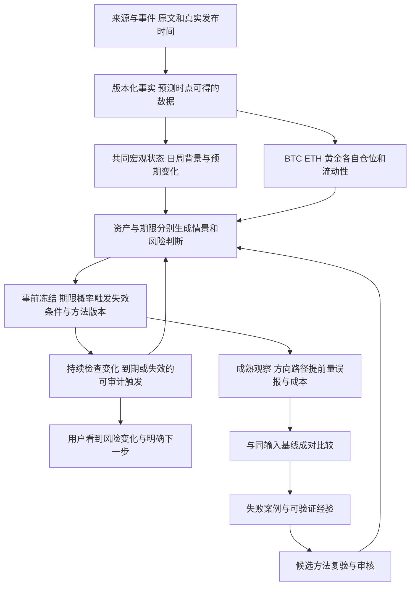

# Decision Hub 预测价值与产品方向审查草案

日期：2026-10-07。状态：**方向讨论，原整改目标已暂停；本稿不启动新目标或恢复开发**。

后续详细方案：[产品价值根因、分层架构与新目标草案](DECISION_HUB_VALUE_ROOT_CAUSE_AND_NEW_PRODUCT_PLAN_2026-10-07.md)。补充了源码结束条件审查、独立路径风险合同、最近两个月行情案例及三条工作线路；仍处于讨论阶段。

具体实施设计已补充：[市场风险V1方案入口](../design/market-risk-v1/README.md)，包含逐层代码/合同、可行性探针、指标、交付和短接续页；不需要整份加载原台账。

当前最需要检验的价值是：系统能否在结果未知时识别风险，并持续证明这些判断比简单方法更有用。现有工程已改善真实研究、留存、追溯和页面操作，但尚无正式成对实验或校准凭据证明预测能力提升。前期执行把大量工程完整性工作排在预测价值验证之前，投入与用户感知的效果发生了偏离；接下来应先改变成功标准与工作顺序。

## 用户提出的核心问题

用户反馈已投入约五天，仍未看到提前判断近期市场变化的实际效果。需要保留以下问题，不能将其缩减为页面整改：

1. 市场受全球宏观、流动性、仓位及突发事件共同影响，当前数据或判断机制是否遗漏重要因素。
2. 分钟和小时信息应如何与日、周、月的背景结合，避免短周期噪声盖过结构变化。
3. BTC、ETH、黄金是否可以共享宏观研究，同时体现各自的结构差异。
4. 多空博弈、杠杆和强制平仓是否被观察；恐慌指标是否只是事后反映价格。
5. 历史经验、失败案例和原始数据是否真正进入后续判断，而不只是落库和写报告。
6. 智能体的上下文、摘要、记忆和执行局限是否造成重复劳动或方向漂移。
7. 原目标的内容、范围与验收门是否需要重新定义，以形成可持续维护、可持续验证的产品。

这些是待逐项检验的机制假说。一次漏判不能确定是缺数据、模型失效、运行未触发或不可预见冲击，更不能直接确定存在操纵。

## 今天行情与当前报告的实际断点

### 已核实的行情

北京时间 **2026-10-07 22:04:26** 的公开交易所快照：

| 品种 | OKX现货最新价格 | 滚动24小时开价 | 计算的24小时变化 |
|---|---:|---:|---:|
| BTC-USDT | 83,187 USDT | 86,274.4 USDT | −3.58% |
| ETH-USDT | 2,566.83 USDT | 2,712.56 USDT | −5.37% |

计算为 `(last / open24h − 1) × 100`，不是北京时间零点起算收益。同期 Coinbase BTC-USD 为83,139.57美元，ETH-USD为2,565.58美元。两处公开接口在本轮人工读取时正常，说明本轮讨论可以自行检索和取数；这不能排除此前Worker的配置、超时、准入或触发问题。不同交易场所、USD/USDT及参考时点有差异，原报价应分别保留。[OKX BTC原始接口](https://www.okx.com/api/v5/market/ticker?instId=BTC-USDT)、[OKX ETH原始接口](https://www.okx.com/api/v5/market/ticker?instId=ETH-USDT)、[Coinbase BTC原始接口](https://api.exchange.coinbase.com/products/BTC-USD/ticker)、[Coinbase ETH原始接口](https://api.exchange.coinbase.com/products/ETH-USD/ticker)。

可复核的固定快照：[read-snapshot01.json](../../artifacts/predictive-direction-review-20261007/read-snapshot01.json)。链接中的实时接口今后会变化，以该文件的原始载荷、服务器日期和行情时间为本次依据。此前提到的黄金近2%跌幅未在本稿核定，不能将其与本次BTC、ETH快照视为同一时间、同一收益口径。

### 最近报告实际做了什么

截至北京时间22:05的只读盘点，最新研究结果于今天 **08:40:02** 落库；采用行情和跨资产材料主要在08:34—08:35获取。结果包含日线趋势、现货、资金费率/OI/基差、单交易所盘口、日线跨资产和三项FRED宏观材料。网络取数和宏观材料存在，但它们的观测频率与公开发布时点不同。

最新报告已经提出美元走强、实际利率偏高、交易所资金费率分歧、成交确认不足等反方信息。最终30m、24h、72h观点仍是偏多，概率均为未校准；另有独立BTC现货7d日线趋势观点。正式报告为“仅供研究”，Run为degraded，内部研究结果为completed；这些状态各有含义，不能把completed解释成预测正确或交易获准。

30m观察已保存为未命中，质量为estimated；24h、72h和7d尚未到期。不能以当前下跌直接宣布尚未成熟的期末方向成绩失败，但用户关心的盘中大跌风险与期末方向本来就是不同目标。[最近原件与观察](../../artifacts/predictive-direction-review-20261007/read-latest-case01.json)、[近期结果与实际来源](../../artifacts/predictive-direction-review-20261007/read-reports01.json)。

报告给出24h下一次复查建议为北京时间14:34:16。截至22:09，该Run没有持久化复查计划，也没有子Run，最新结果之后未保存新的研究结果。[复查记录快照](../../artifacts/predictive-direction-review-20261007/read-review01.json)。源码中确有自动调度消费者，但它依赖当前跟踪基准、有效窗口、准入门及general Worker执行；建议时间不是复查成功凭据。**未登记的具体原因仍需后续有限原件审计，不能静态猜因。** [消费路径审查](../../artifacts/predictive-direction-review-20261007/scheduler-followup.md)。

这说明本次价值问题至少包含三层：已有逆风为何没有改变风险判断；复查建议为何没有形成后续结果；用户为何没有收到及时风险变化。今天的工程验收、反馈保存和演进规划并未证明这三层闭合。

## 架构中已经具备与尚未具备的能力

| 层面 | 已具备的基础 | 对预测价值的实际缺口 |
|---|---|---|
| 来源和事实 | 官方来源目录、市场接口、采集回执、事实版本、知悉时间和准入状态 | 有目录或接口不等于每次真正采到，也不等于采用的是事件时刻可获得的数据；部分盘中宏观与预期能力仍待批准 |
| 全球宏观 | 固定储备金、实际利率、通胀补偿序列，以及日线跨资产接口 | 三项序列不足以描述完整美元流动性；尚缺经过验证的共同状态、预期差和盘中传导闭环 |
| 仓位和微观结构 | BTC funding、OI、basis、盘口深度接口 | 单所盘口失衡不是全市场多空仓位或清算风险；ETF流、期权及完整融资压力未见正式专门闭环 |
| AI研究 | 主链、反方、证据引用、有界补证和真实模型调用 | 结构合格不能认证因果真实；部分引用与因果、反方质量规则仍无完整执行器；文字反方未必改变判断或风险级别 |
| 时间与触发 | 定时复查、持久计划、队列与幂等机制 | 需要让每个到期、价格/利率变化和失效条件，都能追到触发、抑制原因或明确失败；本次建议未落成复查 |
| 结果与评估 | 事前观点、观察窗、历史排除、校准代码及成对试验结构 | 正式成对试验、配对样本、配对标签和校准凭据均为0；窗口起止收益不能完整评价大跌路径与提前量 |
| 历史知识 | 历史材料按版本进入研究上下文；已有受限PIT/replay与冻结原件重读路径 | 辅助文库材料未验证，宏观历史vintage尚未齐备；尚未证明历史知识带来预测增益或形成稳定的失败案例评测 |
| 市场扩展 | BTC永续30m/24h/72h正式范围；BTC现货7d趋势与观察有独立通道 | 黄金正式研究及观察关闭；ETH没有独立正式研究准入。黄金期货出现在跨资产输入中，不等于黄金产品完成 |

详细源码位置见[架构代理审查](../../artifacts/predictive-direction-review-20261007/architecture-agent.md)与[评估代理审查](../../artifacts/predictive-direction-review-20261007/evaluation-agent.md)。黄金准入由[market_scope.py](../../packages/kernel/decision_hub_kernel/application/market_scope.py)明确控制，不能借BTC成绩放开。

只读盘点有435条前瞻观点和250条已完成、质量为estimated的观察。原选择器快照选134条，涉及15课题，其中100条已观察、34条等待，另排除276条同课题重复；100条已观察中有52条中性、48条方向性。这些数不是100个独立、已认证的校准样本，也不证明超越基线。[当前数据库汇总](../../artifacts/predictive-direction-review-20261007/read-snapshot01.json)、[原选样页面](../../artifacts/pc-core-actions281/evolution01.txt)。

## 需要检验的市场机制

### 共同宏观背景与各自市场结构

BTC、ETH和黄金可以共同研究美元、实际/名义利率、政策预期、融资与流动性、全球风险资产和重大事件。共享的是事实和背景状态，各品种的敏感性、仓位、供需与收益标签应分别建模；相关性和影响方向会随状态改变。

首轮应围绕少量明确假说选数据：美元和利率变化是否改变风险状态；预期已被价格消化还是发生新的惊喜；杠杆与流动性是否放大冲击。不能为了“宏观完整”一次加入几十项高度相关指标。通胀补偿还包含风险溢价等成分，不能直接当纯通胀预期；储备金也不能直接当总流动性。

| 机制假说 | 待比较的数据增量 | 不能据此声称 |
|---|---|---|
| 政策与通胀预期变化 | 公布前共识/分布、实际值、修订值，利率路径定价，美元/收益率变化 | CPI高就必然跌，或看到事件标题就已理解市场定价 |
| 融资与现金压力 | 资产负债表、TGA/RRP、储备金、融资利差与信用压力；逐项检验频率和可得性 | 用一条序列的升降确定全球资金方向 |
| 加密杠杆脆弱性 | 多交易所funding/OI/basis及其变化、期权偏度、流动性与ETF流 | OI增加等于净多头；清算热力图等于真实全部持仓；清算发生后统计等于提前预测 |
| 黄金结构 | 独立黄金价格/日历、COT、ETF持有变化、期权、实物溢价与低频央行需求 | 这些时滞数据能提供分钟级实时仓位，或黄金必然与BTC同向 |
| ETH相对风险 | 与BTC共同宏观，加上ETH自身衍生品、资金流和供给/网络事件 | BTC模型能直接给ETH同样的概率与失效阈值 |

分钟和小时信息仍有作用：它们用于识别触发、市场确认、流动性变化和风险扩散；日、周、月数据提供背景。当前日线趋势支持短周期判断的做法必须与明确的短周期基线比较，不能仅凭时间尺度不同就判定有效或无效。

公开研究支持检验仓位与杠杆机制。BIS的Crypto carry研究发现高期货升水与后续崩跌风险有关，但这不保证精确预测哪天跌。[BIS Crypto carry](https://www.bis.org/publications/working-paper-1087-crypto-carry)。BIS对2026年初黄金/白银反转的历史分析讨论了杠杆产品再平衡、CTA及保证金等放大机制；这可用于构造历史案例，不是本周下跌原因的证明。[BIS 2026年3月市场回顾](https://www.bis.org/publications/qr-202603/markets-recalibrate-amid-shifting-currents)。

### 指标的领先性与信息时滞

不能把所有“恐慌指数”都判为马后炮。VIX反映标普500期权隐含的未来30天非方向性波动预期；它不是BTC或黄金的涨跌预测器。其他情绪指标是否只是追随价格，需要分别检验组成、发布日期和相对简单波动模型的增量。[Cboe VIX说明](https://www.cboe.com/insights/posts/what-the-vix-and-vix-1-d-indices-attempt-to-measure-and-how-they-differ/)。

COT通常周五发布此前周二的仓位，不能在周二回测中使用尚未发布的周五信息。[CFTC发布时间表](https://www.cftc.gov/MarketReports/CommitmentsofTraders/ReleaseSchedule/index.htm)。WGC黄金收益归因模型提供历史驱动解释；历史归因本身不是事前预测成绩。[WGC GRAM](https://www.gold.org/goldhub/tools/gold-return-attribution-model)。

“暗盘、操纵、资本博弈”中，公开持仓、资金流、价差及流动性可以作为脆弱性代理。私人场外头寸和交易意图并不完整公开。应提出可检验的竞争解释，如重新定价、对冲、现金需求、强制去杠杆；不能把无法直接观察的行为写成确定原因。

## 建议的产品与评估闭环

以下是目标架构草案，不能视为已经实现：

用户首屏应回答：现在风险是否升高；相对上次什么变了；判断依赖哪些条件；最近一次核验是什么时间；系统现在不知道什么。展开后看共同宏观、各资产差异、事前判断及完整成绩。运行审计保留，但不能成为阅读市场判断的必经路径。

预测必须先定义目标：期末方向、收益区间和窗口内大跌风险可以同时记录，但各有标签。若用户要提前规避快速下跌，需要新增预先定义的路径风险、预警提前量和误报预算；不能以最终回涨掩盖中途暴跌，也不能事后挑跌幅阈值让某个案例成为成功。

评估至少分别报告：

- 原方向命中；概率误差与校准；所有已发布预测的覆盖与弃权比例。
- 大跌预警的召回、精确率、提前量、误报持续时间，以及没有大跌的正常对照时期。
- 相对于训练期基准率、简单趋势与波动风险方法的成对增量和不确定区间。
- 若讨论交易价值，再计算可信费用、滑点、持仓重叠及真实账户路径；逐条收益加总不等于账户回撤。
- 数据延迟、报告延迟、到期/失效触发率和单次成本。未知保留未知。

当前校准主要评价“原动作正确概率”。其coverage_ratio为样本外已评估样本数除以输入样本总数，不是通过折数占比或实际出手率；accuracy也不能直接当原始方向命中率。新的成绩页要展示正确分母和目标。[当期计算源码](../../packages/evals/authenticated_forecast_calibration.py)、[评估合同审查](../../artifacts/predictive-direction-review-20261007/evaluation-agent.md)。评估备忘中原“分折占比”的文字口径已在交叉审查后更正为本段的样本比例，备忘原件保留。

固定截止时间、输入、方法、提示和阈值后做按时间滚动的样本外比较，隔离重叠窗口，并按相同行情/事件归组。同课题重复观点、同一事件影响的多个资产和期限不能当成独立成功。失败、弃权、缺数据及未成熟记录全部入账并参与可用性与覆盖统计；预测误差只对预登记可评分标签计算，同时公开评分覆盖、等待与排除原因，不只看用户愿意复盘的报告。

历史材料还存在LLM预训练知识泄漏：即便屏蔽材料日期，模型仍可能记得已发生的著名行情。因此历史模拟只能作为诊断与辅助证据；严格数值比较使用当时可得特征，最终依赖真实事前影子记录。不能把回忆出的正确历史故事计作新预测能力。

## 智能体与长期知识如何补齐

长上下文不保证关键事实被正确使用。早期Lost in the Middle研究显示，其所测模型在长上下文中对信息位置敏感；这不证明本项目当前漏判必由上下文造成，但支持检查检索和上下文选择质量。[原始研究](https://arxiv.org/abs/2307.03172)。OpenAI的会话记忆文档也讨论了摘要丢失、偏差及累积错误，需要用可复核的原件与回放检验记忆质量。[会话记忆说明](https://developers.openai.com/cookbook/examples/agents_sdk/session_memory)。

建议持久化以下对象，并让每次研究只读取相关版本：

| 对象 | 保存内容与用途 |
|---|---|
| 一页产品使命与范围 | 用户价值、预测对象/期限、成功标准、明确排除项；防止每次接续重新扩目标 |
| 来源和特征合同 | 数据含义、单位、权利、发布/修订/知悉时间、时效、失败降级及代理边界 |
| 机制假说 | 哪个状态下什么机制应出现、反证、触发阈值、待验证数据；区分观点与事实 |
| 市场事件案例 | 当时可得证据、原判断、不同情景、路径结果、错误归因和正常对照；保存“当时不知道什么” |
| 预测和成绩账本 | 原件不变、全量评分、独立性、基线、方法版本和成本，支持回查与可视化 |
| 当前接续页 | 当前决策、已验范围、待办、证据入口和停止条件；历史长日志保留检索，不整份塞入每次上下文 |

数值清洗、时间对齐、标签和评分由可重复程序负责；LLM提出机制、检查资料和解释冲突。多个代理可能共享同一数据与偏差，多数意见不能当独立统计证据。增加代理还增加路由与交接的不确定性，是否需要更多角色应由评估结果决定。[OpenAI评估指南](https://developers.openai.com/api/docs/guides/evaluation-best-practices)。

方法更新应提出候选、在固定合同下复验并审核生效。用户反馈“有帮助”用于改进阅读和研究流程；不能直接改为涨跌正确标签。重复相似失败宜归组，再形成有预算的候选实验。本次两条反馈自然触发4个演进任务、10次规划角色调用，却未形成成对评分或生效方法，说明还需要审查成本与工作归组。[反馈演进实证](../../artifacts/pc-core-actions281/receipt01.json)。

## 原目标如何调整

原AR与W整改保留为工程欠账及已有成果记录。继续原目标会把全部页面、异常分支、来源、演进和新市场串成总结束门；这不能优先回答预测增益。建议采用下面的候选目标，等方向讨论结束后再由用户确认内容和范围。

> 交付可审计的事前市场风险研究与影子评估闭环，验证共同宏观与资产结构相对简单基线是否提供稳定增量。首轮以BTC为主要被评估对象，ETH作为同期比较对象；黄金同时形成共同宏观视图及独立数据与标签合同，正式预测另做准入。允许实验结论为尚无证据或不优于基线。

这是一份范围建议，尚未创建目标。现有30m/24h/72h和独立7d记录保留；建议首轮主要验证24h路径风险及日/周情景，30m作为触发与状态观察辅助。期限及告警阈值必须在试验前固定，不能借其他期限校准结果宣传新期限胜率。

| 阶段 | 交付物 | 停止与进入下一阶段的依据 |
|---|---|---|
| 今日漏判归因 | 事前报告、原输入与事件时间线；区分没采到、已采未用、判断失误、未触发、评分错配及不可预见冲击 | 每个判断有原件；因果未证保持未知，不急于加指标 |
| 最小实验合同 | 最多2—3条机制假说，一个主基线、一个候选；品种/期限/可得数据/成本/主要损失固定 | 关键数据是否可合法稳定取得；每项增量有明确用途；先确定退出标准 |
| 历史与影子比较 | 包含上涨、下跌、震荡及冲击的时间外对照；同输入成对记录，事前冻结 | 泄漏/重复/缺件排除出有效校准集并记录；失败、缺件与弃权仍保留在全量试验分母和覆盖统计中。没有增益不晋级，不挑选历史大跌成功案例 |
| 小范围产品闭环 | 风险总览、变化原因、事前成绩与历史经验三个主要阅读入口；及时触发可追溯 | 数据与报告时效门及主路径通过，实验取得可信结论即可收口，包括无增益；只有优势证据支持候选晋级或增强预测承诺 |

工程实现可分批交付。统计验证需要等待窗口和积累独立样本，这部分单独报告“观察中”，不靠重复构建、重启或增加任务填等待时间。总验收同时允许诚实的无增益结论；不能承诺五天内证明长期稳定预测。

首轮预算和时间上限应在目标确认时固定；只处理阻塞这些交付的工程问题。每阶段完成更新唯一台账与证据入口，若无明确增量假说，不继续无界“自优化”。

## 暂停时的工程断点

原目标于北京时间 **2026-10-07 21:53:19** 经目标工具确认paused；原目标内容未被修改。最近正式发布仍为normal50/schema0071。PC优先、手机排除的约定保留。

- Root281普通反馈与补充的8项PC路径通过，刷新/返回保留原版本、两条意见和冻结评估；这是交互证明。
- 后端演进准入诊断的三个文件仍仅为候选。有限3项受控测试通过；Ruff有3处行长问题未处理，尚未合入或发布，也未证明真实研究资格。
- 三个前端组件候选受控测试4项通过，尚未发布，不计正式PC通过。
- normal51发布和文档回执503探针准备已停止。本轮方向讨论只有源/数据只读与公开检索、备忘和文档写入；没有继续这些候选修复。

唯一进度入口：[原整改执行台账](../plan/ARCHITECTURE_REMEDIATION_EXECUTION_LOG.md)。本稿调整的是待讨论的价值方向，不删除旧功能、改写旧成绩或把原目标标为完成。
