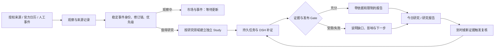
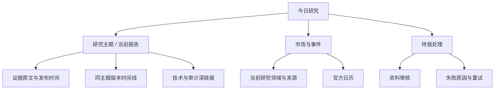

# Decision Hub UX V3：主动研究工作台 PRD（评审稿）

日期：2026-09-26  
状态：**目标设计已进入分阶段实现；生产现状以[实施与验收记录](DECISION_HUB_UX_V3_IMPLEMENTATION_2026-09-27.md)为准**  
可操作原型：[Decision Hub UX V3 原型](../ui/Decision_Hub_UX_Prototype_V3/index.html)（全程示意数据）  
依据：[全项目 PRD](DECISION_HUB_FULL_PRODUCT_PRD_2026-09-26.md)、[研究智能体产品规格](RESEARCH_AGENT_PRODUCT_SPEC.md)、[现状截图复盘](DECISION_DESK_UX_REVIEW_2026-09-26.md)、本机 API/代码核对。V2 设计包的 38 项是页面与状态，不是 38 个业务模块。

## 1. 产品定位与成功标准

Decision Hub 是持续运行的研究助理。用户默认不需要每天输入问题：系统在已授权研究领域内检查来源，发现值得研究的变化，组织证据与反方，形成有边界的结论，并在新证据到来时复核。手动请求是临时追加；报告与交易执行严格分开。

**北极星体验**：打开首页，30 秒内看懂“系统监控什么、今天新发现什么、研究结论和限制是什么、何时再看”。没有重要变化时也要清楚说明最近成功检查与下次检查。来源或 Worker 异常时不能显示“监控正常”。

本阶段不把收益率、交易建议点击量或 Run 数量当作价值指标。观察：有意义的新事件被准入的比率、发现到可读报告的时延、报告打开率、用户认为有用的比率、错误/受限结论的可见性、重复复查噪声、资料审核完成率。

## 2. 当前能力与承诺边界

| 能力 | 当前核对结果 | V3 页面处理 |
| --- | --- | --- |
| 手动发起 BTC/宏观研究、持久 Run、DSH 执行、证据与报告 | 已有真实前后端链路 | 保留，作为次级“临时研究”入口；状态、失败、重试仍可追踪 |
| 定时复查与任务恢复 | 已实现；本机最近 100 条 Run 中 97 条为定时复查 | 同一主题折叠为报告版本，不将每次复查作为一条首页新闻 |
| 官方来源、日历、准入/自动研究 | 代码链路存在；本机最近 500 条 Run 中 449 条定时复查、51 条手动、0 条 `automatic` | 页面只按真实事件显示；上线“主动发现”文案前须通过真实自动事件验收 |
| 报告的证据、反方、限制、技术轨迹 | 已有，默认层次不合理 | 结论与边界置顶，证据可展开，技术记录保留深链接 |
| 资料上传、解析、人工审核、质量复检 | 已有能力与阶段状态 | 统一一个资料入口、一条状态流程；不把“可用”误作“已被每份报告采纳” |
| 来源健康与 Worker 状态 | 已有；本机检查时部分 BLS 来源降级 | 人话显示影响范围和最后成功时间，原始码放诊断层 |
| 用户自行配置长期关注范围/通知偏好 | 尚无完整产品写接口 | 原型仅展示目标交互；生产首版只读当前范围，不能做假保存 |
| 基于报告上下文的自然语言追问 | 当前手动提交是新 BTC Run，不是对原报告追问 | 在有真实上下文合同前不作为已上线功能 |
| 黄金独立研究 | 尚无黄金领域 Pack、独立 Run/报告合同和验收；黄金期货代理数据只是 BTC 研究的跨资产事实 | 仅在评审原型中演示未来概念，生产选择器不启用黄金 |
| 通知与试点就绪 | 本机通知交付为本地 JSONL；试点 readiness 当前为 `not_ready` | 不承诺邮件/手机推送或“正式试点已就绪” |

此处“自动复查在运行”与“自动发现新的高影响事件并形成报告”是两项不同能力，不能混用。500 条是最近样本窗口；当前生产数据目录全表有 18 条 `automatic` Run，其中 17 条为 baseline，只有 1 条 `research.v1` 且因 `provider_timeout` 失败。不能说从未自动发现，也不能说真实自动来源已经形成可读研究报告。测试 fixture 应从默认用户视图隔离，但仍保留可审计记录。本机健康接口还显示 BLS 日历/发布来源降级，不能把所有来源标为正常。

### 2.1 现有功能盘点与入口去向

| 当前能力 | 现状 | 新入口或处理 |
| --- | --- | --- |
| 来源采集、观察去重、准入、优先级、自动任务 | 后台机制已有；真实自动新事件成果待验收 | “市场与事件”解释来源与事件，“今日研究”只呈现已确认结果 |
| 官方宏观日历、事件详情与修订 | 只读可用，部分来源降级 | “市场与事件”，首页仅摘录近期高相关项 |
| 手动 BTC 研究、空输入固定模板 | 空输入也会创建**新的**人工 BTC 快照 Run，不是对已有报告复核 | “研究”的次级动作，命名为“新建一次 BTC 研究”；已有报告的复核另走选中 Run 的命令 |
| 排队、研究中、失败、取消、重试、复查、反馈 | Run 状态与 owner command 已有 | 进行中任务和失败恢复；技术细节保留审计路径 |
| DSH Tool/Subagent、证据、根因图、报告、Gate | 运行与只读详情已有；结论可能 `research_only` | 报告以结论、依据、限制开头，图谱/DSH 收入详情 |
| 预测窗口、Outcome、评估、策略演进候选 | 后台与 owner 审查能力已有，未等于已证明盈利 | 研究报告的长期跟踪与高级管理；不占普通首页首屏 |
| 资料上传、解析、修正、质量复检、观点审核、版本关联 | BTC 手动资料研究链已可用；不会自动进入所有 Run；解析失败目前无资料重试接口 | “资料”独立一级；资料重试列为后端新增能力，不伪装成纯前端按钮 |
| 健康/Operations、来源错误、Runtime 模式 | 可读取，原始码多且本机有来源降级 | “系统状态”提供影响说明；原始诊断保留深链接 |
| outbox 通知 | 持久化与本地交付已有；外发推送未验证 | 不在 UI 承诺手机/邮件提醒 |
| 设计状态目录、组件规范、交付说明 | 评审资产，不是用户任务 | 从生产主导航移出，开发/验收入口保留 |

上述归类不删除审计数据或 owner 功能。相关代码入口包括 [调度器](../../packages/kernel/decision_hub_kernel/application/scheduler.py)、[研究页面](../../apps/decision-desk/src/research/ResearchPage.tsx)、[当前设计状态页](../../apps/decision-desk/src/DesignStatePage.tsx)、[Hub API](../../apps/hub_api/main.py) 与 [BTC 领域 Pack](../../packs/crypto_macro/pack.yaml)。

## 3. 用户任务与信息架构

默认用户是单 owner。任务顺序是：确认监控范围 → 日常查看新变化 → 阅读结论与证据 → 处理需要人工判断的资料/失败 → 必要时提出临时问题或追溯技术过程。

| 一级入口 | 用户要回答的问题 | 核心内容 | 次级内容 |
| --- | --- | --- | --- |
| **今日研究** | 今天有什么值得我看？系统是否正常？ | 新发现、最高价值结论、正在研究、待我处理、下次复核 | 最近事件预告、临时研究 |
| **市场与事件** | 系统看哪些领域和来源？什么事件将发生？ | 当前研究域、已发现事件、官方日历与影响市场 | 未来关注配置与通知偏好 |
| **研究** | 结论是什么？后来怎么变化？ | 按主题归并的报告、进行中任务、版本时间线 | 证据、反方、技术审计、手动 Run |
| **资料** | 上传资料处理到哪一步？我需要确认什么？ | 资料列表、单一上传、审核任务、来源与版本 | 解析块、质量复检、观点与报告关联 |

四个入口是用户任务的首页分类，不是功能删减清单。**研究任务记录、复查/重试/取消/反馈、证据和 DSH 过程仍是研究主线**：研究页必须有清楚可见的“报告 / 任务记录 / 结果跟踪”，报告一键进入本次任务和证据；任务详情一键进入原有技术轨迹、图谱与 owner 命令。另设始终可见的 **“管理与审计”** 入口承接运行与来源、业务账本、评估、策略演进和个人资产，不把这些功能藏在不明层级。

全局“待处理”角标只汇总真正需要 owner 操作的资料审核与可恢复失败，不把来源健康告警、正常自动复查或全量历史失败变成待办。该角标需要一个有当前性、去重和已处理状态的聚合投影；现有 API 尚无统一待办合同。系统状态在“管理与审计”中也有固定入口。只有组件状态目录、设计交付说明等评审资产从生产导航移出，开发/验收路径仍保留。

### 3.1 现有功能的可达性约束

| 现有入口/能力 | V3 中的明确入口 | 保留条件 |
| --- | --- | --- |
| Research 首页与主动研究状态 | 今日研究；研究 → 任务记录 | 活动任务、失败与下一步不能只在诊断页出现 |
| 宏观日历、事件详情与修订 | 市场与事件 → 日历/事件 | 原事件深链接与来源版本可回退 |
| Research Runs 列表、筛选和父子 Run | 研究 → 任务记录 | 列表、搜索、状态/触发筛选、父子关系与历史 Run 仍可见；事件级归并不能代替账本 |
| 报告、Evidence、反方、图谱、DSH 技术轨迹 | 研究 → 报告 → 依据/研究过程；研究 → 任务详情 | 从报告至具体证据或本次 Run 最多一次操作；技术内容逐层展开但不失联 |
| Run 的复核、取消、重试、反馈 | 研究 → 任务详情 | 保留原命令、权限、原因填写与审计结果，失败时可恢复 |
| Forecast、Outcome、效果评估 | 研究 → 结果跟踪；管理与审计 → 评估 | 可核对预测窗口、到期结果和不确定性，不能只留下报告正文 |
| 资料上传、解析、修正、审核、版本关联 | 资料 → 列表/详情 | 上传到引用的真实状态与回退路径保留 |
| 来源健康、Operations、业务 Inbox | 管理与审计 → 运行与来源/业务账本 | 异常从首页可直达影响详情；原 owner 数据仍可访问 |
| 历史行情 DataJob、覆盖率与失败更新 | 管理与审计 → 数据更新与覆盖 | 已有作业和 API 仍可查；需新增前端读取、失败解释与补采路径 |
| Evolution、候选晋级、个人资产 | 管理与审计 → 策略演进/资产 | owner 权限与显式确认仍有效，不能因侧栏收敛而断路 |
| 组件状态、页面目录、交付说明 | 开发/验收入口 | 不占普通用户导航，原评审路由仍可直达 |

实施时先建立新旧路由对照与回归清单。原 hash 深链接保持有效或提供可验证重定向；当前 `#/Operations`、`#/Evolution` 的 workspace 映射也须修复并回归。后台 API 和审计账本不随 UI 改版删除。研究任务列表需先有服务端分页/检索：当前 API 默认只返 100、最多 500，运行库已有 1107 条 Run，单靠前端本地过滤不能保证全历史可达。上述能力要在桌面和手机均可找到，不能把“页面变少”当作功能隐藏的理由。

### 2.2 来源抓取层级与关键时间账本

现有链路有三种不同对象，界面不能把它们都叫作“事件抓取”：① **定时来源轮询**读取官方 RSS/日历并形成 `TextEnvelope`；② **浏览器采集**由 Crawlee + Playwright 按需保存 DOM、网络、截图和 trace，提交采集回执；③ **观察准入与研究取证**把来源内容写成 Observation/Event，必要时建自动 Run，研究中取得的材料还须通过 Evidence Admission。采集成功只证明拿到了页面，不证明内容可信、已形成事件或已被报告采用。浏览器采集主要是按需工具层，不能因为它的 Worker 在线就推断定时来源全都健康。

截至 2026-09-26 10:16 UTC，本机正在运行的 API 使用 `data/core-live-20260913/db/decision_hub.sqlite3`；仓库默认的 `data/decision-hub/db/decision_hub.sqlite3` 是另一套库，不应混作当前运行状态。只读核对如下：

| 层级 | 当前已落库的时间与关联 | 当前缺口 |
| --- | --- | --- |
| 定时来源轮询 | 8 个 `source_states`：`last_success_at`、`last_error_at`、`next_poll_at`、最新耗时/错误、游标；6 个健康、2 个 BLS 降级 | 只有汇总状态，没有逐次轮询的开始、结束、结果、返回条数与重试历史；BLS 两个来源连续失败 261/263 次，只能看到最后一次 |
| 浏览器采集 | 6 条 `source_acquisition_receipts`，均为联储日历成功回执，存 `observed_at`、Hub `created_at`、URL、状态、HTTP 码、工件路径/hash；原始 DOM/网络/截图/trace 在磁盘 | 当前 `observed_at` 在开始浏览器请求前写入，不能当抓取完成时间；缺抓取开始/完成/入库的明确分界；Worker 的失败回执未提交 Hub，成功回执也尚无 Evidence 关联 |
| 事件与观察 | 88 条 Observation/Event；Observation 有 `published_at`、`observed_at`、`received_at`、`scheduled_at`、`revision_of`；10 条宏观日历与 10 条 vintage；10 个事件 watch、80 个窗口 sample | 这些时间散在多个对象，缺事件级统一时间轴与每次准入/排除的原因时间；不能把日历计划时刻当实际发布时间，也不能把 `EventRecord.event_id` 当跨修订稳定事件身份 |
| 研究与证据 | 1107 条 Run、3278 条 Run Event、6528 条 Evidence；Run/步骤/工具调用/证据有创建、执行、完成、接收或采纳时间 | 已有执行轨迹，但来源抓取、事件准入、Run 与报告版本之间缺统一可查询的时间和因果链接 |

**目标合同**：所有关键时刻持久化为 UTC，前端按用户时区显示，并同时保留时间语义、来源、对象 ID、版本/修订、记录时间和可信状态。至少区分：计划发布 `scheduled_at`、来源声称发布 `published_at`、实际抓取开始/完成 `acquisition_started_at`/`acquisition_completed_at`、内容被观察 `observed_at`、Hub 接收 `received_at`、事件准入或排除 `admission_decided_at`、研究开始/结束、证据采纳、报告发布、下次复核。未知时间保持空值，禁止用本机抓取时间补写为官方发布时间。来源时间变化以新版本追加，不静默覆盖旧版本；实际发布时间与计划时间应保留两列。

实施时新增逐次 `source_poll_attempts` 账本：来源、触发类型、应运行/开始/结束时间、成功/失败/跳过、游标前后、接收/去重/修订数量、错误码、重试关联和回执引用；成功但没有新事件也要留痕。浏览器回执升版补明确的开始/完成时间，失败也入库，原始工件继续以路径和 hash 保存并验证可读。事件时间线由现有 Observation、日历/vintage、Evidence、Run Event 与新增轮询/准入记录组成可查询投影；需要的状态变迁采用追加式记录，避免仅凭可变 `source_states` 反推历史。旧数据迁移时标明时间语义为“历史不完整”，不能倒填虚构的精确抓取时刻。

**页面规则**：普通事件详情只显示“预计发布、实际发布、系统获取、研究更新、下次复核”及来源链接；未发布或未取得时明确写“待发布/未获取”。管理与审计可展开每次轮询、浏览器工件、失败与重试。首页“最近检查”必须引用最近一次成功轮询，并与最近失败及下次尝试分开，不能用 Worker 心跳冒充来源成功。

**取舍**：原先三页方案把长期关注配置与资料审核混在一起。它们有不同对象、生命周期和操作，所以拆开；事件日历归“市场与事件”，报告不再承载整页日历。

## 4. 关键页面交互

### 4.1 今日研究

首屏顺序固定：监控健康与时间 → 近期重要变化 → 一条最高优先级结论及“仅供研究/暂不操作”等边界 → 待我处理与下一次复核。新事件必须来自真实来源、已通过优先级筛选；按事件主题去重。按钮“阅读结论与依据”进入报告；“临时研究一个问题”是次级动作。**“自上次查看后”**只有新增已读/访问状态与主题变更合同后才能使用，首版只说“近期更新”。

空态分开：① 尚未配置/启用来源；② 来源正常但暂无值得新增研究的变化；③ 来源降级，结果可能滞后；④ Worker 离线，新研究暂缓；⑤ 研究正在进行，展示当前步骤；⑥ 最近研究受限或失败，解释缺口与可审计重试。不能在未知健康时显示“暂无重要变化”。

### 4.2 市场与事件

当前首版只读展示 `BTC 与宏观` 的实际范围、来源健康、事件发现和日历。**只有一个可用领域时，顶栏显示只读范围标记，不显示单选项下拉框。**事件列表区分“已发布并研究”“已发现但观察中”“未来已知发布时间”；远期事件默认折叠。未来可编辑关注范围必须对应真实保存与回读合同，不允许只在浏览器里假保存。

### 4.3 研究与报告

“研究”默认按**主题/事件**展示报告，避免把 100 条复查 Run 都当成新结论；同时保留独立且可见的**任务记录**标签，展示原始 Run、状态、触发、父子关系和筛选。“结果跟踪”承接 Forecast、Outcome 与评估。失败和受限结果仍可找回。报告页第一屏包含：研究领域与事件、结论性质、适用时间、主要结论、行动边界、关键依据、反方与缺口、失效/复核条件。下面仍有引用原文、版本差异、研究过程与技术轨迹的明确入口。`hard_coverage_ratio=100%` 不能转译成“结论可信度 100%”。

临时动作分三类，名称和合同分清：**新建一次 BTC 快照研究**（当前空输入模板也属于新的人工 Run）、**复核这份报告**（当前需选中既有 Run 并填写原因，保留父子/版本关系）、**提交新事件/关注点**（有文本与来源）。未来的**对这份报告追问**必须携带报告版本与引用上下文；跨研究域的一键复核也需要新合同。这两项在后端合同及 Gate 验收前不作为生产可点入口。

旧 Inbox 的“提交文本”使用 `/v1/observations` 固定分析链，研究页“获取最新操作建议”使用 `/v1/research/observations` 研究链；新入口必须指定进入哪条生命周期。失败任务的“重试”必须使用既有 Run 的正式命令，不得按相同文本重新提交。任务详情的取消、重试、复查和反馈按状态显示，不能只放技术审计层。

### 4.4 资料

列表默认列文件名、研究领域、当前状态、下一步、需不需要我审核。资料详情只有一条真实进度：上传 → 解析 → 人工确认 → 质量复检 → 可供研究选择。发生解析失败先定位到文件/块；“重试解析”需新增可恢复状态与 API 后再启用。质量不足显示哪项金融语义待纠正。资料关系明确分三层：**选入 Run scope**、**在预算与上下文选择后进入研究 Context**、**最终被报告 Evidence/引用采纳**；当前版本关联接口只能直接证明第一层，不能把它显示成“报告已引用”。

## 5. 流程与状态图

## 6. 黄金等多市场扩展约束

研究领域由领域 Pack、标的范围、事件准入规则、证据需求、预测窗口、发布 Gate 和风险边界共同定义。`BTC` 与 `黄金` 不能只通过替换标题或行情代码切换。宏观事件（如同一次 FOMC 发布）可以跨市场共享，但每个研究领域的研究主题、Run、报告和结论必须独立。

目标关系：`Observation → CanonicalOccurrence → N 个 Study → 各自 Run → ReportRevision`。`CanonicalOccurrence` 是跨资产共享、跨发布修订保持稳定的客观事件身份；每次观察、内容哈希与修订仍各有独立记录。它需依据来源外部事件 ID、事件家族、计划发布时间等受控规则匹配，并保留修订链，不能直接把当前可能随内容变化的 `EventRecord.event_id` 当稳定主题键。`Study` 是稳定事件 × 领域 Pack × 规范化标的/基准 × 目标周期族形成的用户主题；`Run` 是首次研究、复核或重试的一次执行；`ReportRevision` 是通过该领域 Gate 的可见版本。跨市场复用的是带出处和时间版本的事实；各市场独立判断传导路径、反证、价格与流动性证据、适用期限、Outcome 和发布权限。持久任务业务键须包含稳定事件、领域/Pack、标的范围、用途与复核代次，防止同一宏观事件下 BTC 与黄金任务互相覆盖。标的键使用规范化内部 ID：`BTC-USDT` 与 `BTCUSDT` 可归为同一对象，`XAUUSD` 现货和 `GC=F` 期货保持不同身份。当前 Run 和事件合同缺少足够的领域关联，不能仅用 Forecast.instrument 反推。

扩展顺序：① 当前 BTC/宏观用户路径收敛；② 真实自动发现闭环与事件级报告归并；③ 补领域注册、用户关注配置和跨市场关联合同，并将历史 BTC Run 迁移到明确的默认研究域；④ 黄金独立 Pack、授权来源/现货与期货口径、证据需求与 Gate；⑤ 黄金真实事件回放和 live 验收后才开放用户切换。黄金的数据口径至少区分 XAU 现货与 COMEX 期货、报价币种、单位、交易时段、Provider 和时效门；当前 `GOLD→GC=F` 只能作为跨资产参考。若后续加入外汇、权益、利率，沿同一领域边界扩展，不增加新的全局主导航。多领域上线后的默认视图是“全部关注”的聚合动态，领域过滤只是聚焦手段，避免用户误以为未选中的市场已停止监控。

## 7. 实施门槛与验收

1. **信息清理**：验收 fixture 不进入普通“最新”排序；中文业务文案覆盖默认页面；原始 ID/枚举只在审计层。保留深链接和 API 审计能力。
2. **首页与报告**：1280×800 与 375×812 首屏均能看到结论或真实空态；报告首屏能看清限制，不被日历、Run 列表覆盖；读屏和键盘可以完成主路径。
3. **事件级归并**：同一事件的定时复查归入版本时间线；用户可比较“是什么新证据改变了结论”。
4. **主动发现**：至少一个非手动、非定时复查的真实来源事件走完发现→准入→DSH/证据→Gate→首页与报告；失败须明确呈现，不算成功。
5. **资料**：从上传到人工审核、质量复检、可用池，再到特定报告引用能回溯；不把可用池状态伪装为已采纳。
6. **多市场预留**：在黄金正式上线前验证同一次 CPI/FOMC 的日历记录、实际发布和后续修订保持同一个稳定事件主题，可关联 BTC 与黄金两个独立 Study，且报告、资料、证据和复核不串域；生产页面不提供无效黄金入口。
7. **功能等价（替换导航的阻断门）**：按第 3.1 节逐项打开旧入口和新入口，验证 Run 筛选与命令、证据深链、预测/结果、Operations、演进与资产仍可达；旧链接可打开或正确重定向。任一已有主线未迁移并通过回归前，不切换生产导航。用户不需要通过组件目录或原始 URL 猜入口。
8. **关键时间可追溯**：分别验收“成功轮询但无新事件”“来源失败并重试”“浏览器采集失败/成功”“日历预告→实际发布→修订→研究复核”。每次尝试与关键状态变迁能按稳定事件/来源 ID 从数据库查询；页面能解释计划、发布、获取、入库与研究时间的差别，并可回到原始来源或工件。重启后历史不丢，时区转换正确；无法确认的时刻显示未知，不制造精确时间。
9. **后验与数据覆盖**：数据作业的完成/失败及覆盖区间有管理入口；有效方向 Forecast 到期后能继续取得 Outcome，`no_trade/neutral` 不堵住到期队列；未到期或未校准不显示胜率。当前演进资产为空须显示真实空态。

本 PRD 通过评审后再改现有前后端。评审重点是用户目标、页面顺序、能力边界和多市场对象关系；原型中的文字与案例均为示意，不构成真实研究结论。

## 8. 多视角审查后的取舍

- **能力审查**否定了“定时复查很多次＝主动发现已验证”的表述，也指出通知仅本地交付、报告追问和用户关注配置缺少合同。因此原型逐页标示示例状态，PRD 将这些能力分阶段验收。
- **用户体验审查**否定了把关注、事件与资料合成一页的三入口方案；它们各有不同的对象和人工任务。因此采用四个用户入口，同时把待处理放在全局、技术诊断放在维护入口。
- **多市场审查**否定了“把 BTC 换成黄金文案就能切市场”的方案。黄金在产品选择器中禁用，评审工具单独演示长期对象关系；同一个宏观事件可共用事实，却必须生成分市场的研究主题、任务和报告。
- **原型二次审查**发现示例健康状态像实时数据、关注按钮假保存、证据无法点到原文、复核按钮误开技术审计、移动底栏位置错误。原型已改为就地标示“示例/非实时”，关注选择不保存，证据只展示结构，复核有独立时间线，并以真实截图检查移动底栏。
- **最终复审**补充了现有手动新 Run 与复核命令的区别、资料选入/入上下文/被引用的三级关系、资料失败重试所需新接口，以及稳定事件身份和规范化标的键。原型增加事件状态筛选与详情、可演示的资料确认/驳回、准确的待办数量；未来黄金概念进入独立 URL 状态，浏览器返回可恢复。
