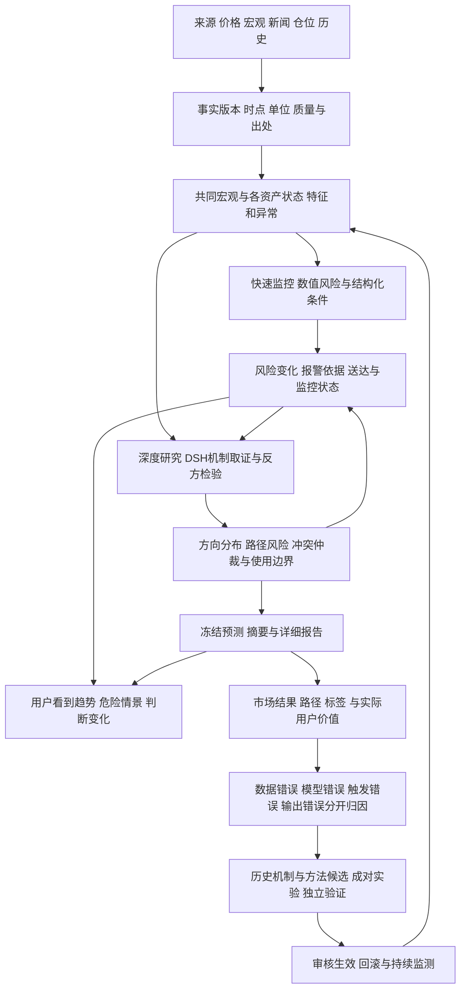

# Decision Hub 产品价值根因与新方案

日期：2026-10-07，Asia/Shanghai。状态：**详细讨论稿，旧目标保持暂停，不沿原整改顺序执行；新目标尚未创建**。

后续已补充[逐层技术方案入口](../design/market-risk-v1/README.md)：代码复用与新增合同、技术可行性、具体实现、数值验收、有限探针和批次；下一轮从[当前一页纸](../design/market-risk-v1/CURRENT_FOCUS.md)按需读取，历史长台账仅作证据。

当前问题贯穿长期迭代，不应只归因于最近五天或某次行情。原设计已明确要求主动研究、主反分析、触发与失效、事前预测、结果评估及经验复用；实际实现却未形成稳定的“用户及时理解风险并得到帮助”的闭环。此前整改以运行、覆盖、保存和页面通过为主要推进单位，没有充分验证这些单位怎样改善用户决策。

这些要求在[9月21日预测研究升级计划](../plan/PREDICTIVE_RESEARCH_UPGRADE_PLAN_2026-09-21.md)中已有记录。此次不是首次提出预测和学习，而是重新审查原意为何没有被实现合同、结束条件和验收结果保证。此前方向讨论见[初步审查](DECISION_HUB_PREDICTIVE_VALUE_DIRECTION_REVIEW_2026-10-07.md)，状态和未完成项统一见[唯一执行台账](../plan/ARCHITECTURE_REMEDIATION_EXECUTION_LOG.md)。

**最强结论是价值目标、研究结束条件、风险合同、自动监控和评估目标没有对齐。** 今天的数据和报告能够证明若干具体断点，但尚不能确定市场变化的全部原因，也不能将某个模型、上下文限制或框架认定为唯一漏判原因。

## 用户要求的重新理解

用户希望系统在行情变化前及变化过程中发挥作用，尤其对单日大幅波动和杠杆暴露给出清晰提醒。单次摘要、详细报告、持续更新与结果学习都应服务这一目的。长期迭代若主要增加流程、页面和审计，仍不足以实现这项价值。

此次审查应回答：

- 当时信息是否准确、及时且有用；有效因素有没有被遗漏或错误解释。
- 价格趋势、波动、宏观预期、流动性和仓位怎样联合影响判断；反方是否改变结果。
- DSH、LangGraph、需求表、上下文选择和停止条件是否影响研究深度与新机制发现。
- 风险是否被量化、结构化和持续求值；报告写出的条件是否真的在运行。
- 输出是否让用户理解依据、危险情景、判断边界及下一步，还是只看到方向标签。
- 历史经验是否能在当时信息约束下复用，失败是否真正形成可验证方法更新。
- 预算是否削弱关键研究；系统怎样保证质量、可维护性和扩展性，同时避免无界循环。

本方案同时考虑金融技术分析、宏观与市场结构、智能体执行和产品交付。技术分析与宏观分析不是互相排斥的路线，各自必须通过时间外比较证明用途。

## 已确认的根因及仍待归因的因素

| 问题 | 已确认事实 | 对用户价值的影响 | 证据边界 |
|---|---|---|---|
| 预测对象不完整 | 当前观察器主要以窗口起止价格评价方向 | 期末上涨也可能途中大跌；方向正确不能证明杠杆持有安全 | 未据此断言仓库其他位置绝无风险指标 |
| 趋势与危险程度混用 | 日线趋势基线使用均线与收益判方向；计算的波动没有进入该基线的风险等级 | “趋势仍偏多”容易覆盖“今天可能发生严重逆向波动” | 趋势基线本身可保留，但需限定用途 |
| 风险条件没有完整机器合同 | 触发/失效主要是自由文本；复查服务消费已标注的失效事实，不自行理解并计算每句条件 | 写了风险仍可能没有实际监控、报警与结果回查 | 上游如何产生每个失效标记仍需核验 |
| 研究充分性定义偏窄 | 覆盖达到充分、主张和方向存在时，有提前结束方向分析的快捷路径，检查顺序先于部分loop阻塞 | 声明内资料齐全可能压过尚未解决的机制或反方问题 | 今天实际命中哪条图分支、是否有阻塞性挑战尚未证明 |
| 新机制发现受需求表约束 | 无法映射到已声明requirement的自由问题不自动创建新需求；无批准可执行路线则结束 | 需求表可能固化已有视野；发现未列因素仍不能继续取证 | 权限控制有必要，应提供受控扩展路径 |
| 风险展示优先级低 | 首屏突出各期限方向和前两条主链推断；反方默认折叠 | 用户首先接收到偏多，未直接看到风险如何影响观点与使用条件 | 完整主反链、引用及确认/失效仍保存，并非全部删掉 |
| 持续跟踪未闭合 | 今天最新结果08:40，建议14:34复查；22:09对应复查计划与子Run均0 | 白天新变化未形成后续报告；用户不能依靠旧报告获得当前风险 | 未登记的具体原因未知，不能只凭静态源码归因 |
| 学习尚无实证闭环 | 正式成对试验及校准凭据为0；反馈规划会生成任务和候选，未证明方法增益 | 自动规划不等于自动学会市场预测；工程缺陷反馈容易主导演进 | 已有受限PIT/replay、原件和前瞻记录，应复用 |

来源：[风险与报告审查](../../artifacts/value-root-cause-review-20261007/risk-output.md)、[运行边界审查](../../artifacts/value-root-cause-review-20261007/runtime-boundaries.md)、[最新报告原件](../../artifacts/predictive-direction-review-20261007/read-latest-case01.json)、[复查只读记录](../../artifacts/predictive-direction-review-20261007/read-review01.json)。

根因可以表达为一条可检验的链：**研究目标主要落到方向输出和预定义材料覆盖，盘中风险缺少独立标签与计算合同；风险文字没有稳定转为条件求值和通知；用户展示又优先突出方向；反馈评价仍未纠正这些目标错配。** 这条链可以解释产品为何长期能产出报告，却仍缺乏用户期待的危险提醒。

对于今天的具体漏判，还要区分以下原因：数据缺失/迟到、事实已取但未用于判断、机制解释或权重失误、方向快捷结束、监控未登记/未求值、通知失败以及不可提前观察的新增冲击。每项要由冻结原件和时间线裁决，不能合并成一句“少收集宏观数据”。

## 今天报告中的具体风险错配

最新报告包含6条主链、3条反链，已经写入美元走强、实际利率偏高、资金费率分歧、负基差及量能不足。30m/24h/72h仍为偏多，主观概率均未校准。缺口因此不只是信息没有进入报告，还包括反方如何改变方向分布、尾部风险、监控级别和使用条件。

冻结日线参考价为85,561.3，SMA60为77,236.59，距离约−9.73%；SMA20为83,858.665，距离约−1.99%。日趋势失效可能要求日线收盘或组合宏观条件。**价格在趋势失效前已可能发生危险盘中波动。** 上述距离只是假定同一冻结价位的计算，不是止损或清算线，也不是当前价格。[原件](../../artifacts/predictive-direction-review-20261007/read-latest-case01.json)。

北京时间22:04的公开现货快照，BTC滚动24小时−3.58%，ETH−5.37%。举例，假设在该滚动窗口起点建立线性多仓，初始名义仓位/初始权益=10，名义暴露固定、抵押品计价不变、忽略费用与再平衡，且期间未被清算，则终点相对初始权益的敏感性约为−35.8%和−53.7%。这不是08:40报告发布后的收益，也不是用户账户实绩。这说明风险提醒必须与方向分开；实际清算还取决于保证金档位、标记价格、抵押品、全仓其他持仓等，不能套用通用1/杠杆公式。[固定报价快照](../../artifacts/predictive-direction-review-20261007/read-snapshot01.json)。

24h等预测尚未成熟，不能提前记为期末失败。但没有及时预警的盘中风险也不能被将来的回涨抹掉。两种用途需要独立评价。

## 最近两个月的大涨案例

检查2026-08-07至10-07之前的已完成日线，找到符合用户描述的候选案例：

| 品种与口径 | 当天开盘至收盘 | 日期意义 |
|---|---:|---|
| OKX ETH-USDT UTC日线 | 8月19日＋17.46% | 北京时间8月19日08:00至20日08:00 |
| Coinbase ETH-USD UTC日线 | 8月19日＋17.47% | 独立交易场所核对，USD与USDT不混同 |
| OKX ETH-USDT北京时间日线 | 8月20日＋11.51% | 北京时间零点至次日零点 |
| OKX BTC-USDT UTC日线 | 8月19日＋7.12% | 共同市场上涨，幅度明显不同 |

[OKX历史接口](https://www.okx.com/api/v5/market/history-candles?instId=ETH-USDT&bar=1Dutc&limit=100)、[Coinbase历史接口](https://api.exchange.coinbase.com/products/ETH-USD/candles?granularity=86400&start=2026-08-19T00%3A00%3A00Z&end=2026-08-20T00%3A00%3A00Z)。固定载荷与计算：[recent-daily01.json](../../artifacts/value-root-cause-review-20261007/recent-daily01.json)、[独立报价核对](../../artifacts/value-root-cause-review-20261007/case-exchange-confirmation01.json)。

公开时间线包含至少两类不同信息：

1. Fidelity Ethereum Fund的托管与质押安排相关8-K，报告事件为8月7日，SEC实际提交/接受页显示8月10日。研究应使用可公开获得的时间，不能按事件日期提前纳入。[SEC原文](https://www.sec.gov/Archives/edgar/data/2000046/000119312526342079/ck0002000046-20260807.htm)、[提交时间](https://www.sec.gov/Archives/edgar/data/2000046/000119312526342079/0001193125-26-342079-index.htm)。
2. 美国财政部8月19日宣布扩大部分长期名义国债流动性支持回购，9月9日生效。当天公告页不能单独证明首次公开到分钟的时点，也不能当成前一天已知，更不能直接解释成美元总流动性或货币创造翻倍。[财政部公告](https://home.treasury.gov/news/press-releases/sb0607)。

这些材料可产生供需与流动性假说，不证明17%涨幅事前确定，也不证明它们分别造成多少涨幅。事后媒体报道只能辅助建立候选机制；还需要公告前的预期、仓位、价格和成交确认，以及未发生大涨的对照样本。

本次正式库的研究结果最早记录为9月13日，8月18—19日记录为0，不能评价当时系统究竟给出了什么预测；也不能由本库无记录推断其他旧库或归档全无。已有历史PIT/replay可辅助诊断，最终需真实前瞻验证。[本库范围与冻结质量](../../artifacts/value-root-cause-review-20261007/frozen-quality01.json)。

**应分别追求事前脆弱性识别和事件后的及时重新定价。** 在公告前检验是否识别了大波动或逼空风险；公告后检验更新有多快、是否仍维持陈旧观点。反应能力可以有实用价值，但不能记为公告前预测成功。

## DSH与LangGraph的职责及限制

### 当前职责

DSH负责内层模型、工具、会话和直接子代理。LangGraph负责外层研究轮次、状态恢复、证据累积、覆盖判定及最终冻结。当前研究运行时选择DSH或DSH Web等明确路径；另外的LangGraphAgentRuntime用于演进规划及可选资料处理。没有证据证明两个框架同时在争夺同一市场判断的控制权。[当期源码审查](../../artifacts/value-root-cause-review-20261007/runtime-boundaries.md)。DSH官方架构也将会话、模型请求与工具执行放在其Agent Loop职责内。[DSH官方Core说明](https://deepseek-harness.github.io/deepseek-harness/en/reference/subsystems/core)。

需要收紧的是状态与责任边界：业务任务、市场事实、预测及报警由Hub统一持久化；DSH管理模型会话与工具执行；外层图管理研究生命周期；金融数值模型与条件计算通过稳定接口调用。复查和通知由业务调度负责，不能同时依赖Hub计划与DSH会话提醒作为互相替代的成功证明。无需为了架构整洁先重写运行时。

### 不能将本次结果直接归因于省token

今天冻结结果是一轮、9次工具调用、4个子代理，停止理由为sufficient，bounded=false；total_tokens和估算费用为null。因此未发现因token/cost上限结束的证据，实际资源使用也不完整可见。[冻结质量](../../artifacts/value-root-cause-review-20261007/frozen-quality01.json)。

当前Pack源配置已有10轮、100工具、32子代理、30分钟等上限；这不是当时有效冻结预算的证明。SDK profile包含low reasoning effort与压缩配置，但本次有效Web Host profile及实际压缩尚未核实。旧选择器12条/4000字符规则也不能直接套今天全部上下文：有新的选择服务，模型还会新增工具证据。冻结manifest中1条初始输入，不等于本次只看1条事实，报告另外采用了13条新增Evidence。

本次真正需要检查的是：如何判定研究充分、反方挑战是否获得处理、是否发现需求表之外的重要机制。当前方向快捷收口先于部分阻塞检查，是明确的静态设计风险；其对具体Run的作用需另行证明。配置起源与本次研究有效版本不完整，不能宣称“最近又减少预算导致错误”。

### 质量优先的预算与上下文方案

- 对关键风险给足研究预算；遇到重要新冲突，进入更深研究并显式提升资源等级。
- 完成条件检查必需事实、最强反证、尾部情景、未知和监控状态；耗尽预算只产生“未解决”状态，不能转为“充分”。
- 按机制组织数值、主反证据、事件时间线和历史适用条件，保护关键反证与新风险，防止被新闻数量挤掉。
- 保存选中、排除、摘录及压缩前后的关键事实核对；丢失哪些信息要可查。
- 固定输入，比较当前与扩容预算/上下文方案的实质遗漏率、风险判断和样本外成绩。资源扩容依据具体遗漏，不依据文本更长或角色更多。
- 给新机制发现受控提案：映射来源与合法访问路径，审核后纳入需求；未能取证时保留明确未覆盖状态。

上下文无法无限增长。预算和循环边界应避免重复与失控，同时保证未解决的重要风险不会被包装成成功。多代理的同源结论仍可能相关，不能把多数意见当独立统计证据。[OpenAI评估指南](https://developers.openai.com/api/docs/guides/evaluation-best-practices)。

## 分层架构与三条工作线路

下面是目标结构，不表示已经上线。模块优先复用当前服务、账本和适配器，不按每一层增加一个后台进程。

| 层 | 应交付的对象 | 必须回答的问题 |
|---|---|---|
| 产品使命与用途 | 被研究资产、时间尺度、方向/风险用途及使用边界 | 用户靠它做什么；如何判断有帮助 |
| 信息获取 | 稳定来源、原文、采集状态与事件流 | 哪个事实最新；缺的是否关键；失败能否恢复 |
| 事实与时点 | 单位、版本、发布时间、知悉时间、质量及血缘 | 当时真的知道吗；修订与旧版如何区分 |
| 市场状态与特征 | 趋势、波动、流动性、预期差、共同宏观与资产结构 | 什么正在变化；处在哪类市场状态 |
| 机制研究与反方 | 主反假说、竞争解释、证据和未知 | 为什么可能发生；什么能推翻；新因素能否查证 |
| 数学风险与仲裁 | 收益分布、路径风险、触发条件及信息冲突的处理 | 偏多时能否仍危险；最坏情景有多大依据 |
| 监控与交付 | 结构化条件求值、报警、深度复查与送达 | 写出的条件是否在看；谁在何时收到提示 |
| 摘要和报告 | 统一的可读输出及原件下钻 | 用户能否理解依据、危险与下一步 |
| 结果与经验 | 全量成绩、错误归因、机制案例及候选实验 | 哪部分确有增益；哪些需要停止或回滚 |

三条线路有不同时间尺度：

1. **快速监控**：以可信价格、波动、流动性和事件状态快速更新风险，不等待长篇研究结束。按来源实际可支持频率定义SLA；先发明确的事实变化，再补解释。快速响应与事前预警分别计分。
2. **深度研究**：围绕新机制或关键冲突查证、比较主反解释，预算服务于研究充分性。深度报告有延迟，不能占据全部即时报警通道。
3. **方法研究**：按失败类型提出候选，进行固定输入的实验与影子观察，再审核启用。不能由每条用户反馈无界启动完整演进，也不能为等成熟标签反复构建。

## 每层数据与能力增强

### 共同宏观及多资产

共同输入包括美元、实际与名义利率、政策路径预期、通胀/增长惊喜、融资与流动性、全球风险资产、信用及重大事件。需要level、change、surprise、known_at与revision，不能只放一个最新值。数据首先围绕预登记机制选择，用增量实验决定保留。

BTC/ETH还需各自多交易所资金费率、OI与变化、基差、成交/盘口、期权与资金流；黄金需独立现货或期货品种、交易日历、COT、ETF/期权与实物结构。盘口失衡不能代替全市场净仓位；期货持仓有匹配的多空两侧，OI不能直接解释成净多。[BIS Crypto carry](https://www.bis.org/publications/working-paper-1087-crypto-carry)。

黄金与加密可共享宏观背景，但相关性、仓位机制和标签分别验证。当前ETH、黄金正式研究准入均不能冒称已完成；黄金期货是某些跨资产输入，也不等于XAU现货已开放。COT等数据有发布时间滞后，必须按当时可得信息使用。[CFTC发布时间](https://www.cftc.gov/MarketReports/CommitmentsofTraders/ReleaseSchedule/index.htm)。

### 金融技术分析

趋势、动量、波动、量价确认、区间突破、流动性与跨资产相对强弱需要分开计算，并说明各自适用状态。日/周背景提供状态，分钟/小时确认触发与风险扩散。日线均线可以做基线，但不单独承担短期路径或杠杆警报。不要同时增加大量指标，再靠LLM挑出事后解释最顺的一组。

### 历史与信息价值

资料落库应进一步形成机制案例：当时的信息、原预测、预期、仓位、关键触发、反证、结果路径、错误归因和正常对照。检索按资产/期限/状态/机制及可得时点，显示相似与不相似之处。宏观vintage、新闻原版与当时采集时间不齐时，历史比较保持不完整。

评价每类数据对基线的增量，也观察错误、时延、采集成本与维护成本。历史类比用于生成可检验假说，不能直接复制结论。LLM可能从预训练记得后来结果，因此历史故事正确不能作为新预测成功的证明。

沉淀数据应成为用户能使用的可视化：在同一研究对象下展示事实与宏观事件时间线、方向/风险/报警叠加的价格路径、观点版本变化、机制与反证关系、历史相似案例及不同处、真实成绩与数据覆盖。用统一时间轴区分市场发生、首次公开、系统知悉、研究发布、报警产生和实际可见时点；未落成的计划与失败通知直接显示，不能用“有报告”掩盖空白。成绩同时展示提前量、漏报、误报、风险区间覆盖和相对基线增量。它们服务于复盘与下一次判断，不单独堆出另一套管理页面。

## 数学模型与风险合同

必须分开四个对象：**方向与幅度、持有期间路径风险、账户暴露情景、监控与通知状态**。暂时缺少某项时分别显示未知，不能由方向字段填补。

### 方向与路径

收益目标为 `R(h)=P(t+h)/P(t)−1`。对初始长仓，最大不利偏移可记为窗口内 `max(0,1−P(s)/P(t))`；对初始短仓则为 `max(0,P(s)/P(t)−1)`。峰谷最大回撤另算，不能与初始持有的不利偏移混同。

应估计并验证：给定截止时刻的信息，某期限收益区间，以及长/短仓不利路径超过预定义幅度的条件风险。正向暴涨同样可能危及空仓，不仅检测暴跌。日线终值概率和盘中穿越概率不同，不能相互代替。

模型路线采用可维护的比较阶梯：

1. 先建立无条件/按状态的经验分位数、简单趋势、实现波动及动态波动基线。
2. 检验宏观预期、跨资产与资产结构的增量；用可解释条件模型、分位数回归或厚尾动态模型作有限候选。
3. 数据与样本充分后再评估状态切换、跳跃和尾部联合模型；不同时上线整套模型目录。

VaR描述某一置信水平的损失分位，ES描述超出该分位后的平均损失；它们不能单独提供盘中最大不利偏移或清算保证。ECB相关研究也强调模型假设、厚尾和极端样本不足的问题。[原始研究](https://www.ecb.europa.eu/pub/pdf/scpwps/ecbwp075.pdf)。分位数、风险概率和区间都需要各自的覆盖/误差检验，不能由LLM临时编数。

### 账户情景

可选输入包括品种、方向、名义仓位、保证金模式、抵押品与交易所规则；没有这些信息时仅展示标准敏感性情景，不声称个人清算距离或安全杠杆。增加杠杆视图不是增加自动下单权限。

### 条件求值与报警

结构化条件至少包含指标、来源、品种、单位、比较符、阈值、观察窗、求值频率、持续时间、时效、适用期限、级别、升级动作、冷却与版本。原自然语言作为解释保留，机器计算使用结构字段。

每次求值保存输入快照、known_at、结果和理由；分别记录未触发、触发、缺数据、数据过期、规则错误及监控停止。数据不可用时返回未知并显式提示，不能保持绿色。通知保存产生、发送、送达和已读状态；发生风险变化新增记录，不改写原预测。

预警区分：事前风险状态预警、条件触发预警和事件后解释更新。提前量以告警实际可见时间计算，不能用研究开始时间替代；事件后才发出的警报不计事前命中。参数、误报预算和退出标准在试验前固定。

## AI分析与完整报告合同

主反分析需要有明确影响：每条重要反证是改变方向分布、增加尾部风险、提高报警级别、宣布未知，还是暂不改变；依据与理由须能复核。独立审查者提出的关键挑战要有处理记录，不能仅因资料覆盖达到100%而忽略。

深度研究可按任务分工：事实核验负责时点与来源，宏观和资产结构研究者提出机制，反方审查者找最强竞争解释，仲裁负责记录哪些挑战改变了结果。角色通过冻结事实和结构化争议交接，而不是互相传递逐轮变短的摘要。数值风险与评分由可重复程序计算，AI承担假说、取证、冲突解释及报告；角色数量和是否分开执行应由遗漏率、时延及预测增量决定。

风险数据、事实覆盖、因果完整性、观点可发布和杠杆适用性有各自状态。“方向可以输出、尾部风险未知”是合法结果，但用户必须直接看到这一组合。

### 首屏示例

以下用今天的已存状态说明报告应怎样表达，属于新展示合同示例，尚未上线：

> **研究方向：24小时偏多，尚未校准。**
>
> **盘中风险：尚未量化，现有方向不能说明杠杆持有安全。**
>
> 支持依据：日线趋势、现货确认。最强反方：美元和实际利率逆风，衍生品与量能确认不足。
>
> 研究数据主要截至今天08:35。最新报告08:40；建议14:34复查，截至22:09未发现对应持久计划或子任务。当前持续监控状态不能视为已完成。
>
> 展开查看：风险如何影响判断、具体失效条件、原始依据与事前成绩。

首屏不能把“偏多”独立放大而让风险、反方和陈旧状态藏在折叠中。默认摘要应包含方向、风险、最危险情景、最强反方、发生变化的条件、实际监控/复查状态、数据时点与未知。

### 详细报告

完整报告按以下顺序组织，技术字段进入可展开审计：

1. 研究问题、资产、期限和数据截止。
2. 市场状态及相对上一版的变化。
3. 关键事实与来源，已发生/预期/修订分开。
4. 主链和最强反链的机制、支持和反证。
5. 冲突如何处理，以及为什么当前判断如此。
6. 收益与路径情景、可能的放大机制和条件。
7. 结构化触发/失效、实际求值及监控状态。
8. 对不同暴露的情景影响与适用边界。
9. 缺口、未知、竞争解释和进一步查证价值。
10. 实际复查计划、风险通知及后续结果入口。

用户应获得可复核的完整分析依据、方法和判断变化，不必阅读原始日志才能理解。报告篇幅按内容充分性安排；摘要和详细报告共用同一冻结对象，避免缩写时丢掉关键反证或改变结论。

## 可维护性与可控进化

业务真相统一由Hub的版本化账本保存；来源、特征、机制、数值模型、研究执行、条件求值、输出和评分通过明确合同连接。新增品种优先扩展领域包、数据与日历合同及标签，不复制全套编排；新模型采用相同预测接口，审核后替换可回滚版本。

经验存储包括：产品使命、来源合同、机制假说、事件案例、完整预测成绩、失败归因与当前接续页。原件保留，给智能体提供相关机制和版本，不把数千行工程日志当全部长期记忆。[OpenAI会话记忆说明](https://developers.openai.com/cookbook/examples/agents_sdk/session_memory)。

自进化至少分四类输入：数据错误、运行/监控错误、模型/机制错误、输出/理解错误。模型预测错时，需要成熟标签和基线比较；用户反馈有帮助时，不能直接生成涨跌正确标签。新候选必须指出改变什么、预期改善哪项指标、如何可能被证伪。

一次只检验有限候选，保存原输入和方法版本，按时间外与真实影子成绩裁决。全部预测、弃权、运行失败与缺数据进入发布/报警账本和可用性、覆盖统计；方向、Brier和路径误差只对预登记且具备可评分标签的样本计算，未知不能被强行标为预测错误。同时公开完整发布数、可评分数、评分覆盖、弃权及排除原因，避免只报有利样本。无增益、过拟合或风险超限可结束实验并拒绝晋级；遇到成熟等待单列观察，不继续无意义工程循环。审核后启用、监测漂移，必要时回滚，不能自主反复修改正式策略追逐最近行情。

## 全新目标草案与阶段交付

候选目标如下，尚未建立目标卡：

> 建立并验证面向BTC、ETH与黄金的多尺度风险研究产品，使用户能直接理解方向、危险路径、变化条件和监控状态；交付及时风险变化与完整主反分析，并用固定基线和真实前瞻成绩证明增量或明确无增益。

共同宏观层同时考虑三类资产；首轮以BTC、ETH的可获得真实数据验证，黄金独立完成来源/品种/日历/标签准入后加入正式成绩。不用BTC成绩代替ETH或黄金资格。旧功能、原件和已验成果保留，旧AR/W顺序不作为新目标的主线。

| 阶段 | 核心交付 | 阶段结束标准 |
|---|---|---|
| 根因与合同冻结 | 今天下跌与8月ETH大涨的时间线、真实旧判断、停止/监控断点；方向/路径/报告合同 | 已证与未知分开，具体断点有证据，完整历史分钟因果未证则明确保留；范围及退出门预先固定 |
| 风险与监控主线 | 结构化条件、完整路径标签、简单风险基线、快速监控与通知回执 | 覆盖正常、触发、缺数据、陈旧、重复、恢复和送达路径；风险提示可核对，不等待长研究 |
| 深度研究与输出 | 主反仲裁、风险充分性、受控机制扩展、完整报告与首屏 | 关键挑战不被快捷收口吞掉；主要用户场景能理解危险、依据和实际下一步；暂停/预算退出不伪装充分 |
| 数据和模型增量 | 预登记少量机制，一主基线一候选，历史诊断与真实影子配对 | 相同截止/输入/标签与完整分母，重叠隔离；得到可信优势、无增益或证据不足结论，均可完成本阶段；后两者不晋级 |
| 扩品种和持续维护 | 黄金独立准入，多资产风险状态、经验检索及审核回滚 | 品种、来源与标签独立通过；可维护接口和运行成本有实证，无需复制另一套研究系统 |

实现与观察有不同进度：工程阶段按具体交付验收，模型统计资格按独立样本、置信区间与前瞻期限验证。两者分别汇报，不能保证几个工作日内形成长期稳定预测，也不能因观察期尚未结束把工程无限延长。

开始实施前确定主要用途、首轮期限、尾部阈值、误报容忍、数据权利/预算及阶段时间上限。原用户“预测风险、详细解释、长期学习”的要求已经明确，不重复问这些已授权方向；具体合同应做成可审阅对象后确定。

本轮完成两项代理静态审查、有限公开历史取数、冻结报告只读和方案记录；没有产品源码修复、模型研究调用、构建、迁移、重启、发布或旧目标接续。下一次工作应由本新方案明确范围，避免重新回到外围验收清单。
