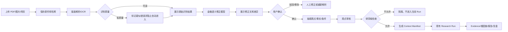

# Decision Hub 资料研究与文档复核 PRD

日期：2026-09-22  
状态：实施前产品需求冻结草案  
关联方案：[资料智能入口与研究域隔离方案](../plan/DOCUMENT_INTELLIGENCE_AND_RESEARCH_ENTRY_ARCHITECTURE_2026-09-22.md)  
适用代码：`apps/decision-desk`、`apps/hub_api`、`apps/hub_worker`、`packages/kernel`、`packages/provider_adapters/research`、`contracts`

## 1. 这份 PRD 修正了什么

之前的方案把“资料解析完成”直接连接到“观点抽取”和“核心研究”，这个交互设计不完整。用户实际需要先回答：

- 文件到底有没有识别成功；
- 哪些段落、数字、表格和图片识别错误；
- 模型修正了什么，为什么修正；
- 修正后的文字是否仍然忠于原文；
- 哪些内容可以进入研究，哪些内容必须被隔离；
- 资料质量不足时，系统是否会阻止它影响交易方向。

因此本 PRD 将链路固定为：

```text
原始资料
  → 原件归档
  → OCR/版面解析
  → 原始识别结果可视化
  → 识别质量检查
  → 金融语义模型修正
  → 原文/修正文对照
  → 用户确认或驳回
  → 观点候选抽取
  → 观点审核
  → 选择研究域和时间点
  → 进入现有 Decision Hub Research Run
```

任何一步未通过，都不能自动进入核心研究链路。

## 2. 产品目标

### 2.1 第一目标

用户提供 PDF、扫描件、截图或允许访问的文章后，能够在一个页面内完成：

1. 查看原始文件；
2. 查看原始 OCR/版面解析结果；
3. 查看解析质量和疑似错误；
4. 查看金融语义模型修正后的文稿；
5. 查看原始文本与修正文的差异；
6. 确认、驳回或人工修改修正结果；
7. 查看系统从文稿中抽取的观点、事实、预测和条件；
8. 选择资料进入哪个研究域；
9. 启动现有核心研究链路；
10. 在最终报告中回到原始页码、区块、表格或图片。

### 2.2 产品不承诺

本功能不承诺：

- OCR 一定百分之百正确；
- 模型修正一定是真实原文；
- 博主观点一定正确；
- 资料加入后交易胜率自动提高；
- 任何外部观点可以替代市场数据和官方信息。

产品必须把不确定性显式显示出来，而不是把低质量内容隐藏在一段漂亮摘要后面。

## 3. 结合当前项目后的产品边界

当前项目已有：

- `Decision Desk` 的 `Research` 页面和 Run 详情页；
- `ContentAddressedDocumentStore` 内容寻址文档存储；
- `document.readback` 原文回读能力；
- `source_acquisition_worker` 的 Playwright/Crawlee 采集回执；
- `ResearchContextManifest` 研究上下文清单；
- DSH 作为研究执行 Harness；
- Evidence、Gate、Artifact 和复查链路。

当前没有完成：

- 本地文件上传入口；
- PDF/图片结构化解析入口；
- 原始 OCR 可视化；
- 金融语义修正和变更对照；
- 低质量资料拦截；
- 观点审核入口；
- 资料绑定 Research Run 的完整 UI；
- 文档版本、解析版本、修正版本和观点版本的可追踪展示。

本 PRD 不改变 DSH 的职责，也不增加第二条 Agent Loop。资料处理是一个独立的 Document Intelligence 子域，只有“确认后的资料上下文”才进入现有 Research Run。

## 4. 用户角色和使用方式

### 4.1 资料提供者

每天上传博主 PDF、图片或文章，关心：

- 资料有没有读对；
- 关键数字有没有错；
- 系统有没有误解作者的语气和条件；
- 今天的资料有没有覆盖到历史资料。

### 4.2 研究使用者

关心：

- 这份资料是否真的进入了当前研究；
- 进入的是哪一部分；
- 它是硬事实、外部观点还是模型推断；
- 它是否影响了最终方向和反方分析。

### 4.3 技术/维护人员

关心：

- 原文、OCR、修正、观点和 Run 是否有稳定关联；
- 失败是否可重试；
- 同一文件是否幂等；
- 模型提示词和版本是否可复现；
- DSH 是否被错误地耦合到解析流程。

## 5. 产品入口设计

当前左侧已经有 `Research`，不新增第二个独立 DSH 页面。Research 内增加三个子标签：

```text
Research
├── 最新建议
├── 资料研究
└── 来源库
```

URL 使用现有页面状态和查询参数，不引入新的前端路由框架：

```text
?view=research&tab=latest
?view=research&tab=library
?view=research&tab=sources
?view=research&run_id=...
?view=research&document_version_id=...
```

### 5.1 最新建议

保留现有“获取最新操作建议”按钮。用户不输入专业关键词即可触发 BTC 最新研究。

增加一个可选资料开关：

```text
资料上下文
○ 不使用个人资料
○ 自动使用已审核且与当前市场相关的资料
○ 选择资料后使用
```

默认选择“自动使用已审核且相关的资料”，但不允许未审核内容进入。

### 5.2 资料研究

资料研究页分成五个阶段导航：

```text
1. 上传资料
2. 识别检查
3. 语义修正
4. 观点审核
5. 发起研究
```

阶段未通过时，后续按钮禁用，并解释原因。

### 5.3 来源库

来源库展示：

- 作者/来源身份；
- 来源类型：私有文件、公开网页、官方页面、社交媒体；
- 市场范围；
- 最近更新时间；
- 历史版本数量；
- 解析成功率；
- 观点被采用次数；
- 过去观点复盘状态。

“采用次数”不等于“正确次数”，页面必须分开显示。

## 6. 完整交互流程



## 7. 阶段一：上传资料

### 7.1 支持格式

首期支持：

- PDF；
- PNG/JPG/WebP；
- 单张或多张图片；
- 允许访问的网页 URL。

暂不支持：

- 需要绕过登录或付费墙的页面；
- 没有授权的批量社交媒体抓取；
- 加密 PDF；
- 体积超限的压缩包。

### 7.2 上传表单

必填：


| 字段 | 说明 |
|---|---|
| 文件 | 原始 PDF 或图片 |
| 来源类型 | 私有资料/公开网页/官方资料/社交媒体 |
| 市场范围 | BTC/加密宏观/中国股票/全球宏观/跨资产 |
| 资料日期 | 作者发表时间，不知道时允许未知 |
| 作者或来源 | 可以先使用待确认身份 |
| 隐私模式 | 本地解析/允许远程解析 |

可选：

- 关注的标的；
- 预期周期；
- 资料标题；
- 是否替代上一版本；
- 是否只作为背景资料。

### 7.3 上传后立即反馈

上传成功后必须显示：

```text
文件名
文件大小
SHA-256
接收时间
原件保存位置引用
资料版本 ID
隐私模式
```

上传成功不等于资料可用于研究。状态显示为 `已接收，等待解析`。

## 8. 阶段二：识别检查

### 8.1 识别输出必须对用户可见

不能只显示“解析完成”。页面必须提供三栏：

```text
左：原始 PDF/图片预览
中：原始 OCR/结构化文本
右：识别质量、页码、表格和图片清单
```

用户可以点击中间文本中的任意段落，左侧自动定位到对应页码和区域。

每个区块显示：

- 页码；
- 区块类型；
- 原始文字；
- 区块置信度；
- 是否包含数字；
- 是否包含表格；
- 是否经过修正；
- 是否有疑似错误。

### 8.2 识别质量检查

系统计算质量信号，但不把它伪装成语义正确率：

```text
layout_coverage       版面区块覆盖率
text_readability      可读字符比例
table_integrity       表格列行完整度
image_coverage        图片/图表是否有工件
numeric_suspicion     数字、百分比、价格、日期异常数
encoding_errors       乱码和替换字符数量
locator_completeness  可回到页码/区块的比例
```

质量状态：

```text
ready_for_correction
needs_review
blocked_low_quality
failed
```

以下情况必须阻止自动进入研究：

- 关键页面无法解析；
- 表格列错位；
- 数字或负号大量异常；
- 中文乱码超过阈值；
- 没有页码或区块定位；
- 原文是图片但没有成功保存图片工件；
- 解析结果为空或只剩导航/水印文字。

### 8.3 识别结果不要隐藏

用户可以导出：

- 原始图片/PDF；
- 原始 OCR Markdown；
- 原始布局 JSON；
- 解析回执；
- 识别问题清单。

原始识别结果永久保留为只读版本，不能被大模型覆盖。

## 9. 阶段三：金融语义修正

### 9.1 为什么需要第二层模型

OCR 解决的是“看见字符”，解决不了：

- “放量不涨”和“放量上涨”的差异；
- “不破位”与“破位”的否定关系；
- 百分比、小数点、负号和单位错误；
- “前值/预期/实际”字段错位；
- “看多但不追高”的条件关系；
- “如果美债收益率继续上行，则观点失效”的条件结构；
- 中英文金融术语、指标简称和交易周期的统一。

因此需要一个独立的语义修正步骤，但它不能直接重写原文，也不能自行补造作者没有表达的内容。

### 9.2 修正流程

```text
原始 OCR 区块
  → 确定性清洗：空格、换行、明显编码错误
  → 风险数字扫描
  → 金融语义模型修正
  → 修正差异和不确定片段
  → 质量 Gate
  → 用户确认
```

### 9.3 修正模型提示词规范

系统提示词固定为版本化模板，例如：

```text
你是金融研究资料校对器，不是交易决策器。

任务：根据原始 OCR 区块和页面图像，生成忠于原文的修正版。

必须遵守：
1. 不得添加原文没有表达的事实、数字、日期、来源或结论。
2. 不确定的字符必须保留为 [UNREADABLE]，不能猜测。
3. 任何数字、百分比、价格、倍数、负号、单位、日期和前值/预期/实际字段都必须逐项核对。
4. 保留“可能、如果、除非、但、仍需确认、不排除”等不确定和条件词。
5. 不得把作者观点改写为事实。
6. 不得把“观察、等待、条件触发”改写为买入或卖出。
7. 不得改变段落顺序、表格行列关系和引用范围。
8. 每一处修正都必须给出原文片段、修正后片段、修正原因和置信度。
9. 无法确认的内容必须进入 needs_review，不得进入 accepted。
10. 输出只能符合给定 JSON Schema。
```

用户上下文只提供金融术语词典、标的范围和资料日期，不能提供一个让模型“顺着市场方向修改文字”的指令。

### 9.4 修正输出

```json
{
  "schema_version": "document-correction.v1",
  "version_id": "docver_...",
  "correction_model_ref": "gpt-5.5-finance-correction.v1",
  "corrected_text_ref": "document://sha256/...",
  "quality_status": "needs_review",
  "changes": [
    {
      "page_no": 3,
      "block_id": "block_17",
      "original": "BTC放量上涨突破6.8",
      "corrected": "BTC 放量不涨，未突破 6.8",
      "reason": "图像与同页上下文显示‘不涨’，OCR 漏掉否定词",
      "confidence": "medium",
      "requires_user_confirmation": true
    }
  ],
  "unresolved_fragments": [
    {
      "page_no": 5,
      "block_id": "block_29",
      "text": "[UNREADABLE]",
      "reason": "价格小数位无法确认"
    }
  ]
}
```

### 9.5 原文与修正文展示

页面必须支持三种视图：

1. **并排视图**：左原文、右修正文；
2. **差异视图**：新增、删除、替换和不确定片段高亮；
3. **原页定位视图**：点击差异直接定位原始页和图片区域。

变更类型颜色：

```text
黄色：模型修正，等待确认
红色：模型无法确认，必须人工处理
蓝色：格式和断行修正
紫色：金融术语标准化
灰色：原文保留，不做改变
```

用户可以逐条接受、逐条拒绝、批量接受格式修正，也可以直接编辑修正文。人工编辑必须记录操作者、时间和修改前后哈希。

## 10. 阶段四：观点和事实抽取

修正文确认后，系统才能抽取结构化内容。抽取结果必须分栏展示：

```text
事实性陈述
作者观点
方向预测
情景条件
失效条件
风险提醒
无法确认内容
```

每条记录必须包含：

- 原文引用；
- 修正文引用；
- 页码/区块定位；
- 作者和发布时间；
- 市场范围；
- 标的范围；
- 时间周期；
- 多空/中性/混合方向；
- 条件和失效条件；
- 是否需要独立市场证据；
- 当前状态。

观点状态：

```text
candidate       模型候选，不能进入 Run
accepted        用户确认，可作为软证据
rejected        用户或规则拒绝
superseded      被新版本替代
```

任何 `opinion`、`forecast` 和 `scenario` 都不能单独提升 BTC 的 hard evidence coverage。

## 11. 阶段五：绑定现有核心研究链路

用户点击“用于本次研究”后显示确认面板：

```text
研究域：crypto_macro / cn_equity / cross_asset
标的：BTC-USDT / 具体股票 / 宏观主题
周期：1d / 7d / 30d / 自定义
纳入资料：3 个版本、8 条已确认观点
排除资料：2 条，原因是市场范围不匹配
资料角色：外部观点，不是硬证据
```

确认后调用现有 `POST /v1/research/observations` 或新的统一 `POST /v1/research/requests`，但仍然只创建一个普通 Research Run。

Run 的 Context Manifest 必须记录：

- 资料版本；
- 观点 ID；
- 原文和修正文哈希；
- 解析器版本；
- 修正模型版本；
- 用户确认记录；
- 选择和排除原因；
- `cutoff_at`。

DSH 只收到选中的结构化上下文和必要原文片段，不能直接读取整个资料库。

## 12. 失败、降级和安全交互

### 12.1 解析失败

显示：

```text
解析失败
阶段：表格结构恢复
解析器：MinerU local
错误：table_layout_unresolved
建议：查看原页、重新上传高清图或切换 PaddleOCR
```

禁止显示一个“解析完成”的假成功状态。

### 12.2 语义修正失败

如果模型超时、输出不符合 Schema 或产生不可解释的大量修改：

- 保留原 OCR；
- 修正版本标记 `failed`；
- 不产生 accepted claim；
- 用户仍可以手工编辑并提交；
- 不影响已有 BTC Run。

### 12.3 原文和修正冲突

如果模型修改了价格、百分比、日期、否定词、方向词或条件词，默认必须人工确认。

### 12.4 隐私模式

- `local_only`：只允许本地 MinerU/Docling/PaddleOCR；
- `remote_allowed`：用户显式授权后才调用 API；
- 私有资料默认 `local_only`；
- 日志不记录原始全文、密钥或未脱敏模型响应。

## 13. 数据模型和代码落点

### 13.1 新增契约

```text
contracts/schemas/research_library.schema.yaml
contracts/schemas/document_correction.schema.yaml
contracts/schemas/analyst_claim.schema.yaml
contracts/schemas/research_request.schema.yaml
```

### 13.2 Kernel/Application

```text
packages/kernel/decision_hub_kernel/ports/documents.py
packages/kernel/decision_hub_kernel/application/research_library.py
packages/kernel/decision_hub_kernel/application/document_correction.py
packages/kernel/decision_hub_kernel/application/claim_review.py
packages/kernel/decision_hub_kernel/application/research_context.py
```

职责：生命周期、权限、版本、确认状态、研究域选择和清单，不执行 OCR 细节。

### 13.3 Provider Adapter

```text
packages/provider_adapters/documents/mineru_local.py
packages/provider_adapters/documents/docling_fallback.py
packages/provider_adapters/documents/paddleocr_fallback.py
packages/provider_adapters/documents/semantic_correction.py
packages/provider_adapters/research/document_bundle_store.py
```

职责：解析器协议、模型协议、文件工件读写。不得写 Run、Gate 或交易结论。

### 13.4 Worker/API

```text
apps/hub_api/routes/research_library.py
apps/hub_worker/document_pipeline.py
```

上传后通过现有 durable outbox/worker 执行解析和修正，不创建第二个长期队列。

### 13.5 前端

```text
apps/decision-desk/src/research/ResearchLibraryPanel.tsx
apps/decision-desk/src/research/DocumentReviewWorkspace.tsx
apps/decision-desk/src/research/ClaimReviewPanel.tsx
apps/decision-desk/src/research/ResearchContextPicker.tsx
apps/decision-desk/src/api/client.ts
apps/decision-desk/src/api/schemas.ts
apps/decision-desk/src/api/types.ts
```

现有 `ResearchPage.tsx` 负责装配，不把解析状态机全部塞进一个页面文件。

## 14. API 设计

```text
POST /v1/research-library/documents
GET  /v1/research-library/documents
GET  /v1/research-library/documents/{document_id}
GET  /v1/research-library/versions/{version_id}
POST /v1/research-library/versions/{version_id}/parse
POST /v1/research-library/versions/{version_id}/correct
GET  /v1/research-library/versions/{version_id}/blocks
GET  /v1/research-library/versions/{version_id}/claims
POST /v1/research-library/claims/{claim_id}/review
POST /v1/research/requests
```

所有写入命令必须支持幂等键。上传重复文件返回既有版本，不创建重复解析任务。

## 15. 验收指标

### 15.1 识别质量

至少覆盖以下固定样本：

1. 普通文字 PDF；
2. 中文扫描 PDF；
3. 表格和图表 PDF；
4. 手机截图；
5. 含中英文金融术语的资料；
6. 同一作者的两个修订版本。

必须满足：

- 原始文件可回读；
- 原始 OCR 和解析质量可见；
- 每个修正都有 locator；
- 数字、日期、百分比和否定词修正必须进入人工确认列表；
- 不确定内容显示 `[UNREADABLE]` 或 `needs_review`；
- 模型不能无来源补写内容。

### 15.2 研究隔离

```text
[ ] 中国股票资料不会自动出现在 BTC hard evidence
[ ] cutoff 之后的文档不能进入历史 Run
[ ] rejected/superseded claim 不会进入 Context Manifest
[ ] DSH 看不到未选中的全局资料库
[ ] 同一 Run 可以完整回放资料版本、修正版本和观点版本
```

### 15.3 交互验收

```text
[ ] 用户能看到上传成功和哈希
[ ] 用户能看到原始 PDF/图片
[ ] 用户能看到原始 OCR
[ ] 用户能看到质量问题
[ ] 用户能看到模型修正前后差异
[ ] 用户能逐条接受/拒绝修正
[ ] 用户能看到抽取观点及原文定位
[ ] 用户能选择研究域和纳入资料
[ ] 用户能看到哪些资料进入了报告
[ ] 用户能从报告跳回原始页码/区块
[ ] 失败时不显示假成功或空白结论
```

## 16. 实施顺序

### P0：产品契约和 UI 原型

- 固定状态机；
- 固定原文/OCR/修正文/观点四种版本；
- 固定质量字段和错误状态；
- 先做静态交互原型，不接模型。

### P1：真实文件和原始识别

- 本地上传；
- MinerU local；
- 原始识别可视化；
- 页面/区块定位；
- 解析质量检查。

### P2：金融语义修正

- 版本化提示词；
- Schema 约束；
- 差异展示；
- 高风险数字和否定词人工确认；
- 修正失败降级。

### P3：观点审核和核心链路

- Claim 抽取；
- 观点审核；
- Research Scope；
- Context Manifest；
- 接入现有 Research Run；
- 报告显示资料影响。

### P4：网页和社交媒体资料

- 复用现有 Playwright/Crawlee；
- 逐来源注册；
- 保留抓取回执和 PIT；
- 不做任意无限爬取。

## 17. 明确的停止条件

出现以下情况时停止扩展，不进入下一阶段：

- 原始 OCR 无法被用户查看；
- 修正版本覆盖了原始版本；
- 数字或否定词变化没有人工确认；
- 观点没有原文定位；
- 资料进入 Run 后无法显示上下文清单；
- 中国股票资料可以无条件进入 BTC；
- DSH 需要直接读文件系统或直接写业务账本；
- 失败时页面仍显示“解析完成”；
- 测试只能依赖真实外部网络或事后数据。

## 18. 最终交付定义

资料研究功能只有在下面这条链路全部可操作、可查看、可复盘时才算交付：

```text
上传
→ 原件保存
→ 原始识别可见
→ 质量问题可见
→ 金融语义修正可见
→ 原文/修正文可对照
→ 用户确认
→ 观点抽取和审核
→ 研究域选择
→ Context Manifest
→ 现有 Research Run
→ Evidence / 根因链 / 报告
→ 原文定位和历史复盘
```

这份 PRD 的核心改动不是“再加一个 OCR 页面”，而是把资料从黑盒输入改成一个用户可以检查、修正、确认、追溯和撤回的中间产品。只有这样，博主资料才有资格成为核心决策能力的一个额外入口。
