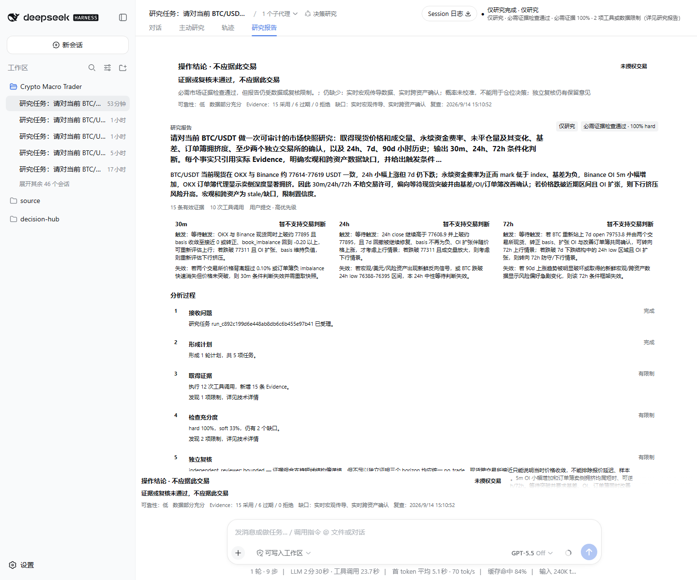
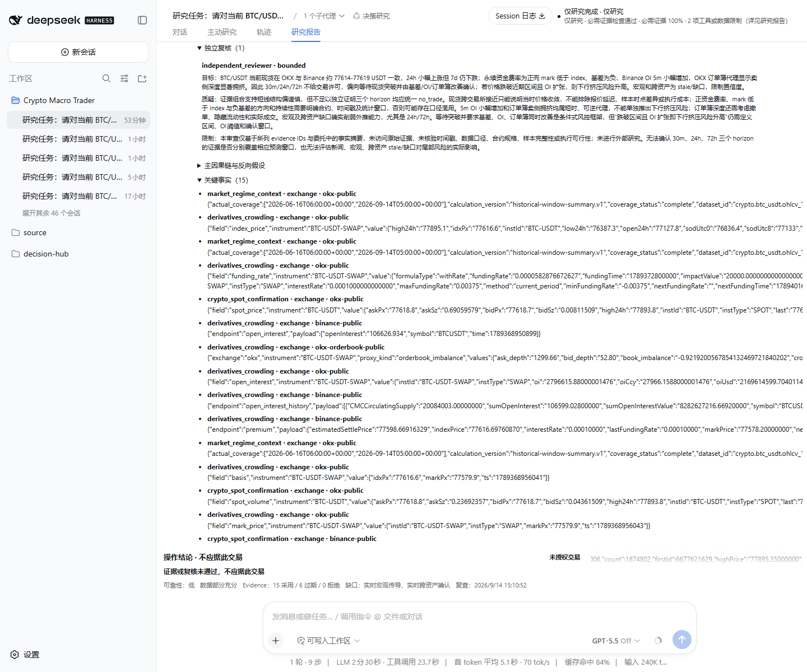
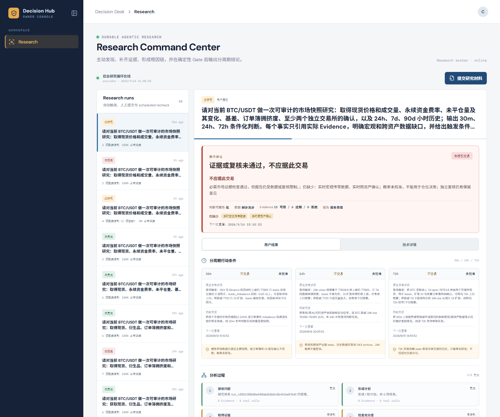
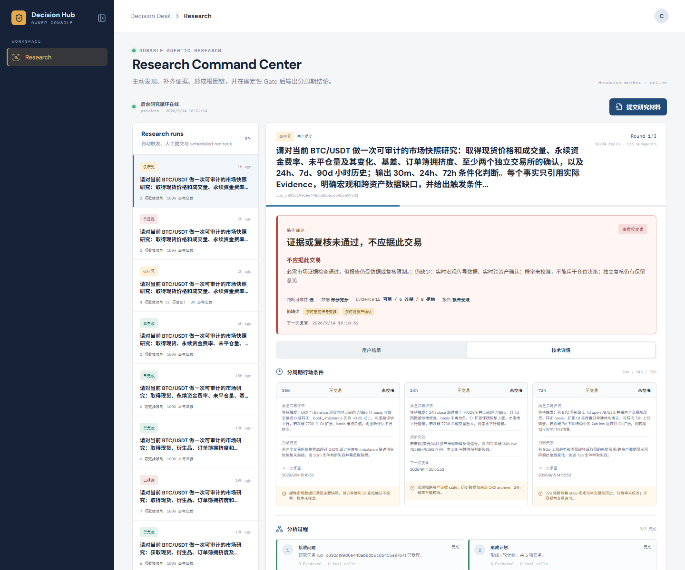

# Decision Hub 当前 BTC/USDT 研究使用说明

> 本文为旧版本历史记录。当前入口已改为 Decision Desk 的“获取最新操作建议”，无需长提示词或小时数据；请使用 [2026-09-19 使用说明](DECISION_HUB_CORE_RESEARCH_GUIDE_2026-09-19.md)。以下旧结论及截图不得作为当前版本验收证明。

适用版本：2026-09-14 核心价值交付版  
当前定位：`LIMITED / 仅研究`  
资金边界：不连接交易账户、不生成订单、不计算仓位，所有结果固定显示 `未授权交易`。

## 1. 启动

在 PowerShell 进入仓库根目录后运行：

```powershell
cd E:\project\study\codex\dsh\decision-hub
.\infra\dsh\run-product.ps1
```

启动器会重新构建当前 Decision Desk 和 DSH 插件、执行数据库升级，并启动 Hub API、Research Worker、历史小时数据 Worker、Research MCP 与 DSH Web。完成后终端会打印两个地址：

- `DSH_URL`：带本地一次性 token 的研究入口；
- `DECISION_DESK_URL`：`http://127.0.0.1:8047/`，用于查看已经落账的研究结果。

不要把 `DSH_URL` 中的 token 贴入截图、文档或聊天。停止全部由启动器管理的进程：

```powershell
.\infra\dsh\stop-product.ps1
```

## 2. 提交一项研究

1. 打开终端输出的 `DSH_URL`。
2. 左侧选择工作区 **Crypto Macro Trader**，点击 **新会话**。
3. 在“对话”输入框提交研究问题。正式验收使用下面的完整输入：

```text
请对当前 BTC/USDT 做一次可审计的市场快照研究：取得现货价格和成交量、永续资金费率、未平仓量及其变化、基差、订单簿拥挤度、至少两个独立交易所的确认，以及 24h、7d、90d 小时历史；输出 30m、24h、72h 条件化判断。每个事实只引用实际 Evidence，明确宏观和跨资产数据缺口，并给出触发条件、失效条件和下一次复查时间。数据不足或概率未校准时，明确给出不交易或等待确认，不得把研究产物状态写成交易许可。
```

4. 等待顶部状态从“正在研究”进入终态。真实验收的完成时间为 176–311 秒；重新提交会产生新的模型调用，不能把刷新页面当作重新运行。
5. 点击顶部 **研究报告**。这是普通用户读取结果的主入口；“对话”和“轨迹”保留 DSH 原始模型与工具记录，主要用于开发审计。

## 3. 先看什么

研究报告按下面的顺序阅读：

1. **操作结论**：只允许“不应据此交易”“等待确认”“需要人工复核”或“无法判断”。
2. **未授权交易**：表示 Artifact 已保存也不等于可以下单。
3. **可靠性与 Evidence 计数**：区分采用、过期和拒绝；过期数据不会被伪装成实时数据。
4. **证据缺口**：当前真实缺口是实时宏观传导和实时跨资产确认。
5. **30m / 24h / 72h**：显示各自的触发、失效和复查时间。`未校准` 时不显示为可用于仓位的概率。
6. **分析过程**：说明接收问题、计划、取证、充分度检查、独立复核、补证判断、合成和 Gate 的实际结果。
7. **独立复核、关键事实、技术限制与错误**：默认折叠，需要核验时展开。原始错误码和事实载荷保留在这里。



展开独立复核与关键事实后，可以核对复核意见以及 OKX、Binance、FRED 和历史小时数据的原始载荷：



## 4. 用 Decision Desk 交叉核验

打开 `http://127.0.0.1:8047/`：

1. 默认只显示 **Research**；最上方是当前 Run，历史列表默认收起。
2. **用户结果**首屏同时显示操作结论、可靠性、Evidence 计数、缺口和三个周期条件。
3. **技术详情**显示 Run、tool call、Trace、原始错误和版本信息，供开发人员排障。
4. 历史 Run 不会被新 Run 覆盖。第二次真实验收的合成失败仍显示为“报告拒绝/无法形成判断”。



切换到 **技术详情** 后，Run ID、实际轮次、工具调用、Trace 和原始错误仍可核对：



## 5. 当前结果能做什么

当前版本已经能替用户完成这些资料拼接与核验：

- 同时取得 OKX 与 Binance 现货快照；
- 取得 funding、mark/index、basis、当前 OI 与 Binance 5 分钟 OI 变化；
- 读取 OKX 24h、7d、90d 小时历史和订单簿拥挤度；
- 把每个结论绑定到实际 Evidence，并保留 stale、gap、Review 和工具错误；
- 在未校准或证据不足时确定性输出 `do_not_trade`，不会把模型措辞当交易许可。

当前版本不能支持方向交易或资金决策：实时宏观传导和实时跨资产确认仍缺失，三周期概率没有经过样本外校准，第三次真实 Review 仍为 `bounded`，单次延迟约三分钟，模型调用成本字段仍为 `unknown`。因此它只能作为单用户证据研究工作台；不要基于“hard 100%”或“报告已保存”建立仓位。

## 6. 验收与故障判断

一次结果至少满足下面四项才算“研究报告形成”：

- DSH 和 Decision Desk 都能回读同一个 Run；
- 有行动摘要、三周期条件、分析过程和独立复核；
- 所有页面显示 `未授权交易`；
- 后端错误保留在技术详情，用户首屏仍明确说明错误是否阻断结果。

启动后如果页面不可用，先查看：

```powershell
Get-Content .\data\product-local\logs\hub-api.stderr.log -Tail 80
Get-Content .\data\product-local\logs\research-worker.stderr.log -Tail 80
Get-Content .\data\product-local\logs\research-mcp.stderr.log -Tail 80
Get-Content .\data\product-local\logs\dsh-web.stderr.log -Tail 80
```

不得通过删除失败 Run、降低证据门、把 stale 改成 fresh 或隐藏后台错误来“修复”验收。
