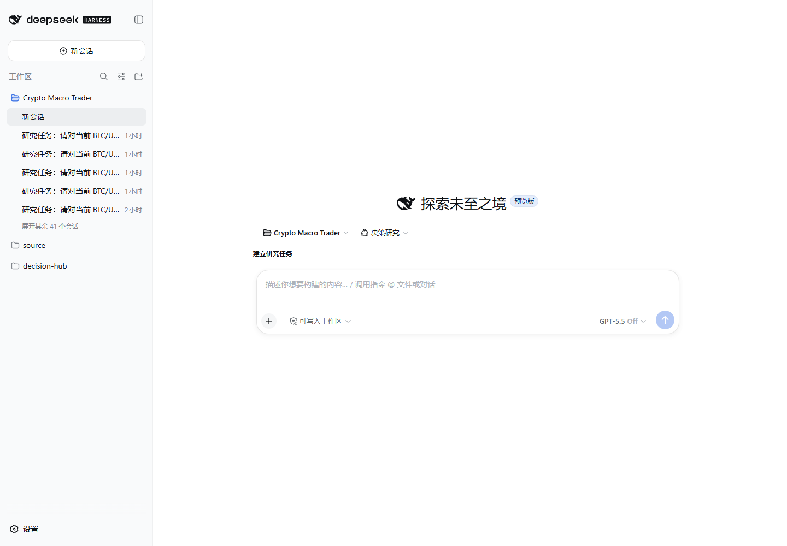
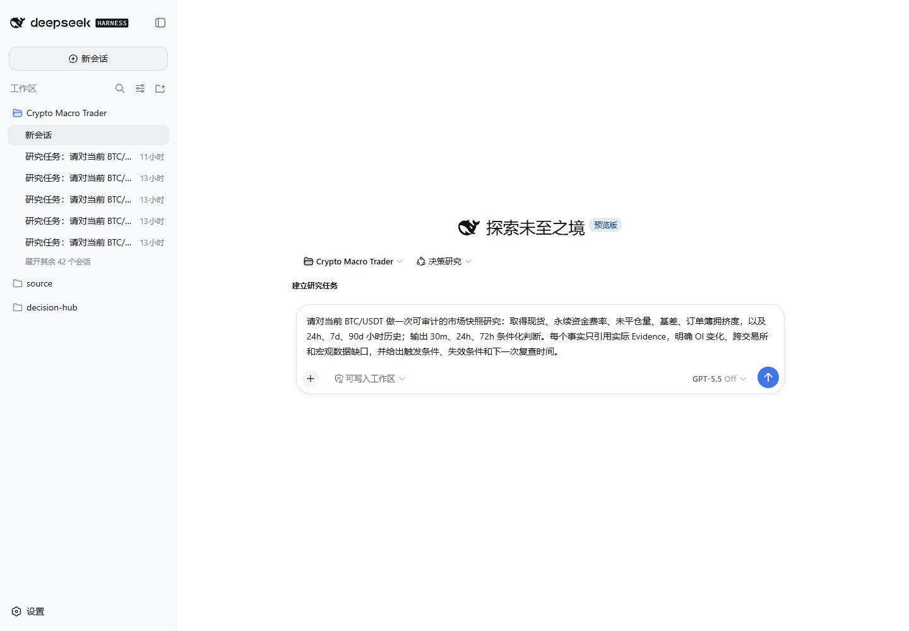
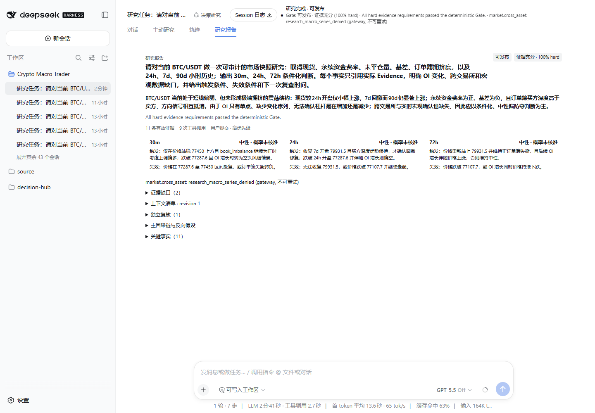
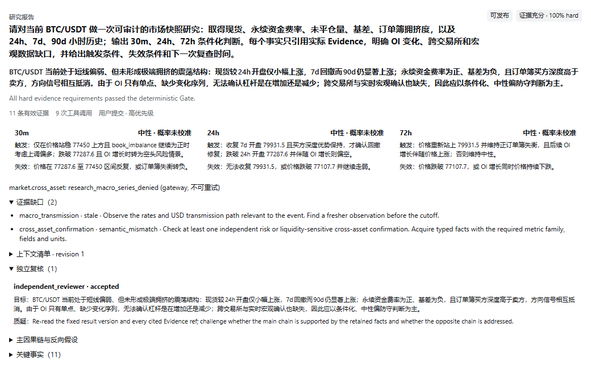
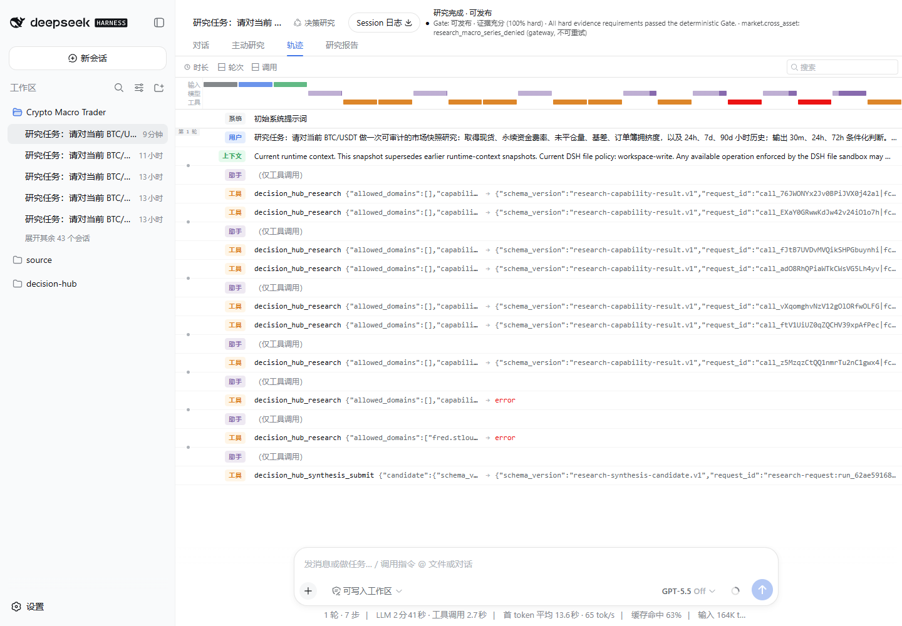
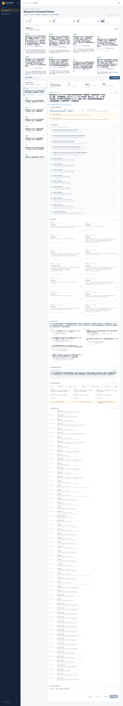
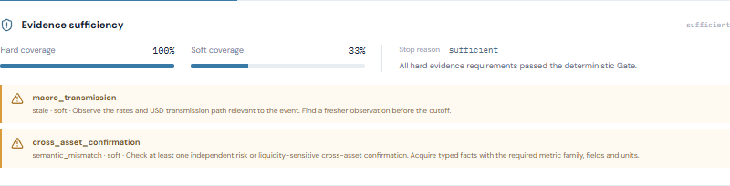
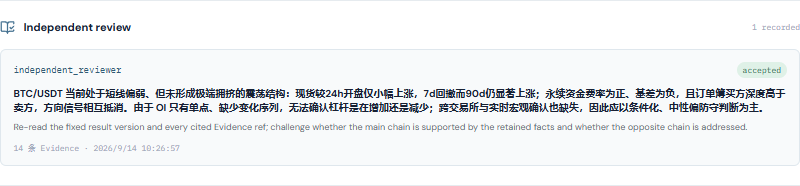
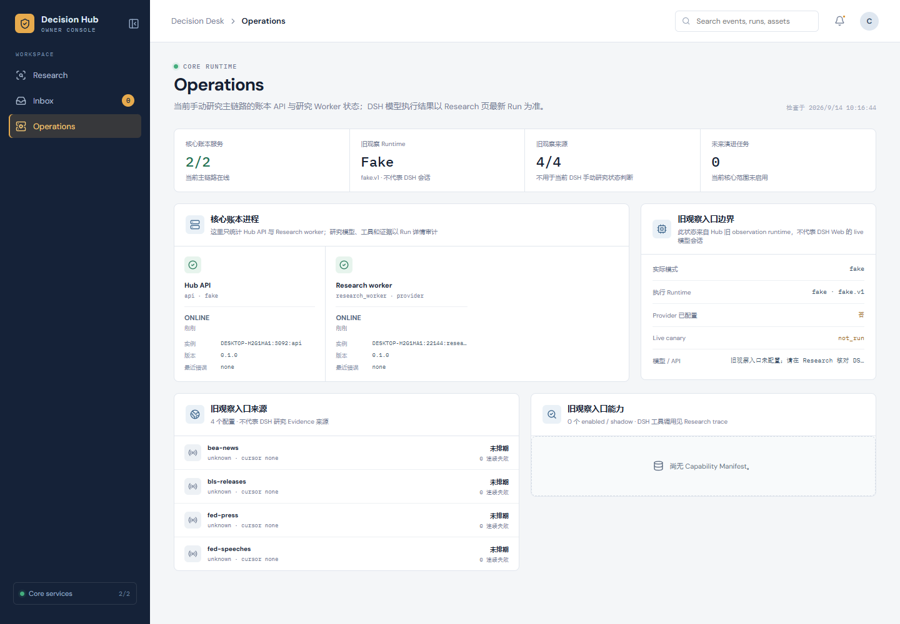

# Decision Hub 当前可用功能与截图引导

日期：2026-09-14  
当前产品范围：单机、单 owner、手动 BTC/USDT 市场快照研究

## 先看结论

当前真正可用的是一条主链：在 DSH Web 输入研究问题，系统调用真实模型和受审计数据工具，生成 Evidence、因果链、独立 Review、30m/24h/72h 条件化判断，再由确定性 Gate 写入 Hub 账本。Decision Desk 用于回读和审计同一个 Run。

它目前不是自动交易产品，也不能可靠完成旧宏观事件的分钟级回放。跨交易所 OI 时序、实时宏观传导和概率校准还没有数据支撑。页面里的“可发布”表示研究 Artifact 可以写入账本供人工使用，不表示可以自动下单。

## 一键启动

在 PowerShell 中运行：

~~~powershell
Set-Location 'E:\project\study\codex\dsh\decision-hub'
.\infra\dsh\run-product.ps1
~~~

启动器会先重建 Decision Desk，避免加载旧的 dist，再依次启动 Hub API、Research MCP、官方 DSH Web、Research Worker 和小时历史 Worker。模型凭据只从 gitignored 的 data/dsh-live/.env 读取。

成功后会打印两个地址：

- DSH_URL=...：必须复制这一整行中的完整一次性 URL，作为主要使用入口。
- DECISION_DESK_URL=http://127.0.0.1:8047/：审计入口。

停止服务：

~~~powershell
.\infra\dsh\stop-product.ps1
~~~

当前 Windows 本机流程不依赖 Docker Desktop。

## 从输入到报告

### 1. 打开 DSH 主入口

打开启动器输出的完整 DSH_URL。页面应自动进入 Crypto Macro Trader 工作区，并恢复最近一个受管研究会话。

如果只打开 http://127.0.0.1:3097/ 后看到 401，需要重新使用本次启动打印的完整一次性 URL。

### 2. 新建会话

点击左上角“新会话”。首次使用时阅读内测说明并点击继续，进入空白研究输入页。

不要在旧研究会话的普通聊天框里期待创建新 Run；新的独立研究应从“新会话”开始。

### 3. 输入明确的研究问题

建议直接使用下面的模板：

~~~text
请对当前 BTC/USDT 做一次可审计的市场快照研究：取得现货、永续资金费率、未平仓量、基差、订单簿拥挤度，以及 24h、7d、90d 小时历史；输出 30m、24h、72h 条件化判断。每个事实只引用实际 Evidence，明确 OI 变化、跨交易所和宏观数据缺口，并给出触发条件、失效条件和下一次复查时间。
~~~

点击“建立研究任务”。页面先显示排队和 Run 状态，然后进入真实模型与工具执行。当前实测耗时约 2 分 45 秒。

### 4. 先读研究报告

完成后点击“研究报告”。先看四件事：

1. Gate 和 hard coverage；
2. 主结论是否明确承认未知；
3. 30m、24h、72h 的触发与失效条件；
4. Evidence 数量、工具失败和证据缺口。

本次真实 Run 为 run_62ae59168aef4378a4188df91e7e86c7，对应 Artifact 为 art_1cf11f728aab4879a44a916f7080abe1。结果为：

- hard coverage 100%，soft coverage 33%；
- 14 条保留 Evidence，其中 11 条 accepted、3 条 stale；
- 9 次受审计研究工具调用，1 次 independent review；
- 30m、24h、72h 均为 neutral，概率状态均为 uncalibrated；
- 未关闭的缺口只有 macro_transmission 和 cross_asset_confirmation。

这次中性结论来自证据互相抵消和数据缺失，不是页面没有产生结果。

### 5. 展开缺口与独立复核

在报告底部展开“证据缺口”和“独立复核”。缺口必须写明缺什么、为什么缺；Review 必须有角色、目标结论、质疑内容、引用和处理结果。

### 6. 查看轨迹

点击“轨迹”，核对实际调用过的工具、失败来源和最终 synthesis 提交。当前运行里 FRED 三序列返回了日频背景，但因不够新只能保留为 stale；模型又尝试了两个不允许的宏观序列，Gateway 以 research_macro_series_denied 拒绝，报告没有把它们伪装成证据。

“Session 日志”会导出当前 DSH Session 的压缩日志，用于深度排障。日常阅读报告不需要下载它。

## 在 Decision Desk 审计

打开 http://127.0.0.1:8047/。当前侧栏只保留真实可用的 Research 和 Operations；原先会打开同一个空抽屉的 Decision、Forecasts、Timeline、Evidence、Assets，以及无响应的 Settings、Runbook 已从当前产品入口移除。

在 Research 页选择与 DSH 报告相同的 Run ID，然后依次查看：

- Evidence sufficiency：hard/soft 覆盖和仍未关闭的 gap；
- Research plan：这次计划和实际工具调用；
- Evidence：accepted 与 flagged 分开统计；
- Causal case：主因果链与反向假设；
- Independent review：独立复核的原始记录；
- Horizon decisions：三个周期分别显示触发、失效和下次复查；
- Research trace：规范化业务轨迹。

Operations 页只把 Hub API 与 Research Worker 计入当前核心服务；旧 observation runtime 的 fake 状态被明确标为旧入口状态，不再冒充 DSH 模型状态。

## 当前产品判断

主链已经可用：输入、实时取证、历史小时摘要、Evidence/PIT、因果综合、独立 Review、Gate、Artifact、DSH 报告和 Desk 回读均在真实页面完成，重启后同一 Run 仍能恢复。

当前价值仍受三类数据限制：

- 只有 OKX 主数据源，缺少跨交易所独立确认；
- OI 只有当前点，没有连续变化序列；
- FRED 是日频且滞后，不能证明当前分钟级宏观传导。

因此当前适合作为“有证据边界的人工研究助手”，不适合作为方向预测或自动交易系统。继续增加页面、Evolution、PPT 或通用评测都不会先解决这个问题。下一项核心开发应积累 OI 时序和第二交易所数据，再用新的真实任务检查缺口、人工返工和判断稳定性是否改善。
