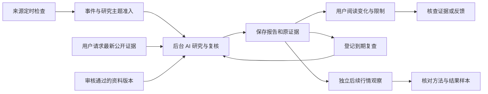

# Decision Hub PC 用户手册

## 当前 PC 版本：2026-10-07 21:39，normal50（页面构建未变）

这是持续收集资料、自动组织研究和定时复查的工作台。日常先读已保存报告；需要新证据或新问题时再手动研究。当前开放BTC及相关宏观，黄金未开通。主题阅读、搜索、历史/原前版、原证据、停止原因和旧版本效果返回已PC实操；完整操作异常矩阵仍未验收。旧版本说明供追溯，以本节为准。

### 对一份报告反馈和补充

1. 在原报告点击“反馈这一版”，选择意见并保存一次。页面显示已反馈及当时评估；保存成功表示意见落库，不表示判断已验证。
2. “查看已保存的反馈”和“查看当时评估依据”读取这笔意见及冻结依据。必需材料覆盖、补充覆盖和费用未知分别核对，覆盖率不是命中率。
3. 后续要补充时点击“补充反馈”另存一笔。系统保留原意见/原评估，页面显示最新意见及其评估时点；刷新或从主题返回后仍是原版本的最新反馈，不要重复保存。
4. 到“管理与审计”→“演进工作台”核对处理结果。调用已返回、操作跟进已结束或候选已保存都不表示方法改善已生效。当前真实存在计划校验失败，以及评测材料不独立导致等待；正式方法尚未因此启用。

这条路径已实操验证保存/补充/刷新/返回和独立评估绑定。[8项PC原件](../../artifacts/pc-core-actions281/browser-steps01.json)。完整PC异常及方法优化仍未交付；本批回执/效果说明精简只是候选，当前页面仍为normal50。

### 从研究主题开始

1. 在“研究”打开“研究主题”。分类横排为“研究主题”“来源资料”“全部”；登记研究任务不等于已保存报告。
2. 在当前分类搜索；切分类保留关键词并回第一页。搜不到先清关键词，旧未知登记到“全部”查。切分类不会启动研究。
3. 有报告时点“阅读报告与变化”，进入后首先看到“最新已保存报告”。点“阅读最新已保存报告”直接读原保存版；“对照原前版”对照准确登记版本；“登记或查看效果跟踪”进入同一报告。
4. “当前任务与下一步”分别说明执行状态和自动复查开关。可查看原运行进度、停止原因或已保存报告；最近任务默认收起，登记次数不代表完成报告数。
5. 展开“报告版本与变化”查各周期与材料变化、旧报告及版本审计。翻到旧页时顶部仍是最新报告；页码、刷新及报告/效果返回保留原主题上下文。
6. 自动复查暂停不会停止已运行或手动任务。恢复开关也不会立即发起研究、重放旧跳过计划；没有完整范围时入口禁用并说明。
7. 无报告但已登记研究，点“查看研究任务”；未知记录点“查看主题登记”；来源资料点“查看资料与准入”或“查看准入限制”。没有匹配重要事件时如实说明本次未触发，不显示假报告。
8. “完整原题与登记依据”、最近准入和版本审计按需展开。长题已限行，已知来源有中文标题；未映射英文保留原文，不猜译为新结论。

已打开旧页签完整刷新一次加载normal50页面。[17项实际操作](../../artifacts/normal50-pc-workspace01/browser-steps01.json)。


### 同一报告有多个本地恢复记录时

页面逐个核对服务器中的原请求。已经完成的记录可整理本地凭据；明确永久失败的记录可关闭；只有原请求与原版本计划均明确404时才可放弃对应本地记录。运行中、权限失败、响应未知或损坏内容继续保留并禁止新登记，避免重复提交。关闭本地记录不删除服务器审计记录，也不自动发起新研究。异常分支有受控测试，当前尚无自然发生的正式永久失败样本，不能声称全部异常实操完成。

### 跟踪一份已保存报告

1. 在报告中点击“登记或查看这版研究效果”，进入该主题的准确报告版本。
2. 点击一次“申请跟踪研究效果”。“已受理，等待核验”或“正在核验原报告”表示后台正在处理；看到“这版已登记跟踪”和三个周期计划，才表示登记完成。
3. 刷新页面后会恢复同一请求。必要时点击“刷新原请求状态”，不要再发起研究。刷新、关闭并重开标签页、第二标签页恢复同一请求，以及单Worker中断后的后台恢复已有实测；整个浏览器应用崩溃后的恢复仍待验。
4. 查看24小时、30分钟、72小时的跟踪进度。“尚未形成采集记录”表示尚无采集结果；费用未配置表示净效果尚无法评估，不表示效果或成本为零。
5. 点击“查看这版判断的到期结果”，在“逐条判断”点击“查看判断”。分别核对判断冻结、到期时间、市场变化和报告/行情依据。未到期的窗口会继续等待，样本身份或研究配方待确认时不计入认证样本。
6. 点击“回到对应报告”，返回同一份原报告；不会自动切到新报告。主题暂停自动复查时仍可登记已有报告效果，登记本身不会开复查或启动AI研究。

遇到请求失败，保留原状态并刷新核对。只有服务器确认终态失败且页面给出关闭入口时，才关闭本浏览器中对应的失败请求；服务器失败记录继续保留，关闭不会自动重试。

本轮实际原件：[7步正式PC回执](../../artifacts/normal47-pc-core01/receipt01.json)。旧主题、原报告、原版本及该主题任务集合与迁移前一致；新登记只保存了原请求和三个跟踪计划。


主题最新报告与任务/历史分层已落地；旧完成回执、效果说明、未映射英文和相似主题仍有阅读负担，事件时间线继续待补。资料上传、反馈、取消重试、晋级与全部异常分支的完整PC矩阵仍开放；关标签页/跨页签和单Worker恢复已有实测，整浏览器崩溃未验。可信美元费用、完整方法资格和黄金未完成；手机验收排除。


### 历史快速上手（2026-10-07，normal46；仍适用的操作供参考）

Decision Hub 是持续收集公开材料并组织AI研究的工作台。当前开通BTC与相关宏观因素，黄金尚未开通。系统已有公开研究和定时复查报告，你可以先读报告，不必每次输入研究问题。需要人工介入时，再更新证据、发起快照研究或补充个人资料。

#### 日常使用

1. 打开[今日研究](http://127.0.0.1:8047/#/home)，点击“阅读结论与依据”。先看30分钟、24小时、72小时的AI判断与适用限制。报告保留当时材料，不会自动改写成最新结论。
2. 核对依据：展开“查看研究过程、证据、审查与预测复盘”，进入证据，按需打开“查找已保存的原始响应”和“查看原始响应”。英文原件保留来源原文，技术字段默认收起。
3. 阅读推导：打开“全屏查看分析链路”，用“查看全貌”看关系、“清晰阅读”看文字；搜索、筛选或“列表查看”均可用。关闭证据或按Esc返回原节点，保留阅读位置；图谱中的Esc退出全屏。
4. 比较变化：“研究”→“查看研究主题与变化”→“查看报告变化”→“并排对照原前版”。“重新读取两版”只读保存内容，不发起研究。
5. 查指标：“管理与审计”→“查看指标与依据”。选择品种、指标、来源和“当时已知截止时间”；行内“查看来源”打开指定版本。存在归档原文时，点击“查看留存原文”，读取后可“收起留存原文”或“收起详情”返回列表，原截止时间保留。
6. 需要更新时，可用首页“发起一次BTC快照研究”，或主题的“更新公开证据”。资料取得、任务排队、AI研究和报告保存是不同步骤；自动复查开关开启后也要满足计划与运行条件。
7. 有异常时，点击首页“查看完整状态”→“查看来源与服务”，查看最近成功、最近错误、下次计划及每次轮询记录。原失败不会因后来成功而消失。

#### 看懂状态与数据

| 页面说明 | 含义 |
| --- | --- |
| 已就绪 | 进程已就绪；目前可能没有正在执行的研究。实际任务在“系统正在做什么”列出 |
| 状态未确认 | 正在读取或尚无法确认状态；等待读取或进入完整状态核对 |
| 来源需检查 | 部分来源尚未成功采集。当前BLS两源仍失败，不能将旧资料当成已更新 |
| 本次无新内容 | 本次请求/解析有记录，没有新增可采纳内容；不表示全部未来事件已覆盖 |
| 仅供研究 | 可以阅读判断和依据；结果仍有限制，未取得交易权限 |
| 用量记录不完整／等待日志归档 | 核对尚未完整；不是费用为零，也不是全部费用已对账 |

宏观名称已改为“美国10年期实际收益率”“美国10年期市场通胀补偿”“美国银行准备金余额”；银行准备金单位为“百万美元”，原数值不换算。指标版本曲线显示系统已知记录，不是补齐后的连续行情。例：原文统计日期为2026-10-05，系统在10月7日取得，不代表10月5日就已经知道这个值。原文统计期、观察、系统已知及登记时间需要分别核对。

留存原文不等于HTTP原始响应；历史记录若未留存HTTP响应，页面会说明。原文核验成功表示同一归档内容哈希一致，不表示材料适用于所有指标、完整历史可得性已证明或研究效果已验证。

#### 当前验收范围

本批实际PC12项通过：修复空闲状态误报、三宏观名称和同版本原文读取，并核对展开/收起/返回、原时间与来源失败记录。旧报告六GET22项通过；之前图谱17项操作验收保留，本批未重复。研究规则仍有缺件，当前是内部研究验证版，完整PC异常流程、可信费用、部分来源恢复与独立样本仍在继续。

[完整PRD](../product/DECISION_HUB_FULL_PRODUCT_PRD_2026-09-26.md) · [交付评估及实际截图](../product/DECISION_HUB_DELIVERY_READINESS_REVIEW_2026-09-29.md) · [PC回执](../../artifacts/normal46-pc-core-acceptance01/pc-acceptance46.json)


以下历史记录对应当时版本；当前使用与限制以上述入口为准。

### 历史 normal45 快速上手（2026-10-07 09:26）

Decision Hub 会收集已配置来源的公开资料，把允许研究的内容送入 AI 研究，并保存报告与证据。你可以直接读已有报告，不用每次输入研究问题。当前开通范围为 BTC 与相关宏观因素；黄金尚未开通。

#### 第一次使用

1. 打开“今日研究”，点击“阅读结论与依据”。先看 30 分钟、24 小时、72 小时的 AI 判断和适用限制；报告代表当时的材料，不会随最新市场自动改写。
2. 需要核对依据时，展开“查看研究过程、证据、审查与预测复盘”。点击“证据”查看保存摘录；再点击“查找已保存的原始响应”和“查看原始响应”核对取证原文与采集时间。
3. 需要看推导关系时，打开“全屏查看分析链路”。用“查看全貌”看关系，用“清晰阅读”看文字；也可搜索、筛选或切换“列表查看”。打开证据后，关闭按钮或 Esc 会回到原节点并保留阅读位置。图谱中的 Esc 用于退出全屏。
4. 需要比较变化时，进入“研究”→“查看研究主题与变化”→“查看报告变化”。点击“并排对照原前版”，分别阅读所选报告和原来登记的上一版。“重新读取两版”只读取保存内容。
5. 需要新研究时，可点击首页“发起一次 BTC 快照研究”，或进入“研究”点击“发起一次研究”。主题开启自动复查后，系统会按计划与运行条件决定是否排队；开启开关不代表立即开始。资料已收集也不代表已经生成 AI 报告。

#### 看懂当前状态

- **来源需检查**：某些来源尚未正常取得资料。打开“查看完整状态”核对原因，不要把旧材料当成最新信息。
- **任务已结束，研究受限**：先读已保存报告中的缺口和限制，再决定是否需要更新研究。
- **仅供研究／未授权交易**：可以读报告，当前结果不代表预测效果已充分验证，也不会自动执行交易。
- **后续观察**：从报告进入查看结果；未到期、样本不足和方法不一致都会保留对应说明。

#### 本轮验收范围

PC 报告→节点→证据原文→原节点→原主题这条流程已通过 17 项检查。100% 缩放、位置、搜索和列表状态能够保留；原报告、原前版与证据采集时间保持。实际截图和技术证据见[交付评估](../product/DECISION_HUB_DELIVERY_READINESS_REVIEW_2026-09-29.md)。

后端本批加载后，原报告读取的22项检查通过：旧图谱、三个AI窗口、原始响应和原来登记的前版关系保持。本批继续使用前述PC17验收的相同页面。研究校验已增强，报告仍需阅读缺口与限制；检查通过或资料时间正确都不表示可以交易。原报告保留当时的核验版本，没有改成新规则结论。

当前仍为内部研究验证版，全项目稳定交付尚未完成。完整研究规则、可信费用、部分来源恢复、成熟结果样本和完整 PC 异常验收仍在继续。项目功能与未完成项见[完整 PRD](../product/DECISION_HUB_FULL_PRODUCT_PRD_2026-09-26.md)。以下历史操作记录保留当时的版本与验收范围。

### 历史 normal41 快速上手与 PC 记录（2026-10-07 05:53）

当前是内部研究验证版，正常前后端和AI研究进程在线。已有真实研究与自动复查报告；全项目稳定交付仍未完成。

1. 在“今日研究”读最近报告，或在“研究”进入已有主题。需要最新公开信息时，点击“更新公开证据”；无需每次填写研究问题。
2. 已研究的主题点击“查看报告变化”；仅收集资料、尚无研究任务的主题点击“查看资料与准入”，先看准入原因。
3. 打开报告先读三个AI周期和限制，再展开确认／失效条件。主题时间线分别说明AI与7天日线参考；方法不同要逐周期核对。
4. 点击“并排对照原前版”读取所选报告和原来登记的前版。“阅读完整报告”进入各自原报告，“重新读取两版”不会发起新研究。材料显示来源、原采集时间和原文入口；只有摘要时可“查找已保存的原始响应”。关闭详情回到原对照。
5. 展开研究过程进入图谱，点击节点查看判断和引用证据。点击证据、查找保存的原始响应后，关闭详情可返回原节点，再退出图谱返回原主题。目前打开节点可能重置缩放，可再次点击“清晰阅读”；此问题及两处英文说明正在修复，尚未验收通过。
6. 查看后续观察；“刷新观察结果”只更新该条观察，未到期会说明等待原因。中性判断不计算方向命中，样本不足不显示胜率。

自动复查开关保留操作回执。若操作尚未确认，先核对原请求，确认前不要反向操作。身份到期后按提示重新验证，再读取原请求和报告。正式研究方法对照仍受完整费用核验限制，普通保存报告的前后阅读不等于已验证方法对照。

部分公开来源目前访问失败，例如BLS日历实际返回403；已有报告保留原证据和时间，来源失败不表示获得了最新资料。黄金尚未开通，手机不在本轮验收范围。完整异常恢复、费用和自然恢复仍在执行台账跟踪；隔离网络回执尚未验收通过。


最新范围见[全项目PRD](../product/DECISION_HUB_FULL_PRODUCT_PRD_2026-09-26.md)、[交付评估](../product/DECISION_HUB_DELIVERY_READINESS_REVIEW_2026-09-29.md)和[逐步执行记录](../plan/ARCHITECTURE_REMEDIATION_EXECUTION_LOG.md)。下方保留历史操作证据。

### 历史 PC 接续验收：未生成报告的取消与失败任务（2026-10-05）

取消、失败、拒绝任务现在先展示任务状态；已知错误采用现有中文映射，未知原因明确为“具体原因尚无可读说明”。没有报告时不展开报告复查建议和市场补齐条件。“查看问题详情”在当前页面展开技术内容并定位原失败/停止记录，原始技术码仍按需展开；普通视图页签保持原导航。原回执、Owner、待确认操作锁、显式后续任务入口与资料重新授权约束保留。

本片 102 项前端控制、实际类型/构建、PC05 取消/重试唯一任务与 PC06 焦点复测通过；正常旧真实报告的三个 AI 窗口、独立 7 天日线及三项已完成复查可读。首次类型门失败和 PC05 路由定位失败均保留，修正后另存证据。控制场景没有 Provider/模型调用或 AI 成功报告，**不能据此称真实 DSH 子树停止或项目全部交付**。真实 DSH 取消协议、其余异常矩阵和原整改未完成项继续列入唯一执行台账，手机验收仍排除。

#### 未完成任务怎么处理

- “本次研究已取消”：该任务不再发布新报告；原材料、调用和费用记录保留。任务取消回执不代表全部 SDK 子任务或上游费用已结清。
- “本次研究未完成”：先读主卡原因；未知原因不会猜成环境故障或超时。点击“查看问题详情”核对原失败/停止记录，原始字段在折叠区。
- 要继续研究，可点击“重新尝试研究”。有待确认的原操作时，先核对其回执；确认得到的新研究由你显式打开，历史资料需重新选择与授权。
- 已有正常报告仍显示原 AI 结论、独立日线和后续复查记录，不会随当前市场改写旧判断。

[受控取消/失败 PC 验收证据](../../data/product-local/remediation/W6/pc-run-command-recovery/pc-terminal-state-copy-draft01/pc-acceptance02.json) · [问题段真实定位截图](../../data/product-local/remediation/W6/pc-run-command-recovery/pc-20261005-06/screenshots/01-problem-focus-viewport.png)。截图所用隔离任务有明确控制标签，非 AI 研究结果。


更新：2026-10-07。适用入口：<http://127.0.0.1:8047/>。保留原文件名作为稳定链接。

**当前为内部研究验证版，尚未完成稳定产品交付。** 本手册说明当前能怎样操作，也标明未完成的部分。最新缺陷与验收范围见[交付评估](../product/DECISION_HUB_DELIVERY_READINESS_REVIEW_2026-09-29.md)，完整功能与架构见[全项目 PRD](../product/DECISION_HUB_FULL_PRODUCT_PRD_2026-09-26.md)。

## 1. 产品怎样工作

系统持续检查已登记的公开来源，把新事件与材料归入研究主题；通过准入检查后，后台研究通道采集市场证据、执行 AI 研究与复核、保存报告。到期复查和事后市场观察分别留痕。

用户的日常工作是看最新报告与变化、核查依据、补充资料、提供反馈。**每次研究不要求用户编写研究问题。** 首页的 BTC 快照和报告的“更新公开证据”可以直接请求最新公开市场研究；临时问题与个人资料属于额外入口。



当前已开通 BTC / 宏观研究。黄金只展示准入条件，尚未接通黄金数据、研究规则和后续评估。研究判断受证据、时效及复核限制；“偏多”不是交易授权。

## 2. 打开与检查状态

在仓库根目录 `E:\project\study\codex\dsh\decision-hub` 使用已有环境：

```powershell
.venv/Scripts/python.exe -c "from tools.full_product_acceptance import ensure_product; print(ensure_product())"
```

这会优先复用正常运行的产品，或等待受管服务恢复；服务未启动时进入组合启动流程。冷启动可能需要构建，不能反复启动多个运行栈。10 月 4 日晚间已经从实际维护停止状态按原 Home 正常恢复，保存就绪回执；后来修正日线展示只构建一次前端，实际 8.34 秒，无需再重启 Host。完整冷启动/退出/异常恢复矩阵仍未全部验收。

打开首页，先看“来源检查”“自动发现”“研究执行”，需要细查时点击“查看完整状态”或左侧“系统状态”。左下角 `3/3` 只概括 API 与研究通道，不代表每个数据源可用、费用已对账或结果已认证。


2026-10-04 截图显示发现与研究运行，但有 **2 个来源需检查**。这是 BLS 来源问题，与研究进程在线分别处理。

需要退出整套产品时使用：

```powershell
powershell.exe -NoProfile -ExecutionPolicy Bypass -File infra/dsh/stop-product.ps1
```

具体运行配置与恢复步骤见[本地恢复手册](../operations/LOCAL_PRODUCT_RECOVERY.md)。停止服务会影响正在使用的页面，应等活动任务结束；当天曾实际维护停止并恢复，不能继续沿用早期只读盘点“未执行停止”的描述。

### 当前实测状态：10 月 5 日

**10 月 5 日 15 时 PC 取消重试恢复验收：本项通过。** 发现并修复了“重试成功但离页后原请求凭据被清除，返回时无法打开已创建子任务”的缺陷。真实按钮操作中，重试响应在 0.853 秒返回，管理页未被跳转；返回原任务只核对原请求回执，再明确打开唯一的新研究。后台只有一次取消、一次重试、一个子任务；原资料正文与授权不继承。排队与回执尚未确认的状态文案也已纠正。[实际 PC 与落库验收封存](../../data/product-local/remediation/W6/pc-run-command-recovery/pc-20261005-04/pc-acceptance02.json)保留修复前反例和失败记录。本项使用真实 API、数据库和研究 Worker，以及明确的受控失败执行端；**真实 DSH 多 Agent 停止、已发生费用、迟到成功发布及其余 PC 异常仍未完成**，不将本项通过扩大为全项目交付。正常产品已加载新 UI，原默认报告的三周期 AI 判断、独立日线参考与自动复查回链仍可阅读，服务显示 3/3 在线。


**默认公开研究和本次自动复查已完成真实 PC 与后台原件验收，完整产品仍未交付。** 正常原 Home 于 01:49 加载本轮回执修复，10 个受管角色、7 个同版本后台心跳、4 项业务读取及采集服务实际就绪；PC 显示 3/3。[本轮正常启动回执](../../data/product-local/remediation/W7/graph-citation-v2-20261004/receipt-core-release02/normal-ready02/business-ready.json)只代表该就绪范围。

首页 BTC 快照**未填写研究问题**，实际发起 `run_b6ab8f8fe70547cea50f92162d6d4e87`，01:50:19 开始、01:55:52 保存结果。研究包含五个后台协作角色、独立复核、10 条采纳证据、6 个来源；30 分钟“未形成方向”、24 小时“中性观察”、72 小时“偏多”三个 AI 判断与独立 7 天日线参考均已落库。约 198 KB 日线完整回执现在通过已有工具正式输出接口传递，并由原认证门核验；原有限报告仍保留，没有改写成成功。[真实严格只读核验](../../data/product-local/remediation/W7/graph-citation-v2-20261004/command-core-release01/b6-normal-observation02.json)实际退出 0、37.264 秒，16 项检查通过：执行方法、研究上下文、过程图、认证终态、复核、结果、报告、三 AI 与日线来源和方法、历史原件。原验收器的业务/RPC 身份及终态误判已修正，原失败记录保留；9 个身份错配、普通取消和超时否定用例仍拒绝。


PC 已实际核对“报告引用 → 保存的 HTTP 200 原始响应 → 返回同一报告”，发布时间未知时仍显示未知。[原文截图](../../data/product-local/remediation/W7/graph-citation-v2-20261004/pc-core-release01/screenshots/13-native-original-response.jpg)保留采集时间与原响应。系统随后按原报告的 02:06:12 计划产生定时子研究 `run_e597191070c04c418938332147e58315`，02:13:21 保存子报告；没有再次人工发起。[自动复查严格核验](../../data/product-local/remediation/W7/graph-citation-v2-20261004/command-core-release01/e597-normal-observation01.json)退出 0、39.156 秒，16 项通过，父子身份、三 AI、7 天日线、复核、报告及原件一致。[自动复查截图](../../data/product-local/remediation/W7/graph-citation-v2-20261004/pc-core-release01/screenshots/14-scheduled-child-report.jpg)与返回父报告路径已验证。PC 已显示 24 小时与 72 小时 08:00 复查任务结束，但这两条还未做本次完整原件核验，不能算已验收。

两次核验均只读、0 正式 SQL 写入、0 模型提交、0 构建，19 份历史身份与旧 6499 条原件未变。**报告仍有限制**：Kernel 状态保留真实 degraded，来源覆盖与叙事缺口仍显示；来源和方法通过不代表预测已经校准，Provider 配置身份、成熟方向样本和长期效果仍独立。单次默认及一次定时子报告通过，不能推全按钮与全市场可交付。

**两轮研究的完整保存、复核和发布流程已通过本机受控验收。** 正常目录耗时约 425 秒，保持原验收条件；同一修复已加载到正式服务。PC 父报告、自动复查、证据原文、返回和刷新按钮已复验，[当前页面截图](../../data/product-local/remediation/W7/graph-citation-v2-20261004/pc-core-release01/screenshots/23-pure-parent-viewport.png)。这不代表每个操作都已验收，真实 Provider 全部组合、资料、反馈、取消重试等 PC 例外仍待完成；原失败与受限报告保留。手机排除，黄金尚未准入。

### 历史阶段实测：10 月 4 日晚间至 10 月 5 日 01:21

正常原 Home 的产品已于 **22:49 恢复在线**。10 个受管角色、7 个后台心跳、4 项业务读取及采集服务就绪实际通过；正常 8047 的 PC 页面显示 3/3。[启动回执](../../data/product-local/remediation/W7/graph-citation-v2-20261004/core-release01/normal-ready01/business-ready.json)与[16 路 API 读取](../../data/product-local/remediation/W7/graph-citation-v2-20261004/../delivery-review-20261004/api-snapshot05.json)只证明对应就绪和读取范围。

PC 未填写关注点，实际发起了 `run_c37a0c7cf1594a3799ddfededd549bb8`。22:58 保存了 10 条采纳证据、6 个来源、Graph2、ContextSelection3、复核和报告；同次 7 天日线记录的来源、方法及稳定配方已由正式原件只读核对。[实际回读](../../data/product-local/remediation/W7/graph-citation-v2-20261004/normal-run-readonly01/normal-run-observation02.json)的整体结论仍为 **limited**：管理 Agent 启动后台协作后提前结束，没有提交综合候选，AI 三窗口为空。当前不能把它算完整 AI 研究成功。

页面已修复日线参考被隐藏与“无证据”误提示：显示实际 90 根完整日线、截至 10 月 3 日、独立 7 天参考，并保留综合判断不足和未授权交易的边界。已在 PC 展开、进入同 Run 的日线结果并返回原报告。


**10 月 5 日 00:18 PC 复验：日线缓存故障已关闭本次范围。** 调度修复通过 19 个边界、租约、并发与取消用例，只受管重载 API / 实时后台，DSH 及其余八个角色保持原进程。原作业自然从 attempt 1→2，无手动写库或人工执行作业。[自然重建回执](../../data/product-local/remediation/W7/graph-citation-v2-20261004/cache-boundary-scheduling01/natural-rebuild-observation01.json)显示来源、方法与配方通过，分组原件检查 **1/1、待核验 0**；PC 详情与分组一致，回原报告成功。未到 10 月 11 日观察期、首次身份仍待确认，方向样本为 0，不显示命中率。


**10 月 5 日 01:21：研究进程正常在线，AI 综合发布仍未通过。** 原命令完成门已修复、33 项相关测试及类型检查通过，必要的一次后台构建和正常加载完成；PC 显示 3/3 在线。新默认空输入研究真实执行了角色协作、独立复核，并提交了 30 分钟、24 小时、72 小时综合候选。最终后端证据校验拒绝了综合，三个 AI 窗口未保存，页面保留日线参考与限制，没有伪造成功。[本轮真实链路回执](../../data/product-local/remediation/W7/graph-citation-v2-20261004/command-core-release01/df78-normal-observation01.json)为 limited，实际方法、研究上下文、过程图、复核与报告原件、7 天日线及历史原件检查通过，不能据此称综合内容通过。

失败已定位到**历史行情回执传递**：约 197 KB 的完整回执被原生 50 KB 工具输出机制截成预览，综合引用的日线证据因此缺少完整可认证凭据。下一步使用已有工具正式输出接口保留有界完整回执，继续原认证，随后重新做真实研究验收。多轮流程的同事务重复核查也有候选，当前仅有限控制通过，联合验收仍未完成；全项目尚不能标为全部交付。


原 12 条 AI 记录的来源与方法重新核对通过；旧五表 **6499 条原行不改不缺**。新研究合法新增 42 条关联记录，不把“新增 0”继续当当前结论。[旧行与新行证明](../../data/product-local/remediation/W7/graph-citation-v2-20261004/core-release02/formal-history03.json)。195 条旧 AI 缺件和 71 条旧日线缺当时方法身份继续保持未知；新日线核验实现不能回签旧记录。

## 3. 日常阅读最新研究

1. 点击“今日研究”，查看最近报告保存时间和研究状态。
2. 点击“阅读结论与依据”，进入该版报告。
3. 先看“本次 AI 综合判断”：30 分钟、24 小时、72 小时分别表示各自窗口的判断。
4. 展开窗口的“确认与失效条件”，同时阅读反向解释与复核意见。
5. 检查“使用这份研究时仍需核对”和数据时间；需要新材料时点击“更新公开证据”。该操作会创建新研究并保留当前报告，可能产生模型费用。


本次示例为 `run_603cc378191447a88cc6094e3fa6a62d`，2026-10-04 08:20:22 保存。页面显示 30 分钟、24 小时中性观察，72 小时偏多，**最新公开信息未核验**。其宏观引用是最新日期 10 月 2 日的 Yahoo 延迟聚合日线，不能理解为此刻的实时行情。

“独立日线参考 · 7 天”是独立的价格规则，不能替代 AI 综合判断。采纳证据数量、来源数量和覆盖通过也不表示独立支持、预测校准或胜率。

报告已保存不等于独立复核已通过。页面显示仅自动检查、审查有保留或状态未核验时，应按该限制使用。缺失资料和未到期结果不记为零；尚未校准的数值不能当作已校准概率。

| 页面状态 | 应怎样理解 |
|---|---|
| 排队、研究中、等待重试 | 尚未形成这次可读结论；等待任务终态 |
| 仅研究 | 报告已保存，仍受使用限制；不自动授予交易权限 |
| 降级 | 检查具体限制，不能只读方向 |
| 失败、取消、拒绝 | 查看失败原因与操作回执；不能当作成功报告 |
| 等待到期 | 尚无结果标签，不能记为命中或失败 |
| 核验程序待恢复、原件不一致、配方待确认 | 分别看程序可用性、原件完整性及分组配方；未通过时不纳入认证效果样本 |

## 4. 核查证据和保存的原文

报告中的“证据”链接会打开该报告对应的证据详情。检查来源、观测时间、内容发布时间和时效。没有保存可核验发布时间时，页面会明确说明；观测时间不等于发布时间。

点击“查找已保存的原始响应”，再点击“查看原始响应”，可以在页面内查看取证时保存的纯文本预览。“打开来源页面”访问的是供应商当前页面，两者可能不同。


点击“关闭证据详情”返回报告。原文列表目前有编号和采集时间，尚缺少每次请求用途的清晰区分，已记录为体验问题。

## 5. 查看主题、任务和变化

“研究”保留完整任务记录、收件箱、研究主题、结果跟踪和旧业务账本。


- **看同一问题的变化**：点击“查看研究主题与变化”并查找主题。仅收集资料、尚无研究的主题进入“查看资料与准入”；已有研究的主题进入“查看报告变化”，再“并排对照原前版”。主题归集各版报告、材料和判断，独立样本需另外核验。
- **看某次执行**：点击“完整任务记录”或报告的任务入口，核对人工发起、自动发现、定时复查及父子任务关系。
- **提出临时问题**：点击“发起一次研究”，补充确有需要的关注点，再提交。开始分析是实际执行操作，不要连续重复提交。
- **失败恢复**：从对应任务查看可用取消、重试或复查入口，提交后看真实回执。重试可能建立新的关联任务；原失败回执应保留。


当前未准入的来源主题显示“已收集，尚未研究”，主入口为“查看资料与准入”，主详情说明资料尚未形成研究。英文官方原标题和历史登记范围在按需展开的原件中保留，并明确登记范围不代表已准入；相关性质量与标题可读性仍需持续核验。上图保留历史样式，不作为当前缺陷证明。


### 停止、重试与回执未确认

1. 研究进行中点击“停止本次研究”。停止请求与已经发生的调用记录分别核对；已发生的费用不会因为停止而消失。
2. 如果显示“有一笔尚未确认的任务操作”，先点击“核对原操作回执”。原任务、用户身份、理由和请求键会保留；返回页面会先读取回执。
3. 原回执暂时不存在时，可明确点击“核对并按原操作重试”，仍使用原请求键。原操作未核对前，新操作保持锁定。
4. 如果重试响应返回时已离开页面，返回原任务后会重新核对原回执；看到“打开已确认的新研究”后再点击进入，页面不会自动抢走当前任务。
5. 新研究不会自动继承原任务的个人资料授权。需要资料时，重新选择版本并授权；“返回研究报告”回到原任务。

若返回时原请求还在处理，等待核对按钮可用后点击“核对原操作回执”。这是原操作的读取，不会新增研究。真实 DSH 子 Agent 全部停止的确认仍待完成验收，当前停止回执不能作为全部上游费用结清证明。


## 6. 区分复查计划与报告建议

报告里的建议复查时间是报告内容；自动执行以持久化计划及其回执为准。可以点击“刷新复查状态”检查实际计划和子任务。

示例 603 是定时复查子任务，自己的计划列表为空以避免无限递归。页面现已说明父计划关系并提供回链；PC 实际进入父报告，看到 24 小时和 72 小时计划均已完成，再返回原子报告。查看操作没有创建新计划或研究。

需要当下公开材料时，使用“更新公开证据”；引用历史个人资料需要重新选择对应版本，不能假定新研究自动继承所有旧授权。

## 7. 看研究效果时先看核验状态

进入“研究”→“查看结果跟踪”，分别选择判断方法和观察窗口。查看“逐条判断”中的“查看判断”，可读冻结时间、观察到期、确认条件与失效条件，点击“回到对应报告”可回原报告。


上图为 16:34 历史失败快照；旧 12 条 AI 来源和方法已正式恢复，详情显示“已核对”。已核对只说明当时依据与方法通过检查，未到期、首次身份未确认或样本不足仍不能算认证胜率。新日线核验已实现且在晚间真实研究回读通过；旧 71 条日线缺当时方法身份保持未知。新日线缓存调度已修，正常后台自然重建后分组与详情均核对一致；未到期和首次身份未知继续保留。


## 8. 看事件和来源覆盖

“市场与事件”提供官方事件、完整日历与筛选、指标依据和研究范围开通条件。


需要查看旧发布和修订时，从完整日历筛选并打开事件。只有日期的计划不应被理解为确定的分钟级发布时间。当前落库事件有 38 条，不代表 CPI、就业、GDP 等近期事件已经完整覆盖。

“来源状态”或“管理与审计”→“查看来源与服务”提供近 14 天采集热图、开始与结束时间、解析与采纳数量、失败原因、下次计划、采集文件。


绿色表示当日有成功请求，不能据此证明已采纳研究材料或日历完整。BLS 两项当前没有最近成功，进入退避；长期失败需要管理员修复来源访问和覆盖问题。

## 9. 用个人资料补充研究

在“资料”中点击“上传资料”，设置标题、适用范围与允许的处理方式，上传后按进度核对原文、解析、人工审核和质量复检。当前单文件限制 20 MiB。


1. 先查看保存原件及解析结果，核对数字、日期和页码。
2. 对语义修正与观点逐项审核，质量不足时不能当作已经可用。
3. 通过审核的版本仅表示可选择进入研究；是否被报告采纳须查看该次上下文和证据。
4. 当前可执行研究范围为 BTC / 宏观，其他资料域不代表已开通对应 AI 研究。

上传资料与允许发送给远程模型是不同操作。内部资料应使用仅本地处理；模型修正是否可用取决于实际配置，扫描材料还受 OCR 依赖限制。本次未重新上传或触发模型修正，不能把资料页可打开当成整条资料处理链已重新验收。

资料库当前仍显示一份验收 fixture，正式资产与测试资产隔离尚待完成。

## 10. 管理、用量和历史资产

“管理与审计”保留服务来源、历史数据作业、业务账本、演进审核、任务记录和技术深链。


本次截图中的用量归集为 699 次研究、811 个会话版本，其中 560 已保存会话核验、231 记录不完整、20 等待日志归档。归集进度不等于费用已结算；具体报告费用未知时显示未知，不应当作零。

演进工作台可访问候选、评测与负责人审核入口，但当前全部政策、真实对照实验、晋级和回滚尚未完成总体验收。界面入口存在不代表已经能够可靠自我改进。

### 正式研究方法对照

这项手动操作固定同一份历史资料，由真实 AI 按基线方法和候选方法分别生成两份新报告，便于核对论据、限制与执行记录。两份报告均重新生成；缺失资料保持缺失，旧报告只供查阅。来源研究、暂停的主题追踪和原自动复查计划保持原状；资料使用权限仍须通过核验。

先按目的选择入口：

| 你想做什么 | 使用入口 | 输入和结果 |
|---|---|---|
| 看最新 BTC / 宏观研究 | “今日研究”→“发起一次 BTC 快照研究”→“开始分析”，关注点可留空；已有报告可点“更新公开证据” | 按正常研究流程检查公开证据，创建一份新研究，可能产生模型费用 |
| 让系统持续跟进 | 来源自动检查、主题自动研究和已登记复查计划 | 通过准入、预算和主题追踪条件后才排队；资料已收集不代表 AI 已研究 |
| 比较两种研究方法 | “管理与审计”→“打开演进工作台”→“基线与候选的成对比较”→“正式研究方法对照” | 固定同一份历史材料，提交两份新研究；用于方法对照，不是获取最新市场结论 |

#### 开始一组对照

1. 展开“正式研究方法对照”，选择“来源研究”和“候选方法”。只可选择页面列出的、由服务端核验并冻结的输入，不能临时粘贴资料替代。
2. 核对“材料截至”时间、依据与事实数量、每份及合计费用上限。“材料截至”限制可使用的资料；新研究的开始和完成时间另行记录，并按各自执行时限检查。每份研究开始后的执行时限单独计算，等待执行时间另计；普通研究优先，两份对照可能先后开始。
3. 在“本机验证口令”中输入本机所有者通过可信启动配置取得的口令，点击“验证所有者身份”。不要把口令写进研究关注点、反馈或截图。验证有效期显示在页面；失效后重新验证再开始或停止。
4. 点击一次“开始两份新研究对照”。看到基线与候选两张卡后，分别核对其状态，不把“等待研究”或“研究进行中”当成已有结论。
5. 报告保存后，分别展开“查看这份新研究的完整记录”，阅读论据、依据采纳状态、尚未解决的问题和本次执行记录。“查看来源研究”回到旧报告；两份新研究的完整记录在本组对照页面查看。

两份研究实际开始后会调用 AI，并可能产生模型费用。费用上限不是实际已发生或已结清的费用；失败或请求停止也可能已经发生费用。实际用量与费用按已保存账目核对，尚未确认的费用不记为 0。

“查看原始来源”打开来源网站，内容可能已变化；不能把当前网站内容当作冻结时保存的材料。需要核对输入或原始报告时，按需展开“技术记录：共同输入、执行凭据与原始报告”。“根研究请求的执行凭据已核验”只说明该根请求的凭据核验范围，不代表所有子执行、费用或研究效果均已认证。

#### 提交未确认、离页与停止

- 若显示“尚未确认原请求回执”，点击“核对原请求回执”。这只读取原请求，不会再次提交两份研究；确认前不要换输入另开一组。
- 在同一浏览器标签页暂时离开或刷新后，返回此面板会核对已保留的原请求。会话过期时先重新验证身份，再核对原回执。请求信息仅保留在当前标签页；关闭标签页、清除浏览器数据或显示原请求信息无法核对时，应由本机所有者核对已保存记录，不能据此认定原提交没有发生。
- 研究尚在进行时，点击一次“停止这组对照”。显示“停止请求已登记”表示停止命令已记录；仍需等待执行端停止回执，不能据此确认所有子任务、队列或资源都已释放。已产生费用仍需结算。
- 停止响应未确认时，继续“核对原请求回执”；页面保留原停止请求，不会自动重发停止。读取失败时，上次快照不代表当前状态。
- 两份研究均已结束后，可查看旧组的原回执与完整记录，也可点击“保留记录，选择另一组对照”。更新服务不会把旧组改成新研究；缺失、失败或取消的报告不算方法成功，也不当作零分。

同一区域的“查看逐条比较与行情凭据”是原有的方向与后续行情观察，和本次固定材料的完整研究对照分别核对。方法对照不会自动启用、晋级或部署候选，也不会恢复暂停的自动追踪、补签旧执行凭据或授予交易权限；长期效果仍需独立成熟样本。

2026-10-07 当前前后端和真实研究服务已正常启动。本轮两份新报告、完整执行记录及独立复核已保存，PC 已回读同一原请求。两份报告都有材料限制；完整美元费用仍无法核验，因此本组对照未完成，也没有获得方法启用资格。当前页面会提前禁止新增正式对照，已有组仍可查阅。

本轮已实际从页面单次提交新对照、运行中离页恢复，并在修复加载后回读原来的两份报告。下图显示“报告已保存，对照未完成”及费用核验限制；新对照按钮禁用，原回执可以继续读取。费用能力修复及全部核心流程验收仍未完成。


## 11. 当前故障怎样处理

| 现象 | 检查与处理 |
|---|---|
| 无法访问或请求失败 | 使用常用启动入口；在系统状态核对实际进程和心跳，保留错误时间与对应任务 |
| 3/3 在线但来源异常 | 查看来源轮询原因、退避和下次计划，分别修复来源；不要反复重启整个产品 |
| 报告时间较旧 | 先看来源时间与限制，再决定更新公开证据；自动计划以回执为准 |
| 原件不一致、配方待确认 | 保留报告，交管理员核查历史版本；不要删记录或重新签名来伪造通过 |
| 到期前没有结果 | 等待到期；尚无标签不属于研究执行失败 |
| 用量或费用未知 | 查看日志归集限制；未知不等于零，保留原凭据 |

## 12. 本手册的验收范围

2026-10-04 使用浏览器自动化工具检查正常 8047 的主要页面、判断详情、回报告、证据链接和原始响应预览，保存 **11 张真实截图**及 DOM / URL / 宽度观测；16 个 API 返回另外保存。主题截图第一次操作超时，失败记录保留后重新捕获，没有计为应用按钮故障。

16:31–16:38 的早期文档盘点没有创建新研究；晚间 PC 已实际创建一次默认空关注点研究，展开日线、进入结果、返回同报告，并验父子复查回链。当时 c37/df78 的 AI 综合缺失，旧受限报告不计成功；后续 b6 默认及 e597 自动报告的三 AI 已实际通过，见当前实测状态。资料上传、写反馈、取消重试、晋级等尚未完成统一全量 PC 复验；手机验收排除。

原 9 月 22–23 日手册的完整字节保存在本次证据目录 `documents-before01/docs/user-guides/`，历史示例不再作为当前交付证明。


## 2026-10-07 18:50：效果请求恢复验收补充（normal47）

关闭受理后的验收标签页，再打开同一主题/报告版本，可以恢复原请求；第二页签也能读取，待处理时登记按钮禁用。后台进程恢复期间会保留原状态，租约到期后显示“核验暂未完成，后台将重试”和实际下次时间，最终原计划正常显示。此流程已在正式8047实操通过；不是关闭整个浏览器应用的验收。

本次使用已保存报告，新研究0，三窗原计划和原回执保持；[真实恢复回执](../../artifacts/normal47-pc-recovery01/receipt01.json)。当时的版本刷新问题已在normal48修复，最新操作见下方19:30补充。本地凭据冲突与自然终态失败关闭仍未完成正式PC验收。


## 2026-10-07 19:30：切换与返回效果版本（normal48）

在主题某版报告点击“登记或查看效果跟踪”，当前版本会写入页面地址。选择另一版后，刷新或从“查看这版判断的到期结果”返回，仍显示同一版；点击“收起效果跟踪”后刷新不会重新展开。切换或收起主题、重新搜索、主题列表翻页会清除上一主题的效果版本和对照选择，保留该动作原有的筛选/返回上下文。

更新产品后，已经打开的旧页签需要完整刷新一次才加载新页面。上述操作只读取原报告和计划，不启动研究或新登记。本批正式8项实操通过；原报告、主题、19条任务和两笔原效果请求保持。凭据冲突和部分失败分支仍待完成，未知费用/未到期/资格限制继续显示。[本批实际操作记录](../../artifacts/normal48-pc-route01/browser-steps01.json)。
